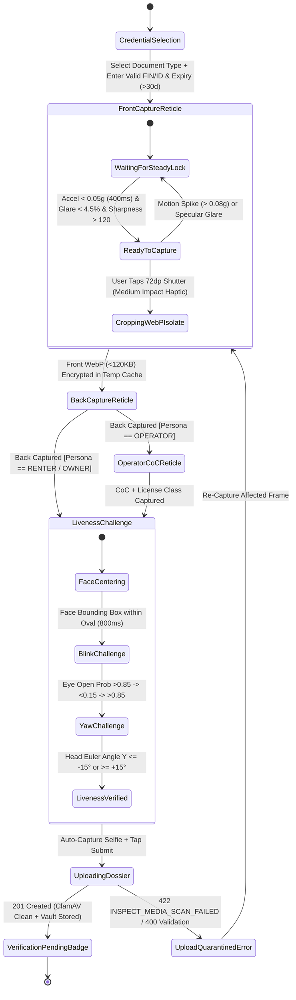

# 04 — Fayda National ID, Kebele & Biometric Liveness KYC (`SPEC-MOB-AUTH-04`)

| Metadata | Value |
| :--- | :--- |
| **Document ID** | `SPEC-MOB-AUTH-04` |
| **Subsystem** | `docs/mobile/auth-kyc/` |
| **Target Framework** | Flutter 3.x (`camera`, `google_mlkit_face_detection`, `sensors_plus`, `flutter_image_compress`) |
| **SRS Traceability** | `REQ-05-01` (`KYC-01` to `KYC-05`, `KYC-10`), `REQ-05-13`, `REQ-05-16` (`AC-01`), `REQ-05-18` (`ER-03`) |
| **Architecture / Flows** | `FLOW-02` (Renter & Operator KYC), `FLOW-03` (Verification Gate), `ADR-008` (Auth & Vault), `ADR-010` (Offline Isar & ClamAV `:3310`) |
| **Design System** | `DS-DINK-CORE-V7.0` (§4.3 Precision Viewfinder Reticles, §5.2 Outdoor High-Contrast) |
| **Status** | Normative — Phase 0 Specification |

---

## 1. Purpose & Requirement Traceability

This specification defines the Individual Identity Verification (KYC) and Biometric Liveness subsystem required before an authenticated user (`PARTIAL_ONBOARDING`) can confirm machinery reservations (`REQ-05-05`), submit damage claims (`REQ-05-07`), or check into operator shifts (`REQ-05-06`). It supports sovereign East African identity credentials across Ethiopia (`ET`) and Kenya (`KE`):

| Requirement ID | Normative Obligation | Mobile Implementation Mechanism |
| :--- | :--- | :--- |
| **`KYC-01` (Fayda / National ID)** | Renters and Operators MUST verify identity using Ethiopian **Fayda Digital ID** (12-digit FIN or 16-digit FAN), **Kebele ID**, **Passport**, or Kenyan **National ID Card / Huduma Namba**. | Jurisdiction-aware credential selector (`ET`: Fayda / Kebele / Passport; `KE`: National ID / Alien ID / Passport) with structured number entry (`Space Mono`) and dual-sided live camera capture. |
| **`KYC-02` (Live Camera Reticle & Anti-Spoof)** | Identity documents MUST be captured via live in-app camera reticle; static gallery uploads are prohibited unless an explicit Admin Support Override token is active. | `PrecisionDocumentReticle` locks out `ImageSource.gallery`, enforces accelerometer steadiness (`< 0.05g` variance over `400ms`), and computes on-device Laplacian blur/glare scores before shutter release. |
| **`KYC-03` (3D Facial Liveness Selfie)** | Users MUST complete a live biometric selfie with active liveness challenge (blink + head yaw) matched against the ID portrait. | `BiometricLivenessReticle` uses `google_mlkit_face_detection` to verify eye-open probability transition (`>0.85` → `<0.15` → `>0.85`) and `±15°` head yaw before capturing the encrypted selfie frame. |
| **`KYC-04` (Operator Machinery CoC)** | Heavy Equipment Operators MUST additionally capture their Ministry of Urban & Infrastructure / NCA **Certificate of Competency (CoC)** and Heavy Vehicle Driving License class (`G1`–`G5`). | Conditional Step 3 in `KycDossierStepper` activated when `selectedPersona == UserPersona.operator`, capturing CoC registration number, machinery ton-class endorsement, and expiry date. |
| **`KYC-05` (30-Day Expiry Floor)** | Any identity or CoC document expiring within `< 30 calendar days` of submission MUST be rejected at the client edge and server boundary. | Dual Gregorian / Ethiopian Ge'ez calendar expiry validator enforcing `expiryDate.isAfter(clock.now().add(Duration(days: 30)))`. |

---

## 2. Domain Context & Non-Negotiable Invariants

1. **Zero Gallery Upload Invariant (`KYC-02`):** To defeat screen-rephotographing and photoshopped Kebele IDs, `ImagePicker(source: ImageSource.gallery)` is stripped from the KYC widget tree. Every frame originates directly from the hardware `CameraController` stream stamped with a cryptographic timestamp and accelerometer telemetry signature.
2. **Accelerometer Steadiness & Glare Gate:** Construction yards suffer from harsh overhead sun (`>80,000 lux`) that creates specular laminate glare on laminated Kebele and Fayda cards. The shutter button (`72dp × 72dp`) remains locked (`{color.feedback.crimson.500}` reticle border) until:
   - Device linear acceleration magnitude $\sqrt{a_x^2 + a_y^2 + a_z^2} < 0.05g$ for `400ms`.
   - Image histogram specular clipping (`pixel Y > 250`) covers `< 4.5%` of the card bounding box.
   - Laplacian sharpness variance exceeds `120.0`.
3. **On-Device WebP Transcoding & ClamAV `:3310` Stream (`ADR-010`):** Raw camera frames (`4000×3000` JPEG, `~5MB`) are cropped to the reticle aspect ratio (`1.586:1` ISO/IEC 7810 ID-1) and compressed in a background Dart `Isolate` to `< 120KB` WebP (`quality: 82`) with EXIF GPS stripped (preserving only the signed capture hash). The multipart upload to `POST /api/v1/kyc/dossier` streams directly through the backend ClamAV `:3310` `zINSTREAM` virus/payload scanner (`INSPECT_MEDIA_SCAN_FAILED` on malware/polyglot detection).
4. **Zero-PII Local Disk Persistence (`AGENTS.md` §1):** Unsubmitted KYC frames are held in AES-256-GCM encrypted temporary files inside `getTemporaryDirectory()` keyed by an ephemeral session key in `FlutterSecureStorage`, and are cryptographically zeroed (`0x00` overwrite + delete) immediately upon `201 Created` confirmation or session disposal.

---

## 3. Bespoke ASCII Wireframes

### 3.1 Step 1 & 2: Fayda / Kebele Live Camera Reticle (`PrecisionDocumentReticle`)
```text
+-----------------------------------------------------------------------+
|  [<-]  IDENTITY VERIFICATION (STEP 1 OF 3)          [☀️ HIGH CONTRAST] |
|  ▓▓▓▓▓▓▓▓▓▓▓▓▓▓▓▓▓▓▓▓▓▓░░░░░░░░░░░░░░░░░░░░░░░░░░░░░░░░░░░░░░░░░░░░░  |
+-----------------------------------------------------------------------+
|  SELECT CREDENTIAL TYPE (ETHIOPIA - ET)                               |
|  +-------------------+  +-------------------+  +-------------------+  |
|  | [◉] FAYDA ID (FIN)|  | [ ] KEBELE ID     |  | [ ] PASSPORT      |  |
|  +-------------------+  +-------------------+  +-------------------+  |
|                                                                       |
|  FAYDA 12-DIGIT FIN NUMBER (OR 16-DIGIT FAN)                          |
|  +-----------------------------------------------------------------+  |
|  |  FIN:  4 8 2 9  -  1 0 3 8  -  5 9 2 1            [QR SCAN 📷]  |  |
|  +-----------------------------------------------------------------+  |
|                                                                       |
|  LIVE CAMERA VIEWPORT — ALIGN FRONT OF FAYDA CARD INSIDE FRAME        |
|  +-----------------------------------------------------------------+  |
|  |  ┏━━━━━━━━━━━┓                                   ┏━━━━━━━━━━━┓  |  |
|  |  ┃           ┃   [🟢 STEADY LOCK: 0.02g]         ┃           ┃  |  |
|  |  ┃           ┃   [🟢 GLARE OK: 1.2%   ]         ┃           ┃  |  |
|  |  ┃                                                           ┃  |  |
|  |  ┃        ETHIOPIAN DIGITAL NATIONAL ID (FAYDA)              ┃  |  |
|  |  ┃        +---------+   NAME: DAWIT MEKONNEN                 ┃  |  |
|  |  ┃        |  PHOTO  |   FIN:  4829-1038-5921                 ┃  |  |
|  |  ┃        |  FACE   |   DOB:  12 MESKEREM 1985 EC            ┃  |  |
|  |  ┃        +---------+   [████████ QR CODE ████████]          ┃  |  |
|  |  ┃                                                           ┃  |  |
|  |  ┗━━━━━━━━━━━┛                                   ┗━━━━━━━━━━━┛  |  |
|  +-----------------------------------------------------------------+  |
|  |  💡 Tip: Tilt card slightly if overhead sun causes white glare. |  |
+-----------------------------------------------------------------------+
|  DOCUMENT EXPIRY DATE (MUST BE > 30 DAYS FROM TODAY)                  |
|  +----------------------------------+  +---------------------------+  |
|  | 📅 14 / 08 / 2031 (Gregorian)    |  | [ 🇪🇹 06 Nehase 2023 EC ]  |  |
|  +----------------------------------+  +---------------------------+  |
|                                                                       |
|  [🔦 FLASH]              (( (  [ 📷 72dp ]  ) ))          [🔄 FLIP]   |
|                           CAPTURE FRONT SIDE                          |
+-----------------------------------------------------------------------+
```

### 3.2 Step 3: 3D Facial Liveness Challenge (`BiometricLivenessReticle`)
```text
+-----------------------------------------------------------------------+
|  [<-]  BIOMETRIC LIVENESS CHECK (STEP 3 OF 3)       [🔊 AUDIO GUIDE]  |
|  ▓▓▓▓▓▓▓▓▓▓▓▓▓▓▓▓▓▓▓▓▓▓▓▓▓▓▓▓▓▓▓▓▓▓▓▓▓▓▓▓▓▓▓▓▓▓▓▓▓▓▓▓▓▓▓▓▓▓▓▓▓▓▓▓▓▓▓  |
+-----------------------------------------------------------------------+
|                                                                       |
|                  ╭─────────────────────────────────╮                  |
|               ╭──╯      🟢 FACE CENTERED           ╰──╮               |
|             ╭─╯                                       ╰─╮             |
|            ╱              . - ~ ~ ~ - .                  ╲            |
|           │           . '               ' .               │           |
|           │          /    (◉)       (◉)    \              │           |
|           │         ;           👃          ;             │           |
|           │         │         \____/        │             │           |
|            ╲         .                     .             ╱            |
|             ╰─╮        ' .             . '            ╭─╯             |
|               ╰──╮         ' - ~ ~ - '             ╭──╯               |
|                  ╰─────────────────────────────────╯                  |
|                                                                       |
|  +-----------------------------------------------------------------+  |
|  |  CHALLENGE PROGRESS:                                            |  |
|  |  [✓] 1. Center face inside oval reticle                         |  |
|  |  [✓] 2. Blink both eyes naturally                               |  |
|  |  [◉] 3. Turn head slowly to the LEFT (15°)  [▓▓▓▓▓▓░░░░] 65%   |  |
|  +-----------------------------------------------------------------+  |
|                                                                       |
|  🔒 Encrypted AES-256-GCM biometric stream. Never shared externally.  |
|                                                                       |
|  +-----------------------------------------------------------------+  |
|  |           SUBMIT KYC DOSSIER FOR VERIFICATION  [ -> ]           |  |
|  +-----------------------------------------------------------------+  |
+-----------------------------------------------------------------------+
```

---

## 4. W3C DTCG Design Token Mapping

All visual properties resolve deterministically from `docs/shared/design/design-tokens.json`:

| UI Element / Component | Token Path (`design-tokens.json`) | Resolved Value (`dark` / `outdoorHighContrast`) |
| :--- | :--- | :--- |
| **Screen Canvas Background** | `{semantic.dark.surface.canvas}` / `{semantic.outdoorHighContrast.surface.canvas}` | `#0F172A` / `#000000` (`21:1` contrast) |
| **Reticle Corner Bracket — Locked / Unsteady** | `{component.reticle.viewfinder.borderLocked}` | `{color.feedback.crimson.500}` (`#EF4444`), `3dp` stroke |
| **Reticle Corner Bracket — Steady & Ready** | `{component.reticle.viewfinder.borderReady}` | `{color.feedback.emerald.500}` (`#10B981`), `3dp` stroke |
| **Reticle Scrim Overlay** | `{component.reticle.viewfinder.scrimColor}` | `#020617` at `78%` opacity (`#C7020617`) |
| **Camera Shutter Actuator (`72dp`)** | `{component.actuator.button.shutterSize}` | `{dimension.space.72}` (`72dp × 72dp` circular hit target) |
| **FIN / Document Serial Input Typography** | `{typography.fontFamily.mono}` | `Space Mono`, `18sp`, `fontWeight: 700`, `letterSpacing: 1.4` |
| **Amharic / Oromoo Liveness Prompts** | `{typography.fontFamily.ethiopic}` + `{typography.lineHeightFactor.ethiopicGolden}` | `Noto Sans Ethiopic`, `18sp`, `1.38x` line-height |
| **Primary Submit CTA (`64dp`)** | `{component.actuator.button.fieldHeight}` + `{semantic.dark.action.primaryBg}` | `{dimension.space.64}` (`64dp`), `#F59E0B` (`#FBBF24` outdoor) |

---

## 5. Screen-Specific State Machine & Upload Sequence



---

## 6. Concrete Flutter Implementation Blueprint

### 6.1 BLoC Events & Freezed State (`kyc_dossier_bloc.dart`)
```dart
import 'package:bloc/bloc.dart';
import 'package:freezed_annotation/freezed_annotation.dart';

part 'kyc_dossier_bloc.freezed.dart';

enum KycDocumentType { ethiopianFaydaFin, ethiopianKebeleId, kenyanNationalId, passport }
enum LivenessStep { centerFace, blinkEyes, turnHeadLeft, completed }

@freezed
sealed class KycDossierEvent with _$KycDossierEvent {
  const factory KycDossierEvent.documentTypeChanged(KycDocumentType type) = _DocumentTypeChanged;
  const factory KycDossierEvent.documentNumberUpdated(String rawNumber) = _DocumentNumberUpdated;
  const factory KycDossierEvent.expiryDateSelected(DateTime gregorianExpiry) = _ExpiryDateSelected;
  const factory KycDossierEvent.telemetryUpdated({
    required double accelMagnitudeG,
    required double glareRatio,
    required double laplacianVariance,
  }) = _TelemetryUpdated;
  const factory KycDossierEvent.shutterPressed({required bool isFrontSide}) = _ShutterPressed;
  const factory KycDossierEvent.livenessStepAdvanced(LivenessStep nextStep, {String? selfieEncryptedPath}) = _LivenessStepAdvanced;
  const factory KycDossierEvent.dossierSubmitted({required String idempotencyKey}) = _DossierSubmitted;
}

@freezed
abstract class KycDossierState with _$KycDossierState {
  const factory KycDossierState({
    @Default(KycDocumentType.ethiopianFaydaFin) KycDocumentType documentType,
    @Default('') String documentNumber,
    DateTime? expiryDate,
    @Default(false) bool isExpiryValid,
    @Default(false) bool isReticleSteadyAndSharp,
    @Default(1.0) double currentAccelG,
    @Default(0.0) double currentGlareRatio,
    String? encryptedFrontWebpPath,
    String? encryptedBackWebpPath,
    String? encryptedOperatorCoCPath,
    String? encryptedSelfieWebpPath,
    @Default(LivenessStep.centerFace) LivenessStep livenessStep,
    @Default(false) bool isSubmitting,
    String? submissionDossierId,
    String? rfc9457ErrorCode,
    String? rfc9457ErrorDetail,
  }) = _KycDossierState;
}
```

### 6.2 Ephemeral Encrypted Storage & ClamAV Upload Payload
```dart
/// Validates the 30-day statutory expiry floor (KYC-05) using injected Clock
bool validateDocumentExpiryFloor(DateTime selectedExpiry, DateTime currentUtc) {
  final minimumAllowedExpiry = currentUtc.toUtc().add(const Duration(days: 30));
  return selectedExpiry.toUtc().isAfter(minimumAllowedExpiry);
}

/// Validates Ethiopian Fayda 12-digit FIN or 16-digit FAN format (KYC-01)
bool validateFaydaIdentifier(String rawInput) {
  final digitsOnly = rawInput.replaceAll(RegExp(r'[\s\-]'), '');
  return RegExp(r'^(\d{12}|\d{16})$').hasMatch(digitsOnly);
}
```

### 6.3 Widget Tree Hierarchy
- `KycVerificationFlowScreen` (`StatefulWidget` managing `WidgetsBindingObserver` camera lifecycle)
  - `DinkAppBar` (Step progress indicator + `OutdoorContrastToggleIconButton` + `AudioGuideToggle`)
  - `BlocConsumer<KycDossierBloc, KycDossierState>`
    - `CredentialJurisdictionSelectorRow` (`56dp` segmented pills for `Fayda FIN`, `Kebele ID`, `National ID`, `Passport`)
    - `MonospaceIdentifierField` (`Space Mono`, formatted `XXXX-XXXX-XXXX` with Fayda QR scanner shortcut)
    - `PrecisionDocumentReticle`
      - `CameraPreview` (clipped to `1.586:1` ISO ID-1 aspect ratio)
      - `CustomPaint(painter: ReticleCornerBracketPainter(isReady: state.isReticleSteadyAndSharp))`
      - `TelemetryStatusBadgeRow` (`Steady Lock: 0.02g`, `Glare: 1.2%`)
    - `DualCalendarExpiryField` (opens Gregorian / Ethiopian Ge'ez 13-month picker `SPEC-MOB-SHR-07`)
    - `BiometricLivenessReticle` (Step 3 oval mask + `MLKitFaceDetector` stream processor)
    - `PrimaryFieldActuatorButton` (`64dp` height, triggers `DossierSubmitted` with UUIDv4 `Idempotency-Key`)

---

## 7. OpenAPI 3.1.0 Contract & RFC 9457 Error Matrix

### 7.1 Endpoint Specification: `POST /api/v1/kyc/dossier`
- **Headers:** `Authorization: Bearer <accessToken>`, `Idempotency-Key: <uuid-v4>`, `Content-Type: multipart/form-data`, `X-Country-Code: ET | KE`
- **Multipart Fields:**
  - `metadata` (`application/json`):
    ```json
    {
      "documentType": "ETHIOPIAN_FAYDA_FIN",
      "documentNumber": "482910385921",
      "issuedCountry": "ET",
      "expiryDate": "2031-08-14",
      "livenessTelemetry": {
        "blinkVerified": true,
        "yawAngleDeg": -16.4,
        "captureSteadyG": 0.021
      }
    }
    ```
  - `frontImage`: `front_id.webp` (`image/webp`, `<= 120KB`)
  - `backImage`: `back_id.webp` (`image/webp`, `<= 120KB`)
  - `livenessSelfie`: `selfie_liveness.webp` (`image/webp`, `<= 100KB`)
  - `operatorCoCImage` *(optional, required if persona == `OPERATOR`)*: `coc_cert.webp`

### 7.2 RFC 9457 Error Recovery Matrix

| HTTP Status | `error.code` | Trigger Condition | Deterministic Mobile UI Recovery |
| :--- | :--- | :--- | :--- |
| **`400`** | `REQ_VALIDATION_FAILED` | FIN checksum invalid or `expiryDate < now + 30 days` (`KYC-05`). | Highlight `MonospaceIdentifierField` or `DualCalendarExpiryField` in `{color.feedback.crimson.500}`, trigger heavy triple-pulse haptic, focus invalid field. |
| **`409`** | `KYC_DOCUMENT_ALREADY_BOUND` | The Fayda FIN or National ID is already bound to another active user account. | Show blocking `DuplicateIdentityModal` offering a direct deep-link to **Phone Number Migration & Account Recovery (`SPEC-MOB-AUTH-06`)**. |
| **`422`** | `INSPECT_MEDIA_SCAN_FAILED` | ClamAV `:3310` `zINSTREAM` rejected a corrupted/polyglot image or server OCR detected severe blur. | Purge only the rejected frame from temporary storage, return stepper to the specific capture step (`Front`, `Back`, or `Selfie`), and display localized re-capture guidance. |
| **`429`** | `SYS_RATE_LIMIT_EXCEEDED` | More than 5 KYC dossier submissions within 1 hour. | Lock submission CTA with live `Space Mono` cooldown timer derived from `Retry-After` header. |

---

## 8. Verification & Acceptance Criteria

1. **`bloc_test` — 30-Day Expiry Floor & Steady Lock Gate:**
   - *Given* `clock.now()` is `2026-03-31T08:00:00Z`, *When* `ExpiryDateSelected(2026-04-15)` (`+15 days`) is emitted, *Then* `state.isExpiryValid` MUST be `false` and the shutter button MUST remain disabled.
   - *When* `TelemetryUpdated(accelMagnitudeG: 0.14, glareRatio: 0.02, laplacianVariance: 150.0)` is emitted, *Then* `state.isReticleSteadyAndSharp` MUST be `false` (`> 0.05g` threshold).
   - *When* `TelemetryUpdated(accelMagnitudeG: 0.03, glareRatio: 0.02, laplacianVariance: 145.0)` is sustained, *Then* `state.isReticleSteadyAndSharp` transitions to `true`.
2. **Zero Gallery Leak Security Test:**
   - Static AST analysis and widget test asserting zero instances of `ImageSource.gallery` exist inside `lib/features/auth_kyc/`.
3. **Golden & Accessibility Tests (`WCAG 2.2 AAA`):**
   - Golden render of `PrecisionDocumentReticle` and `BiometricLivenessReticle` under `outdoorHighContrast` (`#000000` canvas, `#FFFFFF` text) and `am_ET` (`Noto Sans Ethiopic` `1.38x` line height) at `200%` `TextScaler`, verifying `72dp` shutter target and zero text clipping.
