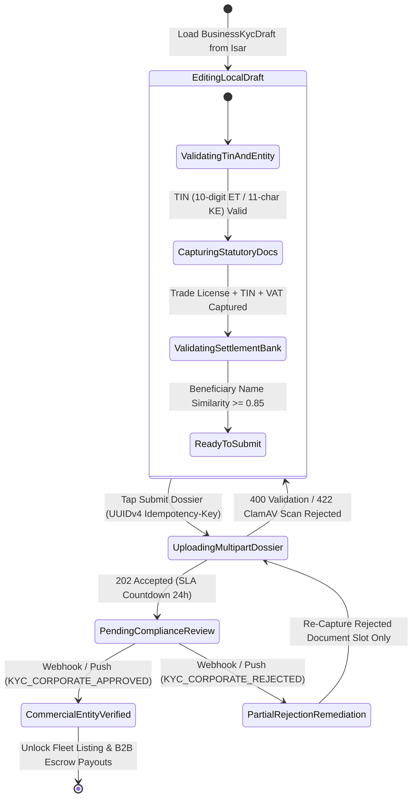

# 05 — Trade License, TIN & Commercial Business Onboarding (`SPEC-MOB-AUTH-05`)

| Metadata | Value |
| :--- | :--- |
| **Document ID** | `SPEC-MOB-AUTH-05` |
| **Subsystem** | `docs/mobile/auth-kyc/` |
| **Target Framework** | Flutter 3.x (`flutter_bloc`, `file_picker` PDF/Camera only, `isar`, `dio`) |
| **SRS Traceability** | `REQ-05-01` (`KYC-06` to `KYC-10`), `REQ-05-02` (`FL-01`), `REQ-06-01`, `REQ-05-18` (`ER-03`) |
| **Architecture / Flows** | `FLOW-02` (Owner & Corporate Onboarding), `FLOW-13` (Compliance Audit Queue), `ADR-008`, `ADR-010` |
| **Design System** | `DS-DINK-CORE-V7.0` (§4.1 Industrial Actuators, §5.2 Outdoor High-Contrast) |
| **Status** | Normative — Phase 0 Specification |

---

## 1. Purpose & Requirement Traceability

This specification defines the Commercial Enterprise Verification workflow required for **Equipment Owners (`OWNER`)**, **Corporate Construction Contractors (`RENTER` requesting B2B credit or VAT withholding invoices)**, and **Lowboy Logistics Transporters (`TRANSPORTER`)**. Under Ethiopian Ministry of Trade & Regional Integration (MoTRI) / Ministry of Revenues (MOR) and Kenyan Registrar of Companies / KRA regulations, commercial entities cannot publish machinery listings (`REQ-05-02`) or receive escrow settlement payouts (`REQ-05-08`) until their corporate dossier is verified by Compliance Officer (`Yohannes Bekele`):

| Requirement ID | Normative Obligation | Mobile Implementation Mechanism |
| :--- | :--- | :--- |
| **`KYC-06` (Trade License Verification)** | Commercial Equipment Owners and Corporate Contractors MUST submit a valid, current-year renewed **Commercial Trade Registration & Business License** (Ethiopia MoTRI ESIC construction/rental category or Kenya Certificate of Incorporation). | Multi-page camera reticle or digitally signed PDF ingestion (`<= 5MB`) with license registration number and Ethiopian/Gregorian renewal year validation. |
| **`KYC-07` (Tax Identification Number — TIN / KRA PIN)** | Commercial entities MUST provide a valid **10-digit Ethiopian MOR TIN** or **11-character Kenyan KRA PIN** (`A000000000Z`) accompanied by the official Tax Clearance / Registration Certificate. | Jurisdiction-aware strict regex & check-digit validator (`Space Mono`) rejecting malformed TIN/PIN strings with `ERR_INVALID_TAX_TIN_FORMAT`. |
| **`KYC-08` (VAT Registration & Withholding Status)** | Entities registered for Value Added Tax (`15% ET` / `16% KE`) or authorized as `2%` Ethiopian Withholding Tax agents MUST upload their VAT Certificate and declare withholding agent status. | Toggleable VAT & Withholding Agent declaration card that unlocks mandatory VAT Certificate capture and configures downstream `RC-05` tax invoice generation (`SPEC-MOB-SHR-04`). |
| **`KYC-09` (Commercial Settlement Bank Account)** | Equipment Owners MUST bind a primary settlement bank account (CBE, Awash, Dashen, Bank of Abyssinia, Telebirr Merchant, KCB, Equity, M-Pesa Paybill) whose **beneficiary legal name matches the Trade License entity name**. | Bank institution selector + IBAN/Account Number input + real-time fuzzy Levenshtein name-match check (`>= 0.85` similarity) against the Trade License legal entity name. |
| **`KYC-10` (24-Hour Compliance Audit SLA & Rejection Remediation)** | Submitted business dossiers enter `PENDING_COMPLIANCE_REVIEW` (`24h` SLA) and support itemized document-level rejection and re-upload without re-entering approved fields. | Live `ComplianceAuditStatusCard` with countdown SLA tracker and per-document `[RE-UPLOAD REJECTED DOCUMENT]` action buttons driven by Compliance Officer rejection reason codes. |

---

## 2. Domain Context & Non-Negotiable Invariants

1. **Entity Name Beneficiary Matching Invariant (`KYC-09`):** To prevent illicit payout diversion and tax evasion, payouts from `OwnerWallet` can never be routed to an unverified third-party personal account when onboarding as a Registered Business. The mobile client compares `beneficiaryAccountName` against `legalEntityName` (normalized uppercase, stripping `PLC`, `S.C.`, `LTD`, `ኃ/የተ/የግ/ማ`) and blocks submission if similarity is `< 85%`.
2. **Jurisdiction Tax Format Invariant (`KYC-07`):**
   - **Ethiopia (`ET`):** Ministry of Revenues (MOR) TIN must be strictly **10 numeric digits** (`^\d{10}$`).
   - **Kenya (`KE`):** Kenya Revenue Authority (KRA) PIN must be strictly **11 alphanumeric characters** starting with `P` (individual) or `A` (company), followed by 9 digits and a check letter (`^[AP]\d{9}[A-Z]$`).
3. **Offline Draft Persistence for Multi-Document Dossiers (`ADR-010`):** Commercial onboarding requires up to 4 statutory documents (Trade License, TIN Certificate, VAT Certificate, Bank Confirmation Letter/Voided Cheque). The user's progress is saved locally in an encrypted Isar collection (`BusinessKycDraftCollection`) so an interrupted field session in a rural yard resumes at the exact uncompleted document slot.
4. **ClamAV `:3310` Stream Gate:** Every uploaded PDF or WebP document is scanned via `zINSTREAM` before storage in S3/MinIO Vault. Polyglot PDFs or embedded JavaScript macros inside PDFs are immediately rejected with `422 INSPECT_MEDIA_SCAN_FAILED`.

---

## 3. Bespoke ASCII Wireframes

### 3.1 Commercial Business & Tax Dossier Screen (`BusinessOnboardingScreen`)
```text
+-----------------------------------------------------------------------+
|  [<-]  COMMERCIAL BUSINESS ONBOARDING (ET)          [💾 DRAFT SAVED]  |
|  ▓▓▓▓▓▓▓▓▓▓▓▓▓▓▓▓▓▓▓▓▓▓▓▓▓▓▓▓▓▓▓▓▓▓▓▓░░░░░░░░░░░░░░░░░░░░░░░░░░░░░░░  |
+-----------------------------------------------------------------------+
|  LEGAL ENTITY CLASSIFICATION                                          |
|  +-----------------------+ +-----------------------+ +-------------+  |
|  | [◉] PLC / SHARE CO.   | | [ ] SOLE PROPRIETOR   | | [ ] SOE/GOV |  |
|  +-----------------------+ +-----------------------+ +-------------+  |
|                                                                       |
|  REGISTERED LEGAL BUSINESS NAME (AS ON MoTRI TRADE LICENSE)           |
|  +-----------------------------------------------------------------+  |
|  | ABAY HEAVY EQUIPMENT RENTAL & LOGISTICS PLC                     |  |
|  +-----------------------------------------------------------------+  |
|                                                                       |
|  TAX IDENTIFICATION & STATUTORY NUMBERS                               |
|  +-------------------------------+ +-------------------------------+  |
|  | 10-DIGIT MOR TIN NUMBER *     | | TRADE LICENSE REG. NO. *      |  |
|  | 0 0 4 8 2 9 1 0 3 7           | | MT/AA/14/6738291/2018         |  |
|  +-------------------------------+ +-------------------------------+  |
|  | [✓] Registered for 15% VAT    | | [✓] Authorized 2% WHT Agent   |  |
|  +-------------------------------+ +-------------------------------+  |
|                                                                       |
|  STATUTORY DOCUMENT VAULT (CLAMAV :3310 VERIFIED)                     |
|  +-----------------------------------------------------------------+  |
|  | 1. Renewed Trade License (2018 EC / 2026 GC)       [✓ UPLOADED] |  |
|  |    📄 trade_license_2018ec.webp (94 KB)         [👁️ VIEW] [🔄]  |  |
|  +-----------------------------------------------------------------+  |
|  | 2. MOR TIN Registration Certificate                [✓ UPLOADED] |  |
|  |    📄 mor_tin_0048291037.webp (82 KB)           [👁️ VIEW] [🔄]  |  |
|  +-----------------------------------------------------------------+  |
|  | 3. VAT Registration Certificate (Required)         [⚠️ MISSING ] |  |
|  |    [ 📷 CAPTURE VIA RETICLE ]       [ 📎 UPLOAD SIGNED PDF ]    |  |
|  +-----------------------------------------------------------------+  |
|                                                                       |
|  COMMERCIAL ESCROW SETTLEMENT BANK ACCOUNT (KYC-09)                   |
|  +-----------------------------------------------------------------+  |
|  | BANK: [ Commercial Bank of Ethiopia (CBE)                   v ] |  |
|  | ACCT: 1 0 0 0 3 8 4 9 2 0 1 8 4                  (13-Digit CBE) |  |
|  | NAME: ABAY HEAVY EQUIPMENT RENTAL PLC                           |  |
|  | 🟢 Entity Name Match: 96% match with Trade License              |  |
|  +-----------------------------------------------------------------+  |
|                                                                       |
|  +-----------------------------------------------------------------+  |
|  |        SUBMIT COMMERCIAL DOSSIER FOR AUDIT (64dp)       [ -> ]  |  |
|  +-----------------------------------------------------------------+  |
+-----------------------------------------------------------------------+
```

### 3.2 Compliance Audit Tracker & Itemized Rejection Remediation Card
```text
+-----------------------------------------------------------------------+
|  [<-]  CORPORATE KYC AUDIT STATUS                   [📞 CALL SUPPORT] |
+-----------------------------------------------------------------------+
|  +-----------------------------------------------------------------+  |
|  | ⚠️ ACTION REQUIRED — 1 DOCUMENT NEEDS RE-SUBMISSION             |  |
|  | Reviewed by Compliance Officer (Yohannes B.) • 14 mins ago      |  |
|  +-----------------------------------------------------------------+  |
|                                                                       |
|  ITEMIZED DOCUMENT AUDIT LEDGER:                                      |
|  +-----------------------------------------------------------------+  |
|  | [🟢 VERIFIED]  MOR TIN Certificate (TIN: 0048291037)            |  |
|  | [🟢 VERIFIED]  VAT Registration Certificate                     |  |
|  | [🟢 VERIFIED]  CBE Settlement Account (1000384920184)           |  |
|  +-----------------------------------------------------------------+  |
|  | [🔴 REJECTED]  Renewed Commercial Trade License                 |  |
|  | Reason Code:   KYC_TRADE_LICENSE_EXPIRED_YEAR                   |  |
|  | Auditor Note:  "Uploaded Page 2 shows 2016 E.C. renewal stamp.  |  |
|  |                 Please capture the current 2018 E.C. renewal    |  |
|  |                 back-page stamp clearly."                       |  |
|  |                                                                 |  |
|  | +-------------------------------------------------------------+ |  |
|  | |       📷 RE-CAPTURE RENEWED TRADE LICENSE (56dp)            | |  |
|  | +-------------------------------------------------------------+ |  |
|  +-----------------------------------------------------------------+  |
+-----------------------------------------------------------------------+
```

---

## 4. W3C DTCG Design Token Mapping

| UI Element / Component | Token Path (`design-tokens.json`) | Resolved Value (`dark` / `outdoorHighContrast`) |
| :--- | :--- | :--- |
| **Document Slot Card Surface** | `{semantic.dark.surface.elevated}` / `{semantic.outdoorHighContrast.surface.elevated}` | `#1E293B` / `#000000` with `2dp` `#FFFFFF` border |
| **TIN / Account Number Typography** | `{typography.fontFamily.mono}` | `Space Mono`, `16sp`, `fontWeight: 700` |
| **Verified Badge Accent** | `{color.feedback.emerald.500}` | `#10B981` (`[🟢 VERIFIED]`) |
| **Pending Review SLA Badge** | `{color.brand.amber.500}` | `#F59E0B` (`[⏳ IN COMPLIANCE REVIEW — SLA 24H]`) |
| **Rejected Document Alert Border** | `{color.feedback.crimson.500}` | `#EF4444` (`2dp` solid border + `#2A0A10` surface tint) |
| **Upload Action Button Height** | `{dimension.space.56}` | `56dp` minimum glove-friendly touch target |
| **Primary Submit CTA Height** | `{dimension.space.64}` | `64dp` full-width industrial actuator |

---

## 5. Screen-Specific State Machine & Compliance Workflow



---

## 6. Concrete Flutter Implementation Blueprint

### 6.1 BLoC Events & Freezed State (`business_kyc_bloc.dart`)
```dart
import 'package:bloc/bloc.dart';
import 'package:freezed_annotation/freezed_annotation.dart';

part 'business_kyc_bloc.freezed.dart';

enum CorporateEntityType { plcOrShareCompany, soleProprietor, stateOwnedEnterprise }
enum StatutoryDocSlot { tradeLicense, tinCertificate, vatCertificate, bankConfirmationLetter }
enum DocumentAuditStatus { missing, localReady, pendingReview, verified, rejected }

@freezed
sealed class BusinessKycEvent with _$BusinessKycEvent {
  const factory BusinessKycEvent.started({required String countryCode}) = _Started;
  const factory BusinessKycEvent.entityDetailsChanged({
    required CorporateEntityType entityType,
    required String legalBusinessName,
    required String taxIdentificationNumber,
    required String tradeLicenseNumber,
    required bool isVatRegistered,
    required bool isWithholdingAgent,
  }) = _EntityDetailsChanged;
  const factory BusinessKycEvent.documentAttached({
    required StatutoryDocSlot slot,
    required String localFilePath,
    required int fileSizeBytes,
  }) = _DocumentAttached;
  const factory BusinessKycEvent.settlementBankChanged({
    required String bankCode,
    required String accountNumber,
    required String beneficiaryAccountName,
  }) = _SettlementBankChanged;
  const factory BusinessKycEvent.submitted({required String idempotencyKey}) = _Submitted;
}

@freezed
abstract class BusinessKycState with _$BusinessKycState {
  const factory BusinessKycState({
    @Default('ET') String countryCode,
    @Default(CorporateEntityType.plcOrShareCompany) CorporateEntityType entityType,
    @Default('') String legalBusinessName,
    @Default('') String taxIdentificationNumber,
    @Default(false) bool isTinFormatValid,
    @Default('') String tradeLicenseNumber,
    @Default(true) bool isVatRegistered,
    @Default(false) bool isWithholdingAgent,
    @Default(<StatutoryDocSlot, DocumentAuditStatus>{}) Map<StatutoryDocSlot, DocumentAuditStatus> slotStatuses,
    @Default(<StatutoryDocSlot, String>{}) Map<StatutoryDocSlot, String> slotRejectionReasons,
    @Default('') String bankCode,
    @Default('') String accountNumber,
    @Default('') String beneficiaryAccountName,
    @Default(0.0) double beneficiaryNameMatchRatio,
    @Default(false) bool isSubmitting,
    String? rfc9457ErrorCode,
    String? rfc9457ErrorDetail,
  }) = _BusinessKycState;
}
```

### 6.2 Jurisdiction TIN / PIN & Beneficiary Name Similarity Validators
```dart
/// Validates Ethiopian 10-digit MOR TIN or Kenyan 11-char KRA PIN (KYC-07)
bool validateJurisdictionTaxId({required String countryCode, required String rawTin}) {
  final normalized = rawTin.trim().toUpperCase().replaceAll(RegExp(r'[\s\-]'), '');
  if (countryCode == 'ET') {
    return RegExp(r'^\d{10}$').hasMatch(normalized);
  } else if (countryCode == 'KE') {
    return RegExp(r'^[AP]\d{9}[A-Z]$').hasMatch(normalized);
  }
  return false;
}

/// Strips corporate suffixes and computes normalized token similarity (KYC-09)
double computeEntityBeneficiarySimilarity(String legalName, String beneficiaryName) {
  String normalize(String input) {
    return input
        .toUpperCase()
        .replaceAll(RegExp(r'\b(PLC|S\.C\.|SC|LTD|LIMITED|INC|ኃ/የተ/የግ/ማ)\b'), '')
        .replaceAll(RegExp(r'[^A-Z0-9\u1200-\u137F]'), ' ')
        .replaceAll(RegExp(r'\s+'), ' ')
        .trim();
  }
  final a = normalize(legalName);
  final b = normalize(beneficiaryName);
  if (a.isEmpty || b.isEmpty) return 0.0;
  if (a == b) return 1.0;
  final tokensA = a.split(' ').toSet();
  final tokensB = b.split(' ').toSet();
  final intersection = tokensA.intersection(tokensB).length;
  final union = tokensA.union(tokensB).length;
  return union == 0 ? 0.0 : intersection / union;
}
```

---

## 7. OpenAPI 3.1.0 Contract & RFC 9457 Error Matrix

### 7.1 Endpoint Specification: `POST /api/v1/kyc/corporate-dossier`
- **Headers:** `Authorization: Bearer <accessToken>`, `Idempotency-Key: <uuid-v4>`, `Content-Type: multipart/form-data`, `X-Country-Code: ET | KE`
- **Request Payload (`metadata` JSON part):**
  ```json
  {
    "entityType": "PLC_OR_SHARE_COMPANY",
    "legalBusinessName": "ABAY HEAVY EQUIPMENT RENTAL & LOGISTICS PLC",
    "taxIdentificationNumber": "0048291037",
    "tradeLicenseNumber": "MT/AA/14/6738291/2018",
    "isVatRegistered": true,
    "isWithholdingAgent": true,
    "settlementBank": {
      "bankCode": "ET_CBE",
      "accountNumber": "1000384920184",
      "beneficiaryName": "ABAY HEAVY EQUIPMENT RENTAL PLC",
      "currency": "ETB"
    }
  }
  ```

### 7.2 RFC 9457 Error Recovery Matrix

| HTTP Status | `error.code` | Trigger Condition | Deterministic Mobile UI Recovery |
| :--- | :--- | :--- | :--- |
| **`400`** | `ERR_INVALID_TAX_TIN_FORMAT` | Submitted TIN is not 10 digits (`ET`) or valid 11-char KRA PIN (`KE`). | Highlight TIN input field in `#EF4444`, display expected format mask (`00XXXXXXXX` or `A000000000Z`). |
| **`409`** | `KYC_TIN_ALREADY_REGISTERED` | Another corporate account already holds this verified MOR TIN / KRA PIN. | Display `CorporateDuplicateConflictSheet` allowing the user to request multi-seat fleet manager access or contact Corporate Compliance. |
| **`422`** | `KYC_BENEFICIARY_NAME_MISMATCH` | Settlement bank account holder name diverges from Trade License entity name (`< 0.85`). | Highlight `beneficiaryAccountName` field and require either correcting the bank account to the corporate account or uploading a notarized Sole Proprietor DBA attestation. |
| **`422`** | `INSPECT_MEDIA_SCAN_FAILED` | Uploaded PDF contains embedded scripts, password encryption, or fails ClamAV `:3310`. | Reject specific document slot, prompt user to capture clean pages via in-app `PrecisionDocumentReticle`. |

---

## 8. Verification & Acceptance Criteria

1. **`bloc_test` — Jurisdiction TIN & VAT Certificate Interlock:**
   - *Given* `countryCode == 'ET'`, *When* `taxIdentificationNumber` is `'12345'` (5 digits), *Then* `state.isTinFormatValid` is `false`. *When* `'0048291037'` (10 digits) is entered, *Then* `state.isTinFormatValid` is `true`.
   - *Given* `isVatRegistered == true`, *When* `slotStatuses[StatutoryDocSlot.vatCertificate]` is `missing`, *Then* submission CTA remains locked.
2. **Itemized Rejection Partial Re-Upload Test:**
   - Verify that when `slotStatuses[tradeLicense] == rejected` while `tinCertificate == verified`, the user can re-upload `tradeLicense` alone without re-attaching `tinCertificate` or `vatCertificate`.
3. **Golden & Accessibility Verification (`WCAG 2.2 AAA`):**
   - Render `BusinessOnboardingScreen` and `ComplianceAuditStatusCard` under `outdoorHighContrast` and `am_ET` (`Noto Sans Ethiopic`), asserting `56dp` upload buttons, `64dp` submit actuator, and zero horizontal overflow at `200%` font scale.
