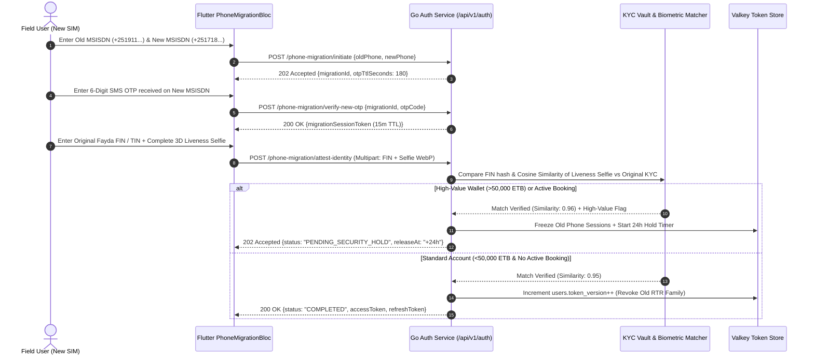

# 06 — Sovereign SIM Swap & Lost Phone Number Migration (`SPEC-MOB-AUTH-06`)

| Metadata | Value |
| :--- | :--- |
| **Document ID** | `SPEC-MOB-AUTH-06` |
| **Subsystem** | `docs/mobile/auth-kyc/` |
| **Target Framework** | Flutter 3.x (`flutter_bloc`, `camera`, `google_mlkit_face_detection`, `flutter_secure_storage`) |
| **SRS Traceability** | `REQ-05-01` (`AUT-06` to `AUT-11`), `REQ-05-18` (`ER-03`), `REQ-05-24` (`INT-04`) |
| **Architecture / Flows** | `FLOW-14` / `FLOW-PHONE-MIGRATION` (`FLOW-APPENDIX-B`), `ADR-008` (RTR & Token Version Revocation) |
| **Design System** | `DS-DINK-CORE-V7.0` (§4.3 Precision Viewfinder Reticles, §4.4 Countdown Timers) |
| **Status** | Normative — Phase 0 Specification |

---

## 1. Purpose & Requirement Traceability

In East African field operations, contractors, fleet owners, and operators frequently lose handsets on remote quarry sites, switch carriers between Ethio Telecom (`+251 9...`) and Safaricom Ethiopia (`+251 7...`), or experience SIM deactivation. Because Dink Machinery uses passwordless phone identity (`SPEC-MOB-AUTH-02`), losing access to the original MSISDN would otherwise strand active bookings, escrow balances in `OwnerWallet`, and verified KYC dossiers. This specification defines the **Sovereign Phone Number Migration & Account Recovery** subsystem (`FLOW-PHONE-MIGRATION`):

| Requirement ID | Normative Obligation | Mobile Implementation Mechanism |
| :--- | :--- | :--- |
| **`AUT-06` (Lost Phone Migration Entry)** | Users who lose access to their registered phone number MUST be able to initiate a guided self-service phone migration from the unauthenticated OTP screen. | `[Lost access to your old phone number?]` link on `PhoneOtpScreen` launching the 4-step `PhoneMigrationRecoveryScreen`. |
| **`AUT-07` (New MSISDN OTP Ownership Proof)** | The user MUST first prove possession of the **new** destination phone number (`+251` or `+254`) via a 6-digit SMS OTP challenge. | Step 1 & 2 verify the new MSISDN via `POST /api/v1/auth/phone-migration/initiate` and `POST /api/v1/auth/phone-migration/verify-new-otp`, issuing a short-lived `migrationSessionToken` (`TTL: 15m`). |
| **`AUT-08` (Vault KYC & Biometric Liveness Match)** | To prevent hostile account takeover (SIM-swap heist), migration MUST verify the user's National ID / Fayda FIN **and** perform a live 3D facial liveness selfie matched against the original encrypted KYC portrait in Vault. | Step 3 requires entering the exact Fayda FIN / National ID / TIN bound to the old account + live `BiometricLivenessReticle` selfie (`>= 0.92` cosine similarity threshold). |
| **`AUT-09` (24-Hour Security Hold for High-Value Wallets)** | Accounts with active machinery bookings or `OwnerWallet` balances exceeding `50,000 ETB` / `150,000 KES` MUST enter a mandatory **24-hour cooling-off security hold** (with SMS/Email alert to the old number/backup contact) unless expedited by Compliance Officer (`Yohannes Bekele`). | Step 4 renders the `MigrationSecurityHoldCountdownCard` (`Space Mono` `23:59:59`) when `status == PENDING_SECURITY_HOLD`, with real-time push notification upon release. |
| **`AUT-10` (Global Token Family Revocation)** | Upon migration completion, ALL JWT access tokens, Refresh Token Rotation (RTR) families in Valkey, and device sessions bound to the old phone number MUST be atomically revoked (`users.token_version++`). | Server increments `users.token_version`, invalidating old tokens across all devices (`401 AUTH_TOKEN_REVOKED`), and issues a fresh RTR token pair for the new MSISDN. |

---

## 2. Domain Context & Non-Negotiable Invariants

1. **Zero-Enumeration Privacy Shield (`AUT-08`):** Entering an old phone number in Step 1 (`oldPhoneNumber`) never reveals whether the account exists or what its wallet balance is until **both** the new phone's 6-digit OTP (`Step 2`) **and** the National ID / Fayda FIN + Biometric Liveness check (`Step 3`) succeed. Failed identity matches return a generic `403 AUTH_MIGRATION_IDENTITY_MISMATCH`.
2. **Ledger & Reputation Continuity Invariant:** Phone number migration mutates `users.phone_number` and `users.phone_verified_at` inside a single PostgreSQL serializable transaction while preserving `users.id` (UUID). Consequently, all historical bookings, operator shift logs, star ratings, verified Trade Licenses, and `OwnerWallet` double-entry ledger legs remain 100% intact.
3. **Anti-SIM-Swap Takeover Quarantine (`INT-04`):** Following a completed phone number migration, outbound bank payout withdrawals (`POST /api/v1/wallet/withdraw`) are automatically quarantined for **48 hours** even after login succeeds, preventing rapid cash-out by sophisticated attackers.

---

## 3. Bespoke ASCII Wireframes

### 3.1 Step 1–3: Old/New MSISDN & Biometric Vault Verification (`PhoneMigrationScreen`)
```text
+-----------------------------------------------------------------------+
|  [<-]  PHONE NUMBER RECOVERY & MIGRATION            [🛡️ SECURITY]     |
|  ▓▓▓▓▓▓▓▓▓▓▓▓▓▓▓▓▓▓▓▓▓▓▓▓▓▓▓▓▓▓▓▓▓▓▓▓▓▓▓▓▓▓░░░░░░░░░░░░░░░░░░░░░░░░░  |
+-----------------------------------------------------------------------+
|  STEP 1 & 2: PHONE NUMBERS (VERIFIED NEW NUMBER)                      |
|  +-----------------------------------------------------------------+  |
|  | OLD LOST NUMBER:  [🇪🇹 +251]  91 123 4567          [🔒 LOCKED]   |  |
|  | NEW SIM NUMBER:   [🇪🇹 +251]  71 890 1234          [🟢 OTP OK]   |  |
|  +-----------------------------------------------------------------+  |
|                                                                       |
|  STEP 3: PROVE ACCOUNT OWNERSHIP (MATCHES YOUR KYC VAULT)             |
|  Enter the National ID / Fayda FIN or 10-Digit Business TIN that      |
|  was verified on your original Dink Machinery account:                |
|  +-----------------------------------------------------------------+  |
|  |  ID / FIN / TIN:  4 8 2 9  -  1 0 3 8  -  5 9 2 1               |  |
|  +-----------------------------------------------------------------+  |
|                                                                       |
|  LIVE BIOMETRIC SELFIE MATCH (COMPARED TO ORIGINAL KYC PHOTO)         |
|  +-----------------------------------------------------------------+  |
|  |                  ╭───────────────────────────╮                  |  |
|  |                ╭─╯   🟢 LIVENESS VERIFIED    ╰─╮                |  |
|  |               │        (Blink + Yaw OK)         │               |  |
|  |               │          [👤 SELFIE]            │               |  |
|  |                ╰─╮     Match Confidence:     ╭─╯                |  |
|  |                  ╰───  Encrypted Upload  ────╯                  |  |
|  +-----------------------------------------------------------------+  |
|                                                                       |
|  ⚠️ SECURITY NOTICE: Completing this migration immediately signs out  |
|     all devices logged into +251 91 123 4567 and places a 48-hour     |
|     safety lock on bank withdrawals.                                  |
|                                                                       |
|  +-----------------------------------------------------------------+  |
|  |         VERIFY IDENTITY & MIGRATE ACCOUNT (64dp)        [ -> ]  |  |
|  +-----------------------------------------------------------------+  |
+-----------------------------------------------------------------------+
```

### 3.2 Step 4: 24-Hour High-Value Account Cooling-Off Hold (`MigrationSecurityHoldCard`)
```text
+-----------------------------------------------------------------------+
|  [<-]  SECURITY COOLING-OFF HOLD ACTIVE             [📞 CALL 8190]    |
+-----------------------------------------------------------------------+
|  +-----------------------------------------------------------------+  |
|  |  🛡️ 24-HOUR HIGH-VALUE ACCOUNT PROTECTION HOLD                  |  |
|  |                                                                 |  |
|  |  Your biometric identity matched! Because your account holds    |  |
|  |  active machinery bookings or an OwnerWallet balance above      |  |
|  |  50,000 ETB, a mandatory 24-hour security hold is active.       |  |
|  |                                                                 |  |
|  |        MIGRATION COMPLETES AUTOMATICALLY IN:                    |  |
|  |             +-----------------------------------+               |  |
|  |             |     2 3  :  5 8  :  4 1           |               |  |
|  |             |    HOURS    MINS    SECS          |               |  |
|  |             +-----------------------------------+               |  |
|  |                                                                 |  |
|  |  Migration Reference:  MIG-2026-09482                           |  |
|  |  Old Number Revoked:   +251 91 *** 4567                         |  |
|  |  New Target Number:    +251 71 890 1234                         |  |
|  +-----------------------------------------------------------------+  |
|                                                                       |
|  NEED IMMEDIATE ACCESS FOR AN ACTIVE SITE DISPATCH?                   |
|  Contact Compliance Officer Verification Desk with your Reference ID: |
|  +-----------------------------------------------------------------+  |
|  |  [ 📞 CALL TOLL-FREE 8190 ]       [ 💬 WHATSAPP COMPLIANCE ]    |  |
|  +-----------------------------------------------------------------+  |
+-----------------------------------------------------------------------+
```

---

## 4. W3C DTCG Design Token Mapping

| UI Element / Component | Token Path (`design-tokens.json`) | Resolved Value (`dark` / `outdoorHighContrast`) |
| :--- | :--- | :--- |
| **Security Hold Banner Surface** | `{semantic.dark.surface.elevated}` | `#1E293B` with `2dp` `{color.brand.amber.500}` border |
| **24h Hold Countdown Digits** | `{component.countdown.timerText}` + `{typography.fontFamily.mono}` | `Space Mono`, `28sp`, `fontWeight: 700`, `#F59E0B` |
| **Old / New MSISDN Input Fields** | `{typography.fontFamily.mono}` | `Space Mono`, `18sp`, `letterSpacing: 1.2` |
| **Verified Step Pill Badge** | `{color.feedback.emerald.500}` | `#10B981` (`[🟢 OTP OK]`) |
| **Security Warning Callout** | `{color.feedback.orange.500}` | `#FF5722` icon + `#FFFBEB` high-legibility text |
| **Primary Migrate CTA (`64dp`)** | `{component.actuator.button.fieldHeight}` | `{dimension.space.64}` (`64dp`) |

---

## 5. Screen-Specific Sequence & State Machine Diagram



---

## 6. Concrete Flutter Implementation Blueprint

### 6.1 BLoC Events & Freezed State (`phone_migration_bloc.dart`)
```dart
import 'package:bloc/bloc.dart';
import 'package:freezed_annotation/freezed_annotation.dart';

part 'phone_migration_bloc.freezed.dart';

enum MigrationStep { enterNumbers, verifyNewPhoneOtp, biometricVaultAttestation, securityHoldPending, completed }

@freezed
sealed class PhoneMigrationEvent with _$PhoneMigrationEvent {
  const factory PhoneMigrationEvent.numbersSubmitted({
    required String oldPhoneE164,
    required String newPhoneE164,
    required String idempotencyKey,
  }) = _NumbersSubmitted;
  const factory PhoneMigrationEvent.newPhoneOtpSubmitted({
    required String otpCode,
  }) = _NewPhoneOtpSubmitted;
  const factory PhoneMigrationEvent.identityAttestationSubmitted({
    required String kycDocumentNumber,
    required String encryptedLivenessSelfiePath,
    required String idempotencyKey,
  }) = _IdentityAttestationSubmitted;
  const factory PhoneMigrationEvent.securityHoldStatusPolled() = _SecurityHoldStatusPolled;
}

@freezed
abstract class PhoneMigrationState with _$PhoneMigrationState {
  const factory PhoneMigrationState({
    @Default(MigrationStep.enterNumbers) MigrationStep step,
    @Default('') String oldPhoneE164,
    @Default('') String newPhoneE164,
    String? migrationId,
    String? migrationSessionToken,
    @Default(0) int otpRemainingSeconds,
    @Default(false) bool isSubmitting,
    DateTime? securityHoldReleaseUtc,
    String? rfc9457ErrorCode,
    String? rfc9457ErrorDetail,
  }) = _PhoneMigrationState;
}
```

### 6.2 Secure Token Replacement & Old Cache Cleanup
```dart
/// Atomically replaces credentials in FlutterSecureStorage after migration completion (AUT-10)
Future<void> commitMigratedSessionTokens({
  required FlutterSecureStorage secureStorage,
  required String newPhoneE164,
  required String accessToken,
  required String refreshToken,
}) async {
  await secureStorage.write(key: 'auth.user_msisdn_e164', value: newPhoneE164);
  await secureStorage.write(key: 'auth.jwt_access_token', value: accessToken);
  await secureStorage.write(key: 'auth.rtr_refresh_token', value: refreshToken);
  await secureStorage.delete(key: 'auth.migration_pending_id');
}
```

---

## 7. OpenAPI 3.1.0 Contract & RFC 9457 Error Matrix

### 7.1 Endpoints
1. `POST /api/v1/auth/phone-migration/initiate` → Sends 6-digit OTP to `newPhoneE164`.
2. `POST /api/v1/auth/phone-migration/verify-new-otp` → Returns short-lived `migrationSessionToken`.
3. `POST /api/v1/auth/phone-migration/attest-identity` → Multipart upload (`kycDocumentNumber` + `livenessSelfie` WebP) authorized by `Bearer <migrationSessionToken>`.

### 7.2 RFC 9457 Error Recovery Matrix

| HTTP Status | `error.code` | Trigger Condition | Deterministic Mobile UI Recovery |
| :--- | :--- | :--- | :--- |
| **`400`** | `AUTH_OTP_INVALID_CODE` | 6-digit OTP for the new phone number is incorrect or expired. | Shake OTP boxes, decrement remaining attempts counter, offer `[Resend SMS]` after `60s` timer. |
| **`403`** | `AUTH_MIGRATION_IDENTITY_MISMATCH` | Submitted Fayda FIN / TIN or facial liveness selfie does not match the original KYC vault record (`< 0.92` similarity). | Display high-contrast error sheet; allow 2 remaining biometric re-attempts before locking migration for `24h` and routing to Compliance Support (`8190`). |
| **`409`** | `AUTH_PHONE_ALREADY_REGISTERED` | The `newPhoneE164` is already bound to a separate existing Dink Machinery account. | Prompt user to enter an unallocated SIM number or sign into the existing account directly. |
| **`429`** | `AUTH_OTP_MAX_ATTEMPTS` | More than 3 failed migration attempts from the same device fingerprint or IP within 24 hours. | Engage `24h` lockout timer (`Space Mono`) to block automated SIM-swap enumeration. |

---

## 8. Verification & Acceptance Criteria

1. **`bloc_test` — 4-Stage Migration State Transitions:**
   - Verify `NumbersSubmitted` → `verifyNewPhoneOtp` → `NewPhoneOtpSubmitted` → `biometricVaultAttestation`.
   - Verify that a `202 Accepted` response with `status: "PENDING_SECURITY_HOLD"` transitions the BLoC to `MigrationStep.securityHoldPending` and persists `migrationId` in `FlutterSecureStorage` so closing and reopening the app restores the `24h` countdown screen.
2. **Global Token Revocation Test (`AUT-10`):**
   - Integration test verifying that once migration completes on Device B (new SIM), any subsequent API call from Device A (old SIM) receives `401 AUTH_TOKEN_REVOKED` and wipes Device A's local session.
3. **Golden & Accessibility Verification (`WCAG 2.2 AAA`):**
   - Render `PhoneMigrationScreen` and `MigrationSecurityHoldCard` under `outdoorHighContrast` and `am_ET`, confirming `64dp` primary CTA, `56dp` support escalation buttons, and `21:1` contrast compliance.
