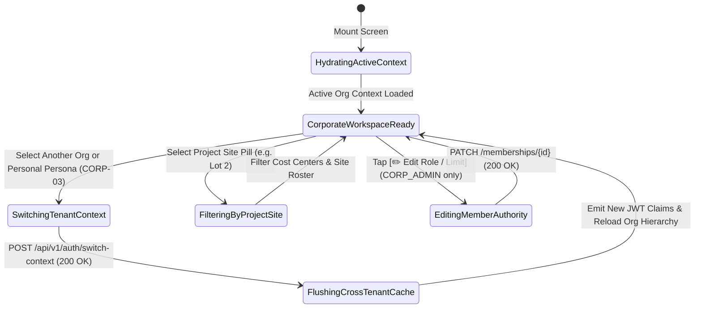

# Corporate Organization Hierarchy, Project Sites & Cost Centers
## Mobile Subsystem Specification — `docs/mobile/corporate-experience/01-corporate-org-hierarchy-cost-centers.md`

**Document Identifier:** `SPEC-MOB-CRP-01`  
**Classification:** Canonical Subsystem UI/UX & Technical Behavior Specification  
**Governing Documents:** `Dink_Machinery_UI_UX_Design_Brief.md`, `SRS-DINK-CORE-V7.0` (`docs/shared/requirements/06-01-corporate-account-management.md`), `docs/shared/design/design-tokens.json`, `docs/ERROR_CATALOG.md`, `contracts/openapi.yaml`  
**Target Subsystem:** Flutter 3.47.8 / Dart 3.9 Mobile Client (iOS & Android)  
**Primary Persona / Actor:** Corporate Procurement Director (*Eng. Samuel Getachew*), Senior Project Manager (*Dawit Haile-Mariam*), Site Quantity Surveyor (*Bethlehem Tessema*)  
**Associated Requirements:** `REQ-06-01` (`CORP-01`, `CORP-02`, `CORP-03`, `CORP-DB`), `REQ-06-05` (`REP-02` Cost Center & WBS Allocation)  
**Associated Interaction Flows:** `FLOW-14` (Corporate Multi-Tenant Onboarding & Context Switching)  
**Architectural Decisions:** `ADR-001` (PostgreSQL 18.6 RLS `organization_id` Isolation), `ADR-005` (Valkey Active Tenant Session Binding), `ADR-008` (`LOC-01-BE` Ministry of Revenues TIN / KRA PIN), `ADR-010` (Integer Minor Units)  
**Status:** Approved Technical Design Baseline

---

## 1. Domain Context, Business Formulas & Architectural Invariants

Tier-1 civil engineering contractors (*e.g., Sur Construction PLC, MIDROC Construction, Sogea-Satom, H-Young*) operate multiple regional divisions and active construction sites simultaneously, each governed by strict cost-center budgets and delegated signing limits. The **Corporate Organization Hierarchy, Project Sites & Cost Centers Screen (`CorporateOrgHierarchyCostCentersScreen`)** implements `REQ-06-01` (`CORP-01`..`CORP-03`) on mobile:
1. **Zero-Reauth Personal $\leftrightarrow$ Corporate Persona Switcher (`CORP-03`):**
   A physical human holds a single sovereign user identity (`users.id`) but may belong to multiple corporate tenants alongside their personal retail account. Switching context invokes `POST /api/v1/auth/switch-context`, updating the Valkey session binding and injecting `X-Organization-ID: {org_uuid}` into all subsequent Dio requests while flushing cross-tenant UI state.
2. **Cost-Center Budget Utilization Formula (`CORP-02` / `REP-02`):**
   For each corporate division or project site Cost Center $c$ with monthly/project allocation $B_{\text{allocated\_minor}}$:
   $$B_{\text{committed\_minor}}(c) = B_{\text{invoiced\_minor}}(c) + B_{\text{active\_rentals\_minor}}(c) + B_{\text{pending\_dockets\_minor}}(c)$$
   $$\mathcal{U}_{\text{budget}}(c) = \frac{B_{\text{committed\_minor}}(c)}{B_{\text{allocated\_minor}}(c)} \times 100\%$$
3. **Granular Enterprise Role Taxonomy & `AutoApprovalLimit` (`CORP-02`):**
   - `CORP_ADMIN`: Full legal entity, division, cost-center, and member management.
   - `APPROVER`: Votes on requisition dockets within assigned stages; optional `has_veto_power`.
   - `REQUESTER`: Drafts requisitions; bookings $\le \text{AutoApprovalLimit}_{\text{minor}}$ bypass internal approval chains (`FLOW-14`).
   - `VIEWER`: Read-only audit visibility into site equipment and cost centers.
4. **PostgreSQL 18.6 Row-Level Security (RLS) Tenant Isolation (`OWASP ASVS L3`):**
   Every query executed by this screen is strictly scoped to `WHERE organization_id = current_setting('app.current_organization_id')::uuid`.

---

## 2. Screen Anatomy & Bespoke ASCII Wireframe

```text
+-----------------------------------------------------------------------+
| [<- Back]      CORPORATE WORKSPACE & COST CENTERS                     |
|=======================================================================|
| 🔄 1. ZERO-REAUTH TENANT & PERSONA SWITCHER (CORP-03)                 |
| +-------------------------------------------------------------------+ |
| | (•) 🏢 SUR CONSTRUCTION PLC (TIN: 0004829104 • ✅ Verified S.C.)  | |
| |     Your Role: Senior Project Manager (APPROVER + REQUESTER)      | |
| |     Auto-Approval Limit: ETB 150,000.00 / requisition             | |
| |-------------------------------------------------------------------| |
| | ( ) 🏢 AWASH AGGREGATES JV (Role: VIEWER)          [Switch ->]    | |
| | ( ) 👤 Dawit Haile-Mariam (Personal Retail Account)[Switch ->]    | |
| +-------------------------------------------------------------------+ |
|=======================================================================|
| 🏗️ 2. ACTIVE INFRASTRUCTURE DIVISIONS & PROJECT SITES                 |
| [🟢 Lot 2: Modjo–Hawassa] [⚪ Lot 4: Adama Bypass] [⚪ Bole Tower]    |
|=======================================================================|
| 📊 3. PROJECT COST-CENTER BUDGET ALLOCATION (Lot 2: Modjo–Hawassa)    |
| +-------------------------------------------------------------------+ |
| | 🏷️ CC-204: Earthworks, Cut & Culvert Excavation (GL #5100-204)    | |
| | Allocated Q4 Budget:                ETB 12,000,000.00             | |
| | Committed (Invoiced + Active + Req): ETB  8,208,000.00 (68.4%)    | |
| | Remaining Available Budget:          ETB  3,792,000.00             | |
| | [███████████████████████████░░░░░░░░░░░░░] 68.4% (🟢 Healthy)     | |
| |-------------------------------------------------------------------| |
| | 🏷️ CC-209: Asphalt Paving & Base Compaction (GL #5100-209)        | |
| | Allocated Q4 Budget:                ETB  8,500,000.00             | |
| | Committed (Invoiced + Active + Req): ETB  7,820,000.00 (92.0%)    | |
| | [████████████████████████████████████░░░░] 92.0% (🟠 Near Cap)    | |
| +-------------------------------------------------------------------+ |
|=======================================================================|
| 👥 4. SITE TEAM ROSTER & SPENDING AUTHORITY (CORP-02)    [➕ Invite]  |
| +-------------------------------------------------------------------+ |
| | • Eng. Samuel Getachew   [CORP_ADMIN • Veto]   Limit: Unlimited   | |
| | • Dawit Haile-Mariam     [APPROVER • Stage 1]  Limit: ETB 150,000 | |
| | • Bethlehem Tessema      [REQUESTER • QS]      Limit: ETB  45,000 | |
| |   [✏️ Edit Role / Auto-Approval Limit]                            | |
| +-------------------------------------------------------------------+ |
+-----------------------------------------------------------------------+
```

---

## 3. W3C DTCG Design Token Mapping Table

| UI Component / Element | W3C DTCG Token Path | Resolved Value (Light / Outdoor High-Contrast) | Ergonomic & Behavioral Mandate |
|---|---|---|---|
| **Active Corporate Banner** | `color.brand.slate.900` + `color.brand.amber.500` border | `#0F172A` surface with `3dp` `#F59E0B` left accent bar | Visually distinguishes Corporate Workspace mode from Personal Retail mode (`CORP-03`). |
| **Budget Bar (<75% Safe)** | `color.feedback.emerald.500` | `#10B981` progress fill | Indicates ample remaining project WBS/cost-center allocation. |
| **Budget Bar (75%..95%)** | `color.brand.amber.500` | `#F59E0B` progress fill | Warns project managers of approaching cost-center ceiling. |
| **Budget Bar (>95% Critical)** | `color.feedback.crimson.500` | `#EF4444` progress fill | Requires Finance Controller override for requisitions exceeding 100% allocation. |
| **Monetary Figures & TIN** | `typography.fontFamily.mono` + `typography.fontSize.14` | `Space Mono` `14sp` Bold (`#020617` / `#FFFFFF`) | Used for TIN/PIN numbers, Cost-Center GL codes, and minor-unit budgets. |
| **Invite / Edit Role Button** | `dimension.space.48` / `dimension.space.56` | `48dp`..`56dp` touch target height | Accessible only when active user holds `CORP_ADMIN`. |

---

## 4. Screen State Machine & Sequence Diagrams

### 4.1 Multi-Tenant Context Switch & Cost-Center Management State Machine


### 4.2 Zero-Reauth Persona Switch & RLS Context Binding Sequence (`CORP-03`)
```mermaid
sequenceDiagram
    autonumber
    actor User as Senior PM (Flutter 3.47.8)
    participant OrgBloc as CorporateOrgHierarchyBloc
    participant Dio as Dio Auth & Tenant Interceptor
    participant API as Go Monolith (/api/v1/auth/switch-context)
    participant Valkey as Valkey 9.1.3 Session Store
    participant PG as PostgreSQL 18.6 (RLS Enabled)

    User->>OrgBloc: Tap "Switch to SUR CONSTRUCTION PLC"
    OrgBloc->>API: POST /api/v1/auth/switch-context {targetOrganizationId: "org_sur_01"}
    API->>PG: Verify active membership in corporate_memberships
    API->>Valkey: HSET session:{sessionId} active_org_id "org_sur_01" role "APPROVER"
    API-->>OrgBloc: 200 OK (Scoped AccessToken + ActiveOrgProfile + AutoApprovalLimitMinor)
    OrgBloc->>Dio: Bind X-Organization-ID: org_sur_01 header globally
    OrgBloc->>API: GET /api/v1/corporate/organizations/org_sur_01
    API->>PG: SET LOCAL app.current_organization_id = 'org_sur_01'; SELECT divisions, cost_centers, members
    PG-->>API: Tenant-Isolated Hierarchy & Cost Center Budgets
    API-->>OrgBloc: 200 OK
    OrgBloc-->>User: Render Sur Construction Workspace, Cost Centers & Team Roster
```

---

## 5. Concrete Flutter Implementation Blueprint

### 5.1 BLoC Events & Freezed States (`corporate_org_hierarchy_bloc.dart`)
```dart
import 'package:freezed_annotation/freezed_annotation.dart';

part 'corporate_org_hierarchy_bloc.freezed.dart';

@freezed
sealed class CorporateOrgHierarchyEvent with _$CorporateOrgHierarchyEvent {
  const factory CorporateOrgHierarchyEvent.started() = _Started;

  const factory CorporateOrgHierarchyEvent.contextSwitched({
    String? targetOrganizationId, // null switches back to Personal Retail persona
  }) = _ContextSwitched;

  const factory CorporateOrgHierarchyEvent.projectSiteSelected({
    required String projectSiteId,
  }) = _ProjectSiteSelected;

  const factory CorporateOrgHierarchyEvent.memberInvited({
    required String phoneE164,
    required String fullName,
    required CorporateRoleType role,
    required int autoApprovalLimitMinor,
    required List<String> assignedProjectSiteIds,
  }) = _MemberInvited;

  const factory CorporateOrgHierarchyEvent.memberAuthorityUpdated({
    required String membershipId,
    required CorporateRoleType newRole,
    required int newAutoApprovalLimitMinor,
  }) = _MemberAuthorityUpdated;
}

@freezed
abstract class CorporateOrgHierarchyState with _$CorporateOrgHierarchyState {
  const factory CorporateOrgHierarchyState({
    @Default(CorpOrgStatus.loading) CorpOrgStatus status,
    String? activeOrganizationId,
    CorporateOrganizationDetailDto? activeOrg,
    @Default(<TenantMembershipSummaryDto>[]) List<TenantMembershipSummaryDto> availableWorkspaces,
    String? selectedProjectSiteId,
    @Default(<CorporateCostCenterDto>[]) List<CorporateCostCenterDto> visibleCostCenters,
    @Default(<CorporateMemberDto>[]) List<CorporateMemberDto> siteTeamMembers,
    @Default(false) bool isSwitchingContext,
    ProblemDetails? error,
  }) = _CorporateOrgHierarchyState;
}
```

### 5.2 Isar Tenant-Scoped Organization Cache (`isar_corporate_org_cache.dart`)
```dart
import 'package:isar/isar.dart';

part 'isar_corporate_org_cache.g.dart';

@collection
class IsarCorporateOrgCache {
  Id id = Isar.autoIncrement;

  @Index(unique: true, replace: true)
  late String organizationId;

  late String legalEntityName;
  late String taxIdentificationNumber; // TIN (ET) or KRA PIN (KE)
  late String verificationStatus; // 'ACTIVE' | 'PENDING_VERIFICATION'
  late String currentUserRole;
  late int currentUserAutoApprovalLimitMinor;
  late String currencyCode;
  late String serializedProjectSitesJson;
  late String serializedCostCentersJson;
  late DateTime syncedAt;
}
```

### 5.3 Widget Tree Hierarchy
```text
CorporateOrgHierarchyCostCentersScreen (Scaffold)
 ├── AppBar ("Corporate Workspace & Cost Centers")
 ├── SingleChildScrollView (Padding: 16dp)
 │    ├── PersonaAndTenantSwitcherCard (CORP-03 Zero-Reauth radio list)
 │    ├── ProjectDivisionSelectorRibbon (Horizontal filter chips for active sites)
 │    ├── CostCenterBudgetAllocationList (REP-02 / CORP-02)
 │    │    └── CostCenterBudgetGaugeCard (Allocated, Committed, Remaining in Space Mono)
 │    └── SiteTeamRosterAndAuthorityCard (CORP-02)
 │         ├── InviteCorporateMemberButton (Visible to CORP_ADMIN)
 │         └── CorporateMemberAuthorityTile (Role badge, Veto tag, AutoApprovalLimit)
```

---

## 6. OpenAPI 3.1.0 Routes & RFC 9457 Error Matrix

### 6.1 Endpoint Specifications
- **`POST /api/v1/auth/switch-context`** (`CORP-03`)
  - **Request Body:** `{ "organizationId": "uuid | null" }`.
- **`GET /api/v1/corporate/organizations/{id}`** (`CORP-01` / `CORP-02`)
  - **Headers:** `X-Organization-ID: <uuid>`, `X-Country-Code: ET | KE`.
- **`POST /api/v1/corporate/memberships/invite`** (`CORP-02`)
  - **Headers:** `Idempotency-Key: <uuid-v4>`, `X-Organization-ID: <uuid>`.

### 6.2 RFC 9457 Problem Details Matrix
| Error Code | HTTP Status | RFC 9457 Type URI | Retryable | Mobile UI Remediation & Recovery Action |
|---|---|---|---|---|
| `AUTH_INSUFFICIENT_PERMISSIONS` | `403` | `/errors/insufficient-permissions` | No | Hide/disable member invite and limit-edit controls for non-`CORP_ADMIN` users. |
| `AUTH_ACCOUNT_SUSPENDED` | `403` | `/errors/account-suspended` | No | Corporate membership was revoked or organization suspended; auto-switch back to Personal Retail context. |
| `REQ_VALIDATION_FAILED` | `400` | `/errors/request-validation-failed` | No | Display inline field error on malformed TIN/KRA PIN or negative `autoApprovalLimitMinor`. |

---

## 7. Verification & Acceptance Criteria

- [ ] **Zero-Reauth Context Isolation (`CORP-03`):** Switching from *Sur Construction PLC* to *Personal Retail Account* immediately clears corporate cost-center state, removes the `X-Organization-ID` header, and requires zero OTP re-authentication.
- [ ] **Deterministic Cost-Center Utilization Math (`REP-02`):** Unit test verifies `committedMinor` equals the exact sum of invoiced + active + pending requisition minor units and renders the correct semantic color threshold (`Emerald < 75%`, `Amber 75..95%`, `Crimson > 95%`).
- [ ] **Strict RLS Perimeter (`OWASP ASVS L3`):** Attempting to query `/api/v1/corporate/organizations/{competitor_org_id}` returns `403 AUTH_INSUFFICIENT_PERMISSIONS`.
