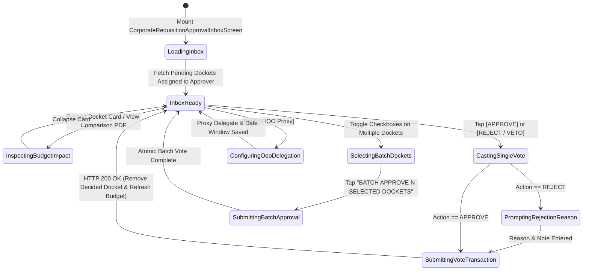

# Corporate Approver Inbox, Quorum Voting & Delegation Console
## Mobile Subsystem Specification — `docs/mobile/corporate-experience/02-corporate-requisition-approval-inbox.md`

**Document Identifier:** `SPEC-MOB-CRP-02`  
**Classification:** Canonical Subsystem UI/UX & Technical Behavior Specification  
**Governing Documents:** `Dink_Machinery_UI_UX_Design_Brief.md`, `SRS-DINK-CORE-V7.0` (`docs/shared/requirements/06-02-corporate-approval-workflows.md`), `docs/shared/design/design-tokens.json`, `docs/ERROR_CATALOG.md`, `contracts/openapi.yaml`  
**Target Subsystem:** Flutter 3.47.9 / Dart 3.9 Mobile Client (iOS & Android)  
**Primary Persona / Actor:** Corporate Procurement Director (*Eng. Samuel Getachew*), Finance Controller (*Solomon Kassa*), Senior Project Manager (*Dawit Haile-Mariam*)  
**Associated Requirements:** `REQ-06-02` (`APPR-01`..`APPR-03`, Quorum Voting, Executive Veto Power, Out-of-Office Proxy Delegation)  
**Associated Interaction Flows:** `FLOW-14` (Corporate Approval Workflow Resolution), `FLOW-07`  
**Architectural Decisions:** `ADR-005` (ACID Quorum Evaluation $<15\text{ms}$ & Valkey Hold Release on Rejection), `ADR-010` (Integer Minor Units & Cryptographic Vote Non-Repudiation)  
**Status:** Approved Technical Design Baseline

---

## 1. Domain Context, Business Formulas & Architectural Invariants

Procurement Directors, Senior Project Managers, and Finance Controllers frequently travel between remote construction sites and headquarters. Waiting until they return to a desktop browser to approve urgent plant requisitions would stall site earthworks and expire machine holds. The **Corporate Approver Inbox, Quorum Voting & Delegation Console (`CorporateRequisitionApprovalInboxScreen`)** empowers authorized enterprise approvers on mobile to inspect requisition dockets, preview real-time cost-center and credit-line budget impact, cast cryptographically signed **Approve / Reject / Veto** votes (single or batch), and configure **Out-of-Office (OOO) Delegation of Authority (`APPR-03 §5.4`)**.

### 1.1 Quorum Evaluation & Governance Formulas (`REQ-06-02 §4`)
1. **Four-Eyes Separation of Duties (`OWASP ASVS §4.3`):**
   $$\text{ApproverUserID} \neq \text{Docket.RequesterUserID}$$
   The inbox automatically excludes or marks read-only any docket authored by the logged-in user.
2. **Budget & Credit-Line Impact Preview Before Voting:**
   For every pending docket $d$ with total commitment $M_{\text{docket\_minor}}$ (including 15% ET / 16% KE VAT):
   $$\mathcal{U}_{\text{cost\_center\_after}} = \frac{B_{\text{current\_committed}} + M_{\text{docket\_minor}}}{B_{\text{allocated}}} \times 100\%$$
   $$\mathcal{C}_{\text{credit\_available\_after}} = \mathcal{C}_{\text{approved\_limit}} - \left(\mathcal{C}_{\text{utilized}} + \mathcal{C}_{\text{pending}} + M_{\text{docket\_minor}}\right)$$
3. **Executive Veto Short-Circuit (`has_veto_power == true` / `APPR-02 §4.2`):**
   When an approver holding `has_veto_power` (e.g., Finance Controller *Solomon Kassa*) casts `REJECT`, the docket transitions immediately to `REJECTED` regardless of other cast votes, releasing the Valkey lease `DEL hold:corporate:{booking_id}` within $< 15\text{ ms}$.
4. **Out-of-Office (OOO) Proxy Delegation Guardrails (`APPR-03 §5.4`):**
   An approver may delegate their voting authority to a peer member in the same organization for a bounded date window $[T_{\text{ooo\_start}}, T_{\text{ooo\_end}}]$ provided no circular delegation cycle ($A \rightarrow B \rightarrow A$) is formed.

---

## 2. Screen Anatomy & Bespoke ASCII Wireframe

```text
+-----------------------------------------------------------------------+
| [<- Back]      CORPORATE APPROVER INBOX (4 Pending)     [🔄 OOO Proxy]|
|-----------------------------------------------------------------------|
| 🏢 SUR CONSTRUCTION PLC • Role: Procurement Director (Weight: 50% • Veto)|
| [🔴 Urgent SLA <1h (2)]  [⏳ All Pending (4)]  [✅ Decided History]   |
|=======================================================================|
| 🔄 OUT-OF-OFFICE DELEGATION OF AUTHORITY BAR (APPR-03 §5.4)           |
| | Status: [⚪ Inactive]  Delegate To: [W/ro Tigist M. (Deputy Dir.)] | |
|=======================================================================|
| ☑️ [Select All Eligible for Batch Approval (2 Dockets • ETB 486,200)] |
|-----------------------------------------------------------------------|
| 📋 DOCKET #1: #REQ-2026-0419 • [🔴 SLA: 00h 48m Left] • Stage 2 of 3  |
| +-------------------------------------------------------------------+ |
| | 🚜 CAT 320D2 L Excavator + Soosan Breaker (8 Days: Oct 30–Nov 06) | |
| | 👤 Requested By: Bethlehem Tessema (Site QS) • Site: Modjo Lot 2  | |
| | 🏷️ Cost Center: CC-204 (Earthworks) • PO#: PO-2026-881 (Net-30)   | |
| |-------------------------------------------------------------------| |
| | 💰 Total Commitment (Incl. 15% VAT):              ETB 301,024.00  | |
| | 📊 CC-204 Budget Impact:   62.1% ──> 68.4% (+6.3% • Within Cap)   | |
| | 💳 Net-30 Credit Impact:   ETB 3.89M Available After Approval     | |
| |-------------------------------------------------------------------| |
| | 📎 Attachments: [📄 Comparison Matrix (3 Units).pdf] [📄 BOQ.pdf] | |
| | 📝 Approver Audit Note: [Verified against Lot 2 culvert BOQ...  ] | |
| | +-------------------------------+ +-----------------------------+ | |
| | | [ ✅ APPROVE STAGE 2 (56dp) ] | | [ 🛑 REJECT / VETO (56dp) ] | | |
| | +-------------------------------+ +-----------------------------+ | |
| +-------------------------------------------------------------------+ |
|-----------------------------------------------------------------------|
| 📋 DOCKET #2: #REQ-2026-0422 • [🟡 SLA: 03h 15m Left] • Stage 1 of 2  |
| +-------------------------------------------------------------------+ |
| | [x] 🛞 XCMG ZL50GN Wheel Loader (5 Days: Nov 01–Nov 05)           | |
| | 💰 Total Commitment: ETB 185,176.00 • CC-204: 68.4% ──> 70.0%     | |
| | [ ✅ APPROVE STAGE 1 (56dp) ]     [ 🛑 REJECT / VETO (56dp) ]     | |
| +-------------------------------------------------------------------+ |
|=======================================================================|
| [     ✅ BATCH APPROVE 2 SELECTED DOCKETS (ETB 486,200.00) (64dp)   ] |
+-----------------------------------------------------------------------+
```

---

## 3. W3C DTCG Design Token Mapping Table

| UI Component / Element | W3C DTCG Token Path | Resolved Value (Light / Outdoor High-Contrast) | Ergonomic & Behavioral Mandate |
|---|---|---|---|
| **Urgent SLA Badge (`<1h`)** | `component.countdown.holdCriticalBg` / `holdCriticalText` | `#FEF2F2` fill, `#B91C1C` text, `#EF4444` border | Alerts approver before stage SLA escalates or corporate hold expires. |
| **Budget Impact Delta Row** | `typography.fontFamily.mono` + `color.feedback.emerald.700` | `Space Mono` `14sp` (`62.1% ──> 68.4%`) | Switches to `#B91C1C` Crimson if approval would push cost center $> 100\%$. |
| **Approve Stage Button** | `color.feedback.emerald.600` + `dimension.space.56` | `#059669` background, `#FFFFFF` bold text, `56dp` height | Requires biometric / PIN confirmation on commitments $> \text{ETB } 500,000$. |
| **Reject / Veto Button** | `semantic.light.action.destructive.bg` + `dimension.space.56` | `#EF4444` background, `#FFFFFF` text, `56dp` height | Prompts mandatory rejection reason code (`BUDGET_EXCEEDED`, `WRONG_SPEC`, `USE_INTERNAL_FLEET`). |
| **Batch Approve Sticky CTA** | `component.actuator.button.heightField` / `action.primary.bg` | `64dp` height, `#F59E0B` (`color.brand.amber.500`) | Displays exact combined minor-unit value of selected dockets. |

---

## 4. Screen State Machine & Sequence Diagrams

### 4.1 Approver Inbox, Single/Batch Voting & OOO Delegation State Machine


### 4.2 Synchronous ACID Quorum Resolution Sequence (`APPR-02`)
```mermaid
sequenceDiagram
    autonumber
    actor Approver as Procurement Director (Flutter 3.47.9)
    participant InboxBloc as CorpApprovalInboxBloc
    participant API as Go Monolith (/api/v1/corporate/approvals)
    participant PG as PostgreSQL 18.6 (ACID Row Lock)
    participant Valkey as Valkey 9.1.3

    Approver->>InboxBloc: Tap [✅ APPROVE STAGE 2] on Docket #REQ-2026-0419
    InboxBloc->>API: POST /api/v1/corporate/approvals/dockets/{id}/vote {choice: "APPROVE", note: "Verified against BOQ"} (Idempotency-Key)
    API->>PG: BEGIN TX; SELECT * FROM corporate_approval_dockets WHERE id = $1 FOR UPDATE;
    API->>PG: Assert ApproverUserID != RequesterUserID (Four-Eyes Check)
    API->>PG: INSERT INTO corporate_approval_votes (docket_id, stage_index, user_id, choice, signature_hash)
    API->>PG: Evaluate Stage 2 Quorum (2-of-3 reached -> Advance current_stage_index = 3)
    PG-->>API: COMMIT (< 15ms p99)
    API-->>InboxBloc: 200 OK (docketState: "STAGE_3_PENDING", stage2Passed: true)
    InboxBloc-->>Approver: Haptic Success + Slide Out Decided Card + Notify Stage 3 Finance Controller
```

---

## 5. Concrete Flutter Implementation Blueprint

### 5.1 BLoC Events & Freezed States (`corp_approval_inbox_bloc.dart`)
```dart
import 'package:freezed_annotation/freezed_annotation.dart';

part 'corp_approval_inbox_bloc.freezed.dart';

@freezed
sealed class CorpApprovalInboxEvent with _$CorpApprovalInboxEvent {
  const factory CorpApprovalInboxEvent.started({
    required String organizationId,
  }) = _Started;

  const factory CorpApprovalInboxEvent.filterChanged({
    required ApproverInboxFilter filter, // URGENT_SLA, ALL_PENDING, DECIDED_HISTORY
  }) = _FilterChanged;

  const factory CorpApprovalInboxEvent.docketSelectionToggled({
    required String docketId,
  }) = _DocketSelectionToggled;

  const factory CorpApprovalInboxEvent.singleVoteSubmitted({
    required String docketId,
    required VoteChoiceType choice, // APPROVE, REJECT
    required String auditNote,
    String? rejectionReasonCode,
  }) = _SingleVoteSubmitted;

  const factory CorpApprovalInboxEvent.batchApprovalSubmitted({
    required String batchAuditNote,
  }) = _BatchApprovalSubmitted;

  const factory CorpApprovalInboxEvent.oooDelegationUpdated({
    required bool isEnabled,
    String? delegateMemberUserId,
    DateTime? startUtc,
    DateTime? endUtc,
  }) = _OooDelegationUpdated;
}

@freezed
abstract class CorpApprovalInboxState with _$CorpApprovalInboxState {
  const factory CorpApprovalInboxState({
    @Default(InboxLoadStatus.loading) InboxLoadStatus status,
    required String organizationId,
    @Default(ApproverInboxFilter.allPending) ApproverInboxFilter activeFilter,
    @Default(<ApproverDocketInboxItemDto>[]) List<ApproverDocketInboxItemDto> pendingDockets,
    @Default(<ApproverDocketInboxItemDto>[]) List<ApproverDocketInboxItemDto> decidedHistory,
    @Default(<String>{}) Set<String> selectedBatchDocketIds,
    @Default(0) int selectedBatchTotalMinor,
    required String currencyCode,
    OooDelegationConfigDto? oooDelegation,
    @Default(false) bool isSubmittingVote,
    ProblemDetails? error,
  }) = _CorpApprovalInboxState;
}
```

### 5.2 Isar Offline Approver Inbox Cache (`isar_approver_inbox_item.dart`)
```dart
import 'package:isar/isar.dart';

part 'isar_approver_inbox_item.g.dart';

@collection
class IsarApproverInboxItem {
  Id id = Isar.autoIncrement;

  @Index(unique: true, replace: true)
  late String docketId;

  @Index()
  late String organizationId;

  late String requisitionRef;
  late String fleetTitle;
  late String requesterFullName;
  late String costCenterCode;
  late int totalCommitmentMinor;
  late String currencyCode;
  late double budgetUtilizationBeforePct;
  late double budgetUtilizationAfterPct;
  late int stageIndex;
  late int totalStages;
  late DateTime stageSlaDeadlineUtc;
  late DateTime cachedAt;
}
```

### 5.3 Widget Tree Hierarchy
```text
CorporateRequisitionApprovalInboxScreen (Scaffold)
 ├── AppBar ("Corporate Approver Inbox", OOO Proxy Action Button)
 ├── Column
 │    ├── ApproverRoleAndVetoHeaderStrip
 │    ├── InboxFilterSegmentedBar (Urgent SLA <1h | All Pending | Decided History)
 │    ├── OooDelegationStatusBanner (APPR-03 §5.4 active proxy indicator)
 │    ├── BatchSelectAllHeaderCheckboxTile
 │    └── Expanded (ListView.builder)
 │         └── ApproverDocketActionCard
 │              ├── DocketUrgencyAndStageHeader (SLA countdown + Stage N of M)
 │              ├── MachineAndRequesterScopeSection
 │              ├── BudgetAndCreditImpactPreviewBox (CC % before -> after + Net-30 headroom)
 │              ├── AttachedJustificationPdfsRow (Comparison Matrix PDF viewer launcher)
 │              ├── ApproverAuditNoteTextField
 │              └── ApproveOrRejectVetoButtonRow (56dp Emerald Approve | 56dp Crimson Reject/Veto)
 └── StickyBatchApprovalBottomBar (Visible when selectedBatchDocketIds.isNotEmpty)
      └── BatchApprovePrimaryActuatorButton (64dp height CTA with combined minor-unit total)
```

---

## 6. OpenAPI 3.1.0 Routes & RFC 9457 Error Matrix

### 6.1 Endpoint Specifications
- **`GET /api/v1/corporate/approvals/inbox`**
  - **Headers:** `X-Organization-ID: <uuid>`, `X-Country-Code: ET | KE`.
- **`POST /api/v1/corporate/approvals/dockets/{id}/vote`** (`APPR-02`)
  - **Headers:** `Idempotency-Key: <uuid-v4>`, `X-Organization-ID: <uuid>`.
  - **Request Body:** `{ "choice": "APPROVE" | "REJECT", "note": "Verified against BOQ", "rejectionReasonCode": "BUDGET_EXCEEDED?" }`.
- **`POST /api/v1/corporate/approvals/dockets:batch-vote`**
  - **Headers:** `Idempotency-Key: <uuid-v4>`, `X-Organization-ID: <uuid>`.
- **`PUT /api/v1/corporate/approvals/delegation`** (`APPR-03 §5.4`)

### 6.2 RFC 9457 Problem Details Matrix
| Error Code | HTTP Status | RFC 9457 Type URI | Retryable | Mobile UI Remediation & Recovery Action |
|---|---|---|---|---|
| `AUTH_INSUFFICIENT_PERMISSIONS` / Four-Eyes Violation | `403` | `/errors/self-approval-prohibited` | No | Block self-approval (`ApproverUserID == RequesterUserID`) and display Four-Eyes governance explanation. |
| `BOOKING_CONCURRENCY_CONFLICT` | `409` | `/errors/booking-concurrency-conflict` | No | Another peer approver just satisfied or vetoed the stage; refresh inbox list and show updated stage status. |
| `ERR_CORPORATE_CREDIT_LIMIT_EXCEEDED` | `403` | `/errors/corporate-credit-limit-exceeded` | No | Approving on Net-30 terms exceeds remaining credit facility; prompt switching docket to Direct Wire or topping up credit line (`03-corporate-credit-line-net30-invoices.md`). |
| `REQ_VALIDATION_FAILED` (Circular Delegation) | `422` | `/errors/circular-delegation-detected` | No | Reject OOO proxy target if target user is already delegating back to the current user. |

---

## 7. Verification & Acceptance Criteria

- [ ] **Sub-15ms Quorum & Veto Resolution (`REQ-06-02 §1.2`):** Casting a `REJECT` vote as a user with `has_veto_power == true` immediately terminates the docket as `REJECTED` regardless of remaining stage voters and releases the Valkey fleet lease.
- [ ] **Real-Time Budget Impact Preview:** Every docket card accurately renders `budgetUtilizationBeforePct -> budgetUtilizationAfterPct` and flags any docket that would breach $100\%$ of the Cost Center allocation.
- [ ] **Circular Proxy Prevention (`APPR-03 §5.4`):** Attempting to assign OOO delegation to a user who has delegated to you is blocked with a clear validation message.
