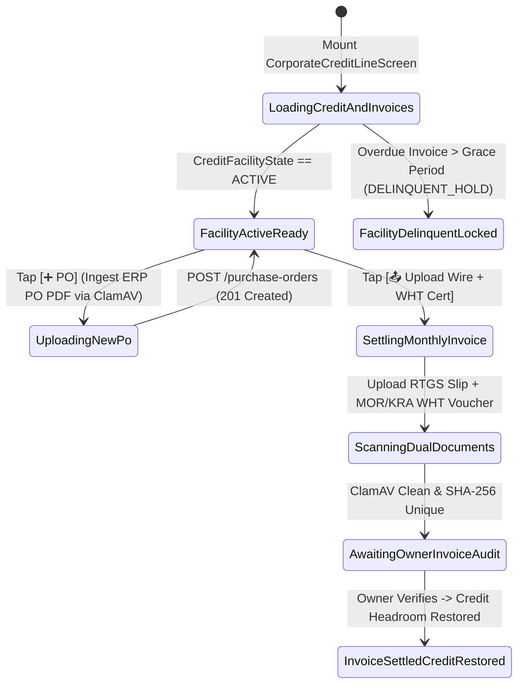

# Corporate Revolving Credit Line, PO Binding & Net-30 Invoices
## Mobile Subsystem Specification — `docs/mobile/corporate-experience/03-corporate-credit-line-net30-invoices.md`

**Document Identifier:** `SPEC-MOB-CRP-03`  
**Classification:** Canonical Subsystem UI/UX & Technical Behavior Specification  
**Governing Documents:** `Dink_Machinery_UI_UX_Design_Brief.md`, `SRS-DINK-CORE-V7.0` (`docs/shared/requirements/06-03-corporate-pricing-payment.md`), `docs/shared/design/design-tokens.json`, `docs/ERROR_CATALOG.md`, `contracts/openapi.yaml`  
**Target Subsystem:** Flutter 3.47.8 / Dart 3.9 Mobile Client (iOS & Android)  
**Primary Persona / Actor:** Corporate Finance Controller (*Solomon Kassa*), Corporate Procurement Director (*Eng. Samuel Getachew*)  
**Associated Requirements:** `REQ-06-03` (`CORP-PRICE`, `CORP-CREDIT`, `CORP-PO`, `CORP-INV`), `REQ-05-05` (`ADR-010` Non-Custodial Direct Settlement)  
**Associated Interaction Flows:** `FLOW-14` (Corporate Credit Booking), `FLOW-08` (Direct Corporate Bank Settlement + WHT Voucher Upload)  
**Architectural Decisions:** `ADR-008` (`LOC-01-BE` 15% ET VAT / 2% ET WHT vs 16% KE VAT / 5% KE WHT), `ADR-010` (**Non-Custodial Phase 2 Corporate Credit Lines & Integer Minor Units**)  
**Status:** Approved Technical Design Baseline

---

## 1. Domain Context, Business Formulas & Architectural Invariants

Under Dink Machinery's phased financial architecture (`ADR-010`), Phase 2 enables underwritten enterprise contractors to procure machinery on **Revolving Corporate Credit Terms (`NET-30` / `NET-60`)** backed by bank guarantees and formal Purchase Orders (`CORP-PO`). Crucially, **even in Phase 2 (`NET-30`), Dink Machinery remains strictly non-custodial (`REQ-06-03 §1.2`)**: consolidated monthly statements settle directly from the corporate contractor's commercial bank account to the respective Fleet Owner enterprise bank accounts, accompanied by statutory **Withholding Tax (WHT) Clearance Certificates** (Ethiopian Ministry of Revenues / Kenyan KRA).

### 1.1 Corporate Credit, Three-Way Matching & Tax Withholding Formulas
1. **Three-Tier Revolving Credit Facility Invariant (`CORP-CREDIT` / `REQ-06-03 §3.2`):**
   Let $\mathcal{C}_{\text{approved\_minor}}$ be the underwritten credit ceiling, $\mathcal{C}_{\text{utilized\_minor}}$ be active/unpaid invoiced balances, and $\mathcal{C}_{\text{pending\_minor}}$ be dockets currently in approval:
   $$\mathcal{C}_{\text{available\_minor}} = \mathcal{C}_{\text{approved\_minor}} - \left(\mathcal{C}_{\text{utilized\_minor}} + \mathcal{C}_{\text{pending\_minor}}\right)$$
   Any Net-30 requisition where $M_{\text{new\_booking\_minor}} > \mathcal{C}_{\text{available\_minor}}$ is blocked synchronously with `403 ERR_CORPORATE_CREDIT_LIMIT_EXCEEDED`.
2. **Rate Resolution Precedence Hierarchy (`CORP-PRICE` / `REQ-06-03 §2.2`):**
   $$\text{1. Bilateral MSA Tariff} \succ \text{2. Project Corridor Tariff} \succ \text{3. Duration Volume Tier (7d/30d/90d)} \succ \text{4. Base Catalog Rate}$$
3. **Three-Way Matching Invariant (`CORP-PO` / `IFRS 15`):**
   A consolidated Net-30 statement line item is unlocked for settlement only when:
   $$\text{Authorized PO Ceiling} \ge \text{Verified Monotonic Shift Log Hours} \equiv \text{Tax Invoice Line Item} \quad (\Delta \le 0.1\text{ hrs})$$
4. **Sovereign VAT & Withholding Tax (WHT) Settlement Formula (`CORP-INV` / `LOC-01-BE`):**
   For a consolidated monthly statement with taxable subtotal $M_{\text{taxable\_minor}}$:
   - **Ethiopia (`ET`):** $\text{VAT} = 15.0\%$ ($1500\text{ bps}$); statutory corporate Withholding Tax $\text{WHT} = 2.0\%$ ($200\text{ bps}$) deducted on taxable supply $> 10,000\text{ ETB}$.
   - **Kenya (`KE`):** $\text{VAT} = 16.0\%$ ($1600\text{ bps}$); statutory Withholding Tax $\text{WHT} = 5.0\%$ ($500\text{ bps}$).
   $$M_{\text{net\_cash\_wire\_minor}} = M_{\text{taxable\_minor}} + M_{\text{vat\_minor}} - M_{\text{wht\_deducted\_minor}}$$
   To close the invoice to `PAID`, the Corporate Finance Controller must upload both the **Commercial Bank Wire Confirmation Slip** ($M_{\text{net\_cash\_wire\_minor}}$) and the **Official Government WHT Certificate** ($M_{\text{wht\_deducted\_minor}}$) via ClamAV streaming scan.

---

## 2. Screen Anatomy & Bespoke ASCII Wireframe

```text
+-----------------------------------------------------------------------+
| [<- Back]     CORPORATE CREDIT LINE & NET-30 INVOICES                 |
|-----------------------------------------------------------------------|
| 🏢 SUR CONSTRUCTION PLC • Facility: #CRD-ET-2026-09 (🟢 ACTIVE NET-30)|
| 🏦 Backed By: CBE Unconditional Bank Guarantee #BG-994021 (Valid 2027)|
|=======================================================================|
| 💳 1. REVOLVING CREDIT FACILITY UTILIZATION GAUGE (CORP-CREDIT)       |
| +-------------------------------------------------------------------+ |
| | Approved Credit Ceiling:             ETB 15,000,000.00 (100.0%)   | |
| | (-) Utilized (Active + Unpaid Inv.): ETB  9,898,976.00 ( 66.0%)   | |
| | (-) Pending In-Flight Dockets:       ETB    901,024.00 (  6.0%)   | |
| |===================================================================| |
| | 🟢 AVAILABLE NET-30 HEADROOM:        ETB  4,200,000.00 ( 28.0%)   | |
| | [██████████████████████████▒▒░░░░░░░░░░] 66% Used | 6% Hold | 28% | |
| | 🤝 Active Rate Badge: [MSA Tier-1 Volume Discount: -18% Applied]  | |
| +-------------------------------------------------------------------+ |
|=======================================================================|
| 📑 2. ACTIVE PURCHASE ORDERS & 3-WAY MATCH STATUS (CORP-PO)  [➕ PO]  |
| +-------------------------------------------------------------------+ |
| | • PO #PO-2026-881 (Lot 2 Earthworks) • Ceiling: ETB 2,500,000.00  | |
| |   Consumed: ETB 1,840,000.00 (73.6%) • [✅ 3-Way Match Verified]  | |
| +-------------------------------------------------------------------+ |
|=======================================================================|
| 🧾 3. CONSOLIDATED MONTHLY NET-30 STATEMENTS (CORP-INV / ADR-010)     |
| +-------------------------------------------------------------------+ |
| | Statement #INV-2026-10 (October 2026 • 6 Rentals) [🟡 DUE IN 9d]  | |
| | Counterparty Fleet Owner: TESFAYE HEAVY PLANT PLC (TIN: 00192837) | |
| |-------------------------------------------------------------------| |
| | Taxable Equipment & Attachment Supply:            ETB 840,000.00  | |
| | (+) Statutory Ethiopian VAT (15.0% / 1500 bps):   ETB 126,000.00  | |
| | Gross Invoice Total:                              ETB 966,000.00  | |
| | (-) Less 2.0% Statutory WHT Withheld at Source:  -ETB  16,800.00  | |
| |===================================================================| |
| | 💰 NET DIRECT BANK WIRE TO OWNER:                 ETB 949,200.00  | |
| | 📜 REQUIRED MOR WHT CERTIFICATE VOUCHER:          ETB  16,800.00  | |
| |-------------------------------------------------------------------| |
| | [📄 View 3-Way Matched PDF]  [📤 Upload Wire + WHT Cert (56dp)]   | |
| +-------------------------------------------------------------------+ |
+-----------------------------------------------------------------------+
```

---

## 3. W3C DTCG Design Token Mapping Table

| UI Component / Element | W3C DTCG Token Path | Resolved Value (Light / Outdoor High-Contrast) | Ergonomic & Behavioral Mandate |
|---|---|---|---|
| **Credit Gauge Multi-Segment Bar** | `color.brand.amber.500` (Used) / `color.feedback.blue.500` (Pending) / `color.feedback.emerald.500` (Available) | `#F59E0B` / `#3B82F6` / `#10B981` | Visualizes the exact Three-Tier Credit Facility Barrier (`CORP-CREDIT`). |
| **MSA Tariff Badge** | `color.feedback.emerald.100` + `color.feedback.emerald.700` | `#D1FAE5` pill, `#047857` text | Confirms negotiated contract tariff precedence (`CORP-PRICE`). |
| **3-Way Match Verified Tag** | `color.feedback.emerald.50` + `color.feedback.emerald.600` | `#ECFDF5` fill, `#059669` text + check icon | Confirms $\text{PO} \equiv \text{Shift Logs} \equiv \text{Tax Invoice}$. |
| **WHT Deduction Line** | `typography.fontFamily.mono` + `color.brand.slate.700` | `Space Mono` `14sp` (`-ETB 16,800.00`) | Explicitly separates cash wire obligation from government WHT voucher obligation. |
| **Settle Statement CTA** | `component.actuator.button.heightStandard` / `action.primary.bg` | `56dp` height, `#F59E0B` (`color.brand.amber.500`) | Opens dual-document ClamAV uploader (Bank RTGS Slip + WHT Certificate). |

---

## 4. Screen State Machine & Sequence Diagrams

### 4.1 Credit Facility, PO Management & Net-30 Settlement State Machine


### 4.2 Consolidated Net-30 Settlement & WHT Reconciliation Sequence (`CORP-INV`)
```mermaid
sequenceDiagram
    autonumber
    actor FinCtrl as Finance Controller (Flutter 3.47.8)
    participant CreditBloc as CorporateCreditInvoiceBloc
    participant API as Go Monolith (/api/v1/corporate/invoices)
    participant ClamAV as ClamAV Daemon (:3310)
    participant PG as PostgreSQL 18.6 (Append-Only Ledger)

    FinCtrl->>CreditBloc: Select Statement #INV-2026-10 & Tap "Upload Wire + WHT Cert"
    FinCtrl->>CreditBloc: Attach CBE RTGS Slip (ETB 949,200.00) + MOR WHT Voucher (ETB 16,800.00)
    CreditBloc->>API: POST /api/v1/corporate/invoices/{id}/settle (Multipart + Idempotency-Key)
    API->>ClamAV: Scan both PDFs/Images via TCP :3310 INSTREAM
    ClamAV-->>API: Both Streams Clean
    API->>PG: Verify NetWireMinor (94920000) + WhtMinor (1680000) == GrossInvoiceMinor (96600000)
    API->>PG: INSERT INTO corporate_invoice_settlements; Notify Owner for Bank Verification
    API-->>CreditBloc: 200 OK (invoiceStatus: "SETTLEMENT_EVIDENCE_UPLOADED")
    Note over API,PG: Upon Owner Verification: utilized_credit_minor decremented by 96,600,000 Santims
    CreditBloc-->>FinCtrl: Update Statement Badge & Restore Available Credit Gauge
```

---

## 5. Concrete Flutter Implementation Blueprint

### 5.1 BLoC Events & Freezed States (`corporate_credit_invoice_bloc.dart`)
```dart
import 'package:freezed_annotation/freezed_annotation.dart';

part 'corporate_credit_invoice_bloc.freezed.dart';

@freezed
sealed class CorporateCreditInvoiceEvent with _$CorporateCreditInvoiceEvent {
  const factory CorporateCreditInvoiceEvent.started({
    required String organizationId,
  }) = _Started;

  const factory CorporateCreditInvoiceEvent.purchaseOrderCreated({
    required String poNumber,
    required String costCenterId,
    required int authorizedCeilingMinor,
    required DateTime validUntilUtc,
    required String poPdfFilePath,
  }) = _PurchaseOrderCreated;

  const factory CorporateCreditInvoiceEvent.invoiceSettlementSubmitted({
    required String invoiceId,
    required String bankWireSlipPath,
    required String bankWireRef,
    required int netWiredAmountMinor,
    String? whtCertificateFilePath,
    String? whtCertificateNumber,
    @Default(0) int whtWithheldAmountMinor,
  }) = _InvoiceSettlementSubmitted;
}

@freezed
abstract class CorporateCreditInvoiceState with _$CorporateCreditInvoiceState {
  const factory CorporateCreditInvoiceState({
    @Default(CreditScreenStatus.loading) CreditScreenStatus status,
    required String organizationId,
    CorporateCreditFacilityDto? creditFacility,
    @Default(<CorporatePurchaseOrderDto>[]) List<CorporatePurchaseOrderDto> purchaseOrders,
    @Default(<ConsolidatedNetInvoiceDto>[]) List<ConsolidatedNetInvoiceDto> statements,
    @Default(false) bool isSubmittingSettlement,
    ProblemDetails? error,
  }) = _CorporateCreditInvoiceState;
}
```

### 5.2 Isar Cached Corporate Credit & Statements (`isar_corporate_credit_cache.dart`)
```dart
import 'package:isar/isar.dart';

part 'isar_corporate_credit_cache.g.dart';

@collection
class IsarCorporateCreditCache {
  Id id = Isar.autoIncrement;

  @Index(unique: true, replace: true)
  late String organizationId;

  late String facilityState; // 'ACTIVE' | 'DELINQUENT_HOLD' | 'SUSPENDED'
  late int approvedLimitMinor;
  late int utilizedMinor;
  late int pendingDocketsMinor;
  late int availableHeadroomMinor;
  late String currencyCode;
  late String activeRateTierLabel;
  late String serializedPurchaseOrdersJson;
  late String serializedStatementsJson;
  late DateTime syncedAt;
}
```

### 5.3 Widget Tree Hierarchy
```text
CorporateCreditLineNet30InvoicesScreen (Scaffold)
 ├── AppBar ("Corporate Credit Line & Net-30 Invoices")
 ├── SingleChildScrollView (Padding: 16dp)
 │    ├── FacilityIdentityAndGuaranteeBanner
 │    ├── RevolvingCreditUtilizationGaugeCard (CORP-CREDIT)
 │    │    ├── ThreeSegmentCreditBar (Utilized | Pending | Available Headroom)
 │    │    ├── MinorUnitCreditBreakdownRows (Space Mono 16sp)
 │    │    └── NegotiatedMsaTariffBadge (CORP-PRICE)
 │    ├── ActivePurchaseOrdersSectionCard (CORP-PO)
 │    │    ├── UploadNewErpPoButton (56dp height)
 │    │    └── PurchaseOrderConsumptionTile (Shows 3-Way Match Verified badge)
 │    └── ConsolidatedMonthlyStatementsList (CORP-INV)
 │         └── Net30StatementReconciliationCard
 │              ├── TaxableSupplyAndVatBreakdown
 │              ├── StatutoryWhtDeductionRow ("2.0% ET WHT" or "5.0% KE WHT")
 │              ├── NetCashWireVsWhtVoucherSummary
 │              └── DualDocumentSettleActionRow (View 3-Way PDF | Upload Wire + WHT Cert)
```

---

## 6. OpenAPI 3.1.0 Routes & RFC 9457 Error Matrix

### 6.1 Endpoint Specifications
- **`GET /api/v1/corporate/credit-facility`** (`CORP-CREDIT`)
- **`POST /api/v1/corporate/purchase-orders`** (`CORP-PO`)
  - **Headers:** `Idempotency-Key: <uuid-v4>`, `X-Organization-ID: <uuid>`, `Content-Type: multipart/form-data`.
- **`POST /api/v1/corporate/invoices/{id}/settle`** (`CORP-INV`)
  - **Headers:** `Idempotency-Key: <uuid-v4>`, `X-Organization-ID: <uuid>`, `Content-Type: multipart/form-data`.

### 6.2 RFC 9457 Problem Details Matrix
| Error Code | HTTP Status | RFC 9457 Type URI | Retryable | Mobile UI Remediation & Recovery Action |
|---|---|---|---|---|
| `ERR_CORPORATE_CREDIT_LIMIT_EXCEEDED` | `403` | `/errors/corporate-credit-limit-exceeded` | No | Highlight remaining headroom (`availableHeadroomMinor`) and prompt settling an open statement or requesting a temporary credit ceiling increase. |
| `PAYMENT_TRANSACTION_EXISTS` | `409` | `/errors/payment-transaction-exists` | No | Reject duplicate RTGS reference or duplicate WHT certificate number. |
| `INSPECT_MEDIA_SCAN_FAILED` | `422` | `/errors/inspect-media-scan-failed` | No | ClamAV blocked infected PO PDF or WHT voucher; prompt clean scan. |
| `LEDGER_DOUBLE_ENTRY_IMBALANCE` | `422` | `/errors/ledger-imbalance` | No | `netWiredAmountMinor + whtWithheldAmountMinor != grossInvoiceTotalMinor`; display exact minor-unit discrepancy. |

---

## 7. Verification & Acceptance Criteria

- [ ] **Three-Tier Credit Headroom Invariant (`CORP-CREDIT`):** Unit test verifies `availableHeadroomMinor == approvedLimitMinor - (utilizedMinor + pendingDocketsMinor)` in 64-bit integer minor units.
- [ ] **Exact WHT + Net Wire Parity (`CORP-INV`):** Settling a gross invoice of `96,600,000` Santims (`ETB 966,000.00`) requires `netWiredAmountMinor` (`94,920,000`) + `whtWithheldAmountMinor` (`1,680,000`) to sum strictly to `96,600,000` with zero rounding drift.
- [ ] **Non-Custodial Direct Settlement Enforcement (`ADR-010`):** Statement cards render the specific Fleet Owner's verified corporate bank coordinates as the direct beneficiary of the Net-30 wire.
