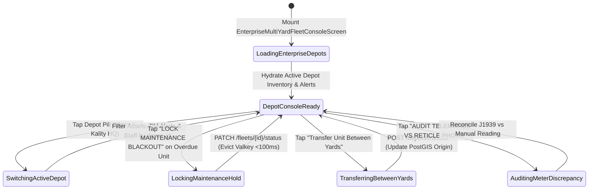

# Enterprise Multi-Yard Fleet Console, Dispatcher Delegation & PM Alerts
## Mobile Subsystem Specification — `docs/mobile/corporate-experience/04-enterprise-multi-yard-fleet-console.md`

**Document Identifier:** `SPEC-MOB-CRP-04`  
**Classification:** Canonical Subsystem UI/UX & Technical Behavior Specification  
**Governing Documents:** `Dink_Machinery_UI_UX_Design_Brief.md`, `SRS-DINK-CORE-V7.0` (`docs/shared/requirements/06-04-corporate-fleet-management-owner-side.md`), `docs/shared/design/design-tokens.json`, `docs/ERROR_CATALOG.md`, `contracts/openapi.yaml`  
**Target Subsystem:** Flutter 3.44 / Dart 3.9 Mobile Client (iOS & Android)  
**Primary Persona / Actor:** Corporate Fleet Owner Executive (*W/ro Almaz Tesfaye* / *Kamau Ndegwa*), Regional Fleet Operations Manager (*Dawit Haile-Mariam*), Depot Yard Supervisor (*Kassahun Mekonnen*)  
**Associated Requirements:** `REQ-06-04` (`CFM-01`..`CFM-05`, Multi-Depot PostGIS Zoning, Yard-Level RBAC Delegation, CAN Bus / J1939 Telematics Sync, Preventive Maintenance Alerts)  
**Associated Interaction Flows:** `FLOW-FLEET-REG-DINK-CORE-V7.0`, `FLOW-09` (Active Telemetry & Meter Audit)  
**Architectural Decisions:** `ADR-004` (PostGIS SRID 4326 Depot Geofencing), `ADR-005` (Sub-100ms Bulk Valkey Cache Invalidation), `ADR-010` (Four-Eyes Separation of Bank Payout Privileges)  
**Status:** Approved Technical Design Baseline

---

## 1. Domain Context, Business Formulas & Architectural Invariants

Commercial plant hire enterprises (*e.g., Tesfaye Heavy Plant PLC, Trans-Africa Logistics Ltd.*) manage dozens of excavators, graders, rollers, and lowboy trailers distributed across regional staging yards (e.g., *Mojo Dry Port Depot*, *Kality Main Workshop*, *Adama Corridor Yard*, *Mombasa Changamwe Depot*). The **Enterprise Multi-Yard Fleet Console (`EnterpriseMultiYardFleetConsoleScreen`)** implements the owner-side corporate requirements `CFM-01` through `CFM-05` (`REQ-06-04`) on mobile.

### 1.1 Multi-Depot, Telematics & Preventive Maintenance Invariants
1. **Strict Depot-Level Spatial Scoping (`CFM-02` / `REQ-06-04 §1.2`):**
   Every corporate fleet unit must be assigned to an active `depot_id` (`GEOGRAPHY(Polygon, 4326)` yard boundary + centroid). Transferring an idle machine from *Kality Depot* to *Mojo Depot* updates its PostGIS discovery origin and invalidates `discovery:search:*` and `fleet:detail:{id}` in Valkey within $< 100\text{ ms}$.
2. **Four-Eyes Separation of Financial Bank Privileges (`CFM-01` / `CFM-RBAC`):**
   Delegated operational roles (`CORP_FLEET_MANAGER`, `CORP_YARD_SUPERVISOR`, `CORP_DISPATCHER`, `CORP_SERVICE_TECHNICIAN`) can manage yard staging, pre-rental inspections, operator assignments, and maintenance holds within their scoped depots, but are **strictly barred** from viewing or mutating corporate bank payout coordinates (`CORP_OWNER_ADMIN` only).
3. **Monotonic CAN Bus / J1939 vs. Manual Meter Discrepancy Audit (`CFM-04 §5.2`):**
   For fleets equipped with IoT telematics (`CAN Bus J1939`), the system compares hardware engine hours $M_{\text{canbus}}$ against manual reticle check-in/out readings $M_{\text{manual}}$:
   $$\left| M_{\text{canbus}} - M_{\text{manual}} \right| > 2.0\text{ Hours} \implies \text{Trigger } \texttt{DISCREPANCY\_METER\_AUDIT}$$
4. **Predictive Preventive Maintenance (PM) Service Countdown (`CFM-04 §5.3`):**
   Given a machine's service interval $I_{\text{pm}}$ (typically every $250.0\text{ hrs}$ for engine oil/filters or $500.0\text{ hrs}$ for hydraulic filters) and last service meter $M_{\text{last\_pm}}$:
   $$H_{\text{until\_pm}} = \left(M_{\text{last\_pm}} + I_{\text{pm}}\right) - M_{\text{current}}$$
   - $H_{\text{until\_pm}} \le 25.0\text{ hrs}$: Amber `PM_DUE_SOON` alert badge.
   - $H_{\text{until\_pm}} \le 0.0\text{ hrs}$: Crimson `PM_OVERDUE` alert; one-tap button places the machine on `UNDER_MAINTENANCE` blackout hold after its current rental completes.

---

## 2. Screen Anatomy & Bespoke ASCII Wireframe

```text
+-----------------------------------------------------------------------+
| [<- Back]     ENTERPRISE MULTI-YARD FLEET CONSOLE                     |
|-----------------------------------------------------------------------|
| 🏢 TESFAYE HEAVY PLANT PLC • Role: Regional Fleet Manager (3 Depots)  |
| 📍 DEPOT SWITCHER: [🟢 Mojo Yard (18)] [⚪ Kality HQ (24)] [⚪ Adama (9)]|
|=======================================================================|
| 📊 1. MOJO DRY PORT DEPOT LIVE SUMMARY (SRID 4326 Geofence Active)    |
| +-----------------+-----------------+---------------+---------------+ |
| | 🟢 On Hire: 12  | 🔵 Idle Ready: 4| 🛠️ Maint.: 2  | ⚠️ PM Due: 3  | |
| +-----------------+-----------------+---------------+---------------+ |
| [ ⚡ Batch Tariff Shift (+/-%) ]    [ 🚚 Transfer Unit Between Yards ] |
|=======================================================================|
| 🔧 2. PREVENTIVE MAINTENANCE (PM) & TELEMATICS ALERTS (CFM-04)        |
| +-------------------------------------------------------------------+ |
| | 🔴 [PM OVERDUE: -4.5 HRS]  Komatsu D85EX Bulldozer (#DZ-104)      | |
| |    250h Engine Oil & Hydraulic Filter Service • Meter: 6,894.5 hrs| |
| |    [ 🛠️ LOCK MAINTENANCE BLACKOUT & ASSIGN TECHNICIAN (56dp) ]    | |
| |-------------------------------------------------------------------| |
| | 🟠 [METER AUDIT FLAG: Δ +3.2 HRS]  CAT 320D2 Excavator (#EX-209)  | |
| |    J1939 CAN Bus: 4,161.2 hrs vs Manual Log: 4,158.0 hrs          | |
| |    [ 🔍 AUDIT TELEMATICS VS RETICLE PHOTO (56dp) ]                | |
| +-------------------------------------------------------------------+ |
|=======================================================================|
| 👷 3. YARD DISPATCHER & SUPERVISOR DELEGATION (Mojo Depot • CFM-01)   |
| +-------------------------------------------------------------------+ |
| | • Kassahun Mekonnen  [CORP_YARD_SUPERVISOR]  Scope: Mojo Yard Only| |
| |   Permissions: Handover Reticles, PM Holds, Operator Roster       | |
| | • Ato Girma Wolde    [CORP_DISPATCHER]       Scope: Mojo + Adama  | |
| |   Permissions: Lowboy Sub-Bookings, Transit Milestones            | |
| | 🔒 Bank Routing & Payouts: Restricted to CORP_OWNER_ADMIN         | |
| | [ ➕ Assign Staff to Mojo Yard (56dp) ]                           | |
| +-------------------------------------------------------------------+ |
+-----------------------------------------------------------------------+
```

---

## 3. W3C DTCG Design Token Mapping Table

| UI Component / Element | W3C DTCG Token Path | Resolved Value (Light / Outdoor High-Contrast) | Ergonomic & Behavioral Mandate |
|---|---|---|---|
| **Depot Switcher Pill (Active)** | `color.brand.amber.500` + `color.brand.slate.950` | `#F59E0B` background, `#020617` bold text (`48dp` height) | Filters all fleet metrics, PM alerts, and staff rosters to the selected `depot_id`. |
| **PM Overdue Alert Card** | `color.feedback.crimson.50` + `color.feedback.crimson.600` | `#FEF2F2` fill, `2dp` `#DC2626` border | Highlights negative remaining service hours (`-4.5 HRS`) in `Space Mono`. |
| **J1939 Discrepancy Card** | `component.countdown.holdUrgentBg` + `color.feedback.orange.500` | `#FFF7ED` fill, `#FF5722` border | Alerts supervisor when `|CANBus - Manual| > 2.0 hrs` (`CFM-04 §5.2`). |
| **RBAC Scope Restriction Notice** | `color.brand.slate.100` + `color.brand.slate.600` | `#F1F5F9` banner, `#475569` text + lock icon | Enforces Four-Eyes separation of bank payout privileges (`CFM-RBAC`). |
| **Lock Maintenance Blackout CTA** | `component.actuator.button.heightStandard` | `56dp` height, `#DC2626` (`color.feedback.crimson.600`) | Atomically sets fleet status to `UNDER_MAINTENANCE` and evicts Valkey discovery keys. |

---

## 4. Screen State Machine & Sequence Diagrams

### 4.1 Multi-Yard Switching, PM Blackout & Telematics Audit State Machine


### 4.2 Preventive Maintenance Hold & Sub-100ms Valkey Eviction Sequence (`CFM-03` / `CFM-04`)
```mermaid
sequenceDiagram
    autonumber
    actor Sup as Yard Supervisor (Flutter 3.44)
    participant YardBloc as EnterpriseYardConsoleBloc
    participant API as Go Monolith (/api/v1/corporate/fleet)
    participant PG as PostgreSQL 18.4 + PostGIS 3.4
    participant Valkey as Valkey 8.0

    Sup->>YardBloc: Tap "LOCK MAINTENANCE BLACKOUT" on Komatsu D85EX (#DZ-104)
    YardBloc->>API: POST /api/v1/corporate/fleet/units/{id}:maintenance-hold {depotId, serviceType: "PM_250H", technicianId} (Idempotency-Key)
    API->>PG: Verify Supervisor is scoped to depotId (CFM-RBAC)
    API->>PG: UPDATE fleets SET status='UNDER_MAINTENANCE'; INSERT INTO maintenance_blackouts
    API->>Valkey: DEL fleet:detail:{id} & SCAN/DEL discovery:search:* (< 100ms SLO)
    API-->>YardBloc: 200 OK (unitStatus: "UNDER_MAINTENANCE", valkeyEvicted: true)
    YardBloc-->>Sup: Update Depot Summary (Maint: 3) & Dispatch Work Order to Technician
```

---

## 5. Concrete Flutter Implementation Blueprint

### 5.1 BLoC Events & Freezed States (`enterprise_yard_console_bloc.dart`)
```dart
import 'package:freezed_annotation/freezed_annotation.dart';

part 'enterprise_yard_console_bloc.freezed.dart';

@freezed
sealed class EnterpriseYardConsoleEvent with _$EnterpriseYardConsoleEvent {
  const factory EnterpriseYardConsoleEvent.started({
    required String organizationId,
  }) = _Started;

  const factory EnterpriseYardConsoleEvent.depotSelected({
    required String depotId,
  }) = _DepotSelected;

  const factory EnterpriseYardConsoleEvent.maintenanceBlackoutLocked({
    required String fleetId,
    required String pmServiceCode, // 'PM_250H' | 'PM_500H' | 'UNSCHEDULED_REPAIR'
    required DateTime estimatedCompletionUtc,
    String? assignedTechnicianUserId,
  }) = _MaintenanceBlackoutLocked;

  const factory EnterpriseYardConsoleEvent.interDepotTransferSubmitted({
    required String fleetId,
    required String destinationDepotId,
  }) = _InterDepotTransferSubmitted;

  const factory EnterpriseYardConsoleEvent.meterDiscrepancyResolved({
    required String auditAlertId,
    required double certifiedMeterHours,
    required String resolutionJustification,
  }) = _MeterDiscrepancyResolved;

  const factory EnterpriseYardConsoleEvent.batchTariffAdjusted({
    required String depotId,
    required int adjustmentBps, // e.g. +500 (+5%) or -1000 (-10%)
  }) = _BatchTariffAdjusted;
}

@freezed
abstract class EnterpriseYardConsoleState with _$EnterpriseYardConsoleState {
  const factory EnterpriseYardConsoleState({
    @Default(YardConsoleStatus.loading) YardConsoleStatus status,
    required String organizationId,
    required String currentUserCorporateRole,
    @Default(<EnterpriseDepotSummaryDto>[]) List<EnterpriseDepotSummaryDto> depots,
    String? selectedDepotId,
    @Default(<PreventiveMaintenanceAlertDto>[]) List<PreventiveMaintenanceAlertDto> pmAlerts,
    @Default(<TelematicsDiscrepancyAlertDto>[]) List<TelematicsDiscrepancyAlertDto> meterDiscrepancies,
    @Default(<DepotStaffAssignmentDto>[]) List<DepotStaffAssignmentDto> depotStaff,
    @Default(false) bool isMutatingFleet,
    ProblemDetails? error,
  }) = _EnterpriseYardConsoleState;
}
```

### 5.2 Isar Cached Depot Inventory & PM Schedule (`isar_enterprise_depot_cache.dart`)
```dart
import 'package:isar/isar.dart';

part 'isar_enterprise_depot_cache.g.dart';

@collection
class IsarEnterpriseDepotCache {
  Id id = Isar.autoIncrement;

  @Index(unique: true, replace: true)
  late String depotId;

  @Index()
  late String organizationId;

  late String depotName;
  late double centroidLat;
  late double centroidLng;
  late int onHireCount;
  late int idleReadyCount;
  late int underMaintenanceCount;
  late int pmDueCount;
  late String serializedPmAlertsJson;
  late String serializedStaffRosterJson;
  late DateTime syncedAt;
}
```

### 5.3 Widget Tree Hierarchy
```text
EnterpriseMultiYardFleetConsoleScreen (Scaffold)
 ├── AppBar ("Enterprise Multi-Yard Fleet Console")
 ├── SingleChildScrollView (Padding: 16dp)
 │    ├── DepotSwitcherHorizontalBar (CFM-02 Mojo Yard | Kality HQ | Adama)
 │    ├── DepotLiveKpiQuadGrid (On Hire, Idle Ready, Maintenance, PM Due)
 │    ├── BatchOperationsActionRow (Batch Tariff Shift | Inter-Yard Asset Transfer)
 │    ├── PreventiveMaintenanceAndTelematicsAlertSection (CFM-04)
 │    │    ├── PmOverdueActionCard (Space Mono hours + 56dp Lock Maintenance CTA)
 │    │    └── CanBusDiscrepancyAuditCard (J1939 vs Manual delta > 2.0h)
 │    └── YardStaffDelegationCard (CFM-01)
 │         ├── DepotSupervisorAndDispatcherList
 │         ├── BankRoutingRestrictionNoticeBanner (Four-Eyes SoD enforcement)
 │         └── AssignStaffToDepotButton (56dp height)
```

---

## 6. OpenAPI 3.1.0 Routes & RFC 9457 Error Matrix

### 6.1 Endpoint Specifications
- **`GET /api/v1/corporate/fleet/depots`** (`CFM-02`)
  - **Headers:** `X-Organization-ID: <uuid>`, `X-Country-Code: ET | KE`.
- **`POST /api/v1/corporate/fleet/units/{id}:maintenance-hold`** (`CFM-03` / `CFM-04`)
  - **Headers:** `Idempotency-Key: <uuid-v4>`, `X-Organization-ID: <uuid>`.
- **`POST /api/v1/corporate/fleet/depots/transfer`** (`CFM-02`)
  - **Headers:** `Idempotency-Key: <uuid-v4>`, `X-Organization-ID: <uuid>`.

### 6.2 RFC 9457 Problem Details Matrix
| Error Code | HTTP Status | RFC 9457 Type URI | Retryable | Mobile UI Remediation & Recovery Action |
|---|---|---|---|---|
| `AUTH_INSUFFICIENT_PERMISSIONS` | `403` | `/errors/insufficient-permissions` | No | Supervisor attempted to mutate a machine stationed in an unassigned depot or access bank payout settings (`CFM-RBAC`). |
| `FLEET_STATUS_CONFLICT` | `409` | `/errors/fleet-status-conflict` | No | Cannot immediately transfer a machine between depots while it is in `11. ACTIVE` rental; schedule transfer for post-return demobilization. |
| `INSPECT_METER_REGRESSION` | `422` | `/errors/inspect-meter-regression` | No | Telematics reconciliation reading cannot be certified below the previous verified check-in floor. |

---

## 7. Verification & Acceptance Criteria

- [ ] **Depot-Scoped RBAC Enforcement (`CFM-01`):** A `CORP_YARD_SUPERVISOR` scoped to *Mojo Depot* can lock maintenance holds on Mojo units, while mutation buttons on *Kality HQ* units are disabled (`403 AUTH_INSUFFICIENT_PERMISSIONS`).
- [ ] **J1939 vs. Manual Meter Audit Threshold (`CFM-04 §5.2`):** Unit test verifies that a CAN Bus reading of `4,161.2 hrs` vs. manual `4,158.0 hrs` ($\Delta = 3.2\text{ hrs} > 2.0\text{ hrs}$) surfaces the `DISCREPANCY_METER_AUDIT` card.
- [ ] **Four-Eyes Bank Coordinate Isolation:** Non-`CORP_OWNER_ADMIN` roles never receive or render corporate payout bank account mutation controls.
