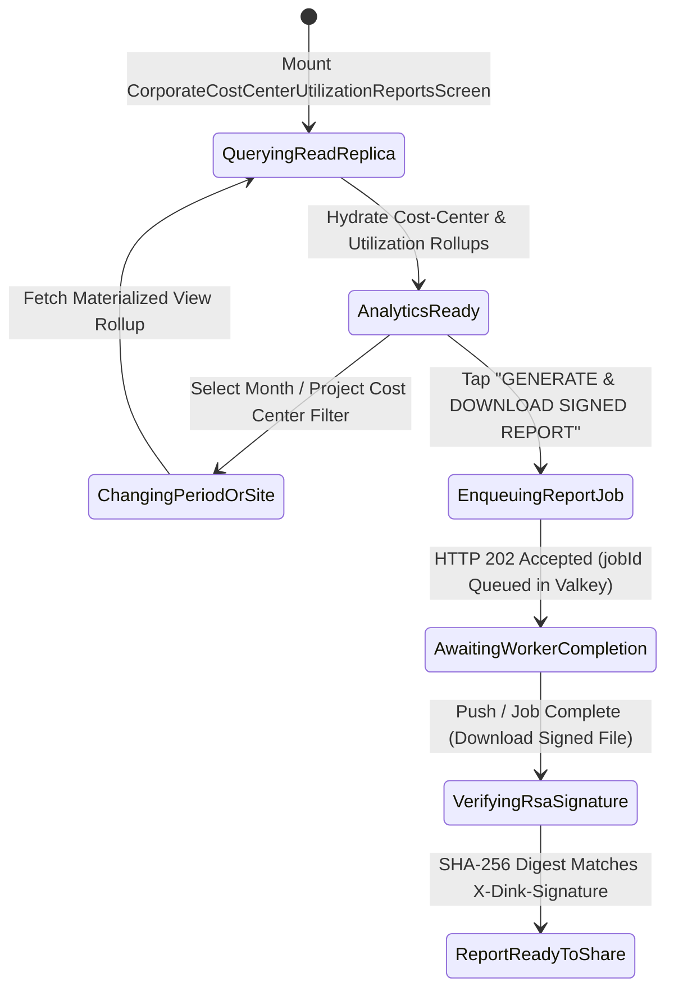
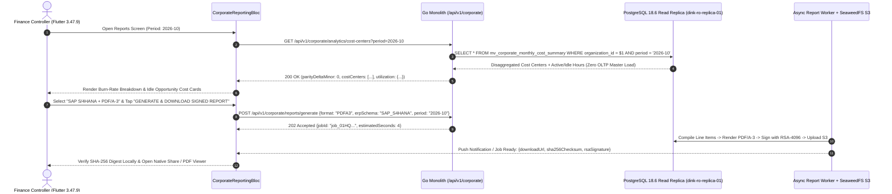

# Corporate Cost-Center Utilization, Burn-Rate & Signed ERP Reports
## Mobile Subsystem Specification — `docs/mobile/corporate-experience/05-corporate-cost-center-utilization-reports.md`

**Document Identifier:** `SPEC-MOB-CRP-05`  
**Classification:** Canonical Subsystem UI/UX & Technical Behavior Specification  
**Governing Documents:** `Dink_Machinery_UI_UX_Design_Brief.md`, `SRS-DINK-CORE-V7.0` (`docs/shared/requirements/06-05-corporate-reporting.md`), `docs/shared/design/design-tokens.json`, `docs/ERROR_CATALOG.md`, `contracts/openapi.yaml`  
**Target Subsystem:** Flutter 3.47.9 / Dart 3.9 Mobile Client (iOS & Android)  
**Primary Persona / Actor:** Corporate Finance Controller (*Solomon Kassa*), Regional Project Director (*Dawit Haile-Mariam*), Corporate Fleet Owner Executive (*W/ro Almaz Tesfaye*)  
**Associated Requirements:** `REQ-06-05` (`REP-01`..`REP-04`, OLAP Read-Replica Segregation, Cost-Center/WBS Spend Disaggregation, Asset Utilization Rate $\mathcal{U}_{\text{asset}}$, RSA-4096 Signed PDF/A-3 & XLSX ERP Exports)  
**Associated Interaction Flows:** `FLOW-14` (Executive Cost-Center Audit & ERP Export Pipeline)  
**Architectural Decisions:** `ADR-001` (Read-Replica OLAP Segregation `dink-ro-replica-01`), `ADR-010` (Double-Entry Integer Minor-Unit Parity & Non-Repudiation Signatures)  
**Status:** Approved Technical Design Baseline

---

## 1. Domain Context, Business Formulas & Architectural Invariants

Corporate Finance Controllers and Project Directors need real-time mobile visibility into project expenditure burn-rates, active versus idle machine operating hours, overtime surcharge leakage, and one-tap export of cryptographically signed **SAP / Oracle / Dynamics 365 / PDF/A-3** statements. The **Corporate Cost-Center Utilization, Burn-Rate & Signed ERP Reports Screen (`CorporateCostCenterUtilizationReportsScreen`)** implements `REQ-06-05` (`REP-01`..`REP-04`) on mobile.

### 1.1 Analytical & Financial Formulas (`REP-02`..`REP-04`)
1. **Double-Entry Cost-Center Allocation Parity Invariant (`REP-02` / `IFRS 16`):**
   Across all active project Cost Centers $c \in \{1..n\}$ within a reporting period, the sum of disaggregated expenses (Base Machinery Hire $M_{\text{mach}}$, Bundled Attachments $M_{\text{att}}$, Overtime Surcharges $M_{\text{overtime}}$, Linked Lowboy Freight $M_{\text{freight}}$, and Sovereign VAT $M_{\text{vat}}$) must equal the consolidated net corporate invoice statement with **zero minor-unit variance**:
   $$\sum_{c=1}^{n} \left(M_{\text{mach}, c} + M_{\text{att}, c} + M_{\text{overtime}, c} + M_{\text{freight}, c} + M_{\text{vat}, c}\right) \equiv M_{\text{consolidated\_invoice\_minor}} \quad (\Delta = 0\text{ Minor Units})$$
2. **Active vs. Idle Machine Utilization Rate ($\mathcal{U}_{\text{asset}}$) (`REP-03 §4.1`):**
   Given total contracted shift allowance $H_{\text{contracted}} = \sum D_{\text{hire}} \times 8.0\text{ hrs}$, verified net operated engine hours $H_{\text{operated}}$, and documented mechanical breakdown hours $H_{\text{breakdown}}$:
   $$\mathcal{U}_{\text{operational}} = \frac{H_{\text{operated}}}{H_{\text{contracted}} - H_{\text{breakdown}}} \times 100\%$$
   $$\text{Idle Opportunity Cost}_{\text{minor}} = \max\left(0,\; \left(H_{\text{contracted}} - H_{\text{breakdown}} - H_{\text{operated}}\right)\right) \times R_{\text{hourly\_minor}}$$
   When $\mathcal{U}_{\text{operational}} < 65.0\%$ on a project site, the analytics card flags `UNDERUTILIZED_SITE_CAPACITY` (contractor is paying for 8-hour daily minimums while machines sit idle waiting for dump trucks or surveying).
3. **Zero-OLTP Impact & Cryptographic Export Signing (`REP-01` / `REP-04`):**
   - All analytical rollups query `mv_corporate_monthly_cost_summary` on the streaming read replica (`dink-ro-replica-01`).
   - Export jobs (`POST /api/v1/corporate/reports/generate`) execute asynchronously (`HTTP 202 Accepted`) and produce **PDF/A-3**, **XLSX**, **CSV**, or **ISO 20022 XML** artifacts signed with `SHA-256` + `RSA-4096` (`X-Dink-Signature`) for non-repudiation during statutory financial audits.

---

## 2. Screen Anatomy & Bespoke ASCII Wireframe

```text
+-----------------------------------------------------------------------+
| [<- Back]      EXECUTIVE COST-CENTER & UTILIZATION REPORTS            |
|-----------------------------------------------------------------------|
| 🏢 SUR CONSTRUCTION PLC • Period: [📅 Oct 2026 (ጥቅምት 2019 ዓ.ም) v]     |
| 🗄️ Data Source: Verified Read-Replica Rollup (Δ = 0 Minor Unit Parity)|
|=======================================================================|
| 💰 1. CONSOLIDATED PROJECT BURN-RATE & EXPENSE SPLIT (REP-02)         |
| +-------------------------------------------------------------------+ |
| | Total Period Plant Expenditure (Incl. 15% VAT): ETB 4,820,400.00  | |
| | • Base Machinery & Attachments (76.2%):         ETB 3,673,144.80  | |
| | • Overtime Hour Surcharges     ( 8.4%):         ETB   404,913.60  | |
| | • Linked Lowboy Mobilization   ( 2.4%):         ETB   115,689.60  | |
| | • Statutory 15% ET VAT         (13.0%):         ETB   626,652.00  | |
| |-------------------------------------------------------------------| |
| | Cost-Center Disaggregation (Double-Entry Parity Verified ✅):     | |
| | • CC-204 (Lot 2 Earthworks):   ETB 2,940,444.00 [██████████░░░░]  | |
| | • CC-209 (Lot 2 Asphalt Base): ETB 1,879,956.00 [██████░░░░░░░░]  | |
| +-------------------------------------------------------------------+ |
|=======================================================================|
| ⏱️ 2. ACTIVE VS. IDLE MACHINE HOURS & EFFICIENCY (REP-03)             |
| +-------------------------------------------------------------------+ |
| | Contracted Shift Allowance (18 Units):          1,152.0 HRS       | |
| | (-) Verified Breakdown Stoppages (Deducted):      -24.0 HRS       | |
| | Net Available Shift Capacity:                   1,128.0 HRS       | |
| |===================================================================| |
| | 🟢 Actual Operated Engine Hours:                  942.0 HRS (83.5%)| |
| | 🟡 Unworked Idle Site Hours (Paid Minimums):      186.0 HRS (16.5%)| |
| | 💸 Est. Idle Opportunity Cost:                    ETB 518,400.00  | |
| | ⚠️ Insight: 2 Wheel Loaders at Lot 2 averaged 4.1 hrs/day (<65%). | |
| +-------------------------------------------------------------------+ |
|=======================================================================|
| 📤 3. CRYPTOGRAPHICALLY SIGNED ERP & AUDIT EXPORTS (REP-04)           |
| +-------------------------------------------------------------------+ |
| | Target ERP Schema: [(•) SAP S/4HANA] [( ) Oracle] [( ) Dynamics]  | |
| | Format: [📄 PDF/A-3 Executive Dossier] [📊 XLSX GL Journal] [XML] | |
| | 🔐 Last Generated: Oct 29, 14:10 • SHA-256 + RSA-4096 Verified    | |
| | [    📥 GENERATE & DOWNLOAD SIGNED REPORT (64dp Primary CTA)    ] | |
| +-------------------------------------------------------------------+ |
+-----------------------------------------------------------------------+
```

---

## 3. W3C DTCG Design Token Mapping Table

| UI Component / Element | W3C DTCG Token Path | Resolved Value (Light / Outdoor High-Contrast) | Ergonomic & Behavioral Mandate |
|---|---|---|---|
| **Financial Disaggregation Card** | `semantic.light.surface.card` + `typography.fontFamily.mono` | `#FFFFFF` surface, `Space Mono` `14sp`..`18sp` figures | Every minor-unit figure aligns vertically to verify $\Delta = 0$ parity. |
| **Active Hours Bar (`83.5%`)** | `color.feedback.emerald.500` | `#10B981` fill | Visualizes productive engine hours against net shift capacity. |
| **Idle Opportunity Cost Pill** | `color.brand.amber.100` + `color.brand.amber.900` | `#FEF3C7` container, `#78350F` text | Highlights paid-but-unworked shift hours so PMs can right-size site fleets. |
| **RSA-4096 Signature Badge** | `color.feedback.blue.50` + `color.feedback.blue.900` | `#EFF6FF` pill, `#1E3A8A` `Space Mono` `12sp` | Confirms cryptographic non-repudiation (`REP-04 §5.4`). |
| **Generate Signed Report CTA** | `component.actuator.button.heightField` / `action.primary.bg` | `64dp` height, `#F59E0B` (`color.brand.amber.500`) | Triggers async Valkey report job (`202 Accepted`) and opens native share/viewer sheet. |

---

## 4. Screen State Machine & Sequence Diagrams

### 4.1 Executive Analytics Rollup & Async Signed Export State Machine


### 4.2 Read-Replica OLAP Query & Async RSA-4096 Report Export Sequence (`REP-01` / `REP-04`)


---

## 5. Concrete Flutter Implementation Blueprint

### 5.1 BLoC Events & Freezed States (`corporate_reporting_bloc.dart`)
```dart
import 'package:freezed_annotation/freezed_annotation.dart';

part 'corporate_reporting_bloc.freezed.dart';

@freezed
sealed class CorporateReportingEvent with _$CorporateReportingEvent {
  const factory CorporateReportingEvent.started({
    required String organizationId,
    required String periodYearMonth, // e.g., '2026-10'
  }) = _Started;

  const factory CorporateReportingEvent.periodOrCostCenterChanged({
    required String periodYearMonth,
    String? filterCostCenterId,
  }) = _PeriodOrCostCenterChanged;

  const factory CorporateReportingEvent.exportConfigChanged({
    required ErpTargetSchema erpSchema, // SAP_S4HANA, ORACLE_FUSION, DYNAMICS_365, ODOO
    required ReportExportFormat exportFormat, // PDFA3, XLSX, CSV, ISO20022_XML
  }) = _ExportConfigChanged;

  const factory CorporateReportingEvent.reportGenerationRequested() = _ReportGenerationRequested;

  const factory CorporateReportingEvent.reportJobCompleted({
    required GeneratedReportArtifactDto artifact,
  }) = _ReportJobCompleted;
}

@freezed
abstract class CorporateReportingState with _$CorporateReportingState {
  const factory CorporateReportingState({
    @Default(ReportingLoadStatus.loading) ReportingLoadStatus status,
    required String organizationId,
    required String periodYearMonth,
    String? selectedCostCenterId,
    CostCenterBurnRateRollupDto? burnRateRollup,
    FleetUtilizationEfficiencyDto? utilizationMetrics,
    @Default(ErpTargetSchema.sapS4Hana) ErpTargetSchema selectedErpSchema,
    @Default(ReportExportFormat.pdfA3) ReportExportFormat selectedFormat,
    @Default(false) bool isGeneratingReport,
    GeneratedReportArtifactDto? latestSignedArtifact,
    ProblemDetails? error,
  }) = _CorporateReportingState;
}
```

### 5.2 Isar Cached Executive Analytics & Signed Reports (`isar_corporate_report_cache.dart`)
```dart
import 'package:isar/isar.dart';

part 'isar_corporate_report_cache.g.dart';

@collection
class IsarCorporateReportCache {
  Id id = Isar.autoIncrement;

  @Index(unique: true, replace: true)
  late String orgPeriodKey; // '{organizationId}_{YYYY-MM}'

  late String organizationId;
  late String periodYearMonth;
  late int totalExpenditureMinor;
  late int baseMachineryMinor;
  late int overtimeSurchargeMinor;
  late int linkedFreightMinor;
  late int vatTotalMinor;
  late double contractedShiftHours;
  late double deductedBreakdownHours;
  late double actualOperatedHours;
  late int idleOpportunityCostMinor;
  late String currencyCode;
  String? downloadedSignedReportPath;
  String? reportSha256Checksum;
  late DateTime cachedAt;
}
```

### 5.3 Widget Tree Hierarchy
```text
CorporateCostCenterUtilizationReportsScreen (Scaffold)
 ├── AppBar ("Executive Cost-Center & Utilization Reports")
 ├── SingleChildScrollView (Padding: 16dp)
 │    ├── PeriodAndCostCenterFilterHeader (Dual Gregorian/Ethiopic Month Picker)
 │    ├── ConsolidatedBurnRateAndExpenseSplitCard (REP-02)
 │    │    ├── ExpenseCategoryBreakdownRows (Base, Overtime, Freight, VAT in Space Mono)
 │    │    ├── DoubleEntryParityVerifiedBadge ("Δ = 0 Minor Unit Parity")
 │    │    └── CostCenterAllocationProgressList (CC-204, CC-209)
 │    ├── ActiveVsIdleUtilizationEfficiencyCard (REP-03)
 │    │    ├── ShiftCapacityVsOperatedHoursGauge (83.5% Operational Utilization)
 │    │    ├── IdleOpportunityCostCalloutRow (Space Mono minor units)
 │    │    └── UnderutilizedAssetInsightBanner (<65% threshold alert)
 │    └── SignedErpExportGeneratorCard (REP-04)
 │         ├── ErpSchemaSelectorChips (SAP S/4HANA | Oracle | Dynamics 365 | Odoo)
 │         ├── ExportFormatSelectorRow (PDF/A-3 | XLSX | CSV | ISO 20022 XML)
 │         ├── CryptographicSignatureVerificationBanner (SHA-256 + RSA-4096)
 │         └── GenerateAndDownloadSignedReportButton (64dp height CTA)
```

---

## 6. OpenAPI 3.1.0 Routes & RFC 9457 Error Matrix

### 6.1 Endpoint Specifications
- **`GET /api/v1/corporate/analytics/cost-centers`** (`REP-02` / `REP-03`)
  - **Headers:** `X-Organization-ID: <uuid>`, `X-Country-Code: ET | KE`.
  - **Query Parameters:** `period` (`YYYY-MM`), `costCenterId` (`uuid?`).
- **`POST /api/v1/corporate/reports/generate`** (`REP-01` / `REP-04`)
  - **Headers:** `Idempotency-Key: <uuid-v4>`, `X-Organization-ID: <uuid>`.
  - **Request Body:** `{ "period": "2026-10", "erpSchema": "SAP_S4HANA", "format": "PDFA3", "costCenterIds": ["uuid"] }`.
  - **Response (`202 Accepted`):** Returns `{ "jobId": "uuid", "status": "QUEUED", "estimatedSeconds": 5 }`.
- **`GET /api/v1/corporate/reports/jobs/{id}`** (`REP-04`)
  - **Response (`200 OK`):** Returns presigned S3 download URL, `sha256Checksum`, and `xDinkRsaSignature`.

### 6.2 RFC 9457 Problem Details Matrix
| Error Code | HTTP Status | RFC 9457 Type URI | Retryable | Mobile UI Remediation & Recovery Action |
|---|---|---|---|---|
| `AUTH_INSUFFICIENT_PERMISSIONS` | `403` | `/errors/insufficient-permissions` | No | Restrict full organizational GL export to `CORP_FINANCE_CONTROLLER`, `CORP_ADMIN`, and `CORP_OWNER_ADMIN`. |
| `LEDGER_DOUBLE_ENTRY_IMBALANCE` | `500` | `/errors/ledger-imbalance` | No | Block report signing if cost-center allocation sum deviates from consolidated invoice by $\ge 1$ minor unit; alert compliance engineering. |
| `SYS_RATE_LIMIT_EXCEEDED` | `429` | `/errors/rate-limit-exceeded` | Yes | Serve cached `IsarCorporateReportCache` artifact if the same period/format was already generated within the last 15 minutes. |

---

## 7. Verification & Acceptance Criteria

- [ ] **Zero Minor-Unit Disaggregation Drift (`REP-02` / `IFRS 16`):** Unit test verifies `baseMachineryMinor + overtimeSurchargeMinor + linkedFreightMinor + vatTotalMinor == totalExpenditureMinor` and equals the sum of all cost-center allocations with $\Delta = 0$.
- [ ] **Operational Utilization & Breakdown Deduction (`REP-03`):** Verified breakdown hours (`24.0 hrs`) are subtracted from contracted shift allowance (`1,152.0 hrs`) before computing operational utilization (`942.0 / 1,128.0 = 83.51%`).
- [ ] **Local SHA-256 Digest Verification (`REP-04`):** Upon downloading a generated PDF/A-3 or XLSX ERP feed, the Flutter client verifies that the file's binary SHA-256 hash matches `sha256Checksum` before opening the share sheet.
