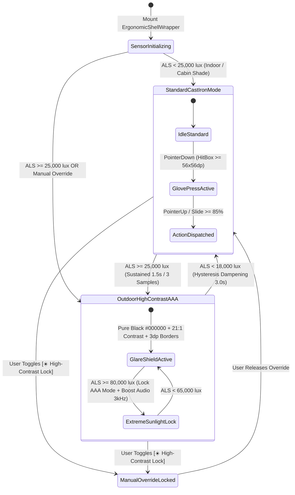

# Industrial Ergonomics, Outdoor Sunlight Mode & Tactile Field Controls
## Mobile Subsystem Specification — `docs/mobile/foundations/01-industrial-ergonomics.md`

**Document Identifier:** `SPEC-MOB-FND-01`  
**Classification:** Canonical Subsystem UI/UX & Technical Behavior Specification  
**Governing Documents:** `docs/source/Dink_Machinery_UI_UX_Design_Brief.md`, `docs/shared/design/00-design-system.md`, `docs/shared/design/design-tokens.json`, `docs/shared/requirements/05-16-accessibility-internationalisation.md`, `docs/shared/requirements/05-17-offline-low-connectivity-support.md`, `docs/ERROR_CATALOG.md`, `contracts/openapi.yaml`  
**Target Subsystem:** Flutter 3.47.8 / Dart 3.9 Mobile Client (iOS & Android)  
**Primary Persona / Actor:** All Mobile Personas (Field Operator, Civil Contractor, Equipment Fleet Owner, Lowboy Transporter)  
**Requirement Traceability:** `REQ-05-16` (`AC-01`..`AC-06`), `REQ-05-17` (`OF-01`..`OF-04`), `REQ-05-18` (`ER-01`..`ER-04`)  
**Associated Interaction Flows:** `FLOW-ENTRY`, `FLOW-08`, `FLOW-09`, `FLOW-10`, `FLOW-APPENDIX-A`  
**Architectural Decision Records:** `ADR-010` (Isar Offline Sync), `ADR-013` (OTA Ethiopic Typography), `ADR-014` (Design Token Pipeline)  
**Status:** Approved Technical Design Baseline

---

## 1. Domain Context & Non-Negotiable Ergonomic Invariants

Heavy machinery operations in Ethiopia and Kenya occur inside vibrating excavator cabs, muddy highway cuts, and blinding open-pit quarries rather than climate-controlled offices. Standard consumer mobile ergonomics ($44\times 44\text{ dp}$ touch targets, subtle 1dp borders, low-contrast pastel cards) fail catastrophically when operated by a heavy plant driver wearing thick split-leather rigging gloves under $>80,000\text{ lux}$ equatorial sunlight.

### 1.1 Non-Negotiable System Invariants
1. **Glove-Friendly Hit Target Floor (`56x56dp` Standard / `64dp` Field Actuators):**
   - Every interactive element (buttons, icon triggers, checkboxes, tab items, date cells) MUST enforce an unobstructed hit-test bounding box of at least **`{dimension.space.56}` ($56 \times 56\text{ dp}$)** with a minimum physical separation margin of **`{dimension.space.8}` ($8\text{ dp}$)** between adjacent targets to prevent accidental dual-touch actuation in $1\text{–}20\text{ Hz}$ vibrating cabs.
   - Primary field action actuators (e.g., *Start Shift*, *Lock Hour Meter*, *Slide-to-Confirm Handover*) MUST enforce a height of **`{dimension.space.64}` ($64\text{ dp}$)**, while camera shutter capture triggers enforce **`{dimension.space.72}` ($72 \times 72\text{ dp}$)**.
2. **Ambient Light Sensor (`>80,000 lux`) Auto-Switching to Outdoor High-Contrast Mode (WCAG 2.2 AAA `21:1`):**
   - The client continuously samples the hardware ambient light sensor (`environment_sensors`) at $2\text{ Hz}$ with a 3-sample moving average.
   - When illuminance exceeds $25,000\text{ lux}$ (and mandatory hardware-locked override at $>80,000\text{ lux}$ direct tropical sun) with hysteresis reset at $<18,000\text{ lux}$, the UI automatically transitions to the `outdoorHighContrast` theme palette (`#000000` pure black canvas, `#FFFFFF` pure white text achieving **$21:1$ contrast**, `{color.brand.amber.400}` `#FBBF24` primary accents, zero drop shadows, and solid `2dp`/`3dp` `{stroke.border.heavy}` white borders).
3. **One-Handed Bottom Thumb-Zone Ergonomics:**
   - All primary mutating CTAs, slide-to-confirm gates, and camera shutter controls are anchored within the bottom $35\%$ of the viewport (` SafeArea` bottom inset $+ 16\text{dp}$), enabling one-handed operation while the operator maintains three points of contact on machinery grab-irons.
4. **Destructive & Financial Action Interlocks:**
   - High-consequence field actions (handover sign-off, emergency breakdown stoppage, dispute escalation, early return initiation) are prohibited from using single-tap buttons; they MUST use a **`64dp` Slide-to-Confirm Mechanical Actuator** requiring $>85\%$ horizontal drag travel against spring resistance.
5. **Zero-Truncation Telemetry Layout (`200%` Font Scaling):**
   - Critical numeric figures (Hour Meter readings, Birr/Shilling minor-unit totals, 6-digit Challenge PINs, Booking IDs) rendered in `{typography.fontFamily.mono}` (`Space Mono`) are strictly forbidden from using `TextOverflow.ellipsis`. Containers must vertically reflow up to $200\%$ system font scaling.

---

## 2. Bespoke ASCII Wireframes & Ergonomic Layout Anatomy

### 2.1 One-Handed Thumb Reachability & Field Viewport Architecture
```text
+-----------------------------------------------------------------------+
| STATUS BAR: 09:42 EAT                        [ALS: 84,200 LUX] [5G/OFF]|
+=======================================================================+
| [<- 56x56dp]  CAT 320D #ET-3-99120           [☀️ AUTO-AAA] [🔊 AUDIO] |
|               UPPER PASSIVE HUD ZONE (Read-Only Telemetry)            |
+-----------------------------------------------------------------------+
|  +-----------------------------------------------------------------+  |
|  | [⚡ OUTDOOR HIGH-CONTRAST ENGAGED: >80,000 LUX DIRECT SUNLIGHT] |  |
|  | Pure Black #000000 Canvas | 21:1 Contrast | 3dp Solid Borders   |  |
|  +-----------------------------------------------------------------+  |
|                                                                       |
|  +------------------------------+   +------------------------------+  |
|  | CHECK-IN BASELINE METER      |   | CURRENT SHIFT ELAPSED        |  |
|  | 1,450.50 HRS                 |   | 06 : 42 : 18                 |  |
|  | [Space Mono 24sp Bold]       |   | Quota: 8.0 Hrs/Day (Normal)  |  |
|  +------------------------------+   +------------------------------+  |
|                                                                       |
|  +--[ NATURAL COMFORT ZONE: GLOVE-FRIENDLY STEPPER CARDS ]---------+  |
|  |                                                                 |  |
|  |  [✓] 1. Exterior 4-Point Walkaround Photos (4/4 Spooled WebP)   |  |
|  |  -------------------------------------------------------------  |  |
|  |  [!] 2. Cabin Mechanical Hour Meter Macro Capture               |  |
|  |      Hold device steady (<0.05g jitter) inside 320x120dp reticle|  |
|  |                                                                 |  |
|  |      +---------------------------------------------------+      |  |
|  |      |  [📷 LAUNCH RETICLE CAMERA]        (56dp Height)  |      |  |
|  |      +---------------------------------------------------+      |  |
|  |  ========[ 3dp Cast-Iron Bottom Lip: {stroke.border.heavy} ]====|  |
|  +-----------------------------------------------------------------+  |
|                                                                       |
|  |<--- Minimum 8dp Physical Gap Between Interactive Targets --->|     |
|                                                                       |
+=======================================================================+
|  PRIMARY THUMB ACTUATION ZONE (Bottom 35% Viewport - One-Handed)      |
|                                                                       |
|  +-------------------------+         +-----------------------------+  |
|  | [⚠️ REPORT BREAKDOWN]   | <--8dp->| [📞 PROXY CALL SITE FOREMAN]|  |
|  |  Height: 56dp | 2dp Bdr |         |  Height: 56dp | 2dp Bdr     |  |
|  +-------------------------+         +-----------------------------+  |
|  |                         <- 12dp Vertical Clearance ->           |  |
|  +-----------------------------------------------------------------+  |
|  | +--------+                                                      |  |
|  | | >>  >> |   SLIDE TO LOCK METER & SIGN HANDOVER (64dp Height)  |  |
|  | +--------+   (Requires >85% Drag Travel + Heavy Triple Haptic)  |  |
|  +=================================================================+  |
|  [                   HOME INDICATOR SAFE AREA (16dp)               ]  |
+-----------------------------------------------------------------------+
```

### 2.2 Hit-Target Expansion & Cast-Iron Skeuomorphic Button Anatomy
```text
    +<----------------- 56dp Minimum Unobstructed Hit Box ----------------->+
    |                         (Transparent 6dp Inset)                       |
    |   +---------------------------------------------------------------+   |
    |   |  2dp Solid Border ({semantic.outdoorHighContrast.border})     |   |
    |   |                                                               |   |
    |   |    [ 28x28dp Lucide Icon ]    CONFIRM WIRE RECEIPT (16sp)     |   |
    |   |                                                               |   |
    |   +===============================================================+   |
    |   |//////// 3dp Solid Cast-Iron Tactile Lip (#D97706) ////////////|   |
    |   +---------------------------------------------------------------+   |
    +<--------------------------------------------------------------------->+
```

---

## 3. W3C DTCG Design Token Mapping Table

All styling properties are resolved strictly from `docs/shared/design/design-tokens.json` without hardcoded hex or pixel literals:

| Ergonomic Element / Role | W3C Token Path (`design-tokens.json`) | Standard Dark (`Cast Iron`) | Outdoor High-Contrast (`>80k lux`) | Behavioral & Physical Constraint |
|---|---|---|---|---|
| **Primary Screen Canvas** | `{semantic.*.surface.canvas}` | `{color.brand.slate.900}` (`#0F172A`) | `#000000` (Pure AMOLED Black) | Zero gradients; eliminates solar glare backscatter. |
| **Elevated Card Surface** | `{semantic.*.surface.card}` | `{color.brand.slate.800}` (`#1E293B`) | `#000000` + `2dp` `#FFFFFF` border | Drops `{elevation.card}` shadow in outdoor mode. |
| **Primary Action Fill** | `{semantic.*.action.primary.bg}` | `{color.brand.amber.500}` (`#F59E0B`) | `{color.brand.amber.400}` (`#FBBF24`) | High-luminance Caterpillar yellow against `#000000`. |
| **Primary Action Label** | `{semantic.*.action.primary.text}` | `{color.brand.slate.950}` (`#020617`) | `#000000` (18sp Weight 900) | Contrast ratio $14.8:1$ on `#FBBF24` fill. |
| **Primary Body Text** | `{semantic.*.text.primary}` | `{color.brand.slate.50}` (`#F8FAFC`) | `#FFFFFF` (100% Solid White) | Achieves **$21:1$ contrast ratio** (WCAG 2.2 AAA). |
| **Standard Glove Hit Box** | `{component.actuator.button.heightStandard}` | `{dimension.space.56}` (`56dp`) | `{dimension.space.56}` (`56dp`) | Mandatory floor for all interactive controls. |
| **Field Actuator Height** | `{component.actuator.button.heightField}` | `{dimension.space.64}` (`64dp`) | `{dimension.space.64}` (`64dp`) | Primary CTA and Slide-to-Confirm track height. |
| **Shutter Capture Button** | `{dimension.space.72}` | `72dp x 72dp` | `72dp x 72dp` (`3dp` border) | Circular viewfinder shutter button diameter. |
| **Tactile Bottom Lip** | `{component.actuator.button.bottomTactileLip}` | `{stroke.border.heavy}` (`3dp`) | `{stroke.border.heavy}` (`3dp`) | Collapses to `0dp` with `translateY(3dp)` on active press. |
| **Camera Reticle Box** | `{component.reticle.viewfinder.*}` | `320dp x 120dp`, `{stroke.border.medium}` | `320dp x 120dp`, `{stroke.border.heavy}` (`3dp`) | Transitions from `{color.brand.amber.500}` to `{color.feedback.emerald.500}`. |
| **Tabular Telemetry Font** | `{typography.fontFamily.mono}` | `Space Mono, monospace` (`16sp`–`28sp`) | `Space Mono, monospace` (`18sp`–`32sp`) | Enforces `FontFeature.tabularFigures()` for meters/money. |
| **Ethiopic Script Font** | `{typography.fontFamily.ethiopic}` | `Noto Sans Ethiopic` (`1.38x` height) | `Noto Sans Ethiopic` (`1.45x` height) | Loaded via `ADR-013` OTA pipeline with $+1.0\text{sp}$ boost. |

---

## 4. Interactive State Machine & Ambient Light Adaptation Choreography



---

## 5. Concrete Flutter Implementation Blueprint

### 5.1 Ergonomics & Ambient Theme BLoC (`ergonomics_cubit.dart`)
```dart
// lib/core/ergonomics/bloc/ergonomics_state.dart
import 'package:freezed_annotation/freezed_annotation.dart';

part 'ergonomics_state.freezed.dart';

enum LightingProfile { standardDark, outdoorHighContrastAAA }
enum HandednessZone { rightHanded, leftHanded }

@freezed
class ErgonomicsState with _$ErgonomicsState {
  const factory ErgonomicsState({
    @Default(LightingProfile.standardDark) LightingProfile lightingProfile,
    @Default(0.0) double ambientLux,
    @Default(false) bool isExtremeGlareLocked, // True when > 80,000 lux
    @Default(false) bool manualOutdoorOverride,
    @Default(HandednessZone.rightHanded) HandednessZone thumbZone,
    @Default(1.0) double textScaleMultiplier,
    @Default(true) bool fieldGloveModeEnabled, // Enforces 56dp/64dp hit boxes
  }) = _ErgonomicsState;
}
```

```dart
// lib/core/ergonomics/bloc/ergonomics_cubit.dart
import 'dart:async';
import 'package:flutter/services.dart';
import 'package:flutter_bloc/flutter_bloc.dart';
import 'package:environment_sensors/environment_sensors.dart';
import 'package:isar/isar.dart';
import 'ergonomics_state.dart';
import '../models/ergonomic_pref_isar.dart';

class ErgonomicsCubit extends Cubit<ErgonomicsState> {
  final EnvironmentSensors _sensors;
  final Isar _isar;
  StreamSubscription<double>? _luxSubscription;
  final List<double> _luxWindow = [];

  static const double kTriggerOutdoorLux = 25000.0;
  static const double kExtremeSunlightLux = 80000.0;
  static const double kResetIndoorLux = 18000.0;

  ErgonomicsCubit(this._sensors, this._isar) : super(const ErgonomicsState()) {
    _hydratePreferences();
    _startAmbientLightMonitoring();
  }

  Future<void> _hydratePreferences() async {
    final pref = await _isar.ergonomicPrefIsars.where().findFirst();
    if (pref != null) {
      emit(state.copyWith(
        manualOutdoorOverride: pref.manualOutdoorOverride,
        lightingProfile: pref.manualOutdoorOverride
            ? LightingProfile.outdoorHighContrastAAA
            : state.lightingProfile,
        fieldGloveModeEnabled: pref.fieldGloveModeEnabled,
      ));
    }
  }

  void _startAmbientLightMonitoring() {
    _luxSubscription = _sensors.light.listen((double rawLux) {
      _luxWindow.add(rawLux);
      if (_luxWindow.length > 3) _luxWindow.removeAt(0);
      final avgLux = _luxWindow.reduce((a, b) => a + b) / _luxWindow.length;

      if (state.manualOutdoorOverride) {
        emit(state.copyWith(ambientLux: avgLux, isExtremeGlareLocked: avgLux >= kExtremeSunlightLux));
        return;
      }

      if (avgLux >= kTriggerOutdoorLux && state.lightingProfile != LightingProfile.outdoorHighContrastAAA) {
        HapticFeedback.mediumImpact();
        emit(state.copyWith(
          ambientLux: avgLux,
          lightingProfile: LightingProfile.outdoorHighContrastAAA,
          isExtremeGlareLocked: avgLux >= kExtremeSunlightLux,
        ));
      } else if (avgLux < kResetIndoorLux && state.lightingProfile == LightingProfile.outdoorHighContrastAAA) {
        emit(state.copyWith(
          ambientLux: avgLux,
          lightingProfile: LightingProfile.standardDark,
          isExtremeGlareLocked: false,
        ));
      } else {
        emit(state.copyWith(
          ambientLux: avgLux,
          isExtremeGlareLocked: avgLux >= kExtremeSunlightLux,
        ));
      }
    });
  }

  Future<void> toggleManualOutdoorMode(bool enabled) async {
    HapticFeedback.heavyImpact();
    await _isar.writeTxn(() async {
      await _isar.ergonomicPrefIsars.put(
        ErgonomicPrefIsar()
          ..id = 1
          ..manualOutdoorOverride = enabled
          ..fieldGloveModeEnabled = state.fieldGloveModeEnabled
          ..updatedAt = DateTime.now().toUtc(),
      );
    });
    emit(state.copyWith(
      manualOutdoorOverride: enabled,
      lightingProfile: enabled
          ? LightingProfile.outdoorHighContrastAAA
          : (state.ambientLux >= kTriggerOutdoorLux
              ? LightingProfile.outdoorHighContrastAAA
              : LightingProfile.standardDark),
    ));
  }

  @override
  Future<void> close() {
    _luxSubscription?.cancel();
    return super.close();
  }
}
```

### 5.2 Isar Local Persistence Model (`ergonomic_pref_isar.dart`)
```dart
// lib/core/ergonomics/models/ergonomic_pref_isar.dart
import 'package:isar/isar.dart';

part 'ergonomic_pref_isar.g.dart';

@collection
class ErgonomicPrefIsar {
  Id id = 1; // Singleton device configuration record
  late bool manualOutdoorOverride;
  late bool fieldGloveModeEnabled;
  late DateTime updatedAt;
}
```

### 5.3 Glove-Friendly Industrial Button & Slide Actuator Hierarchy (`dink_glove_actuator.dart`)
```dart
// lib/core/widgets/dink_glove_actuator.dart
import 'package:flutter/material.dart';
import 'package:flutter/services.dart';

class DinkGloveButton extends StatefulWidget {
  final String label;
  final IconData? icon;
  final VoidCallback? onPressed;
  final bool isFieldPrimary; // 64dp height when true, 56dp minimum when false
  final bool isOutdoorAAA;

  const DinkGloveButton({
    super.key,
    required this.label,
    this.icon,
    this.onPressed,
    this.isFieldPrimary = false,
    this.isOutdoorAAA = false,
  });

  @override
  State<DinkGloveButton> createState() => _DinkGloveButtonState();
}

class _DinkGloveButtonState extends State<DinkGloveButton> {
  bool _isPressed = false;

  @override
  Widget build(BuildContext context) {
    final double targetHeight = widget.isFieldPrimary ? 64.0 : 56.0;
    final Color bgColor = widget.isOutdoorAAA ? const Color(0xFFFBBF24) : const Color(0xFFF59E0B);
    final Color lipColor = widget.isOutdoorAAA ? Colors.white : const Color(0xFFD97706);

    return Semantics(
      button: true,
      enabled: widget.onPressed != null,
      label: widget.label,
      child: Padding(
        padding: const EdgeInsets.all(4.0), // Guarantees 8dp gap between adjacent wrapped controls
        child: GestureDetector(
          behavior: HitTestBehavior.opaque,
          onTapDown: (_) {
            if (widget.onPressed != null) {
              HapticFeedback.lightImpact();
              setState(() => _isPressed = true);
            }
          },
          onTapUp: (_) {
            if (widget.onPressed != null) {
              setState(() => _isPressed = false);
              widget.onPressed!();
            }
          },
          onTapCancel: () => setState(() => _isPressed = false),
          child: ConstrainedBox(
            constraints: BoxConstraints(minWidth: 56.0, minHeight: targetHeight),
            child: AnimatedContainer(
              duration: const Duration(milliseconds: 100),
              transform: Matrix4.translationValues(0, _isPressed ? 3.0 : 0.0, 0),
              decoration: BoxDecoration(
                color: widget.onPressed != null ? bgColor : const Color(0xFF334155),
                borderRadius: BorderRadius.circular(widget.isOutdoorAAA ? 4.0 : 8.0),
                border: Border(
                  top: BorderSide(color: widget.isOutdoorAAA ? Colors.white : const Color(0xFF334155), width: 2.0),
                  left: BorderSide(color: widget.isOutdoorAAA ? Colors.white : const Color(0xFF334155), width: 2.0),
                  right: BorderSide(color: widget.isOutdoorAAA ? Colors.white : const Color(0xFF334155), width: 2.0),
                  bottom: BorderSide(color: lipColor, width: _isPressed ? 0.0 : 3.0),
                ),
              ),
              padding: const EdgeInsets.symmetric(horizontal: 20.0),
              child: Row(
                mainAxisAlignment: MainAxisAlignment.center,
                children: [
                  if (widget.icon != null) ...[
                    Icon(widget.icon, size: 28.0, color: const Color(0xFF020617)),
                    const SizedBox(width: 12.0),
                  ],
                  Flexible(
                    child: Text(
                      widget.label,
                      textAlign: TextAlign.center,
                      style: TextStyle(
                        fontSize: widget.isOutdoorAAA ? 18.0 : 16.0,
                        fontWeight: FontWeight.w900,
                        color: const Color(0xFF020617),
                      ),
                    ),
                  ),
                ],
              ),
            ),
          ),
        ),
      ),
    );
  }
}
```

---

## 6. OpenAPI 3.1.0 Contract & RFC 9457 Error Recovery Matrix

Ergonomic telemetry, remote UI spec schemas, and error recovery modals bind to the following endpoints and error codes:

| Endpoint / Operation | Method & Path | Request / Header Invariants | RFC 9457 Error Code & Status | Ergonomic UI Recovery Behavior |
|---|---|---|---|---|
| **Fetch Dynamic Spec Controls** | `GET /api/v1/admin/ui-config` | `X-Country-Code: ET \| KE`<br/>`Accept-Language: am \| om \| sw \| en` | `SYS_SERVICE_UNAVAILABLE` (`503`) | Fall back immediately to Isar cached `CachedCategory` EAV schema; show non-blocking top amber banner. |
| **Submit Field Inspection** | `POST /api/v1/bookings/{id}/return-inspect` | `Idempotency-Key: <localDraftId>`<br/>`Content-Type: multipart/form-data` | `INSPECT_METER_REGRESSION` (`422`) | Fire 250ms harsh warning buzz; open high-contrast bottom sheet (`#000000` canvas, `3dp` crimson border) with `64dp` `[ 📷 RE-CAPTURE HOUR METER ]` CTA. |
| **Upload Inspection Media** | `POST /api/v1/sync/media-chunk-upload` | Streamed via ClamAV `:3310` `zINSTREAM` | `INSPECT_MEDIA_SCAN_FAILED` (`422`) | Quarantine corrupted file locally; prompt operator with `56dp` button to retake live camera reticle shot. |
| **Validate Field Input** | `POST /api/v1/bookings` | `Idempotency-Key` mandatory | `REQ_VALIDATION_FAILED` (`400`) | Auto-scroll viewport to first offending `DynamicSpecInputField`, thicken border to `3dp` `{color.feedback.crimson.500}`, and play 400Hz error tone. |

---

## 7. Verification & Acceptance Criteria

### 7.1 Automated Unit & BLoC Test Cases (`bloc_test`)
1. **Ambient Light Sensor Hysteresis Verification:**
   - *Given* `ErgonomicsCubit` initialized in `LightingProfile.standardDark` at `450 lux`,
   - *When* ambient light sensor emits `[26000.0, 27500.0, 82000.0]` lux,
   - *Then* state transitions to `LightingProfile.outdoorHighContrastAAA` with `isExtremeGlareLocked: true`, and does NOT revert to `standardDark` when a transient shadow reading of `19500.0 lux` is emitted (requires $<18,000\text{ lux}$).
2. **Manual High-Contrast Lock Persistence:**
   - *Given* user toggles `toggleManualOutdoorMode(true)` in indoor conditions (`300 lux`),
   - *Then* `ErgonomicPrefIsar` persists `manualOutdoorOverride == true` and theme stays locked to `outdoorHighContrastAAA` across app restarts.

### 7.2 Widget, Golden & Accessibility Test Gates
1. **Minimum `56x56dp` Glove Hit-Box Assertion:**
   - Automated widget test walks the render tree of all interactive widgets (`DinkGloveButton`, `IconButton`, `Checkbox`, `Tab`) and asserts `tester.getSize(finder).width >= 56.0` and `tester.getSize(finder).height >= 56.0` with `>= 8.0dp` edge separation.
2. **WCAG 2.2 AAA (`21:1`) Contrast & `200%` Text Reflow Golden Suite:**
   - Golden snapshots rendered with `MediaQueryData(textScaler: TextScaler.linear(2.0))` in `outdoorHighContrastAAA` mode across English (`en`) and Amharic (`am`) locales verify zero text clipping, zero `TextOverflow.ellipsis` on `Space Mono` financial/meter figures, and `>= 7.0:1` contrast on all foreground/background token pairs.
