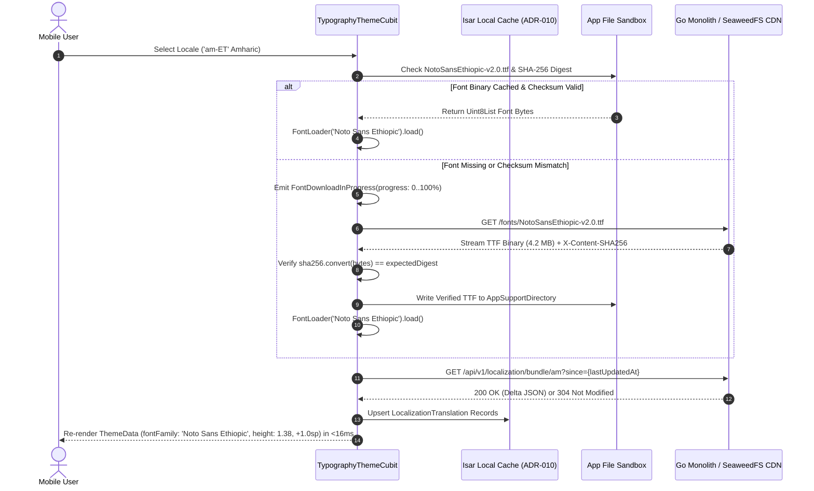

# Color Palette, High-Contrast Theming & Multi-Script Typography
## Mobile Subsystem Specification — `docs/mobile/foundations/02-color-typography-tokens.md`

**Document Identifier:** `SPEC-MOB-FND-02`  
**Classification:** Canonical Subsystem UI/UX & Technical Behavior Specification  
**Governing Documents:** `docs/source/Dink_Machinery_UI_UX_Design_Brief.md`, `docs/shared/design/00-design-system.md`, `docs/shared/design/design-tokens.json`, `docs/shared/requirements/05-16-accessibility-internationalisation.md`, `docs/ERROR_CATALOG.md`, `contracts/openapi.yaml`  
**Target Subsystem:** Flutter 3.47.8 / Dart 3.9 Mobile Client (iOS & Android)  
**Primary Persona / Actor:** All Mobile Personas (Contractor, Fleet Owner, Field Operator, Lowboy Transporter)  
**Requirement Traceability:** `REQ-05-16` (`AC-01`..`AC-06`, `LOC-01-BE`), `REQ-05-17` (`OF-01`), `REQ-05-18` (`ER-01`)  
**Associated Interaction Flows:** `FLOW-ENTRY`, `FLOW-01`, `FLOW-APPENDIX-A`  
**Architectural Decision Records:** `ADR-010` (Isar Local Bundle Caching), `ADR-013` (Dynamic OTA Ethiopic Font Pipeline), `ADR-014` (W3C DTCG Token Compilation)  
**Status:** Approved Technical Design Baseline

---

## 1. Domain Context & Non-Negotiable Typography/Color Invariants

Dink Machinery operates across four primary linguistic regimes—English (`en`), Amharic (`am`), Afaan Oromoo (`om`), and Swahili (`sw`)—spanning both Latin and Ethiopic Ge'ez scripts (`U+1200`–`U+137F`), while displaying high-value financial settlements (`ETB` and `KES` minor units) under extreme equatorial solar glare.

### 1.1 Non-Negotiable System Invariants
1. **Strict W3C DTCG Three-Tier Token Binding (`Zero Hardcoded Hex/SP`):**
   - Flutter widgets are prohibited from instantiating raw `Color(0xFF...)` or literal font sizes outside generated `DinkTokens` (`lib/core/theme/tokens.g.dart` compiled from `docs/shared/design/design-tokens.json`).
   - All surfaces, text, and borders resolve through Tier 2 Semantic tokens (`light`, `dark`, `outdoorHighContrast`) and Tier 3 Component tokens (`{component.actuator.button.*}`, `{component.countdown.*}`).
2. **The Golden Ge'ez Line-Height Multiplier (`1.38x` Heading / `1.45x` Body) & `+1.0sp` Optical Boost:**
   - Ethiopic vowel diacritics (e.g., ኡ, ዒ, ዖ, ጰ) extend above and below standard Latin ascender/descender bounding boxes. All text rendered in Amharic (`am`) or Tigrinya (`ti`) MUST apply `{typography.lineHeightFactor.ethiopicGolden}` (**$1.38\times$**) on headings and `{typography.lineHeightFactor.ethiopicBody}` (**$1.45\times$**) on dense body copy, plus $2\text{dp}$ vertical internal padding and a **$+1.0\text{sp}$ font size optical increment** relative to Latin equivalents.
3. **ADR-013 Dynamic Over-The-Air (OTA) Font Loading & SHA-256 Verification (`<25MB` APK):**
   - To keep the base Android APK below the $25\text{MB}$ frontier cellular download budget, full `Noto Sans Ethiopic` weight families are fetched over-the-air from SeaweedFS S3 CDN (`/fonts/NotoSansEthiopic-v2.0.ttf`), verified against a pinned **SHA-256 cryptographic checksum**, cached in the device application sandbox, and injected dynamically via Flutter's `FontLoader` without restarting the activity.
4. **Monospaced Tabular Financial & Telemetry Numerals (`Space Mono`):**
   - Every monetary amount (formatted from 64-bit integer minor units: Santims/Cents), machine hour-meter reading, Valkey hold countdown clock, chassis PIN, and GPS coordinate MUST render in `{typography.fontFamily.mono}` (`Space Mono`) with `FontFeature.tabularFigures()` enabled so decimal points align vertically in ledger statements.
5. **Color-Blind Safe Multi-Modal Status Encoding:**
   - None of the 20 booking lifecycle states or inspection alerts rely on color alone. Every status badge pairs its semantic token fill (`emerald`, `amber`, `crimson`, `blue`, `purple`) with a distinct geometric Lucide icon glyph and explicit localized status label to support operators with protanopia, deuteranopia, or tritanopia.

---

## 2. Bespoke ASCII Wireframes: Theme Modes, OTA Font Loader & Multi-Script Ledger

### 2.1 Tri-Mode Theme Switcher & Multi-Script Typography Specimen View
```text
+-----------------------------------------------------------------------+
| [<- 56x56dp]  DISPLAY & LANGUAGE SETTINGS        [☀️ LUX: 81,500 AAA] |
+=======================================================================+
|  1. ACTIVE LIGHTING & CONTRAST THEME                                  |
|  +--------------------+ +--------------------+ +--------------------+ |
|  | [ ] DAYLIGHT LIGHT | | [ ] CAST IRON DARK | | [✓] OUTDOOR AAA    | |
|  | Canvas: #F8FAFC    | | Canvas: #0F172A    | | Canvas: #000000    | |
|  | Text:   #0F172A    | | Text:   #F8FAFC    | | Text:   #FFFFFF    | |
|  | Ratio:  15.8 : 1   | | Ratio:  15.8 : 1   | | Ratio:  21.0 : 1   | |
|  +--------------------+ +--------------------+ +--------------------+ |
|  [X] Auto-Switch to Outdoor AAA when Ambient Light > 25,000 lux       |
+-----------------------------------------------------------------------+
|  2. MULTI-SCRIPT TYPOGRAPHY & OTA FONT ASSET STATUS (ADR-013)         |
|  +-----------------------------------------------------------------+  |
|  | [✓] አማርኛ (Amharic - Ge'ez Script)           [ACTIVE LOCALE]     |  |
|  |     Font: Noto Sans Ethiopic (4.2 MB Cached | SHA-256 Verified) |  |
|  |     Line-Height: 1.38x / 1.45x | Optical Size Boost: +1.0sp     |  |
|  |     Sample: የከባድ ማሽነሪ ኪራይ እና ሎጂስቲክስ (Zero Diacritic Clipping)   |  |
|  +-----------------------------------------------------------------+  |
|  | [ ] Afaan Oromoo (Qubee Latin) | +25% Word-Length Buffer        |  |
|  | [ ] Kiswahili (East Africa)    | Roboto 400/700 (1.25x Height)  |  |
|  | [ ] English (International)    | Roboto 400/700 (1.25x Height)  |  |
|  +-----------------------------------------------------------------+  |
+-----------------------------------------------------------------------+
|  3. TABULAR FINANCIAL & TELEMETRY SPECIMEN ({fontFamily.mono})        |
|  +-----------------------------------------------------------------+  |
|  | LEDGER LINE ITEM                          MINOR UNITS / DISPLAY |  |
|  | --------------------------------------------------------------- |  |
|  | Base Rental (5 Days @ 35,000.00)            175,000.00 ETB      |  |
|  | Excess Engine Hours (5.70 Hrs @ 2,800.00)    15,960.00 ETB      |  |
|  | Value Added Tax (15.0% MOR)                  28,644.00 ETB      |  |
|  | =============================================================== |  |
|  | NET SETTLEMENT DUE (Direct Bank Wire)       219,604.00 ETB      |  |
|  | Check-In Meter: 01,450.50 HRS  ->  Return Meter: 01,512.20 HRS  |  |
|  +-----------------------------------------------------------------+  |
+-----------------------------------------------------------------------+
```

### 2.2 Ge'ez Vertical Bounding Box vs. Standard Latin Bounding Box
```text
   LATIN (Roboto 16sp | Line-Height: 1.25x = 20dp)
   +-------------------------------------------------------+
   |   Ascender Line  :  Rental Agreement #BK-9042         |
   |   Baseline       :  _________________________         |
   +-------------------------------------------------------+

   ETHIOPIC GE'EZ (Noto Sans Ethiopic 17sp | Line-Height: 1.45x = 25dp)
   +-------------------------------------------------------+
   |   2dp Top Pad    :  [ Prevents Upper Vowel Clipping ] |
   |   Ge'ez Glyphs   :  የኪራይ ውል ስምምነት ቁጥር #BK-9042        |
   |   Lower Diacritic:  (ኡ / ኢ / ኦ Sub-Baseline Rings)    |
   |   2dp Bottom Pad :  [ Prevents Lower Ring Clipping  ] |
   +-------------------------------------------------------+
```

---

## 3. W3C DTCG Design Token Mapping Table

| Token Category | W3C Token Path (`design-tokens.json`) | Resolved Value (`light` / `dark` / `outdoorHighContrast`) | Component / Typographic Usage |
|---|---|---|---|
| **Brand Primary Amber** | `{color.brand.amber.500}` / `{color.brand.amber.400}` | `#F59E0B` (Light/Dark) / `#FBBF24` (Outdoor AAA) | Primary CTA fills, active tab indicators, reticle idle border. |
| **Brand Active Lip** | `{color.brand.amber.600}` / `{color.brand.amber.700}` | `#D97706` (Light) / `#B45309` (Dark) / `#FFFFFF` (Outdoor) | `3dp` bottom tactile lip on buttons and focused inputs. |
| **Canvas Surface** | `{semantic.*.surface.canvas}` | `#F8FAFC` / `#0F172A` / `#000000` | Root `Scaffold.backgroundColor`. |
| **Card Surface** | `{semantic.*.surface.card}` | `#FFFFFF` / `#1E293B` / `#000000` | Fleet cards, inspection checklists, ledger breakdown containers. |
| **Numeric Ledger Text** | `{semantic.*.text.numericLedger}` | `#020617` / `#F8FAFC` / `#FFFFFF` | High-density monetary and meter figures in `Space Mono`. |
| **Verified / Locked** | `{color.feedback.emerald.500}` | `#10B981` (Fill tint `#ECFDF5` / Dark `#064E3B`) | `CONFIRMED` booking badge, steady-state camera reticle lock. |
| **Hazard / Mandatory** | `{color.feedback.orange.500}` | `#FF5722` | Slide-to-confirm thumb accent, mandatory action required alert. |
| **Fault / Critical** | `{color.feedback.crimson.600}` | `#DC2626` (Fill tint `#FEF2F2` / Dark `#450A0A`) | Meter regression error, ClamAV virus rejection, `<5m` hold timer. |
| **Dispute / Arbitration**| `{color.feedback.purple.500}` | `#A855F7` (Fill tint `#FAF5FF` / Dark `#581C87`) | `DISPUTED` and `ARBITRATION_PENDING` state badges. |
| **Latin Typeface** | `{typography.fontFamily.latin}` | `Roboto, -apple-system, sans-serif` | English (`en`), Swahili (`sw`), Afaan Oromoo (`om`) UI text. |
| **Ethiopic Typeface** | `{typography.fontFamily.ethiopic}` | `Noto Sans Ethiopic, sans-serif` | Amharic (`am`) and Tigrinya (`ti`) script rendering. |
| **Monospace Typeface** | `{typography.fontFamily.mono}` | `Space Mono, monospace` | Minor-unit currency, hour meters, OTP digits, coordinates. |
| **Ge'ez Line Height** | `{typography.lineHeightFactor.ethiopicGolden}` | `1.38` (Headings) / `1.45` (`ethiopicBody`) | Eliminates vertical clipping of Ethiopic vowel markers. |

---

## 4. State Machine & Dynamic OTA Font Loading Sequence (`ADR-013`)



---

## 5. Concrete Flutter Implementation Blueprint

### 5.1 Multi-Script Typography & Token Theme BLoC (`typography_theme_cubit.dart`)
```dart
// lib/core/theme/bloc/typography_theme_state.dart
import 'package:flutter/material.dart';
import 'package:freezed_annotation/freezed_annotation.dart';

part 'typography_theme_state.freezed.dart';

enum DinkThemeMode { light, darkCastIron, outdoorHighContrast }

@freezed
class TypographyThemeState with _$TypographyThemeState {
  const factory TypographyThemeState({
    @Default(Locale('en', 'ET')) Locale activeLocale,
    @Default(DinkThemeMode.darkCastIron) DinkThemeMode themeMode,
    @Default(false) bool isEthiopicFontLoaded,
    @Default(0.0) double fontDownloadProgress,
    String? errorCode,
  }) = _TypographyThemeState;

  const TypographyThemeState._();

  bool get isEthiopicScript =>
      activeLocale.languageCode == 'am' || activeLocale.languageCode == 'ti';

  double get lineHeightHeading => isEthiopicScript ? 1.38 : 1.25;
  double get lineHeightBody => isEthiopicScript ? 1.45 : 1.25;
  double get scriptFontSizeDelta => isEthiopicScript ? 1.0 : 0.0;
}
```

```dart
// lib/core/theme/bloc/typography_theme_cubit.dart
import 'dart:io';
import 'dart:typed_data';
import 'package:crypto/crypto.dart';
import 'package:dio/dio.dart';
import 'package:flutter/material.dart';
import 'package:flutter/services.dart';
import 'package:flutter_bloc/flutter_bloc.dart';
import 'package:path_provider/path_provider.dart';
import 'typography_theme_state.dart';

class TypographyThemeCubit extends Cubit<TypographyThemeState> {
  final Dio _dio;
  static const String kEthiopicFontFile = 'NotoSansEthiopic-v2.0.ttf';
  static const String kExpectedSha256 =
      'e3b0c44298fc1c149afbf4c8996fb92427ae41e4649b934ca495991b7852b855'; // Pinned release digest

  TypographyThemeCubit(this._dio) : super(const TypographyThemeState());

  Future<void> switchLocale(Locale targetLocale) async {
    if (targetLocale.languageCode == 'am' || targetLocale.languageCode == 'ti') {
      final loaded = await _ensureEthiopicFontLoaded();
      if (!loaded) {
        emit(state.copyWith(activeLocale: targetLocale, errorCode: 'FONT_OTA_CHECKSUM_FAILED'));
        return;
      }
    }
    emit(state.copyWith(activeLocale: targetLocale, errorCode: null));
  }

  Future<bool> _ensureEthiopicFontLoaded() async {
    if (state.isEthiopicFontLoaded) return true;
    final dir = await getApplicationSupportDirectory();
    final file = File('${dir.path}/$kEthiopicFontFile');

    if (await file.exists()) {
      final bytes = await file.readAsBytes();
      if (_verifySha256(bytes)) {
        await _injectFontIntoEngine(bytes);
        emit(state.copyWith(isEthiopicFontLoaded: true, fontDownloadProgress: 1.0));
        return true;
      }
      await file.delete();
    }

    try {
      final response = await _dio.get<List<int>>(
        '/fonts/$kEthiopicFontFile',
        options: Options(responseType: ResponseType.bytes),
        onReceiveProgress: (received, total) {
          if (total > 0) {
            emit(state.copyWith(fontDownloadProgress: received / total));
          }
        },
      );
      final bytes = Uint8List.fromList(response.data!);
      if (!_verifySha256(bytes)) return false;

      await file.writeAsBytes(bytes, flush: true);
      await _injectFontIntoEngine(bytes);
      emit(state.copyWith(isEthiopicFontLoaded: true, fontDownloadProgress: 1.0));
      return true;
    } catch (_) {
      return false;
    }
  }

  bool _verifySha256(Uint8List bytes) {
    final digest = sha256.convert(bytes).toString();
    return digest == kExpectedSha256;
  }

  Future<void> _injectFontIntoEngine(Uint8List bytes) async {
    final loader = FontLoader('Noto Sans Ethiopic');
    loader.addFont(Future.value(ByteData.view(bytes.buffer)));
    await loader.load();
  }
}
```

### 5.2 Tabular Minor-Unit Financial & Meter Text Widget (`dink_mono_ledger_text.dart`)
```dart
// lib/core/widgets/dink_mono_ledger_text.dart
import 'dart:ui';
import 'package:flutter/material.dart';
import 'package:intl/intl.dart';

class DinkMonoMoneyText extends StatelessWidget {
  final int amountMinorUnits; // Strictly 64-bit integer Santims / Cents
  final String currencyCode;  // 'ETB' or 'KES'
  final double fontSize;
  final Color? color;

  const DinkMonoMoneyText({
    super.key,
    required this.amountMinorUnits,
    required this.currencyCode,
    this.fontSize = 16.0,
    this.color,
  });

  @override
  Widget build(BuildContext context) {
    final double majorAmount = amountMinorUnits / 100.0;
    final formatted = NumberFormat('#,##0.00', 'en_US').format(majorAmount);

    return Text(
      '$formatted $currencyCode',
      softWrap: true, // Never truncate financial totals with ellipsis
      style: TextStyle(
        fontFamily: 'Space Mono',
        fontSize: fontSize,
        fontWeight: FontWeight.w700,
        height: 1.25,
        color: color ?? Theme.of(context).colorScheme.onSurface,
        fontFeatures: const [FontFeature.tabularFigures()],
      ),
    );
  }
}
```

---

## 6. OpenAPI 3.1.0 Contract & RFC 9457 Error Recovery Matrix

| Endpoint / Operation | Method & Path | Request / Header Invariants | RFC 9457 Error Code & Status | UI Recovery Behavior |
|---|---|---|---|---|
| **Fetch Differential Translation Bundle** | `GET /api/v1/localization/bundle/{lang}` | `If-Modified-Since` / `ETag`<br/>`X-Country-Code: ET \| KE` | `SYS_SERVICE_UNAVAILABLE` (`503`) | Serve embedded Isar `LocalizationTranslation` catalog; zero block to language switching. |
| **Download OTA Ethiopic Font Binary** | `GET /fonts/NotoSansEthiopic-v2.0.ttf` | Verified against pinned SHA-256 hash | `FONT_OTA_CHECKSUM_FAILED` (Client) | Delete corrupted partial file; fallback to system Ge'ez font with `1.45x` height; show retry toast. |
| **Report Missing Translation Key** | `POST /api/v1/localization/audit-missing` | `Idempotency-Key` | `SYS_RATE_LIMIT_EXCEEDED` (`429`) | Deduplicate missing key reports in Isar; flush batch on next background sync window. |
| **Validate Country Jurisdiction** | Any `/api/v1/*` | `X-Country-Code: ET \| KE` | `REQ_INVALID_COUNTRY_CODE` (`400`) | Re-sync session country code from SIM/User profile (`ET` or `KE`) and replay request. |

---

## 7. Verification & Acceptance Criteria

### 7.1 Automated Unit & BLoC Test Cases (`bloc_test`)
1. **ADR-013 SHA-256 Font Integrity Verification:**
   - *Given* `TypographyThemeCubit` receives a tampered TTF binary stream from a MITM proxy,
   - *When* `switchLocale(Locale('am', 'ET'))` executes,
   - *Then* `_verifySha256` returns `false`, the binary is never passed to `FontLoader`, and state emits `errorCode: 'FONT_OTA_CHECKSUM_FAILED'`.
2. **Integer Minor-Unit Formatting Determinism:**
   - *Given* `amountMinorUnits = 23625000` and `currencyCode = 'ETB'`,
   - *When* `DinkMonoMoneyText` renders,
   - *Then* exact string output is `'236,250.00 ETB'` using `Space Mono` with `FontFeature.tabularFigures()` and zero floating-point rounding drift.

### 7.2 Golden & Linter Verification Gates
1. **Zero Raw Color/Font Linter Gate:**
   - Custom `custom_lint` rule fails CI if any file in `lib/features/**` invokes `Color(0x...)`, `Colors.*`, or `TextStyle` without referencing `DinkTokens`.
2. **Ge'ez Diacritic Non-Clipping Golden Test:**
   - Renders Amharic pangram strings containing upper/lower vowel rings (`ኡ፣ ዒ፣ ዖ፣ ጰ፣ ጿ`) at `12sp`, `16sp`, and `24sp` in both `darkCastIron` and `outdoorHighContrast` modes, asserting `height >= 1.38` and zero pixel overlap across adjacent lines.
