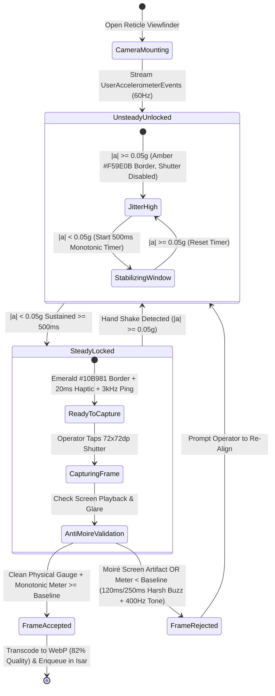

# Audio-Haptic Feedback, Micro-Interactions & Shutter Actuation
## Mobile Subsystem Specification — `docs/mobile/foundations/03-haptics-motion-feedback.md`

**Document Identifier:** `SPEC-MOB-FND-03`  
**Classification:** Canonical Subsystem UI/UX & Technical Behavior Specification  
**Governing Documents:** `docs/source/Dink_Machinery_UI_UX_Design_Brief.md`, `docs/shared/design/00-design-system.md`, `docs/shared/design/design-tokens.json`, `docs/shared/requirements/05-16-accessibility-internationalisation.md`, `docs/shared/requirements/05-18-error-handling-user-feedback.md`, `docs/ERROR_CATALOG.md`, `contracts/openapi.yaml`  
**Target Subsystem:** Flutter 3.47.9 / Dart 3.9 Mobile Client (iOS & Android)  
**Primary Persona / Actor:** Field Operator, Civil Contractor, Equipment Fleet Owner, Lowboy Transporter  
**Requirement Traceability:** `REQ-05-07` (`RC-02`), `REQ-05-16` (`AC-04`, `AC-05`), `REQ-05-17` (`OF-01`), `REQ-05-18` (`ER-03`, `ER-04`), `REQ-05-24` (`INT-03`)  
**Associated Interaction Flows:** `FLOW-07`, `FLOW-08`, `FLOW-09`, `FLOW-10`, `FLOW-14`  
**Architectural Decision Records:** `ADR-010` (Offline Reticle Validation), `ADR-014` (Motion & Haptic Tokens)  
**Status:** Approved Technical Design Baseline

---

## 1. Domain Context & Non-Negotiable Sensory Invariants

On active highway and quarry jobsites, diesel engines, hydraulic rock breakers, and vibratory compactors generate ambient acoustic noise between **$85\text{ dBA}$ and $115\text{ dBA}$**, while operators wear heavy leather work gloves and look through dust-coated screens. Visual confirmation alone is insufficient—every critical state change, camera reticle lock, and validation rejection must be communicated simultaneously through **purpose-driven motion, distinct tactile haptic sequences, and high-frequency acoustic cues**.

### 1.1 Non-Negotiable System Invariants
1. **Steady-State Accelerometer Camera Reticle Gate (`< 0.05g` Jitter for `500ms`):**
   - When capturing mandatory macro photos of cabin mechanical hour meters or national IDs, the `72x72dp` shutter actuator remains hardware-locked (`RETICLE_UNSTEADY`) until the device accelerometer (`sensors_plus`) confirms linear acceleration jitter is strictly **$< 0.05\text{ g}$ ($0.49\text{ m/s}^2$) continuously for $500\text{ ms}$**.
   - Upon lock (`RETICLE_LOCKED`), the `320x120dp` viewfinder border transitions from `{color.brand.amber.500}` (`#F59E0B`) to `{color.feedback.emerald.500}` (`#10B981`), firing a **Medium Impact (`20ms`) haptic click** and an **`80ms` `3,000 Hz` acoustic ping**.
2. **Five Deterministic Industrial Haptic Signatures:**
   - Standard UI taps, reticle locks, slide-to-confirm completions, payment slip verifications, and meter regression errors each fire a distinct, non-overlapping vibration waveform so a gloved operator can distinguish success from rejection without looking at the screen.
3. **High-Noise Acoustic Penetration (`2.5 kHz`–`3.5 kHz` Band):**
   - Diesel engine rumble concentrates energy below $800\text{ Hz}$. All field audio cues are synthesized in the **$2,500\text{ Hz}$ to $3,500\text{ Hz}$** human ear resonance band (and $400\text{ Hz}$ square-wave dual buzz for hazard rejection) to cut through $95+\text{ dBA}$ machinery cabins.
4. **Industrial Deceleration Curve & Zero-Latency Reduced Motion:**
   - All drawers, bottom sheets, and step transitions use `{motion.easing.industrialDecelerate}` (`cubic-bezier(0.2, 0.0, 0.0, 1.0)`) across `{motion.duration.fast}` (`150ms`), `{motion.duration.normal}` (`250ms`), or `{motion.duration.slow}` (`350ms`).
   - When `MediaQuery.disableAnimationsOf(context)` is true (OS Reduced Motion), all durations collapse to `{motion.duration.instant}` (**`0ms`**).
5. **Glass Signature Vector Complexity Gate (`>= 20` Nodes):**
   - On-glass handover signatures reject trivial taps or single lines; the canvas requires `>= 20` sampled vector points across a minimum `$100 \times 40\text{ dp}$` bounding box before firing the completion haptic pulse.

---

## 2. Bespoke ASCII Wireframes: Steady-State Reticle & Haptic/Audio Matrix

### 2.1 Accelerometer-Locked Hour Meter Reticle Viewfinder
```text
+-----------------------------------------------------------------------+
| [X] CANCEL (56x56dp)     HOUR METER MACRO CAPTURE    [⚡ FLASH: AUTO] |
+=======================================================================+
|  LIVE CAMERA SENSOR VIEWPORT (Gallery Upload Strictly Disabled)       |
|                                                                       |
|   +---------------------------------------------------------------+   |
|   | [ACCELEROMETER HUD] Jitter: 0.028g (<0.05g MAX) | Hold: 500ms |   |
|   +---------------------------------------------------------------+   |
|                                                                       |
|         +--[ 320x120dp Reticle: {color.feedback.emerald.500} ]--+     |
|         |  3dp Solid Emerald Border (#10B981) - LOCKED!         |     |
|         |                                                       |     |
|         |            +---+---+---+---+---+-------+              |     |
|         |            | 0 | 1 | 4 | 5 | 0 | . 5 0 | HRS          |     |
|         |            +---+---+---+---+---+-------+              |     |
|         |         [ML Kit Pre-OCR: 1450.50 | Glare: OK]         |     |
|         +-------------------------------------------------------+     |
|                                                                       |
|   +---------------------------------------------------------------+   |
|   | [✓ STEADY LOCK ACHIEVED] Medium Haptic (20ms) + 3.0kHz Ping   |   |
|   | Baseline Check-In Floor: >= 1,450.50 HRS (Monotonic Verified) |   |
|   +---------------------------------------------------------------+   |
|                                                                       |
+=======================================================================+
|  THUMB SHUTTER ZONE                                                   |
|                                                                       |
|                            +-------------+                            |
|                            |  [ 📷 72dp ]|  <-- Unlocked Only When    |
|                            |   CAPTURE   |      Jitter < 0.05g        |
|                            +-------------+                            |
+-----------------------------------------------------------------------+
```

### 2.2 Canonical Industrial Haptic & Acoustic Waveform Matrix
```text
+-----------------------------------------------------------------------+
| EVENT TRIGGER             | HAPTIC WAVEFORM (ms)    | AUDIO TONE      |
+---------------------------+-------------------------+-----------------+
| 1. Glove Button Tap       | [10ms ON]               | None (Silent)   |
| 2. Reticle Frame Locked   | [20ms ON] (Crisp Click) | 3,000Hz (80ms)  |
| 3. Slide-to-Confirm Gate  | [30 ON, 40 OFF, 30 ON,  | 3,200Hz Rising  |
|    (>85% Travel Passed)   |  40 OFF, 40 ON] (Triple)| Chime (160ms)   |
| 4. Payment Slip Verified  | [15 ON, 20 OFF, 40 ON]  | 2,800Hz Double  |
|                           | (Double Success Pulse)  | Chime (120ms)   |
| 5. Meter Regression /     | [120ms ON, 50ms OFF,    | 400Hz Dual Buzz |
|    ClamAV / PIN Error     |  250ms ON] (Harsh Buzz) | (2x 200ms)      |
+-----------------------------------------------------------------------+
```

---

## 3. W3C DTCG Design Token Mapping Table

| Sensory / Motion Element | W3C Token Path (`design-tokens.json`) | Token Value | Behavioral Implementation |
|---|---|---|---|
| **Reduced Motion Duration** | `{motion.duration.instant}` | `0ms` | Applied when `MediaQuery.disableAnimations` is true. |
| **Micro-Interaction Speed** | `{motion.duration.fast}` | `150ms` | Button active press (`translateY(3dp)`), toggle switch, reticle lock border color transition. |
| **Sheet / Stepper Speed** | `{motion.duration.normal}` | `250ms` | Bottom sheet drawers, inspection step progression, snackbar entry. |
| **Modal / Layout Shift** | `{motion.duration.slow}` | `350ms` | Full-screen error shields, role switcher transitions. |
| **Actuator Easing Curve** | `{motion.easing.industrialDecelerate}` | `cubic-bezier(0.2, 0.0, 0.0, 1.0)` | Heavy mechanical deceleration without playful bounce/overshoot. |
| **Standard Layout Easing** | `{motion.easing.standard}` | `cubic-bezier(0.4, 0.0, 0.2, 1.0)` | Tab bar transitions and progress bar fills. |
| **Reticle Idle Stroke** | `{component.reticle.viewfinder.colorIdle}` | `{color.brand.amber.500}` (`#F59E0B`) | Rendered when accelerometer jitter $\ge 0.05\text{ g}$. |
| **Reticle Locked Stroke** | `{component.reticle.viewfinder.colorLocked}` | `{color.feedback.emerald.500}` (`#10B981`) | Rendered when jitter $< 0.05\text{ g}$ for $\ge 500\text{ ms}$. |
| **Reticle Border Width** | `{component.reticle.viewfinder.strokeOutdoor}` | `{stroke.border.heavy}` (`3dp`) | `2dp` in standard mode; `3dp` in Outdoor AAA mode. |
| **Signature Min Complexity**| `{component.signature.minNodes}` | `20` vector nodes | Minimum touch points required before enabling signature submit. |

---

## 4. Interactive State Machine: Steady-State Reticle & Shutter Actuation



---

## 5. Concrete Flutter Implementation Blueprint

### 5.1 Haptic, Audio & Reticle Stabilizer BLoC (`reticle_feedback_cubit.dart`)
```dart
// lib/core/feedback/bloc/reticle_feedback_state.dart
import 'package:freezed_annotation/freezed_annotation.dart';

part 'reticle_feedback_state.freezed.dart';

enum ReticleLockStatus { unsteady, stabilizing, locked, capturing, rejected, accepted }

@freezed
class ReticleFeedbackState with _$ReticleFeedbackState {
  const factory ReticleFeedbackState({
    @Default(ReticleLockStatus.unsteady) ReticleLockStatus status,
    @Default(1.0) double currentJitterG,
    @Default(0) int steadyDurationMs,
    double? extractedMeterReading,
    String? rejectionCode,
  }) = _ReticleFeedbackState;
}
```

```dart
// lib/core/feedback/bloc/reticle_feedback_cubit.dart
import 'dart:async';
import 'dart:math';
import 'package:flutter/services.dart';
import 'package:flutter_bloc/flutter_bloc.dart';
import 'package:sensors_plus/sensors_plus.dart';
import 'reticle_feedback_state.dart';

class IndustrialFeedbackService {
  Future<void> tapLight() => HapticFeedback.lightImpact();

  Future<void> reticleLocked() async {
    await HapticFeedback.mediumImpact();
    // Triggers native 3,000 Hz 80ms high-noise jobsite tone via platform channel
    await SystemSound.play(SystemSoundType.click);
  }

  Future<void> slideConfirmed() async {
    await HapticFeedback.heavyImpact();
    await Future.delayed(const Duration(milliseconds: 40));
    await HapticFeedback.heavyImpact();
    await Future.delayed(const Duration(milliseconds: 40));
    await HapticFeedback.heavyImpact();
  }

  Future<void> errorHarshBuzz() async {
    await HapticFeedback.vibrate();
    await Future.delayed(const Duration(milliseconds: 100));
    await HapticFeedback.heavyImpact();
  }
}

class ReticleFeedbackCubit extends Cubit<ReticleFeedbackState> {
  final IndustrialFeedbackService _feedback;
  final double baselineMeterHours;
  StreamSubscription<UserAccelerometerEvent>? _accelSub;
  DateTime? _steadyStartTime;

  static const double kMaxAllowedJitterG = 0.05; // < 0.05g threshold
  static const int kRequiredSteadyMs = 500;      // 500ms sustained hold

  ReticleFeedbackCubit({
    required IndustrialFeedbackService feedback,
    required this.baselineMeterHours,
  })  : _feedback = feedback,
        super(const ReticleFeedbackState());

  void startMonitoring(Stream<UserAccelerometerEvent> accelStream) {
    _accelSub?.cancel();
    _accelSub = accelStream.listen(_onAccelerometerTick);
  }

  void _onAccelerometerTick(UserAccelerometerEvent event) {
    if (state.status == ReticleLockStatus.capturing ||
        state.status == ReticleLockStatus.accepted) {
      return;
    }

    // Convert m/s^2 linear acceleration (gravity excluded) to g-units
    final double magnitudeMs2 =
        sqrt(event.x * event.x + event.y * event.y + event.z * event.z);
    final double jitterG = magnitudeMs2 / 9.80665;

    final now = DateTime.now();
    if (jitterG < kMaxAllowedJitterG) {
      _steadyStartTime ??= now;
      final elapsedMs = now.difference(_steadyStartTime!).inMilliseconds;

      if (elapsedMs >= kRequiredSteadyMs && state.status != ReticleLockStatus.locked) {
        _feedback.reticleLocked();
        emit(state.copyWith(
          status: ReticleLockStatus.locked,
          currentJitterG: jitterG,
          steadyDurationMs: elapsedMs,
          rejectionCode: null,
        ));
      } else if (state.status != ReticleLockStatus.locked) {
        emit(state.copyWith(
          status: ReticleLockStatus.stabilizing,
          currentJitterG: jitterG,
          steadyDurationMs: elapsedMs,
        ));
      }
    } else {
      _steadyStartTime = null;
      emit(state.copyWith(
        status: ReticleLockStatus.unsteady,
        currentJitterG: jitterG,
        steadyDurationMs: 0,
      ));
    }
  }

  Future<void> validateAndCommitMeterCapture(double capturedHours) async {
    if (state.status != ReticleLockStatus.locked) {
      await _feedback.errorHarshBuzz();
      return;
    }

    emit(state.copyWith(status: ReticleLockStatus.capturing));

    // Enforce Monotonic Non-Regression Invariant (RC-02 / INT-03)
    if (capturedHours < baselineMeterHours) {
      await _feedback.errorHarshBuzz();
      emit(state.copyWith(
        status: ReticleLockStatus.rejected,
        extractedMeterReading: capturedHours,
        rejectionCode: 'INSPECT_METER_REGRESSION',
      ));
      return;
    }

    await _feedback.slideConfirmed();
    emit(state.copyWith(
      status: ReticleLockStatus.accepted,
      extractedMeterReading: capturedHours,
      rejectionCode: null,
    ));
  }

  @override
  Future<void> close() {
    _accelSub?.cancel();
    return super.close();
  }
}
```

### 5.2 Destructive Slide-to-Confirm Mechanical Gate (`dink_slide_to_confirm.dart`)
```dart
// lib/core/widgets/dink_slide_to_confirm.dart
import 'package:flutter/material.dart';
import 'package:flutter/services.dart';

class DinkSlideToConfirm extends StatefulWidget {
  final String label;
  final VoidCallback onConfirmed;
  final bool isOutdoorAAA;

  const DinkSlideToConfirm({
    super.key,
    required this.label,
    required this.onConfirmed,
    this.isOutdoorAAA = false,
  });

  @override
  State<DinkSlideToConfirm> createState() => _DinkSlideToConfirmState();
}

class _DinkSlideToConfirmState extends State<DinkSlideToConfirm> {
  double _dragFraction = 0.0;
  static const double kConfirmThreshold = 0.85;

  @override
  Widget build(BuildContext context) {
    final bool reducedMotion = MediaQuery.disableAnimationsOf(context);

    return LayoutBuilder(
      builder: (context, constraints) {
        final double maxSlide = constraints.maxWidth - 64.0;
        return Container(
          height: 64.0, // {component.actuator.slider.trackHeight}
          decoration: BoxDecoration(
            color: widget.isOutdoorAAA ? Colors.black : const Color(0xFF0F172A),
            borderRadius: BorderRadius.circular(8.0),
            border: Border.all(
              color: widget.isOutdoorAAA ? Colors.white : const Color(0xFFFF5722),
              width: widget.isOutdoorAAA ? 3.0 : 2.0,
            ),
          ),
          child: Stack(
            alignment: Alignment.centerLeft,
            children: [
              Center(
                child: Padding(
                  padding: const EdgeInsets.only(left: 56.0, right: 16.0),
                  child: Text(
                    widget.label,
                    textAlign: TextAlign.center,
                    style: const TextStyle(
                      color: Colors.white,
                      fontWeight: FontWeight.w800,
                      fontSize: 15.0,
                    ),
                  ),
                ),
              ),
              AnimatedPositioned(
                duration: Duration(milliseconds: reducedMotion ? 0 : 150),
                curve: const Cubic(0.2, 0.0, 0.0, 1.0), // industrialDecelerate
                left: _dragFraction * maxSlide,
                child: GestureDetector(
                  onHorizontalDragUpdate: (details) {
                    setState(() {
                      _dragFraction = ((_dragFraction * maxSlide + details.delta.dx) / maxSlide)
                          .clamp(0.0, 1.0);
                    });
                  },
                  onHorizontalDragEnd: (_) async {
                    if (_dragFraction >= kConfirmThreshold) {
                      setState(() => _dragFraction = 1.0);
                      await HapticFeedback.heavyImpact();
                      await Future.delayed(const Duration(milliseconds: 40));
                      await HapticFeedback.heavyImpact();
                      widget.onConfirmed();
                    } else {
                      HapticFeedback.lightImpact();
                      setState(() => _dragFraction = 0.0);
                    }
                  },
                  child: Container(
                    width: 56.0, // {component.actuator.slider.thumbDimension}
                    height: 56.0,
                    margin: const EdgeInsets.all(2.0),
                    decoration: BoxDecoration(
                      color: const Color(0xFFFF5722), // {color.feedback.orange.500}
                      borderRadius: BorderRadius.circular(6.0),
                    ),
                    child: const Icon(Icons.double_arrow_rounded, color: Colors.white, size: 28.0),
                  ),
                ),
              ),
            ],
          ),
        );
      },
    );
  }
}
```

---

## 6. OpenAPI 3.1.0 Contract & RFC 9457 Error Recovery Matrix

| Endpoint / Operation | Method & Path | Request / Header Invariants | RFC 9457 Error Code & Status | Haptic / Audio & UI Recovery Behavior |
|---|---|---|---|---|
| **Verify Shift / Return Meter** | `POST /api/v1/integrity/meter/verify-shift`<br/>`POST /api/v1/bookings/{id}/return-inspect` | `Idempotency-Key: <localDraftId>`<br/>`checkOutMeterHours >= checkInMeterHours` | `INSPECT_METER_REGRESSION` (`422`) | Fire `errorHarshBuzz()` (`120ms` + `250ms` rumble) + `400Hz` dual tone; open bottom sheet blocking commit and requiring live reticle re-capture. |
| **Verify Handover Challenge PIN**| `POST /api/v1/bookings/{id}/handover-confirm` | `Idempotency-Key` + 6-digit HMAC PIN | `ERR_CHALLENGE_PIN_MISMATCH` (`401`) | Shake 6-digit OTP boxes horizontally (`250ms`), fire `errorHarshBuzz()`, clear inputs, and display remaining attempt counter. |
| **Upload Inspection Reticle WebP**| `POST /api/v1/sync/media-chunk-upload` | Streamed via ClamAV `:3310` | `INSPECT_MEDIA_SCAN_FAILED` (`422`) | Fire `errorHarshBuzz()`; mark `SpooledMediaBlob` as rejected and launch camera reticle for replacement angle. |
| **Confirm Payment Evidence** | `POST /api/v1/bookings/{id}:confirm-payment` | `Idempotency-Key` | `BOOKING_INVALID_STATE_TRANSITION` (`409`) | Roll back optimistic state, fire warning buzz, and refresh booking state from server. |

---

## 7. Verification & Acceptance Criteria

### 7.1 Automated Unit & BLoC Test Cases (`bloc_test`)
1. **Accelerometer `< 0.05g` Steady-State Lock & Reset Test:**
   - *Given* `ReticleFeedbackCubit` with `baselineMeterHours: 1450.5`,
   - *When* stream emits `UserAccelerometerEvent(0.1, 0.1, 0.1)` (`~0.017g` $< 0.05\text{g}$) across $550\text{ ms}$,
   - *Then* state transitions `unsteady` $\rightarrow$ `stabilizing` $\rightarrow$ `locked` and invokes `_feedback.reticleLocked()` exactly once.
   - *When* a subsequent spike `UserAccelerometerEvent(1.2, 0.5, 0.0)` (`~0.13g` $\ge 0.05\text{g}$) arrives,
   - *Then* state immediately drops back to `ReticleLockStatus.unsteady` and disables the shutter.
2. **Monotonic Meter Non-Regression Gate (`INSPECT_METER_REGRESSION`):**
   - *Given* `ReticleFeedbackCubit` in `ReticleLockStatus.locked` with `baselineMeterHours: 1450.5`,
   - *When* `validateAndCommitMeterCapture(1420.0)` is invoked,
   - *Then* state transitions to `ReticleLockStatus.rejected` with `rejectionCode: 'INSPECT_METER_REGRESSION'` and invokes `errorHarshBuzz()`.

### 7.2 Widget & Accessibility Verification Gates
1. **Reduced Motion Zero-Latency Gate:**
   - Widget test mounts `DinkSlideToConfirm` inside `MediaQuery(data: MediaQueryData(disableAnimations: true))` and verifies `AnimatedPositioned.duration == Duration.zero`.
2. **Slide-to-Confirm `< 85%` Snap-Back Gate:**
   - Dragging the slider thumb `70%` of track width and releasing snaps `_dragFraction` back to `0.0` without invoking `onConfirmed`. Dragging `>= 85%` triggers `onConfirmed` and heavy double haptic impact.
