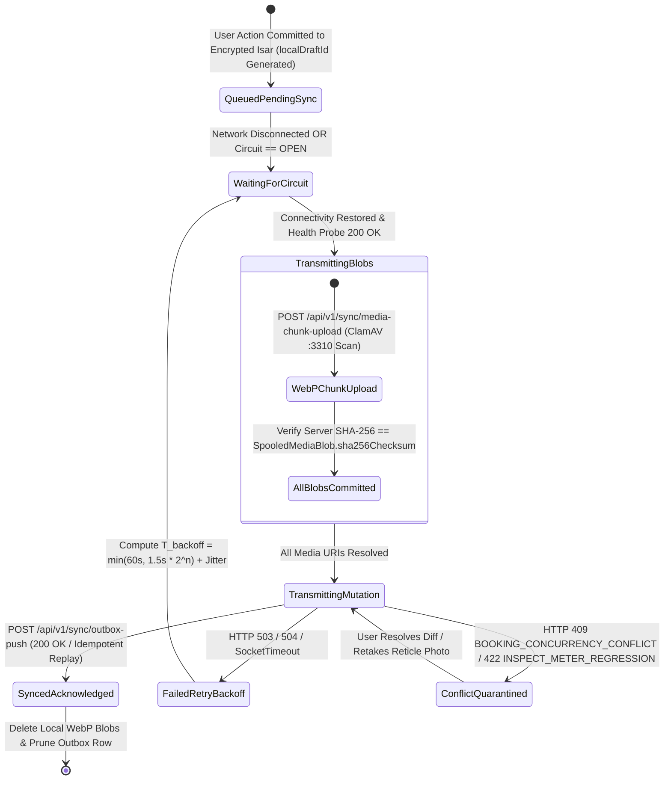

# Offline-First Outbox Pattern, Isar NoSQL & Conflict Resolution
## Mobile Subsystem Specification — `docs/mobile/foundations/04-offline-outbox-architecture.md`

**Document Identifier:** `SPEC-MOB-FND-04`  
**Classification:** Canonical Subsystem UI/UX & Technical Behavior Specification  
**Governing Documents:** `docs/source/Dink_Machinery_UI_UX_Design_Brief.md`, `docs/shared/design/00-design-system.md`, `docs/shared/design/design-tokens.json`, `docs/shared/requirements/05-17-offline-low-connectivity-support.md`, `docs/shared/requirements/05-18-error-handling-user-feedback.md`, `docs/ERROR_CATALOG.md`, `contracts/openapi.yaml`  
**Target Subsystem:** Flutter 3.47.9 / Dart 3.9 Mobile Client (iOS & Android)  
**Primary Persona / Actor:** All Mobile Personas (Primary: Field Operator & Lowboy Transporter)  
**Requirement Traceability:** `REQ-05-17` (`OFF-01`..`OFF-04`, `SYNC-01`), `REQ-05-18` (`ER-02`), `REQ-09` (`NFR-AVAIL`, `NFR-NET`)  
**Associated Interaction Flows:** `FLOW-09`, `FLOW-10`, `FLOW-APPENDIX-A`  
**Architectural Decision Records:** `ADR-010` (Isar Offline Sync & AES-256-GCM Storage), `ADR-014` (Design Tokens)  
**Status:** Approved Technical Design Baseline

---

## 1. Domain Context & Non-Negotiable Offline Invariants

Civil construction sites across Ethiopia (*Modjo–Hawassa Lot 3*, *Abbay Gorge*, *Afar*) and Kenya (*LAPSSET Corridor*, *Turkana*) routinely experience complete cellular blackouts for hours or days, or operate on degraded 2G/EDGE towers with $>35\%$ packet loss and $>2,500\text{ ms}$ RTT. Field operations—including 4-point check-in walkaround inspections, cabin hour-meter captures, peer-to-peer QR handover sign-offs, mechanical breakdown stoppages, and check-out returns—MUST execute with **zero network dependency** once an active booking is hydrated locally.

### 1.1 Non-Negotiable System Invariants
1. **AES-256-GCM Encrypted Isar NoSQL Outbox (`Idempotency-Key == localDraftId`):**
   - Every offline mutation is committed synchronously inside an ACID Isar transaction to `OutboxMutation` before the UI emits success confirmation.
   - The client generates a deterministic UUIDv4 `localDraftId` at the moment of user gesture and binds it identically as `Idempotency-Key: <localDraftId>` across all HTTP replay attempts, guaranteeing zero duplicate financial or state transitions on the Go backend.
   - The Isar instance is encrypted at rest using **AES-256-GCM**, with the 256-bit Data Encryption Key (DEK) sealed inside the **Android Hardware-Backed Keystore (TEE/StrongBox)** or **iOS Secure Enclave (`kSecAccessControlBiometryAny`)**.
2. **On-Device WebP Transcoding & SHA-256 Media Spooling:**
   - Raw $12\text{–}48\text{ MP}$ camera sensor captures ($\sim 8\text{ MB}$) are transcoded on a background Dart `Isolate` into $2048\times 2048\text{ px}$ max bounding box **WebP (`82%` quality, $350\text{–}650\text{ KB}$)** with stripped EXIF GPS/camera metadata and a computed **SHA-256 binary checksum** stored in `SpooledMediaBlob` before chunked upload through the ClamAV (`:3310` `zINSTREAM`) pipeline.
3. **Peer-to-Peer Dynamic HMAC-SHA256 QR Handshake (`OFF-02`):**
   - When both parties are off-grid at a remote quarry, mutual physical handover is attested via an animated dynamic QR code generated on the Owner/Operator device using the booking's `sharedHmacSecret`, `offlineNonceCounter`, and check-in meter reading, scanned and countersigned on glass by the Renter's device.
4. **Truncated Exponential Backoff with Jitter & Circuit Breaker:**
   - Outbox replay adheres to $T_{\text{backoff}} = \min(60.0\text{s}, 1.5\text{s} \times 2^{\text{attempt}}) + \text{UniformRandom}(0.0\text{s}, 1.0\text{s})$. Consecutive `503`/`504`/timeout failures ($\ge 5$ in $30\text{s}$) trip the client circuit breaker to `OPEN` for $30\text{s}$, failing fast to the local outbox without draining battery on dead radio retries.
5. **Deterministic Conflict Resolution (`BOOKING_CONCURRENCY_CONFLICT`):**
   - If an offline mutation collides with an administrative override or superior server state (`HTTP 409 BOOKING_CONCURRENCY_CONFLICT`), signed physical field attestations (monotonic hour-meter photos + HMAC-SHA256 QR signatures) are preserved in `QUARANTINED_AUDIT` rather than silently discarded, surfacing a resolution drawer to the user.

---

## 2. Bespoke ASCII Wireframes: Persistent Offline Banner & Outbox Sync Drawer

### 2.1 Persistent Offline Status Header & Interactive Outbox Inspector Drawer
```text
+-----------------------------------------------------------------------+
| [<- 56x56dp]  ACTIVE RENTAL #BK-9042          [📡 OFFLINE] [🔄 3 QUEUED]|
+=======================================================================+
| [⚠️ OFFLINE MODE: WORKING OFF-GRID | 3 MUTATIONS SPOOLED IN ISAR]     |
| Tap banner to inspect AES-256 encrypted outbox queue & media blobs.   |
+-----------------------------------------------------------------------+
|                                                                       |
|  +--[ OUTBOX SYNC INSPECTOR BOTTOM SHEET (EXPANDED) ]--------------+  |
|  |  STORAGE ENGINE: Isar 3.1+ (AES-256-GCM Hardware Keystore)      |  |
|  |  CIRCUIT BREAKER: HALF-OPEN (Next Canary Probe in 00:14s)       |  |
|  |  -------------------------------------------------------------  |  |
|  |                                                                 |  |
|  |  1. [⏳ QUEUED_PENDING_SYNC] HANDOVER_INSPECT                   |  |
|  |     Draft / Idempotency-Key: idm_8f92a1c4-4102-4b9e-9911        |  |
|  |     Meter Reading: 1,450.50 HRS (Monotonic Verified >= 1450.50) |  |
|  |     Spooled WebP Media: 4/4 Angles (1.84 MB Total | SHA-256 OK) |  |
|  |     Captured At: 2026-10-29 08:14:22 UTC                        |  |
|  |                                                                 |  |
|  |  2. [🔄 TRANSMITTING (Chunk 2/3)] HANDOVER_QR_CONFIRM           |  |
|  |     Draft / Idempotency-Key: idm_3c71e09b-8821-4f1a-b012        |  |
|  |     P2P HMAC-SHA256 Nonce: #0004 | Signature Nodes: 34 pts      |  |
|  |     Progress: [==========================------------] 67%      |  |
|  |                                                                 |  |
|  |  3. [⚠️ CONFLICT_QUARANTINED] BREAKDOWN_REPORT                  |  |
|  |     Code: BOOKING_CONCURRENCY_CONFLICT (Server Version: v14)    |  |
|  |     +-------------------------------------------------------+   |  |
|  |     | [🔍 RESOLVE VERSION CONFLICT & RE-SUBMIT] (56dp CTA)  |   |  |
|  |     +-------------------------------------------------------+   |  |
|  +-----------------------------------------------------------------+  |
|                                                                       |
+=======================================================================+
|  +-----------------------------------------------------------------+  |
|  |  [⚡ FORCE MANUAL SYNC PROBE NOW]                (64dp Height)  |  |
|  +=================================================================+  |
+-----------------------------------------------------------------------+
```

---

## 3. W3C DTCG Design Token Mapping Table

| UI Component / Sync State | W3C Token Path (`design-tokens.json`) | Standard Dark (`Cast Iron`) | Outdoor High-Contrast (`>80k lux`) | Behavioral & Visual Rule |
|---|---|---|---|---|
| **Offline Header Banner Bg** | `{component.countdown.holdNormalBg}` | `{color.brand.amber.900}` (`#78350F`) | `#000000` + `3dp` `{color.brand.amber.400}` | Persistent non-dismissible top bar while offline/syncing. |
| **Offline Banner Text** | `{semantic.*.text.brand}` | `{color.brand.amber.400}` (`#FBBF24`) | `{color.brand.amber.400}` (`#FBBF24`) | High-visibility warning paired with `wifi-off` glyph. |
| **Transmitting Progress Bar**| `{color.feedback.blue.500}` | `#3B82F6` | `{color.brand.amber.400}` (`#FBBF24`) | Determinate chunk upload bar (`Space Mono` percentage). |
| **Synced Badge Indicator** | `{color.feedback.emerald.500}` | `#10B981` (`#064E3B` fill) | `#000000` + `2dp` `#10B981` border | Flashes for `1,500ms` before pruning synced outbox row. |
| **Conflict / Quarantine Card**| `{color.feedback.crimson.600}` | `#DC2626` (`#450A0A` fill) | `#000000` + `3dp` `#EF4444` border | Blocks automatic pruning; requires user/admin resolution. |
| **Idempotency / Hash Font** | `{typography.fontFamily.mono}` | `Space Mono, monospace` (`12sp`) | `Space Mono, monospace` (`14sp`) | Renders `Idempotency-Key`, `SHA-256`, and meter figures. |
| **Manual Sync Actuator** | `{component.actuator.button.heightField}` | `{dimension.space.64}` (`64dp`) | `{dimension.space.64}` (`64dp`) | Full-width bottom CTA with `3dp` tactile lip. |

---

## 4. State Machine & Two-Way Synchronization Sequence (`ADR-010`)



---

## 5. Concrete Flutter Implementation Blueprint

### 5.1 Encrypted Isar Outbox & Media Spool Schema (`outbox_isar_models.dart`)
```dart
// lib/core/offline/models/outbox_isar_models.dart
import 'package:isar/isar.dart';

part 'outbox_isar_models.g.dart';

@collection
class OutboxMutationIsar {
  Id id = Isar.autoIncrement;

  @Index(unique: true, replace: false)
  late String localDraftId; // Strictly used as HTTP Header 'Idempotency-Key'

  @Index()
  late String bookingUuid;

  late String mutationType; // HANDOVER_INSPECT, HANDOVER_CONFIRM, BREAKDOWN_REPORT, RETURN_RECONCILE
  late String endpointPath; // e.g., '/api/v1/bookings/bk_019a/return-inspect'
  late String payloadJson;
  late List<String> attachedBlobIds;

  @Index()
  late String syncStatus; // QUEUED_PENDING_SYNC, TRANSMITTING, FAILED_RETRY_BACKOFF, CONFLICT_QUARANTINED, SYNCED

  late int retryCount;
  String? lastRfc9457ErrorCode;
  String? lastCorrelationId;
  DateTime? nextRetryAtUtc;

  @Index()
  late DateTime createdAtUtc;
}

@collection
class SpooledMediaBlobIsar {
  Id id = Isar.autoIncrement;

  @Index(unique: true)
  late String localBlobId;

  @Index()
  late String bookingUuid;

  late String angleCategory; // METER_MACRO, FRONT_BOOM, UNDERCARRIAGE_LEFT, UNDERCARRIAGE_RIGHT, CABIN
  late String sandboxWebpPath;
  late int byteLength;
  late String sha256Checksum;
  late bool isUploadedToS3;
  String? remoteSeaweedFsUri;
  late DateTime capturedAtUtc;
}
```

### 5.2 Outbox Synchronization Engine BLoC (`outbox_sync_bloc.dart`)
```dart
// lib/core/offline/bloc/outbox_sync_bloc.dart
import 'dart:async';
import 'dart:convert';
import 'dart:math';
import 'package:dio/dio.dart';
import 'package:flutter_bloc/flutter_bloc.dart';
import 'package:freezed_annotation/freezed_annotation.dart';
import 'package:isar/isar.dart';
import '../models/outbox_isar_models.dart';

part 'outbox_sync_bloc.freezed.dart';

@freezed
class OutboxSyncEvent with _$OutboxSyncEvent {
  const factory OutboxSyncEvent.enqueueMutation({
    required String localDraftId,
    required String bookingUuid,
    required String mutationType,
    required String endpointPath,
    required Map<String, dynamic> payload,
    @Default(<String>[]) List<String> blobIds,
  }) = _EnqueueMutation;

  const factory OutboxSyncEvent.connectivityChanged(bool isOnline) = _ConnectivityChanged;
  const factory OutboxSyncEvent.flushQueueRequested() = _FlushQueueRequested;
}

@freezed
class OutboxSyncState with _$OutboxSyncState {
  const factory OutboxSyncState({
    @Default(true) bool isOnline,
    @Default(false) bool isSyncing,
    @Default(0) int pendingCount,
    @Default(0) int quarantinedCount,
    @Default(<OutboxMutationIsar>[]) List<OutboxMutationIsar> activeQueue,
    String? activeBannerErrorCode,
  }) = _OutboxSyncState;
}

class OutboxSyncBloc extends Bloc<OutboxSyncEvent, OutboxSyncState> {
  final Isar _isar;
  final Dio _dio;
  final Random _random = Random.secure();

  OutboxSyncBloc(this._isar, this._dio) : super(const OutboxSyncState()) {
    on<_EnqueueMutation>(_onEnqueueMutation);
    on<_ConnectivityChanged>(_onConnectivityChanged);
    on<_FlushQueueRequested>(_onFlushQueueRequested);
  }

  Future<void> _onEnqueueMutation(
    _EnqueueMutation event,
    Emitter<OutboxSyncState> emit,
  ) async {
    final mutation = OutboxMutationIsar()
      ..localDraftId = event.localDraftId // Invariant: Idempotency-Key == localDraftId
      ..bookingUuid = event.bookingUuid
      ..mutationType = event.mutationType
      ..endpointPath = event.endpointPath
      ..payloadJson = jsonEncode(event.payload)
      ..attachedBlobIds = event.blobIds
      ..syncStatus = 'QUEUED_PENDING_SYNC'
      ..retryCount = 0
      ..createdAtUtc = DateTime.now().toUtc();

    await _isar.writeTxn(() async {
      await _isar.outboxMutationIsars.put(mutation);
    });

    await _refreshQueueSnapshot(emit);
    if (state.isOnline) {
      add(const OutboxSyncEvent.flushQueueRequested());
    }
  }

  Future<void> _onConnectivityChanged(
    _ConnectivityChanged event,
    Emitter<OutboxSyncState> emit,
  ) async {
    emit(state.copyWith(isOnline: event.isOnline));
    if (event.isOnline) {
      add(const OutboxSyncEvent.flushQueueRequested());
    }
  }

  Future<void> _onFlushQueueRequested(
    _FlushQueueRequested event,
    Emitter<OutboxSyncState> emit,
  ) async {
    if (state.isSyncing || !state.isOnline) return;
    emit(state.copyWith(isSyncing: true));

    final pendingItems = await _isar.outboxMutationIsars
        .filter()
        .syncStatusEqualTo('QUEUED_PENDING_SYNC')
        .or()
        .syncStatusEqualTo('FAILED_RETRY_BACKOFF')
        .sortByCreatedAtUtc()
        .findAll();

    for (final item in pendingItems) {
      if (item.nextRetryAtUtc != null &&
          DateTime.now().toUtc().isBefore(item.nextRetryAtUtc!)) {
        continue;
      }

      try {
        await _isar.writeTxn(() async {
          item.syncStatus = 'TRANSMITTING';
          await _isar.outboxMutationIsars.put(item);
        });

        await _dio.post<Map<String, dynamic>>(
          item.endpointPath,
          data: jsonDecode(item.payloadJson),
          options: Options(
            headers: {
              'Idempotency-Key': item.localDraftId, // Strict idempotency replay header
            },
          ),
        );

        await _isar.writeTxn(() async {
          await _isar.outboxMutationIsars.delete(item.id);
        });
      } on DioException catch (e) {
        final statusCode = e.response?.statusCode ?? 503;
        final errorCode = e.response?.data?['error']?['code'] as String? ?? 'SYS_SERVICE_UNAVAILABLE';

        await _isar.writeTxn(() async {
          if (statusCode == 409 || statusCode == 422) {
            item.syncStatus = 'CONFLICT_QUARANTINED';
            item.lastRfc9457ErrorCode = errorCode;
          } else {
            item.retryCount += 1;
            item.syncStatus = 'FAILED_RETRY_BACKOFF';
            item.lastRfc9457ErrorCode = errorCode;
            final double baseBackoff = min(60.0, 1.5 * pow(2, item.retryCount));
            final double jitter = _random.nextDouble();
            item.nextRetryAtUtc = DateTime.now()
                .toUtc()
                .add(Duration(milliseconds: ((baseBackoff + jitter) * 1000).round()));
          }
          await _isar.outboxMutationIsars.put(item);
        });
      }
    }

    emit(state.copyWith(isSyncing: false));
    await _refreshQueueSnapshot(emit);
  }

  Future<void> _refreshQueueSnapshot(Emitter<OutboxSyncState> emit) async {
    final all = await _isar.outboxMutationIsars.where().sortByCreatedAtUtc().findAll();
    final quarantined = all.where((e) => e.syncStatus == 'CONFLICT_QUARANTINED').length;
    emit(state.copyWith(
      pendingCount: all.length - quarantined,
      quarantinedCount: quarantined,
      activeQueue: all,
    ));
  }
}
```

---

## 6. OpenAPI 3.1.0 Contract & RFC 9457 Error Recovery Matrix

| Endpoint / Operation | Method & Path | Request / Header Invariants | RFC 9457 Error Code & Status | Outbox & UI Recovery Behavior |
|---|---|---|---|---|
| **Push Queued Mutations** | `POST /api/v1/sync/outbox-push` | `Idempotency-Key: <localDraftId>`<br/>`X-Country-Code: ET \| KE` | `REQ_MISSING_IDEMPOTENCY_KEY` (`400`) | Hard invariant violation prevented by `OutboxSyncBloc` binding `localDraftId` on every request. |
| **Upload Spooled WebP Chunk** | `POST /api/v1/sync/media-chunk-upload` | `X-Chunk-SHA256` + ClamAV `:3310` stream | `INSPECT_MEDIA_SCAN_FAILED` (`422`) | Transition mutation to `CONFLICT_QUARANTINED`; alert operator to retake corrupted/flagged photo via live camera reticle. |
| **Differential State Pull** | `POST /api/v1/sync/differential-pull` | `syncWatermark` ISO-8601 timestamp | `BOOKING_CONCURRENCY_CONFLICT` (`409`) | Keep signed local inspection in `CONFLICT_QUARANTINED`; pull latest `CachedBooking` server version and open side-by-side resolution sheet. |
| **Gateway / Network Timeout** | Any `/api/v1/sync/*` | Circuit breaker monitored | `SYS_SERVICE_UNAVAILABLE` (`503`) | Increment `retryCount`, compute $T_{\text{backoff}} = \min(60\text{s}, 1.5\text{s} \times 2^n) + \text{jitter}$, keep item safely in Isar. |

---

## 7. Verification & Acceptance Criteria

### 7.1 Automated Unit & BLoC Test Cases (`bloc_test`)
1. **Strict `Idempotency-Key == localDraftId` Replay Invariance:**
   - *Given* an offline `HANDOVER_INSPECT` mutation enqueued with `localDraftId: 'idm_019a8f60-9912'`,
   - *When* the first replay attempt fails with `503 Service Unavailable` and the second replay attempt succeeds with `200 OK`,
   - *Then* both HTTP `POST` requests transmit the exact header `Idempotency-Key: idm_019a8f60-9912`, and upon `200 OK` the item is deleted from `outboxMutationIsars`.
2. **Quarantine on `409` / `422` Without Infinite Retry Loop:**
   - *Given* an outbox item that returns `HTTP 422 INSPECT_METER_REGRESSION`,
   - *When* `_onFlushQueueRequested` processes the response,
   - *Then* `syncStatus` transitions immediately to `'CONFLICT_QUARANTINED'`, `quarantinedCount` increments to `1`, and the item is excluded from exponential backoff retries until manual user remediation.

### 7.2 Persistence & Crash Recovery Test Gates
1. **Sudden Process Kill Durability Gate:**
   - Integration test writes 5 `OutboxMutationIsar` records and 4 `SpooledMediaBlobIsar` WebP files while in Airplane Mode, forcefully closes the Isar instance to simulate battery depletion, re-opens the encrypted Isar database using the hardware keystore key, and verifies $100\%$ payload and SHA-256 checksum integrity.
