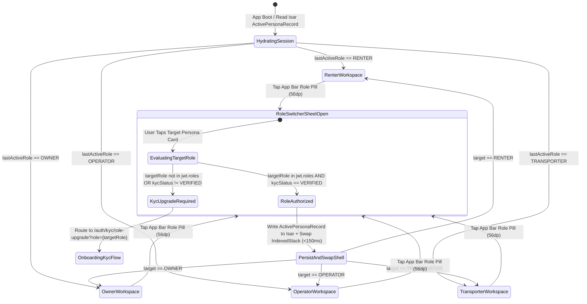

# Dynamic Role-Switcher Shell & Persona Context Management
## Mobile Subsystem Specification — `docs/mobile/navigation/01-role-switcher-app-shell.md`

**Document Identifier:** `SPEC-MOB-NAV-01`  
**Classification:** Canonical Subsystem UI/UX & Technical Behavior Specification  
**Governing Documents:** `docs/source/Dink_Machinery_UI_UX_Design_Brief.md`, `docs/shared/design/00-design-system.md`, `docs/shared/design/design-tokens.json`, `docs/shared/requirements/04-user-roles.md`, `docs/shared/requirements/05-01-registration-authentication.md`, `docs/shared/requirements/05-14-user-onboarding-help.md`, `docs/ERROR_CATALOG.md`, `contracts/openapi.yaml`  
**Target Subsystem:** Flutter 3.47.9 / Dart 3.9 Mobile Client (iOS & Android)  
**Primary Persona / Actor:** Multi-Role User (Civil Contractor + Fleet Owner + Certified Operator + Lowboy Transporter)  
**Requirement Traceability:** `REQ-04` (`ROL-01`..`ROL-04`), `REQ-05-01` (`AUT-06`..`AUT-11`), `REQ-05-14` (`ONB-02`), `REQ-05-16` (`AC-02`)  
**Associated Interaction Flows:** `FLOW-01`, `FLOW-02`, `FLOW-03`, `FLOW-04`  
**Architectural Decision Records:** `ADR-005` (RBAC & JWT Scopes), `ADR-010` (Isar Persona State Isolation), `ADR-014` (Design Tokens)  
**Status:** Approved Technical Design Baseline

---

## 1. Domain Context & Non-Negotiable Shell Invariants

In East Africa's construction ecosystem, a single commercial principal frequently operates across multiple market sides: an excavation contractor (*Dawit Haile-Mariam*) may rent a 50-ton mobile crane as a **Renter** while simultaneously listing three idle dump trucks as a **Fleet Owner**, or an independent owner-operator may both own a backhoe and drive it on site as a **Certified Operator**. Requiring users to log out and maintain separate phone numbers for each persona violates sovereign E.164 MSISDN identity anchoring (`REG-01`).

### 1.1 Non-Negotiable System Invariants
1. **Zero Re-Authentication Persona Switching (`< 150ms` Shell Transition):**
   - Switching between authorized personas (`RENTER`, `OWNER`, `OPERATOR`, `TRANSPORTER`) within the top App Bar Role-Switcher Pill executes in-place without invalidating the user's ECDSA P-256 JWT session (`AUT-06`), completing the shell swap within `{motion.duration.fast}` (`150ms`).
2. **Strict Navigation Stack & State Isolation (`StatefulShellRoute.indexedStack`):**
   - Each persona maintains an isolated `GoRouter` navigator branch and scoped BLoC subtree. Switching from `OWNER` (while halfway through a Fleet Registration Stepper) to `RENTER` (to check a 60-minute hold timer) and back to `OWNER` preserves exact scroll offsets and form draft states without cross-persona state leakage.
3. **Progressive KYC Unlock Gate for Restricted Personas (`kyc_status == VERIFIED`):**
   - If a user registered as a `RENTER` taps an unactivated `OWNER` or `TRANSPORTER` role card inside the Role Switcher bottom sheet, the shell intercepts the switch and routes directly to the **Commercial Trade License / Carrier Permit Onboarding Stepper** (`SPEC-MOB-AUTH-05`) rather than mounting an empty or broken dashboard.
4. **Glove-Friendly `56x56dp` Role Switcher Trigger & Visual Mode Anchor:**
   - The App Bar Role Switcher Pill enforces a minimum `56dp` touch height with a distinct persona color accent border and Lucide machinery glyph (`hard-hat` for Renter, `warehouse` for Owner, `gauge` for Operator, `truck` for Transporter) so the user never confuses whether they are approving a wire receipt as an Owner or paying a wire as a Renter.
5. **Offline Outbox Continuity Across Role Switches (`ADR-010`):**
   - Background `OutboxSyncBloc` and `AmbientThemeController` (`>80,000 lux` Outdoor AAA mode) live above the persona shell in the root widget tree; switching personas never interrupts an active WebP chunk upload or resets high-contrast sunlight mode.

---

## 2. Bespoke ASCII Wireframes: App Bar Role Pill & Persona Switcher Sheet

### 2.1 Top App Shell with Active Persona Pill & Global Status Strip
```text
+-----------------------------------------------------------------------+
| STATUS BAR: 10:15 EAT                        [☀️ AAA 82k LUX] [4G LTE]|
+=======================================================================+
| +-----------------------------------+  +------------+  +------------+ |
| | [🚜 OWNER MODE v]                 |  | [🔄 SYNC 1]|  | [🔔 4]     | |
| | W/ro Almaz Yard  (56dp Hit Target)|  |  (56x56dp) |  |  (56x56dp) | |
| +-----------------------------------+  +------------+  +------------+ |
+=======================================================================+
| [⚡ PERSISTENT CONTEXT BANNER: 1 WIRE SLIP AWAITING VERIFICATION]     |
| Booking #BK-9042 (Cat 320D) | SLA Remaining: 18h 42m  [VERIFY NOW ->] |
+-----------------------------------------------------------------------+
|                                                                       |
|   ACTIVE PERSONA VIEWPORT: OWNER FLEET DASHBOARD                      |
|   (Isolated NavigatorKey<OwnerBranch> - Preserves Scroll & Drafts)    |
|                                                                       |
+-----------------------------------------------------------------------+
```

### 2.2 Modal Bottom Sheet: Multi-Persona Role Switcher & KYC Gate
```text
+-----------------------------------------------------------------------+
|                     [ ==== 48x6dp DRAG HANDLE ==== ]                  |
|  SWITCH ACTIVE WORKSPACE PERSONA                     [X CLOSE 56x56dp]|
|  Signed in as: +251 911 442 910 (TIN: 0049182731)                     |
+=======================================================================+
|                                                                       |
|  +-----------------------------------------------------------------+  |
|  | [🚜] EQUIPMENT FLEET OWNER                    [● ACTIVE NOW]    |  |
|  |      Manage 14 machines, verify wire slips & commission wallet  |  |
|  |      KYC Status: [✓ VERIFIED COMMERCIAL] | Pending Actions: (2) |  |
|  |======[ 3dp Solid Amber Border: {color.brand.amber.500} ]========|  |
|  +-----------------------------------------------------------------+  |
|  |                  <- 8dp Minimum Vertical Gap ->                 |  |
|  +-----------------------------------------------------------------+  |
|  | [🏗️] CIVIL CONTRACTOR (RENTER)                [TAP TO SWITCH]   |  |
|  |      Discover machinery within 50km, manage holds & site PINs   |  |
|  |      KYC Status: [✓ VERIFIED FAYDA ID]   | Active Rentals: (1)  |  |
|  +-----------------------------------------------------------------+  |
|  |                  <- 8dp Minimum Vertical Gap ->                 |  |
|  +-----------------------------------------------------------------+  |
|  | [👷] CERTIFIED FIELD OPERATOR                 [TAP TO SWITCH]   |  |
|  |      Capture hour-meter reticles, log daily shifts & breakdowns |  |
|  |      KYC Status: [✓ GRADE-A PLANT LICENSE]| Assigned Jobs: (1)  |  |
|  +-----------------------------------------------------------------+  |
|  |                  <- 8dp Minimum Vertical Gap ->                 |  |
|  +-----------------------------------------------------------------+  |
|  | [🚛] LOWBOY LOGISTICS TRANSPORTER             [🔒 UNLOCK ROLE]  |  |
|  |      Haul heavy plant on federal corridors (2.5% pass-through)  |  |
|  |      Status: [⚠️ REQUIRES FREIGHT CARRIER PERMIT UPLOAD]        |  |
|  +-----------------------------------------------------------------+  |
|                                                                       |
+=======================================================================+
|  [🛡️ SESSION SECURITY: ECDSA P-256 JWT | Country Lock: ETHIOPIA (ET)] |
+-----------------------------------------------------------------------+
```

---

## 3. W3C DTCG Design Token Mapping Table

| Shell Element | W3C Token Path (`design-tokens.json`) | Standard Dark (`Cast Iron`) | Outdoor High-Contrast (`>80k lux`) | Behavioral & Ergonomic Rule |
|---|---|---|---|---|
| **App Bar Background** | `{color.brand.slate.950}` | `#020617` | `#000000` + `2dp` bottom `#FFFFFF` | Fixed `64dp` toolbar height. |
| **Role Switcher Pill** | `{semantic.*.surface.cardElevated}` | `{color.brand.slate.800}` + `2dp` `{color.brand.amber.500}` | `#000000` + `3dp` `{color.brand.amber.400}` | Minimum `56dp` height; fires `10ms` light haptic on tap. |
| **Active Role Card Border**| `{semantic.*.border.focus}` | `{color.brand.amber.500}` (`#F59E0B`) | `{color.brand.amber.400}` (`#FBBF24`) | `3dp` solid perimeter + `{stroke.border.heavy}` bottom lip. |
| **Locked Role Badge** | `{color.brand.amber.100}` / `{color.brand.amber.900}` | Fill `#78350F`, Text `#FEF3C7` | `#000000` + `2dp` `#FBBF24` | Routes to KYC onboarding stepper when tapped. |
| **Pending Action Counter** | `{color.feedback.orange.500}` | `#FF5722` (`Space Mono 12sp Bold`) | `#FF5722` + `2dp` `#FFFFFF` border | Displays unread action count per inactive persona. |
| **Sheet Modal Backdrop** | `{semantic.*.surface.overlay}` | `rgba(2, 6, 23, 0.85)` | `rgba(0, 0, 0, 0.95)` | Decelerates in `250ms` via `{motion.easing.industrialDecelerate}`. |

---

## 4. State Machine: Persona Switching & KYC Capability Gate



---

## 5. Concrete Flutter Implementation Blueprint

### 5.1 Role Switcher BLoC & Freezed State (`role_switcher_bloc.dart`)
```dart
// lib/features/navigation/bloc/role_switcher_bloc.dart
import 'package:flutter/services.dart';
import 'package:flutter_bloc/flutter_bloc.dart';
import 'package:freezed_annotation/freezed_annotation.dart';
import 'package:isar/isar.dart';
import '../models/persona_shell_isar.dart';

part 'role_switcher_bloc.freezed.dart';

enum AppPersona { renter, owner, operatorRole, transporter }
enum RoleKycState { unverified, pendingAudit, verified, rejected }

@freezed
class PersonaCapability with _$PersonaCapability {
  const factory PersonaCapability({
    required AppPersona persona,
    required RoleKycState kycState,
    @Default(0) int pendingActionBadges,
  }) = _PersonaCapability;
}

@freezed
class RoleSwitcherEvent with _$RoleSwitcherEvent {
  const factory RoleSwitcherEvent.hydrated() = _Hydrated;
  const factory RoleSwitcherEvent.personaRequested(AppPersona targetPersona) = _PersonaRequested;
  const factory RoleSwitcherEvent.badgesUpdated(Map<AppPersona, int> counts) = _BadgesUpdated;
}

@freezed
class RoleSwitcherState with _$RoleSwitcherState {
  const factory RoleSwitcherState({
    @Default(AppPersona.renter) AppPersona activePersona,
    @Default(<PersonaCapability>[]) List<PersonaCapability> capabilities,
    AppPersona? kycRedirectTarget,
    String? errorCode,
  }) = _RoleSwitcherState;
}

class RoleSwitcherBloc extends Bloc<RoleSwitcherEvent, RoleSwitcherState> {
  final Isar _isar;

  RoleSwitcherBloc(this._isar) : super(const RoleSwitcherState()) {
    on<_Hydrated>(_onHydrated);
    on<_PersonaRequested>(_onPersonaRequested);
    on<_BadgesUpdated>(_onBadgesUpdated);
  }

  Future<void> _onHydrated(_Hydrated event, Emitter<RoleSwitcherState> emit) async {
    final record = await _isar.personaShellIsars.where().findFirst();
    if (record != null) {
      emit(state.copyWith(
        activePersona: AppPersona.values.byName(record.activePersonaName),
        capabilities: record.capabilities
            .map((c) => PersonaCapability(
                  persona: AppPersona.values.byName(c.personaName),
                  kycState: RoleKycState.values.byName(c.kycStatusName),
                  pendingActionBadges: c.unreadBadgeCount,
                ))
            .toList(),
      ));
    }
  }

  Future<void> _onPersonaRequested(
    _PersonaRequested event,
    Emitter<RoleSwitcherState> emit,
  ) async {
    HapticFeedback.mediumImpact();
    final capability = state.capabilities.firstWhere(
      (c) => c.persona == event.targetPersona,
      orElse: () => PersonaCapability(
        persona: event.targetPersona,
        kycState: RoleKycState.unverified,
      ),
    );

    if (capability.kycState != RoleKycState.verified) {
      emit(state.copyWith(
        kycRedirectTarget: event.targetPersona,
        errorCode: 'AUTH_INSUFFICIENT_PERMISSIONS',
      ));
      return;
    }

    await _isar.writeTxn(() async {
      final existing = await _isar.personaShellIsars.where().findFirst() ?? PersonaShellIsar();
      existing.id = 1;
      existing.activePersonaName = event.targetPersona.name;
      existing.lastSwitchedAtUtc = DateTime.now().toUtc();
      await _isar.personaShellIsars.put(existing);
    });

    emit(state.copyWith(
      activePersona: event.targetPersona,
      kycRedirectTarget: null,
      errorCode: null,
    ));
  }

  void _onBadgesUpdated(_BadgesUpdated event, Emitter<RoleSwitcherState> emit) {
    final updated = state.capabilities.map((cap) {
      return cap.copyWith(pendingActionBadges: event.counts[cap.persona] ?? cap.pendingActionBadges);
    }).toList();
    emit(state.copyWith(capabilities: updated));
  }
}
```

### 5.2 Isar Persona Persistence Schema (`persona_shell_isar.dart`)
```dart
// lib/features/navigation/models/persona_shell_isar.dart
import 'package:isar/isar.dart';

part 'persona_shell_isar.g.dart';

@collection
class PersonaShellIsar {
  Id id = 1;
  late String activePersonaName;
  late List<EmbeddedRoleCapability> capabilities;
  late DateTime lastSwitchedAtUtc;
}

@embedded
class EmbeddedRoleCapability {
  late String personaName;
  late String kycStatusName;
  late int unreadBadgeCount;
}
```

---

## 6. OpenAPI 3.1.0 Contract & RFC 9457 Error Recovery Matrix

| Endpoint / Operation | Method & Path | Request / Header Invariants | RFC 9457 Error Code & Status | Shell & UI Recovery Behavior |
|---|---|---|---|---|
| **Switch Active Persona Scope** | `POST /api/v1/auth/refresh` | `Idempotency-Key` + `activeRole` claim | `AUTH_INSUFFICIENT_PERMISSIONS` (`403`) | Do not switch shell index; open KYC Upgrade Modal for target role (`/auth/kyc/role-upgrade`). |
| **Session Token Expired** | Any `/api/v1/*` | `Authorization: Bearer <jwt>` | `AUTH_INVALID_TOKEN` (`401`) | Transparently execute single-flight RTR refresh; preserve active persona stack in memory. |
| **Account Security Freeze** | Any `/api/v1/*` | Checked against Valkey blacklist | `AUTH_ACCOUNT_SUSPENDED` (`403`) | Evict all 4 persona stacks and mount Full-Screen Account Freeze Shield with `tel:8190` support CTA. |

---

## 7. Verification & Acceptance Criteria

### 7.1 Automated Unit & BLoC Test Cases (`bloc_test`)
1. **Verified Role Instant Switch & Isar Persistence:**
   - *Given* `RoleSwitcherBloc` with `RENTER` (`verified`) and `OWNER` (`verified`),
   - *When* `RoleSwitcherEvent.personaRequested(AppPersona.owner)` is added,
   - *Then* `activePersona` emits `AppPersona.owner` with `kycRedirectTarget: null` and updates `PersonaShellIsar.activePersonaName == 'owner'`.
2. **Unverified Persona KYC Gate Interception:**
   - *Given* `TRANSPORTER` has `RoleKycState.unverified`,
   - *When* `RoleSwitcherEvent.personaRequested(AppPersona.transporter)` is added,
   - *Then* `activePersona` remains unchanged and state emits `kycRedirectTarget: AppPersona.transporter` with `errorCode: 'AUTH_INSUFFICIENT_PERMISSIONS'`.

### 7.2 Widget & State Preservation Test Gates
1. **Cross-Persona Scroll & Form State Preservation Gate:**
   - Widget test scrolls `RenterSearchList` to offset `420.0`, switches persona to `Owner` via the `56dp` App Bar pill, interacts with the Owner dashboard, and switches back to `Renter`—asserting scroll offset remains exactly `420.0`.
