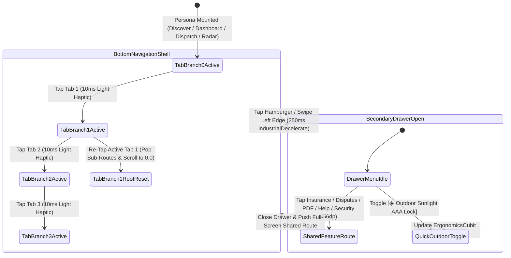

# Role-Based Dynamic Bottom Navigation & Secondary App Drawer
## Mobile Subsystem Specification — `docs/mobile/navigation/02-bottom-navigation-drawer.md`

**Document Identifier:** `SPEC-MOB-NAV-02`  
**Classification:** Canonical Subsystem UI/UX & Technical Behavior Specification  
**Governing Documents:** `docs/source/Dink_Machinery_UI_UX_Design_Brief.md`, `docs/shared/design/00-design-system.md`, `docs/shared/design/design-tokens.json`, `docs/shared/requirements/04-user-roles.md`, `docs/shared/requirements/05-10-notifications-in-app-center.md`, `docs/shared/requirements/05-16-accessibility-internationalisation.md`, `docs/ERROR_CATALOG.md`, `contracts/openapi.yaml`  
**Target Subsystem:** Flutter 3.44 / Dart 3.9 Mobile Client (iOS & Android)  
**Primary Persona / Actor:** All Mobile Personas (Renter, Fleet Owner, Certified Operator, Lowboy Transporter)  
**Requirement Traceability:** `REQ-04` (`ROL-01`..`ROL-04`), `REQ-05-10` (`NT-01`..`NT-05`), `REQ-05-14` (`HLP-03`, `HLP-04`), `REQ-05-16` (`AC-01`..`AC-04`)  
**Associated Interaction Flows:** `FLOW-01`, `FLOW-02`, `FLOW-17`, `FLOW-APPENDIX-A`  
**Architectural Decision Records:** `ADR-010` (Offline Unread Badge Sync), `ADR-013` (Ge'ez Tab Label Metrics), `ADR-014` (Design Tokens)  
**Status:** Approved Technical Design Baseline

---

## 1. Domain Context & Non-Negotiable Navigation Invariants

Each of the four Dink Machinery personas requires a distinct set of primary operational destinations without visual clutter. Furthermore, operators and yard managers use the bottom navigation bar with gloved thumbs under $>80,000\text{ lux}$ direct sunlight while monitoring real-time SSE/WebSocket notification badges (such as expiring 60-minute hold timers or incoming payment wire slips).

### 1.1 Non-Negotiable System Invariants
1. **Strict 4-Tab Primary Bar + Secondary Drawer Architecture (`>= 56x56dp` Hit Boxes):**
   - To guarantee a minimum horizontal hit width of `>= 80dp` and vertical height of `64dp` (`{dimension.space.64}`) on narrow $360\text{dp}$ budget Android screens, the Bottom Navigation Bar is capped at **exactly 4 destinations per persona**.
   - Cross-cutting utilities (Insurance Vault, Dispute Tracker, PDF Invoices, Offline Help Manual, Dual Calendar Settings, Security & Account Deletion) live inside the **Secondary Industrial App Drawer**.
2. **Persona-Specific 4-Tab Configurations:**
   - **`RENTER` (Civil Contractor):** `1. Discover` (PostGIS Map/List) | `2. Bookings` (Holds & Active Leases) | `3. Logistics` (Lowboy Sub-Bookings) | `4. Inbox` (Alerts & Q&A).
   - **`OWNER` (Fleet Yard Manager):** `1. Dashboard` (KPIs & SLA Alerts) | `2. My Fleet` (Equipment & EAV Specs) | `3. Bookings` (Approvals & Wire Audit) | `4. Wallet` (Commission & Payouts).
   - **`OPERATOR` (Field Driver):** `1. Dispatch` (Assigned Jobs) | `2. Inspections` (Reticle Walkarounds) | `3. Shift Log` (8.0h/day HUD) | `4. Safety/SOS` (Breakdown & Manual).
   - **`TRANSPORTER` (Lowboy Carrier):** `1. Job Radar` (Corridor Runs) | `2. Active Hauls` (Pickup/Delivery POD) | `3. Trailers` (Axle/Payload Specs) | `4. Earnings` (Pass-Through Ledger).
3. **Double-Tap-to-Root & Scroll-to-Top Behavior:**
   - Tapping the already-active bottom tab pops any nested sub-routes on that branch's `Navigator` stack back to its root screen, or smoothly scrolls the root `CustomScrollView` to `offset: 0.0` within `{motion.duration.normal}` (`250ms`).
4. **Real-Time SSE/Isar Badge Synchronization (`Space Mono` Numerals):**
   - Unread counts on the `Bookings`, `Wallet`, and `Inbox` tabs update in real time via SSE (`GET /api/v1/notifications/stream`) and persist offline in Isar (`ADR-010`). P0 critical alerts (wire slip uploaded, `<5m` hold expiration, dispute opened) render a `{color.feedback.crimson.600}` (`#DC2626`) pill badge with `Space Mono` numerals.
5. **Ge'ez Multi-Script Tab Label Expansion (`1.38x` Height):**
   - Bottom navigation bar height expands from `64dp` to `72dp` when Amharic (`am`) or Afaan Oromoo (`om`) is active to accommodate `{typography.lineHeightFactor.ethiopicGolden}` (`1.38x`) without truncating labels.

---

## 2. Bespoke ASCII Wireframes: 4-Persona Bottom Bars & Secondary App Drawer

### 2.1 Persona-Specific 4-Tab Bottom Navigation Configurations
```text
+-----------------------------------------------------------------------+
| A. RENTER (CONTRACTOR) BOTTOM BAR (64dp Height | 4x >=90dp Hit Zones) |
+-----------------------------------------------------------------------+
|  +---------------+ +---------------+ +---------------+ +-----------+  |
|  |  [🔍 28x28dp] | | [📋] (● 1 P0) | |  [🚛 28x28dp] | | [🔔] (4)  |  |
|  |   DISCOVER    | |   BOOKINGS    | |   LOGISTICS   | |   INBOX   |  |
|  |===[3dp Amber]=| |               | |               | |           |  |
|  +---------------+ +---------------+ +---------------+ +-----------+  |
+=======================================================================+
| B. FLEET OWNER BOTTOM BAR                                             |
+-----------------------------------------------------------------------+
|  +---------------+ +---------------+ +---------------+ +-----------+  |
|  |  [📊 28x28dp] | |  [🚜 28x28dp] | | [✅] (● 2 SLA)| | [💳] (!1) |  |
|  |   DASHBOARD   | |   MY FLEET    | |   BOOKINGS    | |  WALLET   |  |
|  |===[3dp Amber]=| |               | |               | |           |  |
|  +---------------+ +---------------+ +---------------+ +-----------+  |
+=======================================================================+
| C. CERTIFIED FIELD OPERATOR BOTTOM BAR (Outdoor High-Contrast AAA)    |
+-----------------------------------------------------------------------+
|  +---------------+ +---------------+ +---------------+ +-----------+  |
|  |  [📍 28x28dp] | |  [📷 28x28dp] | |  [⏱️ 28x28dp] | | [⚠️ SOS]  |  |
|  |   DISPATCH    | |  INSPECTIONS  | |   SHIFT LOG   | | BREAKDOWN |  |
|  |===[3dp #FBBF24| |               | |               | |           |  |
|  +---------------+ +---------------+ +---------------+ +-----------+  |
+-----------------------------------------------------------------------+
```

### 2.2 Secondary Industrial Navigation Drawer (`304dp` Width)
```text
+-------------------------------------------------------+---------------+
|  DINK MACHINERY WORKSPACE DRAWER                      |/////////      |
|  +-------------------------------------------------+  |/////////      |
|  | [👤] DAWIT HAILE-MARIAM      [✓ FAYDA VERIFIED] |  |/////////      |
|  |      +251 911 200 491 | Jurisdiction: ET (ETB)  |  |// OVERLAY //  |
|  |      Rating: ★ 4.94 (28 Completed Contracts)    |  |// 85% DARK // |
|  +-------------------------------------------------+  |/////////      |
|  SHARED OPERATIONS & COMPLIANCE VAULT                 |/////////      |
|  +-------------------------------------------------+  |/////////      |
|  | [🛡️] Insurance Certificates & CPAR Claims (56dp)|  |/////////      |
|  +-------------------------------------------------+  |/////////      |
|  | [⚖️] Damage Dispute Arbitration Tracker   [● 1] |  |/////////      |
|  +-------------------------------------------------+  |/////////      |
|  | [📄] Signed Contracts & MOR/KRA VAT Invoices    |  |/////////      |
|  +-------------------------------------------------+  |/////////      |
|  | [📅] Ethiopian Ge'ez / Gregorian Calendar Prefs |  |/////////      |
|  +-------------------------------------------------+  |/////////      |
|  FIELD SUPPORT & OFFLINE MANUALS (ADR-010)            |/////////      |
|  +-------------------------------------------------+  |/////////      |
|  | [📘] Offline Safety Manual & Reticle Guide      |  |/////////      |
|  +-------------------------------------------------+  |/////////      |
|  | [💬] Toll-Free Hotline (8190) & WhatsApp Desk   |  |/////////      |
|  +-------------------------------------------------+  |/////////      |
|  ACCOUNT & HARDWARE SECURITY                          |/////////      |
|  +-------------------------------------------------+  |/////////      |
|  | [☀️] Outdoor Sunlight AAA Mode: [AUTO >25k LUX] |  |/////////      |
|  +-------------------------------------------------+  |/////////      |
|  | [🔐] Passkey Biometrics, SIM Recovery & Delete  |  |/////////      |
|  +-------------------------------------------------+  |/////////      |
+-------------------------------------------------------+---------------+
```

---

## 3. W3C DTCG Design Token Mapping Table

| Navigation Component | W3C Token Path (`design-tokens.json`) | Standard Dark (`Cast Iron`) | Outdoor High-Contrast (`>80k lux`) | Behavioral & Ergonomic Rule |
|---|---|---|---|---|
| **Bottom Bar Surface** | `{color.brand.slate.950}` | `#020617` + `1dp` top `{color.brand.slate.800}` | `#000000` + `3dp` top `#FFFFFF` | Height `64dp` (`72dp` in `am`/`om` locales). |
| **Active Tab Indicator** | `{semantic.*.border.focus}` | `3dp` top bar `{color.brand.amber.500}` | `3dp` top bar `{color.brand.amber.400}` | Paired with `{color.brand.amber.400}` icon & label. |
| **Inactive Tab Icon/Text**| `{semantic.*.text.secondary}` | `{color.brand.slate.400}` (`#94A3B8`) | `{color.brand.slate.200}` (`#E2E8F0`) | Maintains $\ge 7.0:1$ contrast in Outdoor AAA mode. |
| **P0 Urgent Tab Badge** | `{color.feedback.crimson.600}` | `#DC2626` fill, `#FFFFFF` text | `#DC2626` fill + `2dp` `#FFFFFF` border | `Space Mono 12sp Bold`; pulses once on SSE arrival. |
| **Drawer Item Hit Box** | `{component.actuator.button.heightStandard}` | `{dimension.space.56}` (`56dp`) | `{dimension.space.56}` (`56dp`) | Full-width `InkWell` with `16dp` horizontal padding. |
| **Drawer Scrim Overlay** | `{semantic.*.surface.overlay}` | `rgba(2, 6, 23, 0.85)` | `rgba(0, 0, 0, 0.95)` | Tapping outside `304dp` drawer closes in `250ms`. |

---

## 4. Interactive State Machine: Tab Navigation & Drawer Routing



---

## 5. Concrete Flutter Implementation Blueprint

### 5.1 Dynamic Bottom Navigation & Badge BLoC (`navigation_shell_cubit.dart`)
```dart
// lib/features/navigation/bloc/navigation_shell_cubit.dart
import 'package:flutter/material.dart';
import 'package:flutter/services.dart';
import 'package:flutter_bloc/flutter_bloc.dart';
import 'package:freezed_annotation/freezed_annotation.dart';
import 'role_switcher_bloc.dart';

part 'navigation_shell_cubit.freezed.dart';

@freezed
class NavTabSpec with _$NavTabSpec {
  const factory NavTabSpec({
    required String routePath,
    required String i18nKey,
    required IconData icon,
    @Default(0) int badgeCount,
    @Default(false) bool hasCriticalP0Alert,
  }) = _NavTabSpec;
}

@freezed
class NavigationShellState with _$NavigationShellState {
  const factory NavigationShellState({
    @Default(AppPersona.renter) AppPersona persona,
    @Default(0) int currentTabIndex,
    @Default(<NavTabSpec>[]) List<NavTabSpec> tabs,
    @Default(0) int openDisputesBadge,
    @Default(0) int expiringInsuranceBadge,
  }) = _NavigationShellState;
}

class NavigationShellCubit extends Cubit<NavigationShellState> {
  NavigationShellCubit()
      : super(NavigationShellState(tabs: _tabsForPersona(AppPersona.renter)));

  void syncPersona(AppPersona persona) {
    emit(state.copyWith(
      persona: persona,
      currentTabIndex: 0,
      tabs: _tabsForPersona(persona),
    ));
  }

  void selectTab(int index, {required VoidCallback onReselectActiveTab}) {
    HapticFeedback.lightImpact();
    if (index == state.currentTabIndex) {
      onReselectActiveTab();
      return;
    }
    emit(state.copyWith(currentTabIndex: index));
  }

  void updateTabBadges({required int tabIndex, required int count, bool isP0 = false}) {
    final updated = List<NavTabSpec>.from(state.tabs);
    if (tabIndex >= 0 && tabIndex < updated.length) {
      updated[tabIndex] = updated[tabIndex].copyWith(
        badgeCount: count,
        hasCriticalP0Alert: isP0,
      );
      emit(state.copyWith(tabs: updated));
    }
  }

  static List<NavTabSpec> _tabsForPersona(AppPersona persona) {
    switch (persona) {
      case AppPersona.renter:
        return const [
          NavTabSpec(routePath: '/renter/discover', i18nKey: 'nav.renter.discover', icon: Icons.travel_explore),
          NavTabSpec(routePath: '/renter/bookings', i18nKey: 'nav.renter.bookings', icon: Icons.assignment_outlined),
          NavTabSpec(routePath: '/renter/logistics', i18nKey: 'nav.renter.logistics', icon: Icons.local_shipping_outlined),
          NavTabSpec(routePath: '/shared/inbox', i18nKey: 'nav.shared.inbox', icon: Icons.notifications_none),
        ];
      case AppPersona.owner:
        return const [
          NavTabSpec(routePath: '/owner/dashboard', i18nKey: 'nav.owner.dashboard', icon: Icons.dashboard_outlined),
          NavTabSpec(routePath: '/owner/fleet', i18nKey: 'nav.owner.fleet', icon: Icons.agriculture_outlined),
          NavTabSpec(routePath: '/owner/bookings', i18nKey: 'nav.owner.bookings', icon: Icons.fact_check_outlined),
          NavTabSpec(routePath: '/owner/wallet', i18nKey: 'nav.owner.wallet', icon: Icons.account_balance_wallet_outlined),
        ];
      case AppPersona.operatorRole:
        return const [
          NavTabSpec(routePath: '/operator/dispatch', i18nKey: 'nav.operator.dispatch', icon: Icons.pin_drop_outlined),
          NavTabSpec(routePath: '/operator/inspections', i18nKey: 'nav.operator.inspections', icon: Icons.center_focus_strong),
          NavTabSpec(routePath: '/operator/shift-log', i18nKey: 'nav.operator.shift_log', icon: Icons.timer_outlined),
          NavTabSpec(routePath: '/operator/sos', i18nKey: 'nav.operator.sos', icon: Icons.warning_amber_rounded),
        ];
      case AppPersona.transporter:
        return const [
          NavTabSpec(routePath: '/transporter/radar', i18nKey: 'nav.transporter.radar', icon: Icons.radar),
          NavTabSpec(routePath: '/transporter/hauls', i18nKey: 'nav.transporter.hauls', icon: Icons.route_outlined),
          NavTabSpec(routePath: '/transporter/trailers', i18nKey: 'nav.transporter.trailers', icon: Icons.rv_hookup),
          NavTabSpec(routePath: '/transporter/earnings', i18nKey: 'nav.transporter.earnings', icon: Icons.payments_outlined),
        ];
    }
  }
}
```

### 5.2 Glove-Friendly Bottom Bar Widget (`dink_bottom_nav_bar.dart`)
```dart
// lib/features/navigation/widgets/dink_bottom_nav_bar.dart
import 'package:flutter/material.dart';
import '../bloc/navigation_shell_cubit.dart';

class DinkBottomNavBar extends StatelessWidget {
  final NavigationShellState state;
  final ValueChanged<int> onTabTapped;
  final bool isOutdoorAAA;
  final bool isEthiopicLocale;

  const DinkBottomNavBar({
    super.key,
    required this.state,
    required this.onTabTapped,
    this.isOutdoorAAA = false,
    this.isEthiopicLocale = false,
  });

  @override
  Widget build(BuildContext context) {
    final double barHeight = isEthiopicLocale ? 72.0 : 64.0;
    final Color activeColor = isOutdoorAAA ? const Color(0xFFFBBF24) : const Color(0xFFF59E0B);

    return Container(
      height: barHeight + MediaQuery.paddingOf(context).bottom,
      padding: EdgeInsets.only(bottom: MediaQuery.paddingOf(context).bottom),
      decoration: BoxDecoration(
        color: isOutdoorAAA ? Colors.black : const Color(0xFF020617),
        border: Border(
          top: BorderSide(
            color: isOutdoorAAA ? Colors.white : const Color(0xFF1E293B),
            width: isOutdoorAAA ? 3.0 : 1.0,
          ),
        ),
      ),
      child: Row(
        children: List.generate(state.tabs.length, (index) {
          final tab = state.tabs[index];
          final isSelected = index == state.currentTabIndex;

          return Expanded(
            child: Semantics(
              selected: isSelected,
              button: true,
              label: '${tab.i18nKey}, ${tab.badgeCount} unread',
              child: InkWell(
                onTap: () => onTabTapped(index),
                child: ConstrainedBox(
                  constraints: const BoxConstraints(minWidth: 56.0, minHeight: 64.0),
                  child: Column(
                    mainAxisAlignment: MainAxisAlignment.center,
                    children: [
                      Container(
                        height: 3.0,
                        width: 48.0,
                        color: isSelected ? activeColor : Colors.transparent,
                      ),
                      const Spacer(),
                      Badge(
                        isLabelVisible: tab.badgeCount > 0,
                        backgroundColor: tab.hasCriticalP0Alert
                            ? const Color(0xFFDC2626)
                            : const Color(0xFFFF5722),
                        label: Text(
                          '${tab.badgeCount}',
                          style: const TextStyle(
                            fontFamily: 'Space Mono',
                            fontSize: 11.0,
                            fontWeight: FontWeight.w700,
                            color: Colors.white,
                          ),
                        ),
                        child: Icon(
                          tab.icon,
                          size: 28.0,
                          color: isSelected ? activeColor : const Color(0xFFCBD5E1),
                        ),
                      ),
                      const SizedBox(height: 4.0),
                      Text(
                        tab.i18nKey.split('.').last.toUpperCase(),
                        maxLines: 1,
                        style: TextStyle(
                          fontSize: 12.0,
                          height: isEthiopicLocale ? 1.38 : 1.25,
                          fontWeight: isSelected ? FontWeight.w800 : FontWeight.w500,
                          color: isSelected ? activeColor : const Color(0xFFCBD5E1),
                        ),
                      ),
                      const Spacer(),
                    ],
                  ),
                ),
              ),
            ),
          );
        }),
      ),
    );
  }
}
```

---

## 6. OpenAPI 3.1.0 Contract & RFC 9457 Error Recovery Matrix

| Endpoint / Operation | Method & Path | Request / Header Invariants | RFC 9457 Error Code & Status | Navigation & Badge Recovery Behavior |
|---|---|---|---|---|
| **Fetch Unread Notification Counts** | `GET /api/v1/notifications?unreadOnly=true&cursor=...` | Cursor-based pagination (`meta.pagination`) | `SYS_SERVICE_UNAVAILABLE` (`503`) | Compute unread badge counts directly from local Isar `NotificationIsar` collection (`isRead == false`). |
| **Deep-Link Route Resolution** | Internal `dink://bookings/{id}/...` | Validated against active user role | `BOOKING_NOT_FOUND` (`404`) | Pop deep-link overlay, switch to `Bookings` tab root, and show localized toast (`#BK-XXXX not found or archived`). |
| **Wallet Delinquency Lock** | Any Owner/Renter tab route | Checked on shell mount | `WALLET_LOCKED_PENDING_AUDIT` (`423`) | Automatically switch Owner bottom bar to `Tab 3 (Wallet)` and display commission settlement banner. |

---

## 7. Verification & Acceptance Criteria

### 7.1 Automated Unit & BLoC Test Cases (`bloc_test`)
1. **4-Tab Matrix Mapping Per Persona:**
   - *Given* `NavigationShellCubit`,
   - *When* `syncPersona` is called for `renter`, `owner`, `operatorRole`, and `transporter`,
   - *Then* each persona emits exactly 4 `NavTabSpec` items matching its canonical route table and resets `currentTabIndex` to `0`.
2. **Active Tab Reselection Callback:**
   - *Given* `currentTabIndex == 1`,
   - *When* `selectTab(1, onReselectActiveTab: callback)` is invoked,
   - *Then* `callback` fires once to pop nested routes/scroll to top without re-emitting a redundant state transition.

### 7.2 Widget & Accessibility Test Gates
1. **Glove Hit-Target & Ge'ez `72dp` Bar Height Gate:**
   - Widget test mounts `DinkBottomNavBar` with `isEthiopicLocale: true` on a `360x800dp` viewport and verifies bar height equals `72.0dp` and each of the 4 tab targets measures `90.0dp x 72.0dp` ($\ge 56\times 56\text{ dp}$).
