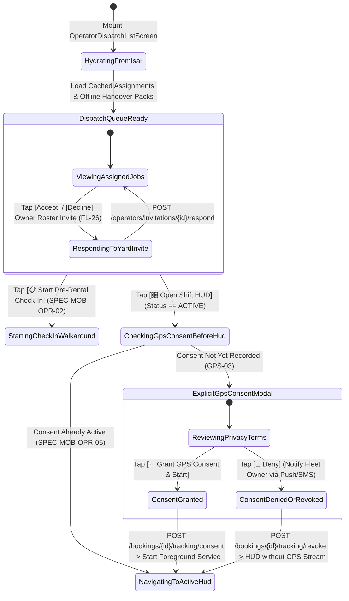
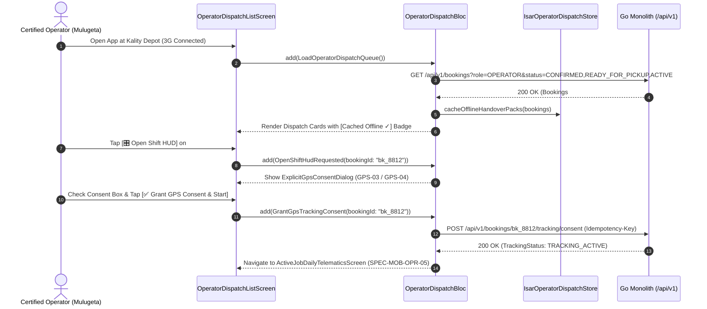

# Certified Operator Job Dispatch Console, Yard Linking & GPS Privacy Consent
## Mobile Subsystem Specification — `docs/mobile/operator-experience/01-operator-job-dispatch-list.md`

**Document Identifier:** `SPEC-MOB-OPR-01`  
**Classification:** Canonical Subsystem UI/UX & Technical Behavior Specification  
**Governing Documents:** `Dink_Machinery_UI_UX_Design_Brief.md`, `SRS-DINK-CORE-V7.0` (§4, §5.2.5, §5.6, §5.12, `FL-25`..`FL-27`, `FL-38`, `GPS-01`..`GPS-04`), `docs/shared/design/design-tokens.json`, `docs/ERROR_CATALOG.md`, `contracts/openapi.yaml`  
**Target Subsystem:** Flutter 3.44 / Dart 3.9 Mobile Client (iOS & Android)  
**Primary Persona / Actor:** Certified Heavy Machinery Operator (*Mulugeta Tadesse* / *Juma Omwamba*)  
**Associated Requirements:** `REQ-04` (Operator Persona & RBAC), `REQ-05-02` (`FL-25`..`FL-27`, `FL-38` Bilateral Operator Invitation & Yard Linking), `REQ-05-12` (`GPS-01`..`GPS-04` Explicit GPS Consent & Privacy Perimeter)  
**Associated Interaction Flows:** `FLOW-07` (Booking Assignment), `FLOW-09` (Active Rental Handover & Shift Execution)  
**Associated ADRs:** `ADR-001` (Modular Monolith), `ADR-008` (Multi-Script Ge'ez/Latin Typography), `ADR-010` (Offline-First Isar Job Caching)  
**Status:** Approved Technical Design Baseline

---

## 1. Domain Context, Business Rules & Architectural Invariants

Certified Heavy Machinery Operators (*Mulugeta Tadesse* in Ethiopia; *Juma Omwamba* in Kenya) operate high-tonnage excavators, graders, cranes, and bulldozers in high-glare ($>85,000\text{ lux}$), high-vibration quarry and highway earthworks environments while wearing thick leather safety gloves.

The **Operator Job Dispatch Console** (`SPEC-MOB-OPR-01`) serves as the operator's primary home screen, governing three critical workflows:
1. **Bilateral Yard Roster Linking (`FL-26`, `FL-38`):** Accepting or declining roster invitations from Equipment Fleet Owners (*W/ro Almaz Tesfaye*) and maintaining verified heavy plant operator license credentials (e.g., *Ethiopian Ministry of Urban & Infrastructure Class IV Heavy Plant License* or *NTSA Class G Plant License*).
2. **Active & Upcoming Job Dispatch Queue:** Offline-cached manifest of assigned machinery bookings (`CONFIRMED`, `READY_FOR_PICKUP`, `ACTIVE`, `RETURN_INITIATED`), job-site PostGIS coordinates, shift schedules ($8.0\text{ hrs/day}$ standard), and one-tap offline-capable route navigation.
3. **Explicit Informed GPS Tracking Consent & Sovereignty (`GPS-03`, `GPS-04`):** Under the **Kenya Data Protection Act 2019 (Part IV)** and **Ethiopian Communications Authority (ECA) Directives**, background/foreground location telemetry (`GPS-01` 30-second sampling) can only activate between booking states `ACTIVE` and `COMPLETED` after the operator grants explicit, revocable informed consent via a dedicated privacy dialog.

### 1.1 Core Business Rules & Operational Invariants
1. **Bilateral Operator-to-Owner Yard Linking (`FL-26`, `FL-38`):**
   - Fleet Owners invite operators via phone number (`+251...` / `+254...`). The operator receives an in-app **Pending Yard Invitation Card** displaying the Fleet Owner's company name, TIN verification badge, and fleet size.
   - Accepting the invitation binds the operator to the owner's `linked_operator_roster`, allowing the owner to assign them to incoming bookings (`SPEC-MOB-OWN-07`).
2. **Strict Lifecycle-Bounded GPS Privacy Consent (`GPS-03`, `GPS-04`):**
   - When an operator taps `[🚀 Start Active Shift HUD]` or completes Handover Check-In (`AR-02`), if location consent for the booking has not yet been recorded (`POST /api/v1/bookings/{id}/tracking/consent`), the **Explicit GPS Tracking Consent Dialog** is presented.
   - The dialog clearly discloses:
     - **What is collected:** WGS 84 Latitude, Longitude, Speed, Heading, Accuracy, and Battery % every 30 seconds (`GPS-01`).
     - **What is NEVER collected:** Zero microphone audio, zero camera snooping, zero personal app data.
     - **Strict Temporal Window:** Tracking activates **only** while the booking is `ACTIVE` and shuts off automatically the instant `RETURN_INITIATED` or `COMPLETED` is triggered (`GPS-03`).
     - **Unilateral Revocation Right:** The operator can revoke tracking at any time from the top status bar (`POST /api/v1/bookings/{id}/tracking/revoke`), which immediately stops hardware sampling and notifies the Fleet Owner.
3. **Pre-Cached Offline Job Dossier (`ADR-010`):**
   - Whenever an operator is assigned to a `CONFIRMED` or `READY_FOR_PICKUP` booking, the Flutter client automatically downloads the machine's baseline meter reading (`fleets.baseline_meter_hours`), check-in reticle templates, and HMAC handover secret into local Isar NoSQL storage so the operator can execute site check-in (`SPEC-MOB-OPR-02`..`04`) in zero-signal river valleys or quarries.

---

## 2. Screen Anatomy, Layout & Bespoke ASCII Wireframe

### 2.1 Operator Dispatch Console & Explicit GPS Consent Modal Wireframe
```text
+-----------------------------------------------------------------------+
| [👷] MULUGETA TADESSE                [🌐 አማ/EN] [☀️ Outdoor] [🟢 Sync]|
|      License: ET-MUDCO-OP-44912 (Class IV Verified ✓) • ★ 4.95        |
+-----------------------------------------------------------------------+
| 🤝 PENDING FLEET OWNER YARD INVITATION (FL-26 / FL-38)                |
| +-------------------------------------------------------------------+ |
| | Tesfaye Heavy Plant & Transport PLC (Kality Depot • 12 Machines)  | |
| | Invites you to join their Certified Operator Dispatch Roster.     | |
| | [ ❌ DECLINE ]                        [ ✅ ACCEPT & LINK TO YARD ] | |
| +-------------------------------------------------------------------+ |
+-----------------------------------------------------------------------+
| 🚜 TODAY'S ASSIGNED DISPATCH QUEUE (2 JOBS • CACHED OFFLINE ✓)        |
| +-------------------------------------------------------------------+ |
| | [🟢 ACTIVE SHIFT — DAY 3 OF 7]                     Booking #BK-8812| |
| | Machine:    CAT 320D Hydraulic Excavator (Plate: ET-3-99120)      | |
| | Attachment: + Soosan SB-81 Hydraulic Rock Breaker (80mm Pin)      | |
| | Contractor: Haile-Mariam Construction (Site Sup: Eng. Dawit H.)   | |
| | 📍 Job Site: Mojo-Meki Highway Expansion — Lot 2 (8.5412°, 39.271°)| |
| | ⏱️ Shift Quota Today: 4.5 / 8.0 hrs logged | Meter: 1,478.50 hrs  | |
| | 📡 GPS Telemetry: [🟢 ACTIVE (30s Stream)]   [🔒 Revoke Consent]   | |
| |-------------------------------------------------------------------| |
| | [ 🗺️ NAVIGATE TO SITE ]   [ 📞 CALL SUP ]   [ 🎛️ OPEN SHIFT HUD →]| |
| +-------------------------------------------------------------------+ |
|                                                                       |
| +-------------------------------------------------------------------+ |
| | [🟡 READY FOR HANDOVER CHECK-IN]                   Booking #BK-8904| |
| | Machine:    XCMG LW500FN Wheel Loader (Plate: ET-3-77412)         | |
| | Schedule:   Starts Tomorrow 07:00 EAT • 5 Days (40.0 Shift Hours) | |
| | 📍 Job Site: Bole Lemi Industrial Park Phase II (8.9711°, 38.854°) | |
| | Baseline Meter Floor: 2,110.00 hrs • Offline Handover Pack: Ready | |
| |-------------------------------------------------------------------| |
| | [ 🗺️ NAVIGATE TO SITE ]        [ 📋 START PRE-RENTAL CHECK-IN → ] | |
| +-------------------------------------------------------------------+ |
+-----------------------------------------------------------------------+

+-----------------------------------------------------------------------+
| 📍 EXPLICIT OPERATOR GPS TELEMETRY CONSENT (GPS-03 / GPS-04)          |
+-----------------------------------------------------------------------+
| Booking #BK-8812 (CAT 320D) requires live job-site location sharing   |
| while the machine is in ACTIVE operation:                             |
|                                                                       |
| • ⏱️ Sampling Rate: Every 30 seconds (25m movement filter).           |
| • 🛡️ Privacy Boundary: Automatically turns OFF when rental ends      |
|      (RETURN_INITIATED / COMPLETED). Never tracks off-shift.          |
| • ✋ Your Right: You may pause or revoke GPS sharing at any time      |
|      (Fleet Owner W/ro Almaz will be notified immediately).           |
|                                                                       |
| [☑] I understand and consent to share operational GPS telemetry       |
|     during active shift hours for Booking #BK-8812.                   |
+-----------------------------------------------------------------------+
| [ 🚫 DENY (NOTIFY OWNER) ]        [ ✅ GRANT GPS CONSENT & START ]   |
+-----------------------------------------------------------------------+
```

---

## 3. W3C DTCG Design Token Mapping Table

| UI Component / Element | W3C Token Path (`design-tokens.json`) | Resolved Value (Light / Dark / Outdoor) | Behavioral & Accessibility Invariant |
|---|---|---|---|
| **Dispatch Card Surface** | `semantic.{mode}.surface.card` + `stroke.border.medium` | `#FFFFFF` / `#1E293B` / `#000000`, `2dp` border | High-contrast envelope legible in direct sunlight (`>85,000 lux`). |
| **Primary Field Action CTA** | `component.actuator.button.heightField` + `semantic.{mode}.action.primary.bg` | Height `64dp` (`dimension.space.64`), `#F59E0B` / `#FBBF24`, Lip `3dp` | Enforces 64dp gloved-hand actuator standard for field operators. |
| **Meter & Coordinate Figures** | `typography.fontFamily.mono` + `semantic.{mode}.text.numericLedger` | `Space Mono` `16sp` | Displays baseline meter (`2,110.00 hrs`) and WGS 84 coordinates cleanly. |
| **GPS Active Consent Pill** | `color.feedback.emerald.100` + `color.feedback.emerald.700` | Bg `#D1FAE5`, Text `#047857`, Dot `#10B981` | Indicates active foreground service telemetry with one-tap `[🔒 Revoke Consent]`. |
| **Yard Invitation Banner** | `color.brand.amber.50` + `color.brand.amber.800` | Bg `#FFFBEB`, Border `#F59E0B`, Text `#92400E` | Highlights pending bilateral owner-to-operator roster link requests (`FL-26`). |

---

## 4. Interactive State Machine & Sequence Flows

### 4.1 Operator Dispatch, Yard Linking & GPS Consent State Machine


### 4.2 Offline Handover Pack Pre-Caching & Explicit GPS Consent Sequence (`GPS-03`, `GPS-04`)


---

## 5. Concrete Flutter Implementation Blueprint

### 5.1 BLoC Events & Immutable Freezed States
```dart
// lib/features/operator_dispatch/presentation/bloc/operator_dispatch_bloc.dart
import 'package:freezed_annotation/freezed_annotation.dart';
import 'package:flutter_bloc/flutter_bloc.dart';

part 'operator_dispatch_bloc.freezed.dart';

@freezed
sealed class OperatorDispatchEvent with _$OperatorDispatchEvent {
  const factory OperatorDispatchEvent.started() = _Started;
  const factory OperatorDispatchEvent.refreshed() = _Refreshed;
  const factory OperatorDispatchEvent.yardInvitationResponded({
    required String invitationId,
    required bool accept,
  }) = _YardInvitationResponded;
  const factory OperatorDispatchEvent.gpsConsentDecisionSubmitted({
    required String bookingId,
    required bool consentGranted,
    String? revocationReason,
  }) = _GpsConsentDecisionSubmitted;
}

@freezed
class OperatorAssignedJobDto with _$OperatorAssignedJobDto {
  const factory OperatorAssignedJobDto({
    required String bookingId,
    required String bookingStatus, // 'CONFIRMED' | 'READY_FOR_PICKUP' | 'ACTIVE' | 'RETURN_INITIATED'
    required String fleetId,
    required String fleetMakeModel,
    required String licensePlate,
    required double baselineMeterHours,
    double? checkInMeterHours,
    required List<String> bundledAttachmentNames,
    required String contractorCompanyName,
    required String siteSupervisorName,
    required String siteSupervisorPhone,
    required double jobSiteLat,
    required double jobSiteLng,
    required String jobSiteAddressLabel,
    required DateTime startDate,
    required DateTime endDate,
    required double dailyShiftQuotaHours, // 8.0 hrs
    required double loggedShiftHoursToday,
    required String gpsTrackingStatus, // 'CONSENT_PENDING' | 'TRACKING_ACTIVE' | 'REVOKED_OPERATOR'
    required bool isOfflineHandoverPackCached,
  }) = _OperatorAssignedJobDto;
}

@freezed
sealed class OperatorDispatchState with _$OperatorDispatchState {
  const factory OperatorDispatchState.loading() = _Loading;
  const factory OperatorDispatchState.loaded({
    required String operatorName,
    required String licenseNumber,
    required List<YardRosterInvitationDto> pendingYardInvitations,
    required List<OperatorAssignedJobDto> assignedJobs,
    required bool isOfflineMode,
    ProblemDetails? error,
  }) = _Loaded;
}
```

### 5.2 Isar Local Persistence for Offline Handover Packs
```dart
// lib/features/operator_dispatch/data/local/isar_operator_job_pack.dart
import 'package:isar/isar.dart';

part 'isar_operator_job_pack.g.dart';

@collection
class IsarOperatorJobPack {
  Id id = Isar.autoIncrement;

  @Index(unique: true, replace: true)
  late String bookingId;

  late String bookingStatus;
  late String fleetId;
  late String fleetMakeModel;
  late String licensePlate;
  late double baselineMeterHours;
  double? checkInMeterHours;
  late double jobSiteLat;
  late double jobSiteLng;
  late String jobSiteAddressLabel;
  late String siteSupervisorName;
  late String siteSupervisorPhone;
  late String offlineHmacHandoverSecret; // Used for ADR-010 Peer QR Handshake
  late String gpsTrackingStatus;
  late DateTime cachedAt;
}
```

### 5.3 Widget Tree Hierarchy
```text
OperatorJobDispatchListScreen (Scaffold)
 ├── OperatorTopAppBar (Operator Name, Verified License Class Badge, Outdoor Glare Toggle, Sync Pill)
 ├── PendingYardInvitationsList (Conditional FL-26 Owner Roster Link Cards with [Accept] / [Decline])
 ├── Expanded -> RefreshIndicator
 │    └── ListView.builder (Assigned Dispatch Cards)
 │         └── OperatorDispatchJobCard
 │              ├── JobStatusAndOfflinePackHeader (Status Pill, Booking ID, [Cached Offline ✓])
 │              ├── MachineAndBundledToolsSummary (Make/Model, Plate, Attached Breakers/Buckets)
 │              ├── JobSiteCoordinatesAndSupervisorRow (WGS 84 Coords, [🗺️ Navigate], [📞 Call Sup])
 │              ├── GpsConsentStatusStrip (Shows Tracking Status + [🔒 Revoke Consent] Quick Toggle)
 │              └── PrimaryFieldActionActuator (64dp Button: [Start Pre-Rental Check-In] or [Open Shift HUD])
 └── ExplicitGpsConsentModalDialog (GPS-03 / GPS-04 Informed Consent Attestation Dialog)
```

---

## 6. OpenAPI 3.1.0 Routes & RFC 9457 Error Matrix

### 6.1 Bound API Endpoints
| Operation | HTTP Method & URI | Headers Required | Purpose & Contract Binding |
|---|---|---|---|
| **List Operator Bookings** | `GET /api/v1/bookings?cursor={c}&limit=20` | `Authorization: Bearer <JWT>`, `X-Country-Code: ET\|KE` | Returns bookings assigned to the authenticated operator (`FL-38`). |
| **Respond to Yard Invite** | `POST /api/v1/operators/invitations/{id}/respond` | `Authorization: Bearer <JWT>`, `Idempotency-Key: <UUIDv4>` | Accepts or declines bilateral linking to a Fleet Owner's yard roster (`FL-26`). |
| **Record GPS Consent** | `POST /api/v1/bookings/{id}/tracking/consent` | `Authorization: Bearer <JWT>`, `Idempotency-Key: <UUIDv4>` | Logs explicit operator opt-in (`GPS-03`, `GPS-04`) and enables WSS telemetry stream. |
| **Revoke GPS Consent** | `POST /api/v1/bookings/{id}/tracking/revoke` | `Authorization: Bearer <JWT>`, `Idempotency-Key: <UUIDv4>` | Immediately halts location tracking (`GPS-03`) and triggers P0 alert to Fleet Owner. |

### 6.2 RFC 9457 Problem Details Error Matrix
| Error Code (`error.code`) | HTTP Status | Type URI | Trigger Condition | Mobile UI Recovery Behavior |
|---|---|---|---|---|
| `BOOKING_INVALID_STATE_TRANSITION` | `409` | `/errors/booking-invalid-state` | Attempted to activate GPS tracking before booking reached `ACTIVE` or after `COMPLETED` (`GPS-03`). | Keep GPS hardware dormant and display lifecycle boundary notice. |
| `AUTH_INSUFFICIENT_PERMISSIONS` | `403` | `/errors/insufficient-permissions` | Operator was reassigned off this booking by the Fleet Owner (`SRS 05.06 §4.3`). | Remove booking from active dispatch list and refresh queue. |
| `SYS_SERVICE_UNAVAILABLE` | `503` | `/errors/service-unavailable` | Device is at a remote quarry without cellular signal. | Serve cached `IsarOperatorJobPack` seamlessly and queue consent/check-in actions in Isar outbox. |

---

## 7. Verification & Acceptance Criteria

- [ ] **Lifecycle-Bounded GPS Privacy (`GPS-03`, `GPS-04`):** Location permissions and background services are never requested or started for bookings in `CONFIRMED` or `READY_FOR_PICKUP` status; the `ExplicitGpsConsentModalDialog` is presented only upon entering `ACTIVE` operation.
- [ ] **Unilateral Revocation (`GPS-03`):** Tapping `[🔒 Revoke Consent]` immediately stops the Flutter foreground location service, closes the WebSocket, and queues/sends `POST /api/v1/bookings/{id}/tracking/revoke`.
- [ ] **Offline Handover Pack Readiness (`ADR-010`):** Turning on airplane mode after initial sync still allows the operator to open a `READY_FOR_PICKUP` job card and launch the Pre-Rental Check-In Walkaround (`SPEC-MOB-OPR-02`) with the cached `baselineMeterHours` floor.
- [ ] **64dp Gloved-Hand Ergonomics:** All primary dispatch buttons use `component.actuator.button.heightField` (`64dp`) and `3dp` tactile borders.
