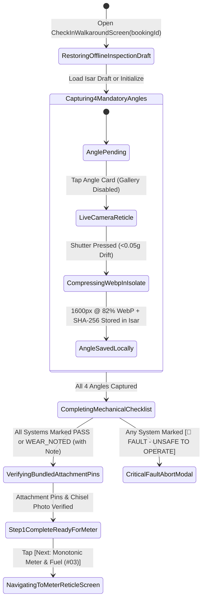
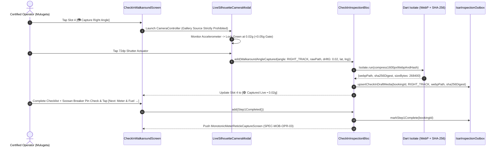

# Pre-Rental Handover Walkaround Inspection & Attachment Pin Verification Stepper
## Mobile Subsystem Specification — `docs/mobile/operator-experience/02-check-in-walkaround-inspection.md`

**Document Identifier:** `SPEC-MOB-OPR-02`  
**Classification:** Canonical Subsystem UI/UX & Technical Behavior Specification  
**Governing Documents:** `Dink_Machinery_UI_UX_Design_Brief.md`, `SRS-DINK-CORE-V7.0` (§5.3.6, §5.6.3, `AR-01`, `AR-02`, `ATT-07`), `docs/shared/design/design-tokens.json`, `docs/ERROR_CATALOG.md`, `contracts/openapi.yaml`  
**Target Subsystem:** Flutter 3.44 / Dart 3.9 Mobile Client (iOS & Android)  
**Primary Persona / Actor:** Certified Heavy Machinery Operator (*Mulugeta Tadesse*) & Contractor Site Engineer (*Dawit Haile-Mariam*)  
**Associated Requirements:** `REQ-05-06` (`AR-01` Pre-Rental Multi-Angle Camera Reticle Inspection, `AR-02` Handover Protocol), `REQ-05-03` (§6.2 Attachment Pin Tolerances, Bushing Play & Chisel Wear Check)  
**Associated Interaction Flows:** `FLOW-09` (Pre-Rental Handover Inspection & Activation), `FLOW-10` (Baseline Anchor for Return Comparison)  
**Associated ADRs:** `ADR-005` (ClamAV Streaming Media Scan), `ADR-010` (Offline-First Isar Inspection Outbox & Live Camera Enforcement)  
**Status:** Approved Technical Design Baseline

---

## 1. Domain Context, Business Rules & Architectural Invariants

Before a mobilized machine (`10. READY_FOR_PICKUP`) can transition to `11. ACTIVE` on a project site, the Certified Operator and the Contractor's Site Supervisor must jointly execute the **Pre-Rental Handover Walkaround Inspection** (`SPEC-MOB-OPR-02`). The photographs and mechanical checklists captured during this walkaround form the legally binding **Check-In Baseline** against which the post-rental Check-Out Return Inspection (`SPEC-MOB-OPR-06`) and 24-Hour Damage Claim Docket (`SPEC-MOB-OWN-11`) are judged.

### 1.1 Core Business Rules & Operational Invariants
1. **Live Camera Reticle Mandate & Gallery Upload Prohibition (`AR-01`):**
   - To prevent operators or contractors from uploading outdated depot photos or stock images, **system photo gallery selection is strictly disabled** (`image_picker` gallery source is omitted; only the embedded `CameraController` reticle viewport is permitted).
   - Every photo capture enforces the accelerometer steady-state gate ($<0.05g$ variance) to prevent motion blur and stamps an immutable cryptographic metadata block (`bookingId`, `angleType`, `UTC timestamp`, `WGS 84 GPS coordinates`, `SHA-256` digest).
2. **4 Mandatory Walkaround Elevation Angles + Cabin & Undercarriage (`AR-01`):**
   - Requires live reticle capture of:
     1. **Angle 1 (`FRONT_WORKING_EQUIPMENT`):** Boom, stick, bucket teeth, or bulldozer blade in ground rest position.
     2. **Angle 2 (`REAR_COUNTERWEIGHT_ENGINE`):** Rear counterweight, radiator grille, and exhaust stack.
     3. **Angle 3 (`LEFT_TRACK_UNDERCARRIAGE`):** Left track chain, grouser pads, sprockets, rollers, or left tires.
     4. **Angle 4 (`RIGHT_TRACK_UNDERCARRIAGE`):** Right track assembly / tires and main hydraulic boom cylinders.
     - *(Note: The Monotonic Cabin Hour Meter & Fuel Level capture is executed in Step 2 of the handover wizard via `SPEC-MOB-OPR-03`).*
3. **Structural, Hydraulic & Fluid Readiness Checklist (`AR-01`):**
   - Interactive glove-friendly (`56dp` touch target) tri-state inspection toggles (`[🟢 PASS]` / `[🟡 WEAR NOTED]` / `[🔴 FAULT]`):
     - Engine Oil & Coolant Levels Verified
     - Main Hydraulic Pump & Hose Lines (Zero Weeping/Leaks)
     - Cabin Safety Glass, ROPS/FOPS Frame & Mirrors Intact
     - Track Tension / Pneumatic Tire Pressure & Lug Nuts
     - Working Horn, Reverse Travel Alarm & Amber Strobe Beacon
   - Selecting `[🟡 WEAR NOTED]` or `[🔴 FAULT]` requires a brief defect note and an optional close-up photo so preexisting scratches or dents are recorded before work begins (protecting the contractor from unfair post-rental damage claims).
4. **Bundled Attachment Pin, Bushing & Tool Tip Verification (`SRS 05.03 §6.2`):**
   - If the booking includes bundled attachments (`booking_attachments`, e.g., *Soosan SB-81 Hydraulic Breaker*), a dedicated **Attachment Coupling & Wear Section** appears automatically, requiring verification of:
     - Quick-Hitch / Mounting Pin Diameter & Safety Locking Cotter Pins
     - Pin-to-Bushing Play Tolerance & Grease Port Lubrication
     - Working Tool Tip Condition (Breaker chisel point diameter or bucket teeth count) + 1 mandatory close-up photo.

---

## 2. Screen Anatomy, Layout & Bespoke ASCII Wireframe

### 2.1 Pre-Rental Walkaround Inspection Stepper Wireframe
```text
+-----------------------------------------------------------------------+
| [← Back]          PRE-RENTAL CHECK-IN INSPECTION        #BK-8812      |
| Asset: CAT 320D (ET-3-99120) + Soosan SB-81 Breaker • Mojo Site B     |
+-----------------------------------------------------------------------+
| HANDOVER WIZARD: STEP 1 OF 3 — EXTERIOR WALKAROUND & FLUID CHECKLIST  |
| [● 1. Walkaround & Pins]──[○ 2. Meter & Fuel (#03)]──[○ 3. PIN/QR #04]|
+-----------------------------------------------------------------------+
| 📷 1. MANDATORY 4-ANGLE LIVE RETICLE PHOTOS (GALLERY DISABLED 🔒)     |
| +---------------------------------+ +-------------------------------+ |
| | [🖼️ 1. FRONT BOOM & BUCKET]     | | [🖼️ 2. REAR COUNTERWEIGHT]    | |
| | 🟢 Captured Live • 0.01g Steady | | 🟢 Captured Live • 0.02g      | |
| | GPS: 8.5412°N, 39.2718°E        | | GPS: 8.5412°N, 39.2718°E      | |
| | [ 🔄 Retake Live ]              | | [ 🔄 Retake Live ]            | |
| +---------------------------------+ +-------------------------------+ |
| +---------------------------------+ +-------------------------------+ |
| | [🖼️ 3. LEFT TRACK / ROLLERS]    | | [📷 4. RIGHT TRACK & BOOM]    | |
| | 🟢 Captured Live • 0.03g Steady | | ⚠️ REQUIRED: Tap to Open      | |
| | GPS: 8.5412°N, 39.2718°E        | |    Live Silhouette Reticle    | |
| | [ 🔄 Retake Live ]              | | [ 📷 CAPTURE RIGHT ANGLE ]    | |
| +---------------------------------+ +-------------------------------+ |
+-----------------------------------------------------------------------+
| 🔧 2. STRUCTURAL, HYDRAULIC & SAFETY SYSTEMS CHECKLIST (AR-01)        |
| +-------------------------------------------------------------------+ |
| | Engine Oil, Radiator Coolant & Hydraulic Tank Level               | |
| | [● 🟢 PASS ]          [○ 🟡 PREEXISTING WEAR ]      [○ 🔴 FAULT ] | |
| |-------------------------------------------------------------------| |
| | Main Boom/Stick Cylinders & High-Pressure Hoses (Zero Leaks)      | |
| | [● 🟢 PASS ]          [○ 🟡 PREEXISTING WEAR ]      [○ 🔴 FAULT ] | |
| |-------------------------------------------------------------------| |
| | Enclosed Cabin Safety Glass, Joysticks & ROPS Frame               | |
| | [○ 🟢 PASS ]          [● 🟡 PREEXISTING WEAR ]      [○ 🔴 FAULT ] | |
| | 📝 Preexisting Note *: [ Minor 4cm scratch on right side door     | |
| |    window; front lower windshield is 100% intact.               ] | |
| |-------------------------------------------------------------------| |
| | Travel Alarm, Horn, Work Lights & Amber Beacon                    | |
| | [● 🟢 PASS ]          [○ 🟡 PREEXISTING WEAR ]      [○ 🔴 FAULT ] | |
| +-------------------------------------------------------------------+ |
|                                                                       |
| 🔨 3. BUNDLED ATTACHMENT CHECK: SOOSAN SB-81 BREAKER (#SB81-ET-0094)  |
| +-------------------------------------------------------------------+ |
| | [☑] 80mm Mounting Pins & Locking Safety Bolts Seated Securely     | |
| | [☑] Bushing Play Within Tolerance & Aux Hoses Coupled (180 bar)   | |
| | Chisel Tip Condition Photo *: [✓ sb81_chisel_checkin.webp • 0.02g]| |
| +-------------------------------------------------------------------+ |
+-----------------------------------------------------------------------+
| [ 💾 SAVE OFFLINE ]          [ NEXT: MONOTONIC METER & FUEL (#03) → ] |
+-----------------------------------------------------------------------+
```

---

## 3. W3C DTCG Design Token Mapping Table

| UI Component / Element | W3C Token Path (`design-tokens.json`) | Resolved Value (Light / Dark / Outdoor) | Behavioral & Accessibility Invariant |
|---|---|---|---|
| **Photo Capture Card (Pending)** | `semantic.{mode}.surface.card` + `color.brand.amber.500` | `#FFFFFF` / `#1E293B` / `#000000`, `2dp` dashed `#F59E0B` | Tapping opens live camera reticle directly; no file picker option exists. |
| **Photo Capture Card (Verified)** | `color.feedback.emerald.50` + `color.feedback.emerald.600` | Bg `#ECFDF5`, Border `#059669` (`2dp`) | Displays accelerometer drift (`0.02g`) and WGS 84 site coordinates. |
| **Tri-State Checklist Pills** | `dimension.space.56` + `color.feedback.emerald.500` / `amber.500` / `crimson.500` | Height `56dp`, Pass `#10B981`, Wear `#F59E0B`, Fault `#EF4444` | Large gloved-hand segmented buttons with icons (`🟢`, `🟡`, `🔴`). |
| **Attachment Safety Checkboxes** | `dimension.space.56` + `stroke.border.heavy` | `56dp` row height, `3dp` checkbox border | Mandatory when `booking.bundledAttachments.isNotEmpty`. |
| **Primary Next Step Actuator** | `component.actuator.button.heightField` + `semantic.{mode}.action.primary.bg` | Height `64dp`, Fill `#F59E0B` (`#FBBF24` Outdoor), Lip `3dp` | Unlocks only when all 4 angles + checklist + attachment pin check are complete. |

---

## 4. Interactive State Machine & Sequence Flows

### 4.1 Pre-Rental Walkaround Inspection State Machine


### 4.2 Live Camera Capture, Background Isolate WebP & Offline Outbox Sequence


---

## 5. Concrete Flutter Implementation Blueprint

### 5.1 BLoC Events & Immutable Freezed States
```dart
// lib/features/operator_inspection/presentation/bloc/check_in_inspection_bloc.dart
import 'package:freezed_annotation/freezed_annotation.dart';
import 'package:flutter_bloc/flutter_bloc.dart';

part 'check_in_inspection_bloc.freezed.dart';

enum InspectionCheckStatus { pass, preexistingWearNoted, criticalFault }

@freezed
sealed class CheckInInspectionEvent with _$CheckInInspectionEvent {
  const factory CheckInInspectionEvent.started(String bookingId) = _Started;
  const factory CheckInInspectionEvent.anglePhotoCaptured({
    required String angleKey, // 'FRONT' | 'REAR' | 'LEFT' | 'RIGHT' | 'ATTACHMENT_TIP'
    required String rawFilePath,
    required double accelerometerDriftG,
    required double latitude,
    required double longitude,
  }) = _AnglePhotoCaptured;
  const factory CheckInInspectionEvent.checklistItemChanged({
    required String itemKey,
    required InspectionCheckStatus status,
    String? wearOrFaultNote,
  }) = _ChecklistItemChanged;
  const factory CheckInInspectionEvent.attachmentPinCheckToggled({
    required String attachmentId,
    required bool pinsAndCotterBoltsLocked,
    required bool bushingPlayAndHosesVerified,
  }) = _AttachmentPinCheckToggled;
  const factory CheckInInspectionEvent.proceedToMeterStepRequested() = _ProceedToMeterStepRequested;
}

@freezed
class WalkaroundPhotoEntry with _$WalkaroundPhotoEntry {
  const factory WalkaroundPhotoEntry({
    required String angleKey,
    required String localWebpPath,
    required String sha256Digest,
    required double accelerometerDriftG,
    required double latitude,
    required double longitude,
    required DateTime capturedAt,
    String? uploadedS3Uri,
  }) = _WalkaroundPhotoEntry;
}

@freezed
sealed class CheckInInspectionState with _$CheckInInspectionState {
  const factory CheckInInspectionState({
    required String bookingId,
    required Map<String, WalkaroundPhotoEntry> capturedAngles, // Must contain FRONT, REAR, LEFT, RIGHT
    required Map<String, InspectionCheckStatus> checklistStatuses,
    required Map<String, String> checklistNotes,
    required bool hasBundledAttachment,
    String? bundledAttachmentName,
    @Default(false) bool attachmentPinsVerified,
    @Default(false) bool attachmentBushingAndHosesVerified,
    @Default(false) bool isCompressingPhoto,
    required bool isStep1Valid,
    ProblemDetails? error,
  }) = _CheckInInspectionState;
}
```

### 5.2 Isar Local Persistence for Offline Inspection Dossiers
```dart
// lib/features/operator_inspection/data/local/isar_inspection_draft.dart
import 'package:isar/isar.dart';

part 'isar_inspection_draft.g.dart';

@collection
class IsarInspectionDraft {
  Id id = Isar.autoIncrement;

  @Index(unique: true, replace: true)
  late String bookingAndStageKey; // e.g., "bk_8812_CHECK_IN" or "bk_8812_CHECK_OUT"

  late String bookingId;
  late String stage; // 'CHECK_IN' | 'CHECK_OUT'
  late String serializedAnglesJson;
  late String serializedChecklistJson;
  late bool attachmentPinsVerified;
  late bool attachmentBushingVerified;
  double? meterReadingHours;
  int? fuelLevelPercent; // 0..100 in 5% steps
  String? signatureVectorSvg;
  String? challengePinOrQrToken;
  late String syncStatus; // 'DRAFT' | 'QUEUED_OUTBOX' | 'SYNCED'
  late String idempotencyKey;
  late DateTime updatedAt;
}
```

### 5.3 Widget Tree Hierarchy
```text
CheckInWalkaroundInspectionScreen (Scaffold)
 ├── InspectionTopAppBar (Booking ID, Step 1 of 3 Progress Bar)
 └── SingleChildScrollView
      ├── Mandatory4AngleGridCard (2x2 Grid: Front, Rear, Left Track, Right Track — Live Camera Only)
      ├── MechanicalAndSafetyChecklistCard (Tri-State 56dp Segmented Rows + Conditional Preexisting Wear Note Input)
      ├── BundledAttachmentPinVerificationCard (Pin/Cotter Lock Checkboxes + Chisel/Teeth Close-Up Reticle Slot)
      └── StickyInspectionFooter ([💾 Save Offline] + [Next: Monotonic Meter & Fuel (#03) →])
```

---

## 6. OpenAPI 3.1.0 Routes & RFC 9457 Error Matrix

### 6.1 Bound API Endpoints
| Operation | HTTP Method & URI | Headers Required | Purpose & Contract Binding |
|---|---|---|---|
| **Submit Handover Inspection** | `POST /api/v1/bookings/{id}/inspections` (or `/handover-inspect`) | `Authorization: Bearer <JWT>`, `Idempotency-Key: <UUIDv4>` | Submits `SubmitInspectionRequest` containing the 4 walkaround angles, checklist states, attachment pin attestation, and Step 2 meter/fuel data (`201 Created`). |

### 6.2 RFC 9457 Problem Details Error Matrix
| Error Code (`error.code`) | HTTP Status | Type URI | Trigger Condition | Mobile UI Recovery Behavior |
|---|---|---|---|---|
| `INSPECT_MEDIA_SCAN_FAILED` | `422` | `/errors/inspect-media-scan-failed` | Any walkaround or attachment photo failed ClamAV (`:3310`) scan during upload. | Highlight the rejected angle slot and prompt immediate live camera re-capture. |
| `GEO_INVALID_COORDINATES` | `400` | `/errors/geo-invalid-coordinates` | Photo metadata coordinates are invalid or $>5\text{ km}$ away from the contractual job site geofence. | Warn operator of site distance discrepancy and re-acquire high-accuracy GPS fix. |
| `BOOKING_INVALID_STATE_TRANSITION` | `409` | `/errors/booking-invalid-state` | Booking is not in `READY_FOR_PICKUP` state. | Refresh booking status from server or proceed in local offline outbox mode. |

---

## 7. Verification & Acceptance Criteria

- [ ] **Strict Gallery Upload Prohibition (`AR-01`):** Widget and integration tests confirm that no gallery/file-system picker is reachable from any inspection photo slot; only live `CameraController` frames with accelerometer drift $<0.05g$ are accepted.
- [ ] **Preexisting Wear Documentation:** Selecting `[🟡 PREEXISTING WEAR]` on any checklist item reveals a mandatory note input so preexisting scratches or dents are recorded in the baseline dossier before the contractor signs off.
- [ ] **Attachment Pin & Bushing Gate (`SRS 05.03 §6.2`):** When a booking includes bundled attachments, `[Next: Monotonic Meter & Fuel →]` remains disabled until the pin locking checkboxes and tool tip close-up photo are completed.
- [ ] **Zero-Signal Offline Persistence (`ADR-010`):** Completing Step 1 in airplane mode persists all compressed WebP paths, `SHA-256` hashes, and checklist states in `IsarInspectionDraft` without data loss.
