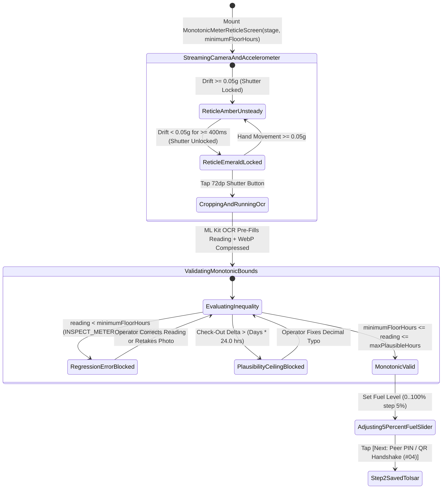
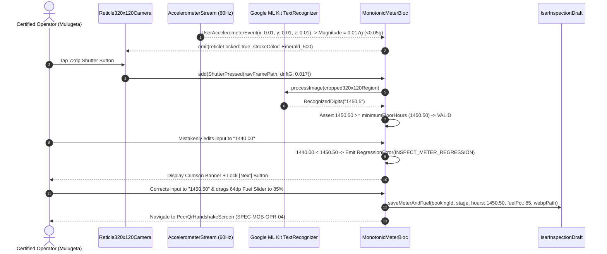

# Live Camera-Enforced Monotonic Hour Meter Reticle & 5%-Step Fuel Slider
## Mobile Subsystem Specification — `docs/mobile/operator-experience/03-monotonic-meter-reticle-capture.md`

**Document Identifier:** `SPEC-MOB-OPR-03`  
**Classification:** Canonical Subsystem UI/UX & Technical Behavior Specification  
**Governing Documents:** `Dink_Machinery_UI_UX_Design_Brief.md`, `SRS-DINK-CORE-V7.0` (§5.2.2, §5.6.3, §5.7.3, `FL-04`, `AR-01`, `RC-02`), `docs/shared/design/design-tokens.json`, `docs/ERROR_CATALOG.md`, `contracts/openapi.yaml`  
**Target Subsystem:** Flutter 3.47.9 / Dart 3.9 Mobile Client (iOS & Android)  
**Primary Persona / Actor:** Certified Heavy Machinery Operator (*Mulugeta Tadesse* / *Juma Omwamba*)  
**Associated Requirements:** `REQ-05-06` (`AR-01` Handover Meter Floor Verification), `REQ-05-07` (`RC-02` Return Meter Non-Regression Verification), `REQ-05-02` (`FL-04` Baseline Meter Anchor)  
**Associated Interaction Flows:** `FLOW-09` (Pre-Rental Handover Check-In), `FLOW-10` (Post-Rental Return Check-Out)  
**Associated ADRs:** `ADR-005` (ClamAV Media Verification), `ADR-010` (Offline-First Monotonic Validation & ML Kit On-Device OCR)  
**Status:** Approved Technical Design Baseline

---

## 1. Domain Context, Business Rules & Architectural Invariants

The cabin mechanical or digital engine hour meter is the primary legal and financial clock governing heavy equipment usage, maintenance intervals, and overtime billing ($8.0\text{ hrs/day}$ shift quota, `RC-03`). Because an hour of excess excavator runtime costs $2,500\text{ to }4,500\text{ ETB/hr}$, preventing meter rollback, blurry photo spoofing, or typographical entry errors is a P0 system invariant.

The **Monotonic Hour Meter Reticle & Fuel Level Capture** screen (`SPEC-MOB-OPR-03`) is a shared, high-precision instrumentation component invoked during both **Pre-Rental Handover Check-In (`AR-01`)** and **Post-Rental Return Check-Out (`RC-02`)**.

### 1.1 Core Business Rules & Mathematical Invariants
1. **Strict Monotonic Meter Non-Regression Inequality (`FL-04`, `AR-01`, `RC-02`):**
   - Across the entire lifecycle of a machine, engine hour meter readings must be strictly non-decreasing:
     $$\text{Baseline Meter } (\text{FL-04}) \le \text{Handover Check-In Meter } (\text{AR-01}) \le \text{Daily Shift Log } (\text{AR-03}) \le \text{Return Check-Out Meter } (\text{RC-02})$$
   - **Client & Server Gate (`INSPECT_METER_REGRESSION` HTTP 422):**
     - During **Check-In (`AR-01`)**, if the operator enters a reading `< fleets.baseline_meter_hours` (e.g., entering `1420.00` when baseline is `1450.50`), submission is blocked immediately.
     - During **Check-Out (`RC-02`)**, if the operator enters a reading `< bookings.check_in_meter_hours` (e.g., entering `1448.00` when check-in was `1450.50`), submission is blocked and flags potential meter tampering (`INSPECT_METER_REGRESSION`).
   - **Plausibility Ceiling Warning:** During Check-Out, if $\Delta\text{Hours} = \text{Check-Out} - \text{Check-In} > \Delta_{\text{days}} \times 24.0\text{ hours}$ (physically impossible $>24\text{ hrs/day}$ runtime), the UI blocks accidental decimal-shift typos (e.g., typing `15122.0` instead of `1512.20`).
2. **$320 \times 120\text{ dp}$ Viewfinder Reticle & $<0.05g$ Accelerometer Gate (`component.reticle.viewfinder`):**
   - Renders a dedicated **$320\text{ dp} \times 120\text{ dp}$** horizontal macro viewfinder (`component.reticle.viewfinder.width` / `height`) with a `50%` dark scrim (`semantic.dark.surface.overlay`) masking the surrounding cabin dashboard.
   - **Gallery Upload Strictly Disabled:** Only live camera frames from the macro reticle are accepted.
   - **Inertial Stability Lock:** Queries `sensors_plus` `userAccelerometerEventStream` at `60Hz`. When the 3-axis acceleration magnitude $\sqrt{a_x^2 + a_y^2 + a_z^2} < 0.05g$ for $\ge 400\text{ ms}$, the reticle border transitions from Amber `#F59E0B` (`colorIdle`) to Emerald `#10B981` (`colorLocked`), unlocking the `72dp` shutter actuator and triggering `HapticFeedback.lightImpact()`.
3. **On-Device Google ML Kit OCR Pre-Fill & Manual Verification:**
   - Immediately upon shutter capture, the cropped $320 \times 120\text{ dp}$ region is passed to on-device `google_mlkit_text_recognition` to extract numeric odometer digits (including tenths `0.1h` fractional drums), pre-populating the `Space Mono` numeric input for operator verification.
4. **Gloved-Hand $0\%–100\%$ Fuel Level Slider (`5%` Discrete Steps):**
   - Captures diesel/fuel tank level from $0\%$ to $100\%$ in discrete **$5\%$ increments** (`20` divisions) using a `64dp`-tall track (`component.actuator.slider.trackHeight`) and `56dp` thumb (`component.actuator.slider.thumbDimension`) so Dry Lease fuel return discrepancies are transparently documented.

---

## 2. Screen Anatomy, Layout & Bespoke ASCII Wireframe

### 2.1 Live $320 \times 120\text{ dp}$ Meter Reticle & Monotonic Input Wireframe
```text
+-----------------------------------------------------------------------+
| [← Back to Walkaround]   HOUR METER & FUEL CAPTURE      #BK-8812      |
| Stage: PRE-RENTAL CHECK-IN (AR-01) • Gallery Upload: DISABLED 🔒      |
+-----------------------------------------------------------------------+
| 📷 LIVE CAMERA VIEWPORT (ALIGN ODOMETER DRUMS INSIDE 320x120 RETICLE) |
| +-------------------------------------------------------------------+ |
| |░░░░░░░░░░░░░░░░░░░░░ DARK SCRIM OVERLAY (85%) ░░░░░░░░░░░░░░░░░░░░| |
| |░░░[🔦 Torch: ON]░░░░░░░░░░░░░░░░░░░░░░░░░░[🟢 STEADY: 0.018g]░░░░░| |
| |░░░░░░░░░+===============================================+░░░░░░░░░| |
| |░░░░░░░░░║  ⌚ CAT ELECTRONIC / MECHANICAL HOUR METER    ║░░░░░░░░░| |
| |░░░░░░░░░║     +-----+-----+-----+-----+-----+ ⋅ +---+   ║ 120dp   | |
| |░░░░░░░░░║     |  0  |  1  |  4  |  5  |  0  | . | 5 | h ║ Height  | |
| |░░░░░░░░░║     +-----+-----+-----+-----+-----+ ⋅ +---+   ║░░░░░░░░░| |
| |░░░░░░░░░+===============================================+░░░░░░░░░| |
| |░░░░░░░░░░░░░░░░░░░░░░░░░░ 320dp Width ░░░░░░░░░░░░░░░░░░░░░░░░░░░░| |
| |         [  ( 📷 CAPTURE MACRO METER PHOTO — 72dp )  ]             | |
| +-------------------------------------------------------------------+ |
+-----------------------------------------------------------------------+
| 🔢 MONOTONIC ENGINE HOUR METER READING (NUMERIC(10, 2) IN SPACE MONO) |
| +-------------------------------------------------------------------+ |
| | Immutable Baseline Floor (FL-04):                   1,450.50 hrs  | |
| | ML Kit OCR Extracted Reading:   1450.50 hrs (Confidence: 99.1% ✓) | |
| | Confirmed Check-In Meter Reading *:                               | |
| | +---------------------------------------------------+-----------+ | |
| | | 1450.50                                           |   HOURS   | | |
| | +---------------------------------------------------+-----------+ | |
| | ✅ MONOTONIC CHECK PASSED: 1,450.50 hrs >= 1,450.50 hrs Floor.    | |
| | (Note: Entering < 1,450.50 triggers 422 INSPECT_METER_REGRESSION) | |
| +-------------------------------------------------------------------+ |
|                                                                       |
| ⛽ DIESEL TANK FUEL LEVEL SLIDER (0% – 100% IN 5% STEPS • DRY LEASE)  |
| +-------------------------------------------------------------------+ |
| | Selected Fuel Level: [ 85% (Full - 3/4+) ]                        | |
| |                                                                   | |
| | 0% [█████████████████████████████████████🔵░░░░░░░] 100%          | |
| |    |      |      |      |      |      |   ^56dp  |   (64dp Track) | |
| |    E     25%    50%    75%            85% Thumb  F   (5% Steps)   | |
| +-------------------------------------------------------------------+ |
+-----------------------------------------------------------------------+
| [ ← BACK ]                [ NEXT: PEER PIN / QR HANDSHAKE (#04) → ]   |
+-----------------------------------------------------------------------+
```

---

## 3. W3C DTCG Design Token Mapping Table

| UI Component / Element | W3C Token Path (`design-tokens.json`) | Resolved Value (Light / Dark / Outdoor) | Behavioral & Accessibility Invariant |
|---|---|---|---|
| **Meter Reticle Box Dimensions** | `component.reticle.viewfinder.width` / `height` | `320dp` width $\times$ `120dp` height | Exact aspect ratio framing standard 6-digit + 1-decimal mechanical/LCD hour meters. |
| **Reticle Stroke & Lock Color** | `component.reticle.viewfinder.strokeOutdoor` + `colorIdle` / `colorLocked` | `3dp` stroke (`2dp` standard), `#F59E0B` Idle $\rightarrow$ `#10B981` Locked | Visually gates shutter actuation on accelerometer stability ($<0.05g$). |
| **Camera Capture Actuator** | `dimension.space.72` + `semantic.{mode}.action.primary.bg` | `72dp` circular button, `#F59E0B` / `#FBBF24` | Disabled while accelerometer variance $\ge 0.05g$. |
| **Meter Reading Input** | `typography.fontFamily.mono` + `typography.fontSize.24` | `Space Mono` `24sp` (`typography.fontSize.24`) | Large tabular digits prevent decimal point misplacement in bright sunlight. |
| **Regression Error Alert** | `color.feedback.crimson.100` + `color.feedback.crimson.700` | Bg `#FEE2F2`, Border `#DC2626` (`3dp`), Text `#B91C1C` | Rendered immediately if `enteredHours < requiredMinimumFloorHours`. |
| **Fuel Level Slider Track & Thumb** | `component.actuator.slider.trackHeight` + `thumbDimension` + `accentColor` | Track `64dp`, Thumb `56dp`, Accent `#FF5722` (`orange.500`) | Snaps to `20` discrete divisions ($5\%$ increments) with haptic tick on each step. |

---

## 4. Interactive State Machine & Sequence Flows

### 4.1 Accelerometer-Gated Reticle, OCR & Monotonic Validation State Machine


### 4.2 Accelerometer Gate, ML Kit OCR & Monotonic Floor Enforcement Sequence


---

## 5. Concrete Flutter Implementation Blueprint

### 5.1 BLoC Events & Immutable Freezed States
```dart
// lib/features/operator_inspection/presentation/bloc/monotonic_meter_bloc.dart
import 'package:freezed_annotation/freezed_annotation.dart';
import 'package:flutter_bloc/flutter_bloc.dart';

part 'monotonic_meter_bloc.freezed.dart';

enum MeterCaptureStage { checkInHandover, dailyShiftLog, checkOutReturn }

@freezed
sealed class MonotonicMeterEvent with _$MonotonicMeterEvent {
  const factory MonotonicMeterEvent.initialized({
    required String bookingId,
    required MeterCaptureStage stage,
    required double minimumFloorHours, // Baseline (AR-01) or Check-In (RC-02)
    required double maxPlausibleCeilingHours,
    int? checkInFuelLevelPercent,
  }) = _Initialized;
  const factory MonotonicMeterEvent.accelerometerSampled(double driftMagnitudeG) = _AccelerometerSampled;
  const factory MonotonicMeterEvent.meterPhotoCaptured(String rawImagePath) = _MeterPhotoCaptured;
  const factory MonotonicMeterEvent.meterReadingTextChanged(String rawText) = _MeterReadingTextChanged;
  const factory MonotonicMeterEvent.fuelSliderChanged(int fuelPercentStep5) = _FuelSliderChanged;
  const factory MonotonicMeterEvent.confirmStepRequested() = _ConfirmStepRequested;
}

@freezed
sealed class MonotonicMeterState with _$MonotonicMeterState {
  const factory MonotonicMeterState({
    required String bookingId,
    required MeterCaptureStage stage,
    required double minimumFloorHours,
    required double maxPlausibleCeilingHours,
    required double currentDriftG,
    required bool isReticleSteadyLocked, // true when currentDriftG < 0.05
    String? capturedMeterWebpPath,
    String? meterPhotoSha256,
    String? ocrExtractedText,
    @Default('') String enteredMeterText,
    double? parsedMeterHours,
    required bool isMonotonicValid, // parsedMeterHours >= minimumFloorHours && <= maxPlausibleCeilingHours
    String? regressionErrorCode, // 'INSPECT_METER_REGRESSION' or 'METER_PLAUSIBILITY_EXCEEDED'
    String? regressionErrorMessage,
    @Default(100) int fuelLevelPercent, // 0..100 in 5% steps
    int? baselineCheckInFuelPercent,
    @Default(false) bool isTorchEnabled,
  }) = _MonotonicMeterState;
}
```

### 5.2 Custom $320 \times 120\text{ dp}$ Reticle Painter & $5\%$-Step Fuel Slider Widget
```dart
// Enforces design-tokens.json:
// - component.reticle.viewfinder.width = 320.0
// - component.reticle.viewfinder.height = 120.0
// - component.actuator.slider.trackHeight = 64.0
// - component.actuator.slider.thumbDimension = 56.0
// - Slider(min: 0, max: 100, divisions: 20, value: state.fuelLevelPercent.toDouble(), ...)
```

### 5.3 Widget Tree Hierarchy
```text
MonotonicMeterReticleCaptureScreen (Scaffold)
 ├── MeterReticleAppBar (Stage Badge: Check-In AR-01 vs Check-Out RC-02, Torch Toggle)
 └── SingleChildScrollView
      ├── LiveMacroReticleCameraViewport (Stack)
      │    ├── CameraPreview (Aspect-Locked)
      │    ├── CustomPaint (Dark Scrim + 320x120dp Viewfinder Cutout in #F59E0B or #10B981)
      │    ├── AccelerometerSteadyHudPill ("🟢 STEADY: 0.018g" or "⚠️ HOLD STEADY (<0.05g)")
      │    └── ShutterActuator72dpButton (Enabled only when isReticleSteadyLocked == true)
      ├── MonotonicMeterNumericInputCard
      │    ├── MinimumFloorComparisonRow (Shows Baseline or Check-In Floor in Space Mono)
      │    ├── SpaceMonoDecimalTextField (24sp Numeric Input + OCR Confidence Pill)
      │    └── MonotonicValidationFeedbackBanner (Emerald Pass or Crimson INSPECT_METER_REGRESSION)
      ├── GlovedFuelLevelSliderCard (64dp Track Height, 56dp Thumb, 0%..100% in 20 Divisions of 5%)
      └── StickyMeterStepFooter ([← Back] + [Next: Peer PIN / QR Handshake (#04) →])
```

---

## 6. OpenAPI 3.1.0 Routes & RFC 9457 Error Matrix

### 6.1 Bound API Endpoints
| Operation | HTTP Method & URI | Headers Required | Purpose & Contract Binding |
|---|---|---|---|
| **Submit Handover Check-In** | `POST /api/v1/bookings/{id}/inspections` (`/handover-inspect`) | `Authorization: Bearer <JWT>`, `Idempotency-Key: <UUIDv4>` | Commits `check_in_meter_hours` ($\ge \text{baseline\_meter\_hours}$) and `check_in_fuel_percent`. |
| **Submit Return Check-Out** | `POST /api/v1/bookings/{id}/return-inspect` | `Authorization: Bearer <JWT>`, `Idempotency-Key: <UUIDv4>` | Commits `check_out_meter_hours` ($\ge \text{check\_in\_meter\_hours}$), `check_out_fuel_percent`, and computes excess shift hours (`RC-03`). |

### 6.2 RFC 9457 Problem Details Error Matrix
| Error Code (`error.code`) | HTTP Status | Type URI | Trigger Condition | Mobile UI Recovery Behavior |
|---|---|---|---|---|
| `INSPECT_METER_REGRESSION` | `422` | `/errors/inspect-meter-regression` | Submitted meter reading is strictly less than `fleets.baseline_meter_hours` (on Check-In) or `bookings.check_in_meter_hours` (on Check-Out). | Render high-contrast crimson alert card showing the exact minimum floor, vibrate with `HapticFeedback.vibrate()`, and block progression. |
| `INSPECT_MEDIA_SCAN_FAILED` | `422` | `/errors/inspect-media-scan-failed` | Meter close-up image failed ClamAV scan (`:3310`). | Purge local file and require fresh live reticle capture. |
| `REQ_VALIDATION_FAILED` | `400` | `/errors/request-validation-failed` | `fuelLevelPercent` not a multiple of `5` in `0..100` or meter reading has $>2$ decimal places. | Snap fuel slider to nearest $5\%$ step and format meter reading to `NUMERIC(10,2)`. |

---

## 7. Verification & Acceptance Criteria

- [ ] **Mathematical Monotonic Enforcement (`AR-01`, `RC-02`, `INSPECT_METER_REGRESSION`):** Unit and widget tests verify that when `minimumFloorHours == 1450.50`, entering `1450.49` immediately sets `isMonotonicValid = false`, surfaces `INSPECT_METER_REGRESSION`, and disables the Next button; entering `1450.50` or `1512.20` passes.
- [ ] **Exact $320 \times 120\text{ dp}$ Reticle & $<0.05g$ Gate:** The viewfinder cutout measures `320x120dp` (`component.reticle.viewfinder`), gallery selection is unreachable, and the `72dp` shutter button unlocks only when 3-axis accelerometer drift is $<0.05g$.
- [ ] **Gloved $5\%$-Step Fuel Slider:** The fuel slider uses `trackHeight: 64dp`, `thumbDimension: 56dp`, `min: 0`, `max: 100`, `divisions: 20`, snapping strictly to $\{0, 5, 10, \dots, 95, 100\}\%$.
