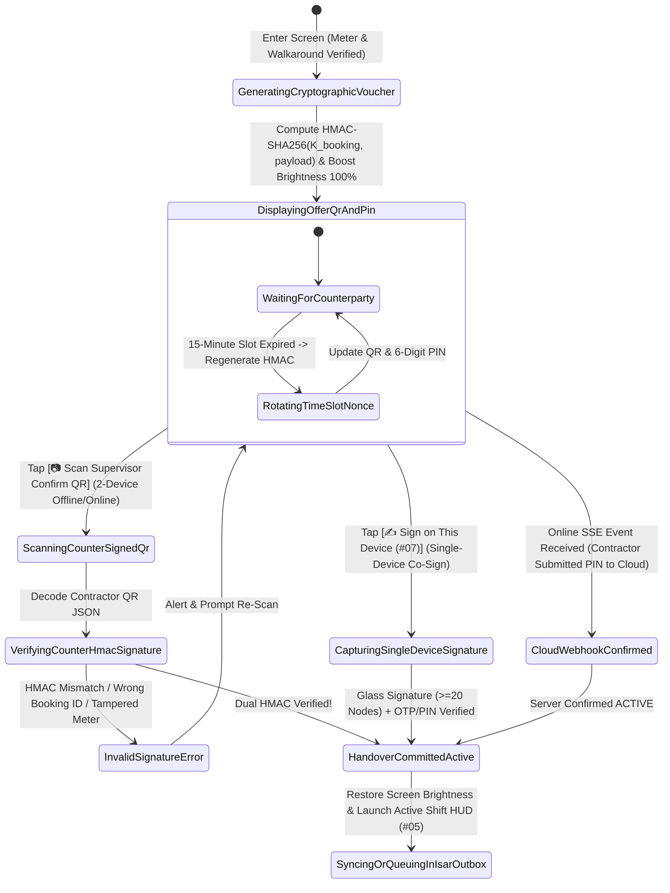
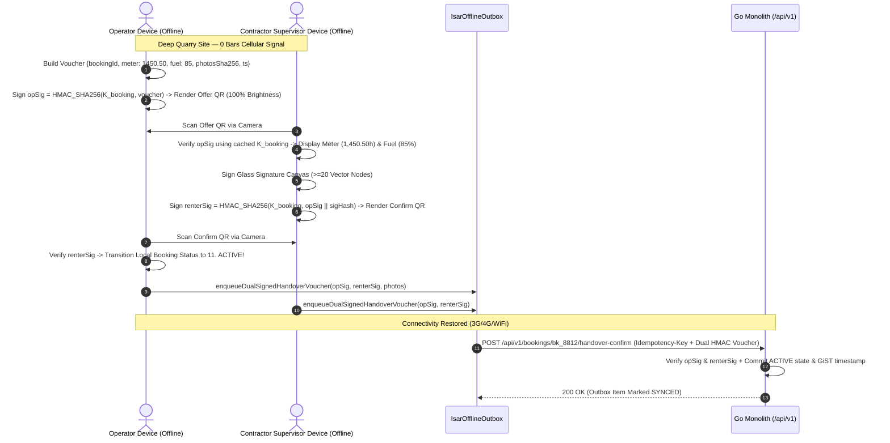

# Cryptographic Dual Challenge 6-Digit PIN & Offline HMAC-SHA256 Peer-to-Peer QR Handshake
## Mobile Subsystem Specification — `docs/mobile/operator-experience/04-peer-qr-handshake-screen.md`

**Document Identifier:** `SPEC-MOB-OPR-04`  
**Classification:** Canonical Subsystem UI/UX & Technical Behavior Specification  
**Governing Documents:** `Dink_Machinery_UI_UX_Design_Brief.md`, `SRS-DINK-CORE-V7.0` (§5.6.3, §5.17, Appendix A `AR-02`, `OF-04`), `docs/shared/design/design-tokens.json`, `docs/ERROR_CATALOG.md`, `contracts/openapi.yaml`  
**Target Subsystem:** Flutter 3.47.8 / Dart 3.9 Mobile Client (iOS & Android)  
**Primary Persona / Actor:** Certified Heavy Machinery Operator (*Mulugeta Tadesse*) & Contractor Site Supervisor (*Dawit Haile-Mariam*)  
**Associated Requirements:** `REQ-05-06` (`AR-02` Cryptographic Dual Challenge PIN Handover), `REQ-05-17` (`OF-04` Offline Peer-to-Peer Dynamic QR Handshake & Outbox Sync)  
**Associated Interaction Flows:** `FLOW-09` (Handover Activation), `FLOW-APPENDIX-A` (Offline Cryptographic P2P QR Voucher Exchange)  
**Associated ADRs:** `ADR-001` (Modular Monolith), `ADR-010` (Offline-First Isar Outbox & Local HMAC-SHA256 Attestation)  
**Status:** Approved Technical Design Baseline

---

## 1. Domain Context, Business Rules & Architectural Invariants

Transitioning a high-value heavy machinery booking from `10. READY_FOR_PICKUP` to `11. ACTIVE` starts the billable shift clock ($22,500\text{ to }45,000\text{ ETB/day}$) and transfers site operational custody to the Civil Contractor. In East African infrastructure projects, handovers frequently take place in deep river gorges, basalt quarries, or rural highway cuts with **zero cellular coverage (0 bars 3G/4G)**.

The **Dual Challenge 6-Digit PIN & Offline Peer-to-Peer QR Handshake Screen** (`SPEC-MOB-OPR-04`) implements `AR-02`, `OF-04`, and `FLOW-APPENDIX-A`, guaranteeing cryptographic proof of physical co-presence between the Operator (or Fleet Owner) and the Contractor Site Supervisor whether online or completely offline.

### 1.1 Core Business Rules & Cryptographic Invariants
1. **Dual-Mode Co-Presence Verification (`AR-02` vs. `OF-04`):**
   - **Mode A — Online / Hybrid 6-Digit Dynamic Challenge PIN (`AR-02`):**
     - Derived deterministically from the booking's pre-shared handover secret (`offlineHmacHandoverSecret`, provisioned into Flutter Secure Storage / Isar when the booking reached `CONFIRMED`):
       $$\text{PIN}_6 = \text{Truncate}_6\left(\text{HMAC-SHA256}\left(K_{\text{booking}}, \text{BookingID} \parallel \text{CheckInMeter} \parallel \lfloor T_{\text{unix}} / 900 \rfloor\right)\right)$$
     - Valid for a **15-minute (`900s`) sliding time slot** ($\pm 1\text{ slot}$ clock-drift tolerance).
     - Displayed on the Operator's screen in oversized `32sp` `Space Mono` digits (`819 - 204`) for the Contractor Supervisor to enter on their device (or vice versa).
   - **Mode B — Zero-Signal Offline Peer-to-Peer Dynamic QR Handshake (`OF-04`, `ADR-010`, `FLOW-APPENDIX-A`):**
     - Step 1 (**Operator Generates Offer QR**): After completing the 4-angle walkaround (`SPEC-MOB-OPR-02`) and monotonic meter capture (`SPEC-MOB-OPR-03`), the Operator's device constructs a canonical JSON handover voucher and signs it with $K_{\text{booking}}$:
       ```json
       {
         "v": 1,
         "bookingId": "bk_019a8f60-8812",
         "fleetId": "flt_320d_99120",
         "stage": "HANDOVER_CHECK_IN",
         "meterHours": "1450.50",
         "fuelPct": 85,
         "photosSha256": "7d865e959b2466918c9863afca942d0fb89d7c9ac0c99bafc3749504ded97730",
         "lat": 8.54121,
         "lng": 39.27184,
         "ts": 1761812400,
         "nonce": "n_99412a",
         "opSig": "hmac_sha256_hex_operator..."
       }
       ```
     - Step 2 (**Contractor Scans Offer QR & Countersigns**): The Contractor Supervisor scans the Operator's screen QR code, inspects the meter reading (`1,450.50 hrs`) and fuel level (`85%`) on their own screen, signs the Glass Signature Canvas (`SPEC-MOB-OPR-07`), and renders a **Counter-Signed Confirmation QR Code** (`renterSig = HMAC-SHA256(K_booking, opSig || signatureHash || ts)`).
     - Step 3 (**Operator Scans Confirmation QR**): The Operator scans the Contractor's Confirmation QR. Both devices immediately transition local booking state in Isar NoSQL to `ACTIVE`, start the local monotonic shift clock, and enqueue the dual-signed cryptographic voucher in the **Isar Offline Outbox** for automatic two-way differential sync (`POST /api/v1/bookings/{id}/handover-confirm`) as soon as either device regains cellular or camp Wi-Fi connectivity.
2. **Maximum Sun-Glare QR Contrast Guardrail:**
   - Even when the app is in `dark` or `outdoorHighContrast` (`#000000` canvas) mode, the QR code container strictly renders a **pure `#FFFFFF` quiet zone ($16\text{ dp}$ padding) with `#000000` modules** and temporarily boosts screen brightness to `100%` (`ScreenBrightness().setScreenBrightness(1.0)`) so optical camera scanners lock instantly in harsh sunlight.

---

## 2. Screen Anatomy, Layout & Bespoke ASCII Wireframe

### 2.1 Dual Challenge 6-Digit PIN & Offline P2P QR Handshake Wireframe
```text
+-----------------------------------------------------------------------+
| [← Back to Meter]    PEER HANDOVER ATTESTATION          #BK-8812      |
| Network: [🟠 OFFLINE QUARRY MODE — P2P HMAC-SHA256 READY] [🔆 100%]   |
+-----------------------------------------------------------------------+
| HANDOVER WIZARD: STEP 3 OF 3 — CO-PRESENCE PIN / QR HANDSHAKE (AR-02) |
| [✓ 1. Walkaround & Pins]──[✓ 2. Meter (1,450.5h)]──[● 3. PIN/QR Sign] |
+-----------------------------------------------------------------------+
| [ ● 📲 OFFLINE P2P QR HANDSHAKE (OF-04) ]  [ ○ 🔢 6-DIGIT PIN CODE ]  |
+-----------------------------------------------------------------------+
| STEP 3A: SHOW VOUCHER QR TO CONTRACTOR SUPERVISOR (ENG. DAWIT H.)     |
| +-------------------------------------------------------------------+ |
| |        +-------------------------------------------------+        | |
| |        |             PURE #FFFFFF QUIET ZONE             |        | |
| |        |    ▄▄▄▄▄▄▄  ▄   ▄ ▄▄▄ ▄▄ ▄  ▄▄▄▄▄▄▄             |        | |
| |        |    █ ▄▄▄ █ ██▀▄▄ ▀▄█▀ ▀▄█  █ ▄▄▄ █             |        | |
| |        |    █ ███ █ ▄▀ ▀▀▄▀█▄▀ ▄ ▀█  █ ███ █             |        | |
| |        |    ▀▀▀▀▀▀▀ ▀ ▄ ▀ ▀ ▀ ▄ ▀ ▀  ▀▀▀▀▀▀▀             |        | |
| |        |    ██ ▀ ▄▀▄▄▀▀█▄ ▄▀█▀▄▀█▄▄▀▄ ▀▄▀ ██             |        | |
| |        |    ▄▄▄▄▄▄▄ █▄█▀▀ ▄▀█ ▄ ▀█▄  ▄▄▄▄▄▄▄             |        | |
| |        |    █ ▄▄▄ █ ▄▀ ▄█▀▀ ▄ ▀ ▄▀▄  █ ▄▄▄ █             |        | |
| |        |    ▀▀▀▀▀▀▀ ▀▀▀   ▀▀▀ ▀▀  ▀  ▀▀▀▀▀▀▀             |        | |
| |        +-------------------------------------------------+        | |
| |  Signed HMAC-SHA256 Voucher: Meter 1,450.50h | Fuel 85% | 5 Photos| |
| |  Slot Validity: ⏱️ 14:22 remaining (Auto-rotates every 15m)       | |
| +-------------------------------------------------------------------+ |
|                                                                       |
| OR USE 6-DIGIT CHALLENGE PIN (AR-02):                                 |
| +-------------------------------------------------------------------+ |
| |   [ 8 ]   [ 1 ]   [ 9 ]     —     [ 2 ]   [ 0 ]   [ 4 ]           | |
| +-------------------------------------------------------------------+ |
|                                                                       |
| STEP 3B: SCAN CONTRACTOR'S COUNTER-SIGNED CONFIRMATION QR             |
| +-------------------------------------------------------------------+ |
| | Once Supervisor Dawit scans the QR above and signs on his phone,  | |
| | scan his Confirmation QR (or capture his Glass Signature on this  | |
| | device) to unlock the Active Shift HUD immediately.               | |
| +-------------------------------------------------------------------+ |
+-----------------------------------------------------------------------+
| [ ✍️ SIGN ON THIS DEVICE (#07) ]  [ 📷 SCAN SUPERVISOR CONFIRM QR → ] |
+-----------------------------------------------------------------------+
```

---

## 3. W3C DTCG Design Token Mapping Table

| UI Component / Element | W3C Token Path (`design-tokens.json`) | Resolved Value (Light / Dark / Outdoor) | Behavioral & Accessibility Invariant |
|---|---|---|---|
| **QR Quiet Zone Container** | `#FFFFFF` (`semantic.light.surface.card`) + `dimension.space.16` | Pure `#FFFFFF` bg, `#000000` modules, `16dp` quiet inset | Never inverted in Dark/Outdoor mode; required by ISO/IEC 18004 QR scanners. |
| **6-Digit Challenge PIN Boxes** | `typography.fontFamily.mono` + `typography.fontSize.32` | `Space Mono` `32sp`, `#F59E0B` border (`2dp`) | High-visibility tabular digits readable across a machine cab at $2\text{ meters}$. |
| **Offline Quarry Mode Banner** | `color.brand.amber.100` + `color.brand.amber.900` | Bg `#FEF3C7`, Text `#78350F`, Icon `🟠` | Reassures operator that P2P cryptographic handover works with zero cellular signal. |
| **Primary Scan / Sign CTAs** | `component.actuator.button.heightField` + `semantic.{mode}.action.primary.bg` | Height `64dp`, Fill `#F59E0B` (`#FBBF24` Outdoor), Lip `3dp` | Supports both 2-phone P2P QR exchange and single-device Glass Signature fallback (`#07`). |

---

## 4. Interactive State Machine & Sequence Flows

### 4.1 Online PIN & Offline P2P HMAC-SHA256 QR Handshake State Machine


### 4.2 Offline Two-Device P2P HMAC-SHA256 QR Handshake & Outbox Sync Sequence (`ADR-010`)


---

## 5. Concrete Flutter Implementation Blueprint

### 5.1 BLoC Events & Immutable Freezed States
```dart
// lib/features/operator_inspection/presentation/bloc/peer_qr_handshake_bloc.dart
import 'package:freezed_annotation/freezed_annotation.dart';
import 'package:flutter_bloc/flutter_bloc.dart';

part 'peer_qr_handshake_bloc.freezed.dart';

@freezed
sealed class PeerQrHandshakeEvent with _$PeerQrHandshakeEvent {
  const factory PeerQrHandshakeEvent.started(String bookingId) = _Started;
  const factory PeerQrHandshakeEvent.timeSlotTicked() = _TimeSlotTicked;
  const factory PeerQrHandshakeEvent.counterSignedQrScanned(String rawQrPayloadJson) = _CounterSignedQrScanned;
  const factory PeerQrHandshakeEvent.singleDeviceSignatureCompleted({
    required String signeeFullName,
    required String signeeRole,
    required String vectorSvgPayload,
    required int vectorNodeCount,
    required String enteredPinOrOtp,
  }) = _SingleDeviceSignatureCompleted;
  const factory PeerQrHandshakeEvent.cloudHandoverEventReceived() = _CloudHandoverEventReceived;
}

@freezed
class HandoverCryptographicVoucher with _$HandoverCryptographicVoucher {
  const factory HandoverCryptographicVoucher({
    required int version,
    required String bookingId,
    required String fleetId,
    required String stage, // 'HANDOVER_CHECK_IN' | 'RETURN_CHECK_OUT'
    required String meterHoursDecimal,
    required int fuelLevelPercent,
    required String combinedPhotosSha256,
    required double latitude,
    required double longitude,
    required int unixTimestampSec,
    required String nonce,
    required String operatorHmacSignature,
    String? contractorCounterHmacSignature,
    String? contractorSignatureSvgHash,
  }) = _HandoverCryptographicVoucher;
}

@freezed
sealed class PeerQrHandshakeState with _$PeerQrHandshakeState {
  const factory PeerQrHandshakeState.presenting({
    required String bookingId,
    required HandoverCryptographicVoucher offerVoucher,
    required String serializedOfferQrData,
    required String sixDigitChallengePin, // e.g., "819204"
    required int slotSecondsRemaining, // 0..900
    required bool isOfflineMode,
    @Default(false) bool isScannerOpen,
    ProblemDetails? verificationError,
  }) = _Presenting;

  const factory PeerQrHandshakeState.handshakeVerified({
    required String bookingId,
    required bool syncedToCloudImmediately,
    required bool queuedInIsarOutbox,
  }) = _HandshakeVerified;
}
```

### 5.2 Deterministic HMAC-SHA256 Voucher & 6-Digit PIN Generator
```dart
// lib/core/crypto/handover_hmac_signer.dart
import 'dart:convert';
import 'package:crypto/crypto.dart';

class HandoverHmacSigner {
  static String computeVoucherHmac({
    required String secretKeyHex,
    required String canonicalMessage,
  }) {
    final keyBytes = utf8.encode(secretKeyHex);
    final messageBytes = utf8.encode(canonicalMessage);
    final hmac = Hmac(sha256, keyBytes);
    return hmac.convert(messageBytes).toString();
  }

  static String deriveSixDigitChallengePin({
    required String secretKeyHex,
    required String bookingId,
    required String meterHoursDecimal,
    required int fifteenMinTimeSlot,
  }) {
    final digest = computeVoucherHmac(
      secretKeyHex: secretKeyHex,
      canonicalMessage: '$bookingId|$meterHoursDecimal|$fifteenMinTimeSlot',
    );
    final hashInt = int.parse(digest.substring(0, 8), radix: 16);
    return (hashInt % 1000000).toString().padLeft(6, '0');
  }
}
```

### 5.3 Widget Tree Hierarchy
```text
PeerQrHandshakeScreen (Scaffold - Manages ScreenBrightness 1.0 lifecycle)
 ├── HandshakeAppBar (Booking ID, Offline/Online Status Pill, 100% Brightness Indicator)
 └── SingleChildScrollView
      ├── HandshakeModeSegmentedControl (Offline P2P QR vs. 6-Digit Challenge PIN)
      ├── HighContrastQrVoucherCard (Pure #FFFFFF Quiet Zone + QrImageView + 15m Slot Countdown)
      ├── SixDigitChallengePinDisplayCard (Space Mono 32sp "819 - 204" Boxes)
      ├── CounterSignScannerViewportModal (MobileScanner for reading Supervisor's Confirmation QR)
      └── StickyHandshakeFooter ([✍️ Sign on This Device (#07)] + [📷 Scan Supervisor Confirm QR →])
```

---

## 6. OpenAPI 3.1.0 Routes & RFC 9457 Error Matrix

### 6.1 Bound API Endpoints
| Operation | HTTP Method & URI | Headers Required | Purpose & Contract Binding |
|---|---|---|---|
| **Confirm Handover Sign-Off** | `POST /api/v1/bookings/{id}/handover-confirm` (or `/handover-sign`) | `Authorization: Bearer <JWT>`, `Idempotency-Key: <UUIDv4>` | Submits the 6-digit Challenge PIN (`AR-02`) or the dual-signed offline HMAC-SHA256 QR voucher (`OF-04`), transitioning booking to `11. ACTIVE`. |

### 6.2 RFC 9457 Problem Details Error Matrix
| Error Code (`error.code`) | HTTP Status | Type URI | Trigger Condition | Mobile UI Recovery Behavior |
|---|---|---|---|---|
| `AUTH_OTP_INVALID_CODE` | `400` | `/errors/otp-invalid-code` | Submitted 6-digit Challenge PIN or HMAC QR signature does not match `K_booking`. | Vibrate device, display crimson invalid signature/PIN alert, and prompt re-scan. |
| `AUTH_OTP_EXPIRED` | `400` | `/errors/otp-expired` | Online Challenge PIN time slot (>15 minutes) elapsed before entry. | Automatically rotate to current 15-minute time slot and display fresh 6-digit PIN. |
| `BOOKING_INSPECTION_REQUIRED` | `422` | `/errors/booking-inspection-required` | Attempted to confirm handover before 4-angle walkaround (`#02`) and meter photo (`#03`) were uploaded/attached. | Bundle queued inspection payload and handover voucher in atomic outbox sequence. |
| `INSPECT_METER_REGRESSION` | `422` | `/errors/inspect-meter-regression` | Voucher `meterHoursDecimal` violates monotonic floor on server sync. | Route back to `SPEC-MOB-OPR-03` for meter verification. |

---

## 7. Verification & Acceptance Criteria

- [ ] **Zero-Signal Offline Activation (`OF-04`, `ADR-010`):** Two devices in airplane mode can complete the Offer QR $\rightarrow$ Counter-Sign QR handshake, verify each other's `HMAC-SHA256` signatures locally, transition the booking to `ACTIVE` in Isar, and unlock the Active Shift HUD (`SPEC-MOB-OPR-05`) immediately.
- [ ] **Tamper Rejection:** Modifying a single character of `meterHoursDecimal` (`1450.50` $\rightarrow$ `1400.50`) in a test QR payload causes `HandoverHmacSigner` verification to fail with an immediate cryptographic mismatch error.
- [ ] **QR Sun-Glare Readability:** Mounting `PeerQrHandshakeScreen` boosts screen brightness to `100%`, renders a `#FFFFFF` quiet zone around the QR code even in `outdoorHighContrast` mode, and restores original screen brightness on `dispose()`.
