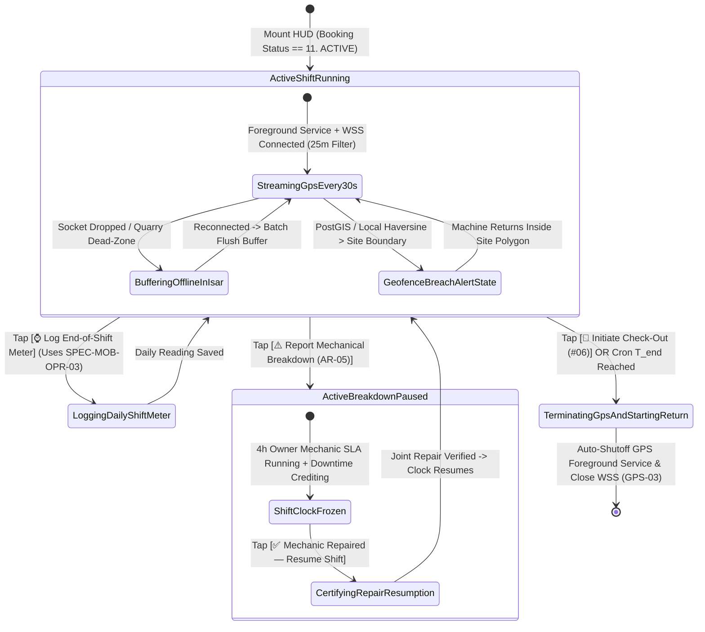
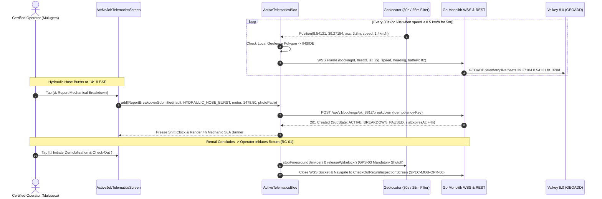

# Active Shift Heads-Up Display (HUD), 30s WebSocket GPS Telemetry & Breakdown Pause Console
## Mobile Subsystem Specification — `docs/mobile/operator-experience/05-active-job-daily-telematics-log.md`

**Document Identifier:** `SPEC-MOB-OPR-05`  
**Classification:** Canonical Subsystem UI/UX & Technical Behavior Specification  
**Governing Documents:** `Dink_Machinery_UI_UX_Design_Brief.md`, `SRS-DINK-CORE-V7.0` (§5.6.4, §5.6.6, §5.12, `AR-03`, `AR-05`, `GPS-01`..`GPS-03`), `docs/shared/design/design-tokens.json`, `docs/ERROR_CATALOG.md`, `contracts/openapi.yaml`  
**Target Subsystem:** Flutter 3.44 / Dart 3.9 Mobile Client (iOS & Android)  
**Primary Persona / Actor:** Certified Heavy Machinery Operator (*Mulugeta Tadesse* / *Juma Omwamba*)  
**Associated Requirements:** `REQ-05-06` (`AR-03` High-Contrast Field HUD & 8.0h Daily Shift Engine, `AR-05` Mechanical Breakdown Logging & Immediate Shift Clock Pause), `REQ-05-12` (`GPS-01` 30s WebSocket Telemetry Streamer, `GPS-02` Geofence Breach Monitoring, `GPS-03` Automatic Lifecycle Shutoff on `RETURN_INITIATED` / `COMPLETED`)  
**Associated Interaction Flows:** `FLOW-09` (Active Rental HUD & Breakdown Stoppage), `FLOW-10` (Transition to Return Check-Out)  
**Associated ADRs:** `ADR-004` (Valkey Geospatial Hot Cache `GEOADD`), `ADR-005` (ClamAV Breakdown Photo Scan), `ADR-010` (Offline-First Telemetry Buffering in Isar)  
**Status:** Approved Technical Design Baseline

---

## 1. Domain Context, Business Rules & Architectural Invariants

While operating heavy plant machinery inside an excavator or grader cab, the Operator's mobile device is mounted in a high-vibration cab cradle exposed to direct equatorial glare ($>85,000\text{ lux}$). The **Active Shift Heads-Up Display (HUD) & Daily Telematics Log** (`SPEC-MOB-OPR-05`) provides an ultra-high-contrast ($\ge 7.0:1$ / $21:1$ Outdoor Mode), glove-operable cockpit tracking the standard East African **8.0 Billable Engine Hours per Day** shift quota (`AR-03`), streaming 30-second WebSocket GPS coordinates (`GPS-01`), alerting on project geofence departures (`GPS-02`), and enabling instant shift clock freezing upon mechanical breakdown (`AR-05`).

### 1.1 Core Business Rules & Operational Invariants
1. **30-Second WebSocket GPS Streamer with 25m Distance Filter & Battery Throttling (`GPS-01`):**
   - Streams JSON telemetry packets over `WSS /api/v1/telemetry/operator/stream` every **30 seconds** (`±2s`) when horizontal movement $\ge 25\text{ meters}$ or heading changes $\ge 15^\circ$.
   - If the machine is stationary ($<0.5\text{ km/h}$ for $>5\text{ minutes}$), sampling throttles to **60 seconds** to preserve phone battery in remote quarries without AC power.
   - **Accuracy & Velocity Filter:** Discards GPS drift points where horizontal dilution of precision $>50\text{ meters}$ or velocity $>140\text{ km/h}$.
   - **Offline Trajectory Buffering (`ADR-010`):** When cellular coverage drops, points buffer into `IsarTelemetryPointOutbox` and flush in compressed batches upon reconnection so `fleet_location_history` (`GPS-04`) has zero trajectory gaps.
2. **Strict Automatic Lifecycle Shutoff (`GPS-03`):**
   - The instant the booking transitions out of `ACTIVE` (into `RETURN_INITIATED` or `COMPLETED`)—either via operator action or server WebSocket event—the Flutter client **immediately terminates the Android Foreground Service / iOS CoreLocation background task, releases partial wakelocks, and closes the WebSocket**.
3. **Real-Time PostGIS Geofence Breach Warning Banner (`GPS-02`):**
   - Evaluates the live GPS fix against the contractual project site polygon / radius (`jobSiteLat`, `jobSiteLng`, `allowedCorridorRadiusMeters`).
   - If the machine exits the authorized cut corridor, a flashing crimson **Geofence Breach Warning Banner** alerts the operator (`🚨 OUTSIDE AUTHORIZED SITE CORRIDOR (+420m)`) and dispatches a real-time alert to the Fleet Owner's Radar and Contractor's Map HUD.
4. **Mechanical Breakdown Logging & Immediate Shift Clock Pause (`AR-05`):**
   - Tapping the oversized `64dp` `[⚠️ REPORT MECHANICAL BREAKDOWN — PAUSE CLOCK]` button prompts the operator to select a fault category (`HYDRAULIC_HOSE_BURST`, `ENGINE_OVERHEAT_INJECTOR`, `TRACK_DERAILMENT_UNDERCARRIAGE`, `ELECTRICAL_STARTER`, `ATTACHMENT_FAILURE`), capture 1 mandatory live photo, and log current engine meter hours.
   - Submitting transitions the active sub-state to `ACTIVE_BREAKDOWN_PAUSED`, **immediately freezing billable shift accumulation** so the contractor is never billed for downtime (`RC-03`), and starts a **4-hour Fleet Owner Mechanic Dispatch SLA timer**.

---

## 2. Screen Anatomy, Layout & Bespoke ASCII Wireframe

### 2.1 High-Contrast Cockpit HUD, Geofence Monitor & Breakdown Modal Wireframe
```text
+-----------------------------------------------------------------------+
| [🟢 ACTIVE SHIFT HUD — DAY 3 OF 7]   #BK-8812     [☀️ 21:1] [🔒 GPS]  |
| CAT 320D Excavator (ET-3-99120) + Soosan SB-81 Breaker                |
+-----------------------------------------------------------------------+
| 📡 LIVE TELEMETRY & GEOFENCE STATUS (WSS STREAM: 30s • 25m FILTER)    |
| +-------------------------------------------------------------------+ |
| | [🟢 INSIDE AUTHORIZED SITE GEOFENCE: Mojo Highway Lot 2]          | |
| | Coords: 8.54121° N, 39.27184° E (±3.8m) | Speed: 1.4 km/h | ⚡ 82%| |
| | Last WSS Sync: 6s ago (0 Buffered Points)   [✋ Pause/Revoke GPS]  | |
| +-------------------------------------------------------------------+ |
| (If Breached -> 🚨 CRIMSON BANNER: OUTSIDE SITE GEOFENCE BY 420m!)    |
+-----------------------------------------------------------------------+
| ⏱️ DAILY SHIFT ENGINE TELEMETRY (8.0 HRS/DAY STANDARD QUOTA - AR-03)  |
| +-------------------------------------------------------------------+ |
| | Handover Check-In Floor:  1,450.50 hrs | Allowed Total: 56.00 hrs | |
| | Current Logged Meter:     1,478.50 hrs | Used Total:    28.00 hrs | |
| |-------------------------------------------------------------------| |
| | TODAY'S SHIFT PROGRESS (DAY 3):                                   | |
| |                   05 hrs : 30 mins  /  08 hrs : 00 mins           | |
| | [██████████████████████████████░░░░░░░░░░░░░] 68.7% of Daily Quota| |
| | Remaining Standard Quota Today: 2.50 hrs | Overtime Rate: 2,800/h | |
| |-------------------------------------------------------------------| |
| | [ ⌚ LOG END-OF-SHIFT METER READING ]                              | |
| +-------------------------------------------------------------------+ |
+-----------------------------------------------------------------------+
| 🛠️ MECHANICAL STATUS & EMERGENCY CONTROLS (64dp GLOVED ACTUATORS)     |
| +-------------------------------------------------------------------+ |
| | [ ⚠️ REPORT MECHANICAL BREAKDOWN — PAUSE SHIFT CLOCK (AR-05) ]    | |
| +-------------------------------------------------------------------+ |
| | [ 🏁 INITIATE DEMOBILIZATION & CHECK-OUT INSPECTION (#06) → ]     | |
| +-------------------------------------------------------------------+ |
+-----------------------------------------------------------------------+

+-----------------------------------------------------------------------+
| 🔧 ACTIVE BREAKDOWN PAUSED STATE (WHEN AR-05 IS TRIGGERED)            |
+-----------------------------------------------------------------------+
| 🛑 CONTRACTUAL SHIFT CLOCK PAUSED AT 14:18 EAT (Meter: 1,478.50 hrs)  |
|    Fault: HYDRAULIC_HOSE_BURST (Main Boom Cylinder Feed Line)         |
|    Owner Mechanic SLA: ⏱️ 03h 41m 12s remaining to resolve on site.   |
|    Downtime Credited to Contractor: 00h 19m (Excluded from Billing)   |
|    [ ✅ MECHANIC REPAIRED — CERTIFY JOINT TEST & RESUME SHIFT ]       |
+-----------------------------------------------------------------------+
```

---

## 3. W3C DTCG Design Token Mapping Table

| UI Component / Element | W3C Token Path (`design-tokens.json`) | Resolved Value (Light / Dark / Outdoor) | Behavioral & Accessibility Invariant |
|---|---|---|---|
| **Cockpit HUD Canvas** | `semantic.dark.surface.canvas` / `semantic.outdoorHighContrast.surface.canvas` | `#0F172A` (Cast Iron Dark) / `#000000` (Pure Black) | Defaults to dark/high-contrast palette (`SRS 05.06 §4.1`) to eliminate cab glare. |
| **Shift Timer & Meter Digits** | `typography.fontFamily.mono` + `typography.fontSize.28` / `32` | `Space Mono` `28sp` / `32sp`, `#F8FAFC` / `#FFFFFF` | Glanceable from $1\text{ meter}$ away while operating cab joysticks. |
| **Geofence Inside Status Bar** | `color.feedback.emerald.950` + `color.feedback.emerald.500` | Bg `#064E3B`, Border `#10B981` (`2dp`), Text `#FFFFFF` | Confirms machine is inside contractual cut boundary (`GPS-02`). |
| **Geofence Breach Alert** | `color.feedback.crimson.950` + `color.feedback.crimson.500` | Bg `#450A0A`, Border `#EF4444` (`3dp`), Text `#FFFFFF` | Triggers visual flash + haptic alert when distance from site polygon $>0\text{ m}$. |
| **Report Breakdown Button** | `component.actuator.button.heightField` + `color.feedback.orange.500` | Height `64dp`, Fill `#FF5722`, Text `#FFFFFF`, Lip `3dp` | High-visibility safety orange (`color.feedback.orange.500`) for immediate fault logging. |

---

## 4. Interactive State Machine & Sequence Flows

### 4.1 Active Shift HUD, Telemetry Loop & Breakdown Pause State Machine


### 4.2 30s WebSocket Telemetry Stream, Breakdown Pause & Automatic GPS Shutoff Sequence


---

## 5. Concrete Flutter Implementation Blueprint

### 5.1 BLoC Events & Immutable Freezed States
```dart
// lib/features/operator_telematics/presentation/bloc/active_telematics_bloc.dart
import 'package:freezed_annotation/freezed_annotation.dart';
import 'package:flutter_bloc/flutter_bloc.dart';

part 'active_telematics_bloc.freezed.dart';

@freezed
sealed class ActiveTelematicsEvent with _$ActiveTelematicsEvent {
  const factory ActiveTelematicsEvent.started(String bookingId) = _Started;
  const factory ActiveTelematicsEvent.gpsPositionSampled({
    required double latitude,
    required double longitude,
    required double accuracyMeters,
    required double speedKmh,
    required double headingDegrees,
    required int batteryPercent,
  }) = _GpsPositionSampled;
  const factory ActiveTelematicsEvent.dailyMeterLogged({
    required double meterReadingHours,
    required String meterPhotoWebpPath,
  }) = _DailyMeterLogged;
  const factory ActiveTelematicsEvent.breakdownReported({
    required String faultCategory,
    required String faultDescription,
    required double currentMeterHours,
    required String faultPhotoWebpPath,
  }) = _BreakdownReported;
  const factory ActiveTelematicsEvent.breakdownResolved({
    required double resumeMeterHours,
    required String resolutionNote,
  }) = _BreakdownResolved;
  const factory ActiveTelematicsEvent.gpsConsentRevokedByOperator() = _GpsConsentRevokedByOperator;
  const factory ActiveTelematicsEvent.initiateReturnCheckOutRequested() = _InitiateReturnCheckOutRequested;
}

@freezed
sealed class ActiveTelematicsState with _$ActiveTelematicsState {
  const factory ActiveTelematicsState.activeHud({
    required String bookingId,
    required String fleetId,
    required String operationalSubState, // 'ACTIVE' | 'ACTIVE_BREAKDOWN_PAUSED'
    required double checkInMeterHours,
    required double latestLoggedMeterHours,
    required double totalAllowedShiftHours, // e.g., 56.0
    required double todayLoggedShiftHours, // e.g., 5.5 / 8.0
    required double accumulatedBreakdownDowntimeHours,
    DateTime? activeBreakdownSlaExpiresAt,
    String? activeBreakdownFaultSummary,
    required bool isGpsStreamingActive,
    required bool isInsideSiteGeofence,
    double? distanceOutsideGeofenceMeters,
    double? lastLat,
    double? lastLng,
    DateTime? lastPingedAt,
    required int bufferedOfflinePointsCount,
    ProblemDetails? error,
  }) = _ActiveHud;

  const factory ActiveTelematicsState.terminatedForReturn({
    required String bookingId,
    required bool gpsHardwareReleased, // Always true per GPS-03
  }) = _TerminatedForReturn;
}
```

### 5.2 Isar Offline Telemetry Point Buffer (`GPS-01`, `GPS-04`)
```dart
// lib/features/operator_telematics/data/local/isar_telemetry_point_outbox.dart
import 'package:isar/isar.dart';

part 'isar_telemetry_point_outbox.g.dart';

@collection
class IsarTelemetryPointOutbox {
  Id id = Isar.autoIncrement;

  @Index()
  late String bookingId;

  late String fleetId;
  late double latitude;
  late double longitude;
  late double accuracyMeters;
  late double speedKmh;
  late double headingDegrees;
  late int batteryPercent;
  late bool wasInsideGeofence;
  late DateTime sampledAtUtc;
}
```

### 5.3 Widget Tree Hierarchy
```text
ActiveJobDailyTelematicsLogScreen (Scaffold - Forced High-Contrast Dark/Outdoor Theme)
 ├── CockpitHudTopBar (Booking ID, Day X of Y Badge, Outdoor 21:1 Toggle, [🔒 Revoke GPS] Button)
 ├── GeofenceStatusAndTelemetryBanner (Emerald Inside vs. Flashing Crimson Breach Alert + WSS Sync Counter)
 └── SingleChildScrollView
      ├── Conditional BreakdownPausedBanner (Rendered when operationalSubState == 'ACTIVE_BREAKDOWN_PAUSED' with 4h SLA & [Resume])
      ├── DailyShiftEngineTelemetryCard (Check-In Floor, Current Meter, 8.0h Daily Progress Bar, [⌚ Log End-of-Shift Meter])
      ├── ReportMechanicalBreakdown64dpButton (AR-05 Safety Orange #FF5722 Actuator -> Launches Breakdown Photo/Fault Sheet)
      └── InitiateReturnCheckOut64dpButton (RC-01 -> Stops GPS Service & Navigates to SPEC-MOB-OPR-06)
```

---

## 6. OpenAPI 3.1.0 Routes & RFC 9457 Error Matrix

### 6.1 Bound API Endpoints
| Operation | HTTP Method & URI | Headers Required | Purpose & Contract Binding |
|---|---|---|---|
| **Stream Live GPS Telemetry** | `WSS /api/v1/telemetry/operator/stream` | `Authorization: Bearer <JWT>` | Streams 30s coordinate frames (`GPS-01`) into Valkey `GEOADD` and 5-minute PostGIS batch buffer (`GPS-04`). |
| **Get Active HUD State** | `GET /api/v1/bookings/{id}/hud` | `Authorization: Bearer <JWT>` | Fetches live shift allowances, breakdown credits, and assigned operator metadata (`AR-03`). |
| **Report Breakdown** | `POST /api/v1/bookings/{id}/breakdown` | `Authorization: Bearer <JWT>`, `Idempotency-Key: <UUIDv4>` | Logs mechanical fault (`AR-05`), pauses billable shift clock, and alerts Fleet Owner (4h SLA). |
| **Initiate Return** | `POST /api/v1/bookings/{id}/return-initiate` | `Authorization: Bearer <JWT>`, `Idempotency-Key: <UUIDv4>` | Transitions booking to `12. RETURN_INITIATED` (`RC-01`) and permanently closes GPS tracking (`GPS-03`). |

### 6.2 RFC 9457 Problem Details Error Matrix
| Error Code (`error.code`) | HTTP Status | Type URI | Trigger Condition | Mobile UI Recovery Behavior |
|---|---|---|---|---|
| `GEO_INVALID_COORDINATES` | `400` | `/errors/geo-invalid-coordinates` | Telemetry packet has accuracy $>50\text{ m}$, speed $>140\text{ km/h}$, or out-of-bounds lat/lng. | Drop noisy GPS reading locally before transmission and wait for next 30s lock. |
| `INSPECT_METER_REGRESSION` | `422` | `/errors/inspect-meter-regression` | Daily shift log or breakdown meter reading is less than prior logged reading. | Open `SPEC-MOB-OPR-03` reticle to verify and correct meter reading. |
| `BOOKING_INVALID_STATE_TRANSITION` | `409` | `/errors/booking-invalid-state` | Server cron already transitioned booking to `RETURN_INITIATED` at $T_{\text{end}}$. | Immediately execute `GPS-03` hardware shutoff and route to `SPEC-MOB-OPR-06`. |

---

## 7. Verification & Acceptance Criteria

- [ ] **30s Cadence & 25m Filter (`GPS-01`):** Unit tests confirm location frames emit at `30s` intervals when moving $\ge 25\text{ m}$, throttle to `60s` when stationary for $>5\text{ minutes}$, and drop readings with `accuracyMeters > 50.0`.
- [ ] **Mandatory Lifecycle Shutoff (`GPS-03`):** Transitioning state to `TerminatedForReturn` (via manual button tap or server `RETURN_INITIATED` push) deterministically stops the background location stream and closes the WebSocket within $<100\text{ ms}$.
- [ ] **Immediate Breakdown Clock Pause (`AR-05`):** Submitting a breakdown transitions the HUD to `ACTIVE_BREAKDOWN_PAUSED`, freezes shift hour accumulation, and starts the 4-hour mechanic dispatch countdown.
