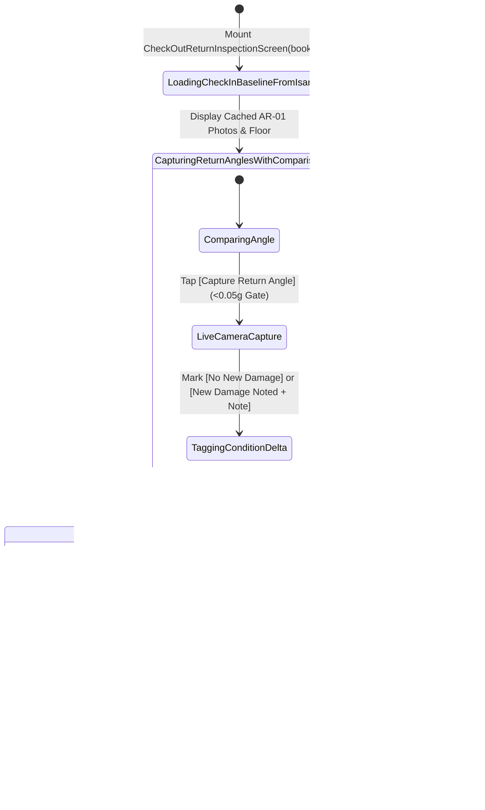
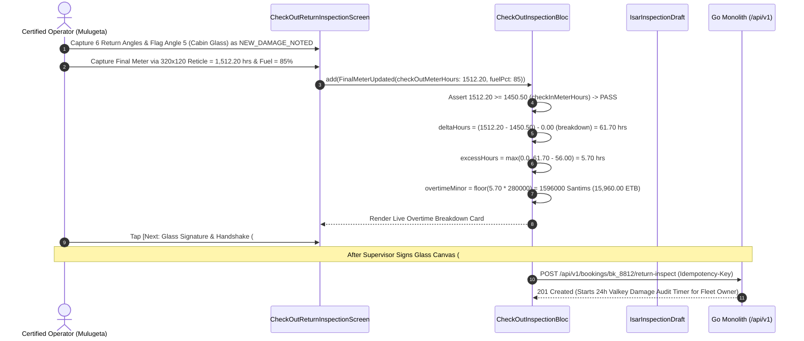

# Post-Rental Return Check-Out Inspection & Automated Excess Hour Calculator
## Mobile Subsystem Specification — `docs/mobile/operator-experience/06-check-out-return-inspection.md`

**Document Identifier:** `SPEC-MOB-OPR-06`  
**Classification:** Canonical Subsystem UI/UX & Technical Behavior Specification  
**Governing Documents:** `Dink_Machinery_UI_UX_Design_Brief.md`, `SRS-DINK-CORE-V7.0` (§5.7.1–§5.7.3, `RC-01` to `RC-03`), `docs/shared/design/design-tokens.json`, `docs/ERROR_CATALOG.md`, `contracts/openapi.yaml`  
**Target Subsystem:** Flutter 3.44 / Dart 3.9 Mobile Client (iOS & Android)  
**Primary Persona / Actor:** Certified Heavy Machinery Operator (*Mulugeta Tadesse*) & Contractor Site Supervisor (*Dawit Haile-Mariam*)  
**Associated Requirements:** `REQ-05-07` (`RC-01` Return Initiation, `RC-02` Check-Out Reticle Photo Auditing & Non-Regressive Hour Meter Capture, `RC-03` Automated Excess Operating Hour Calculation Formula)  
**Associated Interaction Flows:** `FLOW-10` (Demobilization, Return Inspection & 24-Hour Damage Window Trigger)  
**Associated ADRs:** `ADR-002` (Integer Minor-Unit Overtime Surcharge Calculation), `ADR-005` (ClamAV Media Verification), `ADR-010` (Offline-First Return Inspection Outbox)  
**Status:** Approved Technical Design Baseline

---

## 1. Domain Context, Business Rules & Architectural Invariants

When a machinery rental concludes at $T_{\text{end}}$ or an early return is initiated (`RC-01`), the booking transitions to `12. RETURN_INITIATED` and GPS tracking automatically shuts off (`GPS-03`). Before the machine is loaded onto a lowboy trailer for demobilization, the Certified Operator and Contractor Site Supervisor must execute the **Post-Rental Return Check-Out Inspection** (`SPEC-MOB-OPR-06`).

### 1.1 Core Business Rules & Mathematical Invariants
1. **Side-by-Side Check-In Baseline Reference During Return Walkaround (`RC-02`):**
   - For each of the mandatory return perspectives (**1. Front Implement**, **2. Rear Counterweight**, **3. Left Track/Tire**, **4. Right Track/Tire**, **5. Cabin Interior**, **6. Hour Meter**, plus **Bundled Attachment Tip/Pins**), the screen displays the cached **Handover Check-In Baseline Photo (`AR-01`)** directly beside the live return camera slot.
   - This allows the operator and supervisor to immediately spot and flag any new structural defects (e.g., shattered lower cabin glass or bent hydraulic cylinder rod) vs. preexisting wear already logged at check-in.
   - Gallery uploads remain strictly disabled (`AR-01` / `RC-02`); all return photos require live camera capture with $<0.05g$ accelerometer stability.
2. **Strict Monotonic Return Meter Non-Regression (`RC-02`):**
   - Invokes the $320 \times 120\text{ dp}$ macro meter reticle (`SPEC-MOB-OPR-03`) enforcing:
     $$\text{check\_out\_meter\_hours} \ge \text{bookings.check\_in\_meter\_hours}$$
   - Any reading lower than the check-in floor is rejected immediately with HTTP 422 `INSPECT_METER_REGRESSION`.
3. **Deterministic Excess Operating Hour Surcharge Formula (`RC-03`):**
   - Commercial plant hire in East Africa includes a standard single-shift quota of **8.0 Billable Engine Hours per Working Day** (excluding non-working statutory public holidays `HOL-01` unless holiday operation was contracted):
     $$\text{IncludedHours } (\mathcal{H}_{\text{agreed}}) = \Delta_{\text{working\_days}} \times 8.0$$
   - Verified mechanical breakdown stoppage hours (`AR-05`) are credited so the contractor is never billed for downtime:
     $$\Delta\text{Hours}_{\text{net}} = (\text{CheckOutMeter} - \text{CheckInMeter}) - \mathcal{H}_{\text{breakdown\_credit}}$$
   - **Canonical Overtime Formula (`RC-03`):**
     $$\text{ExcessHours } (\mathcal{H}_{\text{excess}}) = \max\left(0.00, \Delta\text{Hours}_{\text{net}} - \text{IncludedHours}\right)$$
     $$\text{OvertimeChargeMinor } (\mathcal{S}_{\text{excess\_minor}}) = \lfloor \text{ExcessHours} \times \text{OvertimeRateMinor} \rfloor$$
4. **24-Hour Statutory Damage Audit Window Trigger (`RC-04`):**
   - Completing the return inspection and dual co-sign (`SPEC-MOB-OPR-07` / `04`) starts the Fleet Owner's **24-hour (`86,400s`) statutory damage claim countdown** (`SPEC-MOB-OWN-11`).

---

## 2. Screen Anatomy, Layout & Bespoke ASCII Wireframe

### 2.1 Post-Rental Return Stepper, Baseline Comparison & Excess Hour Calculator Wireframe
```text
+-----------------------------------------------------------------------+
| [← Back]          POST-RENTAL CHECK-OUT INSPECTION      #BK-8812      |
| Status: [🟠 12. RETURN_INITIATED] • GPS Telemetry: OFF (Auto-Shutoff✓)|
+-----------------------------------------------------------------------+
| RETURN WIZARD: STEP 1 & 2 — BASELINE COMPARISON & OVERTIME CALCULATOR |
| [● 1. Return Walkaround]──[● 2. Meter & Overtime]──[○ 3. Sign-Off #07]|
+-----------------------------------------------------------------------+
| 🔎 1. SIDE-BY-SIDE CHECK-IN BASELINE VS. LIVE RETURN CAPTURE (RC-02)  |
| +-------------------------------------------------------------------+ |
| | ANGLE 5 OF 6: OPERATOR CABIN INTERIOR & SAFETY GLASS              | |
| | +-------------------------------+-------------------------------+ | |
| | | 🟢 CHECK-IN BASELINE (05 Nov) | 🔴 LIVE RETURN CAPTURE (12 Nov| | |
| | | [🖼️ Front windshield intact;  | [🖼️ Lower front windshield    | | |
| | |     4cm scratch on right door]|     shattered by rock impact] | | |
| | +-------------------------------+-------------------------------+ | |
| | Condition Status *: [○ 🟢 NO NEW DAMAGE]  [● 🔴 NEW DAMAGE NOTED] | |
| | Damage Note *: [ Lower front laminated glass cracked during      | |
| |                  basalt trenching on Day 6.                     ] | |
| +-------------------------------------------------------------------+ |
| Angle Progress: [✓1.Front] [✓2.Rear] [✓3.Left] [✓4.Right] [●5.Cabin]  |
+-----------------------------------------------------------------------+
| ⌚ 2. MONOTONIC METER & AUTOMATED EXCESS HOUR CALCULATOR (RC-02/RC-03) |
| +-------------------------------------------------------------------+ |
| | Handover Check-In Meter Floor (05 Nov):            1,450.50 hrs   | |
| | Final Check-Out Meter Reading (Reticle Verified)*: 1,512.20 hrs   | |
| | ✅ MONOTONIC CHECK: 1,512.20 hrs >= 1,450.50 hrs (+61.70h Gross)  | |
| |-------------------------------------------------------------------| |
| | 🧮 AUTOMATED OVERTIME SURCHARGE FORMULA (RC-03):                  | |
| | • Gross Engine Runtime (1,512.20 - 1,450.50):         61.70 hrs   | |
| | • Less Verified Breakdown Credits (AR-05):            -0.00 hrs   | |
| | • Net Billable Operating Hours (ΔHours):              61.70 hrs   | |
| | • Less Included Shift Quota (7 Days × 8.0 hrs/day):  -56.00 hrs   | |
| |-------------------------------------------------------------------| |
| | • Excess Operating Hours: max(0, 61.70 - 56.00) =      5.70 hrs   | |
| | • Contractual Overtime Rate:                × 2,800.00 ETB / hr   | |
| | ================================================================= | |
| | CALCULATED OVERTIME SURCHARGE:                15,960.00 ETB       | |
| | (1,596,000 Santims • Added to Final Reconciliation Statement)     | |
| |-------------------------------------------------------------------| |
| | Fuel Level Check: Check-In 85%  -->  Check-Out [ 85% ] (Matched ✓)| |
| +-------------------------------------------------------------------+ |
+-----------------------------------------------------------------------+
| [ 💾 SAVE OFFLINE ]       [ NEXT: GLASS SIGNATURE & HANDSHAKE (#07) →]|
+-----------------------------------------------------------------------+
```

---

## 3. W3C DTCG Design Token Mapping Table

| UI Component / Element | W3C Token Path (`design-tokens.json`) | Resolved Value (Light / Dark / Outdoor) | Behavioral & Accessibility Invariant |
|---|---|---|---|
| **Baseline vs. Return Split Card** | `semantic.{mode}.surface.card` + `component.lightbox.dividerColor` | `#FFFFFF` / `#1E293B` / `#000000`, `3dp` `#F59E0B` divider | Places cached check-in photo directly beside newly captured return photo. |
| **Overtime Calculation Box** | `color.brand.slate.100` / `color.brand.slate.800` + `typography.fontFamily.mono` | `Space Mono` `14sp` / `18sp` | Displays step-by-step evaluation of $\max(0, \Delta\text{Hours} - \text{IncludedHours}) \times \text{OvertimeRate}$. |
| **New Damage Flag Pill** | `color.feedback.crimson.100` + `color.feedback.crimson.700` | Bg `#FEE2E2`, Text `#B91C1C`, Border `#DC2626` | Pre-populates the Fleet Owner's 24-hour Damage Docket (`SPEC-MOB-OWN-11`). |
| **Primary Next Step CTA** | `component.actuator.button.heightField` + `semantic.{mode}.action.primary.bg` | Height `64dp`, Fill `#F59E0B` (`#FBBF24` Outdoor), Lip `3dp` | Unlocks once all 6 return angles + non-regressive meter reading are verified. |

---

## 4. Interactive State Machine & Sequence Flows

### 4.1 Return Walkaround, Monotonic Meter & Excess Hour State Machine


### 4.2 Excess Operating Hour Calculation & Return Inspection Submission Sequence (`RC-01`..`RC-03`)


---

## 5. Concrete Flutter Implementation Blueprint

### 5.1 BLoC Events & Immutable Freezed States
```dart
// lib/features/operator_inspection/presentation/bloc/check_out_inspection_bloc.dart
import 'package:freezed_annotation/freezed_annotation.dart';
import 'package:flutter_bloc/flutter_bloc.dart';

part 'check_out_inspection_bloc.freezed.dart';

@freezed
sealed class CheckOutInspectionEvent with _$CheckOutInspectionEvent {
  const factory CheckOutInspectionEvent.started(String bookingId) = _Started;
  const factory CheckOutInspectionEvent.returnAngleCaptured({
    required String angleKey,
    required String rawFilePath,
    required double accelerometerDriftG,
    required bool hasNewDamage,
    String? newDamageNote,
  }) = _ReturnAngleCaptured;
  const factory CheckOutInspectionEvent.returnMeterAndFuelUpdated({
    required double checkOutMeterHours,
    required String meterPhotoWebpPath,
    required int checkOutFuelPercent,
  }) = _ReturnMeterAndFuelUpdated;
  const factory CheckOutInspectionEvent.proceedToSignatureRequested() = _ProceedToSignatureRequested;
}

@freezed
class ExcessHourCalculationResult with _$ExcessHourCalculationResult {
  const factory ExcessHourCalculationResult({
    required double checkInMeterHours,
    required double checkOutMeterHours,
    required double grossOperatingHours,
    required double verifiedBreakdownCreditHours,
    required double netOperatingHours,
    required double includedShiftQuotaHours, // workingDays * 8.0
    required double excessOperatingHours, // max(0.0, netOperatingHours - includedShiftQuotaHours)
    required int overtimeRatePerHourMinor,
    required int calculatedOvertimeSurchargeMinor,
    required String currency,
  }) = _ExcessHourCalculationResult;

  factory ExcessHourCalculationResult.compute({
    required double checkInMeter,
    required double checkOutMeter,
    required double breakdownCreditHours,
    required double includedHours,
    required int overtimeRateMinor,
    required String currency,
  }) {
    final gross = checkOutMeter - checkInMeter;
    final net = (gross - breakdownCreditHours).clamp(0.0, double.infinity);
    final excess = (net - includedHours) > 0.0 ? (net - includedHours) : 0.0;
    final surchargeMinor = (excess * overtimeRateMinor).floor();
    return ExcessHourCalculationResult(
      checkInMeterHours: checkInMeter,
      checkOutMeterHours: checkOutMeter,
      grossOperatingHours: gross,
      verifiedBreakdownCreditHours: breakdownCreditHours,
      netOperatingHours: net,
      includedShiftQuotaHours: includedHours,
      excessOperatingHours: double.parse(excess.toStringAsFixed(2)),
      overtimeRatePerHourMinor: overtimeRateMinor,
      calculatedOvertimeSurchargeMinor: surchargeMinor,
      currency: currency,
    );
  }
}

@freezed
sealed class CheckOutInspectionState with _$CheckOutInspectionState {
  const factory CheckOutInspectionState({
    required String bookingId,
    required double checkInMeterFloorHours,
    required int checkInFuelPercent,
    required double verifiedBreakdownCreditHours,
    required double includedShiftQuotaHours,
    required int overtimeRatePerHourMinor,
    required String currency,
    required Map<String, String> checkInBaselinePhotoUris,
    required Map<String, WalkaroundPhotoEntry> capturedReturnPhotos,
    required Map<String, bool> angleHasNewDamage,
    required Map<String, String> angleDamageNotes,
    double? checkOutMeterHours,
    @Default(85) int checkOutFuelPercent,
    ExcessHourCalculationResult? overtimeCalculation,
    String? meterValidationErrorCode, // 'INSPECT_METER_REGRESSION'
    required bool isReadyForSignature,
  }) = _CheckOutInspectionState;
}
```

### 5.2 Isar Persistence Integration
Reuses `IsarInspectionDraft` (`stage = 'CHECK_OUT'`) defined in `SPEC-MOB-OPR-02`, persisting the computed `ExcessHourCalculationResult` and `angleDamageNotes` so offline return check-outs sync deterministically.

### 5.3 Widget Tree Hierarchy
```text
CheckOutReturnInspectionScreen (Scaffold)
 ├── ReturnInspectionAppBar (Booking ID, GPS Auto-Shutoff Verified Pill)
 └── SingleChildScrollView
      ├── SideBySideReturnComparisonCard (Displays Check-In Baseline Photo vs. Live Return Camera Slot + New Damage Toggle)
      ├── MonotonicReturnMeterLauncherCard (Invokes 320x120dp Reticle & Displays Floor Comparison)
      ├── AutomatedExcessHourFormulaCard (Step-by-Step Space Mono Breakdown of max(0, ΔHours - IncludedHours) × OvertimeRate)
      └── StickyReturnInspectionFooter ([💾 Save Offline] + [Next: Glass Signature & Handshake (#07) →])
```

---

## 6. OpenAPI 3.1.0 Routes & RFC 9457 Error Matrix

### 6.1 Bound API Endpoints
| Operation | HTTP Method & URI | Headers Required | Purpose & Contract Binding |
|---|---|---|---|
| **Submit Return Inspection** | `POST /api/v1/bookings/{id}/return-inspect` (or `/inspections`) | `Authorization: Bearer <JWT>`, `Idempotency-Key: <UUIDv4>` | Commits return photos, `check_out_meter_hours`, calculated excess hours (`RC-03`), and triggers the 24h damage audit window (`RC-04`). |

### 6.2 RFC 9457 Problem Details Error Matrix
| Error Code (`error.code`) | HTTP Status | Type URI | Trigger Condition | Mobile UI Recovery Behavior |
|---|---|---|---|---|
| `INSPECT_METER_REGRESSION` | `422` | `/errors/inspect-meter-regression` | `check_out_meter_hours < bookings.check_in_meter_hours` (`RC-02`). | Block submission, display crimson tampering/regression alert, and require fresh reticle capture. |
| `INSPECT_MEDIA_SCAN_FAILED` | `422` | `/errors/inspect-media-scan-failed` | Return walkaround photo failed ClamAV (`:3310`) scan. | Prompt immediate re-capture of the affected angle. |
| `BOOKING_INVALID_STATE_TRANSITION` | `409` | `/errors/booking-invalid-state` | Return inspection already submitted. | Navigate directly to Return Summary / Reconciliation view. |

---

## 7. Verification & Acceptance Criteria

- [ ] **Deterministic Overtime Formula (`RC-03`):** Unit tests verify `ExcessHourCalculationResult.compute` for:
  1. Zero overtime (`checkIn: 1450.50`, `checkOut: 1500.50`, `included: 56.0` $\rightarrow$ `excess: 0.00 hrs`, `surcharge: 0`).
  2. Positive overtime (`checkIn: 1450.50`, `checkOut: 1512.20`, `breakdown: 0.0`, `included: 56.0`, `rate: 280000` $\rightarrow$ `excess: 5.70 hrs`, `surchargeMinor: 1596000` = `15,960.00 ETB`).
  3. Breakdown credit deduction (`checkIn: 1450.50`, `checkOut: 1512.20`, `breakdown: 4.0`, `included: 56.0` $\rightarrow$ `net: 57.70 hrs`, `excess: 1.70 hrs`).
- [ ] **Monotonic Floor Gate (`RC-02`):** Any `checkOutMeter < checkInMeter` emits `INSPECT_METER_REGRESSION` both offline on-client and on the Go backend.
