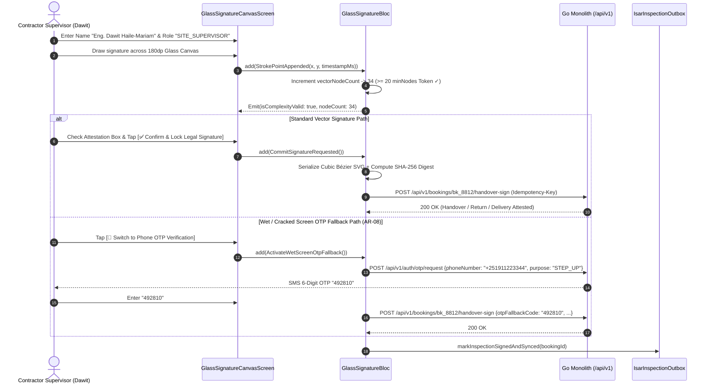

# Orientation-Locked Vector Glass Digital Signature Canvas & Phone OTP Fallback
## Mobile Subsystem Specification — `docs/mobile/operator-experience/07-glass-digital-signature-canvas.md`

**Document Identifier:** `SPEC-MOB-OPR-07`  
**Classification:** Canonical Subsystem UI/UX & Technical Behavior Specification  
**Governing Documents:** `Dink_Machinery_UI_UX_Design_Brief.md`, `SRS-DINK-CORE-V7.0` (§5.6.3, §5.7.3, §5.8.5, `AR-02`, `AR-08`, `RC-02`, `LG-06`, `LG-07`), `docs/shared/design/design-tokens.json`, `docs/ERROR_CATALOG.md`, `contracts/openapi.yaml`  
**Target Subsystem:** Flutter 3.47.8 / Dart 3.9 Mobile Client (iOS & Android)  
**Primary Persona / Actor:** Contractor Site Supervisor (*Dawit Haile-Mariam*), Certified Operator (*Mulugeta Tadesse*), Depot Yard Manager (*W/ro Almaz Tesfaye*), Lowboy Carrier (*Ato Girma Wolde*)  
**Associated Requirements:** `REQ-05-06` (`AR-02`, `AR-08` Vector Digital Signature & Wet/Damaged Screen OTP Fallback), `REQ-05-07` (`RC-02` Return Sign-Off), `REQ-05-08` (`LG-06` Pickup Release, `LG-07` Site Delivery Receipt)  
**Associated Interaction Flows:** `FLOW-09` (Handover Sign-Off), `FLOW-10` (Return Sign-Off), `FLOW-11` (Logistics Loading/Offloading Sign-Off)  
**Associated ADRs:** `ADR-005` (Non-Repudiation & SHA-256 Vector Digest), `ADR-010` (Offline-First Signature Capture & Outbox Queuing)  
**Status:** Approved Technical Design Baseline

---

## 1. Domain Context, Business Rules & Architectural Invariants

Physical custody transfers of heavy machinery ($100,000\text{ to }300,000\text{ USD}$ capital value) require legally binding, non-repudiable human attestation at four critical field checkpoints:
1. **Depot Lowboy Loading Release (`LG-06` / `SPEC-MOB-TRN-04`)**
2. **Site Lowboy Offloading Receipt (`LG-07` / `SPEC-MOB-TRN-05`)**
3. **Pre-Rental Handover Check-In (`AR-02`, `AR-08` / `SPEC-MOB-OPR-02`..`04`)**
4. **Post-Rental Return Check-Out (`RC-02` / `SPEC-MOB-OPR-06`)**

The **Orientation-Locked Vector Glass Digital Signature Canvas** (`SPEC-MOB-OPR-07`) captures high-resolution Cubic Bézier vector strokes on device glass, enforces a strict **minimum complexity threshold of $\ge 20$ vector nodes (`component.signature.minNodes`)** to prevent accidental single-tap dots or fraudulent line swipes, records the signee's full name and site role, and provides a resilient **"Verify via Phone OTP / Challenge PIN" fallback (`AR-08`)** when heavy rain, mud, grease, or a cracked digitizer prevents capacitive touch drawing on site.

### 1.1 Core Business Rules & Cryptographic Invariants
1. **Orientation-Locked Viewport & Gesture Isolation:**
   - Upon mounting the signature modal/screen, the viewport locks orientation (`SystemChrome.setPreferredOrientations`) and wraps the drawing pad in a raw `Listener` / `GestureDetector` that wins the Flutter gesture arena (`RawGestureDetector` with `EagerGestureRecognizer`), preventing parent scroll views from stealing touch strokes.
2. **Minimum 20-Vector-Node Complexity Gate (`component.signature.minNodes = 20`):**
   - As the signee draws across the canvas (`minHeight: 180dp`, `strokeWidth: 3dp` `component.signature`), sampled $(x, y, t)$ touch points filtered by a $2.0\text{ dp}$ Euclidean distance threshold are counted in real time.
   - **Anti-Dot / Anti-Slash Invariant:** The `[✅ Confirm & Lock Legal Signature]` actuator remains disabled until `vectorNodeCount >= 20` (`component.signature.minNodes`). If a user taps a single dot or draws a 4-node short line, an inline badge prompts: `⚠️ Continue signing: 7 / 20 minimum signature points captured`.
3. **Dual Vector SVG + PNG Serialization & `SHA-256` Non-Repudiation Digest:**
   - Upon confirmation, the signature is serialized as a compact **SVG path string** (preserving stroke velocity and bounding box) and a `600x300px` transparent WebP/PNG image, hashed with `SHA-256` alongside the booking ID, meter reading, signee name, signee role, and UTC timestamp.
4. **Wet / Muddy / Cracked Screen Fallback: "Verify via Phone OTP" (`AR-08`):**
   - During East African rainy seasons (*Kiremt* in Ethiopia; *Long Rains* in Kenya) or when an operator's phone screen is coated in hydraulic oil or has a damaged digitizer, drawing a 20-node vector curve can become physically impossible.
   - Tapping `[🌧️ Screen Wet or Damaged? Verify via Phone OTP]` switches the attestation panel to dispatch a 6-digit SMS OTP (`/auth/otp/request` with `purpose: STEP_UP`) or accept the counterparty's offline HMAC 6-digit Challenge PIN (`AR-02`), satisfying legal non-repudiation without stranding the machine on site.

---

## 2. Screen Anatomy, Layout & Bespoke ASCII Wireframe

### 2.1 Orientation-Locked Glass Signature Pad & Wet-Screen OTP Fallback Wireframe
```text
+-----------------------------------------------------------------------+
| [← Back]        LEGAL HANDOVER SIGNATURE ATTESTATION    #BK-8812      |
| Stage: PRE-RENTAL CHECK-IN (AR-08) • Meter: 1,450.50h • Fuel: 85%     |
+-----------------------------------------------------------------------+
| 👤 1. SIGNEE IDENTITY & SITE ROLE ATTESTATION                         |
| +-------------------------------------------------------------------+ |
| | Signee Full Name *: [ Eng. Dawit Haile-Mariam                   ] | |
| | Site Role *:        [● Contractor Site Supervisor] [○ Fleet Rep]  | |
| | Phone / ID Ref:     [ +251 911 223 344 (Verified Renter Account)] | |
| +-------------------------------------------------------------------+ |
|                                                                       |
| ✍️ 2. VECTOR GLASS SIGNATURE CANVAS (MIN 180dp HEIGHT • 3dp STROKE)   |
| +-------------------------------------------------------------------+ |
| | Complexity Gate: [🟢 34 / 20 Min Vector Nodes Validated] [🗑️Clear]| |
| | +---------------------------------------------------------------+ | |
| | |                                                               | | |
| | |        /\      _          _   _       /\                      | | |
| | |       /  \    / \/\  /\  (_) | |_    /  \___                  | | |
| | |      / /\ \  /    / /  \  _  | __|  / /\ ___|                 | | |
| | |     / ____ \ \___/ / /\ \| | | |_  / /                        | | |
| | |                                                               | | |
| | | - - - - - - - - - - - - - - - - - - - - - - - - - - - - - - - | | |
| | | ✖ SIGN ABOVE THE BASELINE (Glove / Stylus / Finger Supported) | | |
| | +---------------------------------------------------------------+ | |
| | SHA-256 Preview: 4a9e81c0...f912 • Timestamp: 2026-11-05 07:14Z   | |
| +-------------------------------------------------------------------+ |
|                                                                       |
| 🌧️ WET, GREASY OR CRACKED TOUCHSCREEN FALLBACK (AR-08)                |
| +-------------------------------------------------------------------+ |
| | Cannot draw smoothly due to heavy rain, hydraulic grease, or      | |
| | damaged screen glass?                                             | |
| | [ 📱 SWITCH TO PHONE OTP / 6-DIGIT CHALLENGE PIN VERIFICATION ]   | |
| +-------------------------------------------------------------------+ |
|                                                                       |
| [☑] By signing, I attest that CAT 320D (ET-3-99120) was inspected     |
|     at 1,450.50 hours and 85% fuel in accordance with Contract #8812. |
+-----------------------------------------------------------------------+
| [ ✅ CONFIRM & LOCK LEGAL SIGNATURE (COMMIT HANDOVER) ]               |
+-----------------------------------------------------------------------+
```

---

## 3. W3C DTCG Design Token Mapping Table

| UI Component / Element | W3C Token Path (`design-tokens.json`) | Resolved Value (Light / Dark / Outdoor) | Behavioral & Accessibility Invariant |
|---|---|---|---|
| **Signature Canvas Min Height** | `component.signature.canvasMinHeight` | `180dp` minimum vertical drawing area | Provides ample vertical clearance for gloved finger or stylus signatures. |
| **Signature Stroke Width** | `component.signature.strokeWidth` | `3dp` (`stroke.border.heavy`) | High-visibility stroke width for clean SVG/WebP legibility on PDF contracts. |
| **Signature Stroke Color** | `component.signature.strokeColor` / `strokeColorDark` | `#020617` (`slate.950` in Light) / `#FFFFFF` (in Dark & Outdoor Mode) | Guarantees maximum contrast against the canvas surface in all three themes. |
| **Minimum Vector Nodes Token** | `component.signature.minNodes` | `20` vector complexity points | Hard validation threshold preventing accidental dots or single-tap bypasses. |
| **Node Counter Status Badge** | `color.brand.amber.100` (`<20`) $\rightarrow$ `color.feedback.emerald.100` ($\ge 20$) | Amber `#FEF3C7` until 20 nodes reached, then Emerald `#D1FAE5` | Live real-time feedback as the user draws across the glass. |
| **Commit Signature Actuator** | `component.actuator.button.heightField` + `semantic.{mode}.action.primary.bg` | Height `64dp`, Fill `#F59E0B` (`#FBBF24` Outdoor), Lip `3dp` | Unlocked when `(vectorNodeCount >= 20 || isOtpFallbackVerified) && isLegalChecked`. |

---

## 4. Interactive State Machine & Sequence Flows

### 4.1 Vector Signature Capture & Wet-Screen OTP Fallback State Machine
```mermaid
stateDiagram-v2
    [*] --> OrientationLockedCanvasIdle: Mount Screen (Lock Orientation + 0/20 Nodes)

    state OrientationLockedCanvasIdle {
        [*] --> DrawingVectorStrokes: OnPanDown / OnPanUpdate (>2dp Euclidean Filter)
        DrawingVectorStrokes --> UnderMinNodesThreshold: 1 <= vectorNodeCount < 20 (Amber Badge)
        DrawingVectorStrokes --> ComplexityThresholdMet: vectorNodeCount >= 20 (Emerald Badge)
        UnderMinNodesThreshold --> DrawingVectorStrokes: Continue Drawing
        ComplexityThresholdMet --> DrawingVectorStrokes: Continue Drawing
        UnderMinNodesThreshold --> OrientationLockedCanvasIdle: Tap [🗑️ Clear] (Reset to 0)
        ComplexityThresholdMet --> OrientationLockedCanvasIdle: Tap [🗑️ Clear] (Reset to 0)
    }

    OrientationLockedCanvasIdle --> WetScreenOtpFallbackMode: Tap [📱 Switch to Phone OTP / Challenge PIN (AR-08)]
    
    state WetScreenOtpFallbackMode {
        [*] --> RequestingStepUpOtp
        RequestingStepUpOtp --> Entering6DigitCode: POST /auth/otp/request (purpose: STEP_UP) or Offline HMAC PIN
        Entering6DigitCode --> OtpFallbackVerified: 6-Digit Code Validated
        Entering6DigitCode --> OtpInvalidError: HTTP 400 (AUTH_OTP_INVALID_CODE)
        OtpInvalidError --> Entering6DigitCode: Retry Code (Max 5 Attempts)
    }

    ComplexityThresholdMet --> SerializingAndHashingAttestation: Tap [✅ Confirm & Lock Legal Signature]
    OtpFallbackVerified --> SerializingAndHashingAttestation: Tap [✅ Confirm & Lock Legal Signature]

    SerializingAndHashingAttestation --> CommittedToCloudOrOutbox: Compute SHA-256 + Submit / Queue in Isar
```

### 4.2 Vector Node Validation, SVG Serialization & Wet-Screen OTP Fallback Sequence


---

## 5. Concrete Flutter Implementation Blueprint

### 5.1 BLoC Events & Immutable Freezed States
```dart
// lib/features/operator_inspection/presentation/bloc/glass_signature_bloc.dart
import 'package:freezed_annotation/freezed_annotation.dart';
import 'package:flutter_bloc/flutter_bloc.dart';

part 'glass_signature_bloc.freezed.dart';

@freezed
class SignatureVectorPoint with _$SignatureVectorPoint {
  const factory SignatureVectorPoint({
    required double x,
    required double y,
    required int timestampEpochMs,
  }) = _SignatureVectorPoint;
}

@freezed
sealed class GlassSignatureEvent with _$GlassSignatureEvent {
  const factory GlassSignatureEvent.initialized({
    required String bookingId,
    required String attestationStage, // 'HANDOVER_CHECK_IN' | 'RETURN_CHECK_OUT' | 'DEPOT_PICKUP' | 'SITE_DELIVERY'
    required String prefilledSigneeName,
    required String prefilledSigneeRole,
  }) = _Initialized;
  const factory GlassSignatureEvent.signeeIdentityChanged({
    required String fullName,
    required String role,
  }) = _SigneeIdentityChanged;
  const factory GlassSignatureEvent.strokeStarted(SignatureVectorPoint startPoint) = _StrokeStarted;
  const factory GlassSignatureEvent.strokePointAdded(SignatureVectorPoint point) = _StrokePointAdded;
  const factory GlassSignatureEvent.canvasCleared() = _CanvasCleared;
  const factory GlassSignatureEvent.wetScreenOtpFallbackToggled(bool enabled) = _WetScreenOtpFallbackToggled;
  const factory GlassSignatureEvent.fallbackOtpRequested() = _FallbackOtpRequested;
  const factory GlassSignatureEvent.fallbackOtpCodeChanged(String sixDigitCode) = _FallbackOtpCodeChanged;
  const factory GlassSignatureEvent.legalAttestationToggled(bool isChecked) = _LegalAttestationToggled;
  const factory GlassSignatureEvent.commitAttestationSubmitted() = _CommitAttestationSubmitted;
}

@freezed
sealed class GlassSignatureState with _$GlassSignatureState {
  const factory GlassSignatureState({
    required String bookingId,
    required String attestationStage,
    required String signeeFullName,
    required String signeeRole,
    @Default([]) List<List<SignatureVectorPoint>> strokes,
    @Default(0) int totalVectorNodeCount,
    @Default(20) int requiredMinNodes, // component.signature.minNodes = 20
    required bool isComplexityMet, // totalVectorNodeCount >= 20
    @Default(false) bool isWetScreenOtpFallbackActive,
    String? otpVerificationSessionId,
    @Default('') String enteredFallbackOtpCode,
    @Default(false) bool isLegalCheckboxChecked,
    @Default(false) bool isSubmitting,
    String? committedSha256Digest,
    ProblemDetails? error,
  }) = _GlassSignatureState;
}
```

### 5.2 CustomPaint Vector Bezier Canvas & SVG Serializer
```dart
// lib/features/operator_inspection/presentation/widgets/vector_glass_signature_pad.dart
// Renders strokes using:
// - Paint()..strokeWidth = 3.0 (component.signature.strokeWidth)
// - Paint()..strokeCap = StrokeCap.round..style = PaintingStyle.stroke
// - Color: Theme.of(context).brightness == Brightness.light ? Color(0xFF020617) : Color(0xFFFFFFFF)
// - Minimum height: 180.0 (component.signature.canvasMinHeight)
```

### 5.3 Widget Tree Hierarchy
```text
GlassDigitalSignatureCanvasScreen (Scaffold - Orientation Locked)
 ├── SignatureTopAppBar (Booking ID, Stage Pill)
 └── SingleChildScrollView (Physics disabled while finger is down on Signature Pad)
      ├── SigneeIdentityAndRoleCard (Full Name Input + Role Segmented Chips)
      ├── VectorGlassSignaturePadCard
      │    ├── NodeComplexityCounterHeader ("34 / 20 Min Vector Nodes" Pill + [🗑️ Clear] Button)
      │    ├── Listener / RawGestureDetector (180dp minHeight CustomPaint Canvas with 3dp Stroke)
      │    └── Sha256AndUtcTimestampFooter
      ├── WetOrDamagedScreenOtpFallbackCard (AR-08 Toggle -> 6-Digit SMS OTP / HMAC PIN Input)
      ├── LegalContractAttestationCheckbox (56dp Touch Target)
      └── StickyCommitSignatureFooter ([✅ Confirm & Lock Legal Signature])
```

---

## 6. OpenAPI 3.1.0 Routes & RFC 9457 Error Matrix

### 6.1 Bound API Endpoints
| Operation | HTTP Method & URI | Headers Required | Purpose & Contract Binding |
|---|---|---|---|
| **Request Fallback OTP** | `POST /api/v1/auth/otp/request` | `X-Country-Code: ET\|KE` | Issues a 6-digit `STEP_UP` verification code when the wet/cracked screen fallback (`AR-08`) is activated. |
| **Submit Signed Handover / Return** | `POST /api/v1/bookings/{id}/handover-sign` (or `/return-inspect`) | `Authorization: Bearer <JWT>`, `Idempotency-Key: <UUIDv4>` | Commits the vector SVG signature (`vectorNodeCount >= 20`), `sha256Digest`, signee identity, or verified OTP fallback token. |

### 6.2 RFC 9457 Problem Details Error Matrix
| Error Code (`error.code`) | HTTP Status | Type URI | Trigger Condition | Mobile UI Recovery Behavior |
|---|---|---|---|---|
| `REQ_VALIDATION_FAILED` | `400` | `/errors/request-validation-failed` | Submitted signature has `< 20` vector nodes (`component.signature.minNodes`) and no OTP fallback token. | Highlight canvas border in crimson and prompt signee to complete a full signature stroke. |
| `AUTH_OTP_INVALID_CODE` | `400` | `/errors/otp-invalid-code` | Supplied 6-digit wet-screen fallback OTP code is incorrect. | Highlight OTP boxes in crimson and display remaining attempts. |
| `AUTH_OTP_EXPIRED` | `400` | `/errors/otp-expired` | Fallback OTP 120-second window expired. | Enable `[Resend OTP Code]` button. |
| `AUTH_OTP_MAX_ATTEMPTS` | `429` | `/errors/otp-max-attempts` | Exceeded 5 OTP attempts; locked for 15 minutes. | Switch automatically to Offline P2P HMAC QR Scan (`SPEC-MOB-OPR-04`). |

---

## 7. Verification & Acceptance Criteria

- [ ] **20-Node Vector Complexity Enforcement (`component.signature.minNodes`):** Unit and widget tests verify that drawing a stroke with `19` sampled vector nodes keeps `isComplexityMet == false` and the commit button disabled; adding the `20th` node transitions `isComplexityMet` to `true` and turns the counter badge emerald.
- [ ] **Wet / Damaged Screen OTP Fallback (`AR-08`):** Tapping `[📱 Switch to Phone OTP Verification]` allows completing legal sign-off using a verified 6-digit SMS OTP or offline Challenge PIN without requiring 20 touch nodes on the glass canvas.
- [ ] **Theme-Adaptive Stroke Contrast:** In `light` mode, strokes render in `#020617` (`component.signature.strokeColor`); in `dark` and `outdoorHighContrast` modes, strokes render in pure `#FFFFFF` (`component.signature.strokeColorDark`) at `3dp` width (`component.signature.strokeWidth`).
