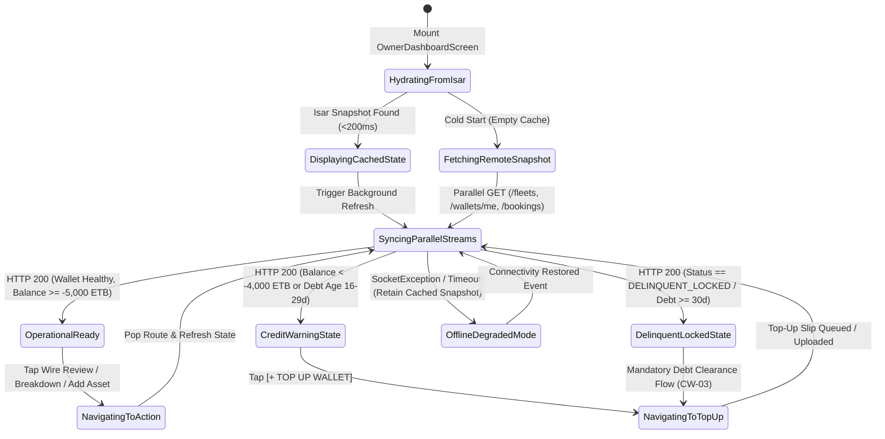
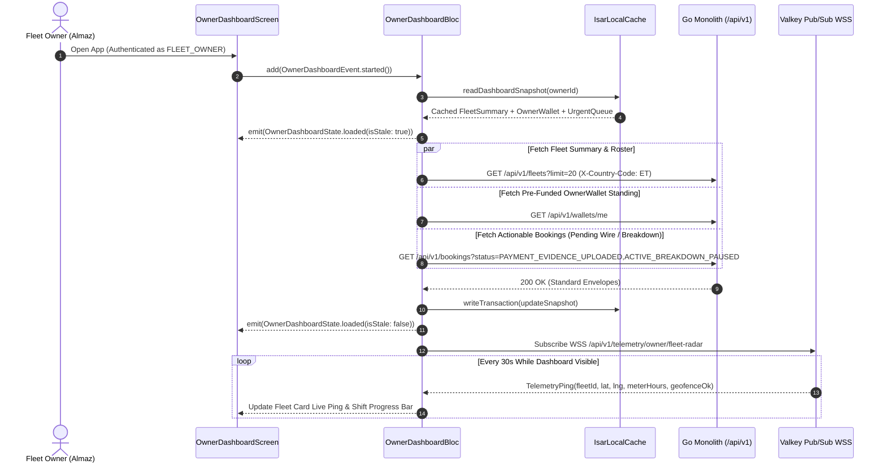

# Fleet Owner Operations Dashboard, Asset Utilization & Pre-Funded Wallet Status
## Mobile Subsystem Specification — `docs/mobile/owner-experience/01-owner-dashboard-fleet-summary.md`

**Document Identifier:** `SPEC-MOB-OWN-01`  
**Classification:** Canonical Subsystem UI/UX & Technical Behavior Specification  
**Governing Documents:** `Dink_Machinery_UI_UX_Design_Brief.md`, `SRS-DINK-CORE-V7.0` (§5.2, §5.6, §5.9), `docs/shared/design/design-tokens.json`, `docs/ERROR_CATALOG.md`, `contracts/openapi.yaml`  
**Target Subsystem:** Flutter 3.44 / Dart 3.9 Mobile Client (iOS & Android)  
**Primary Persona / Actor:** Equipment Fleet Owner & Depot Yard Manager (*W/ro Almaz Tesfaye* / *Kamau Ndegwa*)  
**Associated Requirements:** `REQ-05-02` (`FL-01`, `FL-35`), `REQ-05-05` (`BK-08`, `BK-09`), `REQ-05-06` (`AR-03`, `AR-05`), `REQ-05-09` (`CW-01`, `CW-02`, `CW-06`)  
**Associated Interaction Flows:** `FLOW-03` (Fleet Registration), `FLOW-07` (Booking Lifecycle), `FLOW-08` (Direct Wire Verification), `FLOW-12` (Commission Debt & Delinquency Lockout)  
**Associated ADRs:** `ADR-001` (Modular Monolith), `ADR-002` (Double-Entry Ledger), `ADR-008` (Multi-Country Parameterization), `ADR-010` (Offline-First Isar NoSQL & Non-Custodial Settlement)  
**Status:** Approved Technical Design Baseline

---

## 1. Domain Context, Business Rules & Architectural Invariants

The **Fleet Owner Operations Dashboard** is the mission-critical command center for capital equipment owners managing high-value earthmoving, lifting, compaction, and transport fleets across Ethiopia (`ET`) and Kenya (`KE`). Unlike consumer e-commerce dashboards, a machinery depot manager operates in high-glare outdoor equipment yards ($>85,000\text{ lux}$) while coordinating assets valued at $100,000\text{ to }300,000\text{ USD}$ per unit.

### 1.1 Core Business Rules & Operational Invariants
1. **Real-Time Fleet Utilization Partitioning (`FL-01`, `FL-35`):**
   Every non-deleted asset (`deleted_at IS NULL`) belonging to the authenticated owner is categorized into mutually exclusive operational buckets:
   - **`RENTED`:** Currently mobilized on an active contract (`CONFIRMED`, `IN_TRANSIT`, `READY_FOR_PICKUP`, `ACTIVE`, `RETURN_INITIATED`).
   - **`AVAILABLE`:** Approved (`ACTIVE` fleet status) and free for immediate spatial discovery and booking reservation.
   - **`MAINTENANCE`:** Temporarily blocked via manual maintenance calendar blackouts (`FL-35`), active breakdown repair (`AR-05`), or `INSURANCE_HOLD`.
   - **`PENDING_APPROVAL` / `REJECTED`:** Newly onboarded units awaiting compliance officer (`Yohannes Bekele`) verification or requiring remediation.
2. **Pre-Funded `OwnerWallet` & Credit Buffer Invariant (`CW-01`, `CW-02`, `CW-06`, `ADR-010`):**
   - Under National Bank of Ethiopia (NBE) non-custodial directives (Phase 1), contractors wire gross rental payments directly to the Fleet Owner's verified commercial bank account.
   - To collect the platform's $10.0\%$ machinery commission ($1,000\text{ bps}$) and $2.5\%$ pass-through freight commission ($250\text{ bps}$), each owner maintains a virtual double-entry `OwnerWallet`.
   - The dashboard prominently displays the live `OwnerWallet` balance in minor currency units (`ETB` Santims or `KES` Cents) alongside the `-5,000.00 ETB` (`-500,000` minor units) statutory overdraft credit limit buffer (`CW-06`).
   - If the wallet balance breaches the credit limit or remains negative for $>30\text{ days}$ (`DELINQUENT_LOCKED`, `CW-04`), a high-priority crimson lockout banner is pinned to the top of the viewport, warning that all `ACTIVE` machinery has been automatically de-indexed from PostGIS spatial search until a top-up slip is verified.
3. **Actionable Priority Action Queue (`BK-08`, `AR-05`):**
   Urgent operational blockers requiring owner sign-off—such as unverified contractor wire slips (`PAYMENT_EVIDENCE_UPLOADED` with 24-hour verification SLA), incoming booking requests (`PENDING_PAYMENT`), and active site mechanical breakdowns (`ACTIVE_BREAKDOWN_PAUSED` with 4-hour mechanic dispatch SLA)—are surfaced at the top of the scroll view with live countdown timers.
4. **Integer Minor-Unit Financial Rendering (`ADR-002`):**
   All trailing 30-day gross revenue, commission debt, and net retained earnings metrics are transmitted as `int64` minor units and formatted on-client using `Space Mono` tabular numerals with explicit ISO 4217 currency codes (`ETB` / `KES`).

---

## 2. Screen Anatomy, Layout & Bespoke ASCII Wireframe

### 2.1 Primary Viewport Wireframe (Daylight / Outdoor High-Contrast Adaptive)
```text
+-----------------------------------------------------------------------+
| [≡] TESFAYE HEAVY PLANT PLC          [🌐 AM/EN] [☀️ Outdoor] [🔔 4]   |
|     Addis Ababa - Kality Yard • TIN: 0049182736 (Verified ✓)          |
+-----------------------------------------------------------------------+
| ⚠️ URGENT: 2 WIRE RECEIPTS PENDING VERIFICATION (SLA: 04h 18m left)   |
|    Confirm payment to unlock Cat 320D & Lowboy dispatch -> [REVIEW]   |
+-----------------------------------------------------------------------+
| 💼 PRE-FUNDED COMMISSION WALLET (CW-01 / CW-06)        [+ TOP UP]     |
| +-------------------------------------------------------------------+ |
| | Available Balance:   -1,850.00 ETB   (Within -5,000.00 ETB Limit) | |
| | Credit Buffer Used:  [██████████░░░░░░░░░░░░░░░░] 37% Utilized    | |
| | 30-Day Gross Earned: 425,000.00 ETB  | Net Retained: 382,500 ETB  | |
| +-------------------------------------------------------------------+ |
+-----------------------------------------------------------------------+
| 📊 FLEET UTILIZATION SUMMARY (12 TOTAL ASSETS)          [+ ADD ASSET] |
| +---------------+ +---------------+ +---------------+ +-------------+ |
| | 🟢 RENTED     | | 🟡 AVAILABLE  | | 🔴 MAINT/HOLD | | 🔵 PENDING  | |
| |      07       | |      03       | |      01       | |     01      | |
| | 58.3% Active  | | In PostGIS    | | 1 Breakdown   | | In Review   | |
| +---------------+ +---------------+ +---------------+ +-------------+ |
+-----------------------------------------------------------------------+
| 🚨 PRIORITY ACTION QUEUE (3)                                          |
| +-------------------------------------------------------------------+ |
| | [💳 WIRE SLIP] #BK-8812 • Cat 320D Excavator     ⏱️ 04:18:22 SLA | |
| | Renter: Dawit Construction • Prepay: 112,500.00 ETB (CBE Wire)    | |
| | [ 🔍 INSPECT SLIP & CONFIRM (10% Comm: 22,500 ETB) ]              | |
| +-------------------------------------------------------------------+ |
| | [🔧 BREAKDOWN] #BK-8790 • XCMG GR215 Grader      ⏱️ 02:11:05 SLA | |
| | Site: Mojo-Meki Km 42 • Fault: Hydraulic Hose Burst (Clock Paused)| |
| | [ 🚐 DISPATCH MECHANIC ]               [ 📞 CALL OPERATOR ]       | |
| +-------------------------------------------------------------------+ |
+-----------------------------------------------------------------------+
| 🚜 ACTIVE FLEET ROSTER & LIVE TELEMETRY            [Filter: All ▼]    |
| +-------------------------------------------------------------------+ |
| | CAT 320D Hydraulic Excavator • Plate: ET-3-99120      [🟢 ACTIVE] | |
| | Op: Mulugeta T. • Meter: 1,478.5h • Shift Today: 5.5 / 8.0 hrs    | |
| | 📍 Mojo Highway Site B (Live Ping 12s ago • Inside Geofence)      | |
| | [ 📅 Calendar ]    [ 📋 Spec & Docs ]    [ 🗺️ Live Telemetry ]    | |
| +-------------------------------------------------------------------+ |
| | SINOTRUK HOWO 60T Lowboy • Plate: ET-3-44109       [🟡 AVAILABLE] | |
| | Payload: 60,000 kg • 4-Axle Hydraulic Ramp • Rate: 18,000 ETB/day | |
| | 📍 Kality Main Depot • Next Maintenance: in 140 hrs               | |
| | [ 📅 Block Dates ] [ 💲 Edit Tariff ]    [ 🔗 Link Attachments ]  | |
| +-------------------------------------------------------------------+ |
+-----------------------------------------------------------------------+
| [🏠 Dashboard]  [🚜 My Fleet]  [📅 Bookings]  [💼 Wallet]  [👤 Profile]|
+-----------------------------------------------------------------------+
```

---

## 3. W3C DTCG Design Token Mapping Table

All UI elements bind strictly to `docs/shared/design/design-tokens.json` across `light`, `dark`, and `outdoorHighContrast` semantic modes:

| UI Component / Element | W3C Token Path (`design-tokens.json`) | Resolved Value (Light / Dark / Outdoor) | Behavioral & Accessibility Invariant |
|---|---|---|---|
| **Screen Canvas Background** | `semantic.{mode}.surface.canvas` | `#F8FAFC` / `#0F172A` / `#000000` | Pure `#000000` in Outdoor Mode maximizes AMOLED contrast (>21:1). |
| **KPI & Roster Card Surface** | `semantic.{mode}.surface.card` | `#FFFFFF` / `#1E293B` / `#000000` | Paired with `elevation.card` in standard modes or `2dp` white border in Outdoor Mode. |
| **Wallet Credit Progress Bar** | `color.brand.amber.500` / `color.feedback.crimson.500` | `#F59E0B` (<80% used) / `#EF4444` (≥80% used) | Visualizes utilization of the `-5,000.00 ETB` (`CW-06`) credit limit buffer. |
| **Financial & Meter Figures** | `typography.fontFamily.mono` + `semantic.{mode}.text.numericLedger` | `Space Mono`, `20sp` (`typography.fontSize.20`), `#020617` / `#F8FAFC` / `#FFFFFF` | Fixed-pitch numerals prevent horizontal jitter during live countdown updates. |
| **Ethiopic / Latin Headers** | `typography.fontFamily.ethiopic` / `typography.fontFamily.latin` | `Noto Sans Ethiopic` (`lineHeightFactor.ethiopicGolden`: `1.38`) | Prevents vertical clipping of Ge'ez ascenders and descenders. |
| **Urgent SLA Countdown Chip** | `component.countdown.holdUrgentBg` / `holdCriticalBg` | `#FFF7ED` (text `#C2410C`) / `#FEF2F2` (text `#B91C1C`) | Shifts from Urgent to Critical when verification SLA drops below `02:00:00`. |
| **Primary Action Button** | `component.actuator.button.heightStandard` + `semantic.{mode}.action.primary.bg` | Height `56dp` (`64dp` Field Mode), Fill `#F59E0B` (`#FBBF24` Outdoor), Lip `3dp` | Enforces gloved-hand target size (`dimension.space.56`) and tactile bottom lip. |
| **Rented / Active Status Badge** | `color.feedback.emerald.100` + `color.feedback.emerald.700` | Bg `#D1FAE5`, Text `#047857`, Dot `#10B981` | Always paired with semantic icon (`[🟢]`) for color-vision deficiency safety. |

---

## 4. Interactive State Machine & Sequence Flows

### 4.1 Owner Dashboard Lifecycle State Machine


### 4.2 Parallel Dashboard Hydration & Real-Time Telemetry Subscription


---

## 5. Concrete Flutter Implementation Blueprint

### 5.1 BLoC Events & Immutable Freezed States
```dart
// lib/features/owner_dashboard/presentation/bloc/owner_dashboard_bloc.dart
import 'package:freezed_annotation/freezed_annotation.dart';
import 'package:flutter_bloc/flutter_bloc.dart';

part 'owner_dashboard_bloc.freezed.dart';

@freezed
sealed class OwnerDashboardEvent with _$OwnerDashboardEvent {
  const factory OwnerDashboardEvent.started() = _Started;
  const factory OwnerDashboardEvent.refreshed() = _Refreshed;
  const factory OwnerDashboardEvent.statusFilterChanged(String? fleetStatus) = _StatusFilterChanged;
  const factory OwnerDashboardEvent.telemetryPingReceived({
    required String fleetId,
    required double latitude,
    required double longitude,
    required double currentMeterHours,
    required bool isInsideGeofence,
    required DateTime pingedAt,
  }) = _TelemetryPingReceived;
  const factory OwnerDashboardEvent.loadNextFleetPage(String cursor) = _LoadNextFleetPage;
}

@freezed
sealed class OwnerDashboardState with _$OwnerDashboardState {
  const factory OwnerDashboardState.initial() = _Initial;
  const factory OwnerDashboardState.loading() = _Loading;
  const factory OwnerDashboardState.loaded({
    required OwnerWalletSummaryDto walletSummary,
    required FleetUtilizationMetricsDto utilizationMetrics,
    required List<UrgentBookingActionDto> priorityActionQueue,
    required List<OwnerFleetCardDto> fleetItems,
    required String? nextCursor,
    required bool hasMoreFleets,
    required String? activeStatusFilter,
    required bool isOfflineCached,
    required DateTime lastSyncedAt,
    ProblemDetails? nonBlockingSyncError,
  }) = _Loaded;
  const factory OwnerDashboardState.failure({
    required ProblemDetails error,
  }) = _Failure;
}

@freezed
class OwnerWalletSummaryDto with _$OwnerWalletSummaryDto {
  const factory OwnerWalletSummaryDto({
    required String walletId,
    required String currency, // 'ETB' or 'KES'
    required int availableBalanceMinor, // e.g., -185000 = -1,850.00 ETB
    required int creditLimitMinor, // e.g., -500000 = -5,000.00 ETB (CW-06)
    required int grossEarned30dMinor,
    required int netRetained30dMinor,
    required String walletStatus, // 'ACTIVE' | 'DELINQUENT_LOCKED' | 'FROZEN'
    DateTime? delinquentSince,
  }) = _OwnerWalletSummaryDto;
}
```

### 5.2 Isar Local Persistence & Offline Snapshot Schema
```dart
// lib/features/owner_dashboard/data/local/isar_owner_dashboard_cache.dart
import 'package:isar/isar.dart';

part 'isar_owner_dashboard_cache.g.dart';

@collection
class IsarOwnerDashboardCache {
  Id id = Isar.autoIncrement;

  @Index(unique: true, replace: true)
  late String ownerUserId;

  late String currency;
  late int availableBalanceMinor;
  late int creditLimitMinor;
  late int grossEarned30dMinor;
  late int netRetained30dMinor;
  late String walletStatus;

  late int totalFleetsCount;
  late int rentedCount;
  late int availableCount;
  late int maintenanceCount;
  late int pendingApprovalCount;

  late String serializedPriorityActionsJson;
  late String serializedFleetCardsJson;
  late DateTime cachedAt;
}
```

### 5.3 Widget Tree Hierarchy
```text
OwnerDashboardScreen (Scaffold)
 ├── OwnerTopAppBar (Company Title, TIN Verification Badge, Locale & Outdoor Mode Toggles)
 ├── DelinquencyOrUrgentSlaBanner (Conditional: shown if walletStatus == 'DELINQUENT_LOCKED' or urgent wire slips > 0)
 └── RefreshIndicator (Triggers OwnerDashboardEvent.refreshed)
      └── CustomScrollView
           ├── SliverToBoxAdapter -> OwnerWalletStandingCard (Balance in Space Mono, -5,000 ETB Credit Buffer Progress Bar, [+ TOP UP] CTA)
           ├── SliverToBoxAdapter -> FleetUtilizationKpiGrid (4 Touch Cards: Rented, Available, Maint/Hold, Pending)
           ├── SliverToBoxAdapter -> PriorityActionQueueCarousel (Wire Verification Cards & Active Breakdown SLA Cards)
           ├── SliverPersistentHeader -> FleetRosterFilterBar (Filter Chips: All, Rented, Available, Maintenance)
           └── SliverList -> OwnerFleetRosterCardList (Cursor-paginated Fleet Cards with Live Telemetry Indicator & Quick Actions)
```

---

## 6. OpenAPI 3.1.0 Routes & RFC 9457 Error Matrix

### 6.1 Bound API Endpoints
| Operation | HTTP Method & URI | Headers Required | Purpose & Contract Binding |
|---|---|---|---|
| **Get Wallet Summary** | `GET /api/v1/wallets/me` | `Authorization: Bearer <JWT>`, `X-Country-Code: ET\|KE` | Fetches `WalletSuccessResponse` including `balanceMinor`, `creditLimitMinor` (`-500000`), and `status`. |
| **List Owner Fleets** | `GET /api/v1/fleets?cursor={c}&limit=20&status={s}` | `Authorization: Bearer <JWT>`, `X-Country-Code: ET\|KE` | Returns cursor-paginated `FleetListSuccessResponse` for the authenticated owner's inventory. |
| **List Urgent Bookings** | `GET /api/v1/bookings?status=PAYMENT_EVIDENCE_UPLOADED` | `Authorization: Bearer <JWT>`, `X-Country-Code: ET\|KE` | Fetches reservations awaiting owner bank wire confirmation (`BK-09`) or breakdown dispatch (`AR-05`). |

### 6.2 RFC 9457 Problem Details Error Matrix
| Error Code (`error.code`) | HTTP Status | Type URI | Trigger Condition | Mobile UI Recovery Behavior |
|---|---|---|---|---|
| `AUTH_INVALID_TOKEN` | `401` | `/errors/invalid-token` | Access token expired and silent refresh failed. | Preserve Isar draft outbox; redirect to OTP Re-Authentication modal. |
| `AUTH_INSUFFICIENT_PERMISSIONS` | `403` | `/errors/insufficient-permissions` | User principal lacks `FLEET_OWNER` role assignment. | Prompt user to switch active persona profile or complete Fleet Owner KYC onboarding. |
| `WALLET_LOCKED_PENDING_AUDIT` | `423` | `/errors/wallet-locked-pending-audit` | Owner wallet is under compliance audit or `DELINQUENT_LOCKED` (`CW-04`). | Render persistent crimson lockout header with direct navigation to Wallet Top-Up (`SPEC-MOB-OWN-09`). |
| `REQ_INVALID_COUNTRY_CODE` | `400` | `/errors/invalid-country-code` | `X-Country-Code` header missing or unsupported. | Re-bind country code from verified user profile (`ET` or `KE`) and retry transparently. |
| `SYS_SERVICE_UNAVAILABLE` | `503` | `/errors/service-unavailable` | Backend pool saturated or network unreachable. | Keep cached Isar dashboard rendered with amber offline badge; schedule exponential backoff retry. |

---

## 7. Verification & Acceptance Criteria

- [ ] **Non-Custodial Wallet Buffer Accuracy (`CW-01`, `CW-06`):** Widget tests verify that an `availableBalanceMinor` of `-185000` (`-1,850.00 ETB`) against a `creditLimitMinor` of `-500000` (`-5,000.00 ETB`) renders `37%` buffer utilization in `color.brand.amber.500`, and shifts to `color.feedback.crimson.500` when utilization reaches $\ge 80\%$ (`-4,000.00 ETB`).
- [ ] **Delinquency Lockout De-Indexing Alert (`CW-04`):** When `walletStatus == 'DELINQUENT_LOCKED'`, the crimson banner clearly states that all fleet listings are hidden from contractor search until overdue commission debt is settled.
- [ ] **Cursor Pagination Only:** Scrolling the Fleet Roster triggers `OwnerDashboardEvent.loadNextFleetPage(nextCursor)` without ever passing SQL offset parameters.
- [ ] **Equatorial Glare & Touch Ergonomics:** All interactive KPI cards, filter chips, and action buttons enforce $\ge 56 \times 56\text{ dp}$ touch targets (`dimension.space.56`) and pass $\ge 7.0:1$ contrast in `outdoorHighContrast` mode.
- [ ] **Zero PII Leakage:** Owner TIN and bank account numbers are masked in client telemetry logs and error reports (`0049****36`).
