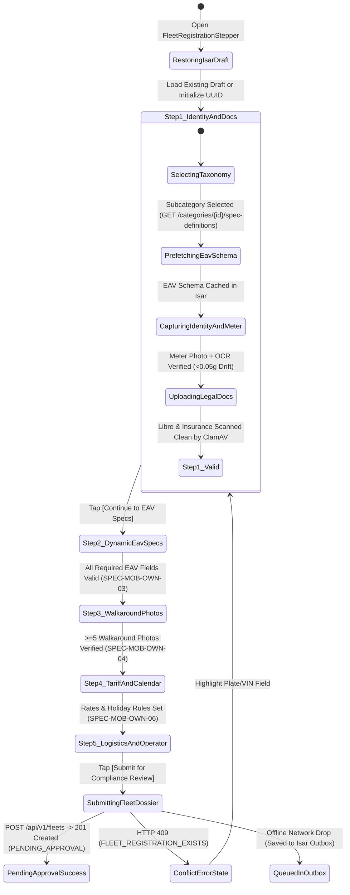
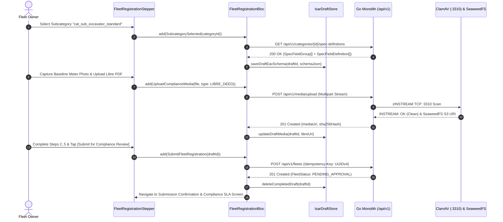

# Unified Machinery & Logistics Asset Registration Stepper Wizard
## Mobile Subsystem Specification — `docs/mobile/owner-experience/02-fleet-registration-stepper.md`

**Document Identifier:** `SPEC-MOB-OWN-02`  
**Classification:** Canonical Subsystem UI/UX & Technical Behavior Specification  
**Governing Documents:** `Dink_Machinery_UI_UX_Design_Brief.md`, `SRS-DINK-CORE-V7.0` (§5.2.1–§5.2.3, §5.13), `docs/shared/design/design-tokens.json`, `docs/ERROR_CATALOG.md`, `contracts/openapi.yaml`  
**Target Subsystem:** Flutter 3.47.9 / Dart 3.9 Mobile Client (iOS & Android)  
**Primary Persona / Actor:** Equipment Fleet Owner & Depot Yard Manager (*W/ro Almaz Tesfaye* / *Kamau Ndegwa*)  
**Associated Requirements:** `REQ-05-02` (`FL-01` to `FL-12`), `REQ-05-13` (Insurance & Document Management `Libre`)  
**Associated Interaction Flows:** `FLOW-03` (Fleet Registration & Compliance Approval), `FLOW-19` (Insurance & Document Verification)  
**Associated ADRs:** `ADR-001` (Modular Monolith), `ADR-005` (ClamAV Streaming Media Pipeline), `ADR-008` (Multi-Country Parameterization), `ADR-010` (Isar Offline Draft Persistence)  
**Status:** Approved Technical Design Baseline

---

## 1. Domain Context, Business Rules & Architectural Invariants

The **Unified Machinery & Logistics Asset Registration Stepper** (`SPEC-MOB-OWN-02`) orchestrates the onboarding of both heavy construction plant machinery (excavators, graders, dozers, cranes, rollers) and heavy haulage logistics trailers (lowboys, step-decks, flatbeds) into the Dink Machinery catalog. Because yard managers frequently register machines while walking through dusty depot yards with intermittent connectivity, every step auto-persists into a local Isar NoSQL draft (`FleetStatus.DRAFT`) upon field blur.

### 1.1 Core Business Rules & Operational Invariants
1. **3-Level Taxonomy & Subcategory Schema Binding (`FL-01`, `FL-07`):**
   - **Level 1 (Domain Root):** `MACHINERY` (Heavy Plant Equipment) vs. `LOGISTICS` (Heavy Transport Carriers) vs. `ATTACHMENTS` (Redirects to `SPEC-MOB-OWN-05`).
   - **Level 2 (Primary Category):** e.g., *Earthmoving*, *Lifting & Material Handling*, *Road & Compaction*, *Heavy Lowboy Trailers*.
   - **Level 3 (Equipment Subcategory):** e.g., *Crawler Excavator (20T–35T)*, *Mini Excavator (<8T)*, *Motor Grader*, *Tri-Axle Lowboy (40T–60T)*.
   - Selecting Level 3 immediately triggers `GET /api/v1/categories/{id}/spec-definitions` to pre-cache the dynamic EAV schema required in Step 2 (`SPEC-MOB-OWN-03`).
2. **Core Asset Identity & Jurisdictional Plate/VIN Uniqueness (`FL-02`, `FL-03`, `FL-06`):**
   - **Make & Model (`FL-02`):** Normalized manufacturer picker (Caterpillar, Komatsu, XCMG, SANY, Liebherr, JCB, Sinotruk, Mercedes-Benz) + model string ($1\dots64\text{ chars}$) + Manufacture Year ($1980 \le \text{Year} \le \text{CurrentYear} + 1$).
   - **Registration Plate & Chassis Serial PIN (`FL-03`):** National registration plate (e.g., `ET-3-99120` or `KBA 412M`) and stamped 17-character ISO 3779 VIN / Manufacturer Serial PIN. Uniqueness is enforced globally across active fleets (`FLEET_REGISTRATION_EXISTS` HTTP 409).
   - **Primary Fuel / Energy Type (`FL-06`):** Standardized enum (`DIESEL`, `ELECTRIC`, `HYBRID`, `PETROL`, `BIODIESEL`).
3. **Baseline Mechanical Hour Meter Anchoring (`FL-04`):**
   - The owner enters the current cabin mechanical hour meter reading as a non-negative fixed-point decimal (`NUMERIC(10,2)`, e.g., `1450.50 hrs`) and captures a live, accelerometer-stabilized ($<0.05g$ drift) close-up photo of the cabin gauge.
   - On-device Google ML Kit OCR extracts digits from the gauge photo to pre-populate and cross-verify the manual entry.
   - **Monotonic Floor Invariant:** Once approved, `baseline_meter_hours` establishes the immutable lower bound for all future handover check-ins (`AR-01`): $\text{Baseline} \le \text{Check-In} \le \text{Check-Out}$.
4. **Statutory Ownership Title Deed (`Libre`) & CPAR Insurance Vault (`REQ-05-13`):**
   - Onboarding requires uploading high-resolution scans/photos of:
     1. **Vehicle/Machinery Ownership Booklet (`Libre` / Logbook):** Issuing authority, booklet serial number, and owner name matching KYC profile.
     2. **Comprehensive Contractors' Plant & Machinery (CPM / CPAR) or Goods-in-Transit Insurance Policy:** Insurer name, policy number, and expiry date ($>\text{CURRENT\_DATE} + 30\text{ days}$).
   - All document uploads stream through the ClamAV antivirus socket (`:3310`) before SeaweedFS S3 archival.
5. **PostGIS Depot Yard Geolocation:**
   - Captures GPS coordinates (`ST_SetSRID(ST_Point(lng, lat), 4326)`) of the machine's home depot yard via interactive map pin or device GPS fix (`GEO_INVALID_COORDINATES` check).

---

## 2. Screen Anatomy, Layout & Bespoke ASCII Wireframe

### 2.1 Step 1 of 5: Taxonomy, Identity, Libre/Insurance & Baseline Hour Meter
```text
+-----------------------------------------------------------------------+
| [← Exit & Save Draft]   REGISTER NEW FLEET ASSET       [Draft Saved ✓]|
+-----------------------------------------------------------------------+
| STEP 1 OF 5: IDENTITY, BASELINE METER & LEGAL DOCUMENTS               |
| [● 1. Identity]──[○ 2. EAV Specs]──[○ 3. 360° Photos]──[○ 4. Tariff]  |
+-----------------------------------------------------------------------+
| 1. ASSET TAXONOMY (3-LEVEL HIERARCHY - FL-01)                         |
| +-------------------------------------------------------------------+ |
| | Domain Root:   [🚜 HEAVY MACHINERY (Selected)] [🚛 LOGISTICS]     | |
| | Category:      [ Earthmoving & Excavation                      ▼ ] | |
| | Subcategory:   [ Standard Crawler Excavator (20T - 35T)        ▼ ] | |
| | ℹ️ Loaded 14 EAV Spec Fields (4 Logistics-Critical) for Step 2.    | |
| +-------------------------------------------------------------------+ |
|                                                                       |
| 2. MAKE, MODEL, YEAR & SERIAL IDENTIFICATION (FL-02, FL-03, FL-06)    |
| +-------------------------------------------------------------------+ |
| | Make *:        [ Caterpillar (CAT)   ▼ ]  Model *: [ 320D GC     ] | |
| | Mfg Year *:    [ 2022 ▼ ]                 Fuel *:  [ DIESEL    ▼ ] | |
| | License Plate *:[ ET-3-99120           ]  (Format: ET-Code-Number) | |
| | Chassis / PIN *:[ CAT0320DPJef09412              ] [📷 Scan Plate] | |
| +-------------------------------------------------------------------+ |
|                                                                       |
| 3. BASELINE MECHANICAL HOUR METER ANCHOR (FL-04)                      |
| +-------------------------------------------------------------------+ |
| | Current Cabin Meter Reading (Hours) *:                             | |
| | [ 1450.50                        ] hrs   (OCR Confidence: 98.4% ✓) | |
| | +---------------------------------------------------------------+ | |
| | | [🖼️ meter_anchor_01.webp]  Accelerometer Drift: 0.02g (Locked)| | |
| | | Verified Close-Up Photo     [ 📷 RETAKE METER GAUGE PHOTO ]   | | |
| | +---------------------------------------------------------------+ | |
| | ⚠️ Invariant: Future check-in readings cannot fall below 1,450.5h. | |
| +-------------------------------------------------------------------+ |
|                                                                       |
| 4. LEGAL OWNERSHIP (LIBRE) & CPAR INSURANCE VAULT (REQ-05-13)         |
| +-------------------------------------------------------------------+ |
| | 📜 Title Deed / Libre Booklet *: [✓ libre_et399120.pdf • ClamAV OK]| |
| |    Libre Serial No *: [ AA-MUDCO-2022-88412                      ] | |
| | 🛡️ CPM / Plant Insurance Policy *: [✓ nyala_cpar_2026.pdf • OK]    | |
| |    Insurer: [ Nyala Insurance S.C. ▼ ]  Expiry *: [ 2027-06-30 📅] | |
| +-------------------------------------------------------------------+ |
|                                                                       |
| 5. HOME DEPOT YARD LOCATION (PostGIS EPSG:4326)                       |
| +-------------------------------------------------------------------+ |
| | 📍 Kality Industrial Ring Rd, Addis Ababa (8.8954° N, 38.7612° E) | |
| | [ 🎯 USE CURRENT GPS ]                    [ 🗺️ ADJUST PIN ON MAP ]| |
| +-------------------------------------------------------------------+ |
+-----------------------------------------------------------------------+
| [ 💾 SAVE DRAFT ]                  [ CONTINUE TO EAV SPECS (STEP 2) →]|
+-----------------------------------------------------------------------+
```

---

## 3. W3C DTCG Design Token Mapping Table

| UI Component / Element | W3C Token Path (`design-tokens.json`) | Resolved Value (Light / Dark / Outdoor) | Behavioral & Accessibility Invariant |
|---|---|---|---|
| **Stepper Progress Indicator** | `color.brand.amber.500` / `color.brand.slate.300` | Active `#F59E0B`, Completed `#10B981`, Pending `#CBD5E1` | Interactive step pills with `48dp` minimum height (`dimension.space.48`). |
| **Form Section Cards** | `semantic.{mode}.surface.card` + `stroke.border.thin` | `#FFFFFF` / `#1E293B` / `#000000` + `1dp` border (`2dp` Outdoor) | Visual grouping of Taxonomy, Identity, Baseline Meter, and Legal Vault. |
| **Input Field Container** | `dimension.space.56` + `semantic.{mode}.border.default` / `focus` | Height `56dp`, Focus border `#D97706` (`3dp` `stroke.border.heavy`) | Prevents fat-finger input errors when wearing work gloves. |
| **Meter Reading & VIN Input** | `typography.fontFamily.mono` + `typography.fontSize.18` | `Space Mono`, `18sp` | Eliminates `0`/`O` and `1`/`I` ambiguity in chassis VINs and hour meters. |
| **ClamAV Verified Document Pill** | `color.feedback.emerald.50` + `color.feedback.emerald.700` | Bg `#ECFDF5`, Text `#047857`, Border `#10B981` | Displayed only after backend ClamAV (`:3310`) scan returns `CLEAN`. |
| **Sticky Bottom CTA Bar** | `component.actuator.button.heightField` + `semantic.{mode}.action.primary.bg` | `64dp` height, `#F59E0B` fill, `#020617` bold text | Remains pinned above soft keyboard or at screen bottom with tactile lip. |

---

## 4. Interactive State Machine & Sequence Flows

### 4.1 Multi-Step Registration Wizard State Machine


### 4.2 Document Upload, Meter Anchoring & Final Fleet Submission Sequence


---

## 5. Concrete Flutter Implementation Blueprint

### 5.1 BLoC Events & Immutable Freezed States
```dart
// lib/features/fleet_registration/presentation/bloc/fleet_registration_bloc.dart
import 'package:freezed_annotation/freezed_annotation.dart';
import 'package:flutter_bloc/flutter_bloc.dart';

part 'fleet_registration_bloc.freezed.dart';

@freezed
sealed class FleetRegistrationEvent with _$FleetRegistrationEvent {
  const factory FleetRegistrationEvent.initialized({String? existingDraftId}) = _Initialized;
  const factory FleetRegistrationEvent.taxonomyChanged({
    required String domainRoot, // 'MACHINERY' | 'LOGISTICS'
    required String categoryId,
    required String subcategoryId,
  }) = _TaxonomyChanged;
  const factory FleetRegistrationEvent.identityUpdated({
    required String make,
    required String model,
    required int manufactureYear,
    required String fuelType,
    required String licensePlate,
    required String chassisPinSerial,
  }) = _IdentityUpdated;
  const factory FleetRegistrationEvent.baselineMeterCaptured({
    required String meterHoursDecimal, // e.g., "1450.50"
    required String localPhotoPath,
    required double accelerometerDriftG,
  }) = _BaselineMeterCaptured;
  const factory FleetRegistrationEvent.legalDocumentUploaded({
    required String docType, // 'LIBRE_DEED' | 'CPAR_INSURANCE'
    required String filePath,
    required String referenceNumber,
    DateTime? expiryDate,
  }) = _LegalDocumentUploaded;
  const factory FleetRegistrationEvent.depotLocationPinned({
    required double latitude,
    required double longitude,
    required String addressLabel,
  }) = _DepotLocationPinned;
  const factory FleetRegistrationEvent.stepSubmitted() = _StepSubmitted;
  const factory FleetRegistrationEvent.finalDossierSubmitted() = _FinalDossierSubmitted;
}

@freezed
sealed class FleetRegistrationState with _$FleetRegistrationState {
  const factory FleetRegistrationState.editing({
    required String draftUuid,
    required int currentStepIndex, // 0..4
    required String domainRoot,
    String? categoryId,
    String? subcategoryId,
    @Default('') String make,
    @Default('') String model,
    int? manufactureYear,
    @Default('DIESEL') String fuelType,
    @Default('') String licensePlate,
    @Default('') String chassisPinSerial,
    @Default('') String baselineMeterHours,
    String? baselineMeterPhotoUri,
    String? libreDocumentUri,
    @Default('') String libreSerialNumber,
    String? insurancePolicyUri,
    DateTime? insuranceExpiryDate,
    double? depotLatitude,
    double? depotLongitude,
    @Default(false) bool isUploadingMedia,
    @Default(false) bool isSubmittingDossier,
    @Default({}) Map<String, String> fieldValidationErrors,
    ProblemDetails? submissionError,
  }) = _Editing;

  const factory FleetRegistrationState.submitted({
    required String fleetId,
    required String status, // 'PENDING_APPROVAL'
  }) = _Submitted;
}
```

### 5.2 Isar Local Persistence Draft Model
```dart
// lib/features/fleet_registration/data/local/isar_fleet_registration_draft.dart
import 'package:isar/isar.dart';

part 'isar_fleet_registration_draft.g.dart';

@collection
class IsarFleetRegistrationDraft {
  Id id = Isar.autoIncrement;

  @Index(unique: true, replace: true)
  late String draftUuid;

  late int currentStepIndex;
  late String domainRoot;
  String? categoryId;
  String? subcategoryId;
  late String make;
  late String model;
  int? manufactureYear;
  late String fuelType;
  late String licensePlate;
  late String chassisPinSerial;
  late String baselineMeterHours;
  String? baselineMeterPhotoUri;
  String? libreDocumentUri;
  late String libreSerialNumber;
  String? insurancePolicyUri;
  DateTime? insuranceExpiryDate;
  double? depotLatitude;
  double? depotLongitude;

  late String cachedEavSchemaJson;
  late String eavValuesJson;
  late List<String> walkaroundPhotoUris;
  late String tariffConfigJson;
  late String idempotencyKey;
  late DateTime updatedAt;
}
```

### 5.3 Widget Tree Hierarchy
```text
FleetRegistrationStepperScreen (Scaffold)
 ├── StepperAppBar (Draft Status Pill, Exit & Save Action)
 ├── IndustrialStepProgressHeader (5 Interactive Step Nodes)
 └── PageView (Physics: NeverScrollableScrollPhysics - Controlled by BLoC Validation)
      ├── Step1IdentityAndLegalView (Taxonomy Picker, Identity Inputs, Meter Reticle Launcher, Libre/CPAR Uploaders, PostGIS Depot Picker)
      ├── Step2DynamicEavSpecFormView (SPEC-MOB-OWN-03)
      ├── Step3Machinery360PhotoUploaderView (SPEC-MOB-OWN-04)
      ├── Step4AvailabilityAndPricingView (SPEC-MOB-OWN-06)
      └── Step5LogisticsAndOperatorCouplingView (Self-Move Toggle, Trailer Heuristic Preview, Linked Operator Roster)
```

---

## 6. OpenAPI 3.1.0 Routes & RFC 9457 Error Matrix

### 6.1 Bound API Endpoints
| Operation | HTTP Method & URI | Headers Required | Purpose & Contract Binding |
|---|---|---|---|
| **List Categories** | `GET /api/v1/categories` | `X-Country-Code: ET\|KE` | Loads 3-level hierarchy (`CategoryListSuccessResponse`) for `MACHINERY` and `LOGISTICS`. |
| **Fetch EAV Schema** | `GET /api/v1/categories/{id}/spec-definitions` | `X-Country-Code: ET\|KE` | Pre-loads `SpecFieldGroup` and `SpecFieldDefinition` metadata for the chosen subcategory. |
| **Register Fleet Asset** | `POST /api/v1/fleets` | `Authorization: Bearer <JWT>`, `Idempotency-Key: <UUIDv4>`, `X-Country-Code: ET\|KE` | Submits `CreateFleetRequest` and transitions asset to `PENDING_APPROVAL` (`201 Created`). |

### 6.2 RFC 9457 Problem Details Error Matrix
| Error Code (`error.code`) | HTTP Status | Type URI | Trigger Condition | Mobile UI Recovery Behavior |
|---|---|---|---|---|
| `FLEET_REGISTRATION_EXISTS` | `409` | `/errors/fleet-registration-exists` | Supplied `licensePlate` or `chassisPinSerial` is already registered to an active fleet. | Jump to Step 1, highlight the conflicting field in `color.feedback.crimson.500`, and offer "Claim Ownership Dispute" link if stolen/misregistered. |
| `CAT_NOT_FOUND` | `404` | `/errors/category-not-found` | Selected `subcategoryId` was deprecated by admin. | Refresh `/api/v1/categories` cache and prompt owner to re-select subcategory. |
| `INSPECT_MEDIA_SCAN_FAILED` | `422` | `/errors/inspect-media-scan-failed` | Uploaded `Libre` PDF, insurance policy, or meter photo failed ClamAV scan (`:3310`). | Purge infected local file reference, display security alert toast, and prompt clean re-capture. |
| `GEO_INVALID_COORDINATES` | `400` | `/errors/geo-invalid-coordinates` | Depot coordinates fall outside valid WGS 84 bounds or enabled jurisdiction. | Open interactive depot map modal centered on Addis Ababa (`9.03°N, 38.74°E`) or Nairobi (`-1.29°S, 36.82°E`). |
| `REQ_VALIDATION_FAILED` | `400` | `/errors/request-validation-failed` | Manufacture year out of range ($<1980$) or insurance expiry $\le 30\text{ days}$. | Map `error.invalidParams` directly to form field error labels and scroll to first invalid input. |

---

## 7. Verification & Acceptance Criteria

- [ ] **Draft Persistence Across App Kills:** Filling Step 1 fields, force-closing the Flutter app, and reopening restores all inputs, uploaded `Libre` S3 URIs, and pre-fetched EAV schemas from `IsarFleetRegistrationDraft` in $<150\text{ ms}$.
- [ ] **Accelerometer-Locked Baseline Meter Capture (`FL-04`):** The baseline hour meter photo shutter button remains disabled until device accelerometer variance settles at $<0.05g$, and OCR pre-fills the `NUMERIC(10,2)` field.
- [ ] **Duplicate Plate/VIN Interception (`FLEET_REGISTRATION_EXISTS`):** Submitting a duplicate chassis PIN returns HTTP 409 RFC 9457 Problem Details and highlights the exact field without losing Steps 2–5 data.
- [ ] **Idempotent Submission:** Tapping `[Submit for Compliance Review]` across flaky 3G connections reuses the draft's `Idempotency-Key` UUIDv4, preventing duplicate `fleets` rows.
