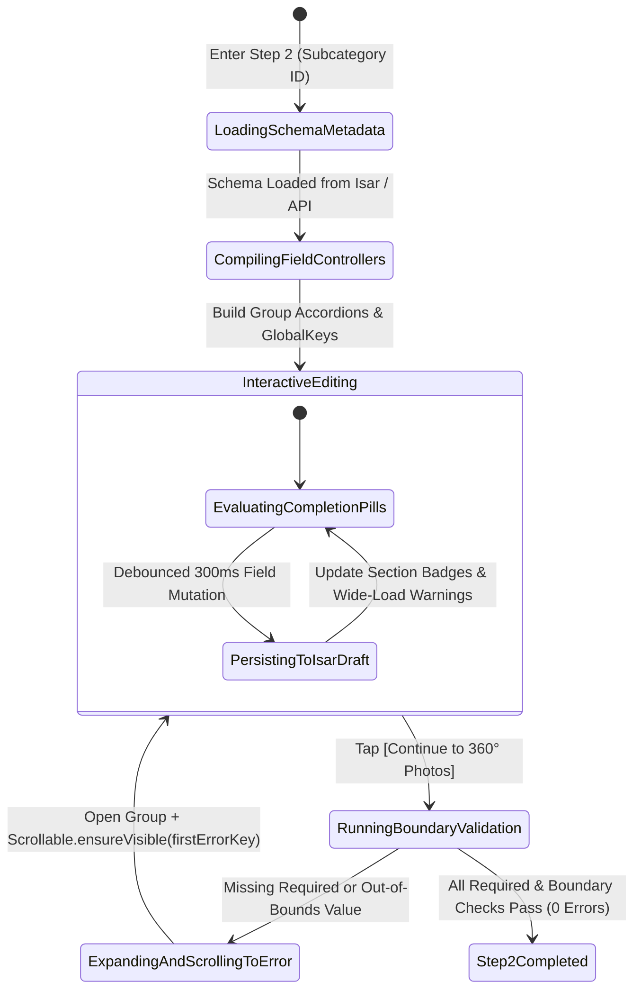
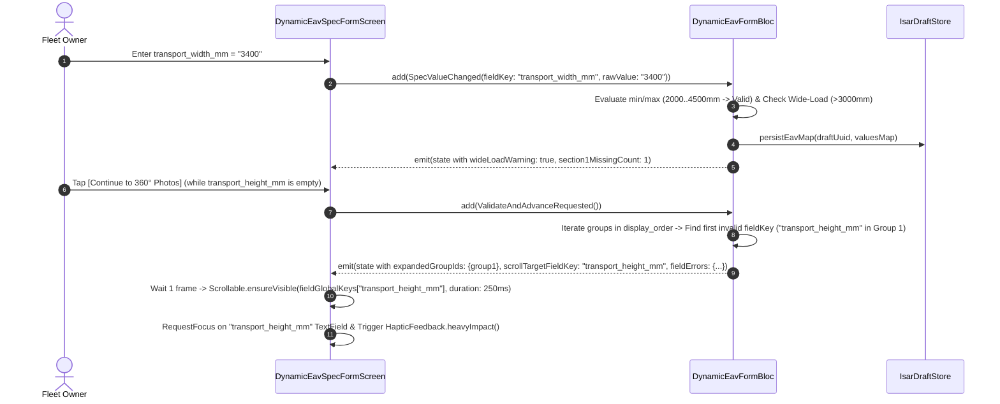

# Server-Driven Dynamic EAV Technical Specification Form Engine
## Mobile Subsystem Specification — `docs/mobile/owner-experience/03-dynamic-eav-spec-form.md`

**Document Identifier:** `SPEC-MOB-OWN-03`  
**Classification:** Canonical Subsystem UI/UX & Technical Behavior Specification  
**Governing Documents:** `Dink_Machinery_UI_UX_Design_Brief.md`, `SRS-DINK-CORE-V7.0` (§5.2.3, §10, §11), `docs/shared/design/design-tokens.json`, `docs/ERROR_CATALOG.md`, `contracts/openapi.yaml`  
**Target Subsystem:** Flutter 3.47.8 / Dart 3.9 Mobile Client (iOS & Android)  
**Primary Persona / Actor:** Equipment Fleet Owner & Depot Yard Manager (*W/ro Almaz Tesfaye* / *Kamau Ndegwa*)  
**Associated Requirements:** `REQ-05-02` (`FL-07` to `FL-15`, `FL-13`..`FL-22` dynamic spec & tariff metadata)  
**Associated Interaction Flows:** `FLOW-03` (Dynamic EAV Specification Rendering & Validation), `FLOW-11` (Logistics Dimensional Matching)  
**Associated ADRs:** `ADR-001` (Modular Monolith), `ADR-008` (Multi-Country & Multi-Script Localization), `ADR-010` (Offline-First Isar Schema Caching)  
**Status:** Approved Technical Design Baseline

---

## 1. Domain Context, Business Rules & Architectural Invariants

Heavy construction machinery and specialized transport trailers encompass dozens of disparate engineering classes—from 1.8-tonne mini-excavators and 350-hp motor graders to 80-tonne telescopic mobile cranes and 4-axle hydraulic gooseneck lowboys. Hardcoding Dart form widgets per machinery class would require mobile app store releases whenever a new equipment category or engineering parameter is introduced.

The **Dynamic Entity-Attribute-Value (EAV) Technical Specification Form Engine** (`SPEC-MOB-OWN-03`) compiles native Flutter form sections at runtime from server-driven metadata (`SpecFieldGroup` and `SpecFieldDefinition`) fetched via `GET /api/v1/categories/{id}/spec-definitions`.

### 1.1 Core Business Rules & Operational Invariants
1. **Collapsible `SpecFieldGroup` Accordions with Live Completion Pills (`FL-07`, `FL-08`):**
   - Specifications are organized into ordered, collapsible accordion cards (`SpecFieldGroup.display_order`), such as *1. Weights & Transport Dimensions*, *2. Engine & Drive*, *3. Hydraulic System*, and *4. Working Ranges & Breakout Force*.
   - Each accordion header renders a live completion status pill:
     - **Incomplete Required Fields:** High-visibility amber/crimson pill `[⚠️ 3 Required Missing]` (`color.brand.amber.100` / `color.feedback.crimson.100`).
     - **All Required Fields Valid:** Emerald completion pill `[✓ 4/4 Complete]` (`color.feedback.emerald.100`).
2. **Typed Widget Compilation & Unit Suffix Locking (`FL-09` to `FL-12`):**
   - Each `SpecFieldDefinition` maps deterministically to an ergonomic industrial input widget:
     - `DECIMAL` / `INTEGER`: Numeric keyboard with fixed monospaced unit suffix badge (`unit_symbol`: `kg`, `mm`, `hp`, `kW`, `bar`, `L/min`, `kN`, `m³`) and explicit `[min_value .. max_value]` boundary hint.
     - `ENUM`: Modal searchable bottom-sheet selector or high-touch segmented chip group populated from `enum_values_json` (e.g., `["Steel Triple Grouser", "Rubber Track", "Pneumatic Tire"]`).
     - `BOOLEAN`: `56dp`-tall industrial toggle switch card (`Yes` / `No`).
     - `STRING`: Single-line text field with regex/length bounds.
   - Multi-script labels (`label_en`, `label_am`) render automatically based on the active app locale, using `Noto Sans Ethiopic` (`1.38x` line height) when Amharic is active.
3. **Logistics-Critical Dual-Persistence Badge (`FL-14`, `FleetSpecIndexed`):**
   - Fields flagged with `is_logistics_critical = true` (`operating_weight_kg`, `transport_length_mm`, `transport_width_mm`, `transport_height_mm`, `payload_capacity_kg`) display a `[🚛 Logistics-Critical]` badge.
   - The UI explains that these exact dimensions drive automated lowboy trailer matching (`FL-29`: $\text{Payload} \ge \text{Weight} \times 1.10$) and Federal Transport Authority abnormal-load bridge clearance checks ($4,500\text{ mm}$ height / $3,000\text{ mm}$ width).
4. **Deterministic Auto-Scroll to First Validation Error (`FL-09`, `FL-10`):**
   - When the owner taps `[Save & Continue to 360° Photos]`, if any `is_required == true` field is empty or any numeric value violates `[min_value, max_value]`, the BLoC automatically expands the collapsed `SpecFieldGroup` containing the first offending field and animates a `Scrollable.ensureVisible` scroll directly to that `GlobalKey` within `250ms` (`motion.duration.normal`).

---

## 2. Screen Anatomy, Layout & Bespoke ASCII Wireframe

### 2.1 Step 2 of 5: Dynamic EAV Accordion Engine (Crawler Excavator Example)
```text
+-----------------------------------------------------------------------+
| [← Back to Step 1]    TECHNICAL SPECIFICATIONS (EAV)   [Draft Saved ✓]|
| Subcategory: Standard Crawler Excavator (20T - 35T)                   |
+-----------------------------------------------------------------------+
| STEP 2 OF 5: DYNAMIC ENGINEERING SPECIFICATIONS                       |
| [✓ 1. Identity]──[● 2. EAV Specs]──[○ 3. 360° Photos]──[○ 4. Tariff]  |
+-----------------------------------------------------------------------+
| Overall Progress: 9 of 12 Required Fields Completed   [75% ████████░░]|
+-----------------------------------------------------------------------+
| ▼ SECTION 1: WEIGHTS & TRANSPORT DIMENSIONS    [⚠️ 2 Required Missing]|
| +-------------------------------------------------------------------+ |
| | Operating Weight *                [🚛 Logistics-Critical (FL-14)] | |
| | +---------------------------------------------------+-----------+ | |
| | | 21500                                             |    kg     | | |
| | +---------------------------------------------------+-----------+ | |
| | Valid Bounds: 18,000 kg – 38,000 kg  (Used for Lowboy Tonnage)    | |
| |                                                                   | |
| | Overall Transport Length *        [🚛 Logistics-Critical (FL-14)] | |
| | +---------------------------------------------------+-----------+ | |
| | | 9530                                              |    mm     | | |
| | +---------------------------------------------------+-----------+ | |
| | Valid Bounds: 6,000 mm – 14,000 mm                                | |
| |                                                                   | |
| | Overall Transport Width *         [🚛 Logistics-Critical (FL-14)] | |
| | +---------------------------------------------------+-----------+ | |
| | | 3400                                              |    mm     | | |
| | +---------------------------------------------------+-----------+ | |
| | ⚠️ >3,000 mm: Flags Abnormal Wide-Load Escort Requirement (FL-29) | |
| |                                                                   | |
| | Overall Transport Height (Top of Boom) *  [🚛 Logistics-Critical] | |
| | +---------------------------------------------------+-----------+ | |
| | | [ EMPTY - REQUIRED ]                              |    mm     | | |
| | +---------------------------------------------------+-----------+ | |
| | ❌ Error: Transport Height is required (Range: 2,500 – 4,500 mm). | |
| +-------------------------------------------------------------------+ |
|                                                                       |
| ▶ SECTION 2: ENGINE & POWERTRAIN                    [✓ 4/4 Complete]  |
|   (Gross Power: 158 hp • Engine Model: Cat C7.1 • Displacement: 7.0L) |
|                                                                       |
| ▼ SECTION 3: HYDRAULICS & WORKING RANGES       [⚠️ 1 Required Missing]|
| +-------------------------------------------------------------------+ |
| | Undercarriage Shoe Type * (ENUM)                                  | |
| | [● Steel Triple Grouser ] [○ Rubber Pad ] [○ Swamp Wide Track ]   | |
| |                                                                   | |
| | Auxiliary Hydraulic Breaker Circuit Installed? * (BOOLEAN)        | |
| | [ 🔨 High-Pressure Auxiliary Circuit (180–220 bar) ]   [ ON  🟢 ] | |
| |                                                                   | |
| | Max Digging Depth *                                               | |
| | +---------------------------------------------------+-----------+ | |
| | | 72000                                             |    mm     | | |
| | +---------------------------------------------------+-----------+ | |
| | ❌ Error: Value 72,000 mm exceeds max bound (12,000 mm).          | |
| +-------------------------------------------------------------------+ |
+-----------------------------------------------------------------------+
| [ 💾 SAVE DRAFT ]                 [ CONTINUE TO 360° PHOTOS (STEP 3) →]|
+-----------------------------------------------------------------------+
```

---

## 3. W3C DTCG Design Token Mapping Table

| UI Component / Element | W3C Token Path (`design-tokens.json`) | Resolved Value (Light / Dark / Outdoor) | Behavioral & Accessibility Invariant |
|---|---|---|---|
| **Accordion Header Card** | `semantic.{mode}.surface.cardElevated` + `dimension.space.56` | `#FFFFFF` / `#334155` / `#000000`, Height `56dp` | Full-width tap target; expands/collapses over `250ms` (`motion.duration.normal`). |
| **"N Required Missing" Pill** | `color.feedback.crimson.100` + `color.feedback.crimson.700` | Bg `#FEE2E2`, Text `#B91C1C`, Radius `stroke.radius.pill` (`999dp`) | Dynamically updates on every keystroke as required fields become valid. |
| **"Complete" Section Pill** | `color.feedback.emerald.100` + `color.feedback.emerald.700` | Bg `#D1FAE5`, Text `#047857`, Radius `999dp` | Confirms section readiness without requiring user to expand the accordion. |
| **Unit Symbol Suffix Box** | `color.brand.slate.100` / `color.brand.slate.700` + `typography.fontFamily.mono` | `Space Mono` `14sp`, Border-left `1dp` `#E2E8F0` | Non-editable suffix (`kg`, `mm`, `hp`, `bar`) prevents unit confusion (e.g., meters vs. mm). |
| **Logistics-Critical Badge** | `color.feedback.blue.100` + `color.feedback.blue.900` | Bg `#DBEAFE`, Text `#1E3A8A`, `12sp` | Identifies fields synced to `FleetSpecIndexed` (`FL-14`). |
| **Field Error Outline & Text** | `color.feedback.crimson.500` + `stroke.border.heavy` | `#EF4444` (`3dp` outline), `12sp` error caption | Accompanied by `❌` icon and auto-scroll focus on validation failure. |

---

## 4. Interactive State Machine & Sequence Flows

### 4.1 Dynamic EAV Form Compilation & Validation State Machine


### 4.2 Auto-Scroll to First Validation Error & Wide-Load Inference Sequence


---

## 5. Concrete Flutter Implementation Blueprint

### 5.1 BLoC Events & Immutable Freezed States
```dart
// lib/features/fleet_registration/presentation/bloc/dynamic_eav_form_bloc.dart
import 'package:freezed_annotation/freezed_annotation.dart';
import 'package:flutter_bloc/flutter_bloc.dart';

part 'dynamic_eav_form_bloc.freezed.dart';

@freezed
sealed class DynamicEavFormEvent with _$DynamicEavFormEvent {
  const factory DynamicEavFormEvent.schemaLoaded({
    required String draftUuid,
    required String subcategoryId,
  }) = _SchemaLoaded;
  const factory DynamicEavFormEvent.groupToggled(String groupId) = _GroupToggled;
  const factory DynamicEavFormEvent.fieldValueChanged({
    required String fieldKey,
    required Object? value, // String, num, or bool
  }) = _FieldValueChanged;
  const factory DynamicEavFormEvent.validateAndProceedRequested() = _ValidateAndProceedRequested;
}

@freezed
class SpecFieldDefinitionDto with _$SpecFieldDefinitionDto {
  const factory SpecFieldDefinitionDto({
    required String id,
    required String groupId,
    required String fieldKey,
    required String labelEn,
    required String labelAm,
    required String fieldType, // 'STRING' | 'DECIMAL' | 'INTEGER' | 'ENUM' | 'BOOLEAN'
    String? unitSymbol,
    required bool isRequired,
    required bool isLogisticsCritical,
    required bool isComparable,
    double? minValue,
    double? maxValue,
    @Default([]) List<String> enumOptions,
    required int displayOrder,
  }) = _SpecFieldDefinitionDto;
}

@freezed
class SpecFieldGroupDto with _$SpecFieldGroupDto {
  const factory SpecFieldGroupDto({
    required String id,
    required String sectionNameEn,
    required String sectionNameAm,
    required int displayOrder,
    required List<SpecFieldDefinitionDto> fields,
  }) = _SpecFieldGroupDto;
}

@freezed
sealed class DynamicEavFormState with _$DynamicEavFormState {
  const factory DynamicEavFormState.loading() = _Loading;
  const factory DynamicEavFormState.ready({
    required String draftUuid,
    required List<SpecFieldGroupDto> groups,
    required Set<String> expandedGroupIds,
    required Map<String, Object?> currentValues, // fieldKey -> typed value
    required Map<String, int> missingRequiredCountByGroup,
    required Map<String, String> validationErrorsByFieldKey,
    required bool requiresAbnormalLoadEscort, // true if transport_width_mm > 3000
    String? inferredTrailerClass, // e.g., 'TRI_AXLE_LOWBOY_40T' (FL-29)
    String? autoScrollTargetFieldKey,
    required int autoScrollTriggerNonce,
    @Default(false) bool isStepValidAndComplete,
  }) = _Ready;
}
```

### 5.2 Auto-Scroll & Dynamic Widget Factory Implementation
```dart
// lib/features/fleet_registration/presentation/widgets/eav_field_widget_factory.dart
// Maps each SpecFieldDefinitionDto to its strongly-typed input widget and binds a GlobalKey
// so the BlocListener can invoke:
// Scrollable.ensureVisible(
//   keyMap[state.autoScrollTargetFieldKey]!.currentContext!,
//   duration: const Duration(milliseconds: 250),
//   curve: Curves.easeOutCubic,
//   alignment: 0.25,
// );
```

### 5.3 Widget Tree Hierarchy
```text
DynamicEavSpecFormView
 ├── OverallRequiredProgressBanner (LinearProgressIndicator + "X of Y Required Completed")
 ├── LogisticsInferenceSummaryCallout (Shows inferred lowboy class & abnormal load warning if width > 3000mm)
 └── ListView.builder (Iterates ordered SpecFieldGroupDto items)
      └── EavSpecGroupAccordionCard (AnimatedCrossFade 250ms)
           ├── AccordionHeaderRow (Localized Section Title, Completion Pill: "2 Required Missing" or "✓ 4/4 Complete")
           └── Column (Rendered when groupId in expandedGroupIds)
                └── EavDynamicFieldTile (Keyed by GlobalKey<FormFieldState> per fieldKey)
                     ├── FieldLabelRow (Localized Label + Mandatory Asterisk + [🚛 Logistics-Critical] Badge)
                     ├── TypedInputControl (DecimalUnitTextField / EnumBottomSheetSelector /GloveBooleanSwitch)
                     └── FieldBoundaryOrErrorCaption (Min/Max bounds hint or RFC 9457 / Client Validation Error)
```

---

## 6. OpenAPI 3.1.0 Routes & RFC 9457 Error Matrix

### 6.1 Bound API Endpoints
| Operation | HTTP Method & URI | Headers Required | Purpose & Contract Binding |
|---|---|---|---|
| **Get Category EAV Schema** | `GET /api/v1/categories/{id}/spec-definitions` | `X-Country-Code: ET\|KE`, `Accept-Language: am\|en` | Returns hierarchical `SpecFieldGroup[]` and `SpecFieldDefinition[]` records for the selected machinery or logistics subcategory. |
| **Submit EAV Payload (Inside Fleet Create)** | `POST /api/v1/fleets` | `Authorization: Bearer <JWT>`, `Idempotency-Key: <UUIDv4>` | Persists `specValues` into `fleet_spec_values` and synchronously populates `fleet_spec_indexed` (`FL-14`). |

### 6.2 RFC 9457 Problem Details Error Matrix
| Error Code (`error.code`) | HTTP Status | Type URI | Trigger Condition | Mobile UI Recovery Behavior |
|---|---|---|---|---|
| `REQ_VALIDATION_FAILED` | `400` | `/errors/request-validation-failed` | Server-side EAV check detected missing required `field_key` or numeric value outside `[min_value, max_value]`. | Parse `error.invalidParams` (e.g., `name: "specs.transport_height_mm"`), expand corresponding accordion, and auto-scroll to field. |
| `CAT_NOT_FOUND` | `404` | `/errors/category-not-found` | Requested category ID no longer exists. | Prompt user to return to Step 1 and re-select active subcategory. |
| `SYS_SERVICE_UNAVAILABLE` | `503` | `/errors/service-unavailable` | Schema fetch failed while offline and subcategory was not previously cached. | Display retry button with offline status banner; preserve Step 1 draft in Isar. |

---

## 7. Verification & Acceptance Criteria

- [ ] **Zero-Deploy Category Extensibility (`FL-07`):** Injecting a new `SpecFieldDefinition` (e.g., `max_boom_reach_mm` of type `DECIMAL` with unit `mm` and bounds `4000..22000`) in mock API responses renders the input field, unit badge, and boundary validator in Flutter without code changes.
- [ ] **Section Completion Pill Accuracy (`FL-08`):** Entering valid values into all required fields of a `SpecFieldGroup` transitions the header pill from `[⚠️ N Required Missing]` to `[✓ M/M Complete]` in real time.
- [ ] **Deterministic Auto-Scroll (`FL-09`, `FL-10`):** Submitting with an invalid or missing field inside a collapsed accordion automatically expands that accordion and scrolls the viewport to center the offending field within `250ms`.
- [ ] **Logistics-Critical Heuristic Preview (`FL-14`, `FL-29`):** Entering `operating_weight_kg = 28500` immediately updates the live trailer heuristic callout to `Tri-Axle Heavy Lowboy (24T–40T Class)`, and entering `transport_width_mm = 3200` displays the abnormal wide-load escort banner.
