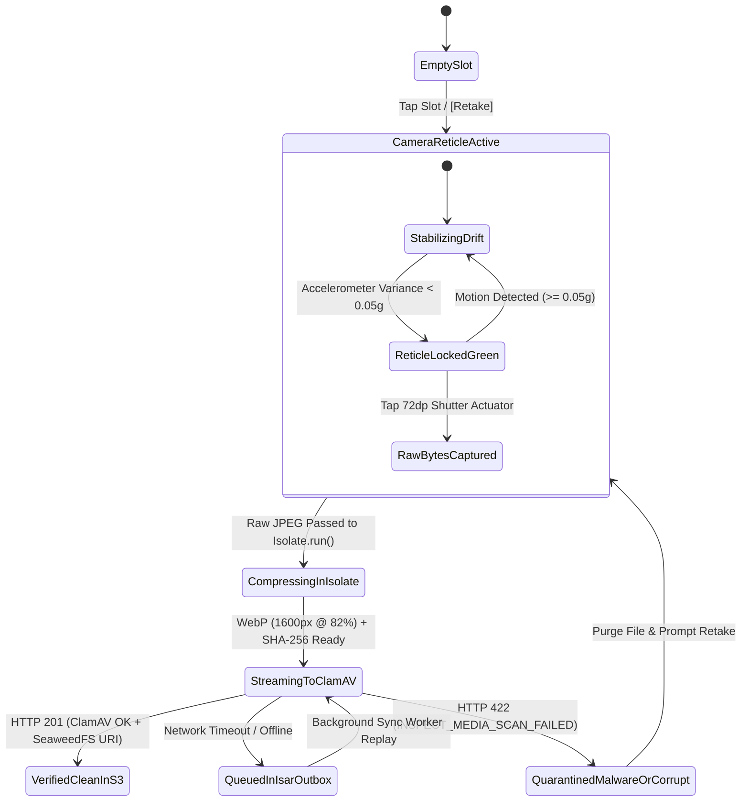
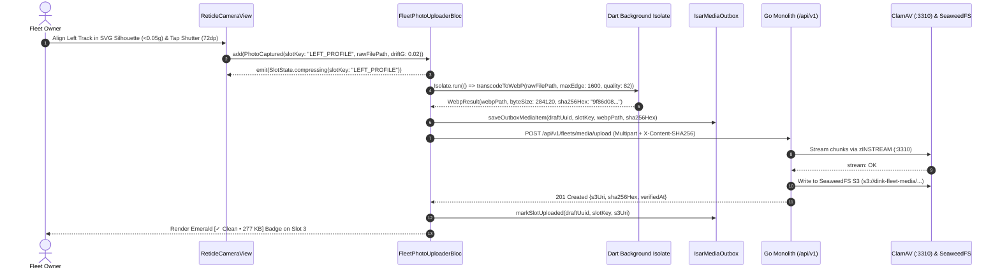

# Machinery 360° Walkaround Photo Uploader & Reticle Guidance
## Mobile Subsystem Specification — `docs/mobile/owner-experience/04-machinery-360-photo-uploader.md`

**Document Identifier:** `SPEC-MOB-OWN-04`  
**Classification:** Canonical Subsystem UI/UX & Technical Behavior Specification  
**Governing Documents:** `Dink_Machinery_UI_UX_Design_Brief.md`, `SRS-DINK-CORE-V7.0` (§5.2.2, `FL-04`, `FL-05`, `FL-23`..`FL-27`), `docs/shared/design/design-tokens.json`, `docs/ERROR_CATALOG.md`, `contracts/openapi.yaml`  
**Target Subsystem:** Flutter 3.47.9 / Dart 3.9 Mobile Client (iOS & Android)  
**Primary Persona / Actor:** Equipment Fleet Owner & Depot Yard Manager (*W/ro Almaz Tesfaye* / *Kamau Ndegwa*)  
**Associated Requirements:** `REQ-05-02` (`FL-04`, `FL-05`, `FL-23`..`FL-27`), `REQ-05-17` (Offline & Low-Connectivity Support)  
**Associated Interaction Flows:** `FLOW-03` (Fleet Registration Media Pipeline), `FLOW-10` (Baseline vs. Return Condition Comparison)  
**Associated ADRs:** `ADR-005` (ClamAV Streaming Antivirus & SeaweedFS S3 Storage), `ADR-010` (Background Isolate Compression & Offline Outbox)  
**Status:** Approved Technical Design Baseline

---

## 1. Domain Context, Business Rules & Architectural Invariants

High-capital machinery rentals ($100,000\text{ to }300,000\text{ USD}$ per unit) depend on indisputable visual baseline evidence to prevent fraudulent listings and post-rental damage disputes. The **Machinery 360° Walkaround Photo Uploader** (`SPEC-MOB-OWN-04`) enforces a structured **5-to-20 photo gallery** with guided SVG silhouette reticles, background Dart isolate WebP transcoding, and ClamAV-shielded multipart streaming uploads.

### 1.1 Core Business Rules & Operational Invariants
1. **Mandatory 5+1 Angle Walkaround Minimum & 20-Photo Ceiling (`FL-05`, `FL-23`..`FL-25`):**
   - A fleet listing cannot advance past Step 3 unless at least **5 mandatory exterior/interior walkaround angles** plus **1 dedicated cabin hour meter macro photo** (6 mandatory slots total) are captured and verified, with support for up to **20 total photos**:
     - **Slot 1 (`FRONT_ELEVATION`):** Full front view showing boom, blade, or front axle in resting ground contact.
     - **Slot 2 (`REAR_ELEVATION`):** Full rear view showing counterweight, radiator grille, and rear lights/plate.
     - **Slot 3 (`LEFT_PROFILE_UNDERCARRIAGE`):** Left side profile clearly showing track grouser shoes, sprockets, rollers, or left pneumatic tires.
     - **Slot 4 (`RIGHT_PROFILE_UNDERCARRIAGE`):** Right side profile showing right undercarriage/tires and hydraulic boom cylinders.
     - **Slot 5 (`CABIN_INTERIOR`):** Operator cabin interior showing seat, safety glass, joysticks, and instrument cluster.
     - **Slot 6 (`HOUR_METER_CLOSEUP`):** High-resolution close-up captured through the $320 \times 120\text{ dp}$ reticle (`component.reticle.viewfinder`) anchored in Step 1 (`FL-04`).
     - **Slots 7–20 (`ADDITIONAL_DETAIL`):** Optional close-ups of bucket teeth, quick-coupler pins, auxiliary hydraulic valves, or tire tread depth.
2. **Guided SVG Silhouette Reticle Overlay & Glare Control:**
   - Opening the in-app camera for Slots 1–5 renders an aspect-locked SVG wireframe silhouette matching the selected equipment category (e.g., Excavator, Wheel Loader, Motor Grader, Lowboy Trailer).
   - Device accelerometer sensors verify $<0.05g$ variance at shutter press (`component.reticle.viewfinder.colorLocked` `#10B981`), preventing motion-blurred baseline photos.
3. **Background Dart Isolate WebP Compression (`1600px` @ `82%` Quality):**
   - Raw 12MP–48MP camera captures ($6\text{ to }18\text{ MB}$ each) would choke East African 3G/EDGE links and freeze the Flutter UI thread.
   - Immediately upon capture, a background `Isolate.run` worker resizes the longest edge to `1600px` (preserving aspect ratio), strips non-essential EXIF tags while retaining capture timestamp and GPS hash, encodes the image to **WebP @ 82% quality** ($\approx 180\text{ to }320\text{ KB}$), and computes a `SHA-256` content digest.
4. **ClamAV Streaming Antivirus & SeaweedFS S3 Persistence (`ADR-005`):**
   - Compressed WebP streams upload via chunked multipart HTTP to the Go backend, which pipes bytes over TCP `:3310` (`zINSTREAM`) to ClamAV before committing to SeaweedFS S3 (`s3://dink-fleet-media/fleets/{id}/`). Infected or corrupted files return HTTP 422 (`INSPECT_MEDIA_SCAN_FAILED`).

---

## 2. Screen Anatomy, Layout & Bespoke ASCII Wireframe

### 2.1 Guided Silhouette Camera Reticle & 5-to-20 Slot Grid Wireframe
```text
+-----------------------------------------------------------------------+
| [✕ Close Camera]   SLOT 3/6: LEFT PROFILE & TRACKS    [⚡ Flash: Auto] |
+-----------------------------------------------------------------------+
| +-------------------------------------------------------------------+ |
| |                                                                   | |
| |            .---.                                                  | |
| |           /     \      [ SVG EXCAVATOR LEFT SILHOUETTE ]          | |
| |          /   /\  \         Align boom, cab, and left track        | |
| |         /   /  \  \______   assembly inside the emerald frame     | |
| |        /   /    |  CAB   |                                        | |
| |       [===]    /|________|\                                       | |
| |            (O================O)  <-- Center Undercarriage Here    | |
| |                                                                   | |
| |   [🟢 STEADY: 0.02g (<0.05g Gate)]     [☀️ Luminance: Optimal]    | |
| +-------------------------------------------------------------------+ |
|                  [  ( 📷 CAPTURE 72dp ACTUATOR )  ]                   |
+-----------------------------------------------------------------------+

+-----------------------------------------------------------------------+
| [← Back to Step 2]   360° WALKAROUND PHOTO GALLERY     [Draft Saved ✓]|
+-----------------------------------------------------------------------+
| STEP 3 OF 5: MANDATORY CONDITION PHOTOS (6/6 REQUIRED • 8/20 TOTAL)   |
| [✓ 1. Identity]──[✓ 2. EAV Specs]──[● 3. 360° Photos]──[○ 4. Tariff]  |
+-----------------------------------------------------------------------+
| MANDATORY WALKAROUND ANGLES (ALL 6 VERIFIED ✓)                        |
| +---------------------+ +---------------------+ +-------------------+ |
| | [🖼️ 1. FRONT ★Cover]| | [🖼️ 2. REAR]        | | [🖼️ 3. LEFT TRACK]| |
| | 240 KB WebP • Clean | | 265 KB WebP • Clean | | 290 KB WebP • OK  | |
| | [🔄 Retake] [🔍Zoom]| | [🔄 Retake] [🔍Zoom]| | [🔄 Retake] [🔍]  | |
| +---------------------+ +---------------------+ +-------------------+ |
| +---------------------+ +---------------------+ +-------------------+ |
| | [🖼️ 4. RIGHT TRACK] | | [🖼️ 5. CABIN INT.]  | | [🖼️ 6. HOUR METER]| |
| | 280 KB WebP • Clean | | 210 KB WebP • Clean | | 1,450.5h Anchored | |
| | [🔄 Retake] [🔍Zoom]| | [🔄 Retake] [🔍Zoom]| | [🔒 Step 1 Locked]| |
| +---------------------+ +---------------------+ +-------------------+ |
|                                                                       |
| OPTIONAL DETAIL & WEAR PHOTOS (2 OF 14 OPTIONAL SLOTS USED)           |
| +---------------------+ +---------------------+ +-------------------+ |
| | [🖼️ 7. BUCKET TEETH]| | [🖼️ 8. AUX VALVES]  | | [ + ADD PHOTO ]   | |
| | Uploading... 68%    | | Queued (Offline) ⏳  | |   Slots 9 to 20   | |
| | [██████████░░░░]    | | Auto-syncs on 3G/4G | |   (Max 20 Total)  | |
| +---------------------+ +---------------------+ +-------------------+ |
+-----------------------------------------------------------------------+
| [ 💾 SAVE DRAFT ]                [ CONTINUE TO PRICING & CALENDAR → ] |
+-----------------------------------------------------------------------+
```

---

## 3. W3C DTCG Design Token Mapping Table

| UI Component / Element | W3C Token Path (`design-tokens.json`) | Resolved Value (Light / Dark / Outdoor) | Behavioral & Accessibility Invariant |
|---|---|---|---|
| **Camera Capture Actuator** | `dimension.space.72` + `color.brand.amber.500` | `72dp` diameter (`dimension.space.72`), `#F59E0B` fill | Oversized tactile shutter ring operable with leather work gloves. |
| **Viewfinder Silhouette Stroke** | `component.reticle.viewfinder.strokeDefault` / `strokeOutdoor` | `2dp` (`3dp` Outdoor), Idle `#F59E0B`, Locked `#10B981` | Shifts from Amber `#F59E0B` to Emerald `#10B981` when accelerometer drift $<0.05g$. |
| **Viewfinder HUD Overlay** | `component.lightbox.hudBackground` + `hudTextColor` | `rgba(2, 6, 23, 0.85)`, Text `#FFFFFF`, Radius `4dp` | Ensures legible angle instructions over bright sunlit quarry backdrops. |
| **Photo Slot Card** | `semantic.{mode}.surface.card` + `stroke.radius.soft` | `#FFFFFF` / `#1E293B` / `#000000`, Radius `8dp` | Displays thumbnail, compressed WebP size, ClamAV badge, and retake control. |
| **ClamAV Failure State** | `color.feedback.crimson.50` + `color.feedback.crimson.600` | Bg `#FEF2F2`, Border `#DC2626` (`2dp`) | Highlights rejected uploads (`INSPECT_MEDIA_SCAN_FAILED`) with immediate retake CTA. |

---

## 4. Interactive State Machine & Sequence Flows

### 4.1 Per-Slot Photo Capture, Isolate Transcoding & Upload State Machine


### 4.2 Background Isolate WebP Compression & ClamAV Upload Sequence


---

## 5. Concrete Flutter Implementation Blueprint

### 5.1 BLoC Events & Immutable Freezed States
```dart
// lib/features/fleet_registration/presentation/bloc/fleet_photo_uploader_bloc.dart
import 'package:freezed_annotation/freezed_annotation.dart';
import 'package:flutter_bloc/flutter_bloc.dart';

part 'fleet_photo_uploader_bloc.freezed.dart';

enum WalkaroundAngleSlot {
  frontElevation,
  rearElevation,
  leftProfileUndercarriage,
  rightProfileUndercarriage,
  cabinInterior,
  hourMeterCloseup,
  additionalDetail,
}

@freezed
sealed class FleetPhotoUploaderEvent with _$FleetPhotoUploaderEvent {
  const factory FleetPhotoUploaderEvent.initialized(String draftUuid) = _Initialized;
  const factory FleetPhotoUploaderEvent.rawPhotoCaptured({
    required String slotId,
    required WalkaroundAngleSlot angleType,
    required String rawImagePath,
    required double accelerometerDriftG,
  }) = _RawPhotoCaptured;
  const factory FleetPhotoUploaderEvent.uploadProgressUpdated({
    required String slotId,
    required double progress, // 0.0 .. 1.0
  }) = _UploadProgressUpdated;
  const factory FleetPhotoUploaderEvent.retrySlotUpload(String slotId) = _RetrySlotUpload;
  const factory FleetPhotoUploaderEvent.optionalSlotRemoved(String slotId) = _OptionalSlotRemoved;
  const factory FleetPhotoUploaderEvent.coverPhotoSelected(String slotId) = _CoverPhotoSelected;
}

@freezed
class PhotoSlotItemState with _$PhotoSlotItemState {
  const factory PhotoSlotItemState({
    required String slotId,
    required WalkaroundAngleSlot angleType,
    required String label,
    required bool isMandatory,
    String? localWebpPath,
    String? remoteS3Uri,
    String? sha256Hash,
    int? compressedBytes,
    @Default(0.0) double uploadProgress,
    @Default('EMPTY') String status, // 'EMPTY' | 'COMPRESSING' | 'UPLOADING' | 'QUEUED_OFFLINE' | 'VERIFIED' | 'FAILED_SCAN'
    ProblemDetails? error,
  }) = _PhotoSlotItemState;
}

@freezed
sealed class FleetPhotoUploaderState with _$FleetPhotoUploaderState {
  const factory FleetPhotoUploaderState({
    required String draftUuid,
    required List<PhotoSlotItemState> slots, // 6 mandatory + up to 14 optional (max 20)
    required String primaryCoverSlotId,
    required bool allMandatorySlotsReady, // true when all 6 mandatory slots are VERIFIED or QUEUED_OFFLINE
  }) = _FleetPhotoUploaderState;
}
```

### 5.2 Isar Media Outbox Collection
```dart
// lib/features/fleet_registration/data/local/isar_fleet_photo_outbox.dart
import 'package:isar/isar.dart';

part 'isar_fleet_photo_outbox.g.dart';

@collection
class IsarFleetPhotoOutbox {
  Id id = Isar.autoIncrement;

  @Index()
  late String draftUuid;

  @Index(unique: true, replace: true)
  late String slotId;

  late String angleType;
  late bool isMandatory;
  late String localWebpPath;
  late String sha256Hash;
  late int compressedBytes;
  String? remoteS3Uri;
  late String uploadStatus; // 'QUEUED_OFFLINE' | 'VERIFIED' | 'FAILED_SCAN'
  late String idempotencyKey;
  late DateTime capturedAt;
}
```

### 5.3 Widget Tree Hierarchy
```text
Machinery360PhotoUploaderView
 ├── WalkaroundCompletionHeader (Shows "6/6 Mandatory Verified • 8/20 Total Slots Used")
 ├── MandatorySixAnglesGridView (SliverGrid 2x3: Front, Rear, Left Track, Right Track, Cabin, Hour Meter)
 │    └── GuidedAnglePhotoSlotCard (Thumbnail, WebP Size Pill, ClamAV Status Badge, Retake/Zoom Buttons)
 ├── OptionalDetailPhotosGridView (Dynamic Grid for Slots 7..20 + [+ Add Detail Photo] Card)
 └── GuidedSilhouetteCameraModal (Full-screen CameraController + CustomPaint SVG Silhouette + <0.05g Accelerometer Gate + 72dp Shutter)
```

---

## 6. OpenAPI 3.1.0 Routes & RFC 9457 Error Matrix

### 6.1 Bound API Endpoints
| Operation | HTTP Method & URI | Headers Required | Purpose & Contract Binding |
|---|---|---|---|
| **Stream Walkaround Photo** | `POST /api/v1/fleets/media/upload` | `Authorization: Bearer <JWT>`, `Idempotency-Key: <UUIDv4>`, `X-Content-SHA256: <Hex>` | Streams compressed WebP through ClamAV (`:3310`) into SeaweedFS S3 (`201 Created`). |
| **Attach Gallery to Fleet** | `POST /api/v1/fleets` | `Authorization: Bearer <JWT>`, `Idempotency-Key: <UUIDv4>` | Commits the verified array of 6–20 `s3Uri` + `angleType` + `sha256Hash` entries on final fleet creation. |

### 6.2 RFC 9457 Problem Details Error Matrix
| Error Code (`error.code`) | HTTP Status | Type URI | Trigger Condition | Mobile UI Recovery Behavior |
|---|---|---|---|---|
| `INSPECT_MEDIA_SCAN_FAILED` | `422` | `/errors/inspect-media-scan-failed` | ClamAV daemon (`:3310`) detected malware signatures or malformed image headers. | Delete local file immediately, mark slot `FAILED_SCAN` in crimson, and prompt fresh camera capture. |
| `REQ_VALIDATION_FAILED` | `400` | `/errors/request-validation-failed` | Fewer than 5 walkaround angles + 1 meter photo submitted, or total photos $>20$. | Highlight missing mandatory angle slots and keep `[Continue to Pricing & Calendar]` disabled. |
| `SYS_RATE_LIMIT_EXCEEDED` | `429` | `/errors/rate-limit-exceeded` | Rapid concurrent media chunk uploads exceeded ingress rate limit. | Respect `Retry-After` header in Dio upload queue without dropping local WebP files. |

---

## 7. Verification & Acceptance Criteria

- [ ] **Mandatory 5+1 Angle Gate (`FL-05`):** The `[Continue to Pricing & Calendar]` button remains disabled until all 5 exterior/cabin slots (`FRONT`, `REAR`, `LEFT`, `RIGHT`, `CABIN`) and the `HOUR_METER` slot have captured valid WebP images, and blocks adding $>20$ total photos.
- [ ] **Isolate WebP Compression Invariant:** Capturing a $12\text{ MB}$ (`4000x3000`) image produces a `1600px` max-edge WebP file at `82%` quality ($<450\text{ KB}$) on a background Dart isolate with zero dropped frames (`60fps`) on the main UI thread.
- [ ] **Accelerometer Steady-State Gate:** The `72dp` camera shutter actuator is locked while device acceleration variance is $\ge 0.05g$, transitioning its reticle stroke from `#F59E0B` (`colorIdle`) to `#10B981` (`colorLocked`) when steady.
- [ ] **Offline Outbox Resilience (`ADR-010`):** Photos captured with airplane mode enabled persist in `IsarFleetPhotoOutbox` as `QUEUED_OFFLINE`, allowing the owner to proceed to Step 4 while the background worker uploads them automatically upon connectivity restoration.
