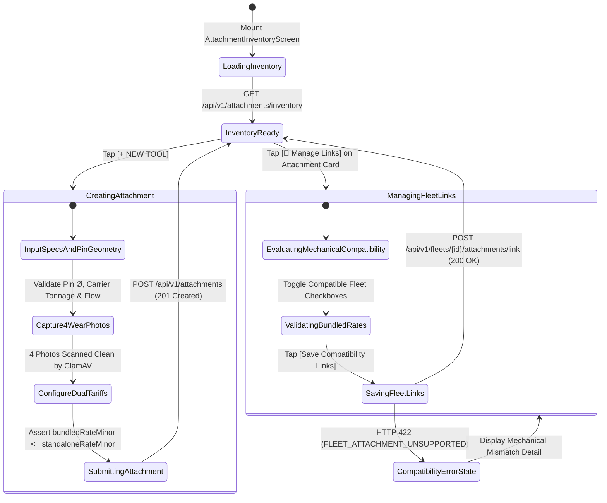
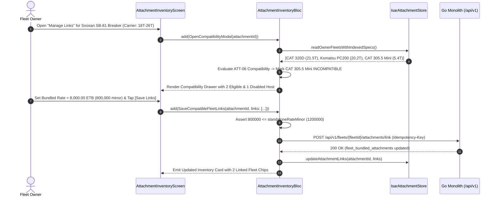

# Auxiliary Attachment Registry, Mechanical Compatibility & Bundled Tariff Management
## Mobile Subsystem Specification — `docs/mobile/owner-experience/05-attachment-inventory-management.md`

**Document Identifier:** `SPEC-MOB-OWN-05`  
**Classification:** Canonical Subsystem UI/UX & Technical Behavior Specification  
**Governing Documents:** `Dink_Machinery_UI_UX_Design_Brief.md`, `SRS-DINK-CORE-V7.0` (§5.3, §5.2.6, `ATT-01`..`ATT-11`, `FL-32`..`FL-34`), `docs/shared/design/design-tokens.json`, `docs/ERROR_CATALOG.md`, `contracts/openapi.yaml`  
**Target Subsystem:** Flutter 3.44 / Dart 3.9 Mobile Client (iOS & Android)  
**Primary Persona / Actor:** Equipment Fleet Owner & Depot Yard Manager (*W/ro Almaz Tesfaye* / *Kamau Ndegwa*)  
**Associated Requirements:** `REQ-05-03` (`ATT-01` to `ATT-11` / `AT-01`..`AT-11`), `REQ-05-02` (`FL-32` to `FL-34`)  
**Associated Interaction Flows:** `FLOW-03` (Fleet & Attachment Onboarding), `FLOW-07` (Multi-Entity Bundled Reservation & Concurrency Lock)  
**Associated ADRs:** `ADR-001` (Modular Monolith), `ADR-002` (Integer Minor-Unit Money Representation), `ADR-005` (ClamAV Media Verification), `ADR-010` (Offline-First Isar Inventory Sync)  
**Status:** Approved Technical Design Baseline

---

## 1. Domain Context, Business Rules & Architectural Invariants

In East African basalt quarry excavation, trenching, and urban demolition, high-value implements—such as hydraulic rock breakers (e.g., *Soosan SB-81*, *Furukawa HB20G*), earth augers, secondary pulverizers, ripper teeth, and trenching buckets—are critical revenue generators valued at $5,000\text{ to }40,000\text{ USD}$ each.

The **Auxiliary Attachment Registry & Compatibility Manager** (`SPEC-MOB-OWN-05`) models implements across two distinct physical and commercial classifications:
1. **Demountable Sovereign Inventory Entities (`FL-32`, `ATT-01`..`ATT-11`):** First-class inventory assets possessing an independent UUID, manufacturer serial PIN, dedicated 4-angle wear photography, independent availability calendar, and dual-pricing modality (**Standalone Rental** vs. **Bundled Add-On Rental**).
2. **Integrated / Permanently Mounted Implements:** Fixed blades, standard factory GP buckets, or rear multi-shank rippers permanently included in a host machine's base daily tariff (`bundled_daily_rate_minor = 0`).

### 1.1 Core Business Rules & Operational Invariants
1. **Mechanical & Hydraulic Carrier Compatibility Guardrails (`ATT-05`, `ATT-06`):**
   - Each attachment records its physical coupling geometry and hydraulic demand:
     - **Compatible Host Subcategories (`ATT-05`):** e.g., `cat_sub_excavator_standard` ($20\text{T}–35\text{T}$).
     - **Compatible Owned Fleet IDs (`compatible_fleet_ids` / `fleet_bundled_attachments`):** Explicit many-to-many linking to specific host machines in the owner's yard (e.g., linking *Soosan SB-81 Breaker #SN-991* to both *CAT 320D `ET-3-99120`* and *Komatsu PC200 `ET-3-88210`*).
     - **Pin & Hydraulic Geometry (`ATT-06`):** Mounting pin diameter ($\text{mm}$, e.g., $80\text{ mm}$), dipper ear width ($\text{mm}$, e.g., $325\text{ mm}$), center-to-center pin spread ($\text{mm}$), operating weight ($\text{kg}$, factored into lowboy payload `FL-29`), required hydraulic oil flow ($L/\text{min}$), and relief pressure ($\text{bar}$).
   - **Compatibility Validation (`FLEET_ATTACHMENT_UNSUPPORTED` HTTP 422):** Attempting to link an attachment whose carrier weight class or pin diameter conflicts with the target host machine's EAV specifications is blocked with a detailed mechanical mismatch warning.
2. **Dual-Modality Tariff Invariant in Integer Minor Units (`ATT-09`, `FL-33`):**
   - All rates are stored and transmitted in `int64` minor currency units (`ETB` Santims or `KES` Cents):
     - **Standalone Daily Rate (`standalone_daily_rate_minor`):** Applied when a contractor rents the implement independently for their own prime mover (e.g., `1200000` = `12,000.00 ETB/day`).
     - **Bundled Daily Rate (`bundled_daily_rate_minor`):** Discounted add-on rate applied when hired alongside a linked host machine from the owner's fleet (e.g., `800000` = `8,000.00 ETB/day`, a $-33.3\%$ bundle incentive).
   - **Hard Pricing Inequality (`FL-33`):**
     $$0 \le \text{bundled\_daily\_rate\_minor} \le \text{standalone\_daily\_rate\_minor}$$
3. **4-Angle Tool Wear & Pin Tolerance Baseline (`ATT-07`, `ATT-08`):**
   - Requires 4 ClamAV-verified photos: (1) Overall Profile, (2) Top Mounting Bracket / Ear Bores, (3) Mounting Pins & Bushings, and (4) Working Tip (Chisel point diameter or bucket teeth), establishing the baseline for 24-hour post-rental damage triage (`SPEC-MOB-OWN-11`).
4. **Multi-Entity Temporal Exclusion Awareness (`FL-34`):**
   - An attachment linked to two excavators in the owner's yard can only be active on one booking at a time (enforced by Valkey Lua multi-key lock `hold:attachment:{id}` and PostgreSQL `EXCLUDE USING gist`). The inventory card displays which host machine currently holds the attachment.

---

## 2. Screen Anatomy, Layout & Bespoke ASCII Wireframe

### 2.1 Attachment Inventory List & Compatibility Linking Drawer Wireframe
```text
+-----------------------------------------------------------------------+
| [← Back]          MY ATTACHMENTS & IMPLEMENT REGISTRY   [+ NEW TOOL]  |
+-----------------------------------------------------------------------+
| [ All Tools (6) ] [ 🟢 Available (4) ] [ 🔵 Rented (1) ] [ 🔧 Maint ] |
+-----------------------------------------------------------------------+
| +-------------------------------------------------------------------+ |
| | 🔨 SOOSAN SB-81 Hydraulic Rock Breaker             [🟢 AVAILABLE] | |
| | Type: HYDRAULIC_BREAKER • Serial PIN: SB81-ET-009412              | |
| | Modality: [Demountable Sovereign Asset] • Weight: 1,850 kg        | |
| |-------------------------------------------------------------------| |
| | MECHANICAL & HYDRAULIC INTERFACE (ATT-06):                        | |
| | Pin Ø: 80 mm | Ear Spread: 325 mm | Flow: 150 L/m | Bar: 180 bar  | |
| | Carrier Class: 18.0T – 26.0T Crawler Excavators                   | |
| |-------------------------------------------------------------------| |
| | COMMERCIAL TARIFFS (ETB MINOR UNITS -> DISPLAY):                  | |
| | • Standalone Hire Rate:  12,000.00 ETB/day (1,200,000 Santims)    | |
| | • Bundled Add-On Rate:    8,000.00 ETB/day (  800,000 Santims)    | |
| |   (33.3% Bundle Discount • Documentary Deposit: 25,000.00 ETB)    | |
| |-------------------------------------------------------------------| |
| | 🔗 LINKED COMPATIBLE HOST FLEETS (2 MACHINES):                    | |
| | [✓ CAT 320D (ET-3-99120)]  [✓ KOMATSU PC200 (ET-3-88210)] [+Link] | |
| |-------------------------------------------------------------------| |
| | [ 📅 Availability ]  [ 🔗 Manage Links ]  [ 💲 Edit Rates & Specs ]| |
| +-------------------------------------------------------------------+ |
|                                                                       |
| +-------------------------------------------------------------------+ |
| | 🪣 CAT 1.2m³ Heavy-Duty Rock Bucket             [🔵 RENTED #BK-8812]| |
| | Type: STANDARD_BUCKET • Serial PIN: CAT-BKT-4410 • Weight: 980 kg | |
| | Modality: [Integrated Default w/ CAT 320D] • Bundled: 0.00 ETB/d  | |
| | 📍 Currently Mobilized at Mojo Highway Site B until 2026-11-12    | |
| +-------------------------------------------------------------------+ |
+-----------------------------------------------------------------------+

+-----------------------------------------------------------------------+
| 🔗 LINK COMPATIBLE HOST FLEETS: SOOSAN SB-81 (18T–26T, 80mm Pin)      |
+-----------------------------------------------------------------------+
| [☑] CAT 320D Excavator (ET-3-99120) • Weight: 21,500 kg • 80mm Pin    |
|     Bundled Daily Rate *: [ 8000.00      ] ETB/day (Max: 12,000.00)   |
| [☑] KOMATSU PC200-8 (ET-3-88210)    • Weight: 20,200 kg • 80mm Pin    |
|     Bundled Daily Rate *: [ 8500.00      ] ETB/day (Max: 12,000.00)   |
| [☒] CAT 305.5E2 Mini (ET-3-11204)   • Weight: 5,400 kg                |
|     ❌ INCOMPATIBLE (FLEET_ATTACHMENT_UNSUPPORTED): Host weight 5.4T  |
|        is below minimum carrier rating (18.0T) for Soosan SB-81.      |
+-----------------------------------------------------------------------+
| [ CANCEL ]                           [ 💾 SAVE COMPATIBILITY LINKS ]  |
+-----------------------------------------------------------------------+
```

---

## 3. W3C DTCG Design Token Mapping Table

| UI Component / Element | W3C Token Path (`design-tokens.json`) | Resolved Value (Light / Dark / Outdoor) | Behavioral & Accessibility Invariant |
|---|---|---|---|
| **Attachment Inventory Card** | `semantic.{mode}.surface.card` + `stroke.border.medium` | `#FFFFFF` / `#1E293B` / `#000000`, `2dp` border | Distinct visual card separating mechanical specs, tariffs, and linked host chips. |
| **Pin Geometry & Rate Figures** | `typography.fontFamily.mono` + `semantic.{mode}.text.numericLedger` | `Space Mono` `14sp` / `16sp` | Ensures tabular alignment of millimeter tolerances (`80 mm`) and Santim rates. |
| **Linked Fleet Chip** | `color.brand.amber.50` + `color.brand.amber.800` | Bg `#FFFBEB`, Text `#92400E`, Border `#F59E0B` | Tapping opens host machine detail or unlinks with confirmation. |
| **Incompatible Host Warning** | `color.feedback.crimson.50` + `color.feedback.crimson.700` | Bg `#FEF2F2`, Text `#B91C1C`, Icon `#EF4444` | Blocks checkbox selection when carrier tonnage or pin Ø mismatches (`ATT-06`). |
| **Bundled Discount Badge** | `color.feedback.emerald.100` + `color.feedback.emerald.700` | Bg `#D1FAE5`, Text `#047857`, `12sp` | Automatically computes and displays percentage savings vs. standalone rate. |

---

## 4. Interactive State Machine & Sequence Flows

### 4.1 Attachment Registration & Fleet Linking State Machine


### 4.2 Mechanical Compatibility Verification & Bundled Rate Persistence Sequence


---

## 5. Concrete Flutter Implementation Blueprint

### 5.1 BLoC Events & Immutable Freezed States
```dart
// lib/features/attachments/presentation/bloc/attachment_inventory_bloc.dart
import 'package:freezed_annotation/freezed_annotation.dart';
import 'package:flutter_bloc/flutter_bloc.dart';

part 'attachment_inventory_bloc.freezed.dart';

@freezed
sealed class AttachmentInventoryEvent with _$AttachmentInventoryEvent {
  const factory AttachmentInventoryEvent.started() = _Started;
  const factory AttachmentInventoryEvent.statusFilterChanged(String? status) = _StatusFilterChanged;
  const factory AttachmentInventoryEvent.createAttachmentSubmitted({
    required CreateAttachmentFormPayload payload,
  }) = _CreateAttachmentSubmitted;
  const factory AttachmentInventoryEvent.fleetLinksUpdated({
    required String attachmentId,
    required List<FleetAttachmentLinkInput> compatibleFleetLinks,
  }) = _FleetLinksUpdated;
}

@freezed
class FleetAttachmentLinkInput with _$FleetAttachmentLinkInput {
  const factory FleetAttachmentLinkInput({
    required String fleetId,
    required int bundledDailyRateMinor, // Must be <= standaloneDailyRateMinor (FL-33)
    required bool isIntegratedDefault, // true => bundledDailyRateMinor == 0
  }) = _FleetAttachmentLinkInput;
}

@freezed
class AttachmentItemDto with _$AttachmentItemDto {
  const factory AttachmentItemDto({
    required String id,
    required String attachmentType, // 'HYDRAULIC_BREAKER' | 'STANDARD_BUCKET' | 'AUGER' | ...
    required String make,
    required String model,
    required String subTypeSizing, // e.g., "135mm Chisel Diameter Breaker"
    required String serialPinNumber,
    required bool isDemountableSovereign,
    required double operatingWeightKg,
    required double minCarrierWeightTonnes,
    required double maxCarrierWeightTonnes,
    required double pinDiameterMm,
    required double earWidthSpreadMm,
    double? requiredFlowLpm,
    double? operatingPressureBar,
    required String currency, // 'ETB' | 'KES'
    required int standaloneDailyRateMinor,
    required int defaultBundledDailyRateMinor,
    required int documentaryDepositMinor,
    required String status, // 'ACTIVE' | 'RENTED' | 'MAINTENANCE_HOLD' | 'DISPUTED_DAMAGE'
    required List<String> compatibleSubcategoryIds,
    required List<LinkedFleetSummaryDto> linkedFleets,
    required List<String> wearPhotoUris, // 4 mandatory angles (ATT-07)
  }) = _AttachmentItemDto;
}

@freezed
sealed class AttachmentInventoryState with _$AttachmentInventoryState {
  const factory AttachmentInventoryState.loading() = _Loading;
  const factory AttachmentInventoryState.loaded({
    required List<AttachmentItemDto> attachments,
    required String? activeStatusFilter,
    @Default(false) bool isMutating,
    ProblemDetails? mutationError,
  }) = _Loaded;
}
```

### 5.2 Isar Local Persistence Schema
```dart
// lib/features/attachments/data/local/isar_attachment_entity.dart
import 'package:isar/isar.dart';

part 'isar_attachment_entity.g.dart';

@collection
class IsarAttachmentEntity {
  Id id = Isar.autoIncrement;

  @Index(unique: true, replace: true)
  late String attachmentUuid;

  late String attachmentType;
  late String make;
  late String model;
  late String serialPinNumber;
  late bool isDemountableSovereign;
  late double operatingWeightKg;
  late double minCarrierWeightTonnes;
  late double maxCarrierWeightTonnes;
  late double pinDiameterMm;
  late double earWidthSpreadMm;
  late String currency;
  late int standaloneDailyRateMinor;
  late int defaultBundledDailyRateMinor;
  late String status;
  late List<String> compatibleFleetIds;
  late String serializedLinkedFleetsJson;
  late List<String> wearPhotoUris;
  late DateTime syncedAt;
}
```

### 5.3 Widget Tree Hierarchy
```text
AttachmentInventoryScreen (Scaffold)
 ├── AttachmentTopAppBar (Title + [+ NEW TOOL] Action Button)
 ├── AttachmentStatusFilterBar (Filter Chips: All, Available, Rented, Maintenance)
 ├── ListView.builder
 │    └── AttachmentInventoryCard
 │         ├── AttachmentHeaderRow (Icon, Make/Model, Serial PIN, Status Badge, Modality Pill)
 │         ├── MechanicalInterfaceSpecGrid (Pin Ø mm, Ear Spread mm, Carrier Tonnage Class, Flow/Bar)
 │         ├── DualTariffBreakdownBox (Standalone Rate vs. Bundled Rate in Space Mono + Savings %)
 │         ├── LinkedHostFleetsWrap (Chips for each linked compatible_fleet_id + [+ Link] CTA)
 │         └── CardActionFooter ([Availability], [Manage Links], [Edit Rates & Specs])
 └── FleetCompatibilityLinkingBottomSheet (Evaluates FleetSpecIndexed weight/pin rules & saves bundledDailyRateMinor)
```

---

## 6. OpenAPI 3.1.0 Routes & RFC 9457 Error Matrix

### 6.1 Bound API Endpoints
| Operation | HTTP Method & URI | Headers Required | Purpose & Contract Binding |
|---|---|---|---|
| **List Owner Attachments** | `GET /api/v1/attachments/inventory` | `Authorization: Bearer <JWT>`, `X-Country-Code: ET\|KE` | Retrieves all sovereign and integrated attachments owned by the authenticated fleet owner. |
| **Register Attachment** | `POST /api/v1/attachments` | `Authorization: Bearer <JWT>`, `Idempotency-Key: <UUIDv4>` | Creates a new `attachments` record with 4 ClamAV-verified wear photos and standalone/bundled minor-unit rates. |
| **Link Compatible Fleets** | `POST /api/v1/fleets/{id}/attachments/link` | `Authorization: Bearer <JWT>`, `Idempotency-Key: <UUIDv4>` | Upserts `fleet_bundled_attachments` linking `compatible_fleet_ids` with `bundled_daily_rate_minor`. |

### 6.2 RFC 9457 Problem Details Error Matrix
| Error Code (`error.code`) | HTTP Status | Type URI | Trigger Condition | Mobile UI Recovery Behavior |
|---|---|---|---|---|
| `FLEET_ATTACHMENT_UNSUPPORTED` | `422` | `/errors/fleet-attachment-unsupported` | Target host machine's operating weight or category conflicts with the attachment's carrier bounds (`ATT-05`, `ATT-06`). | Disable the incompatible fleet checkbox and display exact mechanical reason (e.g., carrier tonnage or pin Ø mismatch). |
| `FLEET_DAILY_RATE_INVALID` | `422` | `/errors/fleet-daily-rate-invalid` | `bundled_daily_rate_minor > standalone_daily_rate_minor` (`FL-33`) or negative minor units supplied. | Highlight the bundled rate input field and clamp maximum allowed value to `standalone_daily_rate_minor`. |
| `FLEET_REGISTRATION_EXISTS` | `409` | `/errors/fleet-registration-exists` | Duplicate manufacturer `serialPinNumber` within owner inventory (`ATT-04`). | Highlight Serial PIN input and prompt user to edit existing tool record instead. |
| `INSPECT_MEDIA_SCAN_FAILED` | `422` | `/errors/inspect-media-scan-failed` | Any of the 4 mandatory attachment wear photos (`ATT-07`) failed ClamAV inspection. | Prompt re-capture of the affected angle (Overall, Bracket, Pins/Bushings, or Working Tip). |

---

## 7. Verification & Acceptance Criteria

- [ ] **Bundled Tariff Inequality Enforcement (`FL-33`):** Entering a bundled daily rate of `13,000.00 ETB` (`1300000` minor units) when the standalone rate is `12,000.00 ETB` (`1200000` minor units) immediately blocks submission with an inline validation error.
- [ ] **Mechanical Compatibility Filtering (`ATT-06`, `FLEET_ATTACHMENT_UNSUPPORTED`):** Opening the Compatibility Linking Sheet automatically disables any owned machine whose `operating_weight_kg` falls outside `[minCarrierWeightTonnes * 1000, maxCarrierWeightTonnes * 1000]`.
- [ ] **Integer Minor-Unit Precision:** All rate inputs convert user-typed decimals (`8000.00`) to `int64` minor units (`800000`) prior to BLoC state persistence or JSON serialization.
- [ ] **4-Angle Wear Baseline Completeness (`ATT-07`):** Registration cannot complete until all 4 tool conditioning photos (Overall Profile, Top Mounting Bracket, Pins/Bushings, Working Chisel/Teeth Tip) are verified.
