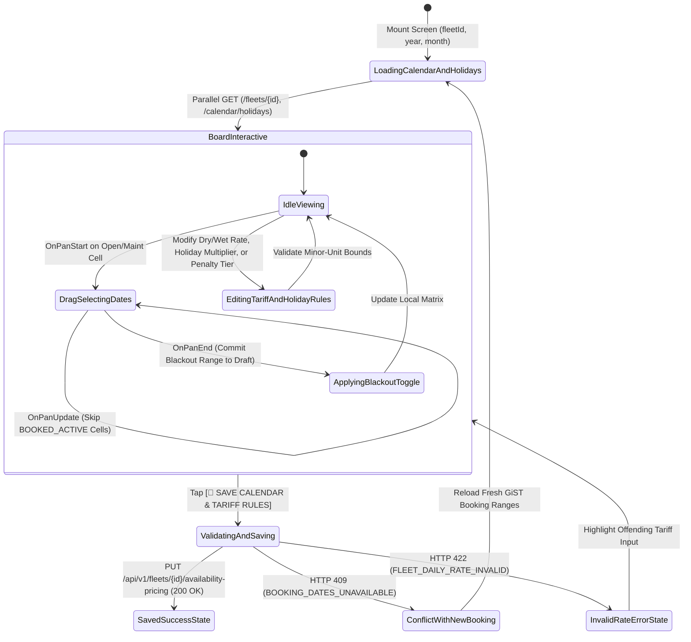
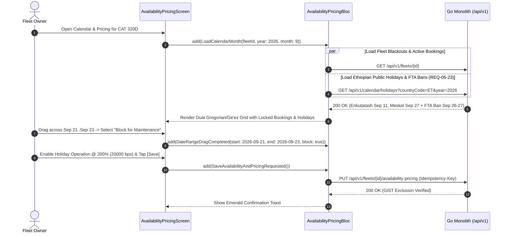

# Interactive Availability Calendar, Tariff Tiers & Ethiopian Holiday Surcharge Configuration
## Mobile Subsystem Specification — `docs/mobile/owner-experience/06-availability-calendar-pricing.md`

**Document Identifier:** `SPEC-MOB-OWN-06`  
**Classification:** Canonical Subsystem UI/UX & Technical Behavior Specification  
**Governing Documents:** `Dink_Machinery_UI_UX_Design_Brief.md`, `SRS-DINK-CORE-V7.0` (§5.2.4, §5.2.6, §5.23, `FL-16`..`FL-24`, `FL-28`..`FL-36`, `HOL-01`..`HOL-03`), `docs/shared/design/design-tokens.json`, `docs/ERROR_CATALOG.md`, `contracts/openapi.yaml`  
**Target Subsystem:** Flutter 3.47.9 / Dart 3.9 Mobile Client (iOS & Android)  
**Primary Persona / Actor:** Equipment Fleet Owner & Depot Yard Manager (*W/ro Almaz Tesfaye* / *Kamau Ndegwa*)  
**Associated Requirements:** `REQ-05-02` (`FL-16`..`FL-24`, `FL-28`..`FL-36`), `REQ-05-23` (`HOL-01`..`HOL-03` / `HC-01`..`HC-05` Ethiopian Public Holiday & Movable Feast Calendar)  
**Associated Interaction Flows:** `FLOW-03` (Tariff & Calendar Setup), `FLOW-07` (Cancellation Penalty Tiers), `FLOW-11` (Lowboy Corridor Freight Ban Interlock)  
**Associated ADRs:** `ADR-002` (Minor-Unit Financial Math), `ADR-008` (Dual Gregorian/Ethiopic Calendar & Multi-Country Tax/Currency), `ADR-010` (Offline-First Sync)  
**Status:** Approved Technical Design Baseline

---

## 1. Domain Context, Business Rules & Architectural Invariants

The **Interactive Availability Calendar & Commercial Tariff Configuration** screen (`SPEC-MOB-OWN-06`) governs both temporal scheduling (`FL-35`) and multi-modal commercial pricing (`FL-16`..`FL-24`, `HC-01`..`HC-05`) for machinery and logistics fleets.

### 1.1 Core Business Rules & Operational Invariants
1. **Interactive Dual-Calendar Board with Drag-to-Block Maintenance (`FL-35`, `ADR-008`):**
   - Renders a monthly calendar grid displaying both **Gregorian** and **Ethiopian Ge'ez (`EC`)** dates side-by-side in each day cell (e.g., `Sep 11 / መስከረም 1`).
   - Day cells are color-coded by immutable reservation or blackout state:
     - **`AVAILABLE`:** Open for booking.
     - **`BOOKED_ACTIVE` / `HOLD_PENDING`:** Locked by an existing contractor booking (`EXCLUDE USING gist` in PostgreSQL 18.6). Cannot be modified or unblocked by the owner.
     - **`MAINTENANCE_BLACKOUT`:** Owner-defined maintenance, servicing, or private-use blackout window created via single-tap or multi-day touch-drag selection (`FL-35`).
     - **`STATUTORY_HOLIDAY` (`HC-01`..`HC-05` / `HOL-01`):** Highlighted with a cultural/religious feast badge (Fixed National, Orthodox Computus *Bahire Hasab* such as *Fasika* / *Timket* / *Meskel*, or Islamic Lunar *Eid al-Fitr* / *Eid al-Adha* / *Mawlid*).
2. **Wet Rate, Dry Rate & Per-Kilometer Logistics Tariff Configuration (`FL-16`..`FL-21`):**
   - All monetary tariffs are entered in major currency units for UX ergonomics and immediately converted to `int64` minor units (`ETB` Santims or `KES` Cents):
     - **Dry Lease Daily Rate (`dry_daily_rate_minor`):** Base machine + operator (if `operator_included = true`), **excluding fuel** (contractor supplies diesel on site).
     - **Wet Lease Daily Rate (`wet_daily_rate_minor`):** Full-service rate **including fuel, lubricants, and operator**.
     - **Weekly (7d) & Monthly (30d) Discounted Rates (`FL-17`).**
     - **Excess Operating Hour Surcharge Rate (`excess_hour_rate_minor`, `FL-19`):** Hourly overtime rate billed for runtime exceeding the standard **8.0 Engine Hours/Day** quota (`RC-03`).
     - **Per-Kilometer / Corridor Haulage Rate (`per_km_rate_minor`, `FL-28`..`FL-31`):** Applicable when configuring a `LOGISTICS` lowboy carrier or owner-mobilized delivery surcharge.
3. **Bilateral Cancellation Penalty Tier Selection (`FL-22`..`FL-24`):**
   - The owner selects a standardized contractual cancellation policy governing post-confirmation (`CONFIRMED`) aborts:
     - **`FLEXIBLE`:** Free cancellation up to $24\text{ hours}$ before mobilization; $10\%$ penalty inside $24\text{ hours}$.
     - **`MODERATE` (Default):** Free up to $48\text{ hours}$ before mobilization; $20\%$ penalty inside $48\text{ hours}$.
     - **`STRICT`:** $25\%$ penalty upon confirmation; $50\%$ penalty inside $72\text{ hours}$ of mobilization.
4. **Ethiopian Public Holiday Surcharge & Shift Quota Exclusion Rules (`HC-01`..`HC-05`, `HOL-01`..`HOL-03`):**
   - **Rule A — Non-Working Holiday Exclusion (Default `is_holiday_operation_permitted = false`, `HOL-01`):** Statutory public holidays intersecting a booking automatically pause the $8.0\text{ hrs/day}$ shift quota ($\mathcal{H}_{\text{agreed}} = (\Delta_{\text{days}} - \text{HolidayCount}) \times 8.0\text{ hrs}$) and are not billed as working days.
   - **Rule B — Holiday Overtime Operation Multiplier (`is_holiday_operation_permitted = true`, `HOL-02`):** Allows contractors to request continuous holiday earthworks at an owner-configured rate multiplier ($150\%$ / $1.5\times$ or $200\%$ / $2.0\times$ daily tariff in `rate_multiplier_bps`: `15000` or `20000`).
   - **Rule C — Federal Transport Authority (FTA) Lowboy Highway Ban Interlock (`HOL-03`):** Automatically flags dates where multi-axle lowboy highway transit is legally prohibited (e.g., *Meskel*, *Fasika*, *Enkutatash*).

---

## 2. Screen Anatomy, Layout & Bespoke ASCII Wireframe

### 2.1 Interactive Dual-Script Availability Calendar & Tariff Configuration Wireframe
```text
+-----------------------------------------------------------------------+
| [← Back]        AVAILABILITY CALENDAR & PRICING         [💾 SAVE ALL] |
| Asset: CAT 320D Excavator (ET-3-99120) • Currency: ETB (Santims)      |
+-----------------------------------------------------------------------+
| 📅 INTERACTIVE AVAILABILITY BOARD (FL-35)    [Gregorian + Ge'ez EC ✓] |
|    [◀]             SEPTEMBER 2026 / መስከረም 2019 EC              [▶]   |
|    ✋ Drag across open dates to block/unblock yard maintenance days.   |
| +---------+---------+---------+---------+---------+---------+-------+ |
| |   MON   |   TUE   |   WED   |   THU   |   FRI   |   SAT   |  SUN  | |
| +---------+---------+---------+---------+---------+---------+-------+ |
| | 07 / 2 ጳ| 08 / 3 ጳ| 09 / 4 ጳ| 10 / 5 ጳ| 11 / 1 መ| 12 / 2 መ|13 / 3መ| |
| | 🟢 Open | 🟢 Open | 🟢 Open | 🟢 Open | 🌼 ENKUT| 🟢 Open |🟢 Open| |
| |         |         |         |         | Holiday |         |       | |
| +---------+---------+---------+---------+---------+---------+-------+ |
| | 14 / 4 መ| 15 / 5 መ| 16 / 6 መ| 17 / 7 መ| 18 / 8 መ| 19 / 9 መ|20 /10መ| |
| | 🔵 #8812| 🔵 #8812| 🔵 #8812| 🔵 #8812| 🔵 #8812| 🔵 #8812|🔵#8812| |
| | Rented  | Rented  | Rented  | Rented  | Rented  | Rented  |Rented | |
| +---------+---------+---------+---------+---------+---------+-------+ |
| | 21 /11 መ| 22 /12 መ| 23 /13 መ| 24 /14 መ| 25 /15 መ| 26 /16 መ|27 /17መ| |
| | 🔧 MAINT| 🔧 MAINT| 🔧 MAINT| 🟢 Open | 🟢 Open | 🚛 FTA  |✝️MESKL| |
| | Blocked | Blocked | Blocked |         |         | Ban     |Holiday| |
| +---------+---------+---------+---------+---------+---------+-------+ |
| Legend: [🟢 Open] [🔵 Rented (Locked)] [🔧 Maint Drag-Block] [🌼 Holiday]|
+-----------------------------------------------------------------------+
| 💲 COMMERCIAL TARIFF CONFIGURATION (8.0 HRS/DAY SHIFT BASE)           |
| +-------------------------------------------------------------------+ |
| | Dry Lease Rate (Excl. Fuel) *:  [ 22,500.00      ] ETB / Day      | |
| | Wet Lease Rate (Incl. Diesel):  [ 34,000.00      ] ETB / Day      | |
| | Weekly Rate (7 Days Bundle):    [ 145,000.00     ] ETB / Week     | |
| | Excess Hour Overtime Rate *:    [ 2,800.00       ] ETB / Hour     | |
| | Min Rental Duration *: [ 3 Days ▼ ] | Prepay Hold Window:[ 24h ▼ ]| |
| | Mobilization Per-Km Rate:       [ 450.00         ] ETB / Km       | |
| +-------------------------------------------------------------------+ |
|                                                                       |
| 🌼 ETHIOPIAN PUBLIC HOLIDAY & MOVABLE FEAST RULES (HC-01..HC-05)      |
| +-------------------------------------------------------------------+ |
| | Permit Site Operation on Statutory Public Holidays?               | |
| | [○ Pause Shift Quota (0h Billed - Default)] [● Allow w/ Surcharge]| |
| | Holiday Rate Multiplier *: [150% (1.5x) ] [● 200% (2.0x Double) ] | |
| | ℹ️ On Sep 11 (Enkutatash) & Sep 27 (Meskel), daily rate becomes   | |
| |    45,000.00 ETB/day. Lowboy highway transit auto-blocked by FTA. | |
| +-------------------------------------------------------------------+ |
|                                                                       |
| ⚖️ CANCELLATION PENALTY TIER (POST-CONFIRMATION - FL-22)              |
| +-------------------------------------------------------------------+ |
| | [○ FLEXIBLE (10% <24h)] [● MODERATE (20% <48h)] [○ STRICT (50%)]  | |
| +-------------------------------------------------------------------+ |
+-----------------------------------------------------------------------+
| [ 💾 SAVE CALENDAR & TARIFF RULES ]                                   |
+-----------------------------------------------------------------------+
```

---

## 3. W3C DTCG Design Token Mapping Table

| UI Component / Element | W3C Token Path (`design-tokens.json`) | Resolved Value (Light / Dark / Outdoor) | Behavioral & Accessibility Invariant |
|---|---|---|---|
| **Calendar Day Cell (Standard)** | `dimension.space.48` + `semantic.{mode}.surface.card` | Min `48x56dp`, `#FFFFFF` / `#1E293B` / `#000000` | Supports touch-down and pan-drag gestures across contiguous date ranges. |
| **Maintenance Blackout Cell** | `color.brand.amber.100` + `color.brand.amber.800` | Bg `#FEF3C7`, Border `#D97706`, Text `#92400E` | Distinguished by diagonal stripe pattern + `🔧` icon for colorblind safety. |
| **Rented / GiST Locked Cell** | `color.feedback.blue.100` + `color.feedback.blue.900` | Bg `#DBEAFE`, Text `#1E3A8A`, Icon `🔒` | Touch-drag passes over locked booking cells without mutating them. |
| **Statutory Holiday Cell** | `color.feedback.purple.100` + `color.feedback.purple.900` | Bg `#F3E8FF`, Text `#581C87`, Border `#A855F7` | Displays holiday badge (`🌼` / `✝️` / `🌙`) and FTA transport ban icon (`🚛`). |
| **Tariff Input Numerals** | `typography.fontFamily.mono` + `semantic.{mode}.text.numericLedger` | `Space Mono` `16sp`, `#020617` / `#F8FAFC` / `#FFFFFF` | Converts decimal strings to `int64` minor units (`2250000` Santims). |
| **Dual-Script Ge'ez Sub-Label** | `typography.fontFamily.ethiopic` + `typography.fontSize.12` | `Noto Sans Ethiopic` `12sp`, `1.38` line-height | Renders Ethiopian month/day (`መስከረም 1`) cleanly inside each cell. |

---

## 4. Interactive State Machine & Sequence Flows

### 4.1 Calendar Drag-to-Block & Tariff Persistence State Machine


### 4.2 Holiday Engine Synchronization & Maintenance Block Save Sequence


---

## 5. Concrete Flutter Implementation Blueprint

### 5.1 BLoC Events & Immutable Freezed States
```dart
// lib/features/fleet_availability/presentation/bloc/availability_pricing_bloc.dart
import 'package:freezed_annotation/freezed_annotation.dart';
import 'package:flutter_bloc/flutter_bloc.dart';

part 'availability_pricing_bloc.freezed.dart';

@freezed
sealed class AvailabilityPricingEvent with _$AvailabilityPricingEvent {
  const factory AvailabilityPricingEvent.monthLoaded({
    required String fleetId,
    required int year,
    required int month,
  }) = _MonthLoaded;
  const factory AvailabilityPricingEvent.dateRangeDragToggled({
    required DateTime startDate,
    required DateTime endDate,
    required bool setMaintenanceBlocked,
    String? maintenanceNote,
  }) = _DateRangeDragToggled;
  const factory AvailabilityPricingEvent.tariffUpdated({
    required int dryDailyRateMinor,
    int? wetDailyRateMinor,
    int? weeklyRateMinor,
    int? monthlyRateMinor,
    required int excessHourRateMinor,
    int? mobilizationPerKmRateMinor,
    required int minRentalDays,
    required String cancellationPolicyTier, // 'FLEXIBLE' | 'MODERATE' | 'STRICT'
  }) = _TariffUpdated;
  const factory AvailabilityPricingEvent.holidayPolicyUpdated({
    required bool isHolidayOperationPermitted,
    required int holidayMultiplierBps, // 10000 (1.0x), 15000 (1.5x), 20000 (2.0x)
  }) = _HolidayPolicyUpdated;
  const factory AvailabilityPricingEvent.saveRequested() = _SaveRequested;
}

@freezed
class RegionalHolidayCellDto with _$RegionalHolidayCellDto {
  const factory RegionalHolidayCellDto({
    required DateTime gregorianDate,
    required String ethiopicDateLabel, // e.g., "መስከረም 17"
    required String nameEn,
    required String nameAm,
    required String category, // 'FIXED_NATIONAL' | 'ORTHODOX_MOVABLE' | 'ISLAMIC_LUNAR' | 'TRANSPORT_BAN_WINDOW'
    required bool hasFtaLowboyHighwayBan,
  }) = _RegionalHolidayCellDto;
}

@freezed
sealed class AvailabilityPricingState with _$AvailabilityPricingState {
  const factory AvailabilityPricingState.loading() = _Loading;
  const factory AvailabilityPricingState.ready({
    required String fleetId,
    required int visibleYear,
    required int visibleMonth,
    required String currency,
    required Set<DateTime> bookedLockedDates, // Read-only from active bookings
    required Set<DateTime> maintenanceBlackoutDates, // Editable via drag
    required Map<DateTime, RegionalHolidayCellDto> holidaysByDate,
    required int dryDailyRateMinor,
    int? wetDailyRateMinor,
    int? weeklyRateMinor,
    int? monthlyRateMinor,
    required int excessHourRateMinor,
    int? mobilizationPerKmRateMinor,
    required int minRentalDays,
    required String cancellationPolicyTier,
    required bool isHolidayOperationPermitted,
    required int holidayMultiplierBps,
    @Default(false) bool hasUnsavedChanges,
    @Default(false) bool isSaving,
    ProblemDetails? error,
  }) = _Ready;
}
```

### 5.2 Isar Offline Availability & Tariff Cache
```dart
// lib/features/fleet_availability/data/local/isar_fleet_calendar_config.dart
import 'package:isar/isar.dart';

part 'isar_fleet_calendar_config.g.dart';

@collection
class IsarFleetCalendarConfig {
  Id id = Isar.autoIncrement;

  @Index(unique: true, replace: true)
  late String fleetId;

  late String currency;
  late int dryDailyRateMinor;
  int? wetDailyRateMinor;
  int? weeklyRateMinor;
  late int excessHourRateMinor;
  int? mobilizationPerKmRateMinor;
  late int minRentalDays;
  late String cancellationPolicyTier;
  late bool isHolidayOperationPermitted;
  late int holidayMultiplierBps;
  late List<String> maintenanceIsoDates;
  late List<String> bookedLockedIsoDates;
  late DateTime updatedAt;
}
```

### 5.3 Widget Tree Hierarchy
```text
AvailabilityCalendarPricingScreen (Scaffold)
 ├── CalendarPricingAppBar (Fleet Title, Unsaved Changes Indicator, [💾 SAVE ALL])
 └── SingleChildScrollView
      ├── InteractiveDualCalendarBoard (GestureDetector OnPanStart/Update/End over 7x5 GridView)
      │    └── DualScriptDayCell (Gregorian Day + Ge'ez Day, Booking/Maint/Holiday/FTA-Ban Badges)
      ├── CommercialTariffFormCard (Dry/Wet/Weekly/Excess-Hour/Per-Km Minor-Unit Inputs + Min Days Picker)
      ├── EthiopianHolidayPolicyCard (Toggle: Pause Shift Quota vs. Allow w/ 1.5x/2.0x Surcharge + FTA Ban Info)
      └── CancellationPenaltyTierSelector (Segmented Cards: Flexible 10%, Moderate 20%, Strict 50%)
```

---

## 6. OpenAPI 3.1.0 Routes & RFC 9457 Error Matrix

### 6.1 Bound API Endpoints
| Operation | HTTP Method & URI | Headers Required | Purpose & Contract Binding |
|---|---|---|---|
| **Get Regional Holidays** | `GET /api/v1/calendar/holidays?countryCode=ET&year={y}` | `X-Country-Code: ET\|KE`, `Accept-Language: am\|en` | Fetches Fixed National, Orthodox Computus (*Bahire Hasab*), Islamic Lunar holidays, and FTA freight ban windows (`REQ-05-23`). |
| **Update Calendar & Pricing** | `PUT /api/v1/fleets/{id}/availability-pricing` | `Authorization: Bearer <JWT>`, `Idempotency-Key: <UUIDv4>` | Atomically updates `fleets` tariff columns, holiday policy flags, and `fleet_maintenance_blackouts`. |

### 6.2 RFC 9457 Problem Details Error Matrix
| Error Code (`error.code`) | HTTP Status | Type URI | Trigger Condition | Mobile UI Recovery Behavior |
|---|---|---|---|---|
| `BOOKING_DATES_UNAVAILABLE` | `409` | `/errors/booking-dates-unavailable` | A contractor placed a reservation hold on one of the dates while the owner was dragging maintenance blocks. | Refresh calendar board from server, highlight newly locked booking dates in blue (`🔵`), and preserve remaining maintenance blocks. |
| `FLEET_DAILY_RATE_INVALID` | `422` | `/errors/fleet-daily-rate-invalid` | `dry_daily_rate_minor <= 0`, `wet_daily_rate_minor < dry_daily_rate_minor`, or `excess_hour_rate_minor <= 0`. | Highlight invalid rate input in crimson (`#EF4444`) and scroll to Commercial Tariff card. |
| `FLEET_STATUS_CONFLICT` | `409` | `/errors/fleet-status-conflict` | Fleet is `DECOMMISSIONED` or `DELINQUENT_LOCKED` (`CW-04`). | Show status banner explaining why public calendar activation is currently suspended. |

---

## 7. Verification & Acceptance Criteria

- [ ] **Drag-to-Block Skips Locked Bookings (`FL-35`):** Dragging a maintenance blackout selection from `Sep 13` to `Sep 22` across an existing confirmed booking (`Sep 14..Sep 20`) blocks `Sep 13`, `Sep 21`, and `Sep 22` while leaving `Sep 14..Sep 20` untouched.
- [ ] **Dual Gregorian & Ge'ez Calendar Rendering (`REQ-05-23`, `ADR-008`):** Every cell accurately displays both the Gregorian date and its corresponding Ethiopian Calendar (`EC`) date (including *Pagume* 5/6 leap-year days).
- [ ] **Wet vs. Dry Tariff Invariant:** If `wet_daily_rate_minor` is enabled, client and server validation assert `wet_daily_rate_minor >= dry_daily_rate_minor`.
- [ ] **Holiday Surcharge Preview (`HOL-02`):** Selecting `Allow w/ Surcharge (200% / 20000 bps)` dynamically previews the exact holiday daily rate (`22,500.00 ETB * 2.0 = 45,000.00 ETB/day`) in the summary callout.
