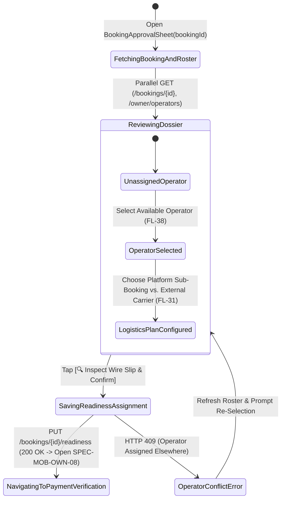
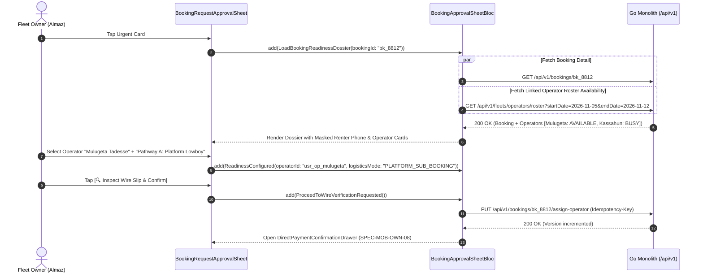

# Incoming Booking Requisition Review, Operator Assignment & Readiness Sheet
## Mobile Subsystem Specification — `docs/mobile/owner-experience/07-booking-request-approval-sheet.md`

**Document Identifier:** `SPEC-MOB-OWN-07`  
**Classification:** Canonical Subsystem UI/UX & Technical Behavior Specification  
**Governing Documents:** `Dink_Machinery_UI_UX_Design_Brief.md`, `SRS-DINK-CORE-V7.0` (§5.2.4, §5.5, §5.8, `BK-05`..`BK-08`, `FL-25`..`FL-31`, `FL-38`), `docs/shared/design/design-tokens.json`, `docs/ERROR_CATALOG.md`, `contracts/openapi.yaml`  
**Target Subsystem:** Flutter 3.44 / Dart 3.9 Mobile Client (iOS & Android)  
**Primary Persona / Actor:** Equipment Fleet Owner & Depot Yard Manager (*W/ro Almaz Tesfaye* / *Kamau Ndegwa*)  
**Associated Requirements:** `REQ-05-05` (`BK-05` to `BK-08`), `REQ-05-02` (`FL-25`..`FL-31`, `FL-38` Linked Operator Roster Assignment), `REQ-05-08` (Logistics Sub-Booking Trigger)  
**Associated Interaction Flows:** `FLOW-07` (Booking State Machine), `FLOW-08` (Wire Prepayment & Verification), `FLOW-11` (Lowboy Transport Coupling)  
**Associated ADRs:** `ADR-001` (Modular Monolith), `ADR-002` (Integer Minor-Unit Accounting), `ADR-004` (Valkey Distributed Concurrency Locks), `ADR-010` (Offline-First & Non-Custodial Settlement)  
**Status:** Approved Technical Design Baseline

---

## 1. Domain Context, Business Rules & Architectural Invariants

When a Civil Engineering Contractor (*Dawit Haile-Mariam*) submits a booking requisition (`POST /api/v1/bookings`), the backend places a 60-minute distributed Valkey hold lease (`hold:fleet:{id}`) on the host machine and any bundled attachments (`BK-05`), transitioning the booking to `PENDING_PAYMENT` and then `PAYMENT_EVIDENCE_UPLOADED` (`BK-08`) once the contractor uploads their 50% bank wire transfer slip.

The **Booking Request Review, Operator Assignment & Readiness Sheet** (`SPEC-MOB-OWN-07`) enables the Fleet Owner to inspect the contractor's verified KYC credentials, job-site coordinates, itemized tariff breakdown, and bundled attachments, assign a linked **Certified Field Operator** (`FL-25`..`FL-27`, `FL-38`), and confirm operational readiness before proceeding to payment slip verification (`SPEC-MOB-OWN-08`).

### 1.1 Core Business Rules & Operational Invariants
1. **Contractor KYC Trust Dossier & Privacy Masking (`BK-05`, `ASVS L3`):**
   - Displays the requesting contractor's corporate identity (*Haile-Mariam Construction GC-1*), verified TIN badge, historical double-blind trust rating (e.g., `★ 4.9 • 18 Completed Rentals`), and zero-dispute record.
   - To prevent off-platform circumvention prior to `CONFIRMED` status, direct contractor phone numbers and personal IDs are masked (`+251 911 *** *44`) until the 50% prepayment wire is verified and the 10% platform commission is debited (`BK-10`).
2. **Job Site PostGIS Coordinate & Geofence Corridor Inspection:**
   - Displays the target project site coordinates (`Lat 8.5412° N, Lng 39.2718° E` — *Mojo-Meki Highway Expansion Site B*), road distance from the owner's home depot yard (e.g., $74.2\text{ km}$), and terrain/cut notes.
3. **Mandatory Linked Certified Operator Assignment (`FL-25`..`FL-27`, `FL-38`):**
   - If the fleet listing is configured with `operator_included = true` (or Wet Lease), the owner **must** select an available, yard-linked **Certified Operator** from their verified operator roster (`FL-38`) whose license class matches the equipment category (e.g., *Mulugeta Tadesse — Class IV Heavy Plant License `ET-MUDCO-OP-44912`*) and who has zero overlapping shift assignments during $[T_{\text{start}}, T_{\text{end}})$.
   - Supports multi-shift assignment (Day Shift + Night Shift operator) when contractors request 16-hour double-shift excavations.
4. **Logistics Mobilization Pathway Selection (`FL-28`..`FL-31`):**
   - If `self_move_capable == false` (e.g., steel-tracked CAT 320D Excavator), the sheet prompts the owner to pre-select their mobilization pathway (`FL-31`):
     - **Pathway A (`PLATFORM_SUB_BOOKING`):** Auto-match a verified lowboy trailer ($\ge 23.65\text{T}$ payload capacity) on Dink Machinery upon payment confirmation (discounted $2.5\%$ freight commission).
     - **Pathway B (`EXTERNAL_OWN_CARRIER`):** Declare the owner's own lowboy truck plate and driver phone.

---

## 2. Screen Anatomy, Layout & Bespoke ASCII Wireframe

### 2.1 Booking Request Review & Operator Assignment Sheet Wireframe
```text
+-----------------------------------------------------------------------+
| [✕ Close]          RESERVATION REVIEW & READINESS       #BK-8812      |
| Status: [🔵 PAYMENT_EVIDENCE_UPLOADED] • Hold Expires: ⏱️ 19h 42m 10s |
+-----------------------------------------------------------------------+
| 🏢 CONTRACTING ENTITY & TRUST DOSSIER                                 |
| +-------------------------------------------------------------------+ |
| | Haile-Mariam Civil Engineering PLC (Grade GC-1 Contractor)        | |
| | [✓ TIN & Trade License Verified]   [★ 4.92 (18 Completed Hires)]  | |
| | Contact: Dawit H. (+251 911 *** *44 • Unlocks on Confirmation 🔒) | |
| +-------------------------------------------------------------------+ |
|                                                                       |
| 🚜 REQUESTED EQUIPMENT, DATES & JOB SITE GEOLOCATION                  |
| +-------------------------------------------------------------------+ |
| | Host Machine:  CAT 320D Hydraulic Excavator (Plate: ET-3-99120)   | |
| | Bundled Tool:  + Soosan SB-81 Hydraulic Breaker (#SB81-ET-009412) | |
| | Hire Period:   05 Nov 2026 – 12 Nov 2026 (7 Days / ጥቅምት 26–ኅዳር 3) | |
| | Shift Quota:   56.0 Engine Hours (8.0 hrs/day • Dry Lease)        | |
| |-------------------------------------------------------------------| |
| | 📍 Job Site:   Mojo-Meki Highway Expansion — Lot 2 Cut Corridor   | |
| |    Coords:     8.5412° N, 39.2718° E (74.2 km from Kality Depot)  | |
| |    [ 🗺️ PREVIEW ROUTE & GEOFENCE POLYGON ]                        | |
| +-------------------------------------------------------------------+ |
|                                                                       |
| 👷 ASSIGN LINKED CERTIFIED OPERATOR (FL-38 - MANDATORY)               |
| +-------------------------------------------------------------------+ |
| | Select Primary Operator from Your Linked Yard Roster *:           | |
| | +---------------------------------------------------------------+ | |
| | | [●] Mulugeta Tadesse        [✓ Class IV Verified • ★ 4.95]   | | |
| | |     License: ET-MUDCO-OP-44912 • Available Nov 05–12          | | |
| | +---------------------------------------------------------------+ | |
| | | [○] Kassahun Bekele         [⚠️ Busy on #BK-8790 until Nov 08]| | |
| | +---------------------------------------------------------------+ | |
| | [+ Invite New Operator via Phone OTP (FL-26)]                     | |
| +-------------------------------------------------------------------+ |
|                                                                       |
| 🚛 MOBILIZATION LOGISTICS PLAN (self_move_capable = false • FL-31)    |
| +-------------------------------------------------------------------+ |
| | Required Trailer: Tri-Axle Lowboy (>= 25.7T Payload w/ Breaker)   | |
| | [● Pathway A: Book Platform Lowboy (2.5% Pass-Through Fee)]       | |
| | [○ Pathway B: Use My Own / External Lowboy Truck]                 | |
| +-------------------------------------------------------------------+ |
|                                                                       |
| 💰 FINANCIAL QUOTE & OWNER WALLET COMMISSION IMPACT (BK-04 / CW-01)   |
| +-------------------------------------------------------------------+ |
| | Base CAT 320D Hire (7d @ 22,500.00 ETB):         157,500.00 ETB   | |
| | Bundled Soosan Breaker (7d @ 8,000.00 ETB):       56,000.00 ETB   | |
| | Gross Contract Value:                            213,500.00 ETB   | |
| | 50% Advance Prepayment Wire Uploaded by Renter:  106,750.00 ETB   | |
| | 10% Platform Commission Debit on Confirmation:   -21,350.00 ETB   | |
| +-------------------------------------------------------------------+ |
+-----------------------------------------------------------------------+
| [ ❌ DECLINE / CANCEL ]     [ 🔍 INSPECT WIRE SLIP & CONFIRM (#08) → ]|
+-----------------------------------------------------------------------+
```

---

## 3. W3C DTCG Design Token Mapping Table

| UI Component / Element | W3C Token Path (`design-tokens.json`) | Resolved Value (Light / Dark / Outdoor) | Behavioral & Accessibility Invariant |
|---|---|---|---|
| **Bottom Sheet / Modal Surface** | `semantic.{mode}.surface.card` + `elevation.modal` | `#FFFFFF` / `#1E293B` / `#000000` | Full-height draggable modal sheet with sticky top SLA bar and bottom CTA bar. |
| **SLA Hold Countdown Header** | `component.countdown.holdNormalBg` / `holdUrgentBg` | `#FFFBEB` (text `#78350F`) / `#FFF7ED` (`#C2410C`) | Live 1-second ticker showing remaining time in the 24-hour owner review window (`BK-08`). |
| **Operator Selection Radio Card** | `dimension.space.64` + `semantic.{mode}.border.focus` | Height `64dp`, Selected border `#D97706` (`3dp`) | Disables operators who have overlapping active bookings during $[T_{\text{start}}, T_{\text{end}})$. |
| **Financial Quote Figures** | `typography.fontFamily.mono` + `semantic.{mode}.text.numericLedger` | `Space Mono` `14sp` / `16sp` | Displays exact integer minor-unit breakdown (`15750000` Santims = `157,500.00 ETB`). |
| **KYC Verified Badge** | `color.feedback.emerald.50` + `color.feedback.emerald.700` | Bg `#ECFDF5`, Text `#047857`, Icon `✓` | Confirms contractor TIN and trade license verification status. |

---

## 4. Interactive State Machine & Sequence Flows

### 4.1 Booking Readiness & Operator Assignment State Machine


### 4.2 Operator Roster Conflict Check & Readiness Pre-Save Sequence


---

## 5. Concrete Flutter Implementation Blueprint

### 5.1 BLoC Events & Immutable Freezed States
```dart
// lib/features/owner_bookings/presentation/bloc/booking_approval_sheet_bloc.dart
import 'package:freezed_annotation/freezed_annotation.dart';
import 'package:flutter_bloc/flutter_bloc.dart';

part 'booking_approval_sheet_bloc.freezed.dart';

@freezed
sealed class BookingApprovalSheetEvent with _$BookingApprovalSheetEvent {
  const factory BookingApprovalSheetEvent.loaded(String bookingId) = _Loaded;
  const factory BookingApprovalSheetEvent.operatorSelected(String operatorUserId) = _OperatorSelected;
  const factory BookingApprovalSheetEvent.logisticsPathwayChanged({
    required String pathway, // 'PLATFORM_SUB_BOOKING' | 'EXTERNAL_OWN_CARRIER' | 'SELF_MOVE'
    String? externalTruckPlate,
    String? externalDriverPhone,
  }) = _LogisticsPathwayChanged;
  const factory BookingApprovalSheetEvent.proceedToPaymentVerification() = _ProceedToPaymentVerification;
}

@freezed
class LinkedOperatorRosterItemDto with _$LinkedOperatorRosterItemDto {
  const factory LinkedOperatorRosterItemDto({
    required String operatorUserId,
    required String fullName,
    required String licenseNumber,
    required String licenseClass, // e.g., 'CLASS_IV_HEAVY_PLANT'
    required double ratingAverage,
    required bool isAvailableForDates,
    String? conflictingBookingId,
  }) = _LinkedOperatorRosterItemDto;
}

@freezed
sealed class BookingApprovalSheetState with _$BookingApprovalSheetState {
  const factory BookingApprovalSheetState.loading() = _Loading;
  const factory BookingApprovalSheetState.ready({
    required BookingDetailDto booking,
    required List<LinkedOperatorRosterItemDto> operatorRoster,
    String? selectedOperatorUserId,
    required String selectedLogisticsPathway,
    @Default('') String externalTruckPlate,
    @Default('') String externalDriverPhone,
    required int estimatedCommissionDebitMinor,
    required int currentOwnerWalletBalanceMinor,
    required int ownerCreditLimitMinor, // -500000 (-5,000.00 ETB)
    @Default(false) bool isSavingAssignment,
    ProblemDetails? error,
  }) = _Ready;
}
```

### 5.2 Isar Local Cache for Offline Review
```dart
// lib/features/owner_bookings/data/local/isar_booking_approval_dossier.dart
import 'package:isar/isar.dart';

part 'isar_booking_approval_dossier.g.dart';

@collection
class IsarBookingApprovalDossier {
  Id id = Isar.autoIncrement;

  @Index(unique: true, replace: true)
  late String bookingId;

  late String bookingStatus;
  late int version;
  late DateTime holdExpiresAt;
  late String contractorCompanyName;
  late String maskedContractorPhone;
  late double contractorRating;
  late String fleetMakeModel;
  late String fleetPlate;
  late bool selfMoveCapable;
  late double jobSiteLat;
  late double jobSiteLng;
  late String jobSiteAddress;
  late int grossContractMinor;
  late int advancePrepaymentMinor;
  late int commissionDebitMinor;
  String? assignedOperatorUserId;
  late String serializedOperatorRosterJson;
  late DateTime cachedAt;
}
```

### 5.3 Widget Tree Hierarchy
```text
BookingRequestApprovalSheet (DraggableScrollableSheet)
 ├── SheetStickyHeader (Booking ID, Status Badge, Live Valkey Lease Countdown Chip)
 ├── Expanded -> ListView
 │    ├── ContractorTrustDossierCard (Company Name, Verified TIN Badge, Star Rating, Masked Phone Notice)
 │    ├── EquipmentAndJobSiteMapCard (Host Machine + Bundled Attachments, Dual-Calendar Dates, PostGIS Site Pin)
 │    ├── LinkedOperatorAssignmentCard (FL-38 Radio List of Yard Operators + Availability Conflict Badges)
 │    ├── MobilizationLogisticsPathwayCard (FL-31 Platform Lowboy Sub-Booking vs. External Carrier Input)
 │    └── FinancialAndCommissionImpactCard (Minor-Unit Breakdown: Gross, 50% Prepay, 10% Commission Debit)
 └── StickyBottomActionRow ([❌ Decline / Cancel] + [🔍 Inspect Wire Slip & Confirm →])
```

---

## 6. OpenAPI 3.1.0 Routes & RFC 9457 Error Matrix

### 6.1 Bound API Endpoints
| Operation | HTTP Method & URI | Headers Required | Purpose & Contract Binding |
|---|---|---|---|
| **Get Booking Detail** | `GET /api/v1/bookings/{id}` | `Authorization: Bearer <JWT>`, `X-Country-Code: ET\|KE` | Retrieves `BookingDetailSuccessResponse` including `version`, quote breakdown, and payment evidence metadata. |
| **Get Linked Operator Roster** | `GET /api/v1/fleets/operators/roster?startDate={s}&endDate={e}` | `Authorization: Bearer <JWT>` | Returns yard-linked operators (`FL-26`, `FL-38`) with temporal availability flags. |
| **Assign Operator & Readiness** | `PUT /api/v1/bookings/{id}/assign-operator` | `Authorization: Bearer <JWT>`, `Idempotency-Key: <UUIDv4>` | Binds selected `operatorUserId` and `logisticsPathway` prior to payment confirmation. |

### 6.2 RFC 9457 Problem Details Error Matrix
| Error Code (`error.code`) | HTTP Status | Type URI | Trigger Condition | Mobile UI Recovery Behavior |
|---|---|---|---|---|
| `BOOKING_HOLD_EXPIRED` | `409` | `/errors/booking-hold-expired` | The 60-minute prepayment hold or 24-hour verification lease expired before action. | Display expired state banner and close sheet, refreshing dashboard queue. |
| `BOOKING_CONCURRENCY_CONFLICT` | `409` | `/errors/booking-concurrency-conflict` | Optimistic lock `version` mismatch (e.g., renter re-uploaded slip or cancelled concurrently). | Reload `GET /api/v1/bookings/{id}` automatically and toast updated booking state. |
| `BOOKING_INVALID_STATE_TRANSITION` | `409` | `/errors/booking-invalid-state` | Booking is already `CONFIRMED` or `CANCELLED`. | Transition UI directly to the updated state view. |
| `REQ_VALIDATION_FAILED` | `400` | `/errors/request-validation-failed` | Fleet requires an operator (`operator_included = true`) but none was selected. | Scroll to `LinkedOperatorAssignmentCard` and highlight in crimson. |

---

## 7. Verification & Acceptance Criteria

- [ ] **Mandatory Operator Gate (`FL-38`):** When `booking.operatorIncluded == true`, the `[🔍 Inspect Wire Slip & Confirm]` CTA remains disabled until a yard-linked operator with `isAvailableForDates == true` is selected.
- [ ] **Anti-Circumvention PII Masking (`ASVS L3`):** While `booking.status` is `PENDING_PAYMENT` or `PAYMENT_EVIDENCE_UPLOADED`, the contractor's telephone number is masked (`+251 911 *** *44`) and unmasks only after transition to `CONFIRMED`.
- [ ] **Logistics Pathway Enforcement (`FL-31`):** When `selfMoveCapable == false`, the owner must explicitly choose between Platform Lowboy Sub-Booking (`2.5%` commission) or External Carrier before confirming.
- [ ] **Exact Commission Preview (`CW-01`):** The Financial Impact Card accurately displays the exact $10\%$ commission (`2,135,000` Santims = `21,350.00 ETB`) that will be debited from `OwnerWallet` upon confirming the wire slip in the next step.
