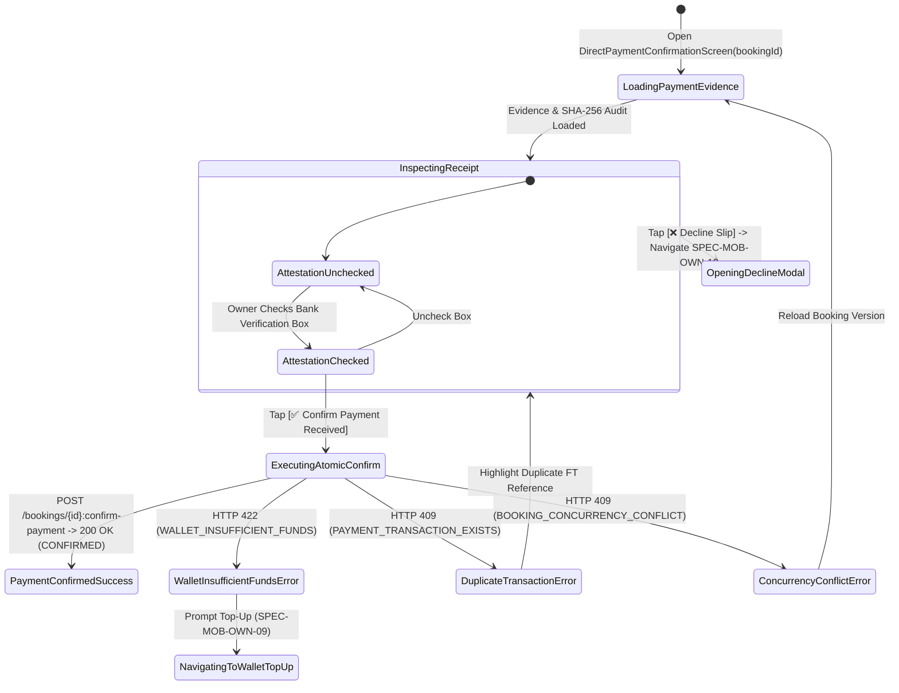
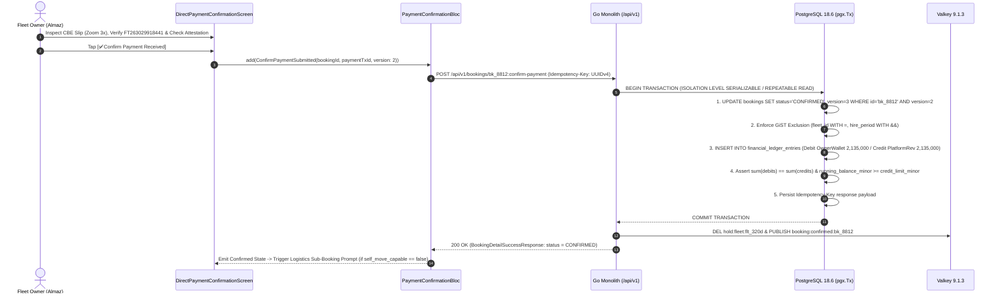

# Direct Bank Wire Evidence Review & Atomic Commission Debit Confirmation
## Mobile Subsystem Specification — `docs/mobile/owner-experience/08-direct-payment-confirmation.md`

**Document Identifier:** `SPEC-MOB-OWN-08`  
**Classification:** Canonical Subsystem UI/UX & Technical Behavior Specification  
**Governing Documents:** `Dink_Machinery_UI_UX_Design_Brief.md`, `SRS-DINK-CORE-V7.0` (§5.5.4, §5.9.3, `BK-07`..`BK-10`, `BK-17-BE`, `CW-01`, `CW-06`), `docs/shared/design/design-tokens.json`, `docs/ERROR_CATALOG.md`, `contracts/openapi.yaml`  
**Target Subsystem:** Flutter 3.47.8 / Dart 3.9 Mobile Client (iOS & Android)  
**Primary Persona / Actor:** Equipment Fleet Owner & Depot Yard Manager (*W/ro Almaz Tesfaye* / *Kamau Ndegwa*)  
**Associated Requirements:** `REQ-05-05` (`BK-09`, `BK-10`, `BK-07B` Duplicate Receipt Hash Detection, `BK-17-BE` Atomic In-Transaction Commission Ledger Mutation), `REQ-05-09` (`CW-01`, `CW-06`)  
**Associated Interaction Flows:** `FLOW-08` (Direct Bank Wire Verification & Atomic Ledger Debit), `FLOW-12` (Commission Overdraft Check)  
**Associated ADRs:** `ADR-002` (Double-Entry Ledger Invariant inside `pgx.Tx`), `ADR-004` (Valkey Lease to GiST Range Promotion), `ADR-005` (ClamAV & SHA-256 Receipt Hashing), `ADR-010` (Non-Custodial NBE Settlement)  
**Status:** Approved Technical Design Baseline

---

## 1. Domain Context, Business Rules & Architectural Invariants

Under National Bank of Ethiopia (NBE) non-custodial regulations, Dink Machinery never holds gross rental funds in escrow. Instead, the Civil Contractor transfers the **50% advance prepayment** (or **100% final settlement balance** at return `RC-06`) directly into the Fleet Owner's verified commercial bank account (e.g., *Commercial Bank of Ethiopia*, *Awash Bank*, *Dashen Bank*, *Bank of Abyssinia*, or *KCB / Equity / M-PESA Paybill* in Kenya) and uploads the wire confirmation slip (`BK-07`).

The **Direct Payment Evidence Review Drawer** (`SPEC-MOB-OWN-08`) provides the Fleet Owner with a high-precision forensic lightbox to inspect the uploaded bank wire slip, cross-check the cryptographic `SHA-256` receipt hash (`BK-07B`), and execute the atomic **"Confirm Payment Received"** mutation (`POST /api/v1/bookings/{id}:confirm-payment` / `BK-10`, `BK-17-BE`).

### 1.1 Core Business Rules & Operational Invariants
1. **Interactive Pinch-to-Zoom Receipt Lightbox (`BK-09`):**
   - Renders the ClamAV-verified bank slip (`s3://dink-payment-vault/...`) inside an `InteractiveViewer` supporting `1.0x` to `5.0x` pinch-to-zoom, 90° rotation, and high-contrast invert filter for inspecting faint thermal bank teller stamps or mobile banking FT reference numbers (e.g., `FT2630299184`).
   - Displays the contractor-submitted transaction reference string with a one-tap `[📋 Copy FT Ref]` button so the owner can paste it into their CBE / Awash corporate banking app.
2. **Cryptographic `SHA-256` & OCR Duplicate Receipt Fraud Warning (`BK-07B`):**
   - Upon ingestion, the backend computes the `SHA-256` file digest and extracts the bank reference number (`payment_reference`).
   - If the binary hash or normalized FT reference matches any historical transaction across the platform (`PAYMENT_TRANSACTION_EXISTS` or fuzzy OCR match), a high-visibility crimson/amber fraud alert banner (`BK-07B`) is pinned over the viewer:
     `🚨 WARNING: Receipt SHA-256 / FT Reference matches previous booking #BK-8401. Verify actual bank credit before confirming!`
3. **Atomic In-Transaction `pgx.Tx` State Transition & 10% Commission Debit (`BK-10`, `BK-17-BE`, `CW-01`):**
   - Tapping `[✅ CONFIRM PAYMENT RECEIVED]` requires a deliberate slide-to-confirm or two-step confirmation checkbox attesting: *"I have verified that 106,750.00 ETB has cleared in my bank account."*
   - Inside a single PostgreSQL `pgx.Tx` database transaction (`BK-17-BE`), the backend atomically:
     1. Verifies optimistic lock `bookings.version` (`BOOKING_CONCURRENCY_CONFLICT` if stale).
     2. Transitions `bookings.status` from `PAYMENT_EVIDENCE_UPLOADED` to `CONFIRMED` and locks the PostgreSQL GiST `daterange` exclusion constraint (`EXCLUDE USING gist`).
     3. Evaluates the Dynamic Commission Rule Engine (`CW-01`: $10.0\%$ for machinery/attachments, $2.5\%$ for linked logistics) and inserts an immutable double-entry debit leg (`COMMISSION_DEBIT`) into `owner_wallet_transactions` alongside a matching credit leg to Platform Revenue (`LEDGER_DOUBLE_ENTRY_IMBALANCE` zero-sum check).
     4. Verifies that the resulting `OwnerWallet` running balance does not breach the owner's approved credit limit buffer (`-5,000.00 ETB` / `-500,000` minor units `CW-06`, or enterprise tier limit). If breached, returns HTTP 422 `WALLET_INSUFFICIENT_FUNDS` and prompts immediate wallet top-up (`SPEC-MOB-OWN-09`).

---

## 2. Screen Anatomy, Layout & Bespoke ASCII Wireframe

### 2.1 Payment Evidence Forensic Viewer & Atomic Confirmation Wireframe
```text
+-----------------------------------------------------------------------+
| [← Back to Dossier]    VERIFY BANK WIRE EVIDENCE        #BK-8812      |
+-----------------------------------------------------------------------+
| 🚨 BK-07B HASH CHECK: [🟢 UNIQUE SHA-256 DIGEST • ZERO PRIOR MATCHES] |
|    File SHA-256: e3b0c44298fc1c14...92b7852b855  | ClamAV: CLEAN ✓    |
+-----------------------------------------------------------------------+
| 🔍 INTERACTIVE RECEIPT LIGHTBOX (Pinch 1x–5x • Double-Tap to Zoom)    |
| +-------------------------------------------------------------------+ |
| | [🔄 Rotate 90°]       [◐ High-Contrast Invert]      [⤢ Fullscreen]| |
| |                                                                   | |
| |        +-------------------------------------------------+        | |
| |        |      COMMERCIAL BANK OF ETHIOPIA (CBE)          |        | |
| |        |          VAT INVOICE / FUND TRANSFER            |        | |
| |        | Date: 29-Oct-2026 14:12:08                      |        | |
| |        | FT Reference: FT263029918441                    |        | |
| |        | Debit Acct:   100029****8812 (Haile-Mariam PLC) |        | |
| |        | Credit Acct:  1000048829104  (Tesfaye Plant PLC)|        | |
| |        | Amount:       ETB 106,750.00                    |        | |
| |        | Narrative:    50% Prepay BK-8812 Cat 320D       |        | |
| |        +-------------------------------------------------+        | |
| |                                                                   | |
| +-------------------------------------------------------------------+ |
+-----------------------------------------------------------------------+
| 📋 WIRE RECONCILIATION & ATOMIC WALLET LEDGER IMPACT (BK-17-BE)       |
| +-------------------------------------------------------------------+ |
| | Expected 50% Advance Prepayment:          106,750.00 ETB          | |
| | Bank Reference (OCR Extracted):           FT263029918441 [📋 Copy]| |
| | Beneficiary Account Verified:             CBE ••••9104            | |
| |-------------------------------------------------------------------| |
| | 💼 OWNER WALLET COMMISSION DEBIT PREVIEW (CW-01 / 10.00%):        | |
| | • Current OwnerWallet Balance:             +4,500.00 ETB          | |
| | • Atomic 10% Commission Debit (pgx.Tx):   -21,350.00 ETB          | |
| | • Projected Balance After Confirmation:   -16,850.00 ETB          | |
| |   (Within Enterprise Overdraft Limit: -50,000.00 ETB ✓)           | |
| +-------------------------------------------------------------------+ |
|                                                                       |
| [☑] I have independently verified my commercial bank statement and    |
|     confirm that 106,750.00 ETB has cleared into my account.          |
+-----------------------------------------------------------------------+
| [ ❌ DECLINE SLIP (OPEN #10) ]      [ ✅ CONFIRM PAYMENT RECEIVED ]   |
+-----------------------------------------------------------------------+
```

---

## 3. W3C DTCG Design Token Mapping Table

| UI Component / Element | W3C Token Path (`design-tokens.json`) | Resolved Value (Light / Dark / Outdoor) | Behavioral & Accessibility Invariant |
|---|---|---|---|
| **Lightbox Viewport Canvas** | `color.brand.slate.950` + `component.lightbox.hudBackground` | `#020617` backdrop, HUD `rgba(2, 6, 23, 0.85)` | Dark frame maximizes contrast around scanned paper/screen bank receipts. |
| **Duplicate Hash Warning (`BK-07B`)** | `color.feedback.crimson.100` + `color.feedback.crimson.700` | Bg `#FEE2E2`, Text `#B91C1C`, Border `#EF4444` (`3dp`) | Displayed if `isDuplicateHashOrRef == true` to prevent replay of old wire slips. |
| **Unique Hash Verified Banner** | `color.feedback.emerald.50` + `color.feedback.emerald.700` | Bg `#ECFDF5`, Text `#047857` | Confirms `SHA-256` digest and `FT` reference have never been used before. |
| **Monetary & Reference Figures** | `typography.fontFamily.mono` + `typography.fontSize.16` | `Space Mono` `16sp` | Renders FT references (`FT263029918441`) and minor-unit amounts clearly. |
| **Confirm Payment CTA Button** | `component.actuator.button.heightField` + `color.feedback.emerald.600` | Height `64dp`, Fill `#059669`, Text `#FFFFFF`, Lip `3dp` | Unlocked only when the attestation checkbox is checked (`isAttested == true`). |
| **Decline Slip Button** | `component.actuator.button.heightField` + `semantic.{mode}.action.destructive.bg` | Height `64dp`, Fill `#EF4444` / `#B91C1C` | Opens structured Payment Decline Modal (`SPEC-MOB-OWN-10`). |

---

## 4. Interactive State Machine & Sequence Flows

### 4.1 Payment Evidence Verification & Atomic Ledger Transition State Machine


### 4.2 Atomic `pgx.Tx` Confirmation & Double-Entry Commission Debit Sequence (`BK-17-BE`)


---

## 5. Concrete Flutter Implementation Blueprint

### 5.1 BLoC Events & Immutable Freezed States
```dart
// lib/features/owner_bookings/presentation/bloc/payment_confirmation_bloc.dart
import 'package:freezed_annotation/freezed_annotation.dart';
import 'package:flutter_bloc/flutter_bloc.dart';

part 'payment_confirmation_bloc.freezed.dart';

@freezed
sealed class PaymentConfirmationEvent with _$PaymentConfirmationEvent {
  const factory PaymentConfirmationEvent.started(String bookingId) = _Started;
  const factory PaymentConfirmationEvent.imageTransformToggled({
    required int quarterTurns,
    required bool invertHighContrast,
  }) = _ImageTransformToggled;
  const factory PaymentConfirmationEvent.attestationToggled(bool isAttested) = _AttestationToggled;
  const factory PaymentConfirmationEvent.confirmPaymentRequested() = _ConfirmPaymentRequested;
}

@freezed
class PaymentEvidenceAuditDto with _$PaymentEvidenceAuditDto {
  const factory PaymentEvidenceAuditDto({
    required String paymentTransactionId,
    required String bookingId,
    required int bookingVersion,
    required String paymentStage, // 'ADVANCE_PREPAYMENT_50' | 'FINAL_RECONCILIATION_BALANCE'
    required String slipImageS3Uri,
    required String sha256FileDigest,
    required String bankName,
    required String submittedReferenceNumber,
    required String beneficiaryAccountMasked,
    required String currency,
    required int claimedAmountMinor,
    required int platformCommissionDebitMinor,
    required int currentWalletBalanceMinor,
    required int projectedWalletBalanceMinor,
    required int walletCreditLimitMinor,
    required bool isDuplicateHashDetected, // BK-07B
    String? duplicateMatchedBookingId,
  }) = _PaymentEvidenceAuditDto;
}

@freezed
sealed class PaymentConfirmationState with _$PaymentConfirmationState {
  const factory PaymentConfirmationState.loading() = _Loading;
  const factory PaymentConfirmationState.inspecting({
    required PaymentEvidenceAuditDto evidence,
    @Default(0) int rotationQuarterTurns,
    @Default(false) bool invertColors,
    @Default(false) bool isBankReceiptAttested,
    @Default(false) bool isSubmittingConfirmation,
    required String idempotencyKey,
    ProblemDetails? submissionError,
  }) = _Inspecting;
  const factory PaymentConfirmationState.confirmed({
    required String bookingId,
    required String newStatus, // 'CONFIRMED' or 'COMPLETED'
    required int updatedWalletBalanceMinor,
    required bool requiresLogisticsSubBooking,
  }) = _Confirmed;
}
```

### 5.2 Isar Local Cache for Offline Slip Inspection
```dart
// lib/features/owner_bookings/data/local/isar_payment_evidence_cache.dart
import 'package:isar/isar.dart';

part 'isar_payment_evidence_cache.g.dart';

@collection
class IsarPaymentEvidenceCache {
  Id id = Isar.autoIncrement;

  @Index(unique: true, replace: true)
  late String paymentTransactionId;

  @Index()
  late String bookingId;

  late int bookingVersion;
  late String localCachedWebpPath;
  late String sha256FileDigest;
  late String submittedReferenceNumber;
  late int claimedAmountMinor;
  late int platformCommissionDebitMinor;
  late bool isDuplicateHashDetected;
  String? duplicateMatchedBookingId;
  late DateTime cachedAt;
}
```

### 5.3 Widget Tree Hierarchy
```text
DirectPaymentConfirmationScreen (Scaffold)
 ├── PaymentAuditAppBar (Booking ID, Stage Pill: "50% Prepayment" or "Final Settlement")
 ├── DuplicateHashSecurityBanner (BK-07B: Emerald "Unique SHA-256" or Crimson "Duplicate Slip Detected!")
 ├── Expanded -> ForensicSlipInteractiveViewer (InteractiveViewer minScale: 1.0, maxScale: 5.0 + ColorFilter Invert + 90° Rotate)
 ├── ReconciliationAndCommissionCard (Expected Minor Units, Copyable FT Ref, Atomic Wallet Debit Preview)
 ├── BankVerificationAttestationCheckbox (56dp Touch Target Checkbox)
 └── StickyConfirmationFooter ([❌ Decline Slip (#10)] + [✅ Confirm Payment Received])
```

---

## 6. OpenAPI 3.1.0 Routes & RFC 9457 Error Matrix

### 6.1 Bound API Endpoints
| Operation | HTTP Method & URI | Headers Required | Purpose & Contract Binding |
|---|---|---|---|
| **Confirm Booking Payment** | `POST /api/v1/bookings/{id}:confirm-payment` | `Authorization: Bearer <JWT>`, `Idempotency-Key: <UUIDv4>` | Body: `{paymentTransactionId, version}`. Atomically transitions booking to `CONFIRMED` and debits 10% commission inside `pgx.Tx` (`BK-17-BE`). |
| **Confirm Final Return Balance** | `POST /api/v1/bookings/{id}/final-reconcile` | `Authorization: Bearer <JWT>`, `Idempotency-Key: <UUIDv4>` | Used when confirming post-rental excess hour / damage settlement (`RC-06`), transitioning `PENDING_FINAL_PAYMENT` $\rightarrow$ `COMPLETED`. |

### 6.2 RFC 9457 Problem Details Error Matrix
| Error Code (`error.code`) | HTTP Status | Type URI | Trigger Condition | Mobile UI Recovery Behavior |
|---|---|---|---|---|
| `WALLET_INSUFFICIENT_FUNDS` | `422` | `/errors/wallet-insufficient-funds` | Debiting the $10\%$ commission would push `OwnerWallet` below the approved credit limit (`-5,000.00 ETB` `CW-06`). | Display modal explaining the credit buffer shortfall with a one-tap `[💳 Top Up Wallet Now]` CTA (`SPEC-MOB-OWN-09`) while preserving the booking hold. |
| `PAYMENT_TRANSACTION_EXISTS` | `409` | `/errors/payment-transaction-exists` | Supplied bank wire reference or receipt hash has already been settled in the ledger (`BK-07B`). | Block confirmation and prompt owner to click `[❌ Decline Slip]` with reason `DUPLICATE_OR_REUSED_SLIP`. |
| `BOOKING_CONCURRENCY_CONFLICT` | `409` | `/errors/booking-concurrency-conflict` | `version` column mismatch due to concurrent update. | Reload booking state and re-verify before re-submitting. |
| `LEDGER_DOUBLE_ENTRY_IMBALANCE` | `500` | `/errors/ledger-imbalance` | Internal double-entry invariant check failed; `pgx.Tx` rolled back automatically. | Display safe error toast with `meta.requestId` and allow idempotent retry. |

---

## 7. Verification & Acceptance Criteria

- [ ] **Atomic `pgx.Tx` Commission Debit Preview (`BK-17-BE`, `CW-01`):** The UI calculates and displays the exact `OwnerWallet` balance before and after the $10\%$ commission debit in integer minor units prior to button tap.
- [ ] **Duplicate Receipt `SHA-256` Interception (`BK-07B`):** When `isDuplicateHashDetected == true`, a persistent crimson warning banner displays the conflicting booking ID (`#BK-8401`) and requires an additional explicit override acknowledgement.
- [ ] **Idempotency Replay Safety:** Re-sending `POST /api/v1/bookings/{id}:confirm-payment` with the same `Idempotency-Key` header after a simulated network drop returns the original `200 OK` response without double-debiting `OwnerWallet`.
- [ ] **Overdraft Buffer Guard (`CW-06`, `WALLET_INSUFFICIENT_FUNDS`):** When `projectedWalletBalanceMinor < walletCreditLimitMinor`, the UI warns the owner upfront and routes `422 WALLET_INSUFFICIENT_FUNDS` directly to the Wallet Top-Up flow (`SPEC-MOB-OWN-09`).
