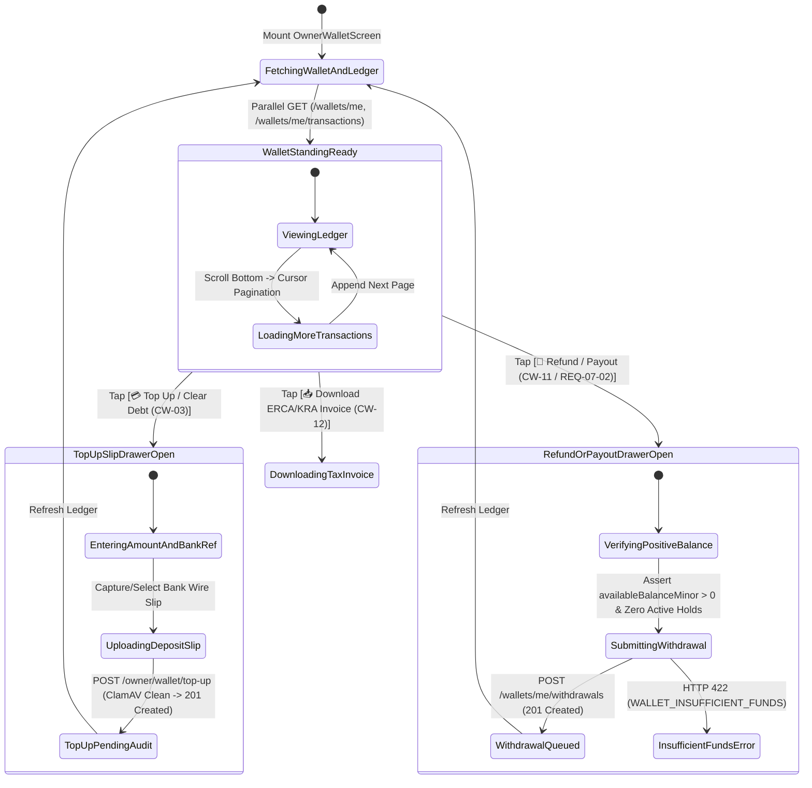
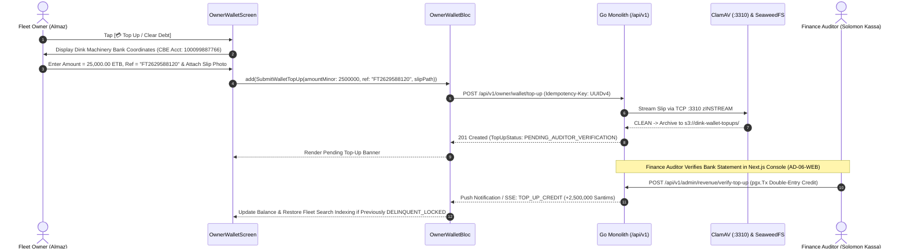

# Pre-Funded OwnerWallet, Commission Ledger, Top-Up & Phase-3 Escrow Payout Console
## Mobile Subsystem Specification — `docs/mobile/owner-experience/09-owner-wallet-payout-request.md`

**Document Identifier:** `SPEC-MOB-OWN-09`  
**Classification:** Canonical Subsystem UI/UX & Technical Behavior Specification  
**Governing Documents:** `Dink_Machinery_UI_UX_Design_Brief.md`, `SRS-DINK-CORE-V7.0` (§5.9, §7.2, `CW-01`..`CW-12`), `docs/shared/design/design-tokens.json`, `docs/ERROR_CATALOG.md`, `contracts/openapi.yaml`  
**Target Subsystem:** Flutter 3.47.8 / Dart 3.9 Mobile Client (iOS & Android)  
**Primary Persona / Actor:** Equipment Fleet Owner & Depot Yard Manager (*W/ro Almaz Tesfaye* / *Kamau Ndegwa*)  
**Associated Requirements:** `REQ-05-09` (`CW-01` to `CW-12`), `REQ-07-02` (Phase 3 Automated Commission Deduction & Gateway Escrow Payouts)  
**Associated Interaction Flows:** `FLOW-12` (Commission Debt, Top-Up Verification & Delinquency Lockout), `FLOW-18` (Force Majeure Commission Restitution)  
**Associated ADRs:** `ADR-002` (Immutable Double-Entry Ledger & Integer Minor Units), `ADR-005` (ClamAV Top-Up Slip Verification), `ADR-008` (Multi-Country ERCA/KRA Tax & 2% WHT), `ADR-010` (Phase 1 Non-Custodial Pre-Funded Wallet vs. Phase 3 Gateway Escrow)  
**Status:** Approved Technical Design Baseline

---

## 1. Domain Context, Business Rules & Architectural Invariants

The **Pre-Funded `OwnerWallet` & Commission Ledger Console** (`SPEC-MOB-OWN-09`) is the financial core of the Fleet Owner mobile experience. It bridges East African sovereign banking compliance across two distinct architectural phases (`ADR-010`):

### 1.1 Dual-Phase Financial Operating Model (`ADR-010`, `CW-01`..`CW-12`, `REQ-07-02`)
1. **Phase 1 — Non-Custodial Direct P2P Settlement & Pre-Funded Commission Wallet (`CW-01`..`CW-12`):**
   - In accordance with National Bank of Ethiopia (NBE) non-custodial directives, Dink Machinery never holds gross rental funds. Civil contractors wire 50% advance prepayments and final settlement balances directly into the Fleet Owner's commercial bank account (`FLOW-08`).
   - To settle the platform's **$10.0\%$ machinery/attachment commission** ($1,000\text{ bps}$) and **$2.5\%$ pass-through logistics commission** ($250\text{ bps}$), every owner maintains a virtual double-entry `OwnerWallet`.
   - **Default Overdraft Credit Buffer (`CW-06`):** Standard owners receive a statutory `-5,000.00 ETB` (`-500,000` Santims) negative credit limit buffer (expandable to `-50,000.00 ETB` / `-100,000.00 ETB` for verified corporate fleets under Four-Eyes authorization).
   - **Wallet Top-Up & Debt Clearance (`CW-03`):** Owners pre-fund their wallet or clear accumulated commission debt by transferring funds to Dink Machinery's corporate bank account (CBE, Awash, Dashen, or M-PESA Paybill) and uploading the bank deposit slip for ClamAV scan and Finance Auditor (*Solomon Kassa*) verification (`TOP_UP_CREDIT`).
   - **30-Day Delinquency Aging & Spatial De-Indexing (`CW-04`):** Unsettled commission debt is tracked across four aging buckets (`Current 0d`, `1–15 Days`, `16–30 Days`, `>30 Days Overdue`). Debt exceeding 30 days triggers `DELINQUENT_LOCKED`, automatically removing all the owner's machines from PostGIS spatial search until cleared.
   - **Unused Prepaid Balance Refund (`CW-11`):** If an owner has a positive prepaid credit balance (`balance_minor > 0`) and zero active/pending bookings, they can request a refund withdrawal of their unused prepaid balance back to their verified bank account.
   - **Statutory Tax Invoices & 2% Withholding Tax (`WHT`) Certificates (`CW-12`):** Generates downloadable monthly PDF tax statements compliant with the **Ethiopian Ministry of Revenue (ERCA)** (15% VAT + 2% WHT on B2B services under TIN verification) and the **Kenya Revenue Authority (KRA)** (eTIMS 16% VAT).
2. **Phase 3 — Automated Gateway Escrow & Instant Payout Withdrawals (`REQ-07-02`):**
   - When the `feature_flag.escrow_gateway_payouts_enabled` remote config flag (`REQ-05-21`) is enabled for licensed jurisdictions/gateways (Telebirr SuperApp, CBEBirr, Safaricom M-PESA B2C), gross rental funds clear through the licensed payment gateway, the $10\%$ commission is deducted automatically at source (`REQ-07-02`), and net rental proceeds (`NET_ESCROW_CREDIT`) accumulate in `OwnerWallet` for one-tap withdrawal to the owner's bank or mobile money account.

---

## 2. Screen Anatomy, Layout & Bespoke ASCII Wireframe

### 2.1 Pre-Funded `OwnerWallet`, Aging Buckets, Top-Up & Tax Invoice Console Wireframe
```text
+-----------------------------------------------------------------------+
| [← Back]          OWNER WALLET & COMMISSION LEDGER      [📄 TAX PDF]  |
| Mode: Phase 1 Non-Custodial Commission Wallet (NBE Compliant • ETB)   |
+-----------------------------------------------------------------------+
| 💼 PRE-FUNDED WALLET STANDING & CREDIT LIMIT BUFFER (CW-01 / CW-06)   |
| +-------------------------------------------------------------------+ |
| | Current Wallet Balance:          -1,850.00 ETB   [🟢 GOOD STANDING]| |
| | Statutory Credit Limit Buffer:   -5,000.00 ETB   (3,150 ETB Avail)| |
| | Buffer Utilization: [█████████░░░░░░░░░░░░░░░] 37.0% Used         | |
| |-------------------------------------------------------------------| |
| | 30-Day Gross P2P Direct Wires:  425,000.00 ETB   (Paid by Renters)| |
| | 30-Day Platform Commissions:    -42,500.00 ETB   (10% / 2.5% Tier)| |
| | 30-Day Net Retained Earnings:   382,500.00 ETB   (90.0% Margin)   | |
| |-------------------------------------------------------------------| |
| | [ 💳 TOP UP / CLEAR DEBT (CW-03) ]  [ 🏦 REFUND / PAYOUT (CW-11) ]| |
| +-------------------------------------------------------------------+ |
|                                                                       |
| ⏳ COMMISSION DEBT AGING BUCKETS (30-DAY DELINQUENCY MONITOR - CW-04) |
| +----------------+ +----------------+ +---------------+ +-----------+ |
| | Current (0d)   | | 1 – 15 Days    | | 16 – 30 Days  | | >30d Lock | |
| |   0.00 ETB     | |  1,850.00 ETB  | |   0.00 ETB    | | 0.00 ETB  | |
| +----------------+ +----------------+ +---------------+ +-----------+ |
|                                                                       |
| 🧾 STATUTORY TAX & WHT COMPLIANCE (ERCA / KRA - CW-12)                |
| +-------------------------------------------------------------------+ |
| | Oct 2026 Commission Invoice (#INV-ET-202610-0891)                 | |
| | Base Commission: 36,956.52 ETB | 15% VAT: 5,543.48 ETB | 2% WHT   | |
| | [ 📥 Download ERCA VAT Invoice ]   [ 📎 Upload 2% WHT Receipt ]   | |
| +-------------------------------------------------------------------+ |
|                                                                       |
| 📜 IMMUTABLE DOUBLE-ENTRY LEDGER JOURNAL (Cursor-Paginated)           |
| [ All Entries ] [ 🔴 Debits ] [ 🟢 Top-Ups & Restitutions ]           |
| +-------------------------------------------------------------------+ |
| | 🔴 COMMISSION_DEBIT • Booking #BK-8812 (CAT 320D + Breaker)       | |
| |    29 Oct 2026 14:20 • 10.0% of 213,500.00 ETB Gross Contract     | |
| |    Amount: -21,350.00 ETB          Running Bal: -1,850.00 ETB     | |
| |-------------------------------------------------------------------| |
| | 🟢 COMMISSION_RESTITUTION • Booking #BK-8710 (FLOW-18 Force Maj.) | |
| |    24 Oct 2026 11:05 • Carrier Default Reversal (100% Credited)   | |
| |    Amount: +14,500.00 ETB          Running Bal: +19,500.00 ETB    | |
| |-------------------------------------------------------------------| |
| | 🟢 TOP_UP_CREDIT • CBE Ref: FT2629588120 (Verified by Auditor ✓)  | |
| |    20 Oct 2026 09:42 • Slip: s3://dink-wallet-topups/tu_991.webp  | |
| |    Amount: +25,000.00 ETB          Running Bal: +5,000.00 ETB     | |
| +-------------------------------------------------------------------+ |
+-----------------------------------------------------------------------+
```

---

## 3. W3C DTCG Design Token Mapping Table

| UI Component / Element | W3C Token Path (`design-tokens.json`) | Resolved Value (Light / Dark / Outdoor) | Behavioral & Accessibility Invariant |
|---|---|---|---|
| **Wallet Hero Surface** | `semantic.{mode}.surface.cardElevated` + `stroke.border.medium` | `#FFFFFF` / `#334155` / `#000000`, `2dp` border | Highlights current balance, credit buffer bar, and primary financial actions. |
| **Ledger Monetary Numerals** | `typography.fontFamily.mono` + `semantic.{mode}.text.numericLedger` | `Space Mono` `16sp` / `24sp`, `#020617` / `#F8FAFC` / `#FFFFFF` | Strict tabular alignment for debits (`-`), credits (`+`), and running balances. |
| **Debit Ledger Row Pill** | `color.feedback.crimson.50` + `color.feedback.crimson.700` | Bg `#FEF2F2`, Text `#B91C1C` | Identifies `COMMISSION_DEBIT` and `CANCELLATION_PENALTY` journal entries. |
| **Credit / Restitution Pill** | `color.feedback.emerald.50` + `color.feedback.emerald.700` | Bg `#ECFDF5`, Text `#047857` | Identifies `TOP_UP_CREDIT` and `COMMISSION_RESTITUTION` (`FLOW-18`) entries. |
| **Aging Bucket Card (>30d)** | `color.feedback.crimson.100` + `color.feedback.crimson.600` | Bg `#FEE2E2`, Border `#DC2626` (`2dp`) | Pulses when overdue balance $>0$, warning of `DELINQUENT_LOCKED` de-indexing. |

---

## 4. Interactive State Machine & Sequence Flows

### 4.1 OwnerWallet Top-Up, Refund & Ledger State Machine


### 4.2 Commission Top-Up Slip Upload & Auditor Release Sequence (`CW-03`, `CW-04`)


---

## 5. Concrete Flutter Implementation Blueprint

### 5.1 BLoC Events & Immutable Freezed States
```dart
// lib/features/owner_wallet/presentation/bloc/owner_wallet_bloc.dart
import 'package:freezed_annotation/freezed_annotation.dart';
import 'package:flutter_bloc/flutter_bloc.dart';

part 'owner_wallet_bloc.freezed.dart';

@freezed
sealed class OwnerWalletEvent with _$OwnerWalletEvent {
  const factory OwnerWalletEvent.started() = _Started;
  const factory OwnerWalletEvent.ledgerFilterChanged(String? transactionType) = _LedgerFilterChanged;
  const factory OwnerWalletEvent.nextLedgerPageRequested(String cursor) = _NextLedgerPageRequested;
  const factory OwnerWalletEvent.topUpSubmitted({
    required int amountMinor,
    required String bankName,
    required String paymentReference,
    required String localSlipWebpPath,
  }) = _TopUpSubmitted;
  const factory OwnerWalletEvent.unusedBalanceRefundRequested({
    required int requestedAmountMinor,
    required String destinationBankAccountId,
  }) = _UnusedBalanceRefundRequested;
  const factory OwnerWalletEvent.taxInvoiceDownloadRequested({
    required int year,
    required int month,
  }) = _TaxInvoiceDownloadRequested;
}

@freezed
class WalletLedgerEntryDto with _$WalletLedgerEntryDto {
  const factory WalletLedgerEntryDto({
    required String id,
    String? bookingId,
    required String transactionType, // 'TOP_UP_CREDIT' | 'COMMISSION_DEBIT' | 'CANCELLATION_PENALTY' | 'COMMISSION_RESTITUTION' | 'ADMIN_ADJUSTMENT'
    required int amountMinor, // Signed minor units
    required int runningBalanceMinor,
    String? paymentReference,
    String? documentStorageUri,
    required DateTime createdAt,
  }) = _WalletLedgerEntryDto;
}

@freezed
class DebtAgingBucketsDto with _$DebtAgingBucketsDto {
  const factory DebtAgingBucketsDto({
    required int current0dMinor,
    required int days1To15Minor,
    required int days16To30Minor,
    required int overdue30PlusMinor, // >0 triggers DELINQUENT_LOCKED (CW-04)
  }) = _DebtAgingBucketsDto;
}

@freezed
sealed class OwnerWalletState with _$OwnerWalletState {
  const factory OwnerWalletState.loading() = _Loading;
  const factory OwnerWalletState.loaded({
    required OwnerWalletSummaryDto summary,
    required DebtAgingBucketsDto agingBuckets,
    required bool isPhase3EscrowPayoutEnabled, // REQ-07-02 feature flag
    required List<WalletLedgerEntryDto> ledgerEntries,
    required String? nextCursor,
    required bool hasMoreEntries,
    String? activeTypeFilter,
    @Default(false) bool isSubmittingMutation,
    ProblemDetails? mutationError,
  }) = _Loaded;
}
```

### 5.2 Isar Local Persistence for Immutable Ledger Entries
```dart
// lib/features/owner_wallet/data/local/isar_wallet_ledger_entry.dart
import 'package:isar/isar.dart';

part 'isar_wallet_ledger_entry.g.dart';

@collection
class IsarWalletLedgerEntry {
  Id id = Isar.autoIncrement;

  @Index(unique: true, replace: true)
  late String transactionUuid;

  @Index()
  late String walletId;

  String? bookingId;
  late String transactionType;
  late int amountMinor;
  late int runningBalanceMinor;
  String? paymentReference;
  String? documentStorageUri;
  late DateTime createdAt;
}
```

### 5.3 Widget Tree Hierarchy
```text
OwnerWalletPayoutScreen (Scaffold)
 ├── WalletAppBar (Title, Phase 1/Phase 3 Mode Badge, [📄 TAX PDF] Button)
 ├── DelinquencyLockoutBanner (Shown if summary.walletStatus == 'DELINQUENT_LOCKED')
 └── CustomScrollView
      ├── SliverToBoxAdapter -> PreFundedWalletStandingCard (Balance, -5,000 ETB Buffer Bar, 30d Gross/Net, [Top Up] & [Refund/Payout] CTAs)
      ├── SliverToBoxAdapter -> CommissionDebtAgingBucketsRow (4 Cards: 0d, 1-15d, 16-30d, >30d Overdue)
      ├── SliverToBoxAdapter -> StatutoryTaxComplianceCard (CW-12 ERCA 15% VAT & 2% WHT / KRA eTIMS Invoice Download & WHT Upload)
      ├── SliverPersistentHeader -> LedgerTypeFilterBar (All, Debits, Top-Ups & Restitutions)
      └── SliverList -> ImmutableLedgerJournalList (Cursor-paginated WalletLedgerEntryDto tiles with Running Balance in Space Mono)
```

---

## 6. OpenAPI 3.1.0 Routes & RFC 9457 Error Matrix

### 6.1 Bound API Endpoints
| Operation | HTTP Method & URI | Headers Required | Purpose & Contract Binding |
|---|---|---|---|
| **Get Owner Wallet** | `GET /api/v1/wallets/me` | `Authorization: Bearer <JWT>`, `X-Country-Code: ET\|KE` | Retrieves `WalletSuccessResponse` (`balanceMinor`, `creditLimitMinor`, `agingBuckets`, `status`). |
| **List Ledger Journal** | `GET /api/v1/wallets/me/transactions?cursor={c}&limit=20` | `Authorization: Bearer <JWT>` | Cursor-paginated `WalletTransactionListSuccessResponse` (offset pagination strictly prohibited). |
| **Submit Top-Up Slip** | `POST /api/v1/owner/wallet/top-up` | `Authorization: Bearer <JWT>`, `Idempotency-Key: <UUIDv4>` | Uploads bank wire slip (`CW-03`) for ClamAV scan and Finance Auditor verification. |
| **Request Refund / Payout** | `POST /api/v1/wallets/me/withdrawals` | `Authorization: Bearer <JWT>`, `Idempotency-Key: <UUIDv4>` | Requests unused prepaid balance refund (`CW-11`) or Phase 3 gateway escrow payout (`REQ-07-02`). |

### 6.2 RFC 9457 Problem Details Error Matrix
| Error Code (`error.code`) | HTTP Status | Type URI | Trigger Condition | Mobile UI Recovery Behavior |
|---|---|---|---|---|
| `WALLET_INSUFFICIENT_FUNDS` | `422` | `/errors/wallet-insufficient-funds` | Withdrawal/refund request (`CW-11`) exceeds positive `availableBalanceMinor` ($\le 0$). | Disable withdrawal submit button and display exact positive balance required. |
| `WALLET_LOCKED_PENDING_AUDIT` | `423` | `/errors/wallet-locked-pending-audit` | Wallet is frozen for compliance audit or `DELINQUENT_LOCKED` (`CW-04`). | Allow `POST /owner/wallet/top-up` to clear debt, but block all withdrawals (`CW-11`). |
| `PAYMENT_TRANSACTION_EXISTS` | `409` | `/errors/payment-transaction-exists` | Top-up bank reference number (`paymentReference`) was already credited. | Highlight reference input in crimson and display the date/ID of the prior top-up entry. |
| `INSPECT_MEDIA_SCAN_FAILED` | `422` | `/errors/inspect-media-scan-failed` | Uploaded top-up bank slip or WHT certificate failed ClamAV scan (`:3310`). | Purge local file and prompt clean camera capture. |
| `LEDGER_IMMUTABLE_MUTATION` | `500` | `/errors/ledger-immutable-mutation` | Disallowed attempt to mutate historical ledger row. | Log `requestId` and refresh append-only journal. |

---

## 7. Verification & Acceptance Criteria

- [ ] **Phase 1 Non-Custodial Clarity (`CW-01`, `CW-06`, `ADR-010`):** The UI clearly distinguishes **Gross P2P Direct Wires** (received directly in the owner's bank account from renters) from the **Pre-Funded Commission Wallet Balance** (used for $10\%$ machinery and $2.5\%$ freight commissions with a `-5,000.00 ETB` credit limit buffer).
- [ ] **Cursor-Only Ledger Pagination:** Scrolling the ledger journal dispatches `GET /api/v1/wallets/me/transactions?cursor=...` and never uses SQL `OFFSET`.
- [ ] **Unused Balance Refund Guard (`CW-11`):** The `[🏦 Refund / Payout]` drawer only permits submission when `availableBalanceMinor > 0` (Phase 1 unused prepaid credit or Phase 3 net escrow balance).
- [ ] **Statutory ERCA/KRA Tax & 2% WHT Support (`CW-12`):** Owners in `ET` can download itemized 15% VAT commission invoices and upload 2% Withholding Tax certificates; owners in `KE` receive KRA eTIMS-formatted statements.
