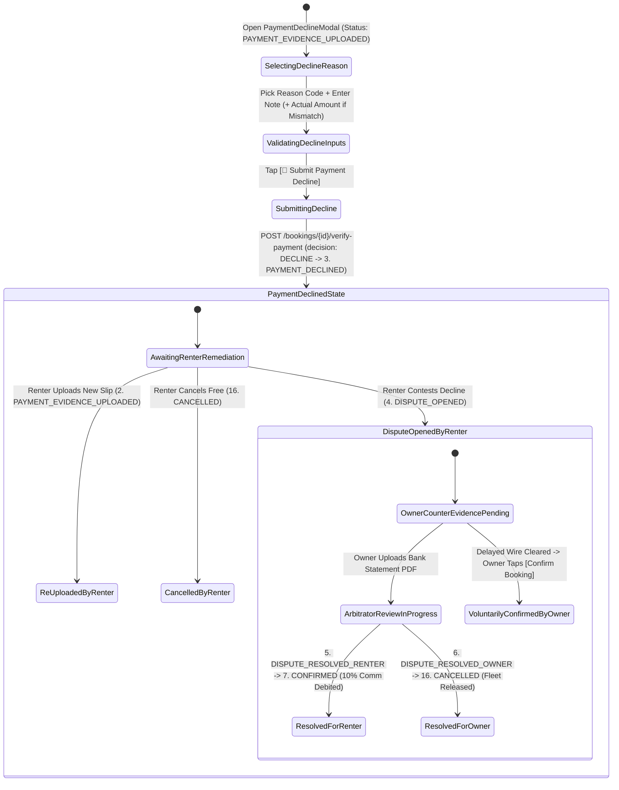
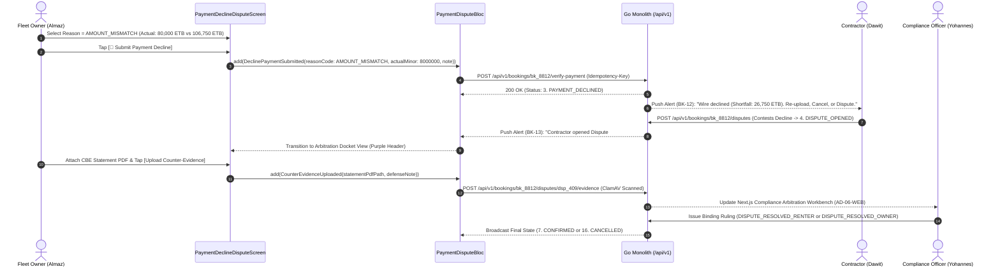

# Owner Payment Decline Modal, Renter Counter-Dispute Alert & Compliance Arbitration Docket
## Mobile Subsystem Specification — `docs/mobile/owner-experience/10-payment-decline-remediation-dispute.md`

**Document Identifier:** `SPEC-MOB-OWN-10`  
**Classification:** Canonical Subsystem UI/UX & Technical Behavior Specification  
**Governing Documents:** `Dink_Machinery_UI_UX_Design_Brief.md`, `SRS-DINK-CORE-V7.0` (§5.5.4, `BK-11` to `BK-13`), `docs/shared/design/design-tokens.json`, `docs/ERROR_CATALOG.md`, `contracts/openapi.yaml`  
**Target Subsystem:** Flutter 3.44 / Dart 3.9 Mobile Client (iOS & Android)  
**Primary Persona / Actor:** Equipment Fleet Owner & Depot Yard Manager (*W/ro Almaz Tesfaye* / *Kamau Ndegwa*)  
**Associated Requirements:** `REQ-05-05` (`BK-11` Structured Payment Decline Reason Codes, `BK-12` Renter Remediation Pathways, `BK-13` Compliance Arbitration & Dispute Resolution Docket)  
**Associated Interaction Flows:** `FLOW-08` (Direct Wire Verification & Decline), `FLOW-13` (Wire Dispute & Compliance Arbitration)  
**Associated ADRs:** `ADR-001` (Modular Monolith), `ADR-002` (Double-Entry Ledger Hold), `ADR-004` (Valkey Hold Lease Extension During Dispute), `ADR-010` (Non-Custodial P2P Wire Audit)  
**Status:** Approved Technical Design Baseline

---

## 1. Domain Context, Business Rules & Architectural Invariants

When a Fleet Owner inspects a contractor's uploaded bank wire receipt in `SPEC-MOB-OWN-08` and discovers that the funds have not cleared into their commercial bank account, the transferred amount is short, or the uploaded image is illegible/forged, the platform must provide a structured, auditable rejection and dispute resolution workflow.

The **Owner Payment Decline & Compliance Arbitration Docket** (`SPEC-MOB-OWN-10`) implements `REQ-05-05` (`BK-11`, `BK-12`, `BK-13`), governing the transition of a booking from `PAYMENT_EVIDENCE_UPLOADED` $\rightarrow$ `PAYMENT_DECLINED` $\rightarrow$ `DISPUTE_OPENED` $\rightarrow$ (`DISPUTE_RESOLVED_RENTER` $\rightarrow$ `CONFIRMED` | `DISPUTE_RESOLVED_OWNER` $\rightarrow$ `CANCELLED`).

### 1.1 Core Business Rules & Operational Invariants
1. **Structured Payment Decline Reason Codes (`BK-11`):**
   - An owner cannot decline a payment slip without selecting a canonical reason enum (`PaymentDeclineReasonCode`) and entering an explanatory audit note ($10\dots500\text{ chars}$):
     - **`FUNDS_NOT_RECEIVED_IN_BANK`:** Wire transfer has not reflected in the owner's commercial bank statement after inter-bank RTGS/instant clearing check.
     - **`AMOUNT_MISMATCH`:** Transferred amount is less than the mandatory 50% advance prepayment (or final settlement balance); requires entering the `actualReceivedAmountMinor` so the exact shortfall is calculated for the renter.
     - **`UNVERIFIABLE_REFERENCE`:** The FT / bank transaction reference number on the slip does not exist or cannot be verified with the issuing bank.
     - **`ILLEGIBLE_SLIP`:** Uploaded photo is blurry, cropped, dark, or missing the bank stamp / account numbers.
     - **`DUPLICATE_OR_REUSED_SLIP`:** Slip matches a prior booking's `SHA-256` hash or FT reference (`BK-07B`).
2. **Renter Remediation vs. Counter-Dispute Escalation (`BK-12`, `BK-13`):**
   - Upon owner decline (`PAYMENT_DECLINED`), the contractor receives an urgent P0 push/SMS notification with three structured options (`BK-12`):
     1. **Re-Upload Corrected/Additional Wire Slip:** Transitions booking back to `PAYMENT_EVIDENCE_UPLOADED` for owner re-verification.
     2. **Cancel Booking Without Penalty:** Free cancellation (`CANCELLED`), releasing the Valkey hold lease.
     3. **Contest Decline & Open Compliance Arbitration (`BK-13`):** Transitions booking to `DISPUTE_OPENED` (`4. DISPUTE_OPENED` in the 16-state FSM).
3. **Compliance Arbitration Docket & Bank Statement Defense (`BK-13`, `FLOW-13`):**
   - When the renter contests a decline (`DISPUTE_OPENED`), the Valkey reservation hold and PostgreSQL temporal range remain frozen so the machine cannot be double-booked during arbitration.
   - The Fleet Owner receives a high-priority **Counter-Dispute Alert** requiring them to upload a timestamped PDF/screenshot of their commercial bank statement history covering the disputed time window within **12 hours**.
   - Compliance Arbitrator (*Yohannes Bekele*) reviews both the contractor's wire slip and the owner's bank statement in the Next.js Arbitration Workbench (`AD-06-WEB`) and issues a binding ruling:
     - **`DISPUTE_RESOLVED_RENTER` (`5`):** Wire cleared legitimately; system atomically transitions booking to `CONFIRMED`, debits the $10\%$ commission from `OwnerWallet`, and logs a compliance strike against the owner.
     - **`DISPUTE_RESOLVED_OWNER` (`6`):** Wire was never received or slip was fabricated; system transitions booking to `CANCELLED`, releases the fleet back to PostGIS search, and penalizes/suspends the contractor account (`REQ-05-24`).

---

## 2. Screen Anatomy, Layout & Bespoke ASCII Wireframe

### 2.1 Screen A: Structured Payment Decline Modal (`BK-11`)
```text
+-----------------------------------------------------------------------+
| [✕ Cancel]         DECLINE PAYMENT EVIDENCE (#BK-8812)                |
| Claimed Wire: 106,750.00 ETB • CBE Ref: FT263029918441                |
+-----------------------------------------------------------------------+
| 1. SELECT STRUCTURED DECLINE REASON CODE (BK-11 - MANDATORY)          |
| +-------------------------------------------------------------------+ |
| | [○] FUNDS_NOT_RECEIVED_IN_BANK                                    | |
| |     No matching credit appears in my CBE corporate statement.     | |
| |-------------------------------------------------------------------| |
| | [●] AMOUNT_MISMATCH (Partial / Short Transfer)                    | |
| |     Funds arrived, but amount is less than 106,750.00 ETB.        | |
| |     +-----------------------------------------------------------+ | |
| |     | Actual Amount Received *: [ 80,000.00         ] ETB       | | |
| |     | Calculated Shortfall:     26,750.00 ETB (2,675,000 Cents) | | |
| |     +-----------------------------------------------------------+ | |
| |-------------------------------------------------------------------| |
| | [○] UNVERIFIABLE_REFERENCE (Invalid FT / Bank Reference Number)   | |
| |-------------------------------------------------------------------| |
| | [○] ILLEGIBLE_SLIP (Blurry, Cropped, or Unreadable Receipt Image) | |
| |-------------------------------------------------------------------| |
| | [○] DUPLICATE_OR_REUSED_SLIP (Matches Prior Booking SHA-256)      | |
| +-------------------------------------------------------------------+ |
|                                                                       |
| 2. AUDIT NOTE & REMEDIATION INSTRUCTIONS FOR CONTRACTOR *             |
| +-------------------------------------------------------------------+ |
| | Only 80,000.00 ETB was credited under FT263029918441. Please      | |
| | transfer the remaining 26,750.00 ETB balance and upload the       | |
| | supplementary CBE slip to confirm CAT 320D mobilization.          | |
| +-------------------------------------------------------------------+ |
| ⚠️ False declines of cleared bank wires are audited by Compliance     |
|    and may result in account demerits under Marketplace Integrity.    |
+-----------------------------------------------------------------------+
| [ ← BACK TO SLIP ]              [ 🚨 SUBMIT PAYMENT DECLINE (BK-11) ] |
+-----------------------------------------------------------------------+
```

### 2.2 Screen B: Renter Counter-Dispute Alert & Compliance Arbitrator Docket (`BK-13`)
```text
+-----------------------------------------------------------------------+
| [← Back]        WIRE DISPUTE ARBITRATION DOCKET         #BK-8812      |
| Status: [🟣 4. DISPUTE_OPENED] • Arbitrator: Yohannes B. (Assigned)   |
+-----------------------------------------------------------------------+
| 🚨 COUNTER-DISPUTE ALERT: CONTRACTOR CONTESTED YOUR PAYMENT DECLINE   |
|    Upload your bank account statement covering Oct 28–29 within       |
|    ⏱️ 09h 41m 18s to prove non-receipt / partial receipt.             |
+-----------------------------------------------------------------------+
| ⚖️ SIDE-BY-SIDE EVIDENCE LOCKER (SHARED WITH COMPLIANCE ARBITRATOR)   |
| +---------------------------------+---------------------------------+ |
| | 📄 CONTRACTOR EVIDENCE (Dawit)  | 🏦 OWNER DEFENSE (Almaz - You)  | |
| |---------------------------------|---------------------------------| |
| | • CBE Slip #FT263029918441      | • Decline Code: AMOUNT_MISMATCH | |
| | • Claimed: 106,750.00 ETB       | • Recorded Credit: 80,000 ETB   | |
| | • Renter Note: "Sent in 2       | • Statement Proof:              | |
| |   tranches: 80k + 26.75k FT2"   |   [✓ cbe_stmt_oct29.pdf Clean]  | |
| +---------------------------------+---------------------------------+ |
|                                                                       |
| 📤 SUBMIT OWNER COUNTER-EVIDENCE / BANK STATEMENT EXTRACT             |
| +-------------------------------------------------------------------+ |
| | [ 📎 ATTACH CBE STATEMENT PDF / SCREENSHOT (ClamAV Scanned) ]     | |
| | Statement Note: [ Uploaded official CBE statement showing only    | |
| |   one credit of 80,000 ETB; second tranche FT2 not received.    ] | |
| | [ 📨 UPLOAD COUNTER-EVIDENCE TO DOCKET ]                          | |
| +-------------------------------------------------------------------+ |
|                                                                       |
| 🏛️ ARBITRATION TIMELINE & BINDING RULING LOG                          |
| • 14:25 — Owner declined slip (Code: AMOUNT_MISMATCH, Short 26,750)   |
| • 14:38 — Contractor opened Dispute #DSP-409 & attached 2nd receipt   |
| • 14:50 — Owner uploaded CBE statement PDF (`cbe_stmt_oct29.pdf`)     |
| • [⏳ Pending Compliance Officer Ruling: DISPUTE_RESOLVED_RENTER /    |
|      DISPUTE_RESOLVED_OWNER]                                          |
+-----------------------------------------------------------------------+
| [ ✅ SECOND WIRE NOW RECEIVED — VOLUNTARILY CONFIRM BOOKING ]         |
+-----------------------------------------------------------------------+
```

---

## 3. W3C DTCG Design Token Mapping Table

| UI Component / Element | W3C Token Path (`design-tokens.json`) | Resolved Value (Light / Dark / Outdoor) | Behavioral & Accessibility Invariant |
|---|---|---|---|
| **Dispute Arbitration Header** | `color.feedback.purple.100` + `color.feedback.purple.900` | Bg `#F3E8FF`, Text `#581C87`, Accent `#A855F7` | Canonical semantic purple palette reserved for `DISPUTE_OPENED` (`color.feedback.purple`). |
| **Decline Radio Option Card** | `semantic.{mode}.surface.card` + `dimension.space.56` | `#FFFFFF` / `#1E293B` / `#000000`, Min Height `56dp` | Selected card highlights border in `#EF4444` (`color.feedback.crimson.500`). |
| **Shortfall Calculation Box** | `color.brand.amber.50` + `typography.fontFamily.mono` | Bg `#FFFBEB`, `Space Mono` `16sp`, Text `#78350F` | Automatically computes `expectedAmountMinor - actualReceivedAmountMinor`. |
| **Submit Decline Button** | `component.actuator.button.heightField` + `semantic.{mode}.action.destructive.bg` | Height `64dp`, Fill `#EF4444` / `#B91C1C`, Text `#FFFFFF` | Requires structured reason code + $\ge 10\text{ char}$ audit note. |
| **Voluntary Confirm Override** | `component.actuator.button.heightField` + `color.feedback.emerald.600` | Height `64dp`, Fill `#059669`, Text `#FFFFFF` | Allows owner to self-resolve the dispute immediately if a delayed bank wire arrives. |

---

## 4. Interactive State Machine & Sequence Flows

### 4.1 Payment Decline, Renter Remediation & Arbitration State Machine


### 4.2 Payment Decline & Compliance Dispute Escalation Sequence (`BK-11`..`BK-13`)


---

## 5. Concrete Flutter Implementation Blueprint

### 5.1 BLoC Events & Immutable Freezed States
```dart
// lib/features/owner_bookings/presentation/bloc/payment_dispute_bloc.dart
import 'package:freezed_annotation/freezed_annotation.dart';
import 'package:flutter_bloc/flutter_bloc.dart';

part 'payment_dispute_bloc.freezed.dart';

enum PaymentDeclineReasonCode {
  fundsNotReceivedInBank,
  amountMismatch,
  unverifiableReference,
  illegibleSlip,
  duplicateOrReusedSlip,
}

@freezed
sealed class PaymentDisputeEvent with _$PaymentDisputeEvent {
  const factory PaymentDisputeEvent.initialized(String bookingId) = _Initialized;
  const factory PaymentDisputeEvent.declineReasonSelected(PaymentDeclineReasonCode reason) = _DeclineReasonSelected;
  const factory PaymentDisputeEvent.actualReceivedAmountChanged(int actualReceivedMinor) = _ActualReceivedAmountChanged;
  const factory PaymentDisputeEvent.declineAuditNoteChanged(String note) = _DeclineAuditNoteChanged;
  const factory PaymentDisputeEvent.submitDeclineRequested() = _SubmitDeclineRequested;
  const factory PaymentDisputeEvent.uploadOwnerCounterEvidence({
    required String disputeId,
    required String bankStatementFilePath,
    required String defenseNote,
  }) = _UploadOwnerCounterEvidence;
  const factory PaymentDisputeEvent.voluntaryConfirmAfterDelayedWire() = _VoluntaryConfirmAfterDelayedWire;
}

@freezed
class ArbitrationDocketDto with _$ArbitrationDocketDto {
  const factory ArbitrationDocketDto({
    required String disputeId,
    required String bookingId,
    required String bookingStatus, // 'PAYMENT_DECLINED' | 'DISPUTE_OPENED' | 'DISPUTE_RESOLVED_RENTER' | 'DISPUTE_RESOLVED_OWNER'
    required PaymentDeclineReasonCode ownerDeclineReason,
    required String ownerDeclineNote,
    required int expectedPrepaymentMinor,
    int? ownerReportedActualMinor,
    String? renterCounterContestNote,
    @Default([]) List<String> renterEvidenceUris,
    @Default([]) List<String> ownerBankStatementUris,
    required DateTime ownerDefenseDeadlineAt,
    String? assignedArbitratorName,
    String? bindingRulingSummary,
  }) = _ArbitrationDocketDto;
}

@freezed
sealed class PaymentDisputeState with _$PaymentDisputeState {
  const factory PaymentDisputeState.composingDecline({
    required String bookingId,
    required int bookingVersion,
    required String paymentTransactionId,
    required int expectedPrepaymentMinor,
    PaymentDeclineReasonCode? selectedReason,
    int? actualReceivedMinor,
    @Default('') String auditNote,
    @Default(false) bool isSubmitting,
    ProblemDetails? error,
  }) = _ComposingDecline;

  const factory PaymentDisputeState.docketActive({
    required ArbitrationDocketDto docket,
    @Default(false) bool isUploadingDefense,
    ProblemDetails? error,
  }) = _DocketActive;
}
```

### 5.2 Isar Local Persistence for Dispute Docket Offline Access
```dart
// lib/features/owner_bookings/data/local/isar_payment_dispute_docket.dart
import 'package:isar/isar.dart';

part 'isar_payment_dispute_docket.g.dart';

@collection
class IsarPaymentDisputeDocket {
  Id id = Isar.autoIncrement;

  @Index(unique: true, replace: true)
  late String bookingId;

  String? disputeId;
  late String bookingStatus;
  late String ownerDeclineReason;
  late String ownerDeclineNote;
  late int expectedPrepaymentMinor;
  int? ownerReportedActualMinor;
  String? renterCounterContestNote;
  late List<String> ownerBankStatementUris;
  late DateTime ownerDefenseDeadlineAt;
  late DateTime syncedAt;
}
```

### 5.3 Widget Tree Hierarchy
```text
PaymentDeclineRemediationDisputeScreen (Scaffold)
 ├── Conditional View Switcher (Based on bookingStatus)
 │    ├── [When PAYMENT_EVIDENCE_UPLOADED] -> PaymentDeclineModalForm
 │    │    ├── DeclineReasonRadioGroup (5 Canonical BK-11 Codes)
 │    │    ├── AmountMismatchShortfallCalculator (Shown when reason == amountMismatch)
 │    │    ├── MandatoryAuditNoteInput (10..500 chars)
 │    │    └── SubmitPaymentDeclineButton (64dp Crimson CTA)
 │    └── [When PAYMENT_DECLINED or DISPUTE_OPENED] -> ComplianceArbitrationDocketView
 │         ├── DisputeStatusPurpleHeader (Arbitrator Name, 12h Defense Countdown SLA)
 │         ├── SideBySideEvidenceComparisonCard (Renter Wire Slips vs. Owner Bank Statement PDF)
 │         ├── OwnerBankStatementUploaderCard (ClamAV PDF/Image Uploader + Defense Note)
 │         ├── ArbitrationTimelineLogList (Immutable Audit Trail)
 │         └── VoluntaryConfirmOverrideButton (Allows immediate confirmation if RTGS wire clears late)
```

---

## 6. OpenAPI 3.1.0 Routes & RFC 9457 Error Matrix

### 6.1 Bound API Endpoints
| Operation | HTTP Method & URI | Headers Required | Purpose & Contract Binding |
|---|---|---|---|
| **Decline Payment Slip** | `POST /api/v1/bookings/{id}/verify-payment` | `Authorization: Bearer <JWT>`, `Idempotency-Key: <UUIDv4>` | Body: `{decision: "DECLINE", reasonCode, actualReceivedMinor, note, version}`. Transitions to `PAYMENT_DECLINED` (`BK-11`). |
| **Upload Dispute Defense** | `POST /api/v1/bookings/{id}/disputes/{disputeId}/evidence` | `Authorization: Bearer <JWT>`, `Idempotency-Key: <UUIDv4>` | Streams owner's commercial bank statement PDF/image through ClamAV (`:3310`) into the Compliance Arbitration Docket (`BK-13`). |
| **Voluntary Self-Confirm** | `POST /api/v1/bookings/{id}:confirm-payment` | `Authorization: Bearer <JWT>`, `Idempotency-Key: <UUIDv4>` | Resolves an open dispute in favor of confirmation if a delayed inter-bank wire subsequently clears. |

### 6.2 RFC 9457 Problem Details Error Matrix
| Error Code (`error.code`) | HTTP Status | Type URI | Trigger Condition | Mobile UI Recovery Behavior |
|---|---|---|---|---|
| `REQ_VALIDATION_FAILED` | `400` | `/errors/request-validation-failed` | Missing `reasonCode`, `note < 10 chars`, or `AMOUNT_MISMATCH` selected without `actualReceivedMinor < expectedPrepaymentMinor`. | Highlight offending field in crimson and scroll into view. |
| `BOOKING_INVALID_STATE_TRANSITION` | `409` | `/errors/booking-invalid-state` | Attempted to decline a booking already `CONFIRMED` or `DISPUTE_RESOLVED_RENTER`. | Refresh booking state and transition UI to current status. |
| `INSPECT_MEDIA_SCAN_FAILED` | `422` | `/errors/inspect-media-scan-failed` | Uploaded bank statement PDF/screenshot failed ClamAV scan (`:3310`). | Reject file and prompt clean statement export upload. |
| `BOOKING_CONCURRENCY_CONFLICT` | `409` | `/errors/booking-concurrency-conflict` | Renter re-uploaded a new slip at the exact moment owner tapped decline. | Reload latest slip and prompt owner to inspect the newly uploaded receipt before deciding. |

---

## 7. Verification & Acceptance Criteria

- [ ] **Structured Reason Code Enforcement (`BK-11`):** The `[🚨 Submit Payment Decline]` button is disabled until one of the 5 canonical `PaymentDeclineReasonCode` options is selected and an audit note of $\ge 10\text{ characters}$ is entered.
- [ ] **Exact Shortfall Calculation (`AMOUNT_MISMATCH`):** Selecting `AMOUNT_MISMATCH` and entering `80,000.00 ETB` against a `106,750.00 ETB` expected prepayment dynamically calculates and displays the `26,750.00 ETB` (`2,675,000` Santims) shortfall.
- [ ] **Counter-Dispute Defense Docket (`BK-13`):** When booking status transitions to `DISPUTE_OPENED`, the screen renders the purple arbitration header (`color.feedback.purple`), displays the 12-hour defense SLA timer, and allows uploading a ClamAV-verified bank statement PDF.
- [ ] **Delayed Wire Voluntary Resolution:** Tapping `[✅ Second Wire Now Received — Voluntarily Confirm Booking]` invokes `:confirm-payment`, closing the dispute and transitioning the booking to `CONFIRMED` with atomic $10\%$ commission debit.
