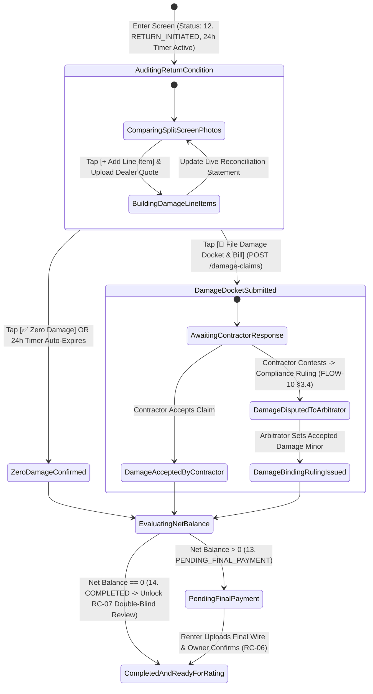
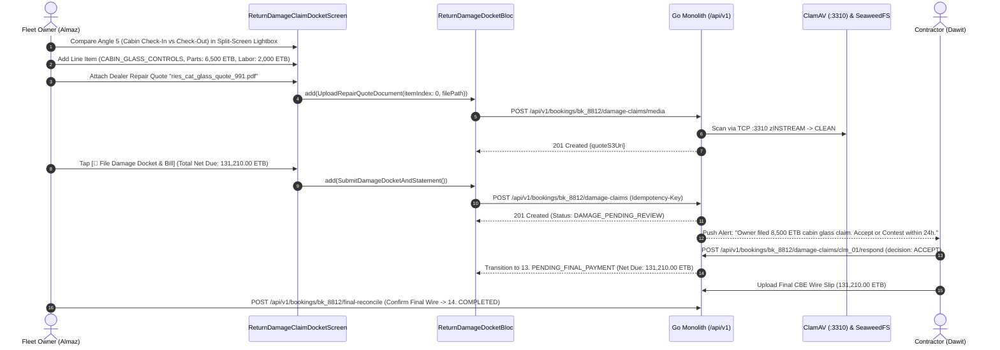

# 24-Hour Post-Return Itemized Damage Claim Docket & Final Settlement Reconciliation
## Mobile Subsystem Specification — `docs/mobile/owner-experience/11-return-damage-claim-24h-docket.md`

**Document Identifier:** `SPEC-MOB-OWN-11`  
**Classification:** Canonical Subsystem UI/UX & Technical Behavior Specification  
**Governing Documents:** `Dink_Machinery_UI_UX_Design_Brief.md`, `SRS-DINK-CORE-V7.0` (§5.7.3–§5.7.6, `RC-03` to `RC-07`), `docs/shared/design/design-tokens.json`, `docs/ERROR_CATALOG.md`, `contracts/openapi.yaml`  
**Target Subsystem:** Flutter 3.47.8 / Dart 3.9 Mobile Client (iOS & Android)  
**Primary Persona / Actor:** Equipment Fleet Owner & Depot Yard Manager (*W/ro Almaz Tesfaye* / *Kamau Ndegwa*)  
**Associated Requirements:** `REQ-05-07` (`RC-03` Excess Hour Surcharge, `RC-04` Statutory 24-Hour Itemized Damage Claim Docket, `RC-05` Final Balance Reconciliation Statement, `RC-06` Non-Custodial Final Wire Settlement, `RC-07` Double-Blind Mutual Rating)  
**Associated Interaction Flows:** `FLOW-10` (Return Inspection, 24h Damage Triage & Final Reconciliation), `FLOW-13` (Damage Arbitration Workbench), `FLOW-19` (Catastrophic Loss CPAR Insurance Escalation)  
**Associated ADRs:** `ADR-002` (Integer Minor-Unit Financial Math & Commission Exemption on Damage Indemnity), `ADR-005` (ClamAV Dealer Repair Quote Scan), `ADR-010` (Non-Custodial Final Settlement)  
**Status:** Approved Technical Design Baseline

---

## 1. Domain Context, Business Rules & Architectural Invariants

The conclusion of a heavy machinery rental is historically the most dispute-prone moment in plant hire. The **24-Hour Post-Return Itemized Damage Claim Docket & Final Settlement Reconciliation** screen (`SPEC-MOB-OWN-11`) implements `REQ-05-07` (`RC-03`..`RC-07`), providing the Fleet Owner with a synchronized pre-rental vs. post-rental visual comparison lightbox, a strict **24-hour statutory claim filing window**, an itemized dealer repair quote builder, and the deterministic **Final Balance Reconciliation Statement**.

### 1.1 Core Business Rules & Operational Invariants
1. **Statutory 24-Hour Damage Audit Guillotine (`RC-04`):**
   - Immediately upon submission of the Check-Out Return Inspection (`RC-02` / `SPEC-MOB-OPR-06`), the backend starts an immutable **24-hour (`86,400 seconds`) Valkey countdown timer**.
   - The Fleet Owner must either tap `[✅ Confirm Zero Damage — Release Statement]` or submit an **Itemized Damage Claim Docket** before the 24-hour timer reaches `00:00:00`.
   - **Auto-Waiver Invariant:** If the 24-hour timer expires without a submitted docket, the backend cron automatically executes a legal damage waiver, locking `accepted_damage_minor = 0` and transitioning the booking to `PENDING_FINAL_PAYMENT` (or `COMPLETED` if net balance is zero).
2. **Synchronized Split-Screen Pre-Rental vs. Post-Rental Photo Comparison (`RC-02`, `RC-04`):**
   - Renders the certified **Handover Check-In Reticle Photos** (`AR-01`) alongside the **Return Check-Out Reticle Photos** (`RC-02`) with synchronized pinch-to-zoom and pan (`component.lightbox.dividerWidth` `3dp` `#F59E0B`), enabling pixel-accurate comparison of undercarriage tracks, hydraulic cylinder rods, cabin safety glass, and breaker chisels.
   - Enforces the distinction between **Ordinary Operational Wear** (bucket tooth abrasion, chisel point wear, tire tread use — non-claimable) and **Compensable Structural Damage** (shattered cabin glass, bent hydraulic piston rod, cracked boom weld, contaminated hydraulic circuit).
3. **Itemized Damage Line-Item Builder & Dealer Repair Quote Attachment (`RC-04`):**
   - Each claimed defect line item requires:
     - **Affected Component Category:** `CABIN_GLASS_CONTROLS`, `HYDRAULIC_CYLINDER_HOSE`, `BOOM_ARM_STRUCTURAL`, `UNDERCARRIAGE_TRACK_TIRE`, `ENGINE_POWERTRAIN`, or `ATTACHMENT_TOOL_BRACKET`.
     - **Paired Evidence Selection:** Pinning the exact pre-rental baseline photo and post-rental damage photo.
     - **Official Dealer / Workshop Repair Quote PDF/Image:** Uploaded through ClamAV (`:3310`) (e.g., *Ries Engineering / Mantrac CAT Dealer Quote*).
     - **Claimed Repair Cost in Integer Minor Units (`claimed_amount_minor`).**
   - **Catastrophic Loss Escalation (`FLOW-19`):** If structural damage exceeds repairable field limits or $20\%$ of machine value, the owner can trigger `[🛡️ Escalate to CPAR Insurance Claim (FLOW-19)]`, placing the fleet in `INSURANCE_HOLD`.
4. **Deterministic Final Balance Reconciliation Formula & Commission Exemption (`RC-05`, `CW-01`):**
   $$\text{Net Final Balance Minor} = \mathcal{B}_{\text{base}} + \sum \mathcal{A}_{\text{bundled}} + \mathcal{S}_{\text{excess\_hours}} + \mathcal{D}_{\text{accepted\_damage}} - \mathcal{P}_{\text{advance\_prepaid}}$$
   - **Commission Exemption Invariant (`SRS 05.09 §3.3`):** Platform commission ($10\%$) is assessed on $\mathcal{S}_{\text{excess\_hours}}$ when settled, but is **strictly $0\%$ (`EXEMPT`) on $\mathcal{D}_{\text{accepted\_damage}}$** because damage compensation is capital repair indemnity, not rental revenue.

---

## 2. Screen Anatomy, Layout & Bespoke ASCII Wireframe

### 2.1 Split-Screen Comparison, 24h Damage Docket Builder & Final Reconciliation Wireframe
```text
+-----------------------------------------------------------------------+
| [← Back]          POST-RETURN DAMAGE & RECONCILIATION   #BK-8812      |
| ⚠️ 24H DAMAGE AUDIT WINDOW: [⏱️ 18h 14m 09s REMAINING BEFORE WAIVER]  |
+-----------------------------------------------------------------------+
| 🔎 SYNCHRONIZED PRE-RENTAL VS. POST-RENTAL LIGHTBOX (Angle 5: Cabin)  |
| +----------------------------------+--------------------------------+ |
| | 🟢 CHECK-IN BASELINE (05 Nov)    | 🔴 CHECK-OUT RETURN (12 Nov)   | |
| | Meter: 1,450.50 hrs              | Meter: 1,512.20 hrs (+61.70h)  | |
| |                                  ║                                | |
| |   [🖼️ Intact Front Lower         ║   [🖼️ Shattered Lower Front    | |
| |       Tempered Cabin Glass]      ║       Tempered Cabin Glass]    | |
| |                                  ║                                | |
| | [🔍 Sync Zoom: 2.4x]             ║       [📌 Pin Defect Location] | |
| +----------------------------------+--------------------------------+ |
| Angle Selector: [1.Front] [2.Rear] [3.Left] [4.Right] [● 5.Cabin] [6.M]|
+-----------------------------------------------------------------------+
| 🛠️ ITEMIZED DAMAGE CLAIM DOCKET BUILDER (RC-04)     [+ ADD LINE ITEM] |
| +-------------------------------------------------------------------+ |
| | ITEM #1: CABIN_GLASS_CONTROLS                                [🗑️] | |
| | Defect: Lower front laminated windshield shattered by flying rock | |
| | Repair Quote *: [✓ ries_cat_glass_quote_991.pdf • ClamAV Clean]   | |
| | Parts Cost:  6,500.00 ETB  | Labor Cost:  2,000.00 ETB            | |
| | Subtotal Claimed:                            8,500.00 ETB         | |
| +-------------------------------------------------------------------+ |
| [ 🛡️ CATASTROPHIC INCIDENT? ESCALATE TO CPAR INSURANCE (FLOW-19) ]    |
+-----------------------------------------------------------------------+
| 🧾 FINAL BALANCE RECONCILIATION STATEMENT PREVIEW (RC-03 / RC-05)     |
| +-------------------------------------------------------------------+ |
| | 1. Base Machine Hire (7 Days @ 22,500.00 ETB):     157,500.00 ETB | |
| | 2. Bundled Soosan Breaker (7 Days @ 8,000.00 ETB):  56,000.00 ETB | |
| | 3. Excess Shift Hours (RC-03):                                    | |
| |    • Gross Runtime: 61.70h - 0.00h Breakdown = 61.70 Net Hours    | |
| |    • Agreed Quota (7d x 8.0h): 56.00h -> Excess: 5.70 Hours       | |
| |    • Overtime Charge (5.70h @ 2,800.00 ETB/hr):    +15,960.00 ETB | |
| | 4. Itemized Damage Claim #1 (0% Platform Comm):     +8,500.00 ETB | |
| |-------------------------------------------------------------------| |
| | TOTAL GROSS CONTRACT & INDEMNITY OBLIGATION:       237,960.00 ETB | |
| | LESS: 50% Advance Prepayment Already Settled:     -106,750.00 ETB | |
| |===================================================================| |
| | NET FINAL BALANCE DUE FROM CONTRACTOR (RC-05):     131,210.00 ETB | |
| | (Incremental 10% Commission on Excess Hours Only:   -1,596.00 ETB)| |
| +-------------------------------------------------------------------+ |
+-----------------------------------------------------------------------+
| [ ✅ ZERO DAMAGE — ISSUE STATEMENT ] [ 🚨 FILE DAMAGE DOCKET & BILL ] |
+-----------------------------------------------------------------------+
```

---

## 3. W3C DTCG Design Token Mapping Table

| UI Component / Element | W3C Token Path (`design-tokens.json`) | Resolved Value (Light / Dark / Outdoor) | Behavioral & Accessibility Invariant |
|---|---|---|---|
| **24h Statutory Countdown Bar** | `component.countdown.holdUrgentBg` / `holdCriticalBg` | `#FFF7ED` (`#C2410C`) / `#FEF2F2` (`#B91C1C`) | Shifts to Critical crimson when $<2\text{ hours}$ remain before automatic damage waiver. |
| **Split-Screen Center Divider** | `component.lightbox.dividerWidth` + `dividerColor` | `3dp` width (`stroke.border.heavy`), `#F59E0B` (`amber.500`) | High-contrast vertical separator between Check-In Baseline and Check-Out Return viewports. |
| **Lightbox HUD Caption** | `component.lightbox.hudBackground` + `hudTextColor` | `rgba(2, 6, 23, 0.85)`, `#FFFFFF`, Radius `4dp` | Displays immutable timestamp and hour meter reading on both comparison panes. |
| **Reconciliation Ledger Math** | `typography.fontFamily.mono` + `semantic.{mode}.text.numericLedger` | `Space Mono` `14sp` / `18sp` | Guarantees decimal alignment across Base, Attachments, Excess Hours, Damage, and Net Balance. |
| **File Damage Docket CTA** | `component.actuator.button.heightField` + `semantic.{mode}.action.primary.bg` | Height `64dp`, Fill `#F59E0B`, Text `#020617`, Lip `3dp` | Validates that every damage item has an attached ClamAV-clean repair quote PDF/image. |

---

## 4. Interactive State Machine & Sequence Flows

### 4.1 24-Hour Damage Audit, Contractor Response & Final Settlement State Machine


### 4.2 Itemized Damage Docket Filing & Final Reconciliation Sequence (`RC-04`..`RC-06`)


---

## 5. Concrete Flutter Implementation Blueprint

### 5.1 BLoC Events & Immutable Freezed States
```dart
// lib/features/owner_return_docket/presentation/bloc/return_damage_docket_bloc.dart
import 'package:freezed_annotation/freezed_annotation.dart';
import 'package:flutter_bloc/flutter_bloc.dart';

part 'return_damage_docket_bloc.freezed.dart';

@freezed
sealed class ReturnDamageDocketEvent with _$ReturnDamageDocketEvent {
  const factory ReturnDamageDocketEvent.started(String bookingId) = _Started;
  const factory ReturnDamageDocketEvent.comparisonAngleChanged(int angleIndex) = _ComparisonAngleChanged;
  const factory ReturnDamageDocketEvent.damageItemAdded(DamageClaimLineItemInput item) = _DamageItemAdded;
  const factory ReturnDamageDocketEvent.damageItemRemoved(int index) = _DamageItemRemoved;
  const factory ReturnDamageDocketEvent.zeroDamageWaiverConfirmed() = _ZeroDamageWaiverConfirmed;
  const factory ReturnDamageDocketEvent.damageDocketSubmitted() = _DamageDocketSubmitted;
  const factory ReturnDamageDocketEvent.doubleBlindReviewSubmitted({
    required int starRating, // 1..5
    required String reviewComment,
  }) = _DoubleBlindReviewSubmitted;
}

@freezed
class DamageClaimLineItemInput with _$DamageClaimLineItemInput {
  const factory DamageClaimLineItemInput({
    required String componentCategory, // 'CABIN_GLASS_CONTROLS' | 'HYDRAULIC_CYLINDER_HOSE' | ...
    required String defectDescription,
    required String baselinePhotoUri,
    required String returnDamagePhotoUri,
    required String dealerQuoteS3Uri,
    required int partsCostMinor,
    required int laborCostMinor,
  }) = _DamageClaimLineItemInput;
}

@freezed
class FinalReconciliationBreakdownDto with _$FinalReconciliationBreakdownDto {
  const factory FinalReconciliationBreakdownDto({
    required String currency,
    required int baseHireMinor,
    required int bundledAttachmentsMinor,
    required double checkInMeterHours,
    required double checkOutMeterHours,
    required double breakdownCreditedHours,
    required double agreedShiftQuotaHours,
    required double netExcessHours,
    required int excessHourSurchargeMinor,
    required int claimedDamageTotalMinor,
    required int advancePrepaymentSettledMinor,
    required int netFinalBalanceDueMinor, // Can be >0 (Renter owes), 0, or <0 (Owner refund)
    required int incrementalExcessHourCommissionMinor, // 10% on excessHourSurchargeMinor ONLY (0% on damage)
  }) = _FinalReconciliationBreakdownDto;
}

@freezed
sealed class ReturnDamageDocketState with _$ReturnDamageDocketState {
  const factory ReturnDamageDocketState.loading() = _Loading;
  const factory ReturnDamageDocketState.auditing({
    required String bookingId,
    required String bookingStatus,
    required DateTime damageWindowExpiresAt, // 24h from RC-02 return inspection
    required int selectedAngleIndex,
    required List<PairedInspectionPhotoDto> pairedAngles,
    required List<DamageClaimLineItemInput> draftDamageItems,
    required FinalReconciliationBreakdownDto reconciliation,
    @Default(false) bool isSubmitting,
    ProblemDetails? error,
  }) = _Auditing;
}
```

### 5.2 Isar Local Persistence for Draft Damage Claims
```dart
// lib/features/owner_return_docket/data/local/isar_damage_claim_draft.dart
import 'package:isar/isar.dart';

part 'isar_damage_claim_draft.g.dart';

@collection
class IsarDamageClaimDraft {
  Id id = Isar.autoIncrement;

  @Index(unique: true, replace: true)
  late String bookingId;

  late DateTime damageWindowExpiresAt;
  late String serializedLineItemsJson;
  late String idempotencyKey;
  late DateTime updatedAt;
}
```

### 5.3 Widget Tree Hierarchy
```text
ReturnDamageClaim24hDocketScreen (Scaffold)
 ├── ReturnDocketAppBar (Booking ID, Status Pill)
 ├── Statutory24hGuillotineCountdownBanner (Live Ticker to Auto-Waiver Deadline)
 └── SingleChildScrollView
      ├── SynchronizedSplitScreenComparisonViewer (Dual InteractiveViewers linked by TransformationController + 3dp Amber Divider)
      ├── AngleSelectorChipRow (1.Front, 2.Rear, 3.Left, 4.Right, 5.Cabin, 6.Hour Meter)
      ├── ItemizedDamageClaimBuilderCard (List of DamageClaimLineItemInput cards + ClamAV Dealer Quote Uploader + CPAR Escalation Link)
      ├── FinalBalanceReconciliationStatementCard (RC-03 Excess Hours + RC-05 Net Balance + 0% Damage Commission Note)
      └── StickyReturnDocketFooter ([✅ Zero Damage — Issue Statement] + [🚨 File Damage Docket & Bill])
```

---

## 6. OpenAPI 3.1.0 Routes & RFC 9457 Error Matrix

### 6.1 Bound API Endpoints
| Operation | HTTP Method & URI | Headers Required | Purpose & Contract Binding |
|---|---|---|---|
| **File Itemized Damage Claim** | `POST /api/v1/bookings/{id}/damage-claims` | `Authorization: Bearer <JWT>`, `Idempotency-Key: <UUIDv4>` | Submits itemized damage docket (`RC-04`) within the 24-hour statutory window. |
| **Confirm Final Reconciliation** | `POST /api/v1/bookings/{id}/final-reconcile` | `Authorization: Bearer <JWT>`, `Idempotency-Key: <UUIDv4>` | Confirms zero damage or verifies the contractor's final balance wire slip (`RC-06`), transitioning to `COMPLETED`. |
| **Submit Mutual Review** | `POST /api/v1/bookings/{id}/reviews` | `Authorization: Bearer <JWT>`, `Idempotency-Key: <UUIDv4>` | Submits double-blind 1–5 star rating (`RC-07`) after `COMPLETED`. |

### 6.2 RFC 9457 Problem Details Error Matrix
| Error Code (`error.code`) | HTTP Status | Type URI | Trigger Condition | Mobile UI Recovery Behavior |
|---|---|---|---|---|
| `BOOKING_INVALID_STATE_TRANSITION` | `409` | `/errors/booking-invalid-state` | 24-hour statutory damage window (`RC-04`) already elapsed and auto-waiver locked damage at `0.00 ETB`. | Disable damage builder, display waiver notice, and show the locked Final Balance Reconciliation Statement. |
| `BOOKING_INSPECTION_REQUIRED` | `422` | `/errors/booking-inspection-required` | Attempted to finalize return reconciliation before operator completed Check-Out Return Inspection (`RC-02`). | Prompt owner/operator to complete Check-Out Inspection (`SPEC-MOB-OPR-06`) first. |
| `INSPECT_MEDIA_SCAN_FAILED` | `422` | `/errors/inspect-media-scan-failed` | Attached dealer repair quote PDF/image failed ClamAV scan (`:3310`). | Remove infected quote attachment and prompt clean re-upload. |
| `REQ_VALIDATION_FAILED` | `400` | `/errors/request-validation-failed` | Damage line item submitted without a dealer repair quote or with `partsCostMinor + laborCostMinor <= 0`. | Highlight missing repair quote or cost field in crimson. |

---

## 7. Verification & Acceptance Criteria

- [ ] **24-Hour Statutory Guillotine Enforcement (`RC-04`):** Widget tests verify that when `DateTime.now().isAfter(damageWindowExpiresAt)`, the `[+ Add Line Item]` and `[🚨 File Damage Docket]` buttons lock automatically and display the statutory auto-waiver notice.
- [ ] **Synchronized Split-Screen Pan/Zoom:** Pinching or panning the left Check-In Baseline photo pane synchronously applies the exact `Matrix4` transformation to the right Check-Out Return photo pane.
- [ ] **Zero Commission on Damage Indemnity (`SRS 05.09 §3.3`):** Adding an `8,500.00 ETB` (`850,000` Santims) damage claim increases `netFinalBalanceDueMinor` by `850,000` while keeping `incrementalExcessHourCommissionMinor` unchanged (`0%` fee on damage repairs).
- [ ] **Breakdown Downtime Credit (`RC-03`):** Any verified mechanical breakdown hours (`breakdownCreditedHours`) logged during the rental are deducted before computing `netExcessHours`.
