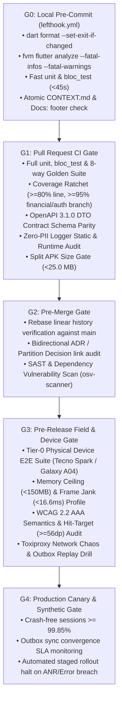

# 01 — Mobile QA Device Matrix, Performance Budgets & G0–G4 Gate Specification (`SPEC-MOB-QAS-01`)

| Metadata | Value |
| :--- | :--- |
| **Document ID** | `SPEC-MOB-QAS-01` |
| **Subsystem** | `docs/mobile/quality/` |
| **Target Framework** | Flutter 3.x (`flutter_test`, `bloc_test`, `alchemist` / `golden_toolkit`, `integration_test`, `patrol`) |
| **SRS Traceability** | `REQ-09` (`NFR-PERF`, `NFR-SCALE`, `NFR-MAINT`), `AGENTS.md` (§1 QA & Test Gates `G0`–`G4`, Coverage Ratchet) |
| **Architecture / Flows** | `ADR-010` (Isar Offline Outbox), `ADR-013` (OTA Font & APK Size Budget), `CODE_STANDARDS.md` |
| **Design System** | `DS-DINK-CORE-V7.0` (60fps Impeller Rendering & Outdoor High-Contrast Golden Parity) |
| **Status** | Normative — Phase 0 Specification |

---

## 1. Purpose & Requirement Traceability

Heavy machinery operators and site foremen across Ethiopia (`ET`) and Kenya (`KE`) predominantly use entry-level budget Android smartphones (`2GB–3GB RAM`, Cortex-A53/A55 cores, Mali-G52 GPUs) under high thermal stress (`38°C+` ambient site temperature). A specification that only passes on a developer's desktop simulator or flagship iPhone will OOM-crash during multi-photo WebP inspection compression on a Tecno Spark. This document establishes the **4-Tier Physical Device Matrix**, **Non-Negotiable Performance & Memory Budgets**, **Coverage Ratchet Rules**, and **G0–G4 CI/CD Quality Gates**:

| Requirement / Rule ID | Normative Obligation | Mobile Verification Mechanism |
| :--- | :--- | :--- |
| **`AGENTS.md` §1 (Coverage Ratchet)** | Minimum **80% line coverage** on all changed code; **95% branch coverage** on financial calculations, minor-unit ledger formatting, auth/RTR paths, and offline outbox sync workflows. Coverage is strictly non-decreasing. | Automated `lcov.info` audit in `G1` CI pipeline failing any PR where global coverage drops by `> 0.0%` or financial/auth packages fall below `95.0%` branch coverage. |
| **`AGENTS.md` §1 (Determinism & Time Freezing)** | Zero dependence on wall-clock `DateTime.now()`, unseeded `Random()`, live network sockets, or shared mutable singletons. Flaky tests are quarantined within 24 hours. | Mandatory injection of `Clock` (`package:clock`) across all BLoCs (OTP timers, 24h `RC-04` damage guillotine, insurance expiry watchdogs). |
| **`NFR-PERF-01` (Startup, Frame & Memory Budgets)** | Cold start `< 1,500ms`, warm start `< 300ms`, sustained `60fps` (`< 16.6ms` raster/UI frame time), peak Dart + native heap `< 150MB` on `2GB RAM` Tier-0 Android devices. | Automated `integration_test` macrobenchmark profile on physical Firebase Test Lab / BrowserStack Tier-0 devices during `G3`. |
| **`ADR-013` (APK Binary & WebP Asset Budget)** | Base split-ABI (`arm64-v8a`) release APK MUST remain `< 25.0 MB` via dynamic OTA font delivery (`Noto Sans Ethiopic` subsetting); compressed inspection/catalog WebP images MUST average `< 80 KB` (`<= 120 KB` ceiling). | `fvm flutter build apk --analyze-size` gate in `G1` blocking any PR that pushes `app-arm64-v8a-release.apk` above `25,000,000 bytes`. |

---

## 2. 4-Tier Physical Field Device Matrix & Performance Budgets

### 2.1 Canonical Target Hardware Tiers
```text
+-----------------------------------------------------------------------+
|  DINK MACHINERY 4-TIER PHYSICAL QA DEVICE MATRIX (ET & KE FIELD)      |
+-----------------------------------------------------------------------+
|  TIER 0: BUDGET FRONTIER ANDROID (PRIMARY OPERATOR & QUARRY BASELINE) |
|  • Reference Hardware: Tecno Spark 10C / Samsung Galaxy A04 / Itel S23|
|  • SoC / RAM / OS:     Unisoc T606 / Helio G35 • 2GB–3GB RAM • API 30 |
|  • Screen:             720 × 1600 HD+ IPS LCD (400 nits)              |
|  • Critical Stress:    4-Photo WebP Isolate Compression + Isar Outbox |
+-----------------------------------------------------------------------+
|  TIER 1: MAINSTREAM CONTRACTOR & FLEET OWNER ANDROID                  |
|  • Reference Hardware: Samsung Galaxy A34 / A54 5G / Redmi Note 13    |
|  • SoC / RAM / OS:     Dimensity 1080 / Exynos 1380 • 6GB RAM • API 34|
|  • Screen:             1080 × 2340 FHD+ Super AMOLED (1000 nits)      |
+-----------------------------------------------------------------------+
|  TIER 2: RUGGEDIZED SITE DISPATCH TABLET                              |
|  • Reference Hardware: Samsung Galaxy Tab Active4 Pro (Glove Mode)    |
|  • SoC / RAM / OS:     Snapdragon 778G • 6GB RAM • Android 13/14      |
|  • Critical Stress:    Split-Screen Before/After Lightbox (`RC-04`)   |
+-----------------------------------------------------------------------+
|  TIER 3: EXECUTIVE CONTRACTOR & CORPORATE OWNER iOS                   |
|  • Reference Hardware: iPhone 13 Mini / iPhone 15 Pro (iOS 17/18)     |
|  • Critical Stress:    Impeller Metal Shader Warmup & Secure Enclave  |
+-----------------------------------------------------------------------+
```

### 2.2 Non-Negotiable Telemetry & Resource Budgets

| Metric Category | Budget Target (Tier-0 Android) | Hard Failure Ceiling (`G1`/`G3` Gate) | Measurement Tooling |
| :--- | :--- | :--- | :--- |
| **Cold Start to First Interactive Frame** | `<= 1,200 ms` | `> 1,500 ms` | `integration_test` `traceAction` (`timeToFirstFrameMicros`) |
| **Warm Start from Background** | `<= 220 ms` | `> 300 ms` | Android Macrobenchmark / Flutter DevTools Timeline |
| **UI & Raster Frame Budget (`60fps`)** | `<= 12.0 ms` (p95) | `> 16.6 ms` (p99 jank > 1.5% frames) | `SchedulerBinding.instance.addTimingsCallback` |
| **Peak Resident Memory (`PSS` / Heap)** | `<= 120 MB` | `> 150 MB` (During 4-photo camera reticle capture) | `vm_service` `MemoryUsage` + Android `dumpsys meminfo` |
| **Release Split APK (`arm64-v8a`)** | `<= 21.5 MB` | `> 25.0 MB` (`ADR-013`) | `fvm flutter build apk --split-per-abi --analyze-size` |
| **Isar Local Query Latency (5,000 rows)** | `<= 15 ms` | `> 40 ms` | Isar benchmark test (`NotificationInbox`, `OutboxQueue`) |

---

## 3. W3C DTCG Token & Golden Matrix Dimensions

Every visual component and screen specification (`SPEC-MOB-*`) executes automated golden snapshot tests across **8 deterministic matrix permutations** (`2 Themes × 2 Locales × 2 Text Scales`):

| Matrix Dimension | Permutation A (Baseline) | Permutation B (Extreme Field Stress) | Token / Theme Reference |
| :--- | :--- | :--- | :--- |
| **Theme Mode** | `dark` (`#0F172A` Slate-900 canvas) | `outdoorHighContrast` (`#000000` pure black, `21:1` contrast) | `{semantic.dark.*}` vs `{semantic.outdoorHighContrast.*}` |
| **Locale & Typography** | `en_US` (`Roboto` `1.25x` + `Space Mono`) | `am_ET` (`Noto Sans Ethiopic` `1.38x`/`1.45x` + `Space Mono`) | `{typography.fontFamily.ethiopic}` |
| **Accessibility Text Scale** | `1.0x` (`100%` nominal) | `2.0x` (`200%` WCAG 2.2 AAA scaling) | `MediaQueryData(textScaler: TextScaler.linear(2.0))` |

---

## 4. Quality Gate Hierarchy (`G0` to `G4`) Pipeline Flow



---

## 5. Concrete Flutter Test Harness Blueprint

### 5.1 Deterministic `bloc_test` with Injected `Clock` & Zero-PII Assertion (`damage_guillotine_test.dart`)
```dart
import 'package:bloc_test/bloc_test.dart';
import 'package:clock/clock.dart';
import 'package:flutter_test/flutter_test.dart';

void main() {
  group('DisputeArbitrationBloc — 24h Guillotine & Zero-PII Invariants', () {
    final fixedReturnTime = DateTime.utc(2026, 10, 30, 12, 0, 0);
    final claimExpiryTime = fixedReturnTime.add(const Duration(hours: 24)); // 86,400s

    blocTest<DisputeArbitrationBloc, DisputeArbitrationState>(
      'locks damage claim submission deterministically at T + 86,401s using injected Clock',
      build: () => withClock(
        Clock.fixed(fixedReturnTime.add(const Duration(seconds: 86401))),
        () => DisputeArbitrationBloc(claimWindowExpiresAtUtc: claimExpiryTime),
      ),
      act: (bloc) => bloc.add(
        DisputeArbitrationEvent.guillotineTicked(
          fixedReturnTime.add(const Duration(seconds: 86401)),
        ),
      ),
      expect: () => [
        isA<DisputeArbitrationState>()
            .having((s) => s.isClaimWindowClosed, 'isClaimWindowClosed', isTrue)
            .having((s) => s.guillotineRemaining, 'guillotineRemaining', Duration.zero),
      ],
    );
  });
}
```

### 5.2 Coverage Ratchet & Zero-PII Log Guard (`coverage_and_pii_audit.dart`)
```dart
import 'package:flutter_test/flutter_test.dart';

/// Asserts that no log line or Sentry breadcrumb ever leaks MSISDNs, Fayda FINs, or TINs (AGENTS.md §1)
void assertZeroPiiInTelemetryBuffer(List<String> capturedLogLines) {
  final ethiopianOrKenyanPhoneRegex = RegExp(r'(\+?251|254|09|07)\d{8}');
  final faydaFinRegex = RegExp(r'\b\d{4}[-\s]?\d{4}[-\s]?\d{4}\b');
  final jwtBearerRegex = RegExp(r'eyJ[A-Za-z0-9_-]+\.[A-Za-z0-9_-]+\.[A-Za-z0-9_-]+');

  for (final line in capturedLogLines) {
    expect(ethiopianOrKenyanPhoneRegex.hasMatch(line), isFalse, reason: 'PII Leak: Raw MSISDN in log: $line');
    expect(faydaFinRegex.hasMatch(line), isFalse, reason: 'PII Leak: Raw 12-digit Fayda FIN in log: $line');
    expect(jwtBearerRegex.hasMatch(line), isFalse, reason: 'Credential Leak: Raw JWT in log: $line');
  }
}
```

### 5.3 8-Way Multi-Locale & Outdoor High-Contrast Golden Matrix Runner (`dink_golden_matrix.dart`)
```dart
import 'package:flutter/material.dart';
import 'package:flutter_test/flutter_test.dart';

class GoldenMatrixVariant {
  final String name;
  final ThemeData theme;
  final Locale locale;
  final double textScaleFactor;

  const GoldenMatrixVariant({
    required this.name,
    required this.theme,
    required this.locale,
    required this.textScaleFactor,
  });
}

/// Runs a widget golden test across all 8 canonical Dink Machinery field permutations:
/// (Dark / OutdoorHighContrast) x (en_US / am_ET) x (1.0x / 2.0x TextScaler)
Future<void> pumpDinkGoldenMatrix({
  required WidgetTester tester,
  required String screenSlug,
  required Widget child,
  required List<GoldenMatrixVariant> variants,
}) async {
  for (final variant in variants) {
    await tester.pumpWidget(
      MaterialApp(
        debugShowCheckedModeBanner: false,
        theme: variant.theme,
        locale: variant.locale,
        builder: (context, widget) => MediaQuery(
          data: MediaQuery.of(context).copyWith(
            textScaler: TextScaler.linear(variant.textScaleFactor),
          ),
          child: widget!,
        ),
        home: Scaffold(body: child),
      ),
    );
    await tester.pumpAndSettle();
    await expectLater(
      find.byType(Scaffold),
      matchesGoldenFile('goldens/${screenSlug}_${variant.name}.png'),
    );
  }
}
```

### 5.4 Tier-0 Device Frame Timing & Heap Ceiling Macrobenchmark (`tier0_perf_benchmark_test.dart`)
```dart
import 'dart:ui';
import 'package:flutter/scheduler.dart';
import 'package:flutter_test/flutter_test.dart';

/// Asserts that 95th-percentile UI & Raster frame times stay within the 16.6ms (60fps) budget
void assertSixtyFpsFrameBudget(List<FrameTiming> timings) {
  expect(timings, isNotEmpty);
  final buildMillis = timings.map((t) => t.buildDuration.inMicroseconds / 1000.0).toList()..sort();
  final rasterMillis = timings.map((t) => t.rasterDuration.inMicroseconds / 1000.0).toList()..sort();

  final p95Index = (timings.length * 0.95).floor().clamp(0, timings.length - 1);
  expect(buildMillis[p95Index], lessThanOrEqualTo(16.6), reason: 'p95 UI build time exceeded 16.6ms');
  expect(rasterMillis[p95Index], lessThanOrEqualTo(16.6), reason: 'p95 Raster time exceeded 16.6ms');
}
```

---

## 6. Architectural & Static Analysis Enforcement Rules (`analysis_options.yaml`)

1. **Strict Layer Dependency Isolation (`AGENTS.md` §3):**
   - `lib/features/*/domain/` MUST NEVER import `package:dio`, `package:isar`, `package:flutter/material.dart`, or generated data DTOs.
   - `lib/features/*/presentation/` MUST communicate exclusively via `Bloc` / `Cubit` events and states—direct repository calls from `Widget` classes fail custom lint (`dink_lint_no_repo_in_widget`).
2. **Strict Money Type Lint (`dink_lint_no_float_money`):**
   - Any field or parameter whose identifier matches `(price|amount|balance|total|fee|tax|deductible|deposit|payout)` with type `double` or `num` triggers a compile-time analyzer error. Only `int` (minor units) or `MoneyMinor` value objects are permitted.

---

## 7. CI Failure Matrix & Remediation Protocol

| Gate Stage | Failure Code | Root Cause | Mandatory Developer Remediation |
| :--- | :--- | :--- | :--- |
| **`G0`** | `LEFTHOOK_MISSING_CONTEXT_MD` | Code/test staged without `CONTEXT.md` (`AGENTS.md` §4 Atomic Doc-Commit Rule). | Update `CONTEXT.md` (and partition decision doc if 5-Point Test triggers) and stage in same commit. |
| **`G1`** | `COVERAGE_RATCHET_BREACH` | Overall line coverage `< 80%` or financial/auth branch coverage `< 95%`. | Add missing `bloc_test` and edge-case branch unit tests before merge is unlocked. |
| **`G1`** | `APK_SIZE_BUDGET_EXCEEDED` | `app-arm64-v8a-release.apk` > `25.0 MB`. | Convert uncompressed PNGs to WebP (`< 80 KB`) or move static font weights to `ADR-013` OTA asset bundle. |
| **`G3`** | `TIER0_HEAP_CEILING_BREACH` | Peak memory exceeded `150 MB` during camera reticle capture on Tier-0 `2GB RAM` device. | Downsample camera stream inside background `Isolate` and dispose native `ui.Image` handles immediately. |

---

## 8. Verification & Acceptance Criteria

1. **Zero-Warning Analyzer Gate:** `fvm flutter analyze --fatal-infos --fatal-warnings` exits with `0` across all packages.
2. **Deterministic Golden Parity:** All 8 permutations (`dark`/`outdoorHighContrast` × `en_US`/`am_ET` × `1.0x`/`2.0x`) render with `0.0%` pixel diff across Linux CI runners using bundledhermetic fonts.
3. **100-Run Flake-Free Certification:** Every new `bloc_test` and widget test suite must pass `fvm flutter test --repeat=100 --test-randomize-ordering-seed=random` with zero failures before quarantine release.
