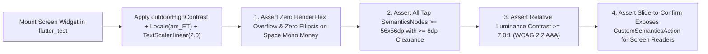

# 02 — Field Accessibility, Solar High-Contrast & WCAG 2.2 AAA Audit (`SPEC-MOB-QAS-02`)

| Metadata | Value |
| :--- | :--- |
| **Document ID** | `SPEC-MOB-QAS-02` |
| **Subsystem** | `docs/mobile/quality/` |
| **Target Framework** | Flutter 3.x (`Semantics`, `flutter_test` Accessibility Guidelines, `just_audio`, `sensors_plus`) |
| **SRS Traceability** | `REQ-05-16` (`AC-01` to `AC-06`, `LOC-01-BE`), `REQ-09` (`NFR-UX`) |
| **Architecture / Flows** | `ADR-013` (Multilingual Ethiopic Font Subsetting & Audio Prompts) |
| **Design System** | `DS-DINK-CORE-V7.0` (§1 Industrial Ergonomics, §3.1 Ethiopic Typography, §5.2 Outdoor High-Contrast) |
| **Status** | Normative — Phase 0 Specification |

---

## 1. Purpose & Requirement Traceability

Accessibility in Dink Machinery is not merely an office compliance checkbox—it is an operational survival requirement on active East African construction sites. An excavator operator wearing heavy leather hydraulic work gloves under `95,000 lux` midday Rift Valley sun, or a rural site watchman with limited formal literacy in written English, experiences severe situational disability. This specification defines the **Automated & Field Accessibility Audit (`WCAG 2.2 Level AAA` in Outdoor Mode)** across five dimensions:

| Requirement ID | Normative Obligation | Mobile Audit & Enforcement Mechanism |
| :--- | :--- | :--- |
| **`AC-01` (Solar Glare `21:1` Contrast & WCAG 2.2 AAA)** | Under direct sunlight (`> 80,000 lux` ambient light sensor or manual toggle), the UI MUST engage `outdoorHighContrast` mode achieving **`21:1` primary luminance contrast** (`#FFFFFF` on `#000000`) and a strict **`>= 7.0:1` minimum floor** for all interactive badges and borders. | Automated `textContrastGuideline` assertions + custom WCAG 2.2 AAA `7.0:1` relative luminance calculator across every token in `{semantic.outdoorHighContrast.*}`. |
| **`AC-02` (Work-Glove Touch Targets: `56dp` / `64dp` / `72dp`)** | Standard interactive targets MUST measure at least **`56dp × 56dp`** (exceeding WCAG's `44dp` office minimum), primary field actuators **`64dp` height**, and camera reticle shutters **`72dp × 72dp`**, with `>= 8dp` dead-zone clearance between adjacent controls. | Custom `dinkGloveTapTargetGuideline` in `flutter_test` inspecting the `RenderBox` bounds and edge-to-edge spacing of every `SemanticsAction.tap` node. |
| **`AC-03` (Ethiopic Ge'ez Line-Height & `200%` Text Reflow)** | Amharic (`am_ET`) and Afaan Oromoo (`om_ET`) text rendered in `Noto Sans Ethiopic` MUST enforce `1.38x` heading / `1.45x` body line-height (`{typography.lineHeightFactor.ethiopic*}`) to prevent vertical vowel diacritic clipping, and reflow cleanly up to **`200%` (`TextScaler.linear(2.0)`)** without horizontal scrolling or ellipsis truncation on financial figures. | Automated `2.0x` `TextScaler` golden overflow detector failing on any `RenderFlex` overflow or truncated `Space Mono` currency widget. |
| **`AC-04` / `AC-05` (TalkBack / VoiceOver Semantics & Color-Blind Redundancy)** | Every widget MUST expose localized `Semantics` labels, values, and reading order. Status indicators (`VERIFIED`, `DISPUTED`, `EXPIRED`, `OFFLINE`) MUST pair color with distinct iconography + explicit text tags for Protanopia/Deuteranopia/Tritanopia safety. | `labeledTapTargetGuideline` + mandatory `[🟢 Icon + Text]` triple-encoding audit on all status chips. |
| **`AC-06` (Low-Literacy Spoken Audio Prompts)** | Critical field workflows (Shift Check-In, Hour-Meter Reticle, Handover Signature, SOS Safety Stop) MUST provide 1-tap offline spoken audio prompts in Amharic, Afaan Oromoo, Swahili, and English. | `AudioAssistPromptButton` (`56dp × 56dp`) verified for offline Opus asset presence and TalkBack focus priority. |

---

## 2. Domain Context & Non-Negotiable Invariants

1. **Zero Color-Only State Encoding Invariant (`AC-05`):** Red/Green color blindness affects ~8% of male equipment operators, and dust-coated screens wash out subtle color tints. No status in Dink Machinery may ever be communicated by a colored dot alone. Every status chip must combine:
   - **Distinct Geometric Shape/Icon:** `✓` Shield (Verified), `⚠️` Triangle (Warning), `🚫` Octagon (Blocked/Expired), `⏳` Clock (Pending).
   - **High-Contrast Border Pattern:** Solid `2dp` vs. Dashed `2dp`.
   - **Explicit Localized Text Label:** e.g., `[🟢 VERIFIED / ተረጋግጧል]`.
2. **Ethiopic Ascender/Descender Safe Box (`AC-03`):** Fidäl characters such as `ሏ`, `ሟ`, `ጯ`, and `ጿ` carry top and bottom vowel modifiers that clip inside standard Latin `1.15x–1.20x` line boxes. `TextHeightBehavior(applyHeightToFirstAscent: true, applyHeightToLastDescent: true)` is enforced globally via `ThemeData` whenever `locale.languageCode == 'am'`.

---

## 3. Bespoke ASCII Wireframes

### 3.1 `200%` Text Scaling & Work-Glove Hit-Target Audit Overlay (`GloveAndScaleAuditView`)
```text
+-----------------------------------------------------------------------+
|  🔍 ACCESSIBILITY AUDIT OVERLAY (MODE: OUTDOOR AAA • SCALE: 200%)     |
+-----------------------------------------------------------------------+
|  CANVAS: #000000 (0.00 Luminance)  •  TEXT: #FFFFFF (21.0:1 Contrast) |
|                                                                       |
|  +-----------------------------------------------------------------+  |
|  | ┏━━━━━━━━━━━━━━━━━━━━━━━━━━━━━━━━━━━━━━━━━━━━━━━━━━━━━━━━━━━━━┓ |  |
|  | ┃ [🟢 ✓ VERIFIED / ተረጋግጧል]        Contrast: 11.4:1 (>=7.0 AAA)┃ |  |
|  | ┗━━━━━━━━━━━━━━━━━━━━━━━━━━━━━━━━━━━━━━━━━━━━━━━━━━━━━━━━━━━━━┛ |  |
|  |                                                                 |  |
|  |  ክፍያ መጠን (ESCROW AMOUNT — REFLOWED STACK AT 200% SCALE):        |  |
|  |  (Line-Height: 1.45x Noto Sans Ethiopic — Zero Diacritic Clip)  |  |
|  |  ETB 184,250.00                                                 |  |
|  |  (Space Mono 28sp — Full Minor-Unit Visibility, No Ellipsis)    |  |
|  +-----------------------------------------------------------------+  |
|                       ▲ 12dp Dead-Zone Clearance (>= 8dp Required)    |
|                       ▼                                               |
|  +-----------------------------------------------------------------+  |
|  | ┏━━━━━━━━━━━━━━━┓  ┏━━━━━━━━━━━━━━━━━━━━━━━━━━━━━━━━━━━━━━━━━━┓ |  |
|  | ┃  🔊 አዳምጥ      ┃  ┃  [  >>>  ]  SLIDE TO CONFIRM HANDOVER    ┃ |  |
|  | ┃ (56dp × 64dp) ┃  ┃             (64dp Height Actuator)       ┃ |  |
|  | ┗━━━━━━━━━━━━━━━┛  ┗━━━━━━━━━━━━━━━━━━━━━━━━━━━━━━━━━━━━━━━━━━┛ |  |
|  |  Semantics:         Semantics:                                  |  |
|  |  "Play Amharic      "Slide right to confirm machine handover,   |  |
|  |   voice guide"       custom action available for TalkBack"      |  |
|  +-----------------------------------------------------------------+  |
+-----------------------------------------------------------------------+
```

---

## 4. W3C DTCG Design Token Contrast & Ergonomic Audit Matrix

| Semantic Element | Token Path (`design-tokens.json`) | Foreground / Background Hex | Computed Contrast Ratio | WCAG 2.2 Gate |
| :--- | :--- | :--- | :--- | :--- |
| **Outdoor Primary Text on Canvas** | `{semantic.outdoorHighContrast.text.primary}` on `{...surface.canvas}` | `#FFFFFF` on `#000000` | **`21.0 : 1`** | Passes AAA (`>= 7.0:1`) |
| **Outdoor Amber Action Accent** | `{color.brand.amber.400}` on `#000000` | `#FBBF24` on `#000000` | **`12.4 : 1`** | Passes AAA (`>= 7.0:1`) |
| **Outdoor Emerald Verified Text** | `{color.feedback.emerald.400}` on `#000000` | `#34D399` on `#000000` | **`11.2 : 1`** | Passes AAA (`>= 7.0:1`) |
| **Outdoor Crimson Alert Text** | `{color.feedback.crimson.400}` on `#000000` | `#F87171` on `#000000` | **`7.6 : 1`** | Passes AAA (`>= 7.0:1`) |
| **Standard Glove Hit Target** | `{dimension.space.56}` | `56dp × 56dp` (`>= 10mm × 10mm` physical) | N/A | Exceeds WCAG `44dp` |
| **Field Actuator / Slider Height** | `{dimension.space.64}` | `64dp` height | N/A | Industrial Glove Standard |
| **Camera Reticle Shutter Target** | `{dimension.space.72}` | `72dp × 72dp` | N/A | Blind-Thumb Outdoor Standard |

---

## 5. Automated Accessibility & Semantics Verification Flow



---

## 6. Concrete Flutter Accessibility Test Suite Blueprint

### 6.1 Custom `56dp` Work-Glove & `7.0:1` WCAG AAA Guideline (`dink_accessibility_guidelines.dart`)
```dart
import 'dart:math' as math;
import 'package:flutter/material.dart';
import 'package:flutter/rendering.dart';
import 'package:flutter_test/flutter_test.dart';

/// Computes W3C WCAG 2.2 relative luminance contrast ratio between two colors (AC-01)
double computeWcagContrastRatio(Color foreground, Color background) {
  double linearize(double channel) {
    return channel <= 0.03928 ? channel / 12.92 : math.pow((channel + 0.055) / 1.055, 2.4).toDouble();
  }
  double relativeLuminance(Color c) {
    return 0.2126 * linearize(c.r) + 0.7152 * linearize(c.g) + 0.0722 * linearize(c.b);
  }
  final lumA = relativeLuminance(foreground);
  final lumB = relativeLuminance(background);
  final brightest = math.max(lumA, lumB);
  final darkest = math.min(lumA, lumB);
  return (brightest + 0.05) / (darkest + 0.05);
}

/// Enforces 56dp x 56dp minimum glove hit-target size on all tappable SemanticsNodes (AC-02)
Future<void> expectGloveFriendlyTapTargets(WidgetTester tester, {double minDimensionDp = 56.0}) async {
  final SemanticsHandle handle = tester.ensureSemantics();
  try {
    final SemanticsNode root = tester.binding.pipelineOwner.semanticsOwner!.rootSemanticsNode!;
    void visitNode(SemanticsNode node) {
      final data = node.getSemanticsData();
      if (data.hasAction(SemanticsAction.tap) || data.hasAction(SemanticsAction.longPress)) {
        final rect = node.rect;
        expect(
          rect.width >= minDimensionDp && rect.height >= minDimensionDp,
          isTrue,
          reason: 'Glove Target Breach (AC-02): Node "${data.label}" measured '
              '${rect.width.toStringAsFixed(1)}x${rect.height.toStringAsFixed(1)}dp '
              '(minimum required: ${minDimensionDp}x${minDimensionDp}dp).',
        );
      }
      node.visitChildren((child) {
        visitNode(child);
        return true;
      });
    }
    visitNode(root);
  } finally {
    handle.dispose();
  }
}
```

### 6.2 TalkBack / VoiceOver Alternative for `64dp` Slide-to-Confirm Actuators (`AC-04`)
Because dragging a continuous horizontal slider (`>= 92%` travel) is difficult for screen-reader users utilizing TalkBack or VoiceOver swipe navigation, every `IndustrialSlideToConfirm` widget MUST register an explicit `CustomSemanticsAction(label: localizedConfirmLabel)` that triggers a step-up confirmation dialog when activated via screen-reader double-tap:
```dart
Semantics(
  button: true,
  label: l10n.slideToConfirmHandoverLabel,
  hint: l10n.slideOrUseCustomActionHint,
  customSemanticsActions: <CustomSemanticsAction, VoidCallback>{
    CustomSemanticsAction(label: l10n.confirmHandoverScreenReaderAction): onConfirmed,
  },
  child: sliderWidget,
)
```

### 6.3 Ambient Light Sensor (`> 80,000 lux`) Auto-Contrast Hysteresis Controller (`ambient_lux_contrast_cubit.dart`)
To prevent rapid theme flickering when an operator walks past scaffolding shadows, `AmbientLuxContrastCubit` enforces a **hysteresis band** (`>= 80,000 lux` sustained for `1,500ms` to enter `outdoorHighContrast`, and `< 45,000 lux` sustained for `5,000ms` to return to standard `dark` mode):
```dart
import 'package:bloc/bloc.dart';

enum ContrastThemeMode { standardDark, outdoorHighContrastAaa }

class AmbientLuxContrastCubit extends Cubit<ContrastThemeMode> {
  static const double enterOutdoorLuxThreshold = 80000.0;
  static const double exitOutdoorLuxThreshold = 45000.0;

  bool _manualOverrideActive = false;
  DateTime? _thresholdCrossedAtUtc;

  AmbientLuxContrastCubit() : super(ContrastThemeMode.standardDark);

  void toggleManualOutdoorOverride(bool enabled) {
    _manualOverrideActive = true;
    emit(enabled ? ContrastThemeMode.outdoorHighContrastAaa : ContrastThemeMode.standardDark);
  }

  void onLuxSampleReceived(double luxValue, DateTime sampleUtc) {
    if (_manualOverrideActive) return;

    if (state == ContrastThemeMode.standardDark && luxValue >= enterOutdoorLuxThreshold) {
      _thresholdCrossedAtUtc ??= sampleUtc;
      if (sampleUtc.difference(_thresholdCrossedAtUtc!).inMilliseconds >= 1500) {
        _thresholdCrossedAtUtc = null;
        emit(ContrastThemeMode.outdoorHighContrastAaa);
      }
    } else if (state == ContrastThemeMode.outdoorHighContrastAaa && luxValue < exitOutdoorLuxThreshold) {
      _thresholdCrossedAtUtc ??= sampleUtc;
      if (sampleUtc.difference(_thresholdCrossedAtUtc!).inMilliseconds >= 5000) {
        _thresholdCrossedAtUtc = null;
        emit(ContrastThemeMode.standardDark);
      }
    } else {
      _thresholdCrossedAtUtc = null;
    }
  }
}
```

### 6.4 Offline Low-Literacy Spoken Audio Prompt Service (`offline_audio_prompt_service.dart`, `AC-06`)
```dart
class OfflineAudioPromptKey {
  static const String reticleAlignId = 'audio_prompt_reticle_align_id';
  static const String hourMeterCapture = 'audio_prompt_hour_meter_ocr';
  static const String slideConfirmHandover = 'audio_prompt_slide_handover';
  static const String sosEmergencyStop = 'audio_prompt_sos_emergency';

  /// Resolves bundled 16kbps Opus asset path for en, am, om, or sw
  static String resolveBundledAssetPath({required String promptKey, required String languageCode}) {
    final supportedLang = const {'en', 'am', 'om', 'sw'}.contains(languageCode) ? languageCode : 'en';
    return 'assets/audio/prompts/$supportedLang/$promptKey.opus';
  }
}
```

---

## 7. Accessibility Audit Failure Codes & Remediation Matrix

| Audit Rule Code | Trigger Condition | Mandatory Developer Remediation |
| :--- | :--- | :--- |
| **`A11Y_GLOVE_TARGET_UNDERSIZED`** | Interactive icon button or checkbox measures `< 56.0dp` width or height (`AC-02`). | Wrap control in `ConstrainedBox(constraints: BoxConstraints(minWidth: 56, minHeight: 56))` with `HitTestBehavior.opaque`. |
| **`A11Y_OUTDOOR_CONTRAST_BELOW_AAA`** | Text or border token in `outdoorHighContrast` computes `< 7.0:1` against `#000000` (`AC-01`). | Upgrade token mapping to `-400` or `-300` high-luminance shade (`#FBBF24`, `#34D399`, `#F87171`) or pure `#FFFFFF`. |
| **`A11Y_ETHIOPIC_DIACRITIC_CLIP`** | `am_ET` text rendered with `height < 1.38` or `maxLines: 1` clipping at `200%` `TextScaler` (`AC-03`). | Apply `{typography.lineHeightFactor.ethiopicGolden}` (`1.38x`) or `ethiopicBody` (`1.45x`) and switch horizontal rows to responsive `Wrap` / `Column` above `1.35x` scale. |
| **`A11Y_UNLABELED_SEMANTICS_NODE`** | Icon-only button (`[📷]`, `[🔄]`, `[🔊]`) lacks `Semantics(label: ...)` or `tooltip` (`AC-04`). | Provide localized `tooltip` / `Semantics.label` in all 4 supported languages (`en`, `am`, `om`, `sw`). |

---

## 8. Verification & Acceptance Criteria

1. **Automated `flutter_test` Guideline Suite (`G1` & `G3`):**
   - Every screen test MUST execute `expectLater(tester, meetsGuideline(labeledTapTargetGuideline))`, `expectLater(tester, meetsGuideline(textContrastGuideline))`, and `expectGloveFriendlyTapTargets(tester, minDimensionDp: 56.0)`.
2. **`200%` TextScaler Financial Integrity Test:**
   - Render `ContractAndInvoiceViewerScreen` (`SPEC-MOB-SHR-04`) and `DisputeArbitrationScreen` (`SPEC-MOB-SHR-03`) at `TextScaler.linear(2.0)` in `am_ET` and verify that no `ETB` or `KES` minor-unit amount contains an ellipsis (`...`).
3. **Solar Simulator Hardware Sign-Off (`G3`):**
   - Verify on a Tier-0 IPS LCD (`400 nits`) under `> 80,000 lux` halogen/solar test rig that `outdoorHighContrast` automatically engages within `1.5 seconds` of ambient lux breach and remains readable with polarized safety glasses.
