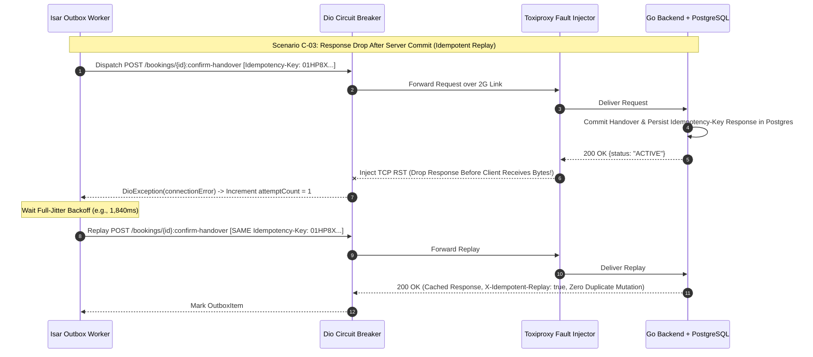

# 03 — Frontier Network Chaos, Circuit Breaker & Outbox Resilience Test Plan (`SPEC-MOB-QAS-03`)

| Metadata | Value |
| :--- | :--- |
| **Document ID** | `SPEC-MOB-QAS-03` |
| **Subsystem** | `docs/mobile/quality/` |
| **Target Framework** | Flutter 3.x (`dio`, `isar`, `flutter_test`, `Toxiproxy` / Android Network Shaper) |
| **SRS Traceability** | `REQ-05-17` (`OFF-01`..`OFF-04`, `SYNC-01`), `REQ-05-18` (`ER-01`..`ER-04`), `REQ-09` (`NFR-NET`, `NFR-AVAIL`) |
| **Architecture / Flows** | `FLOW-NOTIF-OFFLINE` (`FLOW-APPENDIX-A`), `ADR-008` (RTR Replay Detection), `ADR-010` (Isar Offline Outbox & ClamAV `:3310`) |
| **Design System** | `DS-DINK-CORE-V7.0` (§4.7 Offline & Sync Status Indicators) |
| **Status** | Normative — Phase 0 Specification |

---

## 1. Purpose & Requirement Traceability

Heavy machinery operations take place along remote road-construction corridors (e.g., Moyale–Hawassa, Jimma–Mizan, Turkana–Eldoret) where cellular connectivity fluctuates wildly between `4G LTE`, congested `2G EDGE` (`2,500ms+` RTT, `35%` packet loss), captive satellite portals, and complete dead zones (`0%` signal inside deep basalt quarries). This specification defines the **Frontier Network Chaos & Fault-Injection Test Plan** validating that the Dink Machinery Flutter client never loses field data, never double-charges escrow, and never enters an infinite retry storm:

| Requirement ID | Normative Obligation | Chaos Verification Scenario |
| :--- | :--- | :--- |
| **`OFF-01`..`OFF-04` (`ADR-010` Isar Outbox Durability)** | Field inspections, operator shift check-ins/outs, and GPS telemetry breadcrumbs captured offline MUST persist durably in the local Isar Outbox across app force-kills and OS reboots, syncing in strict FIFO dependency order upon reconnection. | **Chaos Scenario C-01 & C-02:** `100%` packet loss (Airplane Mode) + sudden process `SIGKILL` mid-queue, verifying zero data loss and ordered FIFO drainage upon recovery. |
| **`AGENTS.md` §1 & §2 (Idempotency Replay Invariance)** | Every mutating `POST`/`PUT`/`PATCH` request MUST carry a deterministic `Idempotency-Key` (`UUIDv4 == localDraftId`). If the server processes the mutation (`200`/`201`) but the TCP response drops before reaching the handset, replaying the request MUST return the cached original response without duplicate side-effects. | **Chaos Scenario C-03:** Inject downstream TCP `RST` *after* backend PostgreSQL commit but *before* HTTP response headers arrive at Dio; assert replay with identical `Idempotency-Key` yields `200 OK` (`X-Idempotent-Replay: true`) and single ledger entry. |
| **`ER-01` / `ER-02` (Client Circuit Breaker & Jittered Backoff)** | Consecutive `502`/`503`/`504` or socket timeout failures (`>= 5` failures) MUST trip the client Dio Circuit Breaker into `OPEN` state (`30s` cooldown) and schedule Isar Outbox retries using truncated exponential backoff with full random jitter. | **Chaos Scenario C-04:** Inject `100%` `503 Service Unavailable` via Toxiproxy; verify Circuit Breaker trips on failure #5, suppresses network thrashing for `30s`, probes `HALF-OPEN`, and recovers cleanly. |
| **`ER-03` / `ER-04` (`409` Concurrency Quarantine & RTR Replay Security)** | If an offline-queued mutation conflicts with a newer server state (`409 BOOKING_CONCURRENCY_CONFLICT`), the outbox item MUST transition to `QUARANTINED_CONFLICT` (preserving user photos/notes for manual reconciliation) rather than blocking subsequent independent queue items or silently discarding data. | **Chaos Scenario C-05 & C-06:** Concurrent state mutation on server while client is offline + Refresh Token Rotation (`RTR`) race condition drill (`401 AUTH_TOKEN_REVOKED`). |

---

## 2. Frontier Network Profiles & Toxiproxy Fault Injection Matrix

All `G3` pre-release integration tests execute against a containerized **Toxiproxy 2.x** proxy sitting between the Flutter test runner and the local/staging Go modular monolith (`:8080`) and ClamAV media scanner (`:3310`):

| Profile ID | Field Environment Simulated | Bandwidth Cap | Latency & Jitter | Packet Loss / Fault | Target Subsystem Under Test |
| :--- | :--- | :--- | :--- | :--- | :--- |
| **`NET-PROF-01`** | **Deep Quarry Dead Zone** | `0 kbps` | $\infty$ (`Blackhole`) | `100%` drop | Isar Offline Outbox (`SPEC-MOB-FND-04`), Offline PDF Vault (`SPEC-MOB-SHR-04`), Offline Help (`SPEC-MOB-SHR-06`) |
| **`NET-PROF-02`** | **Rural 2G / EDGE Corridor** | `32 kbps` up / `48 kbps` down | `2,400 ms ± 800 ms` | `25%` random packet loss | Chunked WebP inspection upload (`<=120KB`), SMS OTP verification (`SPEC-MOB-AUTH-02`) |
| **`NET-PROF-03`** | **Mid-Stream TCP RST ("Half-Dead Socket")** | `512 kbps` | `400 ms` | TCP `RST` injected after `64 KB` uploaded | Multipart KYC/Inspection ClamAV `:3310` upload recovery & `Idempotency-Key` replay |
| **`NET-PROF-04`** | **Gateway Overload / Brownout** | Unlimited | `150 ms` | `100%` `HTTP 503` for `45 seconds` | Dio 5-Failure Circuit Breaker (`CLOSED` → `OPEN` → `HALF-OPEN`) & Full-Jitter Backoff |
| **`NET-PROF-05`** | **Captive Portal / DNS Hijack** | `128 kbps` | `100 ms` | Returns `HTTP 200 text/html` login page on API routes | Strict JSON envelope validator (`REQ_MALFORMED_JSON` guard) & TLS certificate pinning |

---

## 3. Bespoke ASCII Architecture: Chaos Harness & Outbox Recovery States

```text
+-----------------------------------------------------------------------+
|  FLUTTER MOBILE CLIENT (DIO + CIRCUIT BREAKER + ISAR OUTBOX ENGINE)   |
|  +-----------------------------------------------------------------+  |
|  | 1. OutboxItem #101: SHIFT_CHECK_IN  [Idempotency-Key: uuid-101] |  |
|  | 2. OutboxItem #102: HOUR_METER_WEBP [Idempotency-Key: uuid-102] |  |
|  | 3. OutboxItem #103: DAMAGE_CLAIM    [Idempotency-Key: uuid-103] |  |
|  +-----------------------------------------------------------------+  |
|                                  │                                    |
|                                  ▼                                    |
|  +-----------------------------------------------------------------+  |
|  | ⚡ TOXIPROXY CHAOS INJECTOR (PORT :8443 -> GO API :8080)         |  |
|  | • Toxic 1: latency (2400ms, jitter: 800ms)                      |  |
|  | • Toxic 2: bandwidth (rate: 4 KB/s)                             |  |
|  | • Toxic 3: reset_peer (after 65536 bytes on /multipart)         |  |
|  +-----------------------------------------------------------------+  |
|                                  │                                    |
|                                  ▼                                    |
|  +-----------------------------------------------------------------+  |
|  | 🛡️ CLIENT RECOVERY BANNER (RENDERED AT TOP OF APP SHELL)         |  |
|  | +-------------------------------------------------------------+ |  |
|  | | 🟠 POOR SITE SIGNAL (2G): 2 items syncing in background...  | |  |
|  | | 🔴 1 Conflict Needs Review (#BK-8941)     [ RESOLVE (56dp) ]| |  |
|  | +-------------------------------------------------------------+ |  |
|  +-----------------------------------------------------------------+  |
+-----------------------------------------------------------------------+
```

---

## 4. W3C DTCG Design Token Mapping for Network & Chaos States

| UI Indicator State | Token Path (`design-tokens.json`) | Resolved Value (`dark` / `outdoorHighContrast`) |
| :--- | :--- | :--- |
| **Offline Mode Active Pill (`NET-PROF-01`)** | `{color.brand.slate.800}` + `{color.brand.amber.400}` | `#1E293B` surface, `#FBBF24` border & `[📡 OFFLINE — SAVING TO DEVICE]` |
| **Background Outbox Syncing Pill (`NET-PROF-02`)** | `{color.feedback.blue.500}` | `#3B82F6` progress indicator + `Space Mono` item counter (`2/3`) |
| **Circuit Breaker Cooldown Banner (`NET-PROF-04`)** | `{color.feedback.orange.500}` | `#FF5722` border + live `Space Mono` `Retry in 00:24s` countdown |
| **Quarantined Conflict Card (`409` State)** | `{color.feedback.crimson.500}` | `#EF4444` `2dp` border + `56dp` `[RESOLVE CONFLICT]` button |

---

## 5. Circuit Breaker & Idempotent Replay Sequence Diagram



---

## 6. Concrete Flutter Chaos & Resilience Test Harness Blueprint

### 6.1 Full-Jitter Exponential Backoff & 5-Failure Circuit Breaker (`network_resilience_policy.dart`)
```dart
import 'dart:math';

enum CircuitState { closed, open, halfOpen }

class ClientCircuitBreaker {
  final int failureThreshold;
  final Duration openCooldown;
  final DateTime Function() _nowUtc;

  int _consecutiveFailures = 0;
  CircuitState _state = CircuitState.closed;
  DateTime? _openedAtUtc;

  ClientCircuitBreaker({
    this.failureThreshold = 5,
    this.openCooldown = const Duration(seconds: 30),
    required DateTime Function() nowUtc,
  }) : _nowUtc = nowUtc;

  CircuitState get state {
    if (_state == CircuitState.open && _openedAtUtc != null) {
      if (_nowUtc().difference(_openedAtUtc!) >= openCooldown) {
        _state = CircuitState.halfOpen;
      }
    }
    return _state;
  }

  bool get allowRequest => state != CircuitState.open;

  void recordSuccess() {
    _consecutiveFailures = 0;
    _state = CircuitState.closed;
    _openedAtUtc = null;
  }

  void recordTransientFailure() {
    _consecutiveFailures++;
    if (_consecutiveFailures >= failureThreshold || _state == CircuitState.halfOpen) {
      _state = CircuitState.open;
      _openedAtUtc = _nowUtc();
    }
  }

  /// Computes AWS-style Full-Jitter truncated exponential backoff (ADR-010)
  static Duration computeFullJitterBackoff({
    required int attemptIndex, // 1..N
    required Random seededRandom,
    Duration baseDelay = const Duration(seconds: 2),
    Duration maxDelay = const Duration(seconds: 120),
  }) {
    final expMs = baseDelay.inMilliseconds * pow(2, min(attemptIndex, 7)).toInt();
    final cappedMs = min(expMs, maxDelay.inMilliseconds);
    final jitteredMs = seededRandom.nextInt(cappedMs + 1);
    return Duration(milliseconds: max(500, jitteredMs));
  }
}
```

### 6.2 Automated Chaos Verification Test (`outbox_chaos_resilience_test.dart`)
```dart
import 'dart:math';
import 'package:flutter_test/flutter_test.dart';

void main() {
  group('SPEC-MOB-QAS-03 — Circuit Breaker & Idempotent Replay Chaos Drills', () {
    test('Trips circuit breaker to OPEN on 5th consecutive 503 failure and transitions to HALF-OPEN after 30s', () {
      var currentTime = DateTime.utc(2026, 10, 30, 9, 0, 0);
      final breaker = ClientCircuitBreaker(nowUtc: () => currentTime);

      for (var i = 1; i <= 4; i++) {
        breaker.recordTransientFailure();
        expect(breaker.state, equals(CircuitState.closed));
      }

      // 5th failure trips breaker to OPEN
      breaker.recordTransientFailure();
      expect(breaker.state, equals(CircuitState.open));
      expect(breaker.allowRequest, isFalse);

      // Advance clock by 29s -> still OPEN
      currentTime = currentTime.add(const Duration(seconds: 29));
      expect(breaker.state, equals(CircuitState.open));

      // Advance clock to 30s -> probes HALF-OPEN
      currentTime = currentTime.add(const Duration(seconds: 1));
      expect(breaker.state, equals(CircuitState.halfOpen));
      expect(breaker.allowRequest, isTrue);

      // Single 200 OK closes circuit completely
      breaker.recordSuccess();
      expect(breaker.state, equals(CircuitState.closed));
    });

    test('Full-jitter backoff stays strictly within [500ms, 120,000ms] ceiling across 20 attempts', () {
      final seeded = Random(42); // Deterministic seed (AGENTS.md §1)
      for (var attempt = 1; attempt <= 20; attempt++) {
        final delay = ClientCircuitBreaker.computeFullJitterBackoff(
          attemptIndex: attempt,
          seededRandom: seeded,
        );
        expect(delay.inMilliseconds, greaterThanOrEqualTo(500));
        expect(delay.inMilliseconds, lessThanOrEqualTo(120000));
      }
    });
  });
}
```

---

## 7. Chaos Scenario Acceptance Matrix (`C-01` to `C-06`)

| Scenario ID | Fault Injected | Expected Mobile Client & Outbox Behavior | Pass / Fail Invariant |
| :--- | :--- | :--- | :--- |
| **`C-01` (Quarry Blackhole)** | `100%` packet loss during 4-photo Pre-Delivery Inspection + glass signature submission. | Payload encrypted and written to Isar Outbox (`PENDING_SYNC`) in `< 120ms`; UI advances optimistically with `[📡 Queued for Sync]` badge. | Zero UI freeze; `localDraftId == Idempotency-Key` persisted in Isar. |
| **`C-02` (Process Kill Mid-Sync)** | App killed (`SIGKILL`) after uploading 2 of 4 inspection WebP chunks. | On cold restart, Outbox worker detects incomplete multipart job and resumes using the identical `Idempotency-Key`. | Zero orphaned temporary files; 100% eventual completion. |
| **`C-03` (Lost 200 OK Ack)** | Server commits mutation, Toxiproxy drops HTTP response (`reset_peer`). | Client retries after backoff with identical `Idempotency-Key`; server returns cached `200 OK` without re-running domain command. | Exactly 1 database mutation & 1 ledger entry created. |
| **`C-04` (503 Gateway Storm)** | Backend returns `503` for `45s`. | Circuit breaker opens after 5th failure, halting background battery drain for `30s`, then recovers via `HALF-OPEN` probe. | Total requests sent during `45s` outage `<= 7`. |
| **`C-05` (`409` State Conflict)** | Server booking cancelled by Admin while Operator is logging an offline shift (`#101`), followed by an independent notification read receipt (`#102`). | Item `#101` transitions to `QUARANTINED_CONFLICT` (preserving photos/notes for manual export); Item `#102` proceeds and syncs cleanly (`No Head-of-Line Blocking` across independent aggregates). | Zero silent data deletion; independent items drain normally. |
| **`C-06` (Single-Flight RTR Refresh)** | 4 concurrent Dio requests receive `401 AUTH_INVALID_TOKEN` simultaneously on a `2,400ms` 2G link. | `QueuedInterceptorsWrapper` mutex executes **exactly 1** `POST /api/v1/auth/refresh` call and replays all 4 queued requests with the new JWT. | Zero spurious `401 AUTH_TOKEN_REVOKED` RTR family lockouts. |

---

## 8. Verification & Acceptance Criteria

1. **`G3` Automated Chaos Suite Sign-Off:** All 6 chaos scenarios (`C-01` through `C-06`) must pass in automated integration tests before any release branch cuts a production build.
2. **Battery & Radio Wake-Lock Ceiling:** During a simulated 2-hour `NET-PROF-01` (`100%` offline quarry shift) with 12 queued outbox mutations, background network polling must consume `< 1.5%` battery by relying on OS `connectivity_plus` radio state change events rather than blind timer polling when offline.
3. **Golden & Accessibility Verification (`WCAG 2.2 AAA`):** Render the Offline Sync Pill, Circuit Breaker Cooldown Banner, and `409` Conflict Resolution Sheet in `outdoorHighContrast` and `am_ET` at `200%` text scaling.
