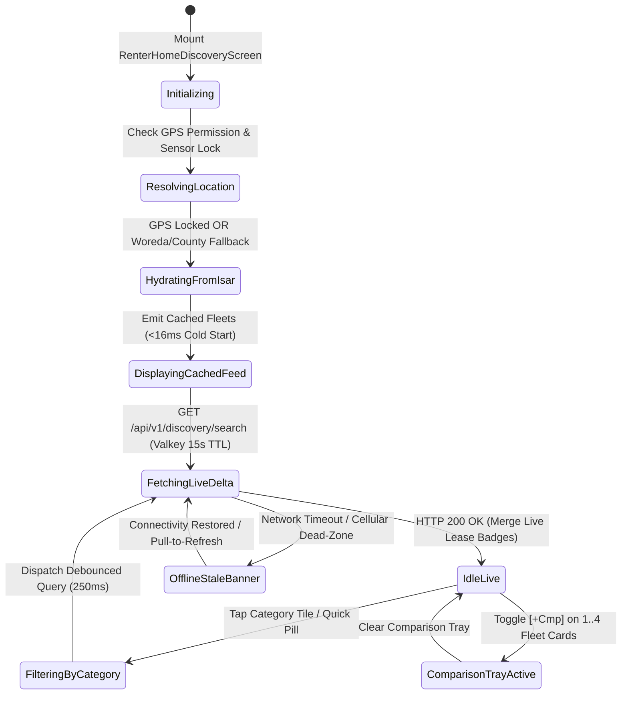
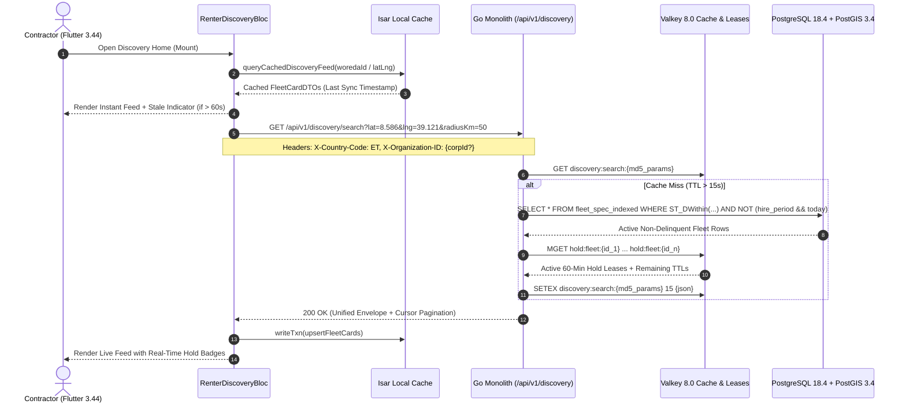

# Renter Discovery Home Screen & Urgent Machinery Radar
## Mobile Subsystem Specification — `docs/mobile/renter-experience/01-renter-home-discovery.md`

**Document Identifier:** `SPEC-MOB-RNT-01`  
**Classification:** Canonical Subsystem UI/UX & Technical Behavior Specification  
**Governing Documents:** `Dink_Machinery_UI_UX_Design_Brief.md`, `SRS-DINK-CORE-V7.0` (`docs/shared/requirements/05-04-fleet-discovery-search-comparison.md`, `05-15-search-discovery-enhancements.md`), `docs/shared/design/design-tokens.json`, `docs/ERROR_CATALOG.md`, `contracts/openapi.yaml`  
**Target Subsystem:** Flutter 3.44 / Dart 3.9 Mobile Client (iOS & Android)  
**Primary Persona / Actor:** Civil Engineering Contractor (*Dawit Haile-Mariam* — Ethiopia `ET` / *Patrick Kariuki* — Kenya `KE`), Corporate Site Requester (*Bethlehem Tessema*)  
**Associated Requirements:** `REQ-05-04` (`FD-01`..`FD-05`, `SR-01`, `SR-02`, `SR-04`, `SR-05`), `REQ-05-15` (`SR-12`), `REQ-06-01` (`CORP-03`)  
**Associated Interaction Flows:** `FLOW-04` (`FLOW-DISCOVERY-DINK-CORE-V7.0`), `FLOW-12` (Commission Delinquency Exclusion)  
**Architectural Decisions:** `ADR-001` (Modular Monolith), `ADR-004` (PostGIS Spatial Indexing), `ADR-005` (Valkey Distributed Lease), `ADR-008` (Multi-Country Parameterization `LOC-01-BE`), `ADR-010` (Non-Custodial Financial Settlement & Offline Resilience)  
**Status:** Approved Technical Design Baseline

---

## 1. Domain Context, Business Formulas & Architectural Invariants

The Renter Discovery Home Screen (`RenterHomeDiscoveryScreen`) is the primary landing viewport for authenticated Civil Engineering Contractors and Corporate Site Requesters. Operating across dusty, high-glare construction sites ($>85,000\text{ lux}$) and intermittent 3G/4G corridors in Ethiopia (`ET`) and Kenya (`KE`), this screen enables sub-50ms equipment discovery without intermediary brokers (*"delalas"*).

### 1.1 Core Business Formulas & Algorithmic Rules
1. **Composite Multi-Factor Discovery Ranking (`FD-04` / `SR-04` / `SR-12`):**
   Featured and Urgent Radar fleet listings are deterministically ranked on the backend and hydrated into the mobile feed using the weighted composite score:
   $$\text{Score}_{\text{fleet}} = \left(0.35 \times \mathcal{S}_{\text{proximity}}\right) + \left(0.30 \times \mathcal{S}_{\text{rating}}\right) + \left(0.20 \times \mathcal{S}_{\text{tariff}}\right) + \left(0.15 \times \mathcal{S}_{\text{mechanical\_age}}\right)$$
   where $\mathcal{S}_{\text{proximity}} = \max\left(0, 1 - \frac{d_{\text{km}}}{R_{\text{max}}}\right)$ and $\mathcal{S}_{\text{rating}} = \frac{\text{VerifiedRating}}{5.0}$.
2. **Commission Delinquency Exclusion Invariant (`FLOW-12`):**
   Any machinery owned by a Fleet Owner whose `owner_wallets.overdue_balance_minor > 0` for $> 30\text{ days}$ is strictly excluded at the PostgreSQL query layer. If an asset is cached in the mobile client's local Isar database and subsequently becomes delinquent, the background refresh delta tombstones the card immediately.
3. **Real-Time Valkey Lease Badge Overlay (`FD-05`):**
   Each fleet card displays its live concurrency state by interrogating `MGET hold:fleet:{id}` in Valkey 8.0:
   - `AVAILABLE_NOW`: Unencumbered in PostgreSQL `hire_period` and no active Valkey hold key.
   - `HELD_PENDING_WIRE`: Active 60-minute soft-lock (`TTL > 0`) held by another renter; card renders an Amber countdown pill and allows "Join Waitlist" (`SD-03`).
4. **Integer Minor Unit Money Representation (`ADR-010`):**
   Daily wet and dry rental rates are transmitted strictly as 64-bit integer minor units (`dailyRateWetMinor`, `dailyRateDryMinor` in Santims for `ETB` or Cents for `KES`) accompanied by the ISO 4217 currency code (`ETB` | `KES`) and rendered using `typography.fontFamily.mono`.
5. **Fail-Safe Geodesic Fallback (`FD-01`):**
   When hardware GPS permission is denied or satellite lock fails inside deep quarry cuts, the location context header automatically falls back to the user's selected administrative centroid (`woreda_centroids_et` e.g., *Bole / Mojo Dry Port* or `county_centroids_ke` e.g., *Mombasa / Machakos*).

---

## 2. Screen Anatomy & Bespoke ASCII Wireframe

```text
+-----------------------------------------------------------------------+
| [📍 Mojo Dry Port, ET (GPS Locked ±8m) v]   [🏢 Corp: Sur Const.] [🔔3]|
|-----------------------------------------------------------------------|
| [🔍 Search Make, Model, Tonnage (e.g. CAT 320D, 30T)...       ] [🎙️] |
|-----------------------------------------------------------------------|
| ⚡ QUICK FILTERS: [🟢 Available Today] [⛽ Wet Rate] [🛡️ Insured] [⚖️2] |
|=======================================================================|
| 🚨 URGENT MACHINERY RADAR (< 25 km • Immediate Mobilization Ready)    |
| +-----------------------------------+ +-----------------------------+ |
| | [🟢 AVAILABLE NOW]   [❤️] [⚖️+Cmp]| | [🟡 HELD: 18m left]  [🔔Wait]| |
| |  _______________________________  | |  _________________________  | |
| | |   [IMG: CAT 320D2 GC Excv]   |  | | | [IMG: Komatsu D85EX]    | | |
| | |___📷 12___|___🛡️ CPAR Ver.___|  | | |__📷 8__|__🛡️ CPAR Ver.__| | |
| | CAT 320D2 Hydraulic Excavator     | | Komatsu D85EX-15 Bulldozer  | |
| | 📍 6.4 km (Mojo Yard) • ⭐ 4.9(42)| | 📍 14.2 km (Adama) • ⭐ 4.8 | |
| | ⏱️ Meter: 4,120.5 hrs • 22.4 Tons | | ⏱️ Meter: 6,890.0 hrs • 28T | |
| | 💰 ETB 28,500.00 /day (Wet Rate)  | | 💰 ETB 42,000.00 /day (Wet) | |
| | [  BOOK / INSPECT SPEC (56dp)   ] | | [  JOIN STANDBY WAITLIST  ] | |
| +-----------------------------------+ +-----------------------------+ |
|=======================================================================|
| 🏗️ MACHINERY TAXONOMY CATEGORIES (FD-02)                   [View All] |
| +----------------+ +----------------+ +----------------+ +----------+ |
| |  [🚜 Excav.]   | |  [🚧 Dozers]   | |  [🏗️ Cranes]   | | [🚛 Lowb]| |
| |  Excavators    | |  Bulldozers    | |  Mobile Cranes | | Lowboys  | |
| |   (142 Units)  | |   (58 Units)   | |   (31 Units)   | | (64 Unit)| |
| +----------------+ +----------------+ +----------------+ +----------+ |
| +----------------+ +----------------+ +----------------+ +----------+ |
| |  [🛞 Loaders]  | |  [🛣️ Graders]  | |  [🪨 Rollers]  | | [🔩 Att.]| |
| | Wheel Loaders  | | Motor Graders  | |  Compactors    | | Breakers | |
| |   (89 Units)   | |   (44 Units)   | |   (76 Units)   | | (115 Un.)| |
| +----------------+ +----------------+ +----------------+ +----------+ |
|=======================================================================|
| ⭐ FEATURED VERIFIED FLEETS NEAR CORRIDOR                              |
| +-------------------------------------------------------------------+ |
| | [🟢 AVAILABLE NOW]  [🏢 MSA Contract Rate -12%]         [⚖️ +Cmp] | |
| | XCMG GR215 Motor Grader (160kW • Ripper + Scarifier Included)     | |
| | 📍 11.8 km • Adama–Awash Express Depot • Owner: Tesfaye Plant PLC | |
| | 💰 ETB 31,200.00 /day (Wet)  |  ETB 24,500.00 /day (Dry)          | |
| | [            VIEW SPEC SHEET & RESERVE (56dp target)            ] | |
| +-------------------------------------------------------------------+ |
|-----------------------------------------------------------------------|
| [🏠 Discover]   [🗺️ Radius Map]   [📋 Bookings (2)]   [👤 Corp/Prof]  |
+-----------------------------------------------------------------------+
```

---

## 3. W3C DTCG Design Token Mapping Table

All visual properties bind directly to `docs/shared/design/design-tokens.json` across `semantic.light`, `semantic.dark`, and `semantic.outdoorHighContrast` (automatically activated when ambient lux sensor $> 50,000\text{ lux}$ or manually toggled).

| UI Component / Element | W3C DTCG Token Path | Resolved Value (Light / Outdoor High-Contrast) | Ergonomic & Behavioral Mandate |
|---|---|---|---|
| **Screen Canvas Background** | `semantic.light.surface.canvas` / `semantic.outdoorHighContrast.surface.canvas` | `#F8FAFC` / `#000000` (21:1 AMOLED) | Zero glare bounce in direct equatorial sun. |
| **Fleet Card Surface** | `semantic.light.surface.card` | `#FFFFFF` (Border: `stroke.border.medium` `2dp` in Outdoor) | `elevation.card` in standard mode; solid `2dp` `#FFFFFF` border in outdoor mode. |
| **Primary CTA Button** | `semantic.light.action.primary.bg` / `component.actuator.button.heightStandard` | `#F59E0B` (`color.brand.amber.500`) / `56dp` height | `stroke.border.heavy` (`3dp`) bottom tactile lip; `HapticFeedback.mediumImpact()`. |
| **Available Status Badge** | `color.feedback.emerald.500` + `color.feedback.emerald.50` | `#10B981` icon/text on `#ECFDF5` pill | Paired with `Icons.check_circle_rounded` for colorblind safety. |
| **Held Pending Wire Badge** | `color.brand.amber.800` + `color.brand.amber.100` | `#92400E` text on `#FEF3C7` pill | Live 1 Hz ticker showing remaining Valkey lease minutes (`HELD: 18m left`). |
| **Monetary Rate Figure** | `typography.fontFamily.mono` + `semantic.light.text.numericLedger` | `Space Mono` `16sp` Bold / `#020617` | Formatted from integer minor units; never floats. |
| **Ge'ez / Latin Typography** | `typography.fontFamily.ethiopic` / `typography.lineHeightFactor.ethiopicGolden` | `Noto Sans Ethiopic` (`1.38x` line height) | Eliminates vertical clipping of Amharic/Tigrinya fidäl ascenders/descenders. |
| **Category Grid Tile** | `dimension.space.56` + `stroke.radius.soft` | Min `88dp x 88dp` touch zone, `8dp` radius | Supports gloved thumb actuation with `motion.duration.fast` (`150ms`) press scale. |

---

## 4. Screen State Machine & Sequence Diagrams

### 4.1 Discovery Feed & Concurrency Pre-Flight State Machine


### 4.2 End-to-End Discovery & Valkey Lease Hydration Sequence


---

## 5. Concrete Flutter Implementation Blueprint

### 5.1 BLoC Events & Immutable Freezed States (`renter_discovery_bloc.dart`)
```dart
import 'package:freezed_annotation/freezed_annotation.dart';

part 'renter_discovery_bloc.freezed.dart';

@freezed
sealed class RenterDiscoveryEvent with _$RenterDiscoveryEvent {
  const factory RenterDiscoveryEvent.initialized({
    required String countryCode,
    String? activeOrganizationId,
  }) = _Initialized;

  const factory RenterDiscoveryEvent.locationUpdated({
    required double latitude,
    required double longitude,
    required String administrativeLabel,
    required bool isFallbackCentroid,
  }) = _LocationUpdated;

  const factory RenterDiscoveryEvent.quickFilterToggled({
    required DiscoveryQuickFilter filter,
  }) = _QuickFilterToggled;

  const factory RenterDiscoveryEvent.categorySelected({
    required String categoryId,
    required String categorySlug,
  }) = _CategorySelected;

  const factory RenterDiscoveryEvent.searchQueryChanged({
    required String trigramQuery,
  }) = _SearchQueryChanged;

  const factory RenterDiscoveryEvent.comparisonToggled({
    required FleetSummaryCardDto fleet,
  }) = _ComparisonToggled;

  const factory RenterDiscoveryEvent.nextCursorRequested() = _NextCursorRequested;
}

@freezed
abstract class RenterDiscoveryState with _$RenterDiscoveryState {
  const factory RenterDiscoveryState({
    @Default(DiscoveryStatus.initial) DiscoveryStatus status,
    required String countryCode, // 'ET' | 'KE'
    String? activeOrganizationId,
    String? activeOrganizationName,
    required GeoContextDto geoContext,
    @Default(<CategoryTaxonomyDto>[]) List<CategoryTaxonomyDto> categories,
    @Default(<FleetSummaryCardDto>[]) List<FleetSummaryCardDto> urgentRadarFleets,
    @Default(<FleetSummaryCardDto>[]) List<FleetSummaryCardDto> featuredFleets,
    @Default(<String, FleetSummaryCardDto>{}) Map<String, FleetSummaryCardDto> comparisonTray,
    @Default(<DiscoveryQuickFilter>{}) Set<DiscoveryQuickFilter> activeQuickFilters,
    String? nextCursor,
    @Default(false) bool hasMore,
    @Default(false) bool isOfflineStale,
    DateTime? lastSyncedAt,
    ProblemDetails? error,
  }) = _RenterDiscoveryState;
}
```

### 5.2 Isar Local Cache Schema (`isar_cached_fleet_card.dart`)
```dart
import 'package:isar/isar.dart';

part 'isar_cached_fleet_card.g.dart';

@collection
class IsarCachedFleetCard {
  Id isarId = Isar.autoIncrement;

  @Index(unique: true, replace: true)
  late String fleetId;

  @Index()
  late String categoryId;

  @Index()
  late String countryCode;

  late String title;
  late String make;
  late String model;
  late double distanceKm;
  late String depotLabel;
  late double baselineHours;
  late int operatingWeightKg;
  late int dailyRateWetMinor;
  late int dailyRateDryMinor;
  late String currencyCode; // 'ETB' | 'KES'
  late String availabilityBadge; // 'AVAILABLE_NOW' | 'HELD_PENDING_WIRE'
  int? holdRemainingSeconds;
  late bool isInsuranceVerified;
  late double ratingAverage;
  late int ratingCount;
  late List<String> thumbnailUrls;
  late DateTime cachedAt;
}
```

### 5.3 Widget Tree Hierarchy
```text
RenterHomeDiscoveryScreen (Scaffold)
 ├── IndustrialLocationAppBar
 │    ├── GpsCentroidSelectorPill (48dp height, opens Woreda/County picker modal)
 │    ├── CorporateContextBadge (CORP-03 quick persona switcher pill)
 │    └── NotificationBellBadge (Shows unread count from REQ-05-10)
 ├── StickySearchAndQuickFilterHeader (SliverPersistentHeader)
 │    ├── TrigramSearchBarField (Debounced 250ms, Amharic/Swahili/English hint)
 │    └── QuickFilterChipsRow (Available Today, Wet Rate, CPAR Insured, MSA Rate)
 ├── CustomScrollView (RefreshIndicator)
 │    ├── OfflineStaleWarningBanner (Visible when isOfflineStale == true)
 │    ├── UrgentMachineryRadarCarousel (Horizontal PageView, <25km ready assets)
 │    │    └── UrgentFleetCardWidget (56dp CTA + Hold Countdown Badge + [+Cmp])
 │    ├── CategoryTaxonomySliverGrid (4x2 responsive industrial icon grid, FD-02)
 │    └── FeaturedCorridorFleetSliverList (Cursor-paginated vertical list)
 │         └── FeaturedFleetDossierCard
 └── FloatingComparisonDockBar (AnimatedSlide, visible when comparisonTray.isNotEmpty)
```

---

## 6. OpenAPI 3.1.0 Routes & RFC 9457 Error Matrix

### 6.1 Endpoint Specifications
- **`GET /api/v1/discovery/search`**
  - **Query Parameters:** `lat` (`double`), `lng` (`double`), `radiusKm` (`int`, default `50`), `categoryId` (`uuid?`), `q` (`string?`, trigram search), `wetRateOnly` (`bool?`), `availableToday` (`bool?`), `cursor` (`string?`), `limit` (`int`, default `20`).
  - **Headers:** `X-Country-Code: ET | KE`, `X-Organization-ID: <uuid>` (optional corporate context), `Accept-Language: am | om | sw | en`.
  - **Response Envelope (`200 OK`):** Standardized `data.urgentRadar[]`, `data.featured[]`, `data.categories[]`, and `meta.pagination` (`nextCursor`, `prevCursor`, `hasMore`).

### 6.2 RFC 9457 Problem Details Matrix
| Error Code | HTTP Status | RFC 9457 Type URI | Retryable | Mobile UI Remediation & Recovery Action |
|---|---|---|---|---|
| `GEO_INVALID_COORDINATES` | `400` | `/errors/geo-invalid-coordinates` | No | Automatically switch `GeoContextDto` to the default Woreda/County centroid (`Addis Ababa / Nairobi`) and re-dispatch query. |
| `GEO_RADIUS_OUT_OF_BOUNDS` | `400` | `/errors/geo-radius-out-of-bounds` | No | Clamp radius filter to `[5, 200] km` client-side and display non-blocking snackbar notice. |
| `CAT_NOT_FOUND` | `404` | `/errors/category-not-found` | No | Clear stale `categoryId` filter, trigger taxonomy refresh, and reset to "All Categories". |
| `REQ_INVALID_COUNTRY_CODE` | `400` | `/errors/invalid-country-code` | No | Re-read sovereign jurisdiction from authenticated session claims (`ET` or `KE`). |
| `SYS_RATE_LIMIT_EXCEEDED` | `429` | `/errors/rate-limit-exceeded` | Yes (`Retry-After`) | Keep cached Isar feed interactive; pause background polling until `Retry-After` seconds elapse. |
| `SYS_SERVICE_UNAVAILABLE` | `503` | `/errors/service-unavailable` | Yes (Exp Backoff) | Activate `isOfflineStale = true` banner and serve cached `IsarCachedFleetCard` records seamlessly. |

---

## 7. Verification & Acceptance Criteria

- [ ] **Cold-Start Offline Hydration (`G0` / `G1`):** Launching `RenterHomeDiscoveryScreen` in Airplane Mode renders cached `IsarCachedFleetCard` entries within $< 16\text{ ms}$ (1 frame at 60fps) and displays the high-contrast offline staleness banner.
- [ ] **Zero Float Money Enforcement:** Unit test verifies `dailyRateWetMinor: 2850000` with `currencyCode: "ETB"` renders strictly as `ETB 28,500.00 /day` via `Space Mono` font without double/float conversion loss.
- [ ] **Homogeneous Comparison Guardrail (`FD-15`):** Toggling `[+Cmp]` on a `Bulldozer` when an `Excavator` is already in `comparisonTray` displays an inline warning sheet prohibiting cross-category comparison, or caps selection at 4 machines.
- [ ] **Outdoor High-Contrast Ergonomics (`G3`):** Automated `axe-core` / Flutter `Semantics` audit confirms all interactive cards, category tiles, and filter chips meet $\ge 56\text{ dp}$ touch target height and $21:1$ contrast in `outdoorHighContrast` theme.
- [ ] **Zero PII Leakage (`ASVS L3`):** Fleet cards display verified company/depot labels (`Tesfaye Plant PLC`) and distance (`6.4 km`), never exposing raw owner phone numbers or bank coordinates on the discovery screen.
