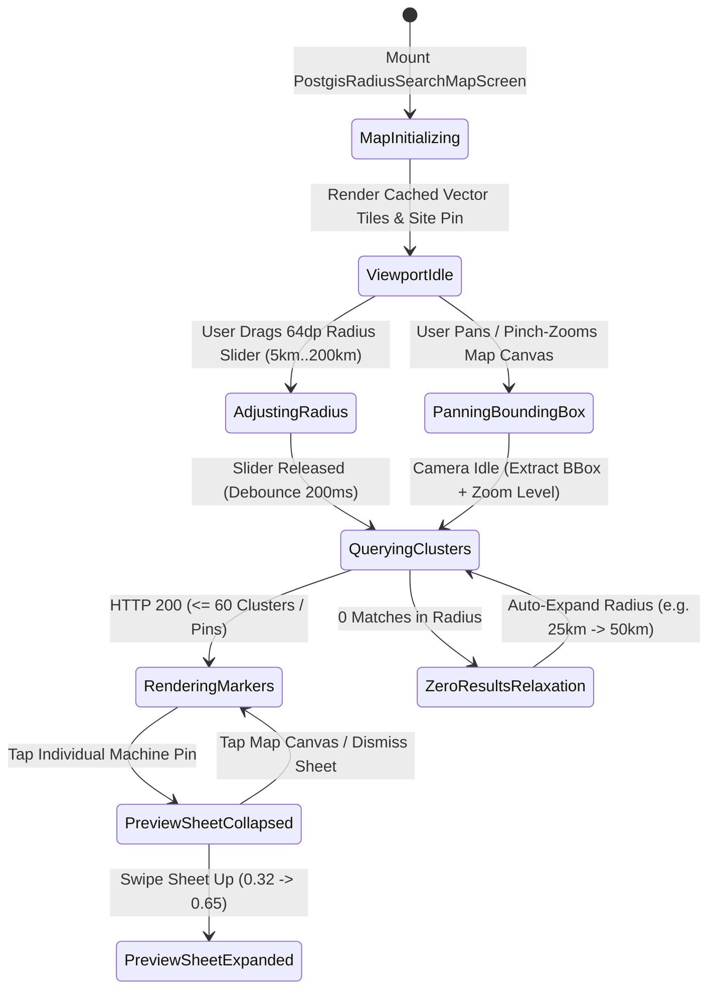
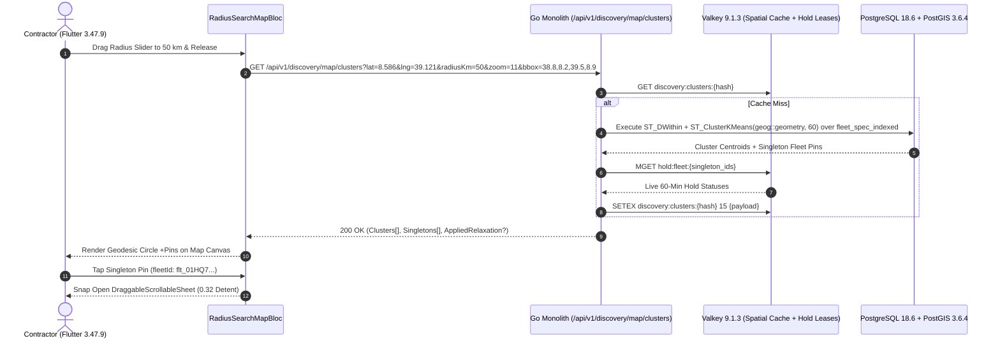

# PostGIS Geodesic Radius Search & Interactive Cluster Map
## Mobile Subsystem Specification — `docs/mobile/renter-experience/02-postgis-radius-search-map.md`

**Document Identifier:** `SPEC-MOB-RNT-02`  
**Classification:** Canonical Subsystem UI/UX & Technical Behavior Specification  
**Governing Documents:** `Dink_Machinery_UI_UX_Design_Brief.md`, `SRS-DINK-CORE-V7.0` (`docs/shared/requirements/05-04-fleet-discovery-search-comparison.md`, `05-15-search-discovery-enhancements.md`), `docs/shared/design/design-tokens.json`, `docs/ERROR_CATALOG.md`, `contracts/openapi.yaml`  
**Target Subsystem:** Flutter 3.47.9 / Dart 3.9 Mobile Client (iOS & Android)  
**Primary Persona / Actor:** Civil Engineering Contractor (*Dawit Haile-Mariam* / *Patrick Kariuki*), Regional Project Director  
**Associated Requirements:** `REQ-05-04` (`FD-06`..`FD-09`, `SR-03`, `SR-05`), `REQ-05-15` (`SR-09`, `ST_ClusterKMeans`)  
**Associated Interaction Flows:** `FLOW-04` (`FLOW-DISCOVERY-DINK-CORE-V7.0`), `FLOW-06`  
**Architectural Decisions:** `ADR-004` (PostGIS 3.6.4 `GEOGRAPHY(Point, 4326)` GiST Indexing), `ADR-005` (Valkey 15s Spatial Cache & Lease Overlay), `ADR-008` (`LOC-01-BE` Regional Geofencing), `ADR-010` (Integer Minor Units & Offline Resilience)  
**Status:** Approved Technical Design Baseline

---

## 1. Domain Context, Business Formulas & Architectural Invariants

Heavy machinery mobilization costs scale nonlinearly with lowboy haulage distance. A 32-ton crawler excavator stationed $12\text{ km}$ from a highway cut in Adama costs a fraction to mobilize compared to an identical unit $140\text{ km}$ away across mountain grades. The **PostGIS Geodesic Radius Search & Interactive Cluster Map (`PostgisRadiusSearchMapScreen`)** provides contractors with a spatial radar viewport backed by PostgreSQL 18.6 + PostGIS 3.6.4.

### 1.1 Spatial Formulas & Architectural Invariants
1. **Spheroidal Geodesic Radius Filtering (`FD-06`):**
   The mobile client transmits the job-site pin $(\phi_{\text{site}}, \lambda_{\text{site}})$ and target radius $R_{\text{km}} \in [5\text{ km}, 200\text{ km}]$. The Go backend executes spheroidal distance filtering using the GiST index `idx_fleets_geog` on `GEOGRAPHY(Point, 4326)`:
   $$\text{ST\_DWithin}\Big(\text{depot\_geog},\; \text{ST\_SetSRID}(\text{ST\_MakePoint}(\lambda_{\text{site}}, \phi_{\text{site}}), 4326)::geography,\; R_{\text{km}} \times 1000\Big)$$
2. **Server-Side K-Means Geo-Clustering (`FD-07` / `REQ-05-15 §4.1`):**
   To guarantee locked 60fps map panning on mid-range field Android devices, whenever the viewport bounding box (`BBox`) contains $> 60$ machines, PostGIS groups points using `ST_ClusterKMeans(depot_geog::geometry, k)` capped at **60 cluster centroids** per viewport response. Each cluster pin displays the unit count and the minimum daily rate in minor units.
3. **Cross-Border Jurisdiction Guardrail (`LOC-01-BE`):**
   Spatial radius rings are clipped at sovereign national borders (`ET` vs `KE`). A search near Moyale (`ET`) will never return Kenyan-registered machinery that cannot legally cross customs without temporary import bonds.
4. **600m Privacy Jitter Before Booking Confirmation (`ASVS L3`):**
   To prevent off-platform circumvention (*"delala" poaching*), unbooked fleet pins render at the owner's public depot centroid or with a deterministic $600\text{ m}$ radial obfuscation ring. Exact yard gate coordinates unlock only after booking confirmation (`7. CONFIRMED`).
5. **Interactive Machine Preview Bottom Sheet (`FD-08` / `FD-09`):**
   Tapping any individual machine pin or small cluster ($\le 5$ units) snaps open a multi-detent `DraggableScrollableSheet` (`0.32`, `0.65`, `0.92`) displaying swipeable thumbnails, road-distance estimate, live Valkey hold state, and a `56dp` "Inspect & Reserve" CTA.

---

## 2. Screen Anatomy & Bespoke ASCII Wireframe

```text
+-----------------------------------------------------------------------+
| [<- Back]  📍 Job Site: Modjo–Hawassa Lot 2 (8.586°N, 39.121°E) [📋List]|
|-----------------------------------------------------------------------|
| [🚜 Excavators (x)] [⚖️ 20T-35T (x)] [📅 Oct 30 - Nov 12] [⚙️ Filters] |
|=======================================================================|
|                     🗺️ MAPBOX / VECTOR TILE CANVAS                     |
|                                                                       |
|          .-~~~-.                                   [☀️ Glare Mode]    |
|        .'       '.   <-- 50 km Geodesic Radius Ring                   |
|       /   [🔵14]  \      (Amber 500 2dp dashed stroke)                |
|      ;   Adama     ;                                                  |
|      |             |         [🟢 ETB 28.5k] <-- Selected Active Pin   |
|      |      🎯     |             (CAT 320D2 • 6.4 km)                 |
|      ;  Job Site   ;                                                  |
|       \   Pin     /          [🟡 HELD 14m]  <-- Valkey Soft-Locked    |
|        '.       .'                                                    |
|          '~---~'     [🔵 8 Units] (Bishoftu Cluster • From ETB 24k)   |
|                                                                       |
| [🎯 Recenter Site]                                       [➕] / [➖]  |
|-----------------------------------------------------------------------|
| 📏 SEARCH RADIUS: 50 km                        [ 5 km =======O==== 200 km ]|
|=======================================================================|
| ====================(  DRAGGABLE PREVIEW SHEET  )==================== |
| [🟢 AVAILABLE NOW]  [🛡️ CPAR Insured]  [🚛 Lowboy Required]  [⚖️ +Cmp]|
| CAT 320D2 L Hydraulic Crawler Excavator (2021)                        |
| 📍 6.4 km geodesic (8.2 km road via A1 Hwy) • Mojo Staging Yard       |
| +-------------------------------------------------------------------+ |
| | ⚙️ Operating Wt: 22,400 kg | 🪣 Bucket: 1.2 m³ | ⏱️ Meter: 4,120h | |
| +-------------------------------------------------------------------+ |
| 💰 Wet Rate: ETB 28,500.00 /day   |   Dry Rate: ETB 23,000.00 /day    |
| [     OPEN FULL SPEC SHEET     ]   [   RESERVE DATES (56dp CTA)   ]   |
+-----------------------------------------------------------------------+
```

---

## 3. W3C DTCG Design Token Mapping Table

| UI Component / Element | W3C DTCG Token Path | Resolved Value (Light / Outdoor High-Contrast) | Ergonomic & Behavioral Mandate |
|---|---|---|---|
| **Radius Slider Track** | `component.actuator.slider.trackHeight` | `64dp` (`dimension.space.64`) | Heavy gloved-thumb slider stepping in `5 km` increments (`5..200 km`). |
| **Radius Slider Thumb** | `component.actuator.slider.thumbDimension` / `stroke.radius.pill` | `56dp` diameter (`#FF5722` `color.feedback.orange.500`) | Emits `HapticFeedback.selectionClick()` at each `5 km` notch. |
| **Available Map Marker Pin** | `color.feedback.emerald.500` / `typography.fontFamily.mono` | `#10B981` background, `#FFFFFF` text (`12sp` bold) | Displays abbreviated minor-unit daily rate (`ETB 28.5k`). |
| **Held Lease Map Marker** | `color.brand.amber.500` / `color.brand.slate.950` | `#F59E0B` background, `#020617` text | Pulses softly (`motion.duration.slow` `350ms`); displays remaining hold minutes. |
| **K-Means Cluster Marker** | `color.brand.slate.900` + `color.brand.amber.400` border | `#0F172A` circle with `3dp` `#FBBF24` ring | Tapping zooms viewport to cluster bounding envelope (`ST_Envelope`). |
| **Geodesic Radius Polygon** | `color.brand.amber.500` (`25%` alpha fill, `2dp` stroke) | `#F59E0B` stroke (`3dp` solid in Outdoor Mode) | Visually demarcates the exact PostGIS `ST_DWithin` boundary. |
| **Bottom Sheet Container** | `semantic.light.surface.cardElevated` / `elevation.modal` | `#FFFFFF` (`#000000` with `2dp` white border in Outdoor) | `stroke.radius.soft` (`8dp`) top corners; `56dp` drag handle zone. |

---

## 4. Screen State Machine & Sequence Diagrams

### 4.1 Spatial Map Viewport & Sheet State Machine


### 4.2 PostGIS Cluster & Preview Hydration Sequence


---

## 5. Concrete Flutter Implementation Blueprint

### 5.1 BLoC Events & Freezed States (`radius_search_map_bloc.dart`)
```dart
import 'package:freezed_annotation/freezed_annotation.dart';

part 'radius_search_map_bloc.freezed.dart';

@freezed
sealed class RadiusSearchMapEvent with _$RadiusSearchMapEvent {
  const factory RadiusSearchMapEvent.mapInitialized({
    required double siteLat,
    required double siteLng,
    @Default(50) int initialRadiusKm,
  }) = _MapInitialized;

  const factory RadiusSearchMapEvent.radiusChanged({
    required int radiusKm, // Clamped 5..200
  }) = _RadiusChanged;

  const factory RadiusSearchMapEvent.cameraIdle({
    required BoundingBoxDto bbox,
    required double zoomLevel,
  }) = _CameraIdle;

  const factory RadiusSearchMapEvent.clusterTapped({
    required MapClusterDto cluster,
  }) = _ClusterTapped;

  const factory RadiusSearchMapEvent.fleetPinSelected({
    required String fleetId,
  }) = _FleetPinSelected;

  const factory RadiusSearchMapEvent.jobSitePinMoved({
    required double newLat,
    required double newLng,
  }) = _JobSitePinMoved;
}

@freezed
abstract class RadiusSearchMapState with _$RadiusSearchMapState {
  const factory RadiusSearchMapState({
    @Default(MapLoadStatus.initial) MapLoadStatus status,
    required double jobSiteLat,
    required double jobSiteLng,
    @Default(50) int radiusKm,
    @Default(11.0) double zoomLevel,
    BoundingBoxDto? currentBbox,
    @Default(<MapClusterDto>[]) List<MapClusterDto> clusters,
    @Default(<MapFleetPinDto>[]) List<MapFleetPinDto> singletonPins,
    FleetSummaryCardDto? selectedFleetPreview,
    String? relaxationNotice, // e.g., "Expanded radius from 25km to 50km (0 matches at 25km)"
    @Default(false) bool isOutdoorGlareMode,
    ProblemDetails? error,
  }) = _RadiusSearchMapState;
}
```

### 5.2 Isar Offline Spatial Tile & Pin Cache (`isar_spatial_pin_cache.dart`)
```dart
import 'package:isar/isar.dart';

part 'isar_spatial_pin_cache.g.dart';

@collection
class IsarSpatialPinCache {
  Id id = Isar.autoIncrement;

  @Index(unique: true, replace: true)
  late String fleetId;

  late double obfuscatedLat; // 600m privacy jitter applied
  late double obfuscatedLng;
  late double geodesicDistanceKm;
  late String categorySlug;
  late String makeModelLabel;
  late int dailyRateWetMinor;
  late int dailyRateDryMinor;
  late String currencyCode;
  late int operatingWeightKg;
  late double baselineHours;
  late String availabilityState; // 'AVAILABLE_NOW' | 'HELD_PENDING_WIRE'
  late DateTime cachedAt;
}
```

### 5.3 Widget Tree Hierarchy
```text
PostgisRadiusSearchMapScreen (Scaffold)
 ├── Stack
 │    ├── OfflineAwareMapCanvas (Mapbox / FlutterMap with MBtiles offline fallback)
 │    │    ├── GeodesicRadiusPolygonLayer (Renders 64-vertex spheroidal ring)
 │    │    ├── JobSiteTargetPinMarker (Draggable site origin reticle)
 │    │    ├── KMeansClusterMarkerLayer (Max 60 cluster circles)
 │    │    └── SingletonFleetPricePinLayer (Emerald/Amber price pills)
 │    ├── TopFloatingFilterOverlay
 │    │    ├── JobSiteCoordinateHeaderCard
 │    │    └── ActiveParametricFilterChipsBar
 │    ├── RightFloatingMapControlsColumn
 │    │    ├── OutdoorGlareModeToggleButton (56dp x 56dp)
 │    │    └── RecenterJobSiteFab (56dp x 56dp)
 │    ├── BottomRadiusControlRibbon
 │    │    └── IndustrialGlovedRadiusSlider (5km..200km, 64dp track height)
 │    └── FleetPreviewDraggableSheet (Visible when selectedFleetPreview != null)
 │         ├── FleetPreviewHeaderBadges (Available/Held, CPAR Insured, Lowboy Tag)
 │         ├── KeySpecTrioRow (Operating Weight, Capacity, Baseline Hour Meter)
 │         ├── DualTariffLedgerRow (Wet Rate vs Dry Rate in Space Mono)
 │         └── DualActionRow (Open Spec Sheet | Reserve Dates 56dp CTA)
```

---

## 6. OpenAPI 3.1.0 Routes & RFC 9457 Error Matrix

### 6.1 Endpoint Specifications
- **`GET /api/v1/discovery/map/clusters`**
  - **Query Parameters:** `lat` (`double`, required), `lng` (`double`, required), `radiusKm` (`int`, `5..200`), `bbox` (`string`, `minLng,minLat,maxLng,maxLat`), `zoom` (`double`, `4.0..20.0`), `categoryId` (`uuid?`), `startDate` (`date?`), `endDate` (`date?`).
  - **Response (`200 OK`):** Returns `clusters[]` (`clusterId`, `centroidLat`, `centroidLng`, `count`, `minDailyRateMinor`, `boundingEnvelope`), `singletons[]`, and `meta.relaxationApplied`.

### 6.2 RFC 9457 Problem Details Matrix
| Error Code | HTTP Status | RFC 9457 Type URI | Retryable | Mobile UI Remediation & Recovery Action |
|---|---|---|---|---|
| `GEO_INVALID_COORDINATES` | `400` | `/errors/geo-invalid-coordinates` | No | Snap job-site marker back to the nearest valid national territory boundary (`ET` or `KE`). |
| `GEO_RADIUS_OUT_OF_BOUNDS` | `400` | `/errors/geo-radius-out-of-bounds` | No | Reset slider to `50 km` default and display boundary toast (`Allowed range: 5 km – 200 km`). |
| `REQ_INVALID_COUNTRY_CODE` | `400` | `/errors/invalid-country-code` | No | Block cross-border pin placement outside active `X-Country-Code` jurisdiction. |
| `SYS_RATE_LIMIT_EXCEEDED` | `429` | `/errors/rate-limit-exceeded` | Yes | Throttle camera-idle BBox requests to 1 request per 1000ms while preserving local pin rendering. |

---

## 7. Verification & Acceptance Criteria

- [ ] **60fps Clustering Density Cap (`REQ-05-15 §1.2`):** Zooming out to national view (`zoom <= 6.0`) over 25,000 cataloged machines renders $\le 60$ cluster markers with zero dropped frames.
- [ ] **Intelligent Zero-Result Relaxation (`REQ-05-15 §1.2`):** When a `10 km` radius search yields `0` machines, the backend automatically relaxes to `25 km` or `50 km` and the mobile UI renders the `relaxationNotice` banner clearly.
- [ ] **600m Privacy Ring Enforcement (`ASVS L3`):** Network payload inspection confirms `singletonPins` expose only `obfuscatedLat`/`obfuscatedLng` and depot area names prior to a confirmed booking.
- [ ] **Gloved Slider Precision (`G3`):** The `64dp` radius slider steps cleanly in `5 km` increments and triggers `GET /api/v1/discovery/map/clusters` only on `onChangeEnd` + `200ms` debounce.
