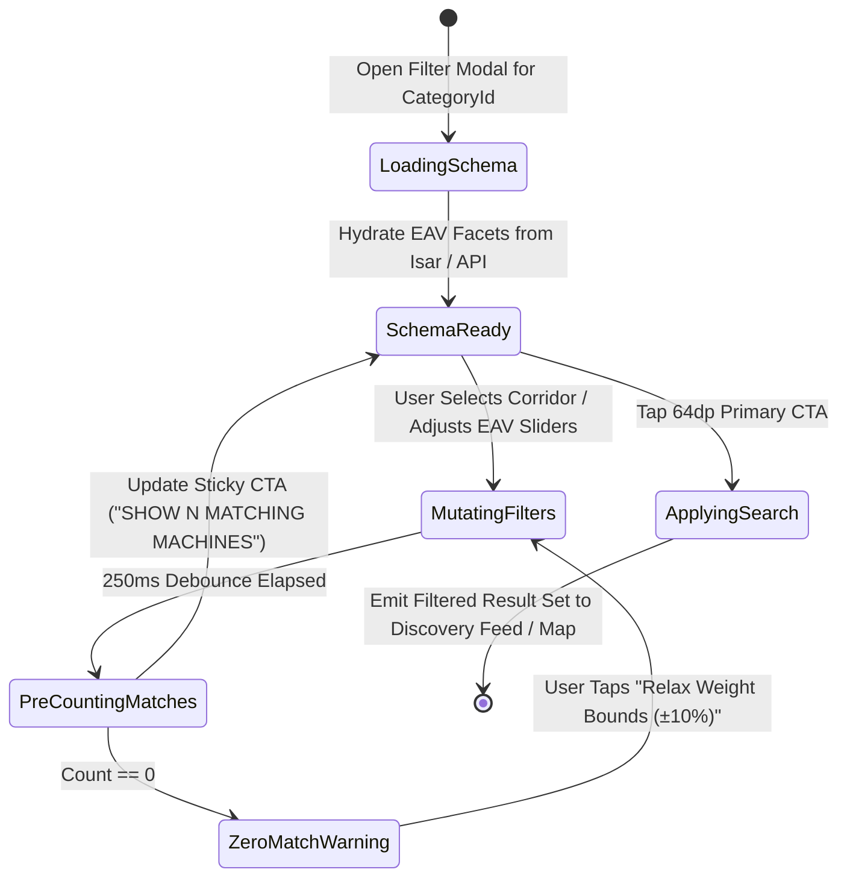
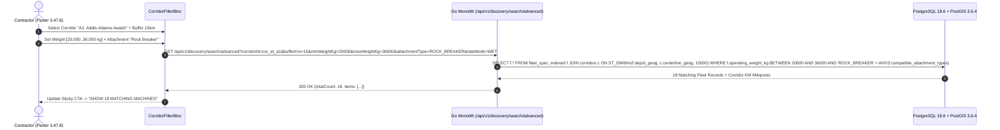

# Transport Corridor Route Filtering & Dynamic EAV Facet Drawer
## Mobile Subsystem Specification — `docs/mobile/renter-experience/03-corridor-route-filtering.md`

**Document Identifier:** `SPEC-MOB-RNT-03`  
**Classification:** Canonical Subsystem UI/UX & Technical Behavior Specification  
**Governing Documents:** `Dink_Machinery_UI_UX_Design_Brief.md`, `SRS-DINK-CORE-V7.0` (`docs/shared/requirements/05-04-fleet-discovery-search-comparison.md`, `05-08-logistics-transport-integration.md`, `05-15-search-discovery-enhancements.md`), `docs/shared/design/design-tokens.json`, `docs/ERROR_CATALOG.md`, `contracts/openapi.yaml`  
**Target Subsystem:** Flutter 3.47.8 / Dart 3.9 Mobile Client (iOS & Android)  
**Primary Persona / Actor:** Civil Engineering Contractor (*Dawit Haile-Mariam* / *Patrick Kariuki*), Lowboy Procurement Coordinator (*Eng. Samuel Getachew*)  
**Associated Requirements:** `REQ-05-04` (`FD-10`..`FD-13`, `SR-03`), `REQ-05-08` (`LG-01`, `FL-28`..`FL-30`), `REQ-05-15` (`SR-09`..`SR-11`, §4.3 Corridor Polyline Proximity)  
**Associated Interaction Flows:** `FLOW-04` (`FLOW-DISCOVERY-DINK-CORE-V7.0`), `FLOW-11` (`FLOW-LOGISTICS-DINK-CORE-V7.0`)  
**Architectural Decisions:** `ADR-002` (Hybrid EAV + Denormalized `fleet_spec_indexed`), `ADR-004` (PostGIS `ST_DWithin` Corridor Polyline Filtering), `ADR-008` (`LOC-01-BE`), `ADR-010` (Integer Minor Units)  
**Status:** Approved Technical Design Baseline

---

## 1. Domain Context, Business Formulas & Architectural Invariants

Linear highway construction and heavy haulage in East Africa revolve around primary national infrastructure corridors (e.g., *Addis Ababa–Adama–Dire Dawa–Djibouti Corridor*, *Modjo–Hawassa Expressway*, *Mombasa–Nairobi–Eldoret Northern Corridor*, *LAPSSET*). Contractors frequently need to filter machinery staged along a specific **Origin $\rightarrow$ Destination Corridor (`FD-10`)** while simultaneously constraining dynamic mechanical specifications (**Dynamic EAV Spec Facets `FD-11`**, **Wet/Dry Rate Mode `FD-12`**, and **Attachment Compatibility `FD-13` / `SR-11`**).

### 1.1 Corridor Spatial & Parametric Formulas
1. **Corridor Centerline Buffer Filtering (`REQ-05-15 §4.3`):**
   Given a selected highway corridor polyline $\mathcal{L}_{\text{corridor}}$ (`GEOGRAPHY(LineString, 4326)`) from Origin $A$ to Destination $B$ and lateral buffer width $W_{\text{km}} \in [5\text{ km}, 50\text{ km}]$, PostGIS filters machines staged within the corridor buffer:
   $$\text{ST\_DWithin}\Big(\text{fleets.depot\_geog},\; \mathcal{L}_{\text{corridor}},\; W_{\text{km}} \times 1000\Big)$$
   Furthermore, for lowboy transport matching (`LG-01`), bridge clearance height ($H_{\text{machine}} + H_{\text{lowboy\_deck}} \le H_{\text{corridor\_min\_bridge}} - 0.15\text{ m}$) and KeNHA/ERA axle-load limits are evaluated automatically.
2. **Denormalized Parametric EAV Querying (`ADR-002` / `SR-09`):**
   When a contractor selects a subcategory (e.g., `Hydraulic Crawler Excavator`), the mobile filter sheet renders dynamic range sliders and multi-select tags driven by `category_spec_definitions`. On the backend, continuous numeric bounds (`operating_weight_kg`, `engine_power_kw`, `max_digging_depth_mm`, `bucket_capacity_m3`) execute against `fleet_spec_indexed` rather than joining raw EAV rows, maintaining the $< 50\text{ ms}$ p95 latency SLO.
3. **Wet vs. Dry Tariff Filtering (`FD-12`):**
   - **Wet Rate (`WET`):** Includes certified operator + fuel allowance (or operator-included commercial terms).
   - **Dry Rate (`DRY`):** Bare machine rental; renter supplies fuel and/or certified operator.
   All tariff range sliders operate in integer minor units (`minDailyRateMinor`..`maxDailyRateMinor`).

---

## 2. Screen Anatomy & Bespoke ASCII Wireframe

```text
+-----------------------------------------------------------------------+
| [✕ Close]      CORRIDOR & TECHNICAL SPEC FILTERS        [Reset All]   |
|=======================================================================|
| 🛣️ 1. INFRASTRUCTURE CORRIDOR ROUTE (FD-10 / LG-01)                   |
| +-------------------------------------------------------------------+ |
| | Preset Corridor: [🇪🇹 A1: Addis -> Mojo -> Adama -> Awash      v] | |
| | Origin Depot/Town:      [📍 Mojo Dry Port (Zone 1)            ]   | |
| | Destination Job Site:   [📍 Metehara Sugar Estate KM 142      ]   | |
| | Lateral Corridor Buffer:[ 15 km ]   [ 5km ====O=========== 50km ] | |
| | [x] Enforce Corridor Bridge Clearance (< 4.50m loaded height)     | |
| +-------------------------------------------------------------------+ |
|=======================================================================|
| 💰 2. COMMERCIAL RATE MODE & DAILY BUDGET (FD-12)                     |
| | (•) Wet Rate (With Operator)   ( ) Dry Rate (Bare)   ( ) Any Mode | |
| | Daily Budget (ETB):  15,000.00  to  45,000.00 /day                | |
| | [ 10k ======O===========================O================== 100k ]| |
|=======================================================================|
| ⚙️ 3. DYNAMIC MECHANICAL SPECS: EXCAVATORS (FD-11 / SR-09..10)        |
| +-------------------------------------------------------------------+ |
| | Operating Weight (Tons):  20.0 T  —  36.0 T                       | |
| | [ 5T ========O==========================O=================== 80T ]| |
| |                                                                   | |
| | Min Digging Depth (mm):   [ 6,200 mm ]  (6.2m Trench Requirement) | |
| | [ 3,000mm ==================O=========================== 9,500mm ]| |
| |                                                                   | |
| | Hydraulic Auxiliary Flow: [x] High-Flow Aux (>180 L/min)          | |
| | Undercarriage Type:       [🟢 Steel Track (600mm)] [⚪ Rubber Pad] | |
| +-------------------------------------------------------------------+ |
|=======================================================================|
| 🔩 4. REQUIRED COMPATIBLE ATTACHMENTS (FD-13 / SR-11)                 |
| | [🟢 Hydraulic Rock Breaker (140mm)] [⚪ Ripper Tooth] [⚪ Auger]    | |
|-----------------------------------------------------------------------|
| 🚛 5. MOBILIZATION & COMPLIANCE                                       |
| | [x] CPAR Insurance Active   [x] Compatible Lowboy Available (<25km)| |
|=======================================================================|
| [        SHOW 18 MATCHING MACHINES ALONG CORRIDOR (64dp CTA)        ] |
+-----------------------------------------------------------------------+
```

---

## 3. W3C DTCG Design Token Mapping Table

| UI Component / Element | W3C DTCG Token Path | Resolved Value (Light / Outdoor High-Contrast) | Ergonomic & Behavioral Mandate |
|---|---|---|---|
| **Filter Drawer Surface** | `semantic.light.surface.card` / `elevation.modal` | `#FFFFFF` / `#000000` (Outdoor) | Full-screen modal sheet with `16dp` horizontal gutter (`dimension.space.16`). |
| **Dual-Thumb Range Slider** | `component.actuator.slider.trackHeight` / `thumbDimension` | `64dp` track height, `56dp` thumb diameter | High-visibility `#FF5722` (`color.feedback.orange.500`) active range bar. |
| **Numeric Spec Value Readout** | `typography.fontFamily.mono` + `typography.fontSize.16` | `Space Mono` `16sp` Bold (`#0F172A` / `#FFFFFF`) | Live numeric readout above every slider preventing thumb occlusion. |
| **Selected Multi-Facet Chip** | `color.brand.amber.500` + `color.brand.slate.950` | `#F59E0B` fill, `#020617` bold text, `2dp` border | `48dp` minimum height (`dimension.space.48`); tactile check icon prefix. |
| **Corridor Route Card** | `color.brand.slate.100` / `stroke.border.medium` | `#F1F5F9` container with `2dp` `#CBD5E1` border | Groups Origin, Destination, Lateral Buffer, and Bridge Clearance toggle. |
| **Sticky Live Count CTA** | `component.actuator.button.heightField` / `action.primary.bg` | `64dp` height, `#F59E0B` (`#FBBF24` in Outdoor) | Dynamically updates count (`SHOW 18 MATCHING MACHINES`) via debounced pre-count. |

---

## 4. Screen State Machine & Sequence Diagrams

### 4.1 Dynamic Facet & Corridor Filter State Machine


### 4.2 Corridor Polyline & EAV Facet Execution Sequence


---

## 5. Concrete Flutter Implementation Blueprint

### 5.1 BLoC Events & Freezed States (`corridor_filter_bloc.dart`)
```dart
import 'package:freezed_annotation/freezed_annotation.dart';

part 'corridor_filter_bloc.freezed.dart';

@freezed
sealed class CorridorFilterEvent with _$CorridorFilterEvent {
  const factory CorridorFilterEvent.schemaRequested({
    required String categoryId,
    required String countryCode,
  }) = _SchemaRequested;

  const factory CorridorFilterEvent.corridorRouteSelected({
    required String corridorId,
    required String originLabel,
    required String destinationLabel,
    required int lateralBufferKm,
    required bool enforceBridgeClearance,
  }) = _CorridorRouteSelected;

  const factory CorridorFilterEvent.rateFilterUpdated({
    required RateFilterMode mode, // WET, DRY, ANY
    required int minDailyRateMinor,
    required int maxDailyRateMinor,
  }) = _RateFilterUpdated;

  const factory CorridorFilterEvent.numericSpecRangeChanged({
    required String specKey, // e.g. 'operating_weight_kg'
    required double minVal,
    required double maxVal,
  }) = _NumericSpecRangeChanged;

  const factory CorridorFilterEvent.attachmentRequirementToggled({
    required String attachmentCategoryCode,
  }) = _AttachmentRequirementToggled;

  const factory CorridorFilterEvent.filtersReset() = _FiltersReset;
}

@freezed
abstract class CorridorFilterState with _$CorridorFilterState {
  const factory CorridorFilterState({
    @Default(FilterStatus.initial) FilterStatus status,
    required String categoryId,
    required String countryCode,
    CorridorRouteFilterDto? selectedCorridor,
    @Default(RateFilterMode.wet) RateFilterMode rateMode,
    @Default(0) int minDailyRateMinor,
    @Default(15000000) int maxDailyRateMinor, // 150,000.00 ETB in minor units
    @Default(<EavFacetDefinitionDto>[]) List<EavFacetDefinitionDto> facetDefinitions,
    @Default(<String, NumericRangeValue>{}) Map<String, NumericRangeValue> activeNumericRanges,
    @Default(<String, Set<String>>{}) Map<String, Set<String>> activeEnumTags,
    @Default(<String>{}) Set<String> requiredAttachmentCodes,
    @Default(true) bool requireVerifiedInsurance,
    @Default(false) bool requireLowboyProximity,
    @Default(0) int matchingCountPreview,
    ProblemDetails? error,
  }) = _CorridorFilterState;
}
```

### 5.2 Isar Cached EAV Category Facet Schema (`isar_eav_facet_schema.dart`)
```dart
import 'package:isar/isar.dart';

part 'isar_eav_facet_schema.g.dart';

@collection
class IsarEavFacetSchema {
  Id id = Isar.autoIncrement;

  @Index(unique: true, replace: true)
  late String categoryId;

  late String categoryName;
  late String serializedFacetDefinitionsJson; // Cached EavFacetDefinitionDto[]
  late String serializedCorridorsJson; // National corridors for ET / KE
  late DateTime updatedAt;
}
```

### 5.3 Widget Tree Hierarchy
```text
CorridorRouteFilterModal (Scaffold)
 ├── FilterTopBar (Close IconButton, Title, Reset All TextButton)
 ├── ListView (Padding: 16dp)
 │    ├── InfrastructureCorridorSectionCard (FD-10 / LG-01)
 │    │    ├── PresetCorridorDropdown (A1 Addis-Djibouti, Modjo-Hawassa, Northern Corridor KE)
 │    │    ├── OriginDestinationWaypointInputs
 │    │    ├── LateralBufferGlovedSlider (5km..50km)
 │    │    └── BridgeClearanceComplianceSwitch (<4.50m check)
 │    ├── CommercialRateModeSectionCard (FD-12)
 │    │    ├── WetDrySegmentedControl (56dp height segments)
 │    │    └── MinorUnitTariffRangeSlider (Space Mono labels)
 │    ├── DynamicEavSpecFacetsSection (FD-11 / SR-09..10)
 │    │    ├── NumericSpecRangeSliderTile (Weight, Dig Depth, Engine kW)
 │    │    └── EnumMultiSelectFacetWrap (Track Type, Auxiliary Hydraulics)
 │    └── CompatibleAttachmentSelectorSection (FD-13 / SR-11)
 │         └── AttachmentFilterChipGrid (Rock Breaker, Ripper, Compactor Wheel)
 └── StickyApplyFilterBottomBar
      └── PrimaryActuatorButton (64dp height, live matchingCountPreview badge)
```

---

## 6. OpenAPI 3.1.0 Routes & RFC 9457 Error Matrix

### 6.1 Endpoint Specifications
- **`GET /api/v1/discovery/search/advanced`**
  - **Query Parameters:** `categoryId` (`uuid`), `corridorId` (`string?`), `bufferKm` (`int`, `5..50`), `enforceClearance` (`bool?`), `rateMode` (`WET|DRY|ANY`), `minRateMinor` (`int64?`), `maxRateMinor` (`int64?`), `specs` (`json` map of indexed ranges), `attachments` (`csv`), `requireInsurance` (`bool`).
  - **Response (`200 OK`):** Returns paginated `FleetSummaryCardDto[]` annotated with `corridorMilepostKm` and `lateralOffsetKm`.

### 6.2 RFC 9457 Problem Details Matrix
| Error Code | HTTP Status | RFC 9457 Type URI | Retryable | Mobile UI Remediation & Recovery Action |
|---|---|---|---|---|
| `REQ_VALIDATION_FAILED` | `400` | `/errors/request-validation-failed` | No | Highlight invalid range parameter (e.g., `minWeightKg > maxWeightKg`) and auto-swap bounds. |
| `CAT_NOT_FOUND` | `404` | `/errors/category-not-found` | No | Evict `IsarEavFacetSchema` for `categoryId` and reload root category taxonomy. |
| `GEO_RADIUS_OUT_OF_BOUNDS` | `400` | `/errors/geo-radius-out-of-bounds` | No | Clamp `bufferKm` strictly to `[5, 50] km`. |

---

## 7. Verification & Acceptance Criteria

- [ ] **Denormalized Sub-50ms Execution (`REQ-05-15 §1.2`):** Combining corridor polyline buffer + 3 numeric EAV sliders + attachment compatibility executes against `fleet_spec_indexed` and updates the live match counter within $< 250\text{ ms}$ end-to-end.
- [ ] **Bridge Clearance Safety Filter (`LG-01`):** Enabling "Enforce Corridor Bridge Clearance (`< 4.50m`)" excludes oversized machines whose transport height + lowboy deck height exceeds the corridor's lowest overpass clearance.
- [ ] **Integer Minor Unit Budget Slider:** Budget slider bounds serialize strictly as integer minor units (`1500000` to `4500000` Santims) in query parameters.
