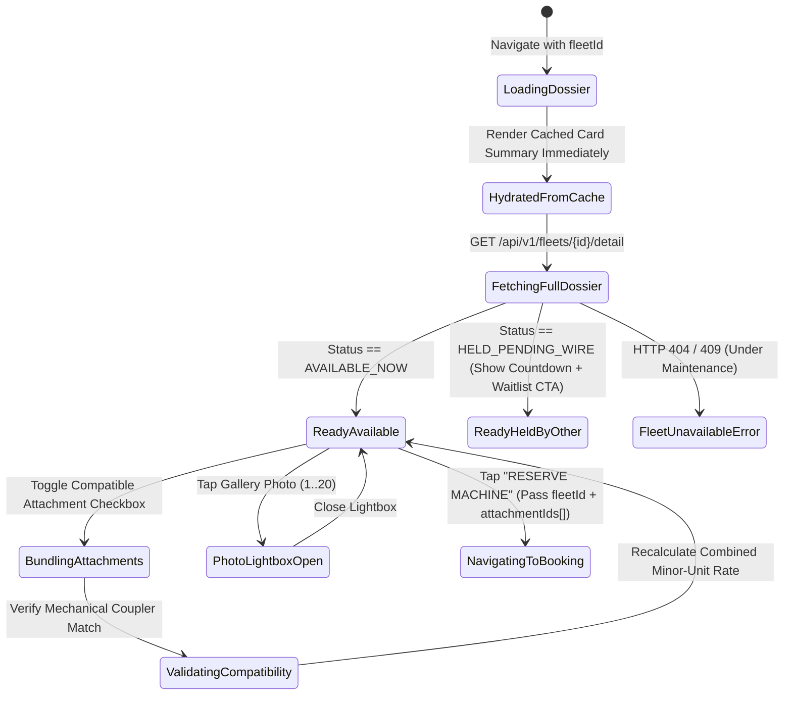
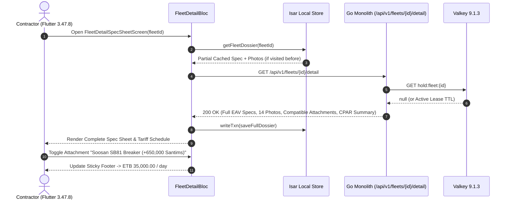

# Fleet Detail Dossier & Dynamic EAV Specification Sheet
## Mobile Subsystem Specification — `docs/mobile/renter-experience/04-fleet-detail-spec-sheet.md`

**Document Identifier:** `SPEC-MOB-RNT-04`  
**Classification:** Canonical Subsystem UI/UX & Technical Behavior Specification  
**Governing Documents:** `Dink_Machinery_UI_UX_Design_Brief.md`, `SRS-DINK-CORE-V7.0` (`docs/shared/requirements/05-02-fleet-registration-machinery-logistics.md`, `05-03-attachment-registration-inventory.md`, `05-04-fleet-discovery-search-comparison.md`), `docs/shared/design/design-tokens.json`, `docs/ERROR_CATALOG.md`, `contracts/openapi.yaml`  
**Target Subsystem:** Flutter 3.47.8 / Dart 3.9 Mobile Client (iOS & Android)  
**Primary Persona / Actor:** Civil Engineering Contractor (*Dawit Haile-Mariam* / *Patrick Kariuki*), Site Quantity Surveyor (*Bethlehem Tessema*)  
**Associated Requirements:** `REQ-05-02` (`FL-05`..`FL-20`), `REQ-05-03` (Compatible Demountable Attachments), `REQ-05-04` (`FD-14`, `SR-06`), `REQ-05-13` (Verified CPAR Insurance Badge)  
**Associated Interaction Flows:** `FLOW-04` (`FLOW-DISCOVERY-DINK-CORE-V7.0`), `FLOW-07` (`FLOW-BOOKING-STATE-MACHINE-DINK-CORE-V7.0`)  
**Architectural Decisions:** `ADR-002` (Dynamic EAV Spec Schema), `ADR-005` (Valkey Hold Pre-Flight), `ADR-010` (Non-Custodial Financial Invariant & Informational Security Deposit)  
**Status:** Approved Technical Design Baseline

---

## 1. Domain Context, Business Formulas & Architectural Invariants

Before committing capital to a heavy machinery rental, a Civil Engineering Contractor or Quantity Surveyor must audit the machine's physical condition, mechanical hour meter baseline, hydraulic ratings, insurance coverage, and compatible demountable attachments. The **Fleet Detail Dossier & Dynamic EAV Specification Sheet (`FleetDetailSpecSheetScreen`)** serves as the canonical technical inspection dossier prior to reservation.

### 1.1 Domain Rules & Invariants
1. **Mandatory 5-to-20 High-Resolution Photo Gallery (`FL-12` / `SR-06`):**
   Every active fleet listing exposes between **5 and 20** ClamAV-verified inspection photos stored on SeaweedFS S3, categorized by angle (`FRONT_LEFT`, `REAR_RIGHT`, `UNDERCARRIAGE_TRACKS`, `CABIN_CONTROLS`, `HOUR_METER_CLOSEUP`, `CHASSIS_SERIAL_PLATE`). Tapping any photo opens a pinch-to-zoom (`1.0x..4.0x`) high-contrast lightbox.
2. **Monotonic Baseline Hour Meter Badge (`FL-09` / `AR-01`):**
   Displays the certified `baseline_operating_hours` (e.g., `4,120.5 hrs`) in `Space Mono` typography alongside the timestamp of the last completed rental check-out inspection. This figure establishes the mathematical floor for the next handover check-in (`CheckInMeter >= BaselineMeter`).
3. **Dynamic EAV Specification Accordion (`FL-10` / `FD-14`):**
   Renders all category-specific technical attributes grouped into four expandable engineering sections:
   - **Engine & Powertrain** (Net Power kW/HP, Engine Make/Model, Aspiration, Fuel Tank Capacity L)
   - **Hydraulics & Performance** (Max Main Pump Flow L/min, Relief Pressure bar, Max Digging Depth mm, Breakout Force kN)
   - **Dimensions & Undercarriage** (Operating Weight kg, Transport Length/Width/Height mm, Track Shoe Width mm, Ground Clearance mm)
   - **Mobilization & Logistics (`FL-28`)** (`self_move_capable: false`, Required Trailer Class: `LOWBOY_3_AXLE_40T`)
4. **Compatible Demountable Attachments Pre-Selector (`REQ-05-03` / `BK-03`):**
   Lists verified attachments owned by the same Fleet Owner that are mechanically compatible with this base unit (e.g., *Soosan SB81 Hydraulic Rock Breaker — `ETB 6,500.00 /day`*). Toggling an attachment immediately updates the sticky footer's combined daily rate preview in integer minor units.
5. **Informational Security Deposit Notice (`ADR-010` / `BK-04`):**
   If the owner specifies a security deposit requirement, it is badged explicitly as **INFORMATIONAL ONLY — Settled Directly with Owner Off-Platform** and is never added to platform checkout totals.

---

## 2. Screen Anatomy & Bespoke ASCII Wireframe

```text
+-----------------------------------------------------------------------+
| [<- Back]     CAT 320D2 L HYDRAULIC EXCAVATOR         [❤️] [⚖️ +Cmp]  |
|=======================================================================|
|  ___________________________________________________________________  |
| |                                                                   | |
| |        [ SWIPEABLE PHOTO GALLERY (1 / 14): FRONT_LEFT_34 ]        | |
| |                                                                   | |
| | [🔍 Pinch Zoom]          [⏱️ Meter Photo #5]          [📷 1 / 14] | |
| |___________________________________________________________________| |
| [Thumb 1: Front] [Thumb 2: Tracks] [Thumb 3: Boom] [Thumb 4: Meter]   |
|=======================================================================|
| [🟢 AVAILABLE NOW]  [🛡️ CPAR Insurance Active]  [🚛 Requires Lowboy] |
| Caterpillar 320D2 L • Mfg Year: 2021 • Serial: *CAT0320D...892*       |
| 📍 Mojo Dry Port Staging Yard (6.4 km from Site) • ⭐ 4.92 (42 Hires) |
| +-------------------------------------------------------------------+ |
| | ⏱️ CERTIFIED BASELINE HOUR METER:  4,120.5 HRS  (Verified Oct 24) | |
| +-------------------------------------------------------------------+ |
|=======================================================================|
| 💰 COMMERCIAL TARIFF SCHEDULE (Minor Units Rendered in Space Mono)    |
| +-----------------------------------+-------------------------------+ |
| | ⛽ WET RATE (Operator + Fuel Terms)| 🔧 DRY RATE (Bare Machine)    | |
| | ETB 28,500.00 / day               | ETB 23,000.00 / day           | |
| | Weekly (>7d): ETB 26,200.00 / day | Min Hire Duration: 3 Days     | |
| +-----------------------------------+-------------------------------+ |
| ℹ️ Owner Security Deposit Note: ETB 50,000.00 (INFORMATIONAL ONLY —   |
|    Settled directly between Renter & Owner off-platform per ADR-010)  |
|=======================================================================|
| 🔩 BUNDLE COMPATIBLE DEMOUNTABLE ATTACHMENTS (REQ-05-03 / BK-03)      |
| +-------------------------------------------------------------------+ |
| | [x] Soosan SB81 Hydraulic Breaker (140mm Chisel)  +ETB 6,500.00/d | |
| | [ ] Heavy-Duty Rock Ripper Tooth (Single Shank)   +ETB 2,200.00/d | |
| | [ ] Narrow Trenching Bucket (600mm / 0.65 m³)     +ETB 1,800.00/d | |
| +-------------------------------------------------------------------+ |
|=======================================================================|
| ⚙️ TECHNICAL EAV SPECIFICATION ACCORDION (FD-14)                      |
| [▼] 1. ENGINE & POWERTRAIN                                            |
|     • Engine Model:           Cat C7.1 ACERT Tier 3                   |
|     • Net Flywheel Power:     112 kW (150 HP) @ 1,800 rpm             |
|     • Fuel Tank Capacity:     410 Liters                              |
| [▼] 2. HYDRAULICS & DIGGING PERFORMANCE                               |
|     • Max Main Pump Flow:     2 x 202 L/min (404 L/min total)         |
|     • Max Digging Depth:      6,720 mm (6.72 m)                       |
|     • Bucket Breakout Force:  150.0 kN                                |
| [▶] 3. DIMENSIONS, WEIGHT & UNDERCARRIAGE (22,400 kg • 600mm Shoes)   |
| [▶] 4. OWNER TRUST LEDGER & CPAR POLICY (Nyala Insurance #CPAR-9921)  |
|=======================================================================|
| Combined Rate (Wet + 1 Att.):                  [   RESERVE MACHINE  ] |
| ETB 35,000.00 / day (Excl. VAT)                [     (64dp CTA)     ] |
+-----------------------------------------------------------------------+
```

---

## 3. W3C DTCG Design Token Mapping Table

| UI Component / Element | W3C DTCG Token Path | Resolved Value (Light / Outdoor High-Contrast) | Ergonomic & Behavioral Mandate |
|---|---|---|---|
| **Gallery HUD Overlay** | `component.lightbox.hudBackground` / `hudTextColor` | `rgba(2, 6, 23, 0.85)` / `#FFFFFF` | High-contrast photo index (`1 / 14`) and angle tag (`UNDERCARRIAGE_TRACKS`). |
| **Baseline Meter Callout** | `color.brand.amber.50` + `typography.fontFamily.mono` | `#FFFBEB` container, `#78350F` border, `Space Mono` `18sp` | Highlights the monotonic meter floor (`4,120.5 HRS`). |
| **CPAR Verified Badge** | `color.feedback.emerald.100` + `color.feedback.emerald.700` | `#D1FAE5` fill, `#047857` text + shield icon | Confirms active Plant All-Risks policy (`REQ-05-13`). |
| **Informational Deposit Box** | `color.feedback.blue.50` + `color.feedback.blue.900` | `#EFF6FF` tint, `#1E3A8A` text, `1dp` border | Explicitly distinguishes off-platform informational deposit (`ADR-010`). |
| **Spec Accordion Row** | `component.table.rowHeightDense` / `color.brand.slate.100` | `40dp` zebra-striped row (`#F1F5F9` alternating) | Left label in `typography.fontFamily.latin`, right value in `Space Mono`. |
| **Sticky Reserve CTA** | `component.actuator.button.heightField` / `action.primary.bg` | `64dp` height, `#F59E0B` (`3dp` bottom tactile lip) | Immediately launches `06-booking-reservation-flow.md` with pre-selected attachments. |

---

## 4. Screen State Machine & Sequence Diagrams

### 4.1 Fleet Dossier & Attachment Bundling State Machine


### 4.2 Dossier Fetch & Live Valkey Lease Check Sequence


---

## 5. Concrete Flutter Implementation Blueprint

### 5.1 BLoC Events & Freezed States (`fleet_detail_bloc.dart`)
```dart
import 'package:freezed_annotation/freezed_annotation.dart';

part 'fleet_detail_bloc.freezed.dart';

@freezed
sealed class FleetDetailEvent with _$FleetDetailEvent {
  const factory FleetDetailEvent.started({
    required String fleetId,
  }) = _Started;

  const factory FleetDetailEvent.rateModeSwitched({
    required RateFilterMode selectedMode, // WET vs DRY
  }) = _RateModeSwitched;

  const factory FleetDetailEvent.attachmentToggled({
    required String attachmentId,
  }) = _AttachmentToggled;

  const factory FleetDetailEvent.accordionSectionToggled({
    required String sectionKey,
  }) = _AccordionSectionToggled;

  const factory FleetDetailEvent.waitlistSubscribed() = _WaitlistSubscribed;
}

@freezed
abstract class FleetDetailState with _$FleetDetailState {
  const factory FleetDetailState({
    @Default(DossierLoadStatus.loading) DossierLoadStatus status,
    FleetDetailDossierDto? dossier,
    @Default(RateFilterMode.wet) RateFilterMode selectedRateMode,
    @Default(<String>{}) Set<String> selectedAttachmentIds,
    @Default({'ENGINE', 'HYDRAULICS'}) Set<String> expandedAccordionKeys,
    @Default(0) int combinedDailyRateMinor,
    @Default(false) bool isWaitlistSubscribed,
    ProblemDetails? error,
  }) = _FleetDetailState;
}
```

### 5.2 Isar Offline Dossier Cache (`isar_fleet_dossier.dart`)
```dart
import 'package:isar/isar.dart';

part 'isar_fleet_dossier.g.dart';

@collection
class IsarFleetDossier {
  Id id = Isar.autoIncrement;

  @Index(unique: true, replace: true)
  late String fleetId;

  late String title;
  late String categoryName;
  late int manufactureYear;
  late String maskedSerialNumber;
  late double baselineOperatingHours;
  late bool selfMoveCapable;
  late String requiredTrailerClass;
  late int dailyRateWetMinor;
  late int dailyRateDryMinor;
  int? informationalSecurityDepositMinor;
  late String currencyCode;
  late List<String> photoUrls; // 5..20 URLs
  late String eavSpecGroupsJson; // Engine, Hydraulics, Dimensions
  late String compatibleAttachmentsJson;
  late String insuranceSummaryJson;
  late DateTime cachedAt;
}
```

### 5.3 Widget Tree Hierarchy
```text
FleetDetailSpecSheetScreen (Scaffold)
 ├── CustomScrollView
 │    ├── SliverAppBar (Pinned, Back button, Bookmark button, [+Cmp] button)
 │    ├── FleetPhotoGalleryCarousel (5..20 swipeable photos + Thumbnail strip + Lightbox launcher)
 │    ├── FleetIdentityAndBaselineMeterCard
 │    │    ├── StatusAndInsuranceBadgesWrap (Available/Held, CPAR Insured, Lowboy Required)
 │    │    └── MonotonicBaselineMeterBanner (Space Mono 18sp: "4,120.5 HRS")
 │    ├── CommercialTariffAndDepositCard
 │    │    ├── WetDryRateComparisonGrid
 │    │    └── InformationalDepositNoticeBanner (ADR-010 explicit disclaimer)
 │    ├── BundledAttachmentsSelectorCard (REQ-05-03 / BK-03)
 │    │    └── CompatibleAttachmentCheckboxTile (Shows daily rate in minor units)
 │    ├── DynamicEavSpecAccordionList (FD-14)
 │    │    ├── EnginePowertrainExpansionTile
 │    │    ├── HydraulicsPerformanceExpansionTile
 │    │    ├── DimensionsUndercarriageExpansionTile
 │    │    └── OwnerTrustAndInsuranceExpansionTile
 └── StickyDossierBottomActionBar
      ├── CombinedDailyRateColumn (Base + Selected Attachments in Space Mono)
      └── PrimaryReserveOrWaitlistActuator (64dp height CTA)
```

---

## 6. OpenAPI 3.1.0 Routes & RFC 9457 Error Matrix

### 6.1 Endpoint Specifications
- **`GET /api/v1/fleets/{id}/detail`**
  - **Path Parameter:** `id` (`uuid`).
  - **Response (`200 OK`):** Full `FleetDetailDossierDto` containing `photos` (`5..20` items), `eavSpecGroups`, `compatibleAttachments[]`, `tariffs`, `informationalDepositMinor`, `cparInsurance`, and live `holdStatus`.

### 6.2 RFC 9457 Problem Details Matrix
| Error Code | HTTP Status | RFC 9457 Type URI | Retryable | Mobile UI Remediation & Recovery Action |
|---|---|---|---|---|
| `FLEET_NOT_FOUND` | `404` | `/errors/fleet-not-found` | No | Purge `fleetId` from `IsarCachedFleetCard` and `IsarFleetDossier`; navigate back with snackbar notice. |
| `FLEET_STATUS_CONFLICT` | `409` | `/errors/fleet-status-conflict` | No | Disable "Reserve Machine" CTA and display `UNDER_MAINTENANCE` banner with "Notify Me When Available" button (`SD-03`). |
| `FLEET_ATTACHMENT_UNSUPPORTED` | `422` | `/errors/fleet-attachment-unsupported` | No | Deselect incompatible attachment and display hydraulic coupler mismatch explanation. |

---

## 7. Verification & Acceptance Criteria

- [ ] **Photo Count Enforcement (`FL-12`):** Gallery widget renders 5 to 20 high-res photos with category angle badges (`HOUR_METER_CLOSEUP`, `UNDERCARRIAGE_TRACKS`) and supports pinch-to-zoom up to `4.0x`.
- [ ] **Informational Deposit Separation (`ADR-010` / `BK-04`):** `informationalSecurityDepositMinor` is rendered strictly inside the informational notice box and is **never** added to `combinedDailyRateMinor`.
- [ ] **Live Attachment Rate Summation (`BK-03`):** Toggling compatible attachments recalculates `combinedDailyRateMinor` using pure 64-bit integer addition without network round-trips.
- [ ] **Zero PII Leakage (`ASVS L3`):** Serial/chassis numbers are partially masked (`*CAT0320D...892*`) and owner phone/bank details remain hidden until booking state `1. PENDING_PAYMENT`.
