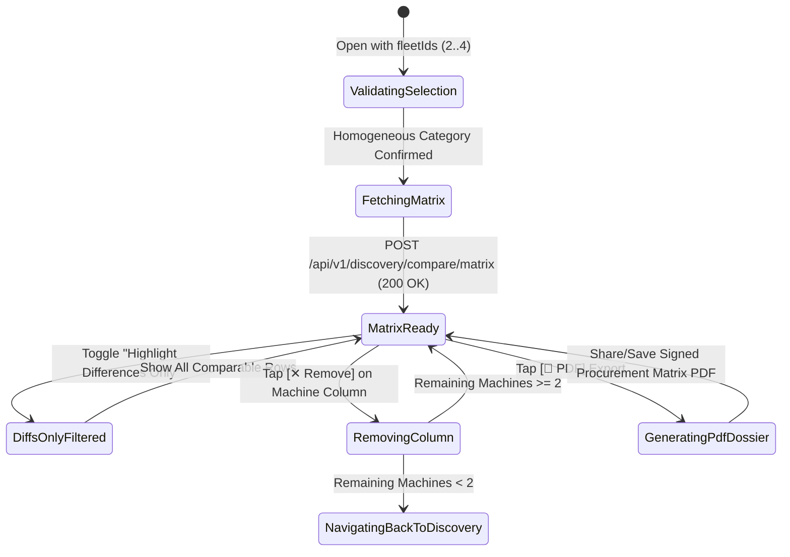
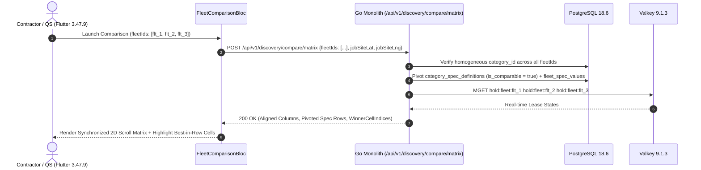

# Multi-Fleet Side-by-Side Technical Comparison Matrix
## Mobile Subsystem Specification — `docs/mobile/renter-experience/05-side-by-side-comparison.md`

**Document Identifier:** `SPEC-MOB-RNT-05`  
**Classification:** Canonical Subsystem UI/UX & Technical Behavior Specification  
**Governing Documents:** `Dink_Machinery_UI_UX_Design_Brief.md`, `SRS-DINK-CORE-V7.0` (`docs/shared/requirements/05-04-fleet-discovery-search-comparison.md`, `05-15-search-discovery-enhancements.md`), `docs/shared/design/design-tokens.json`, `docs/ERROR_CATALOG.md`, `contracts/openapi.yaml`  
**Target Subsystem:** Flutter 3.47.9 / Dart 3.9 Mobile Client (iOS & Android)  
**Primary Persona / Actor:** Civil Engineering Contractor (*Dawit Haile-Mariam* / *Patrick Kariuki*), Corporate Procurement Director (*Eng. Samuel Getachew*)  
**Associated Requirements:** `REQ-05-04` (`FD-15`..`FD-17`, `SR-08`), `REQ-05-15` (§5.1..§5.4 Relational Dynamic Pivoting over `is_comparable = true`, Diff Highlighting, PDF Procurement Export)  
**Associated Interaction Flows:** `FLOW-04` (`FLOW-DISCOVERY-DINK-CORE-V7.0`), `FLOW-06`  
**Architectural Decisions:** `ADR-002` (Dynamic EAV Comparable Attribute Pivoting), `ADR-005` (Valkey Hold Status Overlay), `ADR-010` (Integer Minor Units in Santims/Cents)  
**Status:** Approved Technical Design Baseline

---

## 1. Domain Context, Business Formulas & Architectural Invariants

When evaluating competing heavy machinery listings for a civil tender or quarry excavation (e.g., comparing a *2021 Caterpillar 320D2* against a *2020 Komatsu PC210-8* and a *2022 Hyundai HX220L*), contractors and procurement boards require an objective, side-by-side engineering and commercial matrix. The **Multi-Fleet Side-by-Side Technical Comparison Matrix (`SideBySideComparisonScreen`)** pivots up to **4 homogeneous machines** across commercial tariffs, geodesic proximity, baseline operating hours, attachment compatibility, and dynamic EAV specifications flagged `is_comparable = true`.

### 1.1 Mathematical Rules & Architectural Invariants
1. **Strict Taxonomic Homogeneity & Cardinality Invariant (`FD-15` / `REQ-05-15 §5.1`):**
   A comparison matrix may contain $N \in [2, 4]$ machines belonging strictly to the **same primary taxonomy category** (`category_id`). Attempting to compare an `Excavator` against a `Motor Grader` is blocked at the comparison buffer level (`COMPARISON_CATEGORY_MISMATCH`).
2. **Relational Dynamic Pivoting over `is_comparable = true` (`FD-16` / `REQ-05-15 §5.2`):**
   The backend queries `category_spec_definitions WHERE category_id = $1 AND is_comparable = true ORDER BY display_order ASC` and pivots the corresponding `fleet_spec_values` into aligned comparison rows.
3. **Deterministic Best-in-Row Outlier Highlighting (`FD-17` / `REQ-05-15 §5.3`):**
   Each comparable attribute defines an optimization polarity (`polarity: LOWER_IS_BETTER | HIGHER_IS_BETTER | NEUTRAL`):
   - **Lower is Better (`MIN`):** Daily Wet Rate (`dailyRateWetMinor`), Daily Dry Rate (`dailyRateDryMinor`), Geodesic Distance (`distanceKm`), Baseline Hour Meter (`baselineHours`).
   - **Higher is Better (`MAX`):** Manufacture Year (`manufactureYear`), Net Engine Power (`enginePowerKw`), Max Digging Depth (`maxDiggingDepthMm`), Bucket Breakout Force (`breakoutForceKn`), Verified Rating (`ratingAverage`).
   When "Highlight Differences Only" is toggled, rows where all $N$ machines share identical values are collapsed, and the winning cell in each row receives an Emerald highlight badge (`color.feedback.emerald.50` fill + `★ Best` tag).
4. **Exportable Technical Procurement Dossier (`REQ-05-15 §5.4`):**
   Corporate Requesters can export the comparison matrix as a signed A4 landscape PDF procurement justification sheet to attach to internal approval dockets (`REQ-06-02`).

---

## 2. Screen Anatomy & Bespoke ASCII Wireframe

```text
+-----------------------------------------------------------------------+
| [<- Back]   COMPARE EXCAVATORS (3 / 4 Selected)   [📄 PDF] [➕ Add 4th]|
|-----------------------------------------------------------------------|
| [x] Highlight Differences Only (14/19 rows)   [⛽ Wet Rate] [🔧 Dry]  |
|=======================================================================|
| STICKY SPEC COLUMN | 1. CAT 320D2 L   | 2. Komatsu PC210 | 3. XCMG    |
| (Frozen 128dp Left)| [✕ Remove]       | [✕ Remove]       | [✕ Remove] |
|--------------------+------------------+------------------+------------|
| Status Badge       | 🟢 AVAILABLE NOW | 🟢 AVAILABLE NOW | 🟡 HELD 12m|
| Daily Wet Rate     | ETB 28,500.00    |★ETB 26,800.00    | ETB 29,000 |
| Daily Dry Rate     | ETB 23,000.00    |★ETB 21,500.00    | ETB 24,000 |
| Info. Sec. Deposit | ETB 50,000 (Info)| ETB 40,000 (Info)| None       |
|--------------------+------------------+------------------+------------|
| 📍 Distance (Site) |★6.4 km (Mojo)    | 19.2 km (Adama)  | 11.5 km    |
| ⭐ Owner Rating    |★4.92 (42 Hires)  | 4.78 (19 Hires)  | 4.85 (31)  |
| 🛡️ CPAR Insurance  | ✅ Verified      | ✅ Verified      | ✅ Verified|
| ⏱️ Baseline Meter  |★4,120.5 hrs      | 6,340.0 hrs      | 5,110.2 hrs|
| 📅 Mfg. Year       | 2021             | 2020             |★2022       |
|====================+==================+==================+============|
| ⚙️ ENGINE & HYDRAULICS (Dynamic EAV: is_comparable = true)            |
|--------------------+------------------+------------------+------------|
| Operating Weight   | 22,400 kg        | 21,200 kg        |★23,100 kg  |
| Net Engine Power   | 112 kW (150 HP)  |★123 kW (165 HP)  | 115 kW     |
| Max Digging Depth  |★6,720 mm         | 6,620 mm         | 6,580 mm   |
| Breakout Force     | 150.0 kN         |★158.0 kN         | 149.0 kN   |
| Aux Hydraulic Flow |★202 L/min (High) | 180 L/min        | 190 L/min  |
|====================+==================+==================+============|
| 🔩 COMPATIBLE ATTACHMENTS & LOGISTICS                                 |
|--------------------+------------------+------------------+------------|
| Rock Breaker Ready | ✅ Included Opt. | ✅ Included Opt. | ❌ No Pip. |
| Self-Move Capable  | ❌ Lowboy Req.   | ❌ Lowboy Req.   | ❌ Lowboy  |
|====================+==================+==================+============|
| ACTION             | [RESERVE #1 (56)]| [RESERVE #2 (56)]| [WAITLIST] |
+-----------------------------------------------------------------------+
```

---

## 3. W3C DTCG Design Token Mapping Table

| UI Component / Element | W3C DTCG Token Path | Resolved Value (Light / Outdoor High-Contrast) | Ergonomic & Behavioral Mandate |
|---|---|---|---|
| **Frozen Left Attribute Column** | `color.brand.slate.100` + `stroke.border.medium` | `#F1F5F9` (`128dp` fixed width, `2dp` right border) | Remains pinned while machine columns scroll horizontally via `LinkedScrollControllerGroup`. |
| **Best-in-Row Winner Cell (`★`)** | `color.feedback.emerald.50` + `color.feedback.emerald.700` | `#ECFDF5` cell fill, `#047857` bold text | Paired with explicit `★` glyph so colorblind users immediately identify the optimum spec. |
| **Spec Diff Row Highlight** | `color.brand.amber.50` | `#FFFBEB` subtle tint on differing rows | Distinguishes rows with variance from identical rows. |
| **Numeric Spec & Tariff Cells** | `typography.fontFamily.mono` + `typography.fontSize.14` | `Space Mono` `14sp` (`#020617` / `#FFFFFF`) | Strict tabular alignment across columns for minor-unit rates, `kg`, `mm`, `kW`, and `hrs`. |
| **Column Reserve CTA** | `component.actuator.button.heightStandard` | `56dp` height, `#F59E0B` (`color.brand.amber.500`) | Pinned at the bottom of each machine column; switches to "Waitlist" if `HELD_PENDING_WIRE`. |

---

## 4. Screen State Machine & Sequence Diagrams

### 4.1 Comparison Matrix State Machine


### 4.2 Relational EAV Pivoting & Diff Evaluation Sequence


---

## 5. Concrete Flutter Implementation Blueprint

### 5.1 BLoC Events & Freezed States (`fleet_comparison_bloc.dart`)
```dart
import 'package:freezed_annotation/freezed_annotation.dart';

part 'fleet_comparison_bloc.freezed.dart';

@freezed
sealed class FleetComparisonEvent with _$FleetComparisonEvent {
  const factory FleetComparisonEvent.matrixRequested({
    required List<String> fleetIds, // 2..4 items
    required double jobSiteLat,
    required double jobSiteLng,
  }) = _MatrixRequested;

  const factory FleetComparisonEvent.differencesOnlyToggled({
    required bool onlyDifferences,
  }) = _DifferencesOnlyToggled;

  const factory FleetComparisonEvent.rateBasisSwitched({
    required RateFilterMode rateMode, // WET vs DRY
  }) = _RateBasisSwitched;

  const factory FleetComparisonEvent.machineRemoved({
    required String fleetId,
  }) = _MachineRemoved;

  const factory FleetComparisonEvent.exportPdfRequested() = _ExportPdfRequested;
}

@freezed
abstract class FleetComparisonState with _$FleetComparisonState {
  const factory FleetComparisonState({
    @Default(ComparisonStatus.loading) ComparisonStatus status,
    required String categoryId,
    required String categoryName,
    @Default(<ComparisonMachineColumnDto>[]) List<ComparisonMachineColumnDto> columns,
    @Default(<ComparisonSpecRowDto>[]) List<ComparisonSpecRowDto> allSpecRows,
    @Default(true) bool highlightDifferencesOnly,
    @Default(RateFilterMode.wet) RateFilterMode activeRateMode,
    @Default(false) bool isExportingPdf,
    String? exportedPdfLocalPath,
    ProblemDetails? error,
  }) = _FleetComparisonState;
}
```

### 5.2 Isar Persistent Comparison Tray (`isar_comparison_tray_item.dart`)
```dart
import 'package:isar/isar.dart';

part 'isar_comparison_tray_item.g.dart';

@collection
class IsarComparisonTrayItem {
  Id id = Isar.autoIncrement;

  @Index(unique: true, replace: true)
  late String fleetId;

  @Index()
  late String categoryId;

  late String categoryName;
  late String title;
  late String thumbnailUrl;
  late int dailyRateWetMinor;
  late String currencyCode;
  late DateTime addedAt;
}
```

### 5.3 Widget Tree Hierarchy
```text
SideBySideComparisonScreen (Scaffold)
 ├── ComparisonAppBar (Title, Count Badge "3/4", PDF Export Action, Add Machine Action)
 ├── ComparisonControlRibbon
 │    ├── HighlightDiffsSwitchTile ("Highlight Differences Only")
 │    └── WetDryBasisSegmentedToggle
 ├── Expanded
 │    └── Synchronized2DComparisonGrid (LinkedScrollControllerGroup)
 │         ├── FrozenLeftAttributeLabelsColumn (128dp width)
 │         ├── HorizontalScrollableMachineColumns (160dp width per machine)
 │         │    ├── StickyMachineHeaderCell (Thumbnail, Title, [✕ Remove], Availability Pill)
 │         │    ├── CommercialTariffRows (Wet Rate, Dry Rate, Informational Deposit)
 │         │    ├── ProximityAndTrustRows (Geodesic km, Rating, CPAR Badge, Baseline Hours)
 │         │    ├── PivotedEavComparableSpecRows (Engine, Hydraulics, Dimensions + ★ Best Cell)
 │         │    └── AttachmentAndLogisticsCompatibilityRows
 │         └── StickyBottomColumnActuatorRow
 │              └── ColumnReserveOrWaitlistButton (56dp height per column)
```

---

## 6. OpenAPI 3.1.0 Routes & RFC 9457 Error Matrix

### 6.1 Endpoint Specifications
- **`POST /api/v1/discovery/compare/matrix`**
  - **Request Body:** `{ "fleetIds": ["uuid1", "uuid2", "uuid3"], "jobSiteLat": 8.586, "jobSiteLng": 39.121 }` (min `2`, max `4` IDs).
  - **Response (`200 OK`):** Returns `columns[]` (commercial & trust summary per machine) and `specRows[]` (`specKey`, `label`, `unit`, `polarity`, `hasVariance`, `winnerFleetId`, `valuesByFleetId`).

### 6.2 RFC 9457 Problem Details Matrix
| Error Code | HTTP Status | RFC 9457 Type URI | Retryable | Mobile UI Remediation & Recovery Action |
|---|---|---|---|---|
| `REQ_VALIDATION_FAILED` | `400` | `/errors/request-validation-failed` | No | Enforce `2 <= fleetIds.length <= 4` client-side before enabling "Compare Now". |
| `FLEET_NOT_FOUND` | `404` | `/errors/fleet-not-found` | No | Remove the deleted/decommissioned `fleetId` from `IsarComparisonTrayItem` and reload remaining columns. |
| `CAT_NOT_FOUND` / Category Mismatch | `422` | `/errors/comparison-category-mismatch` | No | Prompt user to clear the existing tray before adding a machine from a different taxonomy category. |

---

## 7. Verification & Acceptance Criteria

- [ ] **Synchronized 2D Scroll Lock (`G1`):** Horizontal scrolling of machine columns stays pixel-locked with the sticky machine headers and bottom CTAs (`LinkedScrollControllerGroup`), while vertical scrolling moves the frozen left attribute labels in unison.
- [ ] **Best-in-Row Polarity Accuracy (`FD-17`):** Unit test verifies that lowest `dailyRateWetMinor` (`2680000` Santims) and lowest `baselineHours` (`4120.5`) win `LOWER_IS_BETTER` rows, while highest `maxDiggingDepthMm` (`6720`) wins `HIGHER_IS_BETTER` rows.
- [ ] **Informational Deposit Clarity (`ADR-010`):** The comparison matrix displays `Info. Sec. Deposit` as a non-additive informational row, never summing it into the daily rate comparison.
