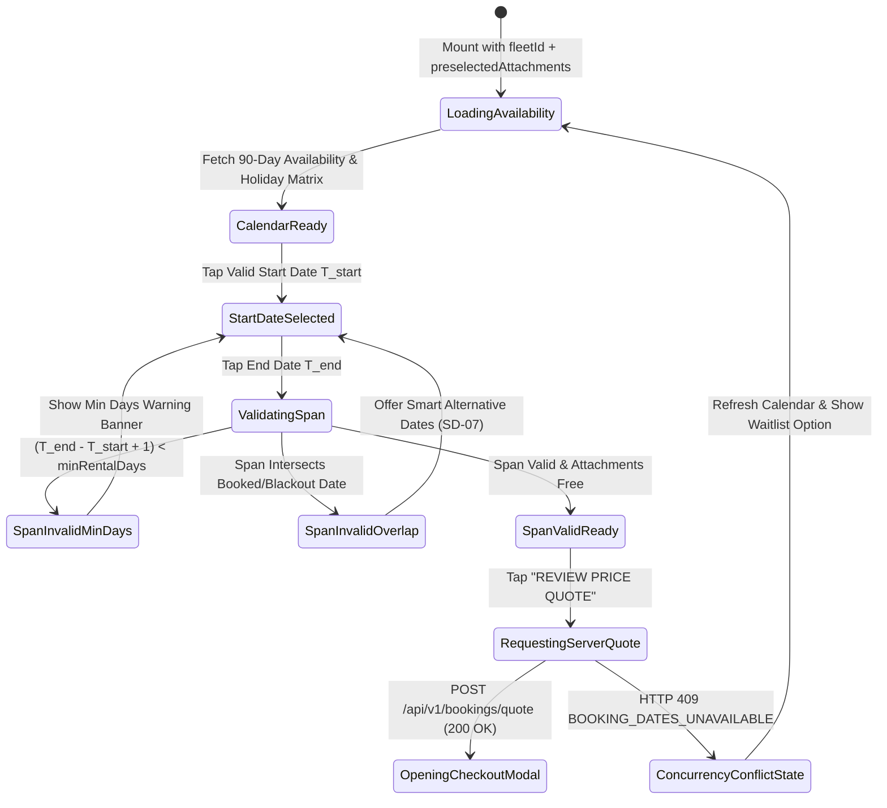
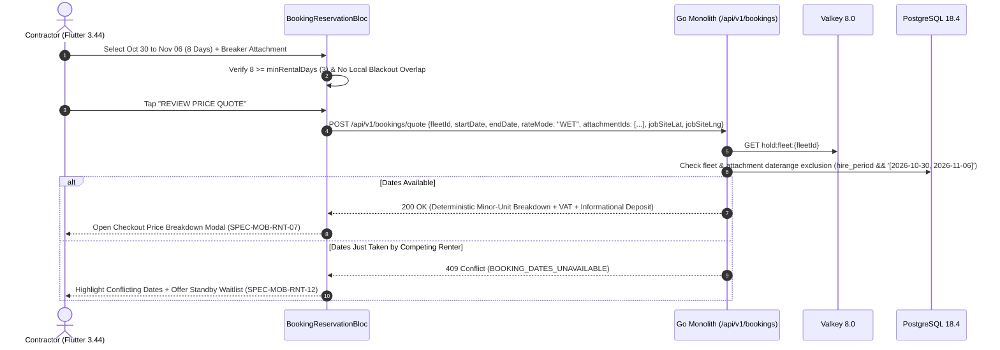

# Booking Reservation Flow & Dual Ethiopian/Gregorian Calendar
## Mobile Subsystem Specification — `docs/mobile/renter-experience/06-booking-reservation-flow.md`

**Document Identifier:** `SPEC-MOB-RNT-06`  
**Classification:** Canonical Subsystem UI/UX & Technical Behavior Specification  
**Governing Documents:** `Dink_Machinery_UI_UX_Design_Brief.md`, `SRS-DINK-CORE-V7.0` (`docs/shared/requirements/05-05-booking-reservation-flow.md`, `05-23-ethiopian-public-holiday-calendar.md`, `06-01-corporate-account-management.md`), `docs/shared/design/design-tokens.json`, `docs/ERROR_CATALOG.md`, `contracts/openapi.yaml`  
**Target Subsystem:** Flutter 3.44 / Dart 3.9 Mobile Client (iOS & Android)  
**Primary Persona / Actor:** Civil Engineering Contractor (*Dawit Haile-Mariam* / *Patrick Kariuki*), Corporate Site Requester (*Bethlehem Tessema*)  
**Associated Requirements:** `REQ-05-05` (`BK-01`..`BK-03`), `REQ-05-23` (Ethiopian 13-Month Ge'ez Calendar & Holiday Overlay), `REQ-05-08` (`LG-01` Self-Move vs Lowboy Selection), `REQ-06-01` (`CORP-02` Cost-Center & PO Tagging)  
**Associated Interaction Flows:** `FLOW-07` (`FLOW-BOOKING-STATE-MACHINE-DINK-CORE-V7.0`), `FLOW-15` (Concurrency Locking)  
**Architectural Decisions:** `ADR-005` (Two-Tier Valkey + PostgreSQL GiST Exclusion), `ADR-008` (`LOC-01-BE` Dual Calendar), `ADR-010` (Integer Minor Units & Non-Custodial Settlement)  
**Status:** Approved Technical Design Baseline

---

## 1. Domain Context, Business Formulas & Architectural Invariants

Initiating a heavy machinery reservation requires synchronizing project site schedules, cultural calendar conventions, operator arrangements, demountable attachments, and lowboy mobilization parameters. The **Booking Reservation Flow (`BookingReservationFlowScreen`)** captures these parameters (`BK-01`..`BK-03`) and performs a pre-flight temporal exclusion check before advancing to the Checkout Price Breakdown modal (`07-checkout-price-breakdown.md`).

### 1.1 Temporal & Domain Rules
1. **Bi-Directional Ethiopian (`Ge'ez` 13-Month) & Gregorian Calendar Picker (`BK-01` / `REQ-05-23`):**
   In Ethiopia (`X-Country-Code: ET`), construction site schedules are routinely planned in the **Ethiopian Calendar (`ዓ.ም` — 12 months of 30 days + *Pagume* 5 or 6 days)**. The date range picker supports instant one-tap toggling between **Gregorian (`ISO 8601`)** and **Ethiopian (`Ge'ez`)** views, rendering cells with dual numerals (e.g., `Oct 30 / ጥቅምት 20`) and marking statutory Ethiopian/Kenyan public holidays (`REQ-05-23`). All wire payloads transmit canonical UTC ISO 8601 dates (`YYYY-MM-DD`).
2. **Minimum Rental Duration & Blackout Enforcement (`BK-02`):**
   Let $D_{\text{hire}} = (T_{\text{end}} - T_{\text{start}}) + 1$ inclusive calendar days. The picker enforces:
   $$D_{\text{hire}} \ge D_{\text{min\_rental\_days}} \quad \land \quad [T_{\text{start}}, T_{\text{end}}] \cap \mathcal{B}_{\text{unavailable}} = \emptyset$$
   where $\mathcal{B}_{\text{unavailable}}$ is the union of confirmed bookings (`PostgreSQL daterange`), owner maintenance blackouts, and active Valkey 60-minute holds (`hold:fleet:{id}`).
3. **Bundled Demountable Attachment Temporal Coupling (`BK-03`):**
   Each selected attachment $a_i \in \mathcal{A}_{\text{selected}}$ from the owner's inventory is validated for availability across the exact same date range $[T_{\text{start}}, T_{\text{end}}]$ (`FLEET_ATTACHMENT_UNSUPPORTED` or `BOOKING_DATES_UNAVAILABLE` if already booked on another machine).
4. **Standard Shift Allowance Disclosure (`AR-03`):**
   Clearly informs the contractor that each rental day includes **8.0 Billable Engine Operating Hours per Day** ($H_{\text{included}} = D_{\text{hire}} \times 8.0\text{ hrs}$), and excess hours at return check-out are reconciled at the pro-rata hourly rate.

---

## 2. Screen Anatomy & Bespoke ASCII Wireframe

```text
+-----------------------------------------------------------------------+
| [<- Back]        CONFIGURE RENTAL REQUISITION (Step 1/2)              |
|-----------------------------------------------------------------------|
| 🚜 CAT 320D2 L Hydraulic Excavator • Owner: Tesfaye Heavy Plant PLC   |
|=======================================================================|
| 📅 1. HIRE PERIOD SELECTION (BK-01 / BK-02 • Min Hire: 3 Days)        |
| Calendar Mode: [(•) Dual ET/Gregorian (ጥቅምት / Oct)]  [( ) Gregorian]  |
| +-------------------------------------------------------------------+ |
| |   <<   ጥቅምት 2019 ዓ.ም  /  OCTOBER - NOVEMBER 2026   >>             | |
| |  እሑድ/Su  ሰኞ/Mo   ማክ/Tu   ረቡ/We   ሐሙ/Th   ዓር/Fr   ቅዳ/Sa           | |
| |  [25/15] [26/16] [27/17] [28/18] [29/19] [START] [31/21]          | |
| |   Booked  Booked  Maint.  Free    Free    30/20   ======          | |
| |  [01/22] [02/23] [03/24] [04/25] [05/26] [ END ] [07/28]          | |
| |   ======  ======  ======  ======  ======  06/27   Free            | |
| +-------------------------------------------------------------------+ |
| ✅ Selected: 8 Days (Oct 30 – Nov 06, 2026 | ጥቅምት 20 – 27, 2019 ዓ.ም) |
| ⏱️ Included Engine Shift Allowance: 64.0 Operating Hours (8.0 hrs/day)|
|=======================================================================|
| 👷 2. COMMERCIAL RATE & OPERATOR INCLUSION                            |
| +-----------------------------------+-------------------------------+ |
| | (•) ⛽ WET RATE (Operator Incl.)  | ( ) 🔧 DRY RATE (Bare Unit)   | |
| |     ETB 28,500.00 / day           |     ETB 23,000.00 / day       | |
| +-----------------------------------+-------------------------------+ |
|=======================================================================|
| 🔩 3. BUNDLED DEMOUNTABLE ATTACHMENTS (BK-03)                         |
| +-------------------------------------------------------------------+ |
| | [x] Soosan SB81 Hydraulic Breaker (140mm)  +ETB 6,500.00 / day    | |
| |     🟢 Available for Oct 30 – Nov 06                              | |
| | [ ] Heavy-Duty Rock Ripper Tooth           +ETB 2,200.00 / day    | |
| +-------------------------------------------------------------------+ |
|=======================================================================|
| 📍 4. PROJECT JOB SITE PIN & MOBILIZATION (FL-28 / LG-01)             |
| | Site GPS Pin: [🎯 Modjo–Hawassa Lot 2 KM 44 (8.586°N, 39.121°E)]   | |
| | Transport:    [(•) Request Linked Lowboy Sub-Booking] [( ) Self]  | |
|-----------------------------------------------------------------------|
| 🏢 5. CORPORATE COST CENTER & PO TAG (Visible in Corporate Context)   |
| | Cost Center: [CC-204: Earthworks & Culverts v]  PO#: [PO-2026-881]| |
|=======================================================================|
| 8 Days × ETB 35,000.00/day                     [ REVIEW PRICE QUOTE ] |
| Est. Subtotal: ETB 280,000.00                  [     (64dp CTA)     ] |
+-----------------------------------------------------------------------+
```

---

## 3. W3C DTCG Design Token Mapping Table

| UI Component / Element | W3C DTCG Token Path | Resolved Value (Light / Outdoor High-Contrast) | Ergonomic & Behavioral Mandate |
|---|---|---|---|
| **Dual Calendar Day Cell** | `dimension.space.48` (`48dp x 52dp`) | `#FFFFFF` cell; `#F59E0B` for `START`/`END` anchors | Primary Gregorian numeral (`14sp` Latin) + secondary Ge'ez numeral (`12sp` `Noto Sans Ethiopic`). |
| **Booked / Blackout Cell** | `color.brand.slate.200` + `color.brand.slate.400` | `#E2E8F0` background with diagonal strikethrough | Non-selectable; tapping shows tooltip ("Reserved until Oct 27" or "Scheduled Maintenance"). |
| **Selected Range Span** | `color.brand.amber.100` + `color.brand.amber.900` | `#FEF3C7` span bar connecting `START` and `END` | High-contrast `#FBBF24` outline in `outdoorHighContrast` mode. |
| **Included Shift Hours Pill** | `color.feedback.emerald.50` + `typography.fontFamily.mono` | `#ECFDF5` fill, `Space Mono` `14sp` (`64.0 Operating Hours`) | Updates reactively as date range changes ($D_{\text{hire}} \times 8.0$). |
| **Primary Quote CTA** | `component.actuator.button.heightField` | `64dp` height, `#F59E0B` (`color.brand.amber.500`) | Enabled only when $D_{\text{hire}} \ge D_{\text{min}}$ and job-site GPS pin is valid. |

---

## 4. Screen State Machine & Sequence Diagrams

### 4.1 Date Range & Requisition Configuration State Machine


### 4.2 Pre-Flight Availability & Deterministic Quote Sequence


---

## 5. Concrete Flutter Implementation Blueprint

### 5.1 BLoC Events & Freezed States (`booking_reservation_bloc.dart`)
```dart
import 'package:freezed_annotation/freezed_annotation.dart';

part 'booking_reservation_bloc.freezed.dart';

@freezed
sealed class BookingReservationEvent with _$BookingReservationEvent {
  const factory BookingReservationEvent.initialized({
    required FleetDetailDossierDto dossier,
    required Set<String> initialAttachmentIds,
    required RateFilterMode initialRateMode,
  }) = _Initialized;

  const factory BookingReservationEvent.calendarSystemToggled({
    required CalendarDisplayMode calendarMode, // DUAL_ETHIOPIC_GREGORIAN, GREGORIAN_ONLY
  }) = _CalendarSystemToggled;

  const factory BookingReservationEvent.dateRangeChanged({
    required DateTime startDateUtc,
    required DateTime endDateUtc,
  }) = _DateRangeChanged;

  const factory BookingReservationEvent.rateModeChanged({
    required RateFilterMode rateMode,
  }) = _RateModeChanged;

  const factory BookingReservationEvent.attachmentToggled({
    required String attachmentId,
  }) = _AttachmentToggled;

  const factory BookingReservationEvent.jobSitePinSelected({
    required double lat,
    required double lng,
    required String addressLabel,
    required LogisticsMobilizationMode mobilizationMode,
  }) = _JobSitePinSelected;

  const factory BookingReservationEvent.corporateMetadataUpdated({
    required String costCenterId,
    String? purchaseOrderNumber,
  }) = _CorporateMetadataUpdated;

  const factory BookingReservationEvent.quoteRequested() = _QuoteRequested;
}

@freezed
abstract class BookingReservationState with _$BookingReservationState {
  const factory BookingReservationState({
    @Default(ReservationFlowStatus.loadingCalendar) ReservationFlowStatus status,
    required FleetDetailDossierDto dossier,
    @Default(CalendarDisplayMode.dualEthiopicGregorian) CalendarDisplayMode calendarMode,
    DateTime? startDateUtc,
    DateTime? endDateUtc,
    @Default(0) int rentalDaysCount,
    @Default(0.0) double includedOperatingHours, // rentalDaysCount * 8.0
    @Default(RateFilterMode.wet) RateFilterMode rateMode,
    @Default(<String>{}) Set<String> selectedAttachmentIds,
    @Default(<DateTime>{}) Set<DateTime> unavailableDatesUtc,
    @Default(<DateTime, String>{}) Map<DateTime, String> publicHolidaysMap,
    JobSiteLocationDto? jobSite,
    @Default(LogisticsMobilizationMode.platformLowboy) LogisticsMobilizationMode mobilizationMode,
    String? corporateCostCenterId,
    String? corporatePoNumber,
    BookingQuoteBreakdownDto? serverQuote,
    ProblemDetails? error,
  }) = _BookingReservationState;
}
```

### 5.2 Isar Draft Booking Requisition (`isar_booking_draft.dart`)
```dart
import 'package:isar/isar.dart';

part 'isar_booking_draft.g.dart';

@collection
class IsarBookingDraft {
  Id id = Isar.autoIncrement;

  @Index(unique: true, replace: true)
  late String fleetId;

  late DateTime startDateUtc;
  late DateTime endDateUtc;
  late String rateMode; // 'WET' | 'DRY'
  late List<String> attachmentIds;
  late double jobSiteLat;
  late double jobSiteLng;
  late String jobSiteLabel;
  late String mobilizationMode; // 'PLATFORM_LOWBOY' | 'EXTERNAL_PRIVATE' | 'SELF_MOVE'
  String? corporateCostCenterId;
  String? corporatePoNumber;
  late DateTime savedAt;
}
```

### 5.3 Widget Tree Hierarchy
```text
BookingReservationFlowScreen (Scaffold)
 ├── AppBar ("Configure Rental Requisition (Step 1/2)")
 ├── SingleChildScrollView (Padding: 16dp)
 │    ├── CompactMachineSummaryBanner
 │    ├── DualCalendarDateRangeCard (BK-01 / BK-02 / REQ-05-23)
 │    │    ├── CalendarScriptModeToggle (Dual Ethiopic/Gregorian vs Gregorian)
 │    │    ├── CustomDualScriptMonthGrid (Renders Ge'ez + Latin numerals & Holiday dots)
 │    │    └── SelectedDurationAndShiftAllowanceSummary (e.g. "8 Days • 64.0 Operating Hours")
 │    ├── CommercialRateAndOperatorToggleCard (Wet vs Dry Rate)
 │    ├── BundledAttachmentsChecklistCard (BK-03 per-attachment availability status)
 │    ├── JobSiteGpsAndMobilizationCard (FL-28 / LG-01)
 │    │    ├── InteractiveJobSitePinPickerButton
 │    │    └── MobilizationPathwayRadioGroup (Linked Lowboy Sub-Booking vs External)
 │    └── CorporateCostCenterAndPoSection (Visible when X-Organization-ID is active)
 └── StickyQuoteBottomBar
      ├── EstimatedSubtotalColumn (Space Mono integer minor units)
      └── ReviewPriceQuoteButton (64dp height CTA)
```

---

## 6. OpenAPI 3.1.0 Routes & RFC 9457 Error Matrix

### 6.1 Endpoint Specifications
- **`GET /api/v1/fleets/{id}/availability`**
  - **Query Parameters:** `from` (`YYYY-MM-DD`), `to` (`YYYY-MM-DD`).
  - **Response (`200 OK`):** Returns `bookedRanges[]`, `maintenanceRanges[]`, `activeHoldExpiryUtc`, and `holidays[]` (`REQ-05-23`).
- **`POST /api/v1/bookings/quote`**
  - **Request Body:** `{ "fleetId": "uuid", "startDate": "2026-10-30", "endDate": "2026-11-06", "rateMode": "WET", "attachmentIds": ["uuid"], "jobSite": {"lat": 8.586, "lng": 39.121}, "costCenterId": "uuid?" }`.

### 6.2 RFC 9457 Problem Details Matrix
| Error Code | HTTP Status | RFC 9457 Type URI | Retryable | Mobile UI Remediation & Recovery Action |
|---|---|---|---|---|
| `BOOKING_DATES_UNAVAILABLE` | `409` | `/errors/booking-dates-unavailable` | No | Refresh calendar blackout cells, highlight conflicting dates in Crimson (`#EF4444`), and present "Join Standby Waitlist" or "View Similar Available Excavators" (`SD-07`). |
| `FLEET_ATTACHMENT_UNSUPPORTED` | `422` | `/errors/fleet-attachment-unsupported` | No | Flag the specific attachment that is unavailable or mechanically incompatible and allow removing it without losing selected dates. |
| `GEO_INVALID_COORDINATES` | `400` | `/errors/geo-invalid-coordinates` | No | Prompt contractor to re-drop the job site pin within national jurisdiction boundaries. |

---

## 7. Verification & Acceptance Criteria

- [ ] **Ethiopian Calendar Conversion Accuracy (`REQ-05-23`):** Unit test verifies deterministic bi-directional conversion between Gregorian dates and Ethiopian (`Ge'ez`) dates, including leap-year *Pagume* 6 handling.
- [ ] **Minimum Rental Days Guardrail (`BK-02`):** Selecting a 2-day span on a machine with `minRentalDays: 3` disables the "Review Price Quote" CTA and displays an inline Amber notice (`Minimum hire duration is 3 days`).
- [ ] **Draft Persistence (`IsarBookingDraft`):** Closing the app mid-selection and reopening restores the exact date span, attachments, and job-site pin from Isar.
