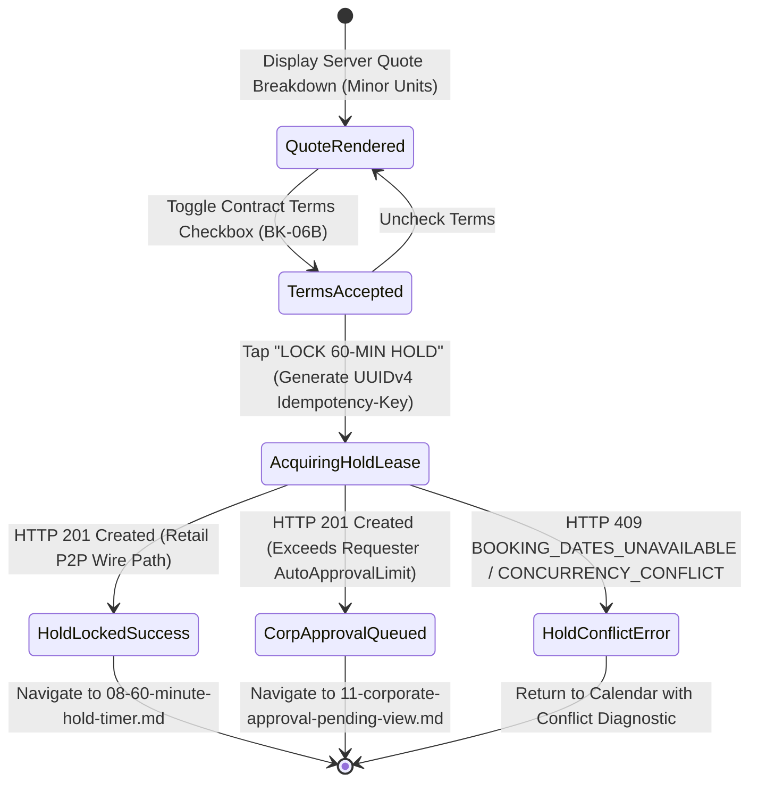

# Pre-Booking Checkout Price Breakdown & Tax Disclosure Modal
## Mobile Subsystem Specification — `docs/mobile/renter-experience/07-checkout-price-breakdown.md`

**Document Identifier:** `SPEC-MOB-RNT-07`  
**Classification:** Canonical Subsystem UI/UX & Technical Behavior Specification  
**Governing Documents:** `Dink_Machinery_UI_UX_Design_Brief.md`, `SRS-DINK-CORE-V7.0` (`docs/shared/requirements/05-05-booking-reservation-flow.md`, `06-03-corporate-pricing-payment.md`), `docs/shared/design/design-tokens.json`, `docs/ERROR_CATALOG.md`, `contracts/openapi.yaml`  
**Target Subsystem:** Flutter 3.44 / Dart 3.9 Mobile Client (iOS & Android)  
**Primary Persona / Actor:** Civil Engineering Contractor (*Dawit Haile-Mariam* / *Patrick Kariuki*), Corporate Requester (*Bethlehem Tessema*)  
**Associated Requirements:** `REQ-05-05` (`BK-04`, `BK-05`, `BK-06B`), `REQ-06-03` (`CORP-PRICE`, `CORP-CREDIT`), `REQ-05-20` (Contractual Terms Acceptance)  
**Associated Interaction Flows:** `FLOW-07` (`FLOW-BOOKING-STATE-MACHINE-DINK-CORE-V7.0`), `FLOW-08` (Direct P2P Bank Wire), `FLOW-14` (Corporate Approval Routing), `FLOW-16` (60-Min Hold Lock)  
**Architectural Decisions:** `ADR-005` (Valkey 60-Min Exclusive Hold Lease), `ADR-008` (`LOC-01-BE` 15% ET VAT vs 16% KE VAT), `ADR-010` (**Non-Custodial Financial Invariant & Informational-Only Security Deposit**)  
**Status:** Approved Technical Design Baseline

---

## 1. Domain Context, Business Formulas & Architectural Invariants

The **Pre-Booking Checkout Price Breakdown Modal (`CheckoutPriceBreakdownModal`)** is the final commercial review gate before acquiring a 60-minute Valkey reservation lease (`1. PENDING_PAYMENT`) or submitting a Corporate Requisition Docket (`AWAITING_CORP_APPROVAL`). It enforces complete fiscal transparency, integer minor-unit precision, and the platform's foundational **Non-Custodial Financial Invariant (`ADR-010`)**.

### 1.1 Deterministic Pricing Formulas (`BK-04` / `ADR-010`)
All monetary calculations execute on the Go backend in 64-bit integer minor units (`MoneyAmount`: Santims for `ETB`, Cents for `KES`) and are rendered verbatim on the mobile client:
1. **Base Machine Rental Subtotal ($M_{\text{base}}$):**
   $$M_{\text{base}} = D_{\text{hire}} \times R_{\text{daily\_effective\_minor}}$$
   where $R_{\text{daily\_effective\_minor}}$ incorporates any weekly/monthly duration tier discount or bilateral Corporate MSA tariff (`REQ-06-03`).
2. **Bundled Attachments Subtotal ($M_{\text{att}}$):**
   $$M_{\text{att}} = \sum_{i=1}^{k} \left(D_{\text{hire}} \times R_{\text{att}, i, \text{minor}}\right)$$
3. **Taxable Gross Rental Subtotal ($M_{\text{taxable}}$):**
   $$M_{\text{taxable}} = M_{\text{base}} + M_{\text{att}}$$
   *(Note: Platform service commission is absorbed by the Fleet Owner per `REQ-05-09` and is never tacked onto the Renter's checkout price).*
4. **Sovereign Value Added Tax ($M_{\text{vat}}$) (`LOC-01-BE`):**
   - **Ethiopia (`ET`):** $\text{VAT}_{\text{bps}} = 1500$ ($15.0\%$).
   - **Kenya (`KE`):** $\text{VAT}_{\text{bps}} = 1600$ ($16.0\%$).
   $$M_{\text{vat}} = \left\lfloor \frac{M_{\text{taxable}} \times \text{VAT}_{\text{bps}} + 5000}{10000} \right\rfloor$$
5. **Total Payable to Owner via Direct Bank Wire ($M_{\text{total\_wire}}$):**
   $$M_{\text{total\_wire}} = M_{\text{taxable}} + M_{\text{vat}}$$
6. **Non-Custodial Informational Security Deposit Invariant (`BK-04` / `ADR-010`):**
   $$\text{SecurityDeposit}_{\text{platform\_charged}} \equiv 0$$
   If the Fleet Owner specifies a security deposit (e.g., `ETB 50,000.00`), it is displayed in a **strictly segregated informational box** labeled:
   > **"INFORMATIONAL ONLY — Settled Directly with Owner Off-Platform. Not included in your Dink Machinery wire total."**

---

## 2. Screen Anatomy & Bespoke ASCII Wireframe

```text
+-----------------------------------------------------------------------+
| [✕ Close]       PRE-BOOKING COMMERCIAL QUOTE (BK-04)                  |
|=======================================================================|
| 🚜 CAT 320D2 L Hydraulic Excavator (Wet Rate • Operator Included)     |
| 📅 Oct 30, 2026 – Nov 06, 2026 (ጥቅምት 20 – 27, 2019 ዓ.ም) • 8 Days      |
| ⏱️ Included Engine Shift Cap: 64.0 Operating Hours (8.0 hrs/day)      |
| 📍 Site: Modjo–Hawassa Lot 2 KM 44 • Owner: Tesfaye Heavy Plant PLC   |
|=======================================================================|
| 🧾 ITEMIZED FINANCIAL BREAKDOWN (Currency: ETB • Minor Units)         |
| +-------------------------------------------------------------------+ |
| | 1. Base Machine Hire (8 Days × ETB 28,500.00)     ETB 228,000.00  | |
| |    └─ Duration Discount Applied (Weekly -8%):    -ETB  18,240.00  | |
| |    Net Base Machine Subtotal:                     ETB 209,760.00  | |
| |-------------------------------------------------------------------| |
| | 2. Bundled Demountable Attachments (BK-03)                        | |
| |    • Soosan SB81 Hydraulic Breaker (8d × 6,500)   ETB  52,000.00  | |
| |-------------------------------------------------------------------| |
| | 3. Taxable Equipment Subtotal                     ETB 261,760.00  | |
| | 4. Statutory Ethiopian VAT (15.0% / 1500 bps)     ETB  39,264.00  | |
| |===================================================================| |
| | 💰 TOTAL DIRECT WIRE TO OWNER (Payable on Hold)   ETB 301,024.00  | |
| +-------------------------------------------------------------------+ |
|=======================================================================|
| 🛡️ SECURITY DEPOSIT DISCLOSURE (ADR-010 NON-CUSTODIAL INVARIANT)      |
| +-------------------------------------------------------------------+ |
| | ℹ️ Owner Security Deposit Requirement:            ETB  50,000.00  | |
| | [INFORMATIONAL ONLY — SETTLED DIRECTLY WITH OWNER OFF-PLATFORM]   | |
| | Dink Machinery never collects, holds, or escrows security         | |
| | deposits. Any deposit or bank guarantee is arranged directly      | |
| | between you and Tesfaye Heavy Plant PLC at site handover.         | |
| +-------------------------------------------------------------------+ |
|=======================================================================|
| 💳 SETTLEMENT PATHWAY                                                 |
| (•) Phase 1: Direct P2P Bank Wire to Owner (60-Min Exclusive Hold)    |
| ( ) Phase 2: Corporate Net-30 Credit Line (Avail: ETB 4,200,000.00)   |
|-----------------------------------------------------------------------|
| [x] I accept the Bilateral Plant Hire Contract & Penalty Terms (BK-06B)|
|=======================================================================|
| [   🔒 LOCK 60-MIN HOLD & VIEW OWNER BANK DETAILS (64dp CTA)        ] |
+-----------------------------------------------------------------------+
```

---

## 3. W3C DTCG Design Token Mapping Table

| UI Component / Element | W3C DTCG Token Path | Resolved Value (Light / Outdoor High-Contrast) | Ergonomic & Behavioral Mandate |
|---|---|---|---|
| **Financial Ledger Table** | `semantic.light.surface.card` + `stroke.border.medium` | `#FFFFFF` surface, `2dp` `#E2E8F0` border | Every monetary figure right-aligned using `typography.fontFamily.mono` (`Space Mono`). |
| **Total Direct Wire Row** | `color.brand.amber.50` + `semantic.light.text.numericLedger` | `#FFFBEB` row background, `Space Mono` `18sp` Bold `#020617` | Clearly highlights the exact bank transfer amount (`ETB 301,024.00`). |
| **Informational Deposit Callout** | `color.feedback.blue.50` + `color.feedback.blue.500` border | `#EFF6FF` background, `2dp` dashed `#3B82F6` border | Visually separated below the total box so it can never be mistaken as part of the wire total. |
| **Contract Terms Checkbox** | `dimension.space.56` (`56dp` touch target) | `#F59E0B` active check fill | Mandatory legal gate (`BK-06B`) before the primary lock CTA activates. |
| **Primary Lock Hold CTA** | `component.actuator.button.heightField` / `action.primary.bg` | `64dp` height, `#F59E0B` (`3dp` bottom tactile lip) | Dispatches `POST /api/v1/bookings` with mandatory `Idempotency-Key` header. |

---

## 4. Screen State Machine & Sequence Diagrams

### 4.1 Checkout Quote & Lease Acquisition State Machine


### 4.2 Atomic Two-Tier Lease Acquisition Sequence (`BK-05` / `FLOW-16`)
```mermaid
sequenceDiagram
    autonumber
    actor Renter as Contractor (Flutter 3.44)
    participant ModalBloc as CheckoutBreakdownBloc
    participant Isar as Isar Outbox & Cache
    participant API as Go Monolith (POST /api/v1/bookings)
    participant Valkey as Valkey 8.0
    participant PG as PostgreSQL 18.4

    Renter->>ModalBloc: Check Terms (BK-06B) & Tap "LOCK 60-MIN HOLD"
    ModalBloc->>ModalBloc: Generate/Reuse deterministic Idempotency-Key (UUID v4)
    ModalBloc->>API: POST /api/v1/bookings (Headers: Idempotency-Key, X-Country-Code: ET)
    API->>Valkey: SET hold:fleet:{fleetId}:{dateHash} {renterId} EX 3600 NX
    alt Valkey NX Lock Acquired
        API->>PG: BEGIN TX; INSERT INTO bookings (status='PENDING_PAYMENT', hold_expires_at=NOW()+60m); COMMIT;
        PG-->>API: Booking Record + Unmasked Owner Bank Coordinates
        API-->>ModalBloc: 201 Created (BookingEnvelope + holdExpiresAtUtc)
        ModalBloc->>Isar: Persist Active Hold Booking Locally
        ModalBloc-->>Renter: Navigate to 60-Minute Hold Timer Screen (SPEC-MOB-RNT-08)
    else Competing Renter Won Lock Milliseconds Earlier
        Valkey-->>API: nil (Lock Already Held)
        API-->>ModalBloc: 409 Conflict (BOOKING_DATES_UNAVAILABLE)
        ModalBloc-->>Renter: Show Concurrency Toast & Offer Standby Waitlist
    end
```

---

## 5. Concrete Flutter Implementation Blueprint

### 5.1 BLoC Events & Freezed States (`checkout_breakdown_bloc.dart`)
```dart
import 'package:freezed_annotation/freezed_annotation.dart';

part 'checkout_breakdown_bloc.freezed.dart';

@freezed
sealed class CheckoutBreakdownEvent with _$CheckoutBreakdownEvent {
  const factory CheckoutBreakdownEvent.started({
    required BookingQuoteBreakdownDto quote,
  }) = _Started;

  const factory CheckoutBreakdownEvent.settlementPathwayChanged({
    required SettlementPathwayType pathway, // P2P_BANK_WIRE vs CORPORATE_NET30
  }) = _SettlementPathwayChanged;

  const factory CheckoutBreakdownEvent.contractTermsToggled({
    required bool accepted,
  }) = _ContractTermsToggled;

  const factory CheckoutBreakdownEvent.confirmLockSubmitted() = _ConfirmLockSubmitted;
}

@freezed
abstract class CheckoutBreakdownState with _$CheckoutBreakdownState {
  const factory CheckoutBreakdownState({
    required BookingQuoteBreakdownDto quote,
    required String idempotencyKey, // Generated once on modal mount (UUID v4)
    @Default(SettlementPathwayType.p2pBankWire) SettlementPathwayType selectedPathway,
    @Default(false) bool termsAccepted,
    @Default(false) bool isSubmitting,
    BookingCreatedResponseDto? createdBooking,
    ProblemDetails? error,
  }) = _CheckoutBreakdownState;
}
```

### 5.2 Immutable Quote Breakdown DTO (`booking_quote_breakdown_dto.dart`)
```dart
import 'package:freezed_annotation/freezed_annotation.dart';

part 'booking_quote_breakdown_dto.freezed.dart';
part 'booking_quote_breakdown_dto.g.dart';

@freezed
abstract class BookingQuoteBreakdownDto with _$BookingQuoteBreakdownDto {
  const factory BookingQuoteBreakdownDto({
    required String quoteId,
    required String fleetId,
    required String startDateIso,
    required String endDateIso,
    required int rentalDays,
    required double includedShiftHours,
    required String currencyCode, // 'ETB' | 'KES'
    required int grossBaseRentalMinor,
    required int durationDiscountMinor,
    required int netBaseRentalMinor,
    required List<AttachmentLineItemDto> bundledAttachmentLines,
    required int taxableSubtotalMinor,
    required int vatRateBps, // 1500 (ET) or 1600 (KE)
    required int vatAmountMinor,
    required int totalDirectWireMinor,
    int? informationalSecurityDepositMinor, // NEVER added to totalDirectWireMinor
    required String informationalDepositDisclaimer,
  }) = _BookingQuoteBreakdownDto;

  factory BookingQuoteBreakdownDto.fromJson(Map<String, dynamic> json) =>
      _$BookingQuoteBreakdownDtoFromJson(json);
}
```

### 5.3 Widget Tree Hierarchy
```text
CheckoutPriceBreakdownModal (DraggableScrollableSheet / ModalScaffold)
 ├── ModalDragHandleAndHeader ("Pre-Booking Commercial Quote")
 ├── ListView (Padding: 16dp)
 │    ├── RequisitionScopeHeaderCard (Machine, Dual Calendar Dates, 64.0 Shift Hours)
 │    ├── ItemizedMinorUnitLedgerCard (BK-04)
 │    │    ├── BaseMachineRentalLineItem
 │    │    ├── DurationOrMsaDiscountLineItem (Emerald text if > 0)
 │    │    ├── BundledAttachmentsItemizedList (BK-03)
 │    │    ├── TaxableSubtotalDividerRow
 │    │    ├── StatutoryVatLineItem ("15.0% ET VAT" or "16.0% KE VAT")
 │    │    └── TotalDirectWireHighlightBox (Space Mono 18sp Bold)
 │    ├── InformationalSecurityDepositIsolationCard (ADR-010 Mandatory Notice)
 │    ├── SettlementPathwaySelectorCard (Direct P2P Wire vs Corporate Net-30 Credit)
 │    └── BilateralContractTermsCheckboxTile (BK-06B + Link to PDF Terms Preview)
 └── StickyConfirmHoldBottomBar
      └── LockHoldPrimaryActuatorButton (64dp height, disabled until termsAccepted == true)
```

---

## 6. OpenAPI 3.1.0 Routes & RFC 9457 Error Matrix

### 6.1 Endpoint Specifications
- **`POST /api/v1/bookings`**
  - **Mandatory Headers:** `Idempotency-Key: <uuid-v4>`, `X-Country-Code: ET | KE`, `X-Organization-ID: <uuid?>`.
  - **Request Body:** `{ "quoteId": "uuid", "fleetId": "uuid", "startDate": "2026-10-30", "endDate": "2026-11-06", "rateMode": "WET", "attachmentIds": ["uuid"], "settlementPathway": "P2P_BANK_WIRE", "termsAcceptedVersion": "v7.0" }`.
  - **Response (`201 Created`):** Returns `bookingId`, `status` (`PENDING_PAYMENT` or `AWAITING_CORP_APPROVAL`), `holdExpiresAtUtc`, and `ownerBankCoordinates[]`.

### 6.2 RFC 9457 Problem Details Matrix
| Error Code | HTTP Status | RFC 9457 Type URI | Retryable | Mobile UI Remediation & Recovery Action |
|---|---|---|---|---|
| `REQ_MISSING_IDEMPOTENCY_KEY` | `400` | `/errors/missing-idempotency-key` | No | Interceptor bug guard: auto-inject `state.idempotencyKey` and retry once. |
| `BOOKING_DATES_UNAVAILABLE` | `409` | `/errors/booking-dates-unavailable` | No | Another renter locked the machine first; close modal and display alternative dates/machines (`SD-07`). |
| `BOOKING_CONCURRENCY_CONFLICT` | `409` | `/errors/booking-concurrency-conflict` | Yes | Re-fetch quote and prompt user to confirm updated version. |
| `ERR_CORPORATE_CREDIT_LIMIT_EXCEEDED` | `403` | `/errors/corporate-credit-limit-exceeded` | No | Disable `CORPORATE_NET30` radio option and allow fallback to `P2P_BANK_WIRE` or alert Finance Controller. |

---

## 7. Verification & Acceptance Criteria

- [ ] **Strict Non-Custodial Deposit Separation (`ADR-010` / `BK-04`):** Automated unit test verifies `totalDirectWireMinor == taxableSubtotalMinor + vatAmountMinor` and confirms `informationalSecurityDepositMinor` (`5000000` Santims) has zero mathematical effect on `totalDirectWireMinor`.
- [ ] **Jurisdictional VAT Precision (`LOC-01-BE`):** Test verifies `ET` applies `1500 bps` (`15%`) and `KE` applies `1600 bps` (`16%`) using integer half-up rounding.
- [ ] **Idempotency Replay Safety (`G1`):** Double-tapping "LOCK 60-MIN HOLD" during network latency transmits the exact same `Idempotency-Key` UUID v4 and yields a single booking record.
