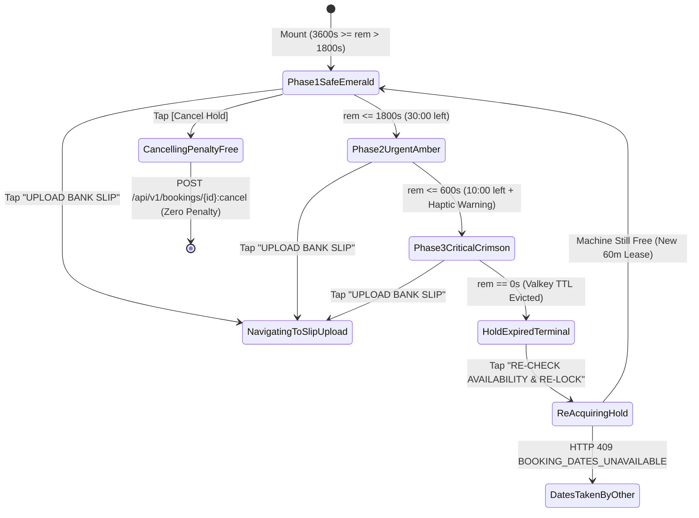
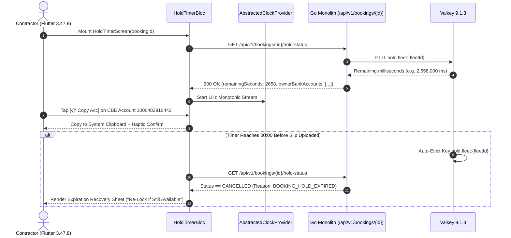

# 60-Minute Valkey Hold Countdown & Owner Bank Coordinates Screen
## Mobile Subsystem Specification — `docs/mobile/renter-experience/08-60-minute-hold-timer.md`

**Document Identifier:** `SPEC-MOB-RNT-08`  
**Classification:** Canonical Subsystem UI/UX & Technical Behavior Specification  
**Governing Documents:** `Dink_Machinery_UI_UX_Design_Brief.md`, `SRS-DINK-CORE-V7.0` (`docs/shared/requirements/05-05-booking-reservation-flow.md`), `docs/shared/design/design-tokens.json`, `docs/ERROR_CATALOG.md`, `contracts/openapi.yaml`  
**Target Subsystem:** Flutter 3.47.8 / Dart 3.9 Mobile Client (iOS & Android)  
**Primary Persona / Actor:** Civil Engineering Contractor (*Dawit Haile-Mariam* / *Patrick Kariuki*), Corporate Finance Officer (*Solomon Kassa*)  
**Associated Requirements:** `REQ-05-05` (`BK-05`, `BK-06`), `REQ-05-10` (15-Min Expiry Warning Push Notification)  
**Associated Interaction Flows:** `FLOW-07` (`1. PENDING_PAYMENT`), `FLOW-08` (Direct P2P Commercial Bank Wire), `FLOW-15` / `FLOW-16` (Valkey 60-Min Soft-Lock Lease & Auto-Eviction)  
**Architectural Decisions:** `ADR-005` (Valkey `SET hold:fleet:{id} EX 3600 NX`), `ADR-010` (**Non-Custodial Direct P2P Bank Settlement**)  
**Status:** Approved Technical Design Baseline

---

## 1. Domain Context, Business Formulas & Architectural Invariants

Once a booking transitions to state **`1. PENDING_PAYMENT`**, the platform locks the machine exclusively for the contractor in Valkey 9.1.3 for **60 minutes ($3,600\text{ seconds}$)** (`BK-05`). Because Dink Machinery operates under the **Non-Custodial Financial Invariant (`ADR-010`)** in compliance with National Bank of Ethiopia (NBE) directives, the contractor transfers the rental prepayment directly into the **Fleet Owner's verified commercial bank account** (e.g., *Commercial Bank of Ethiopia (CBE)*, *Awash Bank*, *Dashen Bank*, *Bank of Abyssinia*, *KCB*, *Equity Bank*) and uploads the payment slip before the countdown expires (`BK-06`).

### 1.1 Timer Math & Color Interpolation Rules
1. **Wall-Clock-Independent Monotonic Countdown (`QA Determinism Rule`):**
   Upon receiving `holdExpiresAtUtc` and `serverTimestampUtc` from the backend, the client calculates the initial remaining duration $\Delta T_0 = T_{\text{expires}} - T_{\text{server}}$ and drives the countdown using an injected `Stopwatch` / monotonic ticker (`ClockProvider`), preventing manipulation or drift if the device's local system clock is skewed.
2. **Three-Phase Chromatic Urgency Interpolation (`design-tokens.json → component.countdown`):**
   Let $t_{\text{rem}}$ be the remaining seconds in $[0, 3600]$:
   - **Phase 1 — Safe Window ($3600\text{ s} \ge t_{\text{rem}} > 1800\text{ s}$ / `60:00`..`30:01`):**
     Ring Stroke: Emerald `#10B981` (`color.feedback.emerald.500`); Container: `component.countdown.holdNormalBg` (`#FFFBEB`).
   - **Phase 2 — Urgent Window ($1800\text{ s} \ge t_{\text{rem}} > 600\text{ s}$ / `30:00`..`10:01`):**
     Ring Stroke: Amber/Orange `#F59E0B` $\rightarrow$ `#C2410C`; Container: `component.countdown.holdUrgentBg` (`#FFF7ED`). At $t_{\text{rem}} = 900\text{ s}$ (`15:00`), a high-priority local/push alert fires.
   - **Phase 3 — Critical Window ($600\text{ s} \ge t_{\text{rem}} > 0\text{ s}$ / `10:00`..`00:01`):**
     Ring Stroke: Crimson `#EF4444` (`color.feedback.crimson.500`) with 1 Hz pulse; Container: `component.countdown.holdCriticalBg` (`#FEF2F2`); Text: `#B91C1C` (`component.countdown.holdCriticalText`).
3. **Unmasked Owner Bank Coordinates & Memo Code (`BK-06`):**
   Only while `status == PENDING_PAYMENT` (or `PENDING_FINAL_PAYMENT`) are the Owner's verified bank coordinates revealed to the counter-party renter. Each bank row provides one-tap clipboard copy (`Clipboard.setData` + haptic pulse) for the **Account Number**, **Exact Wire Amount (`301,024.00`)**, and **Mandatory Payment Memo Reference (`DINK-BK-8841`)**.
4. **Penalty-Free Pre-Confirmation Cancellation (`REQ-05-05 §5.2`):**
   While in `1. PENDING_PAYMENT`, the contractor may cancel at any time with **zero financial penalty**, immediately evicting the Valkey key `DEL hold:fleet:{id}` and releasing the asset back to public discovery.

---

## 2. Screen Anatomy & Bespoke ASCII Wireframe

```text
+-----------------------------------------------------------------------+
| [<- Back]      RESERVATION HOLD ACTIVE (#DINK-BK-8841)   [Cancel Hold]|
|=======================================================================|
| +-------------------------------------------------------------------+ |
| |               .-~~~-.                                             | |
| |             .'   |   '.     🔒 EXCLUSIVE MACHINE HOLD LOCKED      | |
| |            /   44:18   \    Upload bank wire slip before timer    | |
| |           ;   MINUTES   ;   expires to secure CAT 320D2 L.        | |
| |            \  REMAIN   /    Expires: 14:30 EAT (Oct 29, 2026)     | |
| |             '.       .'                                           | |
| |               '~---~'       [🟢 Emerald -> 🟡 Amber -> 🔴 Crimson] | |
| +-------------------------------------------------------------------+ |
|=======================================================================|
| 💰 STEP 1: TRANSFER EXACT AMOUNT DIRECTLY TO FLEET OWNER (ADR-010)    |
| +-------------------------------------------------------------------+ |
| | Beneficiary Legal Name:  TESFAYE HEAVY PLANT PLC                  | |
| | Amount to Wire (Incl VAT): ETB 301,024.00             [📋 Copy Amt]| |
| | Mandatory Wire Reference:  DINK-BK-8841               [📋 Copy Ref]| |
| +-------------------------------------------------------------------+ |
| 🏦 OWNER VERIFIED COMMERCIAL BANK ACCOUNTS (Select Preferred Bank):   |
| +-------------------------------------------------------------------+ |
| | (•) Commercial Bank of Ethiopia (CBE — Bole Corporate Branch)     | |
| |     Account #: 1000482910442                          [📋 Copy Acc]| |
| |-------------------------------------------------------------------| |
| | ( ) Awash Bank S.C. (Kazanchis Main Branch)                       | |
| |     Account #: 01320849102200                         [📋 Copy Acc]| |
| |-------------------------------------------------------------------| |
| | ( ) Dashen Bank S.C. (Mojo Dry Port Branch)                       | |
| |     Account #: 5049201184009                          [📋 Copy Acc]| |
| +-------------------------------------------------------------------+ |
| ℹ️ Non-Custodial Notice: Funds transfer directly to Tesfaye Heavy     |
|    Plant PLC. Include "DINK-BK-8841" in your bank narration/remark.   |
|=======================================================================|
| 📤 STEP 2: UPLOAD BANK WIRE SLIP / MOBILE BANKING SCREENSHOT          |
| [     📷 UPLOAD BANK SLIP / RECEIPT TO LOCK BOOKING (64dp CTA)      ] |
+-----------------------------------------------------------------------+
```

---

## 3. W3C DTCG Design Token Mapping Table

| UI Component / Element | W3C DTCG Token Path | Resolved Value (Light / Outdoor High-Contrast) | Ergonomic & Behavioral Mandate |
|---|---|---|---|
| **Hold Container (60m..30m)** | `component.countdown.holdNormalBg` / `holdNormalText` | `#FFFBEB` / `#78350F` | Paired with `color.feedback.emerald.500` (`#10B981`) circular arc painter. |
| **Hold Container (30m..10m)** | `component.countdown.holdUrgentBg` / `holdUrgentText` | `#FFF7ED` / `#C2410C` | Paired with `color.brand.amber.500` (`#F59E0B`) circular arc painter. |
| **Hold Container (<10m)** | `component.countdown.holdCriticalBg` / `holdCriticalText` | `#FEF2F2` / `#B91C1C` | Paired with `color.feedback.crimson.500` (`#EF4444`) arc + haptic alert at `10:00` and `02:00`. |
| **Monospace Timer & Account #** | `typography.fontFamily.mono` + `typography.fontSize.28` | `Space Mono` `28sp` Bold (Timer), `16sp` Bold (Account #) | Prevents layout jitter on every 1-second tick; zero ambiguity between `0` and `O`. |
| **One-Tap Copy Pill (`[📋 Copy]`)** | `dimension.space.48` + `color.brand.slate.800` | `48dp` height tactile button | Triggers `Clipboard.setData`, `HapticFeedback.lightImpact()`, and `"Copied to clipboard"` pill. |
| **Upload Slip Primary CTA** | `component.actuator.button.heightField` / `action.primary.bg` | `64dp` height, `#F59E0B` | Launches `09-bank-slip-upload-verification.md`. |

---

## 4. Screen State Machine & Sequence Diagrams

### 4.1 60-Minute Lease Countdown & Expiration State Machine


### 4.2 Hold Sync, Clipboard Copy & Expiration Recovery Sequence


---

## 5. Concrete Flutter Implementation Blueprint

### 5.1 BLoC Events & Freezed States (`hold_timer_bloc.dart`)
```dart
import 'package:freezed_annotation/freezed_annotation.dart';

part 'hold_timer_bloc.freezed.dart';

@freezed
sealed class HoldTimerEvent with _$HoldTimerEvent {
  const factory HoldTimerEvent.started({
    required String bookingId,
  }) = _Started;

  const factory HoldTimerEvent.ticked({
    required int remainingSeconds,
  }) = _Ticked;

  const factory HoldTimerEvent.bankAccountSelected({
    required String bankAccountId,
  }) = _BankAccountSelected;

  const factory HoldTimerEvent.fieldCopied({
    required String fieldLabel,
    required String copiedValue,
  }) = _FieldCopied;

  const factory HoldTimerEvent.reLockRequested() = _ReLockRequested;

  const factory HoldTimerEvent.penaltyFreeCancelRequested() = _PenaltyFreeCancelRequested;
}

@freezed
abstract class HoldTimerState with _$HoldTimerState {
  const factory HoldTimerState({
    @Default(HoldScreenStatus.loading) HoldScreenStatus status,
    required String bookingId,
    required String bookingReferenceCode, // e.g., 'DINK-BK-8841'
    required int remainingSeconds, // 0..3600
    required HoldUrgencyPhase urgencyPhase, // SAFE_EMERALD, URGENT_AMBER, CRITICAL_CRIMSON, EXPIRED
    required int totalWireAmountMinor,
    required String currencyCode,
    required String beneficiaryLegalName,
    @Default(<OwnerBankAccountDto>[]) List<OwnerBankAccountDto> ownerBankAccounts,
    String? selectedBankAccountId,
    String? lastCopiedFieldLabel,
    ProblemDetails? error,
  }) = _HoldTimerState;
}
```

### 5.2 Isar Local Hold State Persistence (`isar_active_booking_hold.dart`)
```dart
import 'package:isar/isar.dart';

part 'isar_active_booking_hold.g.dart';

@collection
class IsarActiveBookingHold {
  Id id = Isar.autoIncrement;

  @Index(unique: true, replace: true)
  late String bookingId;

  late String bookingReferenceCode;
  late String fleetId;
  late String fleetTitle;
  late DateTime holdExpiresAtUtc;
  late int totalWireAmountMinor;
  late String currencyCode;
  late String beneficiaryLegalName;
  late String serializedBankAccountsJson; // Cached so user can view bank # offline at bank branch
  late DateTime syncedAt;
}
```

### 5.3 Widget Tree Hierarchy
```text
HoldTimerScreen (Scaffold)
 ├── AppBar ("Reservation Hold #DINK-BK-8841", Penalty-Free Cancel Action)
 ├── SingleChildScrollView (Padding: 16dp)
 │    ├── DynamicUrgencyCountdownCard (Changes bg/border token by HoldUrgencyPhase)
 │    │    ├── CustomCircularHoldProgressRing (Emerald -> Amber -> Crimson CustomPainter)
 │    │    └── MonospaceCountdownReadout ("44:18", Space Mono 28sp Bold)
 │    ├── WireTransferSummaryCard (ADR-010)
 │    │    ├── BeneficiaryLegalNameRow
 │    │    ├── ExactWireAmountCopyRow (Space Mono + [📋 Copy Amt] 48dp button)
 │    │    └── MandatoryMemoReferenceCopyRow ("DINK-BK-8841" + [📋 Copy Ref] button)
 │    ├── OwnerVerifiedBankCoordinatesList (BK-06)
 │    │    └── BankCoordinateSelectableCard (CBE, Awash, Dashen, KCB, Equity + [📋 Copy Acc])
 │    └── ExpiredHoldRecoveryCard (Visible only when urgencyPhase == EXPIRED)
 └── StickyBottomUploadSlipBar
      └── UploadBankSlipPrimaryActuator (64dp height CTA -> 09-bank-slip-upload-verification.md)
```

---

## 6. OpenAPI 3.1.0 Routes & RFC 9457 Error Matrix

### 6.1 Endpoint Specifications
- **`GET /api/v1/bookings/{id}/hold-status`**
  - **Response (`200 OK`):** Returns `bookingId`, `status`, `holdExpiresAtUtc`, `serverTimestampUtc`, `remainingSeconds`, and `ownerBankCoordinates[]`.
- **`POST /api/v1/bookings/{id}:cancel`**
  - **Headers:** `Idempotency-Key: <uuid-v4>`.
  - **Request Body:** `{ "reasonCode": "RENTER_RELEASED_HOLD" }`.
  - **Response (`200 OK`):** Transitions booking to `16. CANCELLED` with `penaltyMinor: 0` and immediately releases Valkey lease.

### 6.2 RFC 9457 Problem Details Matrix
| Error Code | HTTP Status | RFC 9457 Type URI | Retryable | Mobile UI Remediation & Recovery Action |
|---|---|---|---|---|
| `BOOKING_HOLD_EXPIRED` | `409` | `/errors/booking-hold-expired` | No | Transition UI to `HoldUrgencyPhase.expired`; disable bank copy buttons to prevent late wire transfer, and surface "Re-Check Availability & Re-Lock" CTA. |
| `BOOKING_DATES_UNAVAILABLE` | `409` | `/errors/booking-dates-unavailable` | No | Shown if user attempts `Re-Lock` after another contractor reserved the machine; offer smart alternatives (`SD-07`). |
| `BOOKING_INVALID_STATE_TRANSITION` | `409` | `/errors/booking-invalid-state` | No | Refresh booking state; if slip was already uploaded on another device, redirect to `2. PAYMENT_EVIDENCE_UPLOADED`. |

---

## 7. Verification & Acceptance Criteria

- [ ] **Abstracted Clock Determinism (`AGENTS.md §1`):** Unit test with fake `ClockProvider` verifies exact color transitions at `1800s` (`Emerald -> Amber`), `600s` (`Amber -> Crimson`), and `0s` (`Expired`) without sleeping wall-clock time.
- [ ] **Offline Bank Hall Access (`IsarActiveBookingHold`):** When a contractor walks into a bank branch with poor indoor cellular reception, `IsarActiveBookingHold` renders the cached beneficiary name, account number, and wire reference code offline while keeping the monotonic countdown running.
- [ ] **Expiration Guardrail Against Late Wires:** The moment `remainingSeconds == 0`, the account number copy buttons lock and a crimson warning banner instructs the renter **not** to wire funds without first re-acquiring a hold lock.
