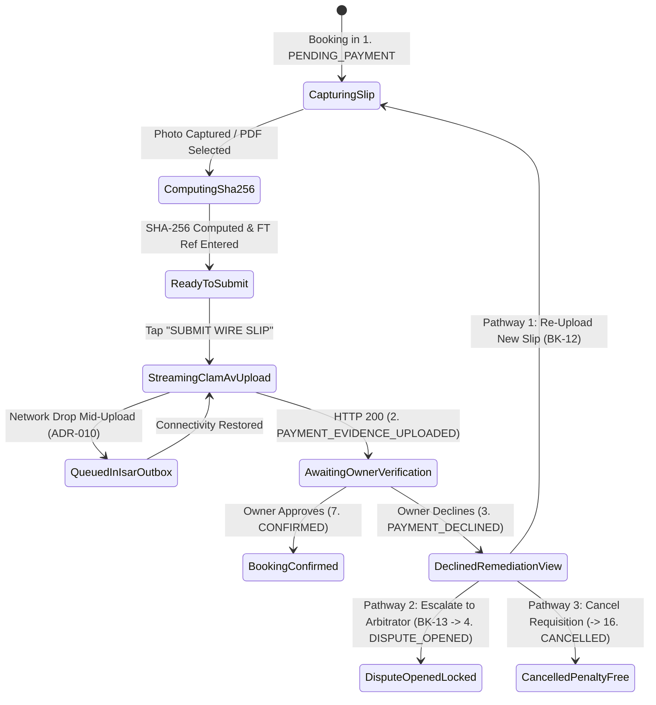

# Non-Custodial Bank Wire Slip Upload & Decline Remediation Screen
## Mobile Subsystem Specification — `docs/mobile/renter-experience/09-bank-slip-upload-verification.md`

**Document Identifier:** `SPEC-MOB-RNT-09`  
**Classification:** Canonical Subsystem UI/UX & Technical Behavior Specification  
**Governing Documents:** `Dink_Machinery_UI_UX_Design_Brief.md`, `SRS-DINK-CORE-V7.0` (`docs/shared/requirements/05-05-booking-reservation-flow.md`), `docs/shared/design/design-tokens.json`, `docs/ERROR_CATALOG.md`, `contracts/openapi.yaml`  
**Target Subsystem:** Flutter 3.47.9 / Dart 3.9 Mobile Client (iOS & Android)  
**Primary Persona / Actor:** Civil Engineering Contractor (*Dawit Haile-Mariam* / *Patrick Kariuki*)  
**Associated Requirements:** `REQ-05-05` (`BK-07`, `BK-07B`, `BK-08`, `BK-11`, `BK-12`, `BK-13`)  
**Associated Interaction Flows:** `FLOW-07` (`2. PAYMENT_EVIDENCE_UPLOADED` $\rightarrow$ `3. PAYMENT_DECLINED` $\rightarrow$ `4. DISPUTE_OPENED` / `7. CONFIRMED`), `FLOW-08` (Wire Verification & Dispute)  
**Architectural Decisions:** `ADR-005` (Valkey Hold Freeze During Owner Verification), `ADR-010` (**Non-Custodial P2P Wire Evidence & Offline Outbox**)  
**Status:** Approved Technical Design Baseline

---

## 1. Domain Context, Business Formulas & Architectural Invariants

Under the **Non-Custodial Financial Invariant (`ADR-010`)**, after transferring the rental prepayment directly to the Fleet Owner's commercial bank account, the contractor submits the physical bank deposit slip or mobile banking RTGS/FT confirmation screenshot via the **Bank Wire Slip Upload & Decline Remediation Screen (`BankSlipUploadVerificationScreen`)**.

### 1.1 Cryptographic & Fraud-Defense Invariants
1. **SHA-256 Duplicate Receipt Anti-Replay Guard (`BK-07B`):**
   Before transmitting the image/PDF stream, the Flutter client computes the binary `SHA-256` digest of the file (`sha256_checksum`) and normalizes the bank transaction reference string (`FT2630299184` / `CBE-RTGS-...`). The Go backend verifies both values against `payment_evidences(sha256_hash, normalized_bank_ref)`:
   $$\exists\, e \in \text{payment\_evidences} : (e.\text{sha256\_hash} = H_{\text{file}} \lor e.\text{normalized\_bank\_ref} = R_{\text{tx}}) \implies \text{HTTP 409 } (\texttt{PAYMENT\_TRANSACTION\_EXISTS})$$
   This prevents malicious recycling of an old bank receipt across multiple bookings.
2. **In-Flight ClamAV Antivirus Streaming (`BK-07`):**
   Uploaded media (`.jpg`, `.png`, `.pdf`, max $10\text{ MB}$) streams directly through the Go monolith's TCP `:3310` `INSTREAM` pipe to ClamAV before touching SeaweedFS S3 (`s3://dink-payment-slips/{booking_id}/`). Any malware signature triggers `HTTP 422 INSPECT_MEDIA_SCAN_FAILED`.
3. **Hold Timer Suspension Upon Evidence Upload (`BK-08`):**
   Transitioning from `1. PENDING_PAYMENT` to `2. PAYMENT_EVIDENCE_UPLOADED` pauses the 60-minute renter eviction timer and locks the reservation while the Fleet Owner audits their bank statement (`BK-09` / `BK-10`).
4. **Three-Path Renter Remediation When Owner Declines Slip (`BK-11` / `BK-12` / `BK-13`):**
   If the Fleet Owner declines the slip (`3. PAYMENT_DECLINED` with mandatory reason code e.g., `ILLEGIBLE_RECEIPT`, `AMOUNT_SHORTFALL`, `FUNDS_NOT_RECEIVED`, `WRONG_ACCOUNT`), the screen switches to the **Renter Remediation Mode (`BK-12`)** offering three explicit pathways:
   - **Pathway A — Re-Upload Corrected Slip (`-> 2. PAYMENT_EVIDENCE_UPLOADED`):** Capture a clearer photo or attach an additional top-up transfer slip.
   - **Pathway B — Escalate to Compliance Arbitrator (`BK-13` `-> 4. DISPUTE_OPENED`):** Freeze the machine and invoke Compliance Officer *Yohannes Bekele* to audit the bank FT reference directly with the bank.
   - **Pathway C — Cancel Requisition Penalty-Free (`-> 16. CANCELLED`):** Walk away with zero platform cancellation penalty.

---

## 2. Screen Anatomy & Bespoke ASCII Wireframe

### 2.1 Mode A: Initial Slip Capture & Upload (`BK-07` / `BK-08`)
```text
+-----------------------------------------------------------------------+
| [<- Back]       UPLOAD BANK WIRE EVIDENCE (#DINK-BK-8841)             |
|-----------------------------------------------------------------------|
| 🔒 Hold Frozen Upon Upload • Required Wire: ETB 301,024.00 (Incl VAT) |
|=======================================================================|
| 📷 1. CAPTURE BANK DEPOSIT SLIP OR RTGS/MOBILE SCREENSHOT             |
| +-------------------------------------------------------------------+ |
| |  +-------------------------------------------------------------+  | |
| |  |          [ 🟩 ALIGN BANK SLIP WITHIN RETICLE FRAME ]        |  | |
| |  |                                                             |  | |
| |  |   CBE Branch Stamp / FT Reference # Must Be Clearly Legible |  | |
| |  |   SHA-256 Verified: e3b0c44298fc1c149afbf4c8996fb924...     |  | |
| |  +-------------------------------------------------------------+  | |
| |  [📷 Retake Photo (56dp)]      [📁 Pick PDF/Screenshot (56dp)]    | |
| +-------------------------------------------------------------------+ |
|=======================================================================|
| 🏦 2. WIRE TRANSFER METADATA (BK-07B Anti-Duplicate Verification)     |
| | Originating Bank:       [Commercial Bank of Ethiopia (CBE)     v] | |
| | Bank FT / Reference #:  [FT263029918402                         ] | |
| | Exact Amount Wired:     [ETB 301,024.00                         ] | |
| | Transfer Date & Time:   [2026-10-29 13:52 EAT                   ] | |
|=======================================================================|
| [   📤 SUBMIT WIRE SLIP FOR OWNER VERIFICATION (64dp CTA)           ] |
+-----------------------------------------------------------------------+
```

### 2.2 Mode B: Renter Decline Remediation & Dispute Escalation (`BK-12` / `BK-13`)
```text
+-----------------------------------------------------------------------+
| [<- Back]     ⚠️ PAYMENT SLIP DECLINED BY OWNER (BK-12)               |
|=======================================================================|
| 🔴 STATUS: 3. PAYMENT_DECLINED • Remediation Window: 120 Mins Left    |
| +-------------------------------------------------------------------+ |
| | Owner Decline Reason Code:  [ILLEGIBLE_RECEIPT / BLURRY_STAMP]    | |
| | Owner Audit Note: "The right edge of the CBE teller sheet showing | |
| | the FT number and branch rubber stamp is cut off. Please re-scan."| |
| +-------------------------------------------------------------------+ |
| 🛠️ SELECT YOUR REMEDIATION PATHWAY (BK-12):                           |
| +-------------------------------------------------------------------+ |
| | [ 📷 1. RE-UPLOAD CLEAR SLIP / TOP-UP RECEIPT (64dp Primary CTA) ]| |
| +-------------------------------------------------------------------+ |
| | [ ⚖️ 2. CONTEST & ESCALATE TO COMPLIANCE ARBITRATOR (BK-13)      ]| |
| |   Locks machine in 4. DISPUTE_OPENED; Compliance Officer audits   | |
| |   FT263029918402 against CBE interbank settlement records.        | |
| +-------------------------------------------------------------------+ |
| | [ ✕ 3. CANCEL REQUISITION WITH ZERO PENALTY (-> 16. CANCELLED)   ]| |
| +-------------------------------------------------------------------+ |
+-----------------------------------------------------------------------+
```

---

## 3. W3C DTCG Design Token Mapping Table

| UI Component / Element | W3C DTCG Token Path | Resolved Value (Light / Outdoor High-Contrast) | Ergonomic & Behavioral Mandate |
|---|---|---|---|
| **Document Reticle Frame** | `component.reticle.viewfinder.strokeDefault` / `colorLocked` | `2dp` (`3dp` Outdoor) `#F59E0B` idle $\rightarrow$ `#10B981` locked | Turns Emerald `#10B981` when blur/glare heuristic passes and all 4 slip corners are inside frame. |
| **Evidence Uploaded Banner** | `color.feedback.blue.100` + `color.feedback.blue.500` | `#DBEAFE` container, `#3B82F6` badge (`2. PAYMENT_EVIDENCE_UPLOADED`) | Indicates hold eviction is paused awaiting Owner verification (`BK-08`). |
| **Decline Alert Container** | `color.feedback.crimson.50` + `color.feedback.crimson.700` | `#FEF2F2` fill, `#B91C1C` text, `2dp` `#EF4444` border | Renders Owner's structured `DeclineReasonCode` and audit note (`BK-11`). |
| **Dispute Escalation Button** | `color.feedback.purple.100` + `color.feedback.purple.900` | `#F3E8FF` fill, `#581C87` text, `#A855F7` border (`56dp`) | Transitions booking to `4. DISPUTE_OPENED` (`BK-13`). |
| **FT Reference Input Field** | `typography.fontFamily.mono` + `dimension.space.56` | `Space Mono` `16sp` Uppercase (`#020617`) | Auto-strips whitespace and enforces minimum 6-character alphanumeric bank ref. |

---

## 4. Screen State Machine & Sequence Diagrams

### 4.1 Payment Evidence & Decline Remediation State Machine


### 4.2 ClamAV Upload, SHA-256 Deduplication & Remediation Sequence
```mermaid
sequenceDiagram
    autonumber
    actor Renter as Contractor (Flutter 3.47.9)
    participant SlipBloc as BankSlipVerificationBloc
    participant API as Go Monolith (/api/v1/bookings/{id}/payment-evidence)
    participant ClamAV as ClamAV Daemon (:3310)
    participant S3 as SeaweedFS S3 Vault
    participant PG as PostgreSQL 18.6

    Renter->>SlipBloc: Capture Slip Image + Input FT Ref "FT263029918402"
    SlipBloc->>SlipBloc: Compute SHA-256 Digest & Compress >2MB Image
    SlipBloc->>API: POST /api/v1/bookings/{id}/payment-evidence (Multipart + Idempotency-Key)
    API->>ClamAV: INSTREAM TCP :3310 Scan
    ClamAV-->>API: stream: OK
    API->>PG: Check UNIQUE(sha256_hash) & UNIQUE(normalized_bank_ref)
    alt Clean & Unique Receipt
        API->>S3: PutObject s3://dink-payment-slips/{bookingId}/{evidenceId}.jpg
        API->>PG: UPDATE bookings SET status='PAYMENT_EVIDENCE_UPLOADED'; INSERT payment_evidences
        API-->>SlipBloc: 200 OK (status: PAYMENT_EVIDENCE_UPLOADED)
        SlipBloc-->>Renter: Show "Awaiting Owner Verification" Tracker
    else Owner Subsequently Declines Slip (Push Notification Received)
        API-->>SlipBloc: Push / Poll Event: status == PAYMENT_DECLINED (reason: ILLEGIBLE_RECEIPT)
        SlipBloc-->>Renter: Switch to BK-12 Remediation View (Re-Upload | Escalate BK-13 | Cancel)
    end
```

---

## 5. Concrete Flutter Implementation Blueprint

### 5.1 BLoC Events & Freezed States (`bank_slip_verification_bloc.dart`)
```dart
import 'package:freezed_annotation/freezed_annotation.dart';

part 'bank_slip_verification_bloc.freezed.dart';

@freezed
sealed class BankSlipVerificationEvent with _$BankSlipVerificationEvent {
  const factory BankSlipVerificationEvent.initialized({
    required String bookingId,
  }) = _Initialized;

  const factory BankSlipVerificationEvent.mediaCaptured({
    required String localFilePath,
    required String mimeType,
    required String sha256Hex,
  }) = _MediaCaptured;

  const factory BankSlipVerificationEvent.metadataChanged({
    required String originatingBankName,
    required String bankTransactionRef,
    required int wiredAmountMinor,
  }) = _MetadataChanged;

  const factory BankSlipVerificationEvent.slipSubmitted() = _SlipSubmitted;

  const factory BankSlipVerificationEvent.remediationReuploadStarted() = _RemediationReuploadStarted;

  const factory BankSlipVerificationEvent.disputeEscalated({
    required String renterContestStatement,
  }) = _DisputeEscalated;

  const factory BankSlipVerificationEvent.penaltyFreeCancelled() = _PenaltyFreeCancelled;
}

@freezed
abstract class BankSlipVerificationState with _$BankSlipVerificationState {
  const factory BankSlipVerificationState({
    @Default(SlipVerificationMode.captureForm) SlipVerificationMode viewMode,
    required String bookingId,
    required String bookingStatus, // 'PENDING_PAYMENT' | 'PAYMENT_EVIDENCE_UPLOADED' | 'PAYMENT_DECLINED' | 'DISPUTE_OPENED'
    required int requiredWireMinor,
    required String currencyCode,
    String? localSlipPath,
    String? sha256Checksum,
    @Default('') String originatingBankName,
    @Default('') String bankTransactionRef,
    int? enteredAmountMinor,
    @Default(false) bool isUploading,
    @Default(false) bool isQueuedOffline,
    PaymentDeclineDetailsDto? lastDeclineDetails, // Populated when status == PAYMENT_DECLINED
    ProblemDetails? error,
  }) = _BankSlipVerificationState;
}
```

### 5.2 Isar Offline Payment Evidence Outbox (`isar_payment_evidence_outbox.dart`)
```dart
import 'package:isar/isar.dart';

part 'isar_payment_evidence_outbox.g.dart';

@collection
class IsarPaymentEvidenceOutbox {
  Id id = Isar.autoIncrement;

  @Index(unique: true, replace: true)
  late String idempotencyKey;

  @Index()
  late String bookingId;

  late String encryptedLocalFilePath;
  late String sha256Checksum;
  late String originatingBankName;
  late String normalizedBankRef;
  late int wiredAmountMinor;
  late String currencyCode;
  late int retryAttempts;
  late DateTime queuedAtUtc;
}
```

### 5.3 Widget Tree Hierarchy
```text
BankSlipUploadVerificationScreen (Scaffold)
 ├── AppBar ("Bank Wire Evidence #DINK-BK-8841")
 ├── BlocBuilder<BankSlipVerificationBloc, BankSlipVerificationState>
 │    ├── [When viewMode == captureForm]:
 │    │    ├── SlipReticleViewfinderCard (Glare/Blur detector + SHA-256 badge)
 │    │    ├── WireMetadataInputCard (Originating Bank, FT Ref in Space Mono, Amount)
 │    │    └── SubmitWireSlipBottomButton (64dp height CTA)
 │    ├── [When viewMode == awaitingVerification]:
 │    │    ├── VerificationPendingStatusBanner (Blue 500 badge + Owner SLA countdown)
 │    │    └── UploadedSlipThumbnailAndHashCard
 │    └── [When viewMode == declinedRemediation (BK-12)]:
 │         ├── OwnerDeclineReasonAlertBox (Crimson 500 border, Reason Code + Owner Note)
 │         ├── ReuploadCorrectedSlipPrimaryButton (64dp height CTA -> captureForm)
 │         ├── EscalateToComplianceArbitratorButton (BK-13 -> 4. DISPUTE_OPENED modal)
 │         └── CancelRequisitionZeroPenaltyButton (-> 16. CANCELLED)
```

---

## 6. OpenAPI 3.1.0 Routes & RFC 9457 Error Matrix

### 6.1 Endpoint Specifications
- **`POST /api/v1/bookings/{id}/payment-evidence`**
  - **Headers:** `Idempotency-Key: <uuid-v4>`, `Content-Type: multipart/form-data`.
  - **Form Fields:** `file` (`binary`), `sha256Checksum` (`string`), `originatingBank` (`string`), `bankTransactionRef` (`string`), `wiredAmountMinor` (`int64`).
- **`POST /api/v1/bookings/{id}:dispute-payment`** (`BK-13`)
  - **Request Body:** `{ "evidenceId": "uuid", "contestStatement": "CBE branch confirmed FT263029918402 settled at 13:52 EAT." }`.

### 6.2 RFC 9457 Problem Details Matrix
| Error Code | HTTP Status | RFC 9457 Type URI | Retryable | Mobile UI Remediation & Recovery Action |
|---|---|---|---|---|
| `PAYMENT_TRANSACTION_EXISTS` | `409` | `/errors/payment-transaction-exists` | No | Block upload; highlight `bankTransactionRef` or duplicate image hash and instruct user to upload the genuine receipt for this booking (`BK-07B`). |
| `INSPECT_MEDIA_SCAN_FAILED` | `422` | `/errors/inspect-media-scan-failed` | No | ClamAV rejected file; purge local temporary file and require fresh camera capture. |
| `BOOKING_HOLD_EXPIRED` | `409` | `/errors/booking-hold-expired` | No | If hold expired before upload started, save slip in `IsarPaymentEvidenceOutbox` and trigger `reLockRequested` first. |
| `BOOKING_INVALID_STATE_TRANSITION` | `409` | `/errors/booking-invalid-state` | No | Reload booking state; if already `CONFIRMED`, navigate directly to booking active tracker. |

---

## 7. Verification & Acceptance Criteria

- [ ] **Duplicate SHA-256 & Bank Ref Rejection (`BK-07B`):** Attempting to upload a slip image with an existing `sha256Checksum` or `bankTransactionRef` returns `409 PAYMENT_TRANSACTION_EXISTS` and renders a clear field-level validation error.
- [ ] **Complete `BK-12` Three-Path Remediation:** Widget test verifies that when `bookingStatus == 'PAYMENT_DECLINED'`, all three remediation buttons (Re-Upload, Escalate to Arbitrator `BK-13`, and Penalty-Free Cancel) render at $\ge 56\text{ dp}$ height and dispatch their exact state transitions.
- [ ] **Offline Outbox queuing (`ADR-010`):** Capturing a bank slip with cellular data disabled encrypts and persists the payload in `IsarPaymentEvidenceOutbox` and automatically streams it to `/payment-evidence` upon network restoration.
