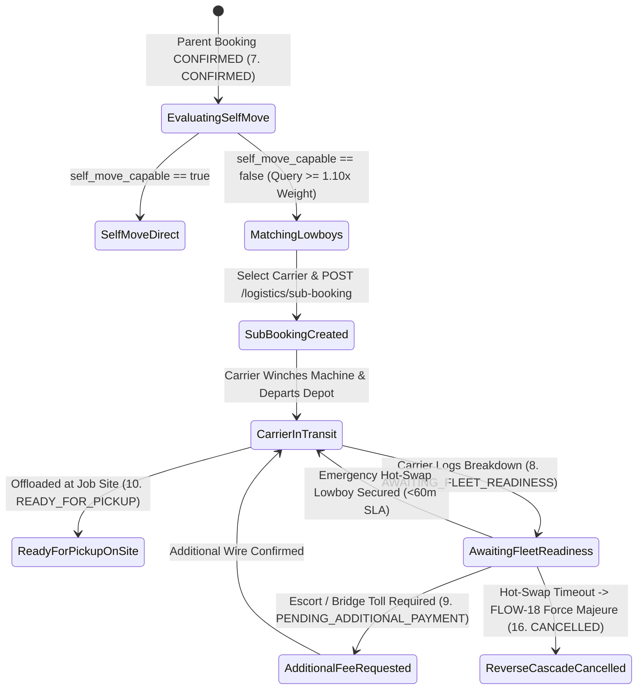
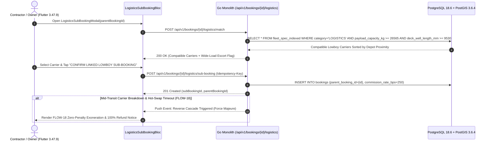

# Linked Logistics Transport Sub-Booking & Reverse Cascade Modal
## Mobile Subsystem Specification — `docs/mobile/renter-experience/10-logistics-sub-booking-modal.md`

**Document Identifier:** `SPEC-MOB-RNT-10`  
**Classification:** Canonical Subsystem UI/UX & Technical Behavior Specification  
**Governing Documents:** `Dink_Machinery_UI_UX_Design_Brief.md`, `SRS-DINK-CORE-V7.0` (`docs/shared/requirements/05-08-logistics-transport-integration.md`, `05-05-booking-reservation-flow.md`), `docs/shared/design/design-tokens.json`, `docs/ERROR_CATALOG.md`, `contracts/openapi.yaml`  
**Target Subsystem:** Flutter 3.47.9 / Dart 3.9 Mobile Client (iOS & Android)  
**Primary Persona / Actor:** Civil Engineering Contractor (*Dawit Haile-Mariam* / *Patrick Kariuki*), Equipment Fleet Owner (*W/ro Almaz Tesfaye* / *Kamau Ndegwa*)  
**Associated Requirements:** `REQ-05-08` (`LG-01`..`LG-08`, `FL-28`..`FL-31`), `REQ-05-05` (§8.1 `ParentBookingID`, §8.2 `AWAITING_FLEET_READINESS`, §8.3 Reverse Cancellation Cascade)  
**Associated Interaction Flows:** `FLOW-11` (`FLOW-LOGISTICS-DINK-CORE-V7.0`), `FLOW-18` (`FLOW-REVERSE-CASCADE-DINK-CORE-V7.0`)  
**Architectural Decisions:** `ADR-002` (`FleetSpecIndexed` Tonnage & Deck Matching), `ADR-008` (`LOC-01-BE` KeNHA / ERA Axle & Wide-Load Rules), `ADR-010` (2.5% Pass-Through Freight Commission & Non-Custodial Settlement)  
**Status:** Approved Technical Design Baseline

---

## 1. Domain Context, Business Formulas & Architectural Invariants

Steel-tracked excavators, bulldozers, vibratory compactors, and pavers (`self_move_capable == false`) cannot legally or mechanically drive on paved highways; they require multi-axle lowboy or step-deck haulage (`REQ-05-08`). The **Linked Logistics Transport Sub-Booking & Reverse Cascade Modal (`LogisticsSubBookingModal`)** coordinates heavy haulage bound via `bookings.parent_booking_id` (`FL-31`), tracks mobilization readiness (`8. AWAITING_FLEET_READINESS`), and surfaces **Force Majeure Reverse Cancellation Cascades (`FLOW-18`)** if a carrier breaks down mid-transit without a viable hot-swap.

### 1.1 Volumetric & Tonnage Matching Formulas (`FL-29` / `LG-02`)
1. **110% Payload Safety Margin & Deck Envelope Formula (`REQ-05-08 §3.3`):**
   Given a parent machine with operating weight $W_{\text{machine\_kg}}$ (plus bundled attachments $\sum W_{\text{att\_kg}}$), transport length $L_{\text{machine\_mm}}$, and width $B_{\text{machine\_mm}}$, a candidate Lowboy Carrier $c$ in `fleet_spec_indexed` (`category = 'LOGISTICS'`) is compatible if and only if:
   $$c.\text{payload\_capacity\_kg} \ge \left\lceil 1.10 \times \left(W_{\text{machine\_kg}} + \sum W_{\text{att\_kg}}\right) \right\rceil$$
   $$\land \quad c.\text{deck\_well\_length\_mm} \ge L_{\text{machine\_mm}} \quad \land \quad c.\text{deck\_width\_mm} + c.\text{outigger\_extension\_mm} \ge B_{\text{machine\_mm}}$$
2. **Abnormal Wide-Load Escort Flag (`REQ-05-08 §3.4`):**
   If $B_{\text{machine\_mm}} > 2,550\text{ mm}$ (standard highway lane width threshold under Ethiopian FTA / Kenyan KeNHA regulations) or gross combination mass $> 48,000\text{ kg}$, the modal automatically flags `REQUIRES_WIDE_LOAD_ESCORT_VEHICLE` and itemizes the permit/escort fee (`9. PENDING_ADDITIONAL_PAYMENT` if raised mid-mobilization).
3. **Pass-Through Freight Commission Discount (`REQ-05-08 §4.4`):**
   Linked transport sub-bookings (`parent_booking_id IS NOT NULL`) incur a discounted **$2.5\%$ ($250\text{ bps}$) platform administrative fee** instead of the standard $10.0\%$ machinery commission, preventing double-commission compounding on mobilization.
4. **Reverse Failure Cascade & Force Majeure Exoneration (`FLOW-18` / `LG-08`):**
   If the assigned Lowboy Carrier logs an unrecoverable mechanical breakdown (`TRANSSHIPMENT_REQUIRED`), the parent machinery booking transitions to **`8. AWAITING_FLEET_READINESS`**, pausing the rental start clock while a 60-minute emergency hot-swap radar searches for a replacement lowboy within $50\text{ km}$. If no replacement is secured before SLA expiry:
   - Child sub-booking transitions to `CANCELLED_CARRIER_DEFAULT`.
   - Parent machinery booking transitions to `16. CANCELLED (Force Majeure —FLOW-18)`.
   - Both Contractor and Equipment Owner are **100% exonerated from bilateral cancellation penalties**, the Owner returns 100% of the machinery prepayment wire, and the Owner's commission wallet receives an automatic restitution credit.

---

## 2. Screen Anatomy & Bespoke ASCII Wireframe

```text
+-----------------------------------------------------------------------+
| [✕ Close]    LINKED LOWBOY TRANSPORT & MOBILIZATION (FLOW-11)         |
|-----------------------------------------------------------------------|
| 🔗 Parent Booking: #DINK-BK-8841 (CAT 320D2 L + Soosan Breaker)       |
| ⚖️ Total Cargo Mass: 24,150 kg (110% Safety Floor: >= 26,565 kg Req.) |
| 📏 Cargo Envelope:   L: 9,530 mm × W: 2,980 mm × H: 3,160 mm          |
| ⚠️ WIDE LOAD (>2,550mm): Outriggers + ERA/KeNHA Escort Permit Active  |
|=======================================================================|
| 🚛 1. COMPATIBLE LOWBOY CARRIERS NEAR MOJO DEPOT (LG-02)              |
| +-------------------------------------------------------------------+ |
| | (•) [🟢 COMPATIBLE • 3.2 km from Depot]     [2.5% Freight Fee Tier]| |
| |     Sinotruk HOWO 371 + 3-Axle 45-Ton Hydraulic Gooseneck Lowboy   | |
| |     Carrier: Girma Heavy Haulage • ⭐ 4.95 (88 Runs) • Deck: 11.5m | |
| |     Est. Haulage (Mojo -> Lot 2 KM 44):       ETB 18,500.00 (Flat) | |
| |-------------------------------------------------------------------| |
| | ( ) [🟢 COMPATIBLE • 9.8 km from Depot]                           | |
| |     Mercedes Actros 3340 + 4-Axle 60-Ton Lowbed (Deck: 12.0m)     | |
| |     Est. Haulage (Mojo -> Lot 2 KM 44):       ETB 22,000.00 (Flat) | |
| +-------------------------------------------------------------------+ |
|=======================================================================|
| 📡 2. LIVE MOBILIZATION & TRANSSHIPMENT STATUS (8. AWAITING_READINESS)|
| +-------------------------------------------------------------------+ |
| | 🟠 STATUS: 8. AWAITING_FLEET_READINESS (Roadside Transshipment)   | |
| | Carrier #1 logged hydraulic ramp failure at KM 19 (Bishoftu Bypass)| |
| | ⏱️ Rental Clock Frozen: You are NOT billed for transit delay.     | |
| | 🔄 Emergency Hot-Swap SLA: Searching 50km radius (38:12 remaining)| |
| |-------------------------------------------------------------------| |
| | 🚨 IF HOT-SWAP FAILS (FLOW-18 REVERSE CASCADE GUARANTEE):         | |
| | Parent Booking #DINK-BK-8841 cancels under Force Majeure with     | |
| | ZERO penalty to you and 100% wire refund obligation.              | |
| +-------------------------------------------------------------------+ |
|=======================================================================|
| [   🔗 CONFIRM LINKED LOWBOY SUB-BOOKING (64dp Primary CTA)         ] |
+-----------------------------------------------------------------------+
```

---

## 3. W3C DTCG Design Token Mapping Table

| UI Component / Element | W3C DTCG Token Path | Resolved Value (Light / Outdoor High-Contrast) | Ergonomic & Behavioral Mandate |
|---|---|---|---|
| **Cargo Envelope Spec Card** | `color.brand.slate.900` + `typography.fontFamily.mono` | `#0F172A` surface, `#F8FAFC` `Space Mono` `14sp` | Displays exact `kg` (with 110% safety floor) and `mm` dimensions. |
| **Wide Load Escort Badge** | `color.feedback.orange.500` + `color.brand.amber.50` | `#FF5722` border/icon on `#FFFBEB` container | Triggered automatically when $B_{\text{machine}} > 2550\text{ mm}$. |
| **Awaiting Readiness Alert** | `component.countdown.holdUrgentBg` / `holdUrgentText` | `#FFF7ED` fill, `#C2410C` text, `2dp` `#F59E0B` border | Reassures contractor that the rental shift clock is frozen during transit delay. |
| **Reverse Cascade Guarantee** | `color.feedback.crimson.50` + `color.feedback.crimson.700` | `#FEF2F2` container, `#B91C1C` text | Explains `FLOW-18` Force Majeure zero-penalty protection if transshipment fails. |
| **Primary Sub-Booking CTA** | `component.actuator.button.heightField` / `action.primary.bg` | `64dp` height, `#F59E0B` (`3dp` bottom lip) | Instantiates child booking with `parentBookingId` and `Idempotency-Key`. |

---

## 4. Screen State Machine & Sequence Diagrams

### 4.1 Linked Sub-Booking & Reverse Cascade State Machine


### 4.2 Dimensional Matching & `FLOW-18` Reverse Failure Cascade Sequence


---

## 5. Concrete Flutter Implementation Blueprint

### 5.1 BLoC Events & Freezed States (`logistics_sub_booking_bloc.dart`)
```dart
import 'package:freezed_annotation/freezed_annotation.dart';

part 'logistics_sub_booking_bloc.freezed.dart';

@freezed
sealed class LogisticsSubBookingEvent with _$LogisticsSubBookingEvent {
  const factory LogisticsSubBookingEvent.initialized({
    required String parentBookingId,
  }) = _Initialized;

  const factory LogisticsSubBookingEvent.carrierSelected({
    required String carrierFleetId,
  }) = _CarrierSelected;

  const factory LogisticsSubBookingEvent.externalTransportDeclared({
    required String truckPlateNumber,
    required String driverFullName,
    required DateTime estimatedArrivalUtc,
  }) = _ExternalTransportDeclared;

  const factory LogisticsSubBookingEvent.subBookingSubmitted() = _SubBookingSubmitted;

  const factory LogisticsSubBookingEvent.hotSwapRetryRequested() = _HotSwapRetryRequested;
}

@freezed
abstract class LogisticsSubBookingState with _$LogisticsSubBookingState {
  const factory LogisticsSubBookingState({
    @Default(LogisticsModalStatus.loadingMatches) LogisticsModalStatus status,
    required String parentBookingId,
    required String parentBookingStatus, // 'CONFIRMED' | 'AWAITING_FLEET_READINESS' | 'PENDING_ADDITIONAL_PAYMENT' | 'CANCELLED'
    required CargoDimensionalProfileDto cargoProfile,
    @Default(<CompatibleLowboyCarrierDto>[]) List<CompatibleLowboyCarrierDto> compatibleCarriers,
    String? selectedCarrierFleetId,
    LinkedSubBookingSummaryDto? activeSubBooking,
    TransshipmentIncidentDto? activeIncident, // Populated during 8. AWAITING_FLEET_READINESS
    ReverseCascadeExonerationDto? reverseCascadeCertificate, // Populated on FLOW-18
    ProblemDetails? error,
  }) = _LogisticsSubBookingState;
}
```

### 5.2 Isar Linked Sub-Booking Cache (`isar_logistics_sub_booking.dart`)
```dart
import 'package:isar/isar.dart';

part 'isar_logistics_sub_booking.g.dart';

@collection
class IsarLogisticsSubBooking {
  Id id = Isar.autoIncrement;

  @Index(unique: true, replace: true)
  late String parentBookingId;

  String? childSubBookingId;
  late String parentStatus;
  late int requiredPayloadWithMarginKg;
  late int cargoLengthMm;
  late int cargoWidthMm;
  late bool requiresWideLoadEscort;
  String? assignedCarrierTitle;
  int? agreedFreightRateMinor;
  late String currencyCode;
  String? transshipmentIncidentJson;
  late DateTime updatedAt;
}
```

### 5.3 Widget Tree Hierarchy
```text
LogisticsSubBookingModal (Scaffold / ModalSheet)
 ├── AppBar ("Linked Lowboy Transport & Mobilization")
 ├── SingleChildScrollView (Padding: 16dp)
 │    ├── CargoTonnageAndEnvelopeCard (Shows 110% safety floor & Wide-Load Escort badge)
 │    ├── CompatibleLowboyCarriersList (LG-02)
 │    │    └── LowboyCarrierRadioCard (Shows 2.5% Freight Fee badge, Deck m, Payload T, Rate)
 │    ├── ExternalPrivateTransportAccordion (FL-31 Pathway B option)
 │    ├── AwaitingFleetReadinessIncidentCard (Visible when parentStatus == AWAITING_FLEET_READINESS)
 │    │    ├── FrozenRentalClockAssuranceBanner
 │    │    └── HotSwapRadarCountdownBar (60-minute transshipment SLA)
 │    └── ReverseCascadeForceMajeureCertificateCard (Visible when FLOW-18 triggers)
 └── StickyBottomSubBookingBar
      └── ConfirmLinkedLowboyButton (64dp height CTA)
```

---

## 6. OpenAPI 3.1.0 Routes & RFC 9457 Error Matrix

### 6.1 Endpoint Specifications
- **`POST /api/v1/bookings/{id}/logistics/match`**
  - **Response (`200 OK`):** Returns `cargoProfile` (`grossMassKg`, `requiredPayloadKg`, `requiresWideLoadEscort`) and `compatibleCarriers[]`.
- **`POST /api/v1/bookings/{id}/logistics/sub-booking`**
  - **Headers:** `Idempotency-Key: <uuid-v4>`.
  - **Request Body:** `{ "carrierFleetId": "uuid", "includeWideLoadEscort": true }`.
- **`POST /api/v1/bookings/{id}/logistics/reverse-cascade`** (`FLOW-18`)
  - **Response (`200 OK`):** Executes atomic Force Majeure cancellation of parent & child bookings with zero penalty and commission restitution.

### 6.2 RFC 9457 Problem Details Matrix
| Error Code | HTTP Status | RFC 9457 Type URI | Retryable | Mobile UI Remediation & Recovery Action |
|---|---|---|---|---|
| `FLEET_ATTACHMENT_UNSUPPORTED` / Payload Exceeded | `422` | `/errors/logistics-payload-insufficient` | No | Carrier payload $< 1.10 \times W_{\text{cargo}}$; filter out carrier and select next higher axle class (`4-Axle 60T`). |
| `BOOKING_DATES_UNAVAILABLE` | `409` | `/errors/booking-dates-unavailable` | No | Selected lowboy was just dispatched to another job; refresh carrier list. |
| `BOOKING_INVALID_STATE_TRANSITION` | `409` | `/errors/booking-invalid-state` | No | Reload parent booking state (`8. AWAITING_FLEET_READINESS` vs `10. READY_FOR_PICKUP`). |

---

## 7. Verification & Acceptance Criteria

- [ ] **110% Payload Safety Margin (`FL-29`):** Unit test verifies a $22,400\text{ kg}$ excavator + $1,750\text{ kg}$ rock breaker ($24,150\text{ kg}$ total) requires a minimum lowboy capacity of $\lceil 24,150 \times 1.10 \rceil = 26,565\text{ kg}$, excluding 25-ton trailers.
- [ ] **2.5% Pass-Through Commission Display (`REQ-05-08 §4.4`):** Sub-booking summary explicitly badges the `2.5% (250 bps)` linked freight fee tier.
- [ ] **`FLOW-18` Reverse Failure Cascade Alert:** Simulating a carrier breakdown timeout transitions the UI to the Force Majeure Exoneration certificate confirming `penaltyMinor == 0` and 100% wire refund obligation.
