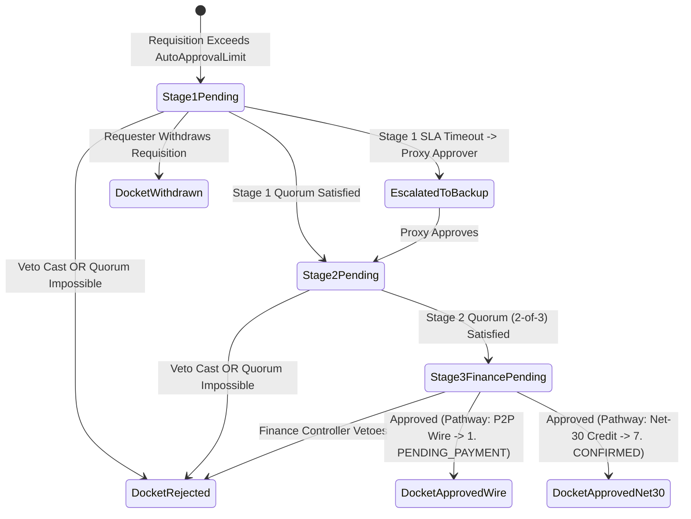
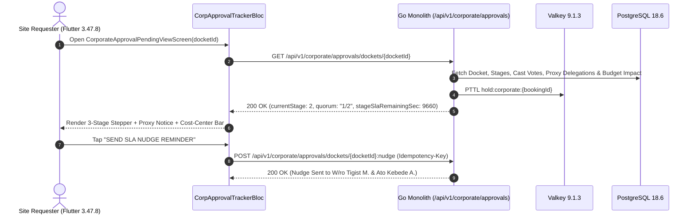

# Corporate Requisition Approval Pending & Multi-Stage Chain Tracker
## Mobile Subsystem Specification — `docs/mobile/renter-experience/11-corporate-approval-pending-view.md`

**Document Identifier:** `SPEC-MOB-RNT-11`  
**Classification:** Canonical Subsystem UI/UX & Technical Behavior Specification  
**Governing Documents:** `Dink_Machinery_UI_UX_Design_Brief.md`, `SRS-DINK-CORE-V7.0` (`docs/shared/requirements/06-02-corporate-approval-workflows.md`, `06-01-corporate-account-management.md`), `docs/shared/design/design-tokens.json`, `docs/ERROR_CATALOG.md`, `contracts/openapi.yaml`  
**Target Subsystem:** Flutter 3.47.8 / Dart 3.9 Mobile Client (iOS & Android)  
**Primary Persona / Actor:** Corporate Site Quantity Surveyor / Requester (*Bethlehem Tessema*), Senior Project Manager (*Dawit Haile-Mariam*)  
**Associated Requirements:** `REQ-06-02` (`CA-01`..`CA-08`, `APPR-01`..`APPR-03`), `REQ-06-01` (`CORP-02` `AutoApprovalLimit`, Four-Eyes Separation of Duties)  
**Associated Interaction Flows:** `FLOW-14` (Corporate Multi-Stage Approval Pipeline), `FLOW-07` (Transition from Corporate Hold to `1. PENDING_PAYMENT` or `7. CONFIRMED` on Net-30)  
**Architectural Decisions:** `ADR-005` (Valkey 48h Corporate Hold Lease `hold:corporate:{booking_id}`), `ADR-010` (Integer Minor Units)  
**Status:** Approved Technical Design Baseline

---

## 1. Domain Context, Business Formulas & Architectural Invariants

When a Corporate Requester (*Bethlehem Tessema*) submits a machinery requisition whose total contract commitment exceeds their assigned `AutoApprovalLimit` (`CORP-02`), the booking does not immediately enter `1. PENDING_PAYMENT`. Instead, it initializes a **Corporate Approval Docket (`corporate_approval_dockets`)** in state **`AWAITING_CORP_APPROVAL`** (`CA-01`..`CA-08` / `FLOW-14`). The **Corporate Approval Pending & Multi-Stage Chain Tracker (`CorporateApprovalPendingViewScreen`)** provides the site requester with real-time visibility into the sequential approval stages, quorum voting progress, SLA timers, cost-center budget impact, and escalation controls.

### 1.1 Governance Formulas & Architectural Invariants
1. **Four-Eyes Separation of Duties (`REQ-06-02 §1.2` / `CA-04`):**
   $$\text{ApproverUserID} \neq \text{RequesterUserID}$$
   Even if the submitting requester also holds an Approver role within Stage 1, the system disqualifies them from voting on their own requisition docket and routes the task to peer approvers in the group.
2. **Stage Quorum & Weighted Vote Resolution (`APPR-02` / `CA-05`):**
   Each stage $s \in \{1, 2, 3\}$ evaluates its quorum rule (`UNANIMOUS`, `N_OF_M`, or `WEIGHTED_PERCENTAGE` $\ge \tau\%$):
   $$\mathcal{Q}_s = \frac{\sum_{v \in \text{ApprovedVotes}(s)} w_v}{\sum_{m \in \text{EligibleMembers}(s)} w_m} \ge \tau_s \quad \land \quad \neg\exists\, v \in \text{RejectedVotes}(s) : v.\text{has\_veto\_power} = \text{true}$$
   If an executive with `has_veto_power == true` (e.g., Finance Controller *Solomon Kassa*) casts a `REJECT` vote, the entire docket terminates immediately as `REJECTED`.
3. **Corporate Reservation Lease & Stage SLA Escalation (`APPR-03` / `CA-06`):**
   While the docket is active, Valkey holds a corporate lease (`hold:corporate:{booking_id}`) bounded by each stage's SLA countdown (e.g., `4 Hours` per stage). If a stage approver fails to act within the SLA window, the backend automatically escalates to the designated backup/proxy approver (`delegated_to_user_id`).
4. **Post-Approval Settlement Routing (`CA-08`):**
   Once the final stage achieves quorum (`DocketState == APPROVED`):
   - If the requisition uses **Phase 1 Direct P2P Bank Wire**, the booking advances to `1. PENDING_PAYMENT` and notifies the Corporate Finance team to wire funds within 60 minutes.
   - If the requisition uses **Phase 2 Corporate Net-30 Credit Line** (`REQ-06-03`), the booking binds the Purchase Order (`PO#`), encumbers the credit facility ($\mathcal{C}_{\text{utilized}} += M_{\text{total}}$), and transitions directly to `7. CONFIRMED`.

---

## 2. Screen Anatomy & Bespoke ASCII Wireframe

```text
+-----------------------------------------------------------------------+
| [<- Back]      CORPORATE REQUISITION DOCKET (#REQ-2026-0419)          |
|-----------------------------------------------------------------------|
| 🏢 Organization: SUR CONSTRUCTION PLC • Site: Modjo–Hawassa Lot 2     |
| 🏷️ Cost Center:  CC-204 (Earthworks)  • PO Ref: PO-2026-881           |
|=======================================================================|
| 🟡 STATUS: AWAITING_CORP_APPROVAL (Stage 2 of 3 In Progress)          |
| +-------------------------------------------------------------------+ |
| | 🔒 Corporate Machine Hold Active • Stage 2 SLA: 02h 41m Remaining | |
| | 🚜 CAT 320D2 L + Soosan Breaker • 8 Days (Oct 30 – Nov 06, 2026)  | |
| | 💰 Total Commitment (Incl. 15% VAT):              ETB 301,024.00  | |
| | 📊 Cost-Center CC-204 Budget After Req: 68.4% Used (Within Limit) | |
| +-------------------------------------------------------------------+ |
|=======================================================================|
| ⛓️ MULTI-STAGE APPROVAL CHAIN TRACKER (CA-02 / APPR-03)               |
| +-------------------------------------------------------------------+ |
| | ✅ STAGE 1: SITE TECHNICAL FIT REVIEW (Quorum: 1-of-1 • PASSED)   | |
| |    • Eng. Dawit Haile-Mariam (Senior Site PM)                     | |
| |      Voted: APPROVED (Oct 29, 13:18 EAT) • Signature: #8f91a2...  | |
| |      Note: "22.4T weight & 6.7m dig depth verified for culvert."  | |
| |-------------------------------------------------------------------| |
| | ⏳ STAGE 2: COMMERCIAL PROCUREMENT QUORUM (Quorum: 2-of-3 • 1/2)  | |
| |    • [✅ Approved] Ato Girma T. (Procurement Officer) — 13:42 EAT | |
| |    • [⏳ Pending ] Eng. Samuel Getachew (Procurement Director)    | |
| |      🔄 Out-of-Office Proxy Active -> Routed to W/ro Tigist M.    | |
| |    • [⏳ Pending ] Ato Kebede A. (Senior QS)                      | |
| |    [ 🔔 SEND SLA NUDGE REMINDER TO STAGE 2 APPROVERS (48dp) ]     | |
| |-------------------------------------------------------------------| |
| | 🔒 STAGE 3: FINANCE CONTROLLER & CREDIT SIGN-OFF (Veto Authority) | |
| |    • [🔒 Queued  ] Solomon Kassa (Finance Controller • Net-30 PO) | |
| +-------------------------------------------------------------------+ |
|=======================================================================|
| 📎 ATTACHED PROCUREMENT JUSTIFICATION ARTIFACTS                       |
| | [📄 Side-by-Side Comparison Matrix.pdf]  [📄 Site BOQ Extract.pdf]| |
|=======================================================================|
| [   ✏️ AMEND PO / COST CENTER   ]   [  ✕ WITHDRAW DOCKET (56dp)   ]   |
+-----------------------------------------------------------------------+
```

---

## 3. W3C DTCG Design Token Mapping Table

| UI Component / Element | W3C DTCG Token Path | Resolved Value (Light / Outdoor High-Contrast) | Ergonomic & Behavioral Mandate |
|---|---|---|---|
| **Completed Stage Node (`✅`)** | `color.feedback.emerald.500` + `color.feedback.emerald.50` | `#10B981` node icon on `#ECFDF5` card tint | Displays immutable vote timestamp, cryptographic hash snippet, and approver note. |
| **Active Stage Node (`⏳`)** | `color.brand.amber.500` + `color.brand.amber.50` | `#F59E0B` pulsing ring on `#FFFBEB` card tint | Shows live Stage SLA countdown (`02h 41m`) and `N-of-M` quorum progress bar. |
| **Locked Future Stage (`🔒`)** | `color.brand.slate.400` + `color.brand.slate.100` | `#94A3B8` icon on `#F1F5F9` muted card | Clearly badges any approver holding `has_veto_power` (`Veto Authority`). |
| **Proxy Delegation Pill (`🔄`)** | `color.feedback.blue.500` + `color.feedback.blue.50` | `#3B82F6` text on `#EFF6FF` pill | Surfaces active Out-of-Office delegation (`APPR-03 §5.4`). |
| **Send SLA Nudge Button** | `dimension.space.48` + `color.brand.slate.800` | `48dp` height button; rate-limited 1 nudge per 60 mins | Dispatches push/SMS reminder to pending Stage $s$ approvers. |

---

## 4. Screen State Machine & Sequence Diagrams

### 4.1 Corporate Approval Docket Lifecycle State Machine


### 4.2 Multi-Stage Vote Evaluation & SLA Nudge Sequence


---

## 5. Concrete Flutter Implementation Blueprint

### 5.1 BLoC Events & Freezed States (`corp_approval_tracker_bloc.dart`)
```dart
import 'package:freezed_annotation/freezed_annotation.dart';

part 'corp_approval_tracker_bloc.freezed.dart';

@freezed
sealed class CorpApprovalTrackerEvent with _$CorpApprovalTrackerEvent {
  const factory CorpApprovalTrackerEvent.started({
    required String docketId,
  }) = _Started;

  const factory CorpApprovalTrackerEvent.slaTicked() = _SlaTicked;

  const factory CorpApprovalTrackerEvent.nudgeApproversRequested({
    required int stageIndex,
  }) = _NudgeApproversRequested;

  const factory CorpApprovalTrackerEvent.costCenterOrPoAmended({
    required String newCostCenterId,
    required String newPoNumber,
  }) = _CostCenterOrPoAmended;

  const factory CorpApprovalTrackerEvent.docketWithdrawn({
    required String withdrawalReason,
  }) = _DocketWithdrawn;
}

@freezed
abstract class CorpApprovalTrackerState with _$CorpApprovalTrackerState {
  const factory CorpApprovalTrackerState({
    @Default(DocketLoadStatus.loading) DocketLoadStatus status,
    CorporateApprovalDocketDto? docket,
    @Default(0) int currentStageSlaRemainingSeconds,
    DateTime? lastNudgeSentAt,
    @Default(false) bool isMutating,
    ProblemDetails? error,
  }) = _CorpApprovalTrackerState;
}
```

### 5.2 Isar Cached Corporate Approval Docket (`isar_corporate_docket.dart`)
```dart
import 'package:isar/isar.dart';

part 'isar_corporate_docket.g.dart';

@collection
class IsarCorporateDocket {
  Id id = Isar.autoIncrement;

  @Index(unique: true, replace: true)
  late String docketId;

  @Index()
  late String organizationId;

  late String bookingId;
  late String docketState; // 'PENDING_APPROVAL' | 'APPROVED' | 'REJECTED' | 'WITHDRAWN'
  late int currentStageIndex;
  late int totalStagesCount;
  late int totalCommitmentMinor;
  late String currencyCode;
  late String costCenterCode;
  String? purchaseOrderNumber;
  late String stagesTimelineJson;
  late DateTime stageSlaExpiresAtUtc;
  late DateTime syncedAt;
}
```

### 5.3 Widget Tree Hierarchy
```text
CorporateApprovalPendingViewScreen (Scaffold)
 ├── AppBar ("Corporate Requisition #REQ-2026-0419")
 ├── SingleChildScrollView (Padding: 16dp)
 │    ├── OrganizationAndCostCenterHeaderBanner
 │    ├── DocketHoldAndBudgetImpactCard
 │    │    ├── StageSlaCountdownRow (Space Mono timer)
 │    │    ├── TotalCommitmentLedgerRow (Minor units)
 │    │    └── CostCenterBudgetUtilizationBar ("68.4% Used After Requisition")
 │    ├── MultiStageApprovalTimelineStepper (CA-02 / APPR-03)
 │    │    ├── CompletedStageCard (Stage 1 + Cryptographic Vote Signature)
 │    │    ├── ActiveQuorumStageCard (Stage 2 + Proxy Routing Pill + Nudge CTA)
 │    │    └── QueuedFutureStageCard (Stage 3 + Veto Authority Tag)
 │    └── AttachedJustificationArtifactsCard (Comparison Matrix PDF, Site BOQ)
 └── StickyBottomRequesterActionsBar
      ├── AmendCostCenterOrPoButton (56dp height)
      └── WithdrawRequisitionDocketButton (56dp height destructive outline)
```

---

## 6. OpenAPI 3.1.0 Routes & RFC 9457 Error Matrix

### 6.1 Endpoint Specifications
- **`GET /api/v1/corporate/approvals/dockets/{id}`**
  - **Headers:** `X-Organization-ID: <uuid>`, `X-Country-Code: ET | KE`.
  - **Response (`200 OK`):** Full `CorporateApprovalDocketDto` with stages, quorum counters, proxy delegations, and cost-center budget utilization.
- **`POST /api/v1/corporate/approvals/dockets/{id}:nudge`**
  - **Headers:** `Idempotency-Key: <uuid-v4>`.
- **`POST /api/v1/corporate/approvals/dockets/{id}:withdraw`**
  - **Headers:** `Idempotency-Key: <uuid-v4>`.

### 6.2 RFC 9457 Problem Details Matrix
| Error Code | HTTP Status | RFC 9457 Type URI | Retryable | Mobile UI Remediation & Recovery Action |
|---|---|---|---|---|
| `AUTH_INSUFFICIENT_PERMISSIONS` | `403` | `/errors/insufficient-permissions` | No | Enforce RLS tenant isolation (`organization_id`); redirect if user switched out of corporate context. |
| `SYS_RATE_LIMIT_EXCEEDED` | `429` | `/errors/rate-limit-exceeded` | Yes | Nudge cooldown active (max 1 nudge per 60 minutes per stage); disable nudge button and show remaining cooldown. |
| `BOOKING_INVALID_STATE_TRANSITION` | `409` | `/errors/booking-invalid-state` | No | Docket was already finalized (`APPROVED` or `REJECTED`); reload state and transition to next screen. |

---

## 7. Verification & Acceptance Criteria

- [ ] **Four-Eyes Self-Approval Disqualification (`REQ-06-02 §1.2`):** The Requester viewing `CorporateApprovalPendingViewScreen` never sees an "Approve" button on their own docket, even if their corporate membership includes `APPROVER` privileges.
- [ ] **Out-of-Office Proxy Visibility (`APPR-03 §5.4`):** When an assigned stage approver has active OOO delegation, the stage card explicitly renders `Routed to <Proxy Name>` so the site requester knows who holds the active signing baton.
- [ ] **Dual Settlement Completion Routing (`CA-08`):** Test verifies that final approval of a `P2P_BANK_WIRE` docket transitions to `08-60-minute-hold-timer.md`, whereas final approval of a `CORPORATE_NET30` docket transitions directly to `7. CONFIRMED`.
