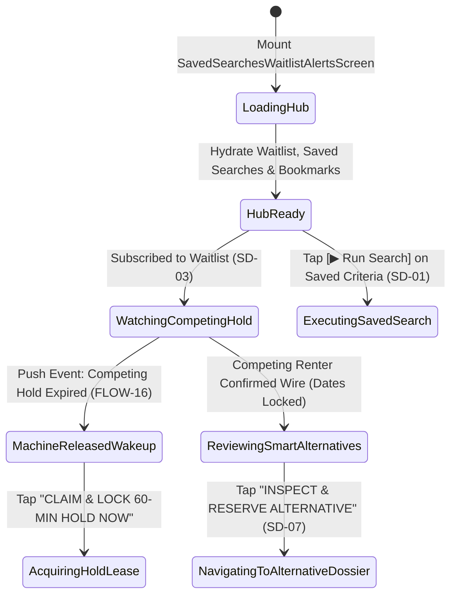

# Saved Searches, Standby Waitlist Alerts & Smart Alternatives
## Mobile Subsystem Specification — `docs/mobile/renter-experience/12-saved-searches-waitlist-alerts.md`

**Document Identifier:** `SPEC-MOB-RNT-12`  
**Classification:** Canonical Subsystem UI/UX & Technical Behavior Specification  
**Governing Documents:** `Dink_Machinery_UI_UX_Design_Brief.md`, `SRS-DINK-CORE-V7.0` (`docs/shared/requirements/05-15-search-discovery-enhancements.md`, `05-04-fleet-discovery-search-comparison.md`, `05-10-notifications-in-app-center.md`), `docs/shared/design/design-tokens.json`, `docs/ERROR_CATALOG.md`, `contracts/openapi.yaml`  
**Target Subsystem:** Flutter 3.44 / Dart 3.9 Mobile Client (iOS & Android)  
**Primary Persona / Actor:** Civil Engineering Contractor (*Dawit Haile-Mariam* / *Patrick Kariuki*), Corporate Procurement Officer  
**Associated Requirements:** `REQ-05-15` (`SD-01`..`SD-07`, §6.1 Persistent Saved Searches, §6.2 Availability Standby Queue & Push Re-Engagement), `REQ-05-10` (Push & SMS Alert Dispatch)  
**Associated Interaction Flows:** `FLOW-04` (`FLOW-DISCOVERY-DINK-CORE-V7.0`), `FLOW-15` / `FLOW-16` (Hold Eviction Standby Wakeup)  
**Architectural Decisions:** `ADR-002` (`fleet_spec_indexed` Similarity Matching), `ADR-005` (Valkey Hold Expiry Event Hook), `ADR-010` (Integer Minor Units & Offline Bookmarking)  
**Status:** Approved Technical Design Baseline

---

## 1. Domain Context, Business Formulas & Architectural Invariants

High-demand specialized machinery (e.g., *35-Ton Long-Reach Excavators*, *160kW Motor Graders*, *60-Ton Lowboy Transporters*) is frequently held in 60-minute checkout locks or booked out along major highway corridors. Rather than forcing contractors to repeatedly poll the app, the **Saved Searches, Standby Waitlist Alerts & Smart Alternatives Hub (`SavedSearchesWaitlistAlertsScreen`)** implements requirements `SD-01` through `SD-07` (`REQ-05-15 §6`):
1. **Persistent Saved Search Criteria & New-Listing Match Alerts (`SD-01` / `SD-02`):** Stores complex spatial + parametric EAV filter combinations (`corridorId`, `radiusKm`, `operatingWeightKg`, `rateMode`, `attachmentCodes`) and dispatches push/SMS alerts within $< 30\text{ seconds}$ when a newly verified machine enters the matching envelope.
2. **"Notify Me When Available" Standby Waitlist Queue (`SD-03` / `SD-04`):** When a target machine is `HELD_PENDING_WIRE` or booked on overlapping dates (`BOOKING_DATES_UNAVAILABLE`), contractors can subscribe to its FIFO standby queue. The instant a 60-minute Valkey hold expires without wire upload (`FLOW-16`) or a booking cancels, the platform fires a high-priority **"Machine Released — Lock Now"** deep-link alert.
3. **Bookmarked Fleets & Offline Recently Viewed History (`SD-05` / `SD-06`):** Synchronizes bookmarked machines across devices while keeping the last 50 viewed fleet dossiers in local Isar storage for zero-connectivity site review.
4. **Smart Alternative Machine Recommendations on Date Conflict (`SD-07`):** When `409 BOOKING_DATES_UNAVAILABLE` occurs, computes a deterministic similarity score against available machines in the same taxonomy category:
   $$\text{Similarity}(f_{\text{target}}, f_{\text{cand}}) = 1 - \left(0.45 \frac{|W_{\text{target}} - W_{\text{cand}}|}{W_{\text{target}}} + 0.35 \frac{d(f_{\text{target}}, f_{\text{cand}})}{50\text{ km}} + 0.20 \frac{|R_{\text{target}} - R_{\text{cand}}|}{R_{\text{target}}}\right)$$

---

## 2. Screen Anatomy & Bespoke ASCII Wireframe

```text
+-----------------------------------------------------------------------+
| [<- Back]      SAVED SEARCHES, WAITLIST & BOOKMARKS                   |
|-----------------------------------------------------------------------|
| [ 🔔 Standby Waitlist (2) ] [ 🔍 Saved Searches (3) ] [ ❤️ Saved (8) ]|
|=======================================================================|
| ⚡ 1. LIVE STANDBY WAITLIST QUEUE (SD-03 / SD-04)                     |
| +-------------------------------------------------------------------+ |
| | [🟢 JUST RELEASED! 60-Min Hold Expired • Lock Within 10 Mins]     | |
| | Komatsu D85EX-15 Bulldozer (28.0 Tons • Ripper Included)          | |
| | 📅 Target Dates: Oct 30 – Nov 06, 2026 • 📍 14.2 km (Adama Yard)  | |
| | 💰 Wet Rate: ETB 42,000.00 /day • Standby Rank: #1 of 3           | |
| | [     🔒 CLAIM & LOCK 60-MIN HOLD NOW (56dp Primary CTA)        ] | |
| +-------------------------------------------------------------------+ |
| +-------------------------------------------------------------------+ |
| | [🟡 WATCHING HOLD: 11m 40s left on competing checkout]   [🔕 Mute]| |
| | XCMGXE335C Crawler Excavator (33.8 Tons • High-Flow Breaker)      | |
| | 📅 Target Dates: Nov 02 – Nov 15, 2026 • 📍 8.9 km (Mojo Depot)   | |
| | 🔔 Alert Channel: [x] Push Notification  [x] SMS (+251 911 *** 82)| |
| +-------------------------------------------------------------------+ |
|=======================================================================|
| 🧠 2. SMART ALTERNATIVES AVAILABLE NOW FOR NOV 02 – NOV 15 (SD-07)    |
| (Matched within ±10% Operating Weight & <25 km of your Job Site)      |
| +-------------------------------------------------------------------+ |
| | [🟢 94% SPEC MATCH • AVAILABLE NOW]                     [⚖️ +Cmp] | |
| | Caterpillar 330D2 L Excavator (30.5 Tons • Breaker Piping Ready)  | |
| | 📍 11.4 km (Mojo Yard) • 💰 ETB 36,500.00 /day (Wet Rate)         | |
| | [        INSPECT & RESERVE ALTERNATIVE (56dp CTA)               ] | |
| +-------------------------------------------------------------------+ |
|=======================================================================|
| 🔍 3. SAVED CORRIDOR & PARAMETRIC SEARCH ALERTS (SD-01 / SD-02)       |
| +-------------------------------------------------------------------+ |
| | "Mojo-Hawassa 20T-35T Excavators + Rock Breaker"      [3 New! 🟢] | |
| | Corridor: A1/Modjo-Hawassa (±15km) • Wet Rate <= ETB 35,000/day   | |
| | Cadence: [Instant Push + Daily Digest]  [▶ Run Search]  [🗑️ Del]  | |
| +-------------------------------------------------------------------+ |
+-----------------------------------------------------------------------+
```

---

## 3. W3C DTCG Design Token Mapping Table

| UI Component / Element | W3C DTCG Token Path | Resolved Value (Light / Outdoor High-Contrast) | Ergonomic & Behavioral Mandate |
|---|---|---|---|
| **Just Released Alert Card** | `color.feedback.emerald.50` + `color.feedback.emerald.600` border | `#ECFDF5` container, `3dp` (`stroke.border.heavy`) `#059669` border | High-priority visual callout when a watched machine's hold expires (`SD-04`). |
| **Watching Hold Card** | `component.countdown.holdNormalBg` + `color.brand.amber.600` | `#FFFBEB` fill, `#D97706` border | Shows live countdown of the competing hold TTL. |
| **94% Spec Match Badge** | `color.feedback.blue.100` + `color.feedback.blue.900` | `#DBEAFE` pill, `#1E3A8A` `Space Mono` `12sp` Bold | Explains why the smart alternative (`SD-07`) was recommended. |
| **Tab Segment Control** | `dimension.space.56` (`56dp` height) | `#F59E0B` active indicator bar | Switches cleanly between Standby Waitlist, Saved Searches, and Bookmarks/History. |
| **Claim & Lock Now CTA** | `component.actuator.button.heightStandard` / `action.primary.bg` | `56dp` height, `#F59E0B` (`color.brand.amber.500`) | Deep-links directly into `07-checkout-price-breakdown.md` with pre-populated dates. |

---

## 4. Screen State Machine & Sequence Diagrams

### 4.1 Waitlist Subscription, Hold Eviction Wakeup & Smart Alternatives State Machine


### 4.2 Valkey Hold Eviction $\rightarrow$ Standby Waitlist Push Wakeup Sequence
```mermaid
sequenceDiagram
    autonumber
    actor RenterB as Standby Contractor B (Flutter 3.44)
    participant HubBloc as SavedSearchesWaitlistBloc
    participant API as Go Monolith (/api/v1/discovery)
    participant Valkey as Valkey 8.0 Keyspace Events
    participant PG as PostgreSQL 18.4

    RenterB->>HubBloc: Tap "Notify Me When Available" on Held Komatsu D85EX
    HubBloc->>API: POST /api/v1/discovery/waitlist {fleetId, startDate, endDate, notifySms: true}
    API->>PG: INSERT INTO fleet_waitlist_subscriptions (status='WATCHING')
    API-->>HubBloc: 201 Created (waitlistId, queuePosition: 1)
    Note over Valkey,API: 22 minutes later: Competing Renter A fails to upload wire slip; Valkey key expires
    Valkey-->>API: Keyspace Event: expired hold:fleet:{komatsuId}
    API->>PG: Query FIFO fleet_waitlist_subscriptions + Compute Smart Alternatives (SD-07)
    API-->>HubBloc: FCM Push + WebSocket: WAITLIST_ASSET_RELEASED (fleetId, targetDates)
    HubBloc-->>RenterB: Render Emerald "JUST RELEASED!" Card + 56dp "CLAIM & LOCK NOW" CTA
```

---

## 5. Concrete Flutter Implementation Blueprint

### 5.1 BLoC Events & Freezed States (`saved_searches_waitlist_bloc.dart`)
```dart
import 'package:freezed_annotation/freezed_annotation.dart';

part 'saved_searches_waitlist_bloc.freezed.dart';

@freezed
sealed class SavedSearchesWaitlistEvent with _$SavedSearchesWaitlistEvent {
  const factory SavedSearchesWaitlistEvent.initialized() = _Initialized;

  const factory SavedSearchesWaitlistEvent.tabSelected({
    required RetentionHubTab tab, // WAITLIST, SAVED_SEARCHES, BOOKMARKS_HISTORY
  }) = _TabSelected;

  const factory SavedSearchesWaitlistEvent.waitlistSubscribed({
    required String fleetId,
    required DateTime startDateUtc,
    required DateTime endDateUtc,
    @Default(true) bool enableSmsAlert,
  }) = _WaitlistSubscribed;

  const factory SavedSearchesWaitlistEvent.waitlistUnsubscribed({
    required String subscriptionId,
  }) = _WaitlistUnsubscribed;

  const factory SavedSearchesWaitlistEvent.savedSearchCreated({
    required String title,
    required Map<String, dynamic> filterCriteriaJson,
    required AlertCadenceMode cadence, // INSTANT_PUSH, DAILY_DIGEST
  }) = _SavedSearchCreated;

  const factory SavedSearchesWaitlistEvent.savedSearchDeleted({
    required String savedSearchId,
  }) = _SavedSearchDeleted;

  const factory SavedSearchesWaitlistEvent.bookmarkToggled({
    required FleetSummaryCardDto fleet,
  }) = _BookmarkToggled;
}

@freezed
abstract class SavedSearchesWaitlistState with _$SavedSearchesWaitlistState {
  const factory SavedSearchesWaitlistState({
    @Default(RetentionHubStatus.loading) RetentionHubStatus status,
    @Default(RetentionHubTab.waitlist) RetentionHubTab activeTab,
    @Default(<WaitlistSubscriptionDto>[]) List<WaitlistSubscriptionDto> waitlistItems,
    @Default(<SmartAlternativeFleetDto>[]) List<SmartAlternativeFleetDto> smartAlternatives,
    @Default(<SavedSearchCriteriaDto>[]) List<SavedSearchCriteriaDto> savedSearches,
    @Default(<FleetSummaryCardDto>[]) List<FleetSummaryCardDto> bookmarkedFleets,
    @Default(<FleetSummaryCardDto>[]) List<FleetSummaryCardDto> recentlyViewedFleets,
    ProblemDetails? error,
  }) = _SavedSearchesWaitlistState;
}
```

### 5.2 Isar Offline Bookmarks, History & Saved Searches (`isar_retention_hub.dart`)
```dart
import 'package:isar/isar.dart';

part 'isar_retention_hub.g.dart';

@collection
class IsarBookmarkedOrViewedFleet {
  Id id = Isar.autoIncrement;

  @Index(unique: true, replace: true)
  late String fleetId;

  @Index()
  late bool isBookmarked;

  @Index()
  late DateTime lastViewedAtUtc; // Capped at 50 most recent via LRU cleanup

  late String title;
  late String categoryName;
  late int dailyRateWetMinor;
  late String currencyCode;
  late double distanceKm;
  late double baselineHours;
  late String thumbnailUrl;
}
```

### 5.3 Widget Tree Hierarchy
```text
SavedSearchesWaitlistAlertsScreen (Scaffold)
 ├── AppBar ("Saved Searches, Waitlist & Bookmarks")
 ├── RetentionHubSegmentedTabBar (Standby Waitlist | Saved Searches | Saved & History)
 ├── Expanded
 │    ├── [Tab 1: Standby Waitlist & Smart Alternatives]:
 │    │    ├── ReleasedWaitlistPriorityCard (Emerald border + "CLAIM & LOCK 60-MIN HOLD NOW")
 │    │    ├── ActiveWaitlistSubscriptionTile (Live competing hold countdown + SMS toggle)
 │    │    └── SmartAlternativeRecommendationsSection (SD-07 similarity % cards)
 │    ├── [Tab 2: Saved Searches]:
 │    │    └── SavedSearchCriteriaCard (Corridor/Spec chips, New Match count badge, Run CTA)
 │    └── [Tab 3: Bookmarks & Recently Viewed]:
 │         ├── BookmarkedFleetsSliverList (SD-05)
 │         └── RecentlyViewedOfflineCarousel (SD-06 last 50 viewed dossiers)
```

---

## 6. OpenAPI 3.1.0 Routes & RFC 9457 Error Matrix

### 6.1 Endpoint Specifications
- **`POST /api/v1/discovery/saved-searches`** (`SD-01`)
  - **Headers:** `Idempotency-Key: <uuid-v4>`.
  - **Request Body:** `{ "title": "Mojo-Hawassa 20T-35T Excavators", "criteria": {...}, "cadence": "INSTANT_PUSH" }`.
- **`POST /api/v1/discovery/waitlist`** (`SD-03`)
  - **Headers:** `Idempotency-Key: <uuid-v4>`.
  - **Request Body:** `{ "fleetId": "uuid", "startDate": "2026-10-30", "endDate": "2026-11-06", "notifySms": true }`.
- **`GET /api/v1/discovery/fleets/{id}/alternatives`** (`SD-07`)
  - **Query Parameters:** `startDate`, `endDate`, `lat`, `lng`.

### 6.2 RFC 9457 Problem Details Matrix
| Error Code | HTTP Status | RFC 9457 Type URI | Retryable | Mobile UI Remediation & Recovery Action |
|---|---|---|---|---|
| `REQ_VALIDATION_FAILED` | `400` | `/errors/request-validation-failed` | No | Max 20 active saved searches per user; prompt user to delete an older saved search before adding a 21st. |
| `BOOKING_DATES_UNAVAILABLE` | `409` | `/errors/booking-dates-unavailable` | No | Another standby user claimed the released machine first; re-queue subscription and highlight top Smart Alternative (`SD-07`). |
| `FLEET_NOT_FOUND` | `404` | `/errors/fleet-not-found` | No | Remove decommissioned asset from `IsarBookmarkedOrViewedFleet` and display replacement suggestions. |

---

## 7. Verification & Acceptance Criteria

- [ ] **Hold Eviction Standby Wakeup (`SD-04` / `FLOW-16`):** When a watched machine transitions from `HELD_PENDING_WIRE` to `AVAILABLE_NOW`, the waitlist card transitions to the Emerald `JUST RELEASED!` state and enables one-tap checkout locking.
- [ ] **Smart Alternatives Similarity Formula (`SD-07`):** Receiving `409 BOOKING_DATES_UNAVAILABLE` automatically queries `/alternatives` and renders available machines within $\pm 15\%$ operating weight and $< 50\text{ km}$ sorted by similarity percentage.
- [ ] **Offline LRU History Cap (`SD-06`):** Viewing 60 fleet dossiers retains the 50 most recent records in `IsarBookmarkedOrViewedFleet` while preserving all explicitly bookmarked (`isBookmarked == true`) records indefinitely.
