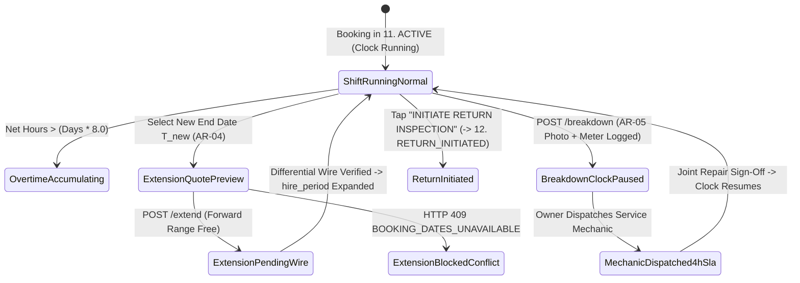
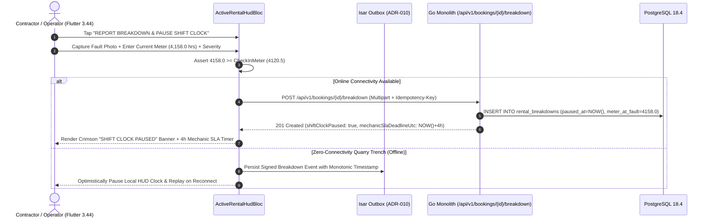

# Active Rental Shift HUD, Duration Extensions & Mechanical Breakdowns
## Mobile Subsystem Specification — `docs/mobile/renter-experience/13-active-rental-hud-extensions-breakdowns.md`

**Document Identifier:** `SPEC-MOB-RNT-13`  
**Classification:** Canonical Subsystem UI/UX & Technical Behavior Specification  
**Governing Documents:** `Dink_Machinery_UI_UX_Design_Brief.md`, `SRS-DINK-CORE-V7.0` (`docs/shared/requirements/05-06-active-rental-management.md`, `05-05-booking-reservation-flow.md`), `docs/shared/design/design-tokens.json`, `docs/ERROR_CATALOG.md`, `contracts/openapi.yaml`  
**Target Subsystem:** Flutter 3.44 / Dart 3.9 Mobile Client (iOS & Android)  
**Primary Persona / Actor:** Civil Engineering Contractor (*Dawit Haile-Mariam* / *Patrick Kariuki*), Certified Field Operator (*Mulugeta Tadesse*)  
**Associated Requirements:** `REQ-05-06` (`AR-03`, `AR-04`, `AR-05`), `REQ-05-12` (Operator GPS & Roster Assignment), `REQ-05-17` (Offline Outbox Resilience)  
**Associated Interaction Flows:** `FLOW-09` (`FLOW-ACTIVE-RENTAL-DINK-CORE-V7.0`), `FLOW-07` (`11. ACTIVE` $\rightarrow$ `12. RETURN_INITIATED`)  
**Architectural Decisions:** `ADR-005` (Atomic Extension Forward Range Lock), `ADR-010` (Non-Custodial Differential Wire & Offline Breakdown Queuing)  
**Status:** Approved Technical Design Baseline

---

## 1. Domain Context, Business Formulas & Architectural Invariants

Once physical site handover (`AR-01` reticle photos + `AR-02` 6-digit HMAC PIN or offline QR handshake) completes, the booking enters state **`11. ACTIVE`**. During active earthworks, quarry excavation, or road grading under intense sunlight ($> 85,000\text{ lux}$), the contractor monitors machine productivity, requests forward date extensions, and reports mechanical stoppages via the **Active Rental Shift HUD, Duration Extensions & Mechanical Breakdowns Screen (`ActiveRentalHudScreen`)**.

### 1.1 Shift Telemetry, Extension & Breakdown Formulas (`AR-03`..`AR-05`)
1. **Standard East African 8.0-Hour Daily Shift Allowance (`AR-03`):**
   Let $D_{\text{hire}}$ be the contracted calendar days and $M_{\text{checkin}}$ be the immutable handover check-in hour meter floor (`CheckInMeter >= BaselineMeter`):
   $$H_{\text{allowance}} = D_{\text{hire}} \times 8.0\text{ Engine Operating Hours}$$
   $$H_{\text{net\_operated}}(t) = \max\Big(0.0,\; \left(M_{\text{current}}(t) - M_{\text{checkin}}\right) - H_{\text{verified\_breakdown}}\Big)$$
   When $H_{\text{net\_operated}}(t) > H_{\text{allowance}}$, the HUD switches its shift gauge to Amber/Orange (`OVERTIME_ACCUMULATING`) and previews the pro-rata hourly excess charge:
   $$R_{\text{hourly\_minor}} = \left\lfloor \frac{R_{\text{daily\_effective\_minor}}}{8} \right\rfloor$$
2. **Rental Duration Extension & Rate Differential Formula (`AR-04` / `REQ-05-06 §5.2`):**
   When a contractor requests to extend the rental end date from $T_{\text{end}}$ to $T_{\text{new}}$ ($\Delta D = T_{\text{new}} - T_{\text{end}}$ additional days):
   - The backend executes an atomic PostgreSQL GiST overlap check on $(T_{\text{end}}, T_{\text{new}}]$. If another contractor has already booked the machine starting in that window, `409 BOOKING_DATES_UNAVAILABLE` is returned immediately.
   - If the total extended duration $D_{\text{total}} = D_{\text{hire}} + \Delta D$ crosses a duration discount threshold (e.g., from $<7$ days to $\ge 7$ days weekly tier, or $\ge 30$ days monthly tier), the rate differential recalculates across the entire span:
     $$M_{\text{diff\_wire}} = M_{\text{total\_contract}}(D_{\text{total}}) - M_{\text{already\_paid}}(D_{\text{hire}})$$
3. **Immediate Shift Clock Pausing on Mechanical Breakdown (`AR-05` / `REQ-05-06 §6`):**
   If a hydraulic hose bursts, an injector fails, or an undercarriage track derails, tapping **"Report Mechanical Breakdown"** with a timestamped photo and current hour meter reading immediately pauses billable shift accumulation (`ShiftClockState = PAUSED_BREAKDOWN`) and starts a **4-Hour Owner Field Service Dispatch SLA**. All verified downtime hours $H_{\text{verified\_breakdown}}$ are deducted from final reconciliation (`RC-03`).

---

## 2. Screen Anatomy & Bespoke ASCII Wireframe

```text
+-----------------------------------------------------------------------+
| [<- Back]   ACTIVE RENTAL HUD (#DINK-BK-8841)     [☀️ High-Contrast]  |
|-----------------------------------------------------------------------|
| 🟢 STATUS: 11. ACTIVE (Day 5 of 8 • Ends Nov 06, 2026 / ጥቅምት 27 ዓ.ም)   |
| 🚜 CAT 320D2 L + Soosan SB81 Breaker • 📍 Modjo–Hawassa Lot 2 KM 44   |
|=======================================================================|
| ⏱️ MONOTONIC ENGINE SHIFT TELEMETRY GAUGE (AR-03 • 8.0 Hrs/Day Cap)   |
| +-------------------------------------------------------------------+ |
| |  Check-In Floor:  4,120.5 HRS   |   Current Meter:  4,158.0 HRS   | |
| |  Gross Elapsed:      37.5 HRS   |   Breakdown Ded.:    -2.5 HRS   | |
| |-------------------------------------------------------------------| |
| |  BILLABLE NET HOURS:  35.0 / 64.0 HRS INCLUDED  (54.7% Utilized)  | |
| |  [██████████████████████░░░░░░░░░░░░░░░░░]  29.0 Hrs Remaining    | |
| |  Today's Shift (Oct 29): 6.5 / 8.0 hrs • Overtime Rate: ETB 4,375/h| |
| +-------------------------------------------------------------------+ |
|=======================================================================|
| 👷 ASSIGNED CERTIFIED FIELD OPERATOR (REQ-05-12)                      |
| +-------------------------------------------------------------------+ |
| | Mulugeta Tadesse • License: #FTA-EX-90412 (Verified Heavy Plant)  | |
| | [📞 Call Operator (56dp)]       [🔄 Request Operator Replacement] | |
| +-------------------------------------------------------------------+ |
|=======================================================================|
| 📅 RENTAL DURATION EXTENSION ENGINE (AR-04)                           |
| +-------------------------------------------------------------------+ |
| | Need the machine longer? Forward window Nov 07 – Nov 14 is FREE.  | |
| | Extend End Date To: [📅 Nov 10, 2026 (+4 Days / +32.0 Shift Hrs)] | |
| | 💰 Extension Differential (Incl. Weekly Tier + VAT): ETB 151,800  | |
| | [      📅 REQUEST +4 DAYS EXTENSION & LOCK WINDOW (56dp CTA)    ] | |
| +-------------------------------------------------------------------+ |
|=======================================================================|
| 🚨 MECHANICAL BREAKDOWN & STOPPAGE LOGGING (AR-05)                    |
| +-------------------------------------------------------------------+ |
| | Machine stopped due to mechanical/hydraulic fault?                | |
| | Pausing the shift clock protects you from paying for downtime.    | |
| | [  🛠️ REPORT BREAKDOWN & PAUSE SHIFT CLOCK (64dp Hazard CTA)    ] | |
| +-------------------------------------------------------------------+ |
|-----------------------------------------------------------------------|
| [       🏁 INITIATE EARLY / SCHEDULED RETURN INSPECTION (56dp)      ] |
+-----------------------------------------------------------------------+
```

---

## 3. W3C DTCG Design Token Mapping Table

| UI Component / Element | W3C DTCG Token Path | Resolved Value (Light / Outdoor High-Contrast) | Ergonomic & Behavioral Mandate |
|---|---|---|---|
| **HUD Surface Canvas** | `semantic.outdoorHighContrast.surface.canvas` | `#000000` (Defaulting to High-Contrast in Field HUD) | Maximizes legibility in $>85,000\text{ lux}$ quarry/roadside sunlight. |
| **Monotonic Hour Readouts** | `typography.fontFamily.mono` + `typography.fontSize.20` | `Space Mono` `20sp` Bold (`#FFFFFF` / `#020617`) | Displays Check-In Floor (`4,120.5 HRS`), Current Meter, and Net Billable Hours. |
| **Shift Gauge Bar (Normal)** | `color.feedback.emerald.500` | `#10B981` fill when $H_{\text{net}} \le H_{\text{allowance}}$ | Transitions to `#F59E0B` (`>85%`) and `#FF5722` when overtime hours accumulate. |
| **Report Breakdown CTA** | `color.feedback.crimson.600` / `component.actuator.button.heightField` | `#DC2626` background, `#FFFFFF` text, `64dp` height | High-priority gloved actuator; immediately opens camera reticle to log fault & pause clock. |
| **Extension Request CTA** | `semantic.light.action.primary.bg` / `heightStandard` | `#F59E0B` (`#FBBF24` Outdoor), `56dp` height | Locks forward dates in Valkey and generates differential wire quote (`AR-04`). |

---

## 4. Screen State Machine & Sequence Diagrams

### 4.1 Active Rental HUD, Extension & Breakdown Sub-State Machine


### 4.2 Mechanical Breakdown Logging & Shift Clock Pause Sequence (`AR-05`)


---

## 5. Concrete Flutter Implementation Blueprint

### 5.1 BLoC Events & Freezed States (`active_rental_hud_bloc.dart`)
```dart
import 'package:freezed_annotation/freezed_annotation.dart';

part 'active_rental_hud_bloc.freezed.dart';

@freezed
sealed class ActiveRentalHudEvent with _$ActiveRentalHudEvent {
  const factory ActiveRentalHudEvent.started({
    required String bookingId,
  }) = _Started;

  const factory ActiveRentalHudEvent.shiftMeterLogged({
    required double currentMeterHours,
    required String meterPhotoPath,
  }) = _ShiftMeterLogged;

  const factory ActiveRentalHudEvent.extensionDatePreviewed({
    required DateTime proposedNewEndDateUtc,
  }) = _ExtensionDatePreviewed;

  const factory ActiveRentalHudEvent.extensionSubmitted({
    required DateTime proposedNewEndDateUtc,
  }) = _ExtensionSubmitted;

  const factory ActiveRentalHudEvent.breakdownReported({
    required double meterAtBreakdown,
    required String faultCategory, // HYDRAULIC, ENGINE, ELECTRICAL, UNDERCARRIAGE
    required String faultDescription,
    required List<String> faultPhotoPaths,
  }) = _BreakdownReported;

  const factory ActiveRentalHudEvent.breakdownResolvedConfirmed({
    required String breakdownId,
    required double meterAtResume,
  }) = _BreakdownResolvedConfirmed;

  const factory ActiveRentalHudEvent.returnInitiated() = _ReturnInitiated;
}

@freezed
abstract class ActiveRentalHudState with _$ActiveRentalHudState {
  const factory ActiveRentalHudState({
    @Default(HudLoadStatus.loading) HudLoadStatus status,
    required String bookingId,
    required double checkInMeterFloor,
    required double currentMeterReading,
    required double verifiedBreakdownHours,
    required double netBillableHours,
    required double includedShiftAllowanceHours, // rentalDays * 8.0
    required int overtimeHourlyRateMinor,
    required String currencyCode,
    @Default(false) bool isShiftClockPaused,
    ActiveBreakdownIncidentDto? activeBreakdown,
    ExtensionQuotePreviewDto? extensionPreview,
    AssignedOperatorDossierDto? assignedOperator,
    @Default(true) bool isOutdoorHighContrast,
    ProblemDetails? error,
  }) = _ActiveRentalHudState;
}
```

### 5.2 Isar Offline Shift & Breakdown Outbox (`isar_active_shift_outbox.dart`)
```dart
import 'package:isar/isar.dart';

part 'isar_active_shift_outbox.g.dart';

@collection
class IsarActiveShiftOutbox {
  Id id = Isar.autoIncrement;

  @Index(unique: true, replace: true)
  late String idempotencyKey;

  @Index()
  late String bookingId;

  late String eventType; // 'SHIFT_METER_LOG' | 'BREAKDOWN_REPORT' | 'BREAKDOWN_RESUME'
  late double recordedMeterReading;
  late String faultCategory;
  late String faultDescription;
  late List<String> localPhotoPaths;
  late DateTime clientRecordedAtUtc;
  late bool isSynced;
}
```

### 5.3 Widget Tree Hierarchy
```text
ActiveRentalHudScreen (Scaffold)
 ├── HighContrastFieldAppBar (Booking Ref, Outdoor High-Contrast Toggle)
 ├── SingleChildScrollView (Padding: 16dp)
 │    ├── ActiveShiftClockStatusBanner (Emerald "RUNNING" vs Crimson "PAUSED — BREAKDOWN")
 │    ├── MonotonicShiftTelemetryGaugeCard (AR-03)
 │    │    ├── CheckInVsCurrentMeterRow (Space Mono 20sp)
 │    │    ├── NetBillableHoursProgressBar (35.0 / 64.0 hrs + Overtime rate note)
 │    │    └── LogDailyShiftMeterButton (56dp height)
 │    ├── AssignedOperatorRosterCard (REQ-05-12 Call & Re-Assignment Request)
 │    ├── RentalDurationExtensionCard (AR-04)
 │    │    ├── ForwardAvailabilityDatePicker
 │    │    ├── DifferentialRateAndDiscountBreakdown (Space Mono minor units)
 │    │    └── RequestExtensionLockButton (56dp height CTA)
 │    ├── MechanicalBreakdownIncidentCard (AR-05)
 │    │    ├── ReportBreakdownHazardButton (64dp Crimson CTA)
 │    │    └── ActiveMechanicSlaCountdownBox (4-hour dispatch SLA + Joint Resume Sign-off)
 │    └── InitiateReturnDemobilizationButton (56dp height -> 14-post-rental-reconciliation)
```

---

## 6. OpenAPI 3.1.0 Routes & RFC 9457 Error Matrix

### 6.1 Endpoint Specifications
- **`GET /api/v1/bookings/{id}/hud`** (`AR-03`)
  - **Response (`200 OK`):** Returns live shift telemetry, `checkInMeterFloor`, `currentMeterReading`, `verifiedBreakdownHours`, `includedShiftAllowanceHours`, `assignedOperator`, and forward calendar availability.
- **`POST /api/v1/bookings/{id}/extend`** (`AR-04`)
  - **Headers:** `Idempotency-Key: <uuid-v4>`.
  - **Request Body:** `{ "newEndDate": "2026-11-10" }`.
- **`POST /api/v1/bookings/{id}/breakdown`** (`AR-05`)
  - **Headers:** `Idempotency-Key: <uuid-v4>`, `Content-Type: multipart/form-data`.

### 6.2 RFC 9457 Problem Details Matrix
| Error Code | HTTP Status | RFC 9457 Type URI | Retryable | Mobile UI Remediation & Recovery Action |
|---|---|---|---|---|
| `INSPECT_METER_REGRESSION` | `422` | `/errors/inspect-meter-regression` | No | Submitted shift/breakdown meter $< \text{checkInMeterFloor}$; highlight input in Crimson and require re-capturing the hour meter reticle photo. |
| `BOOKING_DATES_UNAVAILABLE` | `409` | `/errors/booking-dates-unavailable` | No | Another contractor reserved the machine after $T_{\text{end}}$; disable extension past the conflict date and mandate on-time return. |
| `INSPECT_MEDIA_SCAN_FAILED` | `422` | `/errors/inspect-media-scan-failed` | No | Breakdown photo rejected by ClamAV; prompt fresh camera capture. |

---

## 7. Verification & Acceptance Criteria

- [ ] **Strict Monotonic Meter Guard (`AR-01` / `AR-03`):** Entering a shift or breakdown meter reading of `4,119.0 hrs` when `checkInMeterFloor` is `4,120.5 hrs` is blocked synchronously on the client and rejected with `422 INSPECT_METER_REGRESSION` on the server.
- [ ] **Immediate Breakdown Clock Pause (`AR-05`):** Submitting a breakdown transitions `isShiftClockPaused` to `true`, displays the 4-hour Owner Mechanic SLA countdown, and deducts verified downtime hours from `netBillableHours`.
- [ ] **Extension Tier Recalculation (`AR-04`):** Extending a 5-day booking by +4 days (total 9 days) automatically applies the 7+ day weekly duration discount to the differential quote in integer minor units.
