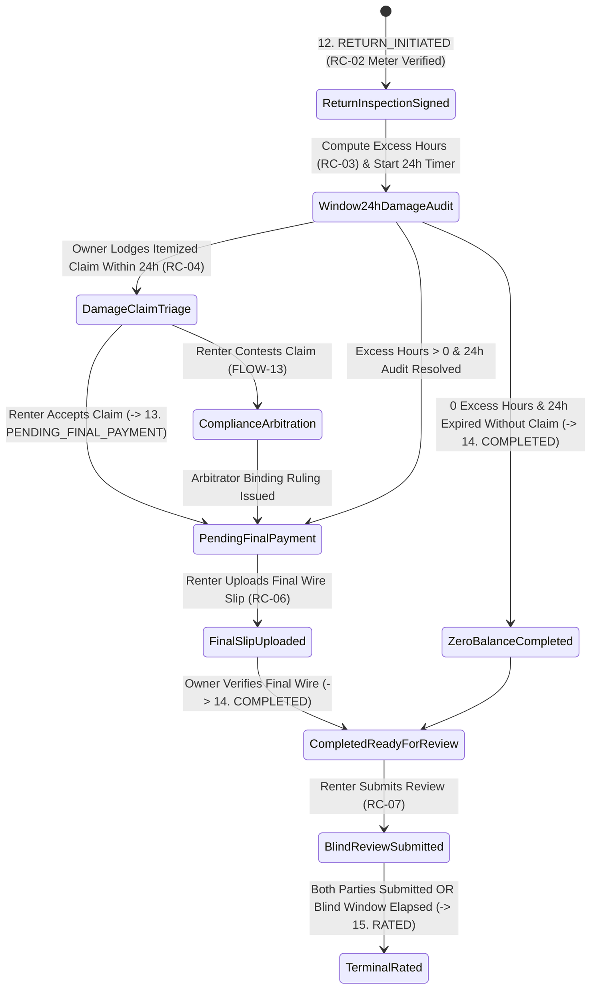
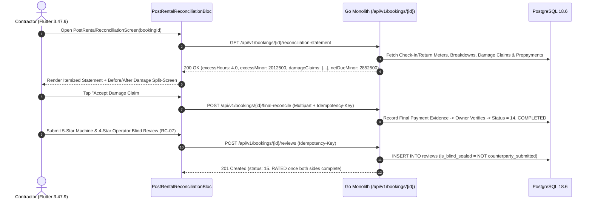

# Post-Rental Final Balance Reconciliation & Mutual Blind Rating
## Mobile Subsystem Specification — `docs/mobile/renter-experience/14-post-rental-reconciliation-mutual-rating.md`

**Document Identifier:** `SPEC-MOB-RNT-14`  
**Classification:** Canonical Subsystem UI/UX & Technical Behavior Specification  
**Governing Documents:** `Dink_Machinery_UI_UX_Design_Brief.md`, `SRS-DINK-CORE-V7.0` (`docs/shared/requirements/05-07-rental-completion-return-damage.md`, `05-05-booking-reservation-flow.md`), `docs/shared/design/design-tokens.json`, `docs/ERROR_CATALOG.md`, `contracts/openapi.yaml`  
**Target Subsystem:** Flutter 3.47.9 / Dart 3.9 Mobile Client (iOS & Android)  
**Primary Persona / Actor:** Civil Engineering Contractor (*Dawit Haile-Mariam* / *Patrick Kariuki*), Corporate Project Manager  
**Associated Requirements:** `REQ-05-07` (`RC-03`..`RC-07`), `REQ-05-05` (§7.2..§7.5 `12. RETURN_INITIATED` $\rightarrow$ `13. PENDING_FINAL_PAYMENT` $\rightarrow$ `14. COMPLETED` $\rightarrow$ `15. RATED`)  
**Associated Interaction Flows:** `FLOW-10` (`FLOW-RETURN-INSPECTION-DINK-CORE-V7.0`), `FLOW-13` (Damage Claim Arbitration), `FLOW-19` (Catastrophic Loss CPAR Escalation)  
**Architectural Decisions:** `ADR-010` (**Non-Custodial P2P Final Wire Settlement & Double-Entry Integer Minor Units**)  
**Status:** Approved Technical Design Baseline

---

## 1. Domain Context, Business Formulas & Architectural Invariants

When a machinery rental concludes and the physical return reticle inspection (`RC-01` / `RC-02`) is signed, the platform reconciles **Excess Operating Hours (`RC-03`)**, **24-Hour Statutory Damage Claims (`RC-04`)**, **Final Non-Custodial P2P Wire Settlement (`RC-05` / `RC-06`)**, and the **Double-Blind Mutual Reputation Rating (`RC-07`)** via the **Post-Rental Final Balance Reconciliation & Mutual Blind Rating Screen (`PostRentalReconciliationScreen`)**.

### 1.1 Mathematical Reconciliation Formulas (`RC-03`..`RC-06`)
1. **Strict Monotonic Return Meter Invariant (`RC-02`):**
   $$M_{\text{return}} \ge M_{\text{checkin}} \ge M_{\text{baseline}}$$
   Any check-out meter reading below $M_{\text{checkin}}$ aborts with `422 INSPECT_METER_REGRESSION`.
2. **Billable Excess Operating Hours Formula (`RC-03`):**
   Given contracted days $D_{\text{hire}}$, standard daily shift allowance $8.0\text{ hrs/day}$, and verified mechanical breakdown downtime $H_{\text{breakdown}}$ (`AR-05`):
   $$H_{\text{excess}} = \max\Big(0.0,\; \left(M_{\text{return}} - M_{\text{checkin}} - H_{\text{breakdown}}\right) - \left(D_{\text{hire}} \times 8.0\right)\Big)$$
   $$M_{\text{excess\_minor}} = \left\lfloor H_{\text{excess}} \times \left\lfloor \frac{R_{\text{daily\_effective\_minor}}}{8} \right\rfloor \right\rfloor$$
3. **Statutory 24-Hour Damage Claim Guillotine (`RC-04`):**
   From the timestamp of `RC-02` return inspection completion, a **24-hour ($86,400\text{ s}$) Valkey audit timer** runs.
   - If the Owner files no claim before $86,400\text{ s}$ elapses, compensable damage locks permanently at $M_{\text{damage\_minor}} = 0$ (Auto-Waiver).
   - If the Owner files an itemized damage docket (comparing Pre-Rental Handover Reticle Photos vs. Post-Rental Return Reticle Photos + dealer repair quote), the Renter may **Accept Liability** or **Contest to Compliance Arbitrator (`FLOW-10 §3.4` / `FLOW-13`)**.
4. **Universal Final Net Balance Formula (`RC-05` / `ADR-010`):**
   $$M_{\text{final\_net\_minor}} = \left(M_{\text{gross\_contract}} + M_{\text{excess\_minor}} + M_{\text{ excess\_vat}} + M_{\text{resolved\_damage\_minor}}\right) - M_{\text{prepaid\_wire\_minor}}$$
   - If $M_{\text{final\_net\_minor}} == 0$: Booking auto-transitions immediately from `12. RETURN_INITIATED` to `14. COMPLETED`.
   - If $M_{\text{final\_net\_minor}} > 0$: Booking transitions to `13. PENDING_FINAL_PAYMENT`; Renter wires $M_{\text{final\_net\_minor}}$ directly to Owner's bank account and uploads the final wire slip (`RC-06`).
5. **Double-Blind Mutual Rating Isolation (`RC-07`):**
   Once in `14. COMPLETED`, both Renter and Owner have a **7-to-14 day blind window** to submit multi-factor ratings (Mechanical Reliability, Operator Skill, Site Readiness, Payment Timeliness). Neither party's score or written review is visible to the counterparty until **both** have submitted or the blind window expires, preventing retaliatory rating extortion. When both submit, the booking reaches terminal state **`15. RATED`**.

---

## 2. Screen Anatomy & Bespoke ASCII Wireframe

```text
+-----------------------------------------------------------------------+
| [<- Back]     POST-RENTAL RECONCILIATION (#DINK-BK-8841)              |
|-----------------------------------------------------------------------|
| 🟠 STATUS: 13. PENDING_FINAL_PAYMENT • Return Signed: Nov 06, 17:10   |
|=======================================================================|
| ⏱️ 1. ENGINE HOUR METER RECONCILIATION (RC-03 • Monotonic Verified)   |
| +-------------------------------------------------------------------+ |
| | Handover Check-In Meter:  4,120.5 HRS  | Return Meter: 4,191.0 HRS| |
| | Gross Elapsed Hours:         70.5 HRS  | Breakdowns:      -2.5 HRS| |
| | Net Operated Hours:          68.0 HRS  | Included (8d×8h): 64.0 HR| |
| |-------------------------------------------------------------------| |
| | ⚠️ BILLABLE EXCESS HOURS:   4.0 HRS × ETB 4,375.00/hr             | |
| |    Excess Hours Subtotal:                         ETB  17,500.00  | |
| |    Statutory 15% ET VAT on Excess Hours:          ETB   2,625.00  | |
| +-------------------------------------------------------------------+ |
|=======================================================================|
| 🔍 2. 24-HOUR DAMAGE TRIAGE & SPLIT-SCREEN AUDIT (RC-04)              |
| +-------------------------------------------------------------------+ |
| | Claim #DMG-902: Right Track Guard Bent (Filed 04h 12m after return)| |
| | +-------------------------------+-------------------------------+ | |
| | | [BEFORE: Nov 30 Handover #2]  | [AFTER: Nov 06 Return #2]     | | |
| | |  Intact Steel Track Guard     |  Bent Flange + Missing Bolts  | | |
| | +-------------------------------+-------------------------------+ | |
| | Claimed Repair Cost (Cat Dealer Quote Attached):  ETB   8,400.00  | |
| | Status: [✅ ACCEPTED BY RENTER]  (Or [⚖️ Contest to Arbitrator])  | |
| +-------------------------------------------------------------------+ |
|=======================================================================|
| 🧾 3. FINAL DOUBLE-ENTRY SETTLEMENT STATEMENT (RC-05 / ADR-010)       |
| +-------------------------------------------------------------------+ |
| | Original Contract + 15% VAT (Prepaid Oct 29):     ETB 301,024.00  | |
| | (+) Excess Operating Hours (4.0 hrs + 15% VAT):   ETB  20,125.00  | |
| | (+) Resolved Compensable Damage (#DMG-902):       ETB   8,400.00  | |
| | (-) Less Verified Prepayment Wire (#FT263029...): -ETB 301,024.00 | |
| |===================================================================| |
| | 💰 NET FINAL BALANCE DUE TO OWNER (Direct Wire):  ETB  28,525.00  | |
| +-------------------------------------------------------------------+ |
| [    📷 UPLOAD FINAL SETTLEMENT WIRE SLIP (ETB 28,525.00) (64dp)    ] |
|=======================================================================|
| ⭐ 4. DOUBLE-BLIND MUTUAL REVIEW VAULT (RC-07 • Unlocked at COMPLETED)|
| +-------------------------------------------------------------------+ |
| | 🔒 Blind Escrow Active: Owner cannot see your rating until both   | |
| |    parties submit (or 7-day blind window closes).                 | |
| | Machine Mechanical Reliability:  [★] [★] [★] [★] [★] (5.0 / 5.0)  | |
| | Operator Skill & Punctuality:    [★] [★] [★] [★] [☆] (4.0 / 5.0)  | |
| | Review Note: [Strong hydraulic breakout; minor hose leak Day 3.]  | |
| | [        🔒 SUBMIT BLIND REVIEW TO TRUST LEDGER (56dp CTA)       ] |
| +-------------------------------------------------------------------+ |
+-----------------------------------------------------------------------+
```

---

## 3. W3C DTCG Design Token Mapping Table

| UI Component / Element | W3C DTCG Token Path | Resolved Value (Light / Outdoor High-Contrast) | Ergonomic & Behavioral Mandate |
|---|---|---|---|
| **Split-Screen Photo Divider** | `component.lightbox.dividerWidth` / `dividerColor` | `3dp` (`stroke.border.heavy`) `#F59E0B` | Interactive slider handle comparing Handover vs. Return reticle photos (`RC-04`). |
| **Excess Hours Callout Row** | `color.brand.amber.50` + `typography.fontFamily.mono` | `#FFFBEB` background, `Space Mono` `16sp` Bold | Clearly shows exact formula: $(68.0 - 64.0) \times \text{ETB } 4,375.00$. |
| **Net Final Balance Box** | `semantic.light.text.numericLedger` + `color.brand.amber.100` | `#020617` `Space Mono` `20sp` Bold on `#FEF3C7` | Zero-ambiguity integer minor unit settlement figure (`ETB 28,525.00`). |
| **Blind Review Vault Banner** | `color.feedback.purple.50` + `color.feedback.purple.900` | `#FAF5FF` container, `#581C87` text | Explains double-blind anti-retaliation guarantee (`RC-07`). |
| **Star Rating Touch Targets** | `dimension.space.56` (`56dp x 56dp` per star) | `#F59E0B` filled star / `#CBD5E1` empty star | Gloved-hand friendly rating selection with haptic step feedback. |

---

## 4. Screen State Machine & Sequence Diagrams

### 4.1 Post-Rental Reconciliation & Blind Rating State Machine


### 4.2 Excess Hour Reconciliation, Damage Triage & Blind Review Sequence


---

## 5. Concrete Flutter Implementation Blueprint

### 5.1 BLoC Events & Freezed States (`post_rental_reconciliation_bloc.dart`)
```dart
import 'package:freezed_annotation/freezed_annotation.dart';

part 'post_rental_reconciliation_bloc.freezed.dart';

@freezed
sealed class PostRentalReconciliationEvent with _$PostRentalReconciliationEvent {
  const factory PostRentalReconciliationEvent.started({
    required String bookingId,
  }) = _Started;

  const factory PostRentalReconciliationEvent.damageClaimResponded({
    required String claimId,
    required DamageClaimResponseAction action, // ACCEPT_LIABILITY, CONTEST_TO_ARBITRATOR
    String? disputeNote,
  }) = _DamageClaimResponded;

  const factory PostRentalReconciliationEvent.finalWireSlipSubmitted({
    required String slipFilePath,
    required String sha256Checksum,
    required String bankTransactionRef,
    required int wiredAmountMinor,
  }) = _FinalWireSlipSubmitted;

  const factory PostRentalReconciliationEvent.blindReviewSubmitted({
    required int machineReliabilityStars, // 1..5
    required int operatorSkillStars, // 1..5
    required int ownerCommunicationStars, // 1..5
    required String reviewCommentary,
  }) = _BlindReviewSubmitted;
}

@freezed
abstract class PostRentalReconciliationState with _$PostRentalReconciliationState {
  const factory PostRentalReconciliationState({
    @Default(ReconciliationLoadStatus.loading) ReconciliationLoadStatus status,
    required String bookingId,
    required String bookingLifecycleState, // 'RETURN_INITIATED' | 'PENDING_FINAL_PAYMENT' | 'COMPLETED' | 'RATED'
    ReconciliationStatementDto? statement,
    @Default(<DamageClaimDocketDto>[]) List<DamageClaimDocketDto> damageClaims,
    int? damageAuditWindowRemainingSeconds, // 86,400s countdown (RC-04)
    @Default(false) bool hasSubmittedBlindReview,
    @Default(false) bool isCounterpartyReviewUnsealed,
    MutualReviewPairDto? unsealedReviews,
    ProblemDetails? error,
  }) = _PostRentalReconciliationState;
}
```

### 5.2 Isar Cached Reconciliation Statement (`isar_reconciliation_statement.dart`)
```dart
import 'package:isar/isar.dart';

part 'isar_reconciliation_statement.g.dart';

@collection
class IsarReconciliationStatement {
  Id id = Isar.autoIncrement;

  @Index(unique: true, replace: true)
  late String bookingId;

  late double checkInMeterHours;
  late double returnMeterHours;
  late double deductedBreakdownHours;
  late double includedAllowanceHours;
  late double billableExcessHours;
  late int excessHoursChargeMinor;
  late int excessHoursVatMinor;
  late int resolvedDamageMinor;
  late int prepaidContractMinor;
  late int netFinalBalanceDueMinor;
  late String currencyCode;
  late String lifecycleState;
  late DateTime syncedAt;
}
```

### 5.3 Widget Tree Hierarchy
```text
PostRentalReconciliationScreen (Scaffold)
 ├── AppBar ("Post-Rental Reconciliation #DINK-BK-8841")
 ├── SingleChildScrollView (Padding: 16dp)
 │    ├── Statutory24hDamageAuditCountdownBanner (RC-04 86,400s guillotine timer)
 │    ├── EngineHourMeterReconciliationCard (RC-03)
 │    │    ├── CheckInVsReturnMeterLedgerRow
 │    │    ├── BreakdownDeductionAndIncludedAllowanceRow
 │    │    └── BillableExcessHoursSubtotalBox (Space Mono minor units)
 │    ├── ItemizedDamageClaimTriageSection (RC-04)
 │    │    ├── BeforeAfterReticleSplitLightbox (Interactive 3dp Amber divider)
 │    │    ├── DealerRepairQuotePdfPreviewRow
 │    │    └── AcceptOrContestDamageActionButtons (56dp height)
 │    ├── DoubleEntryFinalSettlementCard (RC-05 / RC-06 / ADR-010)
 │    │    ├── NetFinalBalanceHighlightRow
 │    │    └── UploadFinalSettlementWireSlipButton (64dp height CTA)
 │    └── DoubleBlindMutualReviewVaultCard (RC-07)
 │         ├── BlindEscrowAssuranceNotice
 │         ├── MultiFactorGlovedStarRatingRows (Machine, Operator, Owner)
 │         └── SubmitBlindReviewButton (56dp height CTA -> 15. RATED)
```

---

## 6. OpenAPI 3.1.0 Routes & RFC 9457 Error Matrix

### 6.1 Endpoint Specifications
- **`GET /api/v1/bookings/{id}/reconciliation-statement`** (`RC-05`)
- **`POST /api/v1/bookings/{id}/damage-claims/{claimId}/respond`** (`RC-04`)
  - **Headers:** `Idempotency-Key: <uuid-v4>`.
  - **Request Body:** `{ "decision": "ACCEPT" | "CONTEST", "renterNote": "..." }`.
- **`POST /api/v1/bookings/{id}/final-reconcile`** (`RC-06`)
  - **Headers:** `Idempotency-Key: <uuid-v4>`, `Content-Type: multipart/form-data`.
- **`POST /api/v1/bookings/{id}/reviews`** (`RC-07`)
  - **Headers:** `Idempotency-Key: <uuid-v4>`.

### 6.2 RFC 9457 Problem Details Matrix
| Error Code | HTTP Status | RFC 9457 Type URI | Retryable | Mobile UI Remediation & Recovery Action |
|---|---|---|---|---|
| `INSPECT_METER_REGRESSION` | `422` | `/errors/inspect-meter-regression` | No | Block return check-out meter $< \text{checkInMeter}$; require re-verification of hour meter photo. |
| `PAYMENT_TRANSACTION_EXISTS` | `409` | `/errors/payment-transaction-exists` | No | Reject duplicate final wire receipt hash or FT reference (cannot reuse initial prepayment slip for final balance). |
| `BOOKING_INVALID_STATE_TRANSITION` | `409` | `/errors/booking-invalid-state` | No | Review submission blocked until `netFinalBalanceDueMinor == 0` (`14. COMPLETED`). |

---

## 7. Verification & Acceptance Criteria

- [ ] **Excess Hour Formula & Breakdown Deduction (`RC-03`):** Unit test verifies that `70.5` gross hours minus `2.5` breakdown hours (`68.0` net) against a `64.0` hour allowance bills strictly `4.0` excess hours in integer minor units.
- [ ] **24-Hour Damage Guillotine Auto-Waiver (`RC-04`):** When `damageAuditWindowRemainingSeconds` reaches `0` with zero claims filed, `resolvedDamageMinor` locks at `0` and cannot be mutated.
- [ ] **Double-Blind Review Seal (`RC-07`):** Before the Renter submits their review (and while the Owner's review is pending), the API and UI keep `unsealedReviews == null`, revealing both reviews simultaneously only after mutual submission or window expiry.
