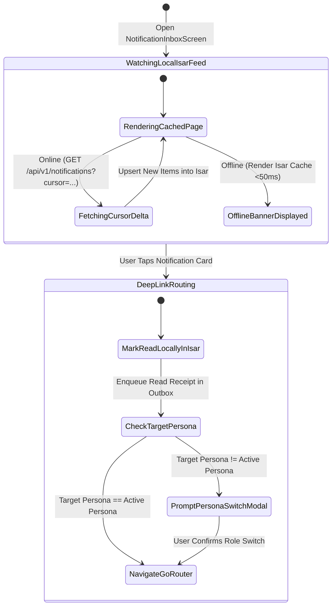

# 01 — Categorized Notification Inbox & Multi-Channel Preferences (`SPEC-MOB-SHR-01`)

| Metadata | Value |
| :--- | :--- |
| **Document ID** | `SPEC-MOB-SHR-01` |
| **Subsystem** | `docs/mobile/shared-features/` |
| **Target Framework** | Flutter 3.x (`flutter_bloc`, `isar`, `firebase_messaging`, `go_router`) |
| **SRS Traceability** | `REQ-05-10` (`NT-01` to `NT-05`), `REQ-05-17` (`OFF-01`), `REQ-05-18` (`ER-03`) |
| **Architecture / Flows** | `FLOW-17` (Notification Delivery & Preferences), `FLOW-NOTIF-OFFLINE` (`FLOW-APPENDIX-A`), `ADR-010` |
| **Design System** | `DS-DINK-CORE-V7.0` (§4.1 Industrial Actuators, §5.2 Outdoor High-Contrast) |
| **Status** | Normative — Phase 0 Specification |

---

## 1. Purpose & Requirement Traceability

This specification defines the unified **In-App Notification Center (`NotificationInboxScreen`)** and **Granular Multi-Channel Preference Matrix (`NotificationPreferencesScreen`)** shared across all four personas (`RENTER`, `OWNER`, `OPERATOR`, `TRANSPORTER`). In high-stakes machinery leasing—where a missed 24-hour damage claim window (`RC-04`) or expired insurance policy (`IN-02`) carries severe financial consequences—notifications are treated as auditable operational records:

| Requirement ID | Normative Obligation | Mobile Implementation Mechanism |
| :--- | :--- | :--- |
| **`NT-01` (Categorized In-App Inbox & Cursor Pagination)** | The mobile app MUST provide a persistent in-app notification center filterable by category (`ALL`, `FINANCIAL_P0`, `OPERATIONAL`, `SAFETY_COMPLIANCE`, `DISPUTES`) using strict cursor-based pagination. | `NotificationInboxScreen` backed by an Isar local cache (`NotificationEntityCollection`) and `GET /api/v1/notifications?cursor=...&category=...` with `meta.pagination.nextCursor`. |
| **`NT-02` (Deterministic Deep-Link Routing & Cross-Persona Switch)** | Tapping any notification item or FCM push banner MUST route deterministically to the target domain screen (`dink://...`), prompting an explicit persona switch if the target belongs to an inactive role. | `DeepLinkNotificationRouter` inspects `notification.targetPersona` vs. `RoleSwitcherBloc.activePersona` (`SPEC-MOB-NAV-01`) before pushing the `GoRouter` path and firing `POST /api/v1/notifications/{id}/read`. |
| **`NT-03` (Multi-Channel Delivery Matrix)** | Users MUST be able to configure delivery preferences across 4 channels: `IN_APP`, `PUSH_FCM`, `SMS_SMPP` (Ethio Telecom / Safaricom), and `WHATSAPP_BUSINESS`. | `NotificationPreferencesScreen` (`GET` / `PUT /api/v1/notifications/preferences`) with `56dp` channel toggles per event category. |
| **`NT-04` (Immutable P0 Financial & Safety Alerts)** | **Priority-0 (`P0`)** alerts (escrow release, payout disbursement, 24h damage claim guillotine, insurance expiry de-indexing, SIM-swap security hold, SOS safety stop) MUST NOT be disableable on `IN_APP` or `SMS_SMPP`. | UI renders locked `[🔒 MANDATORY STATUTORY ALERT]` toggles for `P0` categories (`isMutable: false`); backend rejects attempts to disable `P0` channels with `422 NT_P0_CHANNEL_IMMUTABLE`. |
| **`NT-05` (Quiet Hours & P0 Emergency Override)** | Users MAY configure nocturnal Quiet Hours (e.g., `22:00`–`06:00 EAT`) to suppress non-urgent promotional/operational pushes, while `P0` financial/safety alerts bypass Quiet Hours unconditionally. | Quiet-hours time range picker (`East Africa Time UTC+3`) with explicit amber disclosure badge: *"P0 Financial, Escrow & Safety alerts always bypass Quiet Hours."* |

---

## 2. Domain Context & Non-Negotiable Invariants

1. **Cursor-Only Pagination Invariant (`AGENTS.md` §2):** Offset/limit pagination (`?page=2&limit=20`) is strictly prohibited on the notification feed. The client passes `cursor` (ULID of the last notification) and merges pages into the local Isar database keyed by `notificationId`.
2. **Offline Inbox Availability & Outbox Read-Sync (`FLOW-NOTIF-OFFLINE`, `ADR-010`):** When a field operator or contractor opens the Notification Center inside a zero-signal quarry (`Offline`), the full historical inbox renders in `< 50ms` from Isar. Marking items as read while offline queues a lightweight `MARK_NOTIFICATION_READ` mutation in the Isar Outbox (`SPEC-MOB-FND-04`) that flushes automatically upon connectivity restoration.
3. **Unread Counter Synchronization:** The bottom navigation bar badge (`SPEC-MOB-NAV-02`) and app-bar bell badge subscribe directly to an Isar reactive query (`isar.notificationEntities.filter().isReadEqualTo(false).count()`), ensuring instant zero-latency badge decrements on tap or `[Mark All Read]`.

---

## 3. Bespoke ASCII Wireframes

### 3.1 Categorized Notification Inbox (`NotificationInboxScreen`)
```text
+-----------------------------------------------------------------------+
|  [<-]  NOTIFICATION CENTER (3 UNREAD)             [✓✓ MARK ALL READ]  |
|        [⚙️ CHANNEL PREFERENCES]                                       |
+-----------------------------------------------------------------------+
|  CATEGORY FILTER PILLS (56dp GLOVE HEIGHT)                            |
|  +---------+ +------------------+ +---------------+ +--------------+  |
|  | [◉ ALL] | | [🔴 P0 FINANCIAL]| | [🚜 DISPATCH] | | [⚖️ DISPUTE] |  |
|  +---------+ +------------------+ +---------------+ +--------------+  |
+-----------------------------------------------------------------------+
|  TODAY — 30 OCT 2026 (20 TIKIMT 2019 E.C.)                            |
|  +-----------------------------------------------------------------+  |
|  | 🔴 [P0 ESCROW & DAMAGE CLAIM]                   • UNREAD (2m)   |  |
|  | 24-Hour Damage Claim Filed on CAT 320D (#BK-8941)               |  |
|  | Owner filed a structural hydraulic cylinder claim for           |  |
|  | ETB 42,500.00. Respond within 23:58:10 before binding ruling.   |  |
|  | [ ⚖️ REVIEW & RESPOND TO CLAIM (56dp) -> ]                      |  |
|  +-----------------------------------------------------------------+  |
|  | 🟠 [SAFETY & INSURANCE]                         • UNREAD (1h)   |  |
|  | CPAR Insurance Policy Expiring in 7 Days (XCMG LW500FN)         |  |
|  | Upload renewed Awash Insurance certificate before 06 Nov 2026   |  |
|  | to prevent automatic fleet de-indexing.                         |  |
|  | [ 🛡️ UPLOAD RENEWED POLICY (56dp) -> ]                          |  |
|  +-----------------------------------------------------------------+  |
|  | 🟢 [P0 PAYOUT SETTLED]                            READ (4h ago) |  |
|  | Escrow Tranche Disbursed to CBE Account (*0184)                 |  |
|  | Net Settlement: ETB 184,250.00 (Ref: FT2630394812)              |  |
|  +-----------------------------------------------------------------+  |
+-----------------------------------------------------------------------+
```

### 3.2 Granular Multi-Channel Preference Matrix (`NotificationPreferencesScreen`)
```text
+-----------------------------------------------------------------------+
|  [<-]  NOTIFICATION CHANNELS & QUIET HOURS         [💾 AUTO-SAVED]    |
+-----------------------------------------------------------------------+
|  1. P0 FINANCIAL, ESCROW, SAFETY & STATUTORY ALERTS                   |
|  +-----------------------------------------------------------------+  |
|  | ⚠️ Mandatory protection alerts cannot be turned off for In-App  |  |
|  |    or SMS. They always bypass Quiet Hours.                      |  |
|  |                                                                 |  |
|  |  • In-App Inbox Center             [🔒 LOCKED ON]               |  |
|  |  • SMS (Ethio Telecom / Safaricom) [🔒 LOCKED ON]               |  |
|  |  • Push Notification (FCM)         [🔒 LOCKED ON]               |  |
|  |  • WhatsApp Verified Business      [  ◉ ON      ]  (56dp)       |  |
|  +-----------------------------------------------------------------+  |
|                                                                       |
|  2. OPERATIONAL DISPATCH, SHIFT LOGS & TELEMETRY                      |
|  +-----------------------------------------------------------------+  |
|  |  • In-App Inbox Center             [🔒 LOCKED ON]               |  |
|  |  • Push Notification (FCM)         [  ◉ ON      ]  (56dp)       |  |
|  |  • SMS (SMPP Fallback)             [  ◉ ON      ]  (56dp)       |  |
|  |  • WhatsApp Verified Business      [  ◯ OFF     ]  (56dp)       |  |
|  +-----------------------------------------------------------------+  |
|                                                                       |
|  3. NOCTURNAL QUIET HOURS (EAST AFRICA TIME — UTC+3)                  |
|  +-----------------------------------------------------------------+  |
|  |  Mute Non-Urgent Notifications:    [  ◉ ENABLED ]  (56dp)       |  |
|  |  From: [ 22:00 (4:00 Night ET) ]   To: [ 06:00 (12:00 Morn ET)] |  |
|  +-----------------------------------------------------------------+  |
+-----------------------------------------------------------------------+
```

---

## 4. W3C DTCG Design Token Mapping

| UI Element / Component | Token Path (`design-tokens.json`) | Resolved Value (`dark` / `outdoorHighContrast`) |
| :--- | :--- | :--- |
| **Unread Notification Card Surface** | `{semantic.dark.surface.elevated}` | `#1E293B` with `4dp` left accent bar (`#F59E0B` or `#EF4444` for `P0`) |
| **Read Notification Card Surface** | `{semantic.dark.surface.canvas}` | `#0F172A` with `1dp` `#334155` border |
| **P0 Financial / Urgent Badge** | `{color.feedback.crimson.500}` | `#EF4444` (`[🔴 P0 FINANCIAL]`) |
| **Monetary Amounts & Reference IDs** | `{typography.fontFamily.mono}` | `Space Mono`, `15sp`, `fontWeight: 700` |
| **Category Filter Pill & Toggle Height** | `{dimension.space.56}` | `56dp` minimum glove-friendly touch target |
| **Locked Statutory Toggle Badge** | `{color.brand.slate.700}` + `{color.brand.amber.400}` | `#334155` pill background with `#FBBF24` lock icon |

---

## 5. Screen-Specific State Machine & Offline Sync Flow



---

## 6. Concrete Flutter Implementation Blueprint

### 6.1 Isar Local Schema (`notification_entity.dart`)
```dart
import 'package:isar/isar.dart';

part 'notification_entity.g.dart';

@collection
class NotificationEntity {
  Id isarId = Isar.autoIncrement;

  @Index(unique: true, replace: true)
  late String notificationId; // ULID for deterministic cursor sorting

  @Index()
  late String category; // FINANCIAL_P0 | OPERATIONAL | SAFETY_COMPLIANCE | DISPUTES

  late String priority; // P0_CRITICAL | P1_HIGH | P2_STANDARD
  late String targetPersona; // RENTER | OWNER | OPERATOR | TRANSPORTER
  late String title;
  late String body;
  late String deepLinkUri; // e.g., dink://bookings/bk_01HP.../damage-claims/dc_01...

  @Index()
  late bool isRead;

  @Index()
  late DateTime createdAtUtc;
}
```

### 6.2 BLoC Events & Freezed State (`notification_center_bloc.dart`)
```dart
import 'package:bloc/bloc.dart';
import 'package:freezed_annotation/freezed_annotation.dart';

part 'notification_center_bloc.freezed.dart';

@freezed
sealed class NotificationCenterEvent with _$NotificationCenterEvent {
  const factory NotificationCenterEvent.started({@Default('ALL') String categoryFilter}) = _Started;
  const factory NotificationCenterEvent.nextCursorPageRequested() = _NextCursorPageRequested;
  const factory NotificationCenterEvent.notificationTapped(String notificationId) = _NotificationTapped;
  const factory NotificationCenterEvent.markAllReadRequested({required String idempotencyKey}) = _MarkAllReadRequested;
  const factory NotificationCenterEvent.preferenceToggled({
    required String category,
    required String channel,
    required bool enabled,
    required String idempotencyKey,
  }) = _PreferenceToggled;
}

@freezed
abstract class NotificationCenterState with _$NotificationCenterState {
  const factory NotificationCenterState({
    @Default('ALL') String activeCategoryFilter,
    @Default(0) int unreadCount,
    String? nextCursor,
    @Default(false) bool hasMorePages,
    @Default(false) bool isLoadingNetworkDelta,
    String? pendingDeepLinkUri,
    String? requiredPersonaSwitch,
    String? rfc9457ErrorCode,
  }) = _NotificationCenterState;
}
```

---

## 7. OpenAPI 3.1.0 Contract & RFC 9457 Error Matrix

### 7.1 Endpoints
1. `GET /api/v1/notifications?cursor=<ulid>&limit=25&category=ALL` → Returns unified envelope with `meta.pagination.{nextCursor, prevCursor, hasMore}`.
2. `POST /api/v1/notifications/{id}/read` & `POST /api/v1/notifications/read-all` (`Idempotency-Key` required).
3. `GET /api/v1/notifications/preferences` & `PUT /api/v1/notifications/preferences` (`Idempotency-Key` required).

### 7.2 RFC 9457 Error Recovery Matrix

| HTTP Status | `error.code` | Trigger Condition | Deterministic Mobile UI Recovery |
| :--- | :--- | :--- | :--- |
| **`400`** | `REQ_INVALID_CURSOR` | Expired or malformed ULID cursor parameter. | Reset pagination cursor to `null`, fetch latest head page (`limit=25`), and reconcile Isar cache. |
| **`422`** | `NT_P0_CHANNEL_IMMUTABLE` | Client attempted to disable `IN_APP`, `SMS_SMPP`, or `PUSH_FCM` for a `P0` financial/safety category (`NT-04`). | Revert toggle switch immediately to `ON`, trigger warning haptic, and display statutory explanation banner. |
| **`503`** | `SYS_SERVICE_UNAVAILABLE` | Backend offline or rural 2G timeout during read-status sync or preference update. | Persist read status / preference mutation in Isar Outbox (`ADR-010`) and display non-blocking `[💾 Saved Offline — Will Sync]` pill. |

---

## 8. Verification & Acceptance Criteria

1. **`bloc_test` — Immutable P0 Guard & Cursor Pagination:**
   - Verify that emitting `PreferenceToggled(category: 'FINANCIAL_P0', channel: 'SMS_SMPP', enabled: false)` is blocked at the BLoC presentation boundary before firing a network call.
   - Verify that `NextCursorPageRequested` appends items using `meta.pagination.nextCursor` and stops when `hasMore == false`.
2. **Offline Inbox & Cross-Persona Deep-Link Test:**
   - Simulate Airplane Mode, open `NotificationInboxScreen`, verify cached items render in `< 50ms`, tap a notification targeting `OWNER` while active persona is `RENTER`, and verify `PromptPersonaSwitchModal` appears before routing.
3. **Golden & Accessibility Verification (`WCAG 2.2 AAA`):**
   - Render `NotificationInboxScreen` and `NotificationPreferencesScreen` in `outdoorHighContrast` and `am_ET`, confirming `56dp` filter pills/toggles and `Space Mono` currency figures.
